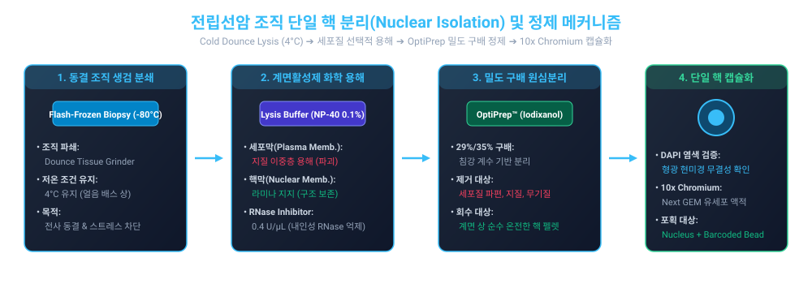

# Chapter 01. 실험 원리 및 생물학: 전립선암 조직과 snRNA-seq

> **Cognitive Goal**: 전립선암(원발암 및 mCRPC 전이암) 조직의 병리학적 특성을 이해하고, 왜 온전한 단일 세포(scRNA-seq) 대신 단일 핵(snRNA-seq)을 분리해야 하는지 생물학적/실험적 메커니즘 관점에서 명확히 인지한다.

---

## 1. 전립선암 조직 구조와 단일 세포 해리의 한계

### 1.1 정상 전립선 및 원발암(Primary Adenocarcinoma)의 조직학적 특성
전립선 상피(Prostate epithelium)는 크게 세 가지 세포층으로 구성됩니다:
- **기저세포 (Basal cells)**: 기저막(Basement membrane)에 접하며 줄기세포능을 보유 (*TP63*, *KRT5*, *KRT14* 발현).
- **분비성 관강세포 (Luminal secretory cells)**: 안드로겐 수용체(*AR*) 및 전립선 특이 항원(*KLK3/PSA*)을 고발현하며 정액 분비 담당 (*KRT8*, *KRT18*, *CD26/DPP4* 발현).
- **신경내분비 세포 (Neuroendocrine cells)**: 드물게 분포하며 분비 조절 담당 (*CHGA*, *SYP* 발현).

**원발성 전립선 선암(Adenocarcinoma)**이 발생하면 기저세포층이 소실되고 비정형 관강세포(Atypical luminal cells)가 무질서하게 증식하며, 주변 기질은 반응성 기질(Reactive stroma)로 전환되어 **암 연관 섬유아세포(CAF)**와 밀집된 콜라겐 섬유망을 형성합니다.

```
[정상 전립선 샘(Gland)]
 기저막 ── Basal Cell (TP63+) ── Luminal Cell (AR+, KLK3+) ── 샘강(Lumen)

[전립선 선암(Adenocarcinoma)]
 기저막 파괴 & Basal 소실 ── 무질서한 악성 Luminal 증식 ── 극심한 기질 섬유화(CAF, ECM)
```

### 1.2 전립선 구역 해부학 및 글리슨 점수(Gleason Score / ISUP Grade)
전립선암 연구 시 조직 검체의 채취 위치와 병리학적 등급을 정확히 인지해야 합니다:
- **말초대 (Peripheral Zone, PZ)**: 전체 전립선의 약 70%를 차지하며, **전립선 선암의 70~80%가 발생하는 주 호발 부위**입니다. 분비성 샘 조직이 밀집되어 있어 snRNA-seq 시 상피세포 포획률이 높습니다.
- **이행대 (Transition Zone, TZ)**: 요도를 둘러싼 부위로, 양성 전립선 비대증(BPH)의 주요 부위이자 약 20%의 암이 발생합니다.
- **중심대 (Central Zone, CZ)**: 사정관이 통과하는 부위로 암 발생률은 5% 미만입니다.
- **ISUP 등급 체계 (Grade Group 1~5)**:
  - Grade Group 1 (Gleason 3+3=6): 개별적인 잘 형성된 샘 구조 (인돌런트 종양).
  - Grade Group 2~3 (Gleason 3+4=7, 4+3=7): 융합된 샘 및 사상형(Cribriform) 구조 출현 (전이 위험 증가).
  - Grade Group 4~5 (Gleason 4+4=8, 4+5/5+5=9-10): 분화 소실, 시트상 증식, 면포괴사(Comedonecrosis), 높은 전이 위험.

### 1.3 전이성 거세저항성 전립선암 (mCRPC)의 분자 병태생리
원발암 환자에게 안드로겐 차단 요법(ADT, Enzalutamide/Abiraterone 등)을 시행하면 초기에는 극적인 반응을 보이지만, 병기·치료에 따라 다르지만 대략 1~2년 전후에 **mCRPC**로 진행하는 경우가 많습니다. mCRPC 종양의 계통 가소성과 약제 저항성은 Labrecque et al. (2019; bulk RNA-seq·IHC 기반 ARPC/ARLPC/AMPC/DNPC/SCNPC 분류)와 Bluemn et al. (2017; DNPC 보고) 등에 근거하여 다음 **mCRPC 4대 분자 표현형**으로 정리합니다(본 교재의 편의상 분류이며 'Four-State Lineage Model'이라는 표준 명칭은 아닙니다. Tang et al. 2022는 bulk ATAC/RNA-seq로 AR-dependent/NE/Wnt-dependent/stem-cell-like 4군을 제시한 별개 분류입니다):

1. **AR-Positive Adenocarcinoma (`AR+ / NE-`)**:
   - 고전적 안드로겐 수용체 의존성 종양.
   - *AR* 유전자 좌위 증폭(Amplification) 및 업스트림 인핸서 중복(Enhancer duplication).
   - 리간드 결합 도메인(LBD) 점돌연변이: *T878A* (프로게스테론/에스트로겐에 교차 반응), *W742C* (비칼루타마이드 역전 활성화), *F877L* (구 표기 F876L; 엔잘루타마이드 작용제로 전환).
   - *AR-V7* 스플라이스 변이체: 유전체 결실이 아니라 대체 스플라이싱으로 exon 3 뒤에 잠재 엑손(Cryptic Exon 3, CE3)이 연결되어 LBD 코딩 exon 4~8이 전사체에 포함되지 않으며, 안드로겐 리간드 없이 구성적(constitutive) 전사 활성을 유지.
2. **Amphicrine PCa (`AR+ / NE+`)**:
   - 단일 세포 내에서 안드로겐 수용체(*AR*, *KLK3*) 신호와 신경내분비 분화 마커(*SYP*, *CHGA*)를 동시에 발현하는 혼합 상태(전이 이전 단계라는 해석은 가설 수준).
   - 선암에서 신경내분비 계통으로 전이되는 과도기적(Transitional) 가소성 단계일 수 있다는 가설이 제안됨.
3. **Double-Negative PCa (DNPC, `AR- / NE-`)**:
   - mCRPC 환자의 일부를 차지하며(비율은 코호트와 DNPC 정의에 따라 달라 단일 수치로 단정할 수 없음), AR 발현과 신경내분비 마커가 모두 결손된 난치성 아형.
   - 안드로겐 신호 차단 환경에서 생존하기 위해 **FGF / MAPK 신호 전달 경로 및 *ETV4 / FGFR* 활성**을 대체 구동축으로 가동.
4. **Treatment-Emergent Neuroendocrine PCa (t-NEPC, `AR- / NE+`)**:
   - 강력한 2세대 AR 억제제(Enzalutamide) 치료 압력 하에서 발생하는 극단적인 계통 가소성(Lineage Plasticity) 암종.
   - *TP53* 및 *RB1* 복합 결손에 의해 관강세포 계통 정체성을 완전히 소실.
   - *EZH2* 히스톤 메틸전달효소의 후성유전학적 재편 및 다능성 전사인자 *SOX2* 유도.
   - 신경계 억제자인 *REST* 소실 및 *ASCL1*, *INSM1*, *NEUROD1* 발현 획득 ➔ 고도 악성 신경내분비 분화 (*SYP*, *CHGA* 발현).

또한 임상적으로 가장 치명적인 **골전이(Bone metastasis) 미세환경**에서는 원발암에서 유탈된 암세포가 골수강으로 침투하여 파골세포(*RANKL/RANK*)와 조골세포(*Wnt/BMP/ET-1*)의 항상성을 파괴하며 골형성성/골용해성 혼합 병변을 형성합니다.

---

## 2. 왜 scRNA-seq이 아닌 snRNA-seq인가? (Comparative Analysis)

임상 암 조직에서 전통적인 단일 세포 분리(Warm enzymatic dissociation)를 적용할 경우 발생하는 치명적인 세 가지 왜곡 현상이 있습니다:

| 비교 항목 | 단일 세포 RNA 시퀀싱 (scRNA-seq) | 단일 핵 RNA 시퀀싱 (snRNA-seq) |
|:---|:---|:---|
| **검체 요구조건** | 갓 채취한 신선 조직(Fresh tissue) 필수 | **급속 동결 조직(Flash-frozen, -80°C)** 및 OCT 블록, FFPE 가능 |
| **조직 해리 방식** | 37°C 효소 처리 (Collagenase, Dispase 등 30~60분) | **4°C 저온 기계적/화학적 균질화 (Dounce lysis, 5~10분)** |
| **인공적 유전자 유도 (Stress Artifacts)** | **극심함** (37°C 해리 스트레스로 *FOS*, *JUN*, *HSPA1A* 등 즉시-초기 유전자 폭발적 유도) | **크게 감소** (저온·단시간 처리로 스트레스 반응이 줄어들지만 완전히 없지는 않음) |
| **세포 포획 편향 (Capture Bias)** | 취약한 대형 암세포, 분비 상피세포, 골전이 세포가 효소 처리 중 용해·사멸되어 **손실(Drop-out)**될 수 있음 | **효소 해리 편향은 줄지만 핵 회수 편향은 존재** (조직·세포 유형에 따라 핵 회수율이 달라지고 핵 전사체는 긴 유전자·lncRNA 쪽으로 치우치므로 세포 비율 해석에 주의) |
| **골전이/생검 조직 적용성** | 탈회 및 해리 불가로 사실상 적용 불가 | **극소량 바늘 생검(Core needle biopsy) 및 골전이 검체 분석 최적화** |

> **Cognitive Insight**: 
> 암 환자의 예후를 결정하는 핵심 세포군(약제 내성 악성 관강세포, 전이암 줄기세포, 희귀 신경내분비세포)은 세포막이 약하여 효소 처리 시 먼저 파괴됩니다. 따라서 일부 조직에서는 scRNA-seq 시 취약한 세포가 선택적으로 손실되어 **전립선암 종양 이질성(tumor heterogeneity)이 왜곡**될 수 있습니다. snRNA-seq은 이러한 효소 해리 유래 세포 손실을 크게 줄입니다(다만 핵 회수 효율의 유형별 편향은 남습니다).

---

## 3. 단일 핵 분리(Nuclear Isolation) 메커니즘 및 실전 프로토콜



snRNA-seq의 성공은 **세포질(cytoplasm)을 완전히 용해하여 제거하되, 핵막(nuclear envelope)의 구조적 무결성을 유지하고 핵 내 RNA의 분해를 막는 것**에 달려 있습니다.

### 3.1 검증된 조직 라이시스 버퍼(Lysis Buffer) 표준 레시피
- **10 mM Tris-HCl (pH 7.4)**: 완충 용액 (생체 생리적 pH 유지)
- **10 mM NaCl**: 이온 강도 조절
- **3 mM MgCl₂**: 이가 양이온을 공급하여 염색질 응축 및 핵막 구조 안정화
- **0.1% IGEPAL CA-630 (또는 NP-40)**: 비이온성 계면활성제로 외부 세포막 선택적 파괴
- **0.1% Tween-20**: 온화한 세척 촉진
- **0.01% Digitonin**: 콜레스테롤 복합체 제거 및 막 투과성 유도
- **1.0% Bovine Serum Albumin (BSA, Molecular Biology Grade)**: 핵 응집 방지 및 표면 비특이 결합 차단
- **0.4 ~ 1.0 U/µL Recombinant RNase Inhibitor**: 내인성 리소좀 RNase 즉각 비활성화

### 3.2 Dounce Homogenization 절차 및 클리어런스
1. 영하 80°C 동결 전립선 생검 조직(10~30 mg)을 냉각된 Lysis Buffer 1 mL가 든 2 mL Dounce 조직 분쇄기에 투입합니다.
2. **Pestle A (Loose Pestle, Clearance 0.003~0.005 in)**: 얼음 위에서 기포가 발생하지 않도록 천천히 20~25회 스트로크하여 거친 조직 덩어리를 1차 분쇄합니다.
3. **Pestle B (Tight Pestle, Clearance 0.001~0.003 in)**: 20~25회 정밀 스트로크하여 세포막을 찢고 온전한 단일 핵을 부유액으로 방출합니다.
4. 현탁액을 40 µm 멸균 셀 스트레이너(Cell Strainer)에 통과시켜 미분쇄 결합조직 파편을 걸러냅니다.

### 3.3 OptiPrep™ (Iodixanol) 밀도 구배 정제
골전이 조직의 뼈 무기질 파편, 지방 방울, 파괴된 세포질 잔해물을 제거하기 위해 밀도 구배 원심분리를 수행합니다:
- **하층**: 35% Iodixanol 쿠션 (700 µL)
- **중간층**: 29% Iodixanol 층 (700 µL)
- **상층**: 1차 여과된 단일 핵 현탁액
- **원심분리**: 4°C, 스윙잉 버킷 로터(Swinging-bucket rotor)에서 **10,000 × g로 30분간** 가속/감속 무브레이크(Brake OFF) 조건으로 원심분리합니다.
- 순수한 단일 핵은 29%와 35% 계면(Interface)에 얇은 백색 밴드로 모이며, 피펫으로 정밀 회수합니다.

```
[세포질 용출 및 유리 핵 방출] (Cytoplasm lysis, Nuclei released)
       │
       ▼  Filter (35~40 µm strainer) & Density Gradient (Iodixanol / OptiPrep)
[원심분리 & 파편(Debris) 제거]
       │
       ▼  DAPI / DRAQ7 염색 후 FACS 정제 (또는 직접 세척)
[순수 단일 핵 현탁액] ──> 10x Chromium 유세포 채널 투입
```

### 3.4 라이시스 버퍼(Lysis Buffer)의 계면활성제(Detergent) 화학 및 골전이 탈회(Decalcification) 주의점
- **Nonidet P-40 (NP-40) / IGEPAL CA-630 (0.1%)**: 비이온성 계면활성제로, 낮은 농도·단시간·저온 조건에서 형질막(Plasma membrane)을 우선 용해하면서 핵막은 상대적으로 보존합니다(NP-40은 비선택적 계면활성제이며 핵 보존은 농도·시간·완충액 조건에 의존; 콜레스테롤 선택성은 digitonin의 특성).
- **Triton X-100 (0.1%)**: 기질이 강한 전립선암 조직에서 세포막 분리를 촉진합니다.
- **RNase Inhibitor (0.2~1.0 U/µL)**: 조직 파쇄 시 세포질 리소좀에서 방출되는 내인성 RNase를 즉각 비활성화하여 핵 내 전사체를 보호합니다.
- **골전이 검체 탈회(Decalcification) 시 주의점 (Critical Warning)**:
  - 전립선암 골전이 생검 검체의 통상적인 병리 조직 처리에 사용되는 **강산(Formic acid, HCl) 기반 급속 탈회**는 포르말린 고정과 함께 핵산을 심하게 단편화·손상시켜 RNA 무결성을 크게 떨어뜨릴 수 있습니다(예: RIN이 2 이하로 측정된 사례; FFPE RNA는 RIN보다 DV200 지표를 주로 사용).
  - 따라서 snRNA-seq 분석용 골전이 검체는 **반드시 비탈회 동결 생검 코어(Non-decalcified flash-frozen bone core)**를 확보하여 사용해야 하며, 골질 분리가 불가피한 경우에 한해 **4°C 중성 EDTA(0.5 M, pH 7.4~8.0) 완속 킬레이트 탈회 조건**만 극히 제한적으로 허용됩니다.

### 3.5 핵 무결성(Integrity) 평가 기준
현미경 하에서 트립판 블루(Trypan Blue) 또는 DAPI 형광 염색을 통해 분리된 핵을 관찰할 때:
- **합격(Good)**: 핵막이 매끄러운 타원형/원형을 유지하고, 핵 내 염색질 덩어리가 뚜렷하며, 세포질 파편(clump)이 붙어있지 않음.
- **불합격(Blebbing / Damaged)**: 핵막에 소포(bleb)가 돌출되어 있거나, 핵이 팽창하여 터진 상태 (RNA 누출로 이어져 시퀀싱 QC 실패 유발).

---

## 4. 핵 전사체(Nuclear Transcriptome)의 분자적 특성

snRNA-seq 라이브러리를 시퀀싱하면 기존 scRNA-seq과 근본적으로 다른 유전자 발현 프로파일이 관찰됩니다:

### 4.1 높은 인트론(Intron) 비율: Pre-mRNA의 포획
세포질에는 스플라이싱(splicing)이 완료된 성숙 mRNA(mature mRNA, 엑손만 존재)가 주로 위치하지만, **핵 내부에는 전사 직후의 미성숙 pre-mRNA가 다량 존재**합니다.
- 인트론 매핑 리드 비율은 조직·칩·읽기 위치에 따라 크게 달라지며 대략 수십 %에 이릅니다(이 문서에서는 단위를 '리드 기준'으로 통일; 분자 기준 비율과 구분).
- 따라서 업스트림 분석 도구(Cell Ranger 등)에서 인트론을 포함하지 않고 엑손만 카운트할 경우, **신호의 상당 부분을 버리게 되어 검출 유전자 수(Gene count)가 급감**합니다.

### 4.2 세포질 유전자 vs 핵 잔류 유전자 (Long Non-Coding RNA)
- **미토콘드리아 전사체 (*MT-CO1*, *MT-ND1* 등)**: 미토콘드리아는 세포질 소기관이므로 정상적으로 분리된 순수 핵에서는 **대개 낮게(예시: 수 % 이하, 조직·프로토콜별 분포로 임계 설정)** 관찰됩니다.
- **핵 보유 전사체 (Nuclear-retained transcripts)**: 스플라이싱 복합체 및 핵 구조를 이루는 lncRNA인 *MALAT1*, *NEAT1*이 압도적으로 높게 검출됩니다. 이는 snRNA-seq 데이터의 정상적인 품질 지표입니다.

---

## 5. 결론 및 다음 단계 연결

전립선암의 악성 관강세포, 전이암의 약제 내성 계통, 면역세포 및 기질세포를 손실 없이 포획하기 위한 최선의 선택은 동결 조직 기반 **snRNA-seq**입니다.

이렇게 생성된 서열 리드는 대량의 인트론을 포함하고 있으므로, 다음 장 [Chapter 02. 업스트림 데이터 처리](02_UPSTREAM_PROCESSING.md)에서는 원시 FASTQ 파일로부터 전립선암 인트론 전사체를 온전히 카운트 매트릭스로 전환하는 원리를 다룹니다.

---

## 6. 단원 핵심 점검 (Cognitive Checkpoint & Case Study)

### [문제 1. 핵심 개념 능동 회상 (Active Recall)]
전립선암 동결 생검 검체에서 온전한 전세포 scRNA-seq 대신 단일 핵 전사체 분석(snRNA-seq)을 필수적으로 선택해야 하는 3가지 결정적 이유를 조직학적/실험적 관점에서 기술하고, 라이브러리 정렬 시 pre-mRNA 인트론 영역을 반드시 포함해야 하는 분자생물학적 이유를 설명하시오.

<details>
<summary>💡 모범 답안 및 해설 확인</summary>

1. **전립선암에서 snRNA-seq이 필수적인 3대 이유**:
   - **조직 해리 편향(Dissociation Bias) 감소**: 전립선암은 풍부한 콜라겐과 암 연관 섬유아세포(CAF)로 인해 극심한 섬유화(Fibrosis)를 띱니다. 효소 해리(37°C Collagenase 등) 적용 시 취약한 악성 관강세포 및 희귀 신경내분비세포가 용해·사멸되어 소실될 수 있는 반면, 저온 물리적 핵 분리는 이러한 효소 유래 손실을 줄입니다(단, 핵 회수율은 세포 유형에 따라 다르므로 세포 비율은 보수적으로 해석).
   - **동결 보관 임상 검체(-80°C Flash-frozen) 활용**: 전립선암 생검 검체 및 다기관 임상 코호트(골전이, 림프절 전이)는 채취 즉시 급속 냉동되므로 세포막이 파괴되어 생세포 분리가 불가능하지만, 핵막(Nuclear envelope)은 온전하게 보존되어 분리가 가능합니다.
   - **인공적 스트레스 반응 유전자(Stress Artifacts) 배제**: 37°C 효소 처리 중 급격히 유도되는 즉시-초기 유전자(*FOS*, *JUN*, *HSPA1A* 등)의 인공적 발현을 차단하고 4°C 저온 환경에서 전사 상태를 즉시 동결합니다.
2. **인트론(Pre-mRNA) 포함이 필수적인 이유**:
   - 핵 내부에는 스플라이싱 전 단계인 미성숙 pre-mRNA가 풍부하여 전체 시퀀싱 리드의 **40% ~ 60%**가 인트론 영역에 매핑됩니다. 만약 엑손 리드만 카운트하면 시퀀싱 신호의 절반 이상을 손실하여 세포당 검출 유전자 수(Gene count)와 UMI가 급감하고 저발현 전사인자 검출력이 붕괴합니다.

</details>

---

### [문제 2. 핵심 개념 능동 회상 (Active Recall)]
전이성 거세저항성 전립선암(mCRPC)의 4대 분자 표현형(AR+, Amphicrine, DNPC, t-NEPC; Labrecque 2019·Bluemn 2017 기반 분류)을 정의하고, 각 군의 핵심 마커 및 치료 저항성 우회 기전을 비교하여 서술하시오.

<details>
<summary>💡 모범 답안 및 해설 확인</summary>

| 분자 아형 | 수용체/신경내분비 상태 | 핵심 분자 마커 | 치료 저항성 및 생존 우회 메커니즘 |
|:---|:---|:---|:---|
| **AR-Positive Adenocarcinoma** | `AR+ / NE-` | *AR*, *KLK3*, *NKX3-1*, *TMPRSS2* | *AR* 유전자 좌위 증폭, LBD 돌연변이(*T878A*, *F877L*), 리간드 비의존적 *AR-V7* 스플라이스 변이체 활성 |
| **Amphicrine PCa** | `AR+ / NE+` | *AR*, *KLK3* + *SYP*, *CHGA* | 단일 세포 내에서 AR 경로와 신경내분비 계통 프로그램이 동시 공존하는 계통 가소성 과도기 상태 |
| **Double-Negative PCa (DNPC)** | `AR- / NE-` | *ETV4*, *FGFR1*, *MAPK* pathway | mCRPC의 일부(비율은 코호트·정의에 따라 상이)를 차지하며, AR과 신경내분비 모두 결손된 상태에서 **FGF/MAPK 신호 축 및 *ETV4* 전사인자**를 대체 구동축으로 가동 |
| **t-NEPC** | `AR- / NE+` | *ASCL1*, *INSM1*, *NEUROD1*, *SYP*, *CHGA* | *TP53/RB1* 동시 결손, *SOX2/EZH2* 후성유전학적 재편, *REST* 억제자 소실을 통한 완전한 신경내분비 계통 전이 (엔잘루타마이드 완전 불응) |

</details>

---

### [문제 3. 임상 사례 분석 (Clinical Interpretation Case Study)]
**[임상 시나리오]**
골전이(Bone metastasis)가 확인된 mCRPC 환자의 장골(Iliac crest) 코어 생검 검체를 병리과 조직 처리 루틴에 따라 포르말린 고정 후 10% 포름산(Formic acid) 급속 탈회액에 48시간 처리하여 파라핀 블록을 제작했습니다. 연구팀이 이 블록에서 단일 핵을 분리하여 snRNA-seq을 시도하였으나, Agilent Bioanalyzer 측정 결과 RNA Integrity Number (RIN)가 1.6으로 측정되었고, Cell Ranger 실행 후 세포당 중간 검출 유전자 수가 120개에 불과하여 분석이 전면 실패했습니다.

**[질문]**
1. 이 실험이 실패한 근본 원인을 분자생물학적/생화학적 탈회 메커니즘 관점에서 규명하시오.
2. 향후 골전이 환자 코호트에서 성공적인 snRNA-seq 라이브러리를 확보하기 위해 병리 검체 채취실 및 습식 실험실에서 변경해야 할 표준 작업 절차(SOP)를 제시하시오.

<details>
<summary>💡 모범 답안 및 해설 확인</summary>

1. **실패의 근본 원인**:
   - **강산(Formic acid)에 의한 RNA 화학적 절단**: 포름산(또는 염산)과 같은 강산 기반 급속 탈회제는 하이드록시아파타이트 무기질을 빠르게 녹이지만, 극단적인 산성 환경(pH < 2.0)에서 핵산 손상(주로 DNA에서 알려진 N-glycosidic bond 가수분해에 의한 탈퓨린화 등)이 촉진되며, 포르말린 고정에 의한 손상과 복합되어 RNA 단편화가 심해집니다.
   - 이로 인해 전사체 길이가 50~100 nt 이하로 분해되어 올리고 dT 프라이밍이 불가능해지고, RIN 값이 매우 낮게(본 사례 1.6) 측정되어 역전사 효소가 온전한 cDNA를 합성하지 못하게 됩니다.
2. **개선된 표준 작업 절차 (SOP)**:
   - **원칙: 비탈회 급속 동결(Flash-Freezing without Decalcification)**: 골전이 코어 생검 채취 즉시 포르말린 고정이나 산 탈회를 거치지 않고, 액체 질소(LN2)에 급속 동결하여 영하 80°C에 보관합니다.
   - **물리적 분쇄 및 밀도 구배 정제**: 동결된 골 검체를 분쇄(Cryo-pulverization)한 후 Dounce homogenization을 수행하고, 뼈 무기질 파편과 지방층은 **OptiPrep™ (29%/35% Iodixanol) 밀도 구배 원심분리**를 통해 순수한 핵만 회수합니다.
   - **불가피한 탈회 시 대안**: 만약 병리학적 이유로 탈회가 불가피한 경우 강산을 전면 배제하고, **4°C 저온에서 중성 EDTA (0.5 M, pH 7.4~8.0) 완속 킬레이트 완충액**을 사용하여 RNA 분해를 최소화하면서 킬레이션 탈회를 진행해야 합니다.

</details>

---

<!-- REFERENCES:BEGIN (generated by scripts/apply_references.py; do not edit by hand) -->
## 참고문헌 (References)
### 본문 인용 문헌
1. Labrecque MP, Coleman IM, Brown LG, et al. Molecular profiling stratifies diverse phenotypes of treatment-refractory metastatic castration-resistant prostate cancer. *J Clin Invest*. 2019;129(10):4492-4505. PMID: 31361600. doi: 10.1172/JCI128212
2. Bluemn EG, Coleman IM, Lucas JM, et al. Androgen Receptor Pathway-Independent Prostate Cancer Is Sustained through FGF Signaling. *Cancer Cell*. 2017;32(4):474-489.e6. PMID: 29017058. doi: 10.1016/j.ccell.2017.09.003
3. Tang F, Xu D, Wang S, et al. Chromatin profiles classify castration-resistant prostate cancers suggesting therapeutic targets. *Science*. 2022;376(6596):eabe1505. PMID: 35617398. doi: 10.1126/science.abe1505
### 검수 근거 문헌
1. Mu P, Zhang Z, Benelli M, et al. SOX2 promotes lineage plasticity and antiandrogen resistance in TP53- and RB1-deficient prostate cancer. *Science*. 2017;355(6320):84-88. PMID: 28059768. doi: 10.1126/science.aah4307
2. Wu H, Kirita Y, Donnelly EL, et al. Advantages of Single-Nucleus over Single-Cell RNA Sequencing of Adult Kidney: Rare Cell Types and Novel Cell States Revealed in Fibrosis. *J Am Soc Nephrol*. 2019;30(1):23-32. PMID: 30510133. doi: 10.1681/ASN.2018090912
3. Denisenko E, Guo BB, Jones M, et al. Systematic assessment of tissue dissociation and storage biases in single-cell and single-nucleus RNA-seq workflows. *Genome Biol*. 2020;21(1):130. PMID: 32487174. doi: 10.1186/s13059-020-02048-6
4. Osorio D, Cai JJ. Systematic determination of the mitochondrial proportion in human and mice tissues for single-cell RNA-sequencing data quality control. *Bioinformatics*. 2021;37(7):963-967. PMID: 32840568. doi: 10.1093/bioinformatics/btaa751
5. Chen S, Zhu G, Yang Y, et al. Single-cell analysis reveals transcriptomic remodellings in distinct cell types that contribute to human prostate cancer progression. *Nat Cell Biol*. 2021;23(1):87-98. PMID: 33420488. doi: 10.1038/s41556-020-00613-6
6. Song H, Weinstein HNW, Allegakoen P, et al. Single-cell analysis of human primary prostate cancer reveals the heterogeneity of tumor-associated epithelial cell states. *Nat Commun*. 2022;13(1):141. PMID: 35013146. doi: 10.1038/s41467-021-27322-4
7. Gupta A, Shamsi F, Altemose N, et al. Characterization of transcript enrichment and detection bias in single-nucleus RNA-seq for mapping of distinct human adipocyte lineages. *Genome Res*. 2022;32(2):242-257. PMID: 35042723. doi: 10.1101/gr.275509.121
<!-- REFERENCES:END -->
