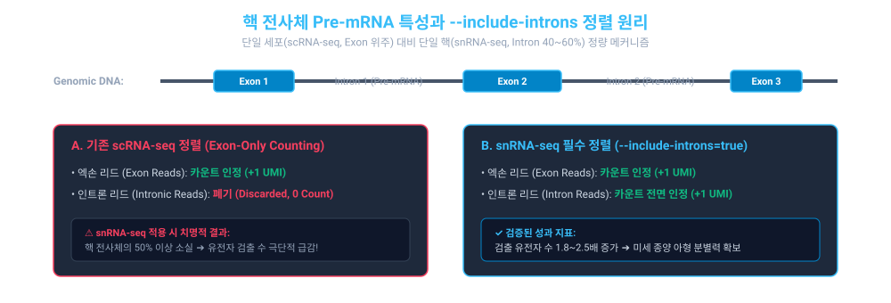

# Chapter 02. 업스트림 데이터 처리: 전립선암 FASTQ에서 카운트 매트릭스까지

> **Cognitive Goal**: 시퀀서에서 출력된 원시 서열(FASTQ)의 구조를 이해하고, 핵 전사체의 인트론을 온전히 정량화하기 위한 정렬(Alignment) 알고리즘 원리(`Cell Ranger --include-introns`, `STARsolo GeneFull`)와 `AnnData` 희소 행렬(Sparse Matrix) 구조를 깊이 인지한다.

---

## 1. 10x Genomics 단일 핵 시퀀싱 라이브러리 구조

10x Genomics Chromium 시스템(예: Chromium Next GEM Single Cell 3' 또는 Multiome)으로 시퀀싱을 진행하면 샘플당 최소 2개의 FASTQ 파일이 생성됩니다:

```
[Read 1 (28 bp)] ───► [Cell Barcode: 16 bp] + [UMI (Unique Molecular Identifier): 12 bp]
[Read 2 (91+ bp)] ──► [cDNA Fragment (전립선 전사체 서열: pre-mRNA / mRNA)]
[Sample Index (8~10 bp)] ──► [Illumina i7/i5 인덱스: 샘플 멀티플렉싱 식별용]
```

- **Cell Barcode (16 bp)**: 어느 액적(droplet) 또는 어느 핵에서 유래했는지를 구분 ($4^{16} \approx 4.29 \times 10^9$개의 고유 조합 중 10x의 검증된 화이트리스트 바코드(v2는 737,280개, v3/v3.1은 `3M-february-2018` 목록)와 매핑, 해밍 거리 1 이내 오류 자동 교정).
- **UMI (12 bp in v3/v3.1)**: $4^{12} \approx 1.67 \times 10^7$개의 분자 태그. PCR 증폭 과정에서 발생하는 복제 바이어스를 보정하여 1개의 고유 전사체로 디덥(deduplication) 정량.
- **시퀀싱 포화도 (Sequencing Saturation)**:
  $$\text{Saturation} = 1 - \frac{N_{\text{deduplicated UMI}}}{N_{\text{total valid reads}}}$$
  시퀀싱 포화도 자체에 보편적인 목표 수치는 없으며(snRNA-seq처럼 복잡도가 높고 UMI가 적은 라이브러리에서는 낮아도 정상일 수 있음), 추가 시퀀싱의 이득은 depth-saturation 곡선(깊이에 따른 검출 유전자·UMI 증가)으로 판단합니다. 포화도가 낮으면 극저발현 전사 인자(*FOXA1*, *AR*, *ASCL1*) 검출력이 저하될 수 있습니다.

---

## 2. 왜 `--include-introns`가 필수적인가? (정렬 알고리즘의 핵심 인지)



전통적인 scRNA-seq에서는 전사체 주석(Transcriptome annotation) 데이터베이스의 **엑손(Exon)**에 겹치는 리드만을 유전자 카운트로 인정했습니다.

그러나 단일 핵 내부의 전사체는 전사 직후의 **미완성 pre-mRNA가 상당 부분(조직 의존, 대략 수십 %)**을 차지합니다.

```
[Genomic DNA]      ──[ Exon 1 ]─────( Intron 1 )─────[ Exon 2 ]──
                          │              │                │
[snRNA Read A]            └── Exon 매핑   │                │   ──► 일반 scRNA: 카운트 인정 (1 Count)
[snRNA Read B]                           └── Intron 매핑   │   ──► 일반 scRNA: 폐기 (0 Count) ── [손실!]
                                                              ──► snRNA-seq: 인정 (1 Count) ── [필수!]
```

### 2.1 Cell Ranger 실행 명령
Cell Ranger 7.0 이상부터는 기본값으로 인트론이 포함되지만, 파이프라인 무결성을 보장하기 위해 항상 명시적으로 확인해야 합니다:

```bash
# 10x Cell Ranger 카운트 실행
cellranger count \
  --id=Prostate_mCRPC_Patient01 \
  --transcriptome=/ref/refdata-gex-GRCh38-2024-A \
  --fastqs=/data/fastqs/Patient01/ \
  --sample=Patient01_mCRPC \
  --include-introns=true \
  --localcores=16 \
  --localmem=64
```

### 2.2 오픈소스 대안: STARsolo 및 Alevin-fry
클러스터 환경이나 대규모 코호트 분석 시 10x 라이선스 종속성을 피하고 속도를 10배 이상 향상시키기 위해 **STARsolo**를 활용할 수 있습니다:

```bash
STAR --genomeDir /ref/STAR_GRCh38/ \
     --readFilesIn /data/fastqs/Patient01_R2.fastq.gz /data/fastqs/Patient01_R1.fastq.gz \
     --readFilesCommand zcat \
     --soloType CB_UMI_Simple \
     --soloCBwhitelist /opt/cellranger/lib/python/cellranger/barcodes/3M-february-2018.txt \
     --soloUMIlen 12 \
     --soloFeatures GeneFull \
     --soloCellFilter EmptyDrops_CR
```
> **Key Parameter**: `--soloFeatures GeneFull` 옵션이 바로 인트론과 엑손을 합산한 pre-mRNA 전체를 카운트하도록 지시하는 옵션입니다.
> **화이트리스트/UMI 길이**: 위 명령은 10x v3/v3.1(UMI 12 bp)용입니다. v3 화이트리스트는 `3M-february-2018.txt.gz`를 `gunzip`한 파일을 쓰고 `--soloUMIlen 12`를 지정해야 합니다(STARsolo 기본값 CB 16 bp/UMI 10 bp와 `737K-august-2016.txt`는 v2용). Multiome GEX는 별도 화이트리스트를 사용합니다.

---

## 3. EmptyDrops 알고리즘: 핵 바코드 판별 원리

시퀀싱 결과 생성된 수백만 개의 바코드 중, **"진짜 온전한 핵이 들어있는 액적"**과 **"유리된 배경 RNA(Ambient RNA)만 떠다니는 빈 액적"**을 어떻게 통계적으로 분리할까요? Cell Ranger는 **EmptyDrops의 변형(EmptyDrops_CR)**을, STARsolo는 옵션(`--soloCellFilter EmptyDrops_CR`)으로 같은 방식을 제공합니다(STARsolo 기본값은 CellRanger2.2 knee 방식). 아래는 원 알고리즘(Lun 2019)의 설명이며 파라미터는 구현마다 다릅니다.

```
Total UMI Count
     ▲
10^5 │  ═══════ [Knee Point: 고순도 온전한 핵]
     │         \
10^3 │          ══════ [Inflection Point: 세포 경계선]
     │                \
10^1 │                 ══════════════════ [Ambient RNA Background Profile]
     └────────────────────────────────────────► Barcode Rank (내림차순)
```

1. **상위 임계값 (Knee Point)**: UMI 수가 매우 높은 바코드는 즉시 "세포(핵)"로 분류.
2. **배경 프로파일 모델링 (Background Profile, $T_b$)**: UMI 수가 매우 적은 하위 바코드들의 발현 빈도를 합산하여(DropletUtils 기본은 UMI < 100; Cell Ranger/STARsolo `EmptyDrops_CR`은 UMI 순위 45,000~90,000 구간을 ambient로 사용하고 umiMin 500, 후보 20,000, simN 10,000을 쓰며 선행 knee 호출 뒤 추가 세포를 호출), 주변 수용액에 떠다니는 Ambient RNA의 다항분포(Multinomial distribution)를 추정.
3. **통계적 가설 검정**: 중간 영역의 바코드들에 대해 "이 바코드의 발현 패턴이 배경 RNA 다항분포와 동일한가?"를 검정하여, FDR < 0.01(Cell Ranger/STARsolo `EmptyDrops_CR` 값; DropletUtils 관례는 0.001)로 유의하게 다른 바코드만을 진정한 핵으로 선별.

### 3.1 Barcode Rank Plot (Knee Plot) 이상 패턴 진단
Cell Ranger 웹 리포트(`web_summary.html`)의 Barcode Rank Plot은 라이브러리의 전반적 건전성과 핵막 무결성을 즉각 판별할 수 있는 핵심 지표입니다:

- **정상적인 snRNA-seq 패턴 (Sharp Cliff-and-Knee Curve)**:
  - 상위 고농도 바코드 구간(Plateau)에서 세포 경계점(Inflection point)에 도달하면 **수직에 가까운 급격한 절벽(Cliff)**을 그리며 하강한 뒤, 완만한 바닥 배경 구간(Ambient RNA plateau)으로 연결됩니다.
  - 온전한 핵 내부의 고농도 전사체와 부유액 내 저농도 배경 전사체 사이의 경계가 명확함을 의미합니다.
- **핵막 파열 및 세포 용해(lysis) 이상 패턴 (Loss of Knee Point / 완만한 대각선 붕괴)**:
  - 과도한 Dounce 물리적 스트로크, Lysis buffer 계면활성제 과노출, 또는 조직의 반복 동결-해동(Freeze-thaw damage)으로 핵막이 광범위하게 파열되면, 핵 내부 pre-mRNA/mRNA가 세포 외 완충액(Soup)으로 완전히 쏟아져 나옵니다.
  - 이로 인해 **"핵 내부 전사체 농도 $\approx$ 부유액 배경 RNA 농도"** 상태가 되어 무릎 점(Knee)과 절벽이 완전히 소멸하고 **완만한 우하향 대각선(Diagonal gradual drop)** 형태로 그래프가 붕괴합니다.
  - 결과적으로 EmptyDrops가 배경 노이즈와 실제 핵을 분리하지 못해 빈 액적(Droplets)을 세포로 대량 오인식하거나 유효 핵을 대량 탈락시키는 심각한 오류가 초래됩니다.

---

## 4. 출력 카운트 매트릭스와 AnnData 아키텍처

Cell Ranger 실행이 완료되면 `outs/` 폴더에 두 가지 버전의 매트릭스가 산출됩니다:
- `raw_feature_bc_matrix/`: 필터링되지 않은 전체 바코드 매트릭스(화이트리스트 규모: v2 약 73.7만, v3/v3.1 약 680만 개) (**CellBender 배경 제거의 필수 입력값**).
- `filtered_feature_bc_matrix/`: EmptyDrops를 통과한 유효 핵 매트릭스.

### 4.1 Market Exchange Format (MEX) 3종 세트
- `matrix.mtx.gz`: 실제 카운트 값 (희소 행렬 형태: Row ID, Col ID, Count).
- `barcodes.tsv.gz`: 각 열(Column)에 대응하는 세포 바코드 목록 (예: `AAACCCAAGTCGACAT-1`).
- `features.tsv.gz`: 각 행(Row)에 대응하는 유전자 정보 (Ensembl ID, Gene Symbol, Feature Type).

### 4.2 Python `AnnData` 객체의 구조 해부
단일세포/핵 분석 표준 데이터 구조인 `AnnData`는 다음과 같이 다차원 메타데이터를 통합 관리합니다:

```
                  ┌──────────────────────────────┐
                  │          var (유전자 메타)    │
                  │   (Gene Symbol, Ensembl ID)  │
                  └──────────────────────────────┘
                                 ▲
                                 │
┌──────────────┐  ┌──────────────────────────────┐  ┌────────────────────────┐
│ obs (세포    │  │              X               │  │  obsm (다차원 임베딩)    │
│    메타데이터)│◄─┤   (Sparse Matrix: N x M)     ├──┤ (X_pca, X_umap,       │
│(n_counts,    │  │    [Cells x Genes Count]     │  │  X_scvi, X_harmony)    │
│ cell_type)   │  └──────────────────────────────┘  └────────────────────────┘
└──────────────┘                 │
                                 ▼
                  ┌──────────────────────────────┐
                  │ layers (대체 카운트 레이어)   │
                  │   (spliced, unspliced, raw)  │
                  └──────────────────────────────┘
```

```python
import scanpy as sc

# Filtered Matrix 로드
adata = sc.read_10x_mtx(
    path="outs/filtered_feature_bc_matrix/",
    var_names="gene_symbols",
    cache=True
)

# AnnData 기본 사양 확인
print(adata)
# Output 예시:
# AnnData object with n_obs × n_vars = 6842 × 36601   (예시 출력: 유전자 수는 레퍼런스 버전(2020-A/2024-A 등)에 따라 다름)
#     var: 'gene_ids', 'feature_types'
```

---

## 5. 결론 및 다음 단계 연결

전립선암 snRNA-seq의 업스트림 정렬 시 `--include-introns`를 포함하여 pre-mRNA를 포획함으로써 정상적으로 카운트 매트릭스를 확보했습니다.

그러나 조직 파쇄 과정에서 전립선 상피세포의 주 분비 단백질인 *KLK3*(PSA)나 *ACPP* 등의 RNA가 세포 밖으로 다량 용출되어 모든 액적에 섞여 들어가는 **Ambient RNA 오염**이 발생합니다. 다음 장 [Chapter 03. 암 조직 특화 QC 및 클리닝](03_QC_AND_CLEANING.md)에서는 딥러닝 기반 CellBender를 통해 이러한 오염을 수학적으로 제거하고 이중핵(Doublet)을 선별하는 원리를 배웁니다.

---

## 6. 단원 핵심 점검 (Cognitive Checkpoint & Case Study)

### [문제 1. 핵심 개념 능동 회상 (Active Recall)]
Cell Ranger 카운트 수행 시 `--include-introns=true` 옵션(또는 STARsolo `--soloFeatures GeneFull`)이 전립선암 snRNA-seq 분석에서 생물학적/통계적으로 필수적인 이유와, 이 옵션을 실수로 누락했을 때 발생하는 구체적인 데이터 왜곡 현상 2가지를 기술하시오.

<details>
<summary>💡 모범 답안 및 해설 확인</summary>

1. **옵션의 필수성**:
   - 단일 핵(Nucleus) 내부의 전사체는 스플라이싱 전 단계인 미성숙 pre-mRNA가 상당 부분(조직 의존, 대략 수십 %)을 차지합니다. `--include-introns=true`를 활성화해야 인트론 영역에 매핑되는 대량의 리드를 온전한 유전자 카운트로 포함할 수 있습니다.
2. **누락 시 발생하는 2대 왜곡 현상**:
   - **세포당 검출 유전자 수 및 UMI의 급격한 감소**: 상당 비율의 시퀀싱 리드가 버려져 세포당 중간 유전자 검출 수(Median Genes per Cell)가 크게 감소합니다(감소 폭은 조직·시퀀싱 깊이에 의존하므로 자체 샘플에서 인트론 포함 on/off를 비교해 확인).
   - **저발현 핵심 전사인자의 위음성(Drop-out) 증가**: 전립선암의 분자 아형과 계통 가소성을 규정하는 핵심 전사인자(*AR*, *FOXA1*, *ASCL1*, *SOX2*, *ETV4*) 등은 기초 발현량이 낮아, 인트론 리드를 버릴 경우 검출 신호가 약해지거나 소실되어 클러스터링 및 전사조절망(pySCENIC) 분석이 불안정해질 수 있습니다.

</details>

---

### [문제 2. 핵심 개념 능동 회상 (Active Recall)]
Cell Ranger의 Barcode Rank Plot(Knee Plot)에서 온전한 핵 검체(Sharp Cliff-and-Knee)와 세포 용해/파열된 검체(완만한 대각선 붕괴)의 형태학적 차이가 발생하는 생화학적 메커니즘을 설명하고, EmptyDrops 알고리즘이 배경 액적과 실제 핵을 통계적으로 분리하는 3단계 원리를 서술하시오.

<details>
<summary>💡 모범 답안 및 해설 확인</summary>

1. **생화학적 메커니즘과 Knee Plot 형태의 차이**:
   - **정상 검체**: 세포막만 선택적으로 용해되고 핵막이 온전한 경우, 액적 내부의 핵 RNA 농도는 매우 높고 완충액의 배경 RNA 농도는 낮습니다. 따라서 세포 바코드와 배경 액적 사이에 UMI 수의 급격한 단차가 형성되어 뚜렷한 "절벽-무릎(Cliff-and-Knee)" 패턴이 나타납니다.
   - **파열 검체**: 과도한 균질화나 동결 손상으로 핵막이 터지면 핵 전사체가 버퍼로 쏟아져 나와 "핵 내부 농도 $\approx$ 부유액 배경 농도"가 됩니다. 농도 구배가 사라지며 절벽이 붕괴하고 완만하게 감소하는 직선/대각선 붕괴 형태를 보입니다.
2. **EmptyDrops 3단계 분리 원리**:
   - **1단계 (High UMI cutoff)**: Knee point 상위의 UMI가 극히 높은 바코드는 즉각 확실한 핵/세포로 확정.
   - **2단계 (배경 다항분포 모델링)**: UMI가 극히 낮은 하위 바코드(보통 UMI < 100)의 전사체 프로파일을 통합하여, 주변 용액에 떠다니는 Ambient RNA의 다항분포(Multinomial model)를 추정.
   - **3단계 (통계적 가설 검정)**: 중간 바코드들에 대해 "이 액적의 RNA 구성이 주변 Ambient RNA 다항분포와 동일한가(귀무가설)?"를 검정하여, FDR < 0.01로 배경 프로파일과 유의하게 다른 바코드만을 진정한 핵으로 선별.

</details>

---

### [문제 3. 데이터 분석 트러블슈팅 사례 (Bioinformatics Case Study)]
**[분석 시나리오]**
전립선암 골전이 생검 검체에서 분리한 단일 핵 라이브러리를 시퀀싱한 후 Cell Ranger `web_summary.html`을 확인했더니 다음과 같은 결과가 나타났습니다:
- Estimated Number of Cells: **18,450개** (실험 투입 목표 핵 수: 6,000개 대비 3배 초과)
- Fraction Reads in Cells: **26.8%** (표준 권장치: > 70%)
- Barcode Rank Plot: 상위 1,000개 바코드 이후 Knee point 없이 바닥까지 완만한 대각선 형태로 지속 하강

**[질문]**
1. 이 라이브러리의 품질 문제를 진단하고 발생 원인을 추정하시오.
2. Cell Ranger가 제공한 `filtered_feature_bc_matrix`를 필터링 없이 그대로 Scanpy 다운스트림 파이프라인(PCA/UMAP)에 투입할 경우 어떤 치명적인 분석 오류가 발생하는지 설명하시오.
3. 이 데이터를 구제하기 위해 업스트림 및 QC 단계에서 즉각 취해야 할 수습 조치를 제시하시오.

<details>
<summary>💡 모범 답안 및 해설 확인</summary>

1. **품질 진단 및 원인**:
   - **극심한 핵막 파열 및 Ambient RNA 과다 오염**: 전체 리드 중 실제 세포(핵)에 할당된 비율이 26.8%에 불과하고, 세포 수가 기대치의 3배로 과대 추정된 것은 완충액 내 용출된 배경 RNA 농도가 너무 높아 EmptyDrops가 수만 개의 빈 액적(Ambient droplets)을 세포로 잘못 통과시켰음을 의미합니다. 조직 채취 시 반복 해동 또는 과도한 Dounce 분쇄로 핵막이 파열되었을 가능성이 높습니다.
2. **다운스트림 직접 투입 시 오류**:
   - 세포로 판정된 18,450개 중 대다수가 핵이 없는 빈 액적(Ghost droplets)이므로, UMAP 상에서 실제 생물학적 세포 집단 대신 라이브러리 크기(n_counts)에 따라 길게 늘어지는 연속적 노이즈 스미어(Smear) 클러스터가 형성됩니다.
   - *KLK3*, *ACPP*, *COL1A1* 등 배경에 고농도로 녹아든 유전자가 모든 가짜 세포에서 검출되어 위양성 마커 및 가짜 세포 상태(Artifactual hybrid cell)를 유발합니다.
3. **수습 및 데이터 구제 조치**:
   - **1단계 (Raw Matrix 기반 CellBender 필수 적용)**: Cell Ranger의 `filtered` 매트릭스를 폐기하고, 70만 개 전체 바코드가 담긴 `raw_feature_bc_matrix`를 입력으로 하여 **CellBender `remove-background`**를 실행합니다. 딥러닝 VAE를 통해 빈 액적과 오염 Soup을 정밀하게 분리해 냅니다.
   - **2단계 (엄격한 UMI 및 유전자 수 하한선 재설정)**: `n_genes_by_counts`의 바이모달 분포를 시각화하여 배경 피크에 해당하는 바코드(예시값: n_genes < 600 또는 total_counts < 1,000 — 03장의 MAD 적응형 기준과 다른 임의 예시이며 실제로는 분포를 보고 정함)를 엄격하게 하드 필터링합니다.
   - **3단계 (Scrublet 및 이중핵 제거)**: 높은 배경 농도 하에서는 이중핵 예측 알고리즘의 오류가 커지므로, CellBender로 정제된 카운트 레이어에서 Scrublet을 재실행합니다.

</details>

---

<!-- REFERENCES:BEGIN (generated by scripts/apply_references.py; do not edit by hand) -->
## 참고문헌 (References)
### 본문 인용 문헌
1. Lun ATL, Riesenfeld S, Andrews T, et al. EmptyDrops: distinguishing cells from empty droplets in droplet-based single-cell RNA sequencing data. *Genome Biol*. 2019;20(1):63. PMID: 30902100. doi: 10.1186/s13059-019-1662-y
### 소프트웨어 (표기 버전은 검수 시 API를 확인한 버전이며, 파이프라인 실행 환경은 requirements-pipelines.txt 참조)
- Scanpy 1.12.4 (github.com/scverse/scanpy). 원 논문: Wolf FA, Angerer P, Theis FJ. SCANPY: large-scale single-cell gene expression data analysis. *Genome Biol*. 2018;19(1):15. PMID: 29409532. doi: 10.1186/s13059-017-1382-0
- STAR 2.7.11 (github.com/alexdobin/STAR). 원 논문: Dobin A, Davis CA, Schlesinger F, et al. STAR: ultrafast universal RNA-seq aligner. *Bioinformatics*. 2013;29(1):15-21. PMID: 23104886. doi: 10.1093/bioinformatics/bts635
- Cell Ranger (10xgenomics.com/support/software/cell-ranger).
<!-- REFERENCES:END -->
