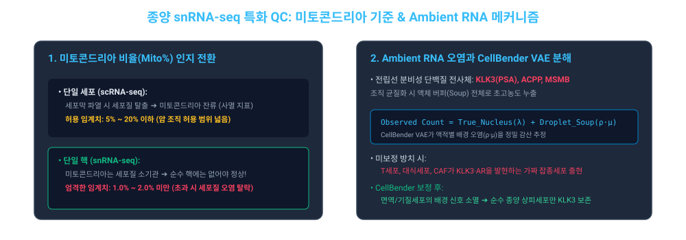

# Chapter 03. 종양 조직 특화 QC 및 데이터 클리닝 (Ambient RNA & Doublets)

> **Cognitive Goal**: snRNA-seq과 scRNA-seq의 품질 관리(QC) 기준의 결정적 차이를 인지하고, 전립선암 조직 파쇄 과정에서 발생하는 극심한 배경 RNA(Ambient RNA) 오염과 이중핵(Doublet)이 유발하는 가짜 생물학적 신호(Artifacts)를 수학적/통계적으로 제거하는 원리를 체득한다.

---

## 1. snRNA-seq 특화 QC 지표와 인지적 전환



일반적인 scRNA-seq의 QC 룰(예: Mito% < 10~20%, 최소 유전자 수 > 1,000)을 전립선암 snRNA-seq에 그대로 적용하면 **유효한 면역세포를 몰살시키거나 세포질이 덜 떨어진 오염된 핵을 정상으로 오인**하는 치명적 실수를 범하게 됩니다.

```
                      [scRNA-seq (온전한 단일 세포)]               [snRNA-seq (분리된 단일 핵)]
  미토콘드리아 %      사멸 세포(Apoptosis) 시 급증 (예: 5~20%)    세포질 소기관이므로 대개 낮음 (예: 수 % 이하)
  정상 범위           조직·프로토콜별 분포로 설정 (예시: 0~10%)   조직·프로토콜별 분포로 설정 (예시: 0~2%)  # 모두 예시값
  
  총 UMI 수           세포 전체 mRNA 포획 (예: 3,000 ~ 20,000)    핵 내 pre-mRNA 위주 (예: 800 ~ 4,000)  # 예시값
  소형 세포 판정      고정 UMI 기준은 저전사 세포에 불리         고정 기준 적용 시 저전사 림프구가 선택적으로 탈락할 수 있음
```

### 1.1 미토콘드리아 비율 (`pct_counts_mt`)의 생물학적 재해석
- **scRNA-seq**: 세포막이 찢어지면 세포질 단백질과 일반 mRNA는 유출되지만, 미토콘드리아는 크기가 커 세포 내에 남아 상대적 미토콘드리아 RNA 비율이 치솟습니다 (사멸 세포의 지표).
- **snRNA-seq**: 미토콘드리아는 **핵막 바깥의 세포질(cytoplasm)**에 존재합니다. 순수하게 정제된 핵에서는 미토콘드리아 전사체(*MT-CO1*, *MT-ND2* 등)가 소량만 검출되는 것이 일반적입니다(0은 아님).
- **Cognitive Rule**: snRNA-seq에서 `pct_counts_mt`가 샘플 분포상 높은 쪽(예시: 2~3% 이상, 조직·프로토콜 의존)에 속하는 바코드는 사멸 세포가 아니라, **Dounce homogenization 과정에서 세포질이 깨끗하게 벗겨지지 않고 핵막에 덕지덕지 붙어 있는 불완전 분리 핵(Cytoplasmic remnant)**이므로 엄격히 필터링해야 합니다.

### 1.2 UMI 및 유전자 수의 세포 유형별 편차
- (아래 UMI 수치는 시퀀싱 깊이·칩 버전·조직에 따라 크게 달라지는 예시값입니다.) 암세포(Malignant Luminal)는 대개 이수체(Aneuploidy)이며 전사 활성이 매우 높아 핵 내 UMI 수가 예를 들어 3,000~8,000에 달할 수 있습니다.
- 반면, 전립선 TME에 침투한 **종양 침윤 림프구(TILs: CD4/CD8 T세포, NK세포)**는 세포질뿐 아니라 핵 자체의 크기도 작고 전사 활성이 낮아 정상적인 핵의 UMI 수가 상대적으로 낮습니다(예시: 600~1,500).
- 따라서 일률적인 고정 컷오프(Hard cutoff) 대신, 밀도 분포(Bimodal density curve)를 확인하고 최소 UMI를 자체 분포(예시: 500~800 선)에 맞춰 낮게 설정해야 종양 면역 미세환경을 보존할 수 있습니다.

### 1.3 고정 임계치(Hard Cutoff)의 한계와 적응형 MAD (Median Absolute Deviation) 필터링
`pct_counts_mt < 2%`는 잘 보존된 신선 동결 전립선 조직에 대한 훌륭한 벤치마크 기준이지만, 대사적 변이가 심한 mCRPC 전이암이나 복잡한 골전이 검체에서는 샘플 간 차이가 존재할 수 있습니다.

일률적인 고정 수치(Hard threshold)만을 고집할 경우:
1. 라이브러리 제작 배치가 약간 다른 샘플에서 정상 핵을 과도하게 대량 탈락시키거나,
2. 전사량이 본래 적은 림프구(TILs)나 희귀 아형을 선별적으로 제거하는 **선택적 탈락 편향(Selective Drop-out Bias)**이 발생합니다.

따라서 데이터 자체의 분포를 반영하는 **적응형 이상치 탐지 (Adaptive Outlier Detection)** 기법인 **MAD (Median Absolute Deviation)** 필터링을 표준적으로 병행합니다:

$$\text{Upper Threshold} = \text{Median}(X) + k \cdot \text{MAD}(X)$$
$$\text{Lower Threshold} = \text{Median}(X) - k \cdot \text{MAD}(X)$$
$$\text{MAD}(X) = \text{Median}(|X - \text{Median}(X)|)$$

- 통상적으로 $k = 3 \sim 5$를 적용합니다. 정규분포에서 원시 MAD는 $\sigma$의 약 $0.6745$배이므로, 약 $3\sigma$ 밖을 절단하려면 scaled MAD($1.4826 \times \text{MAD}$)를 사용해야 합니다(원시 MAD 기준 $k=3$은 약 $2\sigma$, $k=5$는 약 $3.4\sigma$). `pct_counts_mt`는 상한만 의미가 있으며, 값이 0 근처에 몰려 MAD가 0에 가까워지는 경우를 대비해 하한(floor)/상한(cap)을 병행합니다 ($X$는 $\log_{10}(\text{total\_counts})$, $\log_{10}(\text{n\_genes\_by\_counts})$, $\text{pct\_counts\_mt}$).
- **QC 민감도 검증 (Sensitivity Check)**:
  - 필터링을 적용하기 전, 탈락 대상 세포들이 특정 생물학적 마커(*SYP*, *CHGA* 발현 희귀 t-NEPC 세포 또는 *CD8A*, *CD3D* 발현 세포독성 T세포)에 편중되어 있지 않은지 산점도(Scatter plot) 상에서 교차 검증해야 합니다.
  - 이를 통해 희귀하지만 임상적으로 치명적인 종양 하위 집단이 전처리 과정에서 부당하게 유실되는 참사를 방지합니다.

---

## 2. Ambient RNA 오염: 전립선암 분석의 최대 복병

### 2.1 생물학적 메커니즘과 가짜 신호(Artifact)의 탄생
전립선 상피세포와 선암세포는 *KLK3*(PSA), *ACPP*, *MSMB* 같은 분비 단백질 RNA를 정상 세포보다 훨씬 높은 수준으로 발현합니다(*FOLH1*/PSMA는 분비 단백질이 아니라 막 결합 당단백질이며, 구체적 배수는 검체마다 달라 수치는 제시하지 않음). 
조직 균질화(Homogenization) 과정에서 수백만 개의 세포가 파괴되면, 이 분비성 RNA들이 액체 버퍼(Soup) 전체에 고농도로 용출됩니다.

```
[Ambient RNA 오염 전]
  T 세포 액적:      [T 세포 핵] ──► TCR, CD3D, CD3E 발현 (KLK3 발현 없음: 정상)
  CAF 액적:         [섬유아세포 핵] ──► ACTA2, COL1A1 발현 (KLK3 발현 없음: 정상)

[버퍼 내 암세포 파편 RNA (Soup) 유입 후]
  T 세포 액적:      [T 세포 핵] + [Soup: KLK3, ACPP, AR] ──► T세포가 PSA와 AR을 발현하는 것처럼 왜곡!
  CAF 액적:         [섬유아세포 핵] + [Soup: KLK3, ACPP, AR] ──► 섬유아세포가 암세포로 변환된 것처럼 왜곡!
```
> **Catastrophic Impact**: Ambient RNA를 제거하지 않으면, 면역세포나 혈관내피세포가 안드로겐 수용체(*AR*)나 종양 마커를 발현하는 **가짜 중간 세포(Transitional state / Hybrid cell)**로 클러스터링되어, 약제 타깃 분석이나 세포 간 상호작용(Cell-Cell Communication) 네트워크를 완전히 왜곡합니다.

### 2.2 해결책: CellBender 딥러닝 생성 모델 (Deep Generative Model)
CellBender의 `remove-background`는 비지도 딥러닝(Variational Autoencoder) 프레임워크를 기반으로 각 액적의 발현 프로파일을 다음과 같은 통계 모델로 분해합니다:

$$\text{Observed Count}_{c, g} \sim \text{NegativeBinomial}(\lambda_{c, g}^{\text{true}} + \rho_c \cdot \mu_g^{\text{ambient}}, \phi)$$

- $\lambda_{c, g}^{\text{true}}$: 핵 자체에서 방출된 순수 전사체 발현량
- $\rho_c \cdot \mu_g^{\text{ambient}}$: 액적의 크기와 주변 용액(Soup)의 유전자별 배경 농도에 의해 섞여 들어간 오염량

```bash
# CellBender CLI 실행 (GPU 권장)
cellbender remove-background \
  --input outs/raw_feature_bc_matrix.h5 \
  --output cellbender_cleaned.h5 \
  --expected-cells 6000 \
  --total-droplets-included 25000 \
  --fpr 0.01 \
  --epochs 150 \
  --cuda   # GPU 사용 시 필요 (GPU가 없으면 이 줄을 제외; 미지정 시 CPU로 실행됨)
```
(`--expected-cells`는 예상 세포 수, `--total-droplets-included`는 바코드 순위 플롯에서 ambient 안정 구간 이후까지 포함하도록 정하며, `--fpr 0.01`과 `--epochs 150`은 CellBender 기본값입니다.)

> **컴퓨팅 인프라 팁 (CellBender vs SoupX)**:
> - **CellBender**: 심층 생성 모델이므로 **NVIDIA GPU 가속이 강력히 권장**됩니다 (샘플당 약 20~40분 소요; CPU 실행 시 수 시간 소요).
> - **SoupX**: GPU 환경이 없는 경우 R 환경의 `SoupX`를 대안으로 활용할 수 있습니다. 사전 클러스터링 기반으로 배경 오염률($\rho$)을 빠르게 추정하여 수 분 내에 CPU로 처리가 가능합니다.

---

## 3. 이중핵 (Doublet) 검출 및 필터링

### 3.1 동종 이중핵(Homotypic) vs 이종 이중핵(Heterotypic)
미세유체 액적 내에 2개 이상의 핵이 우연히 동시에 캡슐화되는 현상입니다.
- **동종 이중핵 (Homotypic)**: 암세포 + 암세포. 발현 프로파일이 유사하여 단순히 UMI가 높은 세포로 보임.
- **이종 이중핵 (Heterotypic)**: **악성 관강세포 + CAF** 또는 **암세포 + 대식세포(Macrophage)**.
  - 이종 이중핵은 두 세포의 마커가 1:1로 섞여 나와, 연구자에게 "상피-간엽 이행(EMT) 중간 상태" 또는 "새로운 약제 내성 줄기세포 하위집단"이라는 **거짓 발견(False discovery)**을 유발합니다.

### 3.2 Scrublet 알고리즘의 원리와 적용
Scrublet은 실제 데이터셋의 바코드들을 무작위로 2개씩 짝지어 **가상의 인공 이중핵(Synthetic doublets)**을 시뮬레이션합니다:

```python
import scrublet as scr
import numpy as np
import scanpy as sc

# Scrublet은 캡처(샘플)별로 따로, 원시(정규화 전) UMI 카운트에 실행해야 합니다.
# (병합 데이터에서는 세포 유형 비율이 샘플 대표성을 잃어 성능이 떨어집니다. 이 시점의 adata.X는 원시 카운트로 가정)
adata.obs['doublet_score'] = np.nan
adata.obs['is_doublet'] = False
for sample in adata.obs['sample_id'].unique():   # sample_id: 캡처/라이브러리 ID 열
    mask = (adata.obs['sample_id'] == sample).values
    counts_matrix = adata.X[mask]

    # 1. Scrublet 객체 초기화 (expected_doublet_rate는 로딩 세포 수에 맞춰 설정; 0.06은 예시값)
    scrub = scr.Scrublet(counts_matrix, expected_doublet_rate=0.06)

    # 2. 이중핵 점수(Doublet score) 계산 및 자동 임계값 결정
    doublet_scores, predicted_doublets = scrub.scrub_doublets(
        min_counts=2, 
        min_cells=3, 
        min_gene_variability_pctl=85, 
        n_prin_comps=30
    )

    # 3. AnnData 메타데이터에 기록
    adata.obs.loc[mask, 'doublet_score'] = doublet_scores
    adata.obs.loc[mask, 'is_doublet'] = predicted_doublets

# 4. 필터링 (싱글렛만 보존)
adata = adata[~adata.obs['is_doublet']].copy()
print(f"Remaining high-quality singlets: {adata.n_obs}")
```

---

## 4. 전립선암 정제 전후 비교 체크리스트

```
[Raw Count Matrix]
   │
   ├─► 1. CellBender 적용: KLK3, ACPP 등 Ambient RNA 배경 제거 완료
   │
   ├─► 2. QC Filtering:
   │      - MAD 기반 적응형 임계 + 안전 하한/상한 (샘플·세포군별로 분포를 보고 결정)
   │        (예시값: pct_counts_mt < 2.5%, n_genes_by_counts > 500, total_counts > 800 — 임의 예시이며
   │         고정 상한은 대형 악성 핵을 자를 수 있어 상한은 분포·이중핵 판정으로 정함)
   │
   └─► 3. Scrublet 필터링: 이종 이중핵 배제
   │
[Cleaned Singlet AnnData] ──► 다운스트림 분석으로 전달 준비 완료
```

---

## 5. 결론 및 다음 단계 연결

CellBender와 Scrublet을 통과하여 비로소 세포질 오염, 배경 분비성 RNA 오염, 이중핵 인공물이 제거된 진정한 전립선암 단일 핵 데이터셋이 준비되었습니다.

다음 장 [Chapter 04. 핵심 다운스트림 분석 파이프라인](04_CORE_DOWNSTREAM_PIPELINE.md)에서는 이 청정 데이터를 바탕으로 분산 안정화 정규화, PCA/UMAP 차원축소의 수학적 원리, Leiden 그래프 클러스터링을 심층 분석합니다.

---

## 6. 단원 핵심 점검 (Cognitive Checkpoint & Case Study)

### [문제 1. 핵심 개념 능동 회상 (Active Recall)]
전립선암 scRNA-seq과 snRNA-seq에서 미토콘드리아 전사체 비율(`pct_counts_mt`)이 지니는 생물학적/기술적 의미의 근본적 차이를 설명하고, snRNA-seq 데이터에서 `pct_counts_mt`가 높은 바코드(예시 임계: 2~3%)를 엄격하게 필터링해야 하는 이유를 세포 소기관 구조 관점에서 설명하시오.

<details>
<summary>💡 모범 답안 및 해설 확인</summary>

1. **scRNA-seq과 snRNA-seq의 미토콘드리아 비율 차이**:
   - **scRNA-seq (단일 세포)**: 세포막이 손상되면 세포질의 가용성 mRNA가 세포 밖으로 누출되지만, 미토콘드리아는 소기관 크기가 커 손상된 세포막 안에 갇혀 상대적 비율이 10~30%까지 치솟습니다. 즉, **사멸 세포(Apoptotic/dying cells)**를 식별하는 지표입니다.
   - **snRNA-seq (단일 핵)**: 미토콘드리아는 핵 외부의 **세포질(Cytoplasm)**에 존재하는 소기관입니다. 정상적인 분리 과정을 거친 순수 핵 현탁액에서는 세포질이 대부분 박리되므로 미토콘드리아 전사체는 소량만 검출되는 것이 일반적입니다 (예시: 수 % 이하).
2. **분포상 높은 pct_counts_mt(예시: 2~3% 초과) 바코드를 필터링해야 하는 이유**:
   - snRNA-seq에서 미토콘드리아 비율이 높다는 것은 사멸 세포가 아니라, Dounce homogenization 및 세척 과정에서 **세포질이 깨끗하게 떨어져 나가지 않고 핵막 외벽에 파편(Cytoplasmic debris/remnant) 형태로 덕지덕지 부착된 불완전 분리 핵**임을 나타냅니다.
   - 이 세포질 찌꺼기가 잔류하면 세포질 mRNA가 핵 전사체에 무작위로 섞여 들어가 순수 핵 전사체 프로파일을 오염시키고 다운스트림 클러스터링을 왜곡하므로 엄격히 제거해야 합니다.

</details>

---

### [문제 2. 핵심 개념 능동 회상 (Active Recall)]
전립선암 조직에서 발생하는 극심한 Ambient RNA 오염의 분자생물학적 원인과, 이를 제거(CellBender 등)하지 않고 그대로 방치했을 때 면역세포/기질세포 클러스터링 및 세포 간 상호작용(Cell-Cell Communication) 네트워크 분석에서 초래되는 가짜 발견(Artifacts) 2가지를 설명하시오.

<details>
<summary>💡 모범 답안 및 해설 확인</summary>

1. **극심한 Ambient RNA 오염의 분자생물학적 원인**:
   - 전립선 관강 상피세포 및 선암세포는 *KLK3*(PSA), *ACPP*, *MSMB* 등 분비성 단백질 유전자를 매우 높은 수준으로 발현합니다(구체적 카피 수는 근거 없어 제시하지 않음).
   - 단일 핵 분리를 위한 조직 기계적/화학적 균질화 과정에서 수백만 개의 세포질이 한꺼번에 터지면서, 이 초고발현 RNA들이 완충액 용액(Soup) 전체로 대량 용출되어 모든 미세유체 액적 내부로 균일하게 유입됩니다.
2. **방치 시 발생하는 2대 가짜 발견(Artifacts)**:
   - **가짜 전이/혼합 세포 상태(Artifactual Transition/Hybrid Cells) 발생**: 순수한 종양 침윤 T세포나 암 연관 섬유아세포(CAF)의 액적에 주변 Soup의 *KLK3*, *ACPP*, *AR* 전사체가 섞여 들어가면서, 연구자로 하여금 "상피-면역 융합 세포"나 "안드로겐 수용체를 발현하는 기질 줄기세포"라는 치명적인 허위 클러스터를 발견했다고 오판하게 만듭니다.
   - **세포 간 상호작용(Cell-Cell Communication) 네트워크의 전면 왜곡**: CellChat, SingleCellSignalR 등의 리간드-수용체 분석 시, Soup에 섞인 종양 분비 리간드가 모든 면역/내피세포에서 발현되는 것으로 계산되어 가짜 자가분비(Autocrine) 및 비특이적 범세포 상호작용 신호가 폭발적으로 생성됩니다.

</details>

---

### [문제 3. 데이터 품질 관리 트러블슈팅 사례 (Case Study)]
**[임상/생물정보학 시나리오]**
연구원이 mCRPC 환자 10명의 골전이 및 원발암 snRNA-seq 데이터를 처리하면서, 파이프라인의 일관성을 위해 단일한 고정 임계치(`pct_counts_mt < 1.0%`, `total_counts > 1,500`)를 전체 샘플에 일괄 적용했습니다. 필터링 후 결과를 시각화했더니 다음과 같은 심각한 문제가 관찰되었습니다:
1. 원발암 검체는 85%의 핵이 보존되었으나, 골전이 검체 3개에서는 전체 바코드의 **72%가 대량 탈락**함.
2. 보존된 세포들로 UMAP을 그린 결과, 골전이 미세환경의 핵심인 **종양 침윤 T세포(`CD8A+`, `CD3D+`)**와 **신경내분비 암세포(`SYP+`, `CHGA+`)** 군집이 완전히 소멸하고 거대한 악성 관강세포만 남음.

**[질문]**
1. 이 현상이 발생한 통계적 및 생물학적 메커니즘을 분석하시오.
2. 특정 희귀 계통이나 면역세포를 보존하면서도 노이즈를 제거하기 위해 도입해야 할 **적응형 MAD(Median Absolute Deviation) 필터링 프로토콜**과 **QC 민감도 검증(Sensitivity Check)** 방안을 제시하시오.

<details>
<summary>💡 모범 답안 및 해설 확인</summary>

1. **실패 원인 분석**:
   - **세포 유형별 고유 전사 활성 차이 무시**: 악성 관강세포는 대개 이수체(Aneuploidy)이며 핵 크기가 크고 전사량이 왕성한 경우가 많아 total_counts가 예를 들어 3,000~8,000에 달할 수 있습니다(예시 수치이며, 이수체성과 전사 활성의 인과는 단정할 수 없고 핵 크기·ploidy·세포 상태가 복합 작용). 반면 면역 침윤 T세포(`CD8A+`)나 휴면 상태의 신경내분비세포는 세포 크기와 핵 용적이 작아 정상적인 핵의 total_counts가 600~1,400 수준에 불과합니다. 따라서 고정 임계값 `total_counts > 1,500`은 소형 림프구와 저전사 종양 아형을 물리적으로 100% 절멸시키는 편향을 낳았습니다.
   - **골전이 검체의 배경 편차**: 골전이 조직은 무기질 기질 파편으로 인해 기초 라이브러리 포획 효율에 샘플별 차이가 큼에도 불구하고 일률적 고정 컷오프를 적용하여 정상 세포를 대량 폐기했습니다.
2. **해결을 위한 개선 프로토콜**:
   - **적응형 MAD 기반 이상치 탐지 적용**:
     $$\text{Lower Cutoff} = \text{Median}(\log_{10}(\text{counts})) - 3 \times \text{MAD}(\log_{10}(\text{counts}))$$
     각 샘플 내부의 고유한 분포 중앙값과 MAD 편차를 기준으로 하한선을 설정하여 라이브러리 배치 간 효율 차이를 자동 흡수합니다.
   - **이중 임계치 및 밀도 곡선 기반 하한선(Bimodal Threshold)**: `log1p(total_counts)`의 바이모달 밀도 분포에서 배경 노이즈 피크(Ambient peak)와 진정한 세포 피크(Cellular peak) 사이의 골짜기(Valley)를 탐색하여 최소 UMI 하한선을 500~700 선으로 유연하게 낮춥니다.
   - **QC 민감도 검증 (Sensitivity Check)**:
     필터링 전후의 세포들에 대해 `CD8A`, `CD3D`, `NCAM1`, `SYP`, `CHGA` 등 핵심 기능 마커의 발현 밀도를 플롯하고, 특정 마커 양성 세포가 전체 탈락 세포의 상위 백분위에 치우쳐 제거되지 않았는지 확인 후 필터링 임계값을 최종 확정합니다.

</details>

---

<!-- REFERENCES:BEGIN (generated by scripts/apply_references.py; do not edit by hand) -->
## 참고문헌 (References)
### 검수 근거 문헌
1. Osorio D, Cai JJ. Systematic determination of the mitochondrial proportion in human and mice tissues for single-cell RNA-sequencing data quality control. *Bioinformatics*. 2021;37(7):963-967. PMID: 32840568. doi: 10.1093/bioinformatics/btaa751
2. Heumos L, Schaar AC, Lance C, et al. Best practices for single-cell analysis across modalities. *Nat Rev Genet*. 2023;24(8):550-572. PMID: 37002403. doi: 10.1038/s41576-023-00586-w
3. Fleming SJ, Chaffin MD, Arduini A, et al. Unsupervised removal of systematic background noise from droplet-based single-cell experiments using CellBender. *Nat Methods*. 2023;20(9):1323-1335. PMID: 37550580. doi: 10.1038/s41592-023-01943-7
### 소프트웨어 (표기 버전은 검수 시 API를 확인한 버전이며, 파이프라인 실행 환경은 requirements-pipelines.txt 참조)
- CellBender (github.com/broadinstitute/CellBender). 원 논문: Fleming SJ, Chaffin MD, Arduini A, et al. Unsupervised removal of systematic background noise from droplet-based single-cell experiments using CellBender. *Nat Methods*. 2023;20(9):1323-1335. PMID: 37550580. doi: 10.1038/s41592-023-01943-7
- NumPy 2.5.4 (numpy.org). 원 논문: Harris CR, Millman KJ, van der Walt SJ, et al. Array programming with NumPy. *Nature*. 2020;585(7825):357-362. PMID: 32939066. doi: 10.1038/s41586-020-2649-2
- Scanpy 1.12.4 (github.com/scverse/scanpy). 원 논문: Wolf FA, Angerer P, Theis FJ. SCANPY: large-scale single-cell gene expression data analysis. *Genome Biol*. 2018;19(1):15. PMID: 29409532. doi: 10.1186/s13059-017-1382-0
- Scrublet 0.2.3 (github.com/swolock/scrublet). 원 논문: Wolock SL, Lopez R, Klein AM. Scrublet: Computational Identification of Cell Doublets in Single-Cell Transcriptomic Data. *Cell Syst*. 2019;8(4):281-291.e9. PMID: 30954476. doi: 10.1016/j.cels.2018.11.005
<!-- REFERENCES:END -->
