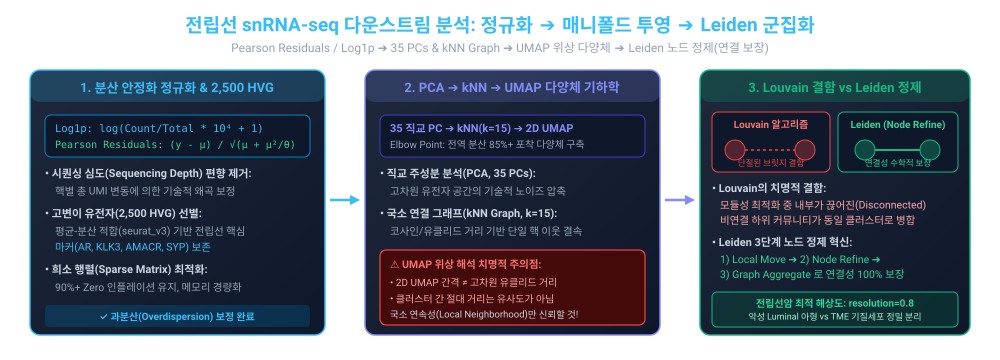

# Chapter 04. 핵심 다운스트림 분석 파이프라인: 수학적 원리와 알고리즘 인지

> **Cognitive Goal**: 정규화(Normalization), 고변이 유전자(HVG) 선별, PCA/UMAP 차원축소, Leiden 그래프 클러스터링 및 차등발현검정(DEG)의 수학적·기하학적 원리를 깊이 이해하고, 각 단계의 하이퍼파라미터가 생물학적 해석에 미치는 영향을 비판적으로 인지한다.

---

## 1. 정규화 및 분산 안정화 (Normalization & Variance Stabilization)

시퀀싱 과정에서 각 핵(nucleus)이 포획되는 액적마다 시퀀싱 깊이(Sequencing depth, 라이브러리 크기)가 제각각 다릅니다. 이 기술적 변이(Technical noise)를 보정하지 않으면 발현량 차이가 생물학적 차이가 아닌 단순 시퀀싱 깊이 차이로 왜곡됩니다.

### 1.1 Shifted Log-Normalization의 원리와 한계
가장 보편적인 방법은 각 핵의 총 카운트를 특정 스케일 팩터($10,000$; Seurat의 기본값이며 Scanpy `normalize_total`의 기본은 `target_sum=None`, 즉 중앙값 스케일. 아래 코드는 1e4를 명시)로 맞추고 자연로그를 취하는 것입니다:

$$\tilde{X}_{c, g} = \ln \left( \frac{X_{c, g}}{\sum_{g'} X_{c, g'}} \times 10^4 + 1 \right)$$

- **`+ 1` (`log1p`)의 의미**: 카운트가 $0$인 경우 $\ln(0)$(음의 무한대) 발산을 막고, $0$은 그대로 $0$으로 보존하기 위한 가산 상수(pseudocount).
- **한계점**: 단일세포/핵 카운트 데이터는 분산이 평균에 따라 달라지는 **평균-분산 종속성(Mean-variance dependency)**을 갖습니다(Poisson은 $\text{Var}=\mu$, 음이항은 $\text{Var}=\mu+\mu^2/\theta$이며, 평균이 낮을수록 커지는 것은 상대 산포 $\text{CV}^2$입니다). 단순 로그 변환 후에도 이 이분산성(heteroscedasticity)이 남아 HVG 선별과 차원 축소에 영향을 줄 수 있습니다.

### 1.2 대안: 정규화 음이항 회귀 (SCTransform / Pearson Residuals)
각 유전자 $g$에 대해 시퀀싱 깊이 $m_c$를 공변량(covariate)으로 두는 정규화 음이항 회귀를 수행하여 피어슨 잔차(Pearson residuals)를 계산합니다:

$$r_{c, g} = \frac{X_{c, g} - \mu_{c, g}}{\sqrt{\mu_{c, g} + \mu_{c, g}^2 / \theta_g}}$$

- **Cognitive Insight**: 시퀀싱 깊이에 따른 기술적 변이를 크게 줄이고 생물학적 변이를 잔차에 더 잘 남깁니다(다만 잔차 클램핑, $\theta_g$ 고정 등 모델 가정에 의존하며 완전 제거는 아닙니다). 전립선암의 미세한 아형(subtype) 분리에 도움이 될 수 있습니다.
- **Python 구현 (Scanpy Native)**: R의 Seurat SCTransform에 대응하여 Scanpy에서도 `sc.experimental.pp.normalize_pearson_residuals(adata)` 함수를 통해 순수 Python 환경에서 피어슨 잔차 정규화를 직접 실행할 수 있습니다.

---

## 2. 고변이 유전자 (HVG: Highly Variable Genes) 선별

인간 유전체 3만여 개 유전자 중 대부분은 모든 세포에서 고르게 발현되는 하우스키핑 유전자(Housekeeping genes)이거나 노이즈 수준의 저발현 유전자입니다.
- **선별 목적**: 세포 간 이질성을 설명하는 핵심 유전자 **2,000 ~ 3,000개**만을 선별하여 차원의 저주(Curse of Dimensionality)를 피하고 연산 효율을 극대화합니다.
- **선별 메커니즘**: 두 계열이 있습니다. (a) `flavor='seurat'`/`'cell_ranger'`: 유전자들을 평균 발현량 구간별로 비닝(binning)한 뒤 각 빈 내에서 분산($\sigma^2 / \mu$)을 정규화(로그 정규화 데이터 입력). (b) `flavor='seurat_v3'`(아래 코드): 원시 카운트에서 분산 안정화 변환(VST, 평균-분산 추세 적합 후 표준화 분산)으로 선별. 아래 코드는 (b)입니다.

```python
import scanpy as sc

# 1. 정규화 및 로그 변환 (seurat_v3 HVG가 원시 카운트를 요구하므로 변환 전에 레이어로 보존)
adata.layers["raw_counts"] = adata.X.copy()
sc.pp.normalize_total(adata, target_sum=1e4)
sc.pp.log1p(adata)

# 2. HVG 선별 (상위 2,500개) — seurat_v3 플레이버는 log 변환된 X가 아닌 원시 카운트 입력 필요
sc.pp.highly_variable_genes(
    adata, 
    layer="raw_counts",
    n_top_genes=2500, 
    subset=False, 
    flavor="seurat_v3"
)
```

---

## 3. 차원 축소의 기하학: 선형 PCA에서 비선형 UMAP까지



```
[초고차원 공간: 2,500개 HVG] 
         │
         ▼  주성분 분석 (PCA, Linear): 전역적 공분산 축 보존 & 노이즈 압축
[저차원 선형 공간: Top 30~50 PCs]
         │
         ▼  k-최근접 이웃 그래프 (kNN Graph Construction)
[세포 간 연결 토폴로지 (Manifold Topology)]
         │
         ▼  비선형 매니폴드 투영 (UMAP, Non-linear): 국소 구조 보존 시각화
[2차원 시각화 평면: UMAP1 vs UMAP2]
```

### 3.1 PCA (Principal Component Analysis): 직교 좌표계로의 압축
- 2,500차원의 데이터 공분산 행렬에서 고유값(Eigenvalue)이 가장 큰 고유벡터(Eigenvector) 축을 순서대로 찾습니다.
- **Elbow Plot의 인지**: PC의 설명 분산(Variance explained)이 완만해지는 변곡점을 데이터에서 찾고, jackstraw·견고성 점검 등으로 확인하여 PC 수를 정합니다(고정된 규칙은 없음).
  - 전립선암 복합 조직(암세포, TME, 면역세포, 골전이 기질)은 다양한 세포 계통이 공존하므로 PC 수가 너무 작으면 정보 손실이 있을 수 있습니다. 아래 30~40 PCs는 이 튜토리얼의 *예시값*입니다(Luecken & Theis 2019는 데이터 의존적 선택을 권고).

### 3.2 UMAP (Uniform Manifold Approximation and Projection)의 원리와 오해
리만 기하학(Riemannian geometry)과 퍼지 단순 집합(Fuzzy simplicial sets) 이론을 기반으로, 고차원 kNN 그래프의 국소적 연결 구조를 2차원 평면에 최적화하여 투영합니다.

#### 핵심 하이퍼파라미터 인지
- **`n_neighbors` (기본값 15~30)**:
  - 값이 작을수록(5~10): 극소수 세포 간의 미세 구조에 집중 (국소적 파편화).
  - 값이 클수록(30~50): 세포 계통의 거시적 연속성 및 전역 구조 보존.
- **`min_dist` (기본값 0.1~0.5)**:
  - 2차원 평면에서 세포들이 얼마나 빽빽하게 뭉칠지 결정. 값이 작으면 클러스터가 좁은 점으로 뭉치고, 값이 크면 넓게 퍼짐.

> **CRITICAL WARNING (UMAP 거리 해석의 오류)**:
> 1. UMAP 상에서 두 클러스터 간의 기하학적 유클리드 거리는 **생물학적 진화 거리나 발현 유사도에 정비례하지 않습니다**.
> 2. 클러스터의 크기나 퍼짐 정도는 세포 집단의 분산이 아니라 **단순 시각화 투영 알고리즘의 비선형 왜곡**일 수 있습니다.

---

## 4. 그래프 기반 클러스터링: Louvain vs Leiden 알고리즘

단일세포 분석에서 $k$-means 대신 그래프 클러스터링을 사용하는 이유는, 세포 매니폴드가 구형(Spherical)이 아니라 구불구불한 비선형 곡면(Non-linear manifold) 형태를 띠기 때문입니다.

```
[Louvain의 치명적 결함]                        [Leiden의 노드 정제 (Node Refinement)]
   노드 A ──── 노드 B (연결 없음)               연결이 끊어진 노드를 독립 서브클러스터로 강제 분리
      \       /                                  │
       커뮤니티 X (단일 군집으로 오인)            ▼
                                              안정적이고 연결이 보장된 군집 확정
```

### 4.1 Leiden 알고리즘이 표준인 이유
- **모듈러리티(Modularity) 최적화**: 네트워크 내에서 무작위 기대치 대비 군집 내부의 연결 밀도를 극대화.
- **Louvain의 한계 극복**: Louvain은 빠르게 수렴하지만 **임의로 잘 연결되지 않은(badly connected) 커뮤니티를 만들 수 있습니다**(Traag et al., Sci Rep 2019: 실험에서 최대 25%의 커뮤니티가 badly connected, 최대 16%가 disconnected; 최악 사례 기준). Leiden은 연결성을 보장합니다. Leiden은 노드 정제(Refinement step)를 거쳐 모든 클러스터가 그래프 상에서 완전히 연결됨을 수학적으로 증명합니다.

### 4.2 `resolution` 파라미터의 인지적 조율
- `resolution = 0.2 ~ 0.5`: 대분류 (상피세포, 섬유아세포, T세포, 골수계세포 등 메이저 계통 분리).
- `resolution = 0.8 ~ 1.5`: 세부 아형 분류 (Malignant Luminal 아형, CAF 아형, 조골세포/파골세포 분리).

```python
# PCA 후 kNN 그래프 생성 및 Leiden 클러스터링 (HVG 선별 후 스케일·PCA를 명시; 생략하면 neighbors가 내부에서 암묵적으로 PCA를 계산)
sc.pp.scale(adata, max_value=10)
sc.tl.pca(adata, n_comps=50, svd_solver="arpack")
sc.pp.neighbors(adata, n_neighbors=25, n_pcs=35)
# flavor="igraph"(권장, 훨씬 빠름): n_iterations=2, directed=False 지정
sc.tl.leiden(adata, resolution=0.8, key_added="leiden_res0.8", flavor="igraph", n_iterations=2, directed=False)
sc.tl.umap(adata, min_dist=0.3)
```

---

## 5. 차등 발현 분석 (DEG: Differential Expression Analysis)

클러스터가 정의된 후, 각 클러스터의 정체성을 밝히기 위해 특이적 마커 유전자를 발굴합니다.

### 5.1 Wilcoxon Rank-Sum vs Logistic Regression
- **Wilcoxon Rank-Sum (비모수 검정)**: 정규분포를 가정하지 않고 발현량의 순위(Rank)를 비교하므로, 마커 탐색(순위화)에서 경험적으로 양호한 성능을 보입니다(zero-inflation에 '가장 안정적'이라는 일반화는 근거가 부족하며, 조건 간 비교에는 pseudobulk가 필요 — 08장 참조).
- **MAST / Model-based**: 결측률(cellular detection rate)을 공변량으로 모델링하여 민감도를 높임.

### 5.2 마커 선별 시 3대 핵심 판정 지표 (탐색적 가이드)
단순히 $p$-value만으로 마커를 결정하지 말고 다음 세 가지를 함께 살펴보는 것이 일반적입니다(아래 임계값은 임의의 휴리스틱 예시이며, *ASCL1*, *AR*처럼 저발현 전사 인자는 $\text{pct.1} > 0.5$를 넘기 어려울 수 있어 데이터에 맞게 조정합니다. 또한 클러스터링에 쓴 동일 데이터로 클러스터 대 나머지를 검정하면 순환(double dipping)이므로 $p$-value는 순위 용도로만 해석합니다):
1. **$\text{log}_2\text{FC} > 1.0$**: 해당 클러스터에서 타 클러스터 대비 발현량이 최소 2배 이상 높을 것.
2. **$\text{pct.1} > 0.5$**: 해당 클러스터 세포의 과반수 이상에서 발현될 것.
3. **$\text{pct.2} < 0.2$**: 다른 클러스터 세포에서는 20% 미만으로만 발현될 것 (배경 잡음 배제).

```python
# 클러스터별 마커 식별 (Wilcoxon 검정)
sc.tl.rank_genes_groups(
    adata, 
    groupby="leiden_res0.8", 
    method="wilcoxon", 
    pts=True # 각 군집별 발현 세포 비율(pct) 계산
)
```

---

## 6. 결론 및 다음 단계 연결

차원축소와 Leiden 클러스터링을 거쳐 전립선 조직 내 세포 군집들이 2차원 평면 위에 분리되었습니다.

그러나 이 클러스터 번호(0, 1, 2...)가 실제로 어떤 세포 유형(Luminal, Basal, CAF, TAM)인지, 그리고 **정상 상피세포와 염색체 변이를 지닌 악성 암세포를 어떻게 분리할 것인가**는 전혀 다른 차원의 문제입니다. 다음 장 [Chapter 05. 세포 유형 어노테이션 및 악성 세포 판별](05_CELL_TYPE_ANNOTATION.md)에서 이를 심층 학습합니다.

---

## 7. 단원 핵심 점검 (Cognitive Checkpoint & Case Study)

### [문제 1. 핵심 개념 능동 회상 (Active Recall)]
단일세포/핵 전사체 분석에서 전통적인 Shifted Log-Normalization(`sc.pp.normalize_total` + `log1p`)이 지니는 통계적 한계(평균-분산 종속성)를 설명하고, 피어슨 잔차 정규화(Pearson Residuals / SCTransform)가 이 한계를 수학적으로 극복하여 전립선암 미세 아형 분리에 기여하는 원리를 기술하시오.

<details>
<summary>💡 모범 답안 및 해설 확인</summary>

1. **Shifted Log-Normalization의 통계적 한계**:
   - 단일 핵 RNA-seq 카운트 데이터는 본질적으로 음이항(Negative Binomial) 분포를 따르며, 분산이 발현량 평균에 따라 달라지는 **평균-분산 종속성(Mean-Variance Dependency)**을 보입니다.
   - 단순 스케일링 후 $\log(x+1)$ 변환을 취해도 평균에 따른 분산 의존성(이분산성)이 남고 pseudocount·size factor 선택에 결과가 민감해, HVG 선별 및 차원 축소 시 왜곡이 발생할 수 있습니다.
2. **피어슨 잔차(Pearson Residuals)의 수학적 극복 원리**:
   - 각 유전자별로 전체 라이브러리 크기(시퀀싱 깊이)를 설명변수로 하는 정규화 음이항 회귀 모델을 적합하여 기대치($\mu_{c,g}$)와 분산($\sigma^2_{c,g} = \mu + \mu^2/\theta$)을 추정합니다.
   - 관측치에서 기대치를 뺀 편차를 표준편차로 나눈 **피어슨 잔차($r_{c,g} = \frac{X_{c,g} - \mu_{c,g}}{\sqrt{\mu_{c,g} + \mu_{c,g}^2/\theta_g}}$)**를 계산함으로써, 시퀀싱 깊이에 따른 기술적 변이를 크게 줄이고 생물학적 초과 분산을 더 잘 보존합니다.
   - 이를 통해 전립선암 조직 내 *AR*, *ETV4*, *ASCL1* 등 전사량이 낮은 핵심 계통 마커의 미세한 발현 차이를 더 잘 드러내 서브타입 분리에 도움이 될 수 있습니다.

</details>

---

### [문제 2. 핵심 개념 능동 회상 (Active Recall)]
단일세포/핵 클러스터링에서 Louvain 알고리즘 대신 Leiden 알고리즘이 현대 생물정보학의 표준으로 자리잡은 결정적 이유를 그래프 토폴로지(Disconnected Community 문제) 관점에서 설명하고, `resolution` 파라미터가 군집 경계에 미치는 영향을 서술하시오.

<details>
<summary>💡 모범 답안 및 해설 확인</summary>

1. **Leiden이 Louvain을 대체한 결정적 이유**:
   - **Louvain의 연결성 결함 (Disconnected Communities)**: Louvain 알고리즘은 국소 모듈러리티(Modularity)를 탐욕적으로 최적화하는 과정에서, kNN 그래프 상에서 **잘 연결되지 않거나 끊어진(disconnected) 커뮤니티**를 만들 수 있습니다(Traag 2019: 최대 25% badly connected, 최대 16% disconnected라는 최악 사례 보고).
   - **Leiden의 노드 정제 (Node Refinement)**: Leiden은 (1) 국소 이동, (2) 파티션 정제(Refinement), (3) 축약 그래프 생성의 3단계를 거치며, 각 군집 내부의 모든 서브커뮤니티가 그래프 상에서 완전히 연결(connected)되어 있음을 보장합니다. 따라서 연결되지 않은 커뮤니티가 생기는 문제는 피할 수 있습니다(Leiden이 희귀 세포군 흡수 같은 모든 군집 인공물을 막아 주는 것은 아닙니다).
2. **`resolution` 파라미터의 영향**:
   - 해상도(resolution)가 낮을수록($0.2 \sim 0.5$) 모듈러리티 계산 시 군집 간 페널티가 완화되어 상피, 섬유아세포, 면역계 등 대분류 계통 단위로 묶입니다.
   - 해상도가 높을수록($0.8 \sim 1.5$) 군집 분할 페널티가 강화되어 악성 관강세포의 세부 클론(AR+ vs DNPC vs NEPC)이나 대식세포 세부 활성형(M1-like vs M2-like) 등 미세 아형이 정밀하게 분리됩니다.

</details>

---

### [문제 3. 차원 축소 해석 오류 트러블슈팅 사례 (Case Study)]
**[임상/생물정보학 시나리오]**
전립선암 코호트의 snRNA-seq 다운스트림 분석을 수행한 연구원이 UMAP 산점도를 보고서에 첨부하며 다음과 같이 결론을 기술했습니다:
- *"UMAP 2차원 평면에서 클러스터 A(AR-Positive Luminal)와 클러스터 B(t-NEPC) 간의 물리적 유클리드 거리가 멀리 떨어져 있으므로 두 종양 집단 간 전사체적/진화적 거리는 매우 멀며 상호 변환이 불가능하다."*
- *"클러스터 A의 점들이 2차원 평면상에서 넓은 면적으로 퍼져 있는 반면 클러스터 C(Basal)는 조밀한 작은 점 형태로 뭉쳐 있으므로, 클러스터 A가 클러스터 C보다 유전체적 이질성(Heterogeneity)과 세포 간 발현 분산이 훨씬 높다."*

**[질문]**
1. 위 두 가지 결론이 UMAP 알고리즘의 기하학적·수학적 특성에 비추어 왜 치명적인 오류인지 비판하시오.
2. 두 군 간의 실제 생물학적 발현 유사도 및 분산을 정확하게 비교하기 위해 적용해야 할 정량적 대안 분석법 2가지를 제시하시오.

<details>
<summary>💡 모범 답안 및 해설 확인</summary>

1. **연구원의 해석 오류 비판**:
   - **오류 1: UMAP 상의 전역적 거리(Global distance) 과대해석**: UMAP은 고차원 다양체(Manifold)의 국소 이웃 관계(Local topology)를 최적화하여 보존하는 비선형 투영 기법입니다. 서로 다른 두 클러스터 간의 2차원 유클리드 거리는 임의의 초기화(Random seed)나 하이퍼파라미터(`n_neighbors`, `min_dist`)에 의해 극심하게 왜곡되며, 실제 고차원 상의 진화적 거리나 계통 발생 거리와 비례하지 않습니다.
   - **오류 2: 클러스터 면적(Volume)을 분산으로 착각**: UMAP 평면에서 점들이 넓게 퍼져 보이는 현상은 세포 집단의 생물학적 발현 분산이 아니라, UMAP 알고리즘이 균일한 다양체 분포(Uniform distribution assumption)를 강제하면서 발생하는 국소 밀도 왜곡의 결과일 뿐입니다.
2. **올바른 정량적 대안 분석법**:
   - **고차원 PCA/잠재 공간 기반 거리 측정**: UMAP 2차원 좌표 대신, 노이즈가 제거된 **상위 30~50개 주성분(PC) 공간 또는 scVI 잠재 변수 공간**에서 두 군 간의 **마할라노비스 거리(Mahalanobis distance)** 또는 유클리드 중심점 거리를 계산해야 합니다.
   - **의사시간 궤적(Pseudotime) 및 전사조절망 분석**: 두 집단 간의 상호 변환 가능성을 검증하기 위해서는 Palantir/Diffusion Pseudotime 또는 RNA Velocity(scVelo)를 적용하여 방향성 있는 계통 전이 확률을 계산해야 합니다.
   - **다양성 지수(Heterogeneity metric)의 직접 계산**: 세포 내 이질성을 비교할 때는 클러스터 면적이 아닌, 고변이 유전자 발현 행렬에 대한 세포 간 평균 피어슨 상관계수(Mean pairwise correlation)나 분산 분석을 수행해야 합니다.

</details>

---

<!-- REFERENCES:BEGIN (generated by scripts/apply_references.py; do not edit by hand) -->
## 참고문헌 (References)
### 본문 인용 문헌
1. Luecken MD, Theis FJ. Current best practices in single-cell RNA-seq analysis: a tutorial. *Mol Syst Biol*. 2019;15(6):e8746. PMID: 31217225. doi: 10.15252/msb.20188746
2. Traag VA, Waltman L, van Eck NJ. From Louvain to Leiden: guaranteeing well-connected communities. *Sci Rep*. 2019;9(1):5233. PMID: 30914743. doi: 10.1038/s41598-019-41695-z
### 검수 근거 문헌
1. Hafemeister C, Satija R. Normalization and variance stabilization of single-cell RNA-seq data using regularized negative binomial regression. *Genome Biol*. 2019;20(1):296. PMID: 31870423. doi: 10.1186/s13059-019-1874-1
2. Lause J, Berens P, Kobak D. Analytic Pearson residuals for normalization of single-cell RNA-seq UMI data. *Genome Biol*. 2021;22(1):258. PMID: 34488842. doi: 10.1186/s13059-021-02451-7
3. Squair JW, Gautier M, Kathe C, et al. Confronting false discoveries in single-cell differential expression. *Nat Commun*. 2021;12(1):5692. PMID: 34584091. doi: 10.1038/s41467-021-25960-2
### 소프트웨어 (표기 버전은 검수 시 API를 확인한 버전이며, 파이프라인 실행 환경은 requirements-pipelines.txt 참조)
- Scanpy 1.12.4 (github.com/scverse/scanpy). 원 논문: Wolf FA, Angerer P, Theis FJ. SCANPY: large-scale single-cell gene expression data analysis. *Genome Biol*. 2018;19(1):15. PMID: 29409532. doi: 10.1186/s13059-017-1382-0
<!-- REFERENCES:END -->
