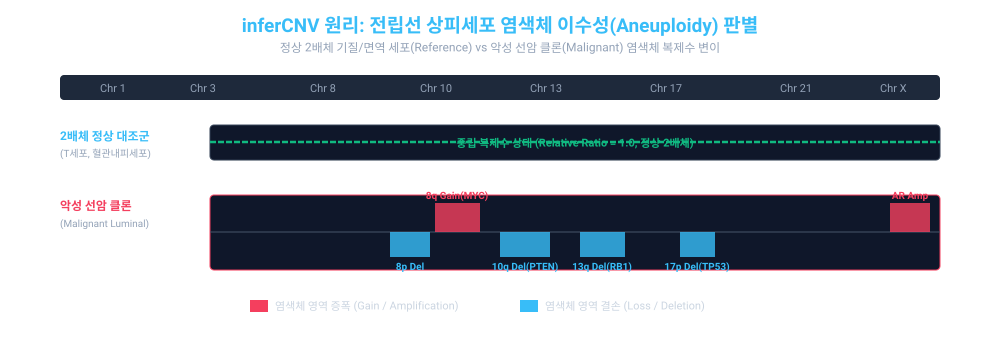

# Chapter 05. 세포 유형 어노테이션 및 악성 세포 판별 (inferCNV & TME)

> **Cognitive Goal**: 전립선 정상 상피세포와 종양 미세환경(TME)의 표준 분자 마커를 체계화하고, 발현 프로파일만으로 구분이 어려운 "정상 관강세포"와 "악성 암세포"를 대규모 염색체 복제수 변이(CNA) 분석 도구인 `inferCNV`를 통해 명확히 감별하는 원리를 마스터한다.

---

## 1. 전립선 세포 계통과 종양 미세환경 (TME) 표준 마커

단일세포/핵 데이터에서 세포 유형을 명명할 때는 문헌으로 검증된 표준 마커(Canonical markers)의 발현 조합을 확인해야 합니다.

| 대분류 계통 | 세부 세포 유형 (Cell Type) | 핵심 표준 마커 유전자 (Canonical Markers) | 생물학적 기능 및 임상적 의미 |
|:---|:---|:---|:---|
| **상피 계통** | **기저세포 (Basal)** | *TP63*, *KRT5*, *KRT14*, *DST* | 기저막 지지 및 줄기세포능; 원발암 발생 시 소실 |
| (Epithelial) | **정상 관강세포 (Luminal)** | *KRT8*, *KRT18*, *KLK3*, *ACPP*, *MSMB* | 성숙 분비 세포; 안드로겐 수용체(*AR*) 의존적 |
| | **클럽/힐록 세포 (Club/Hillock)**| *SCGB1A1*, *KRT13*, *PSCA* | 요도 주변부 전이대(Transition zone) 완충 세포 |
| | **신경내분비 (Neuroendocrine)** | *CHGA*, *SYP*, *ENO2*, *INSM1* | 분비 조절 희귀 세포; t-NEPC 전이의 기원 또는 표적 |
| **악성 종양** | **악성 관강세포 (Malignant)** | *AMACR*, *ERG* (융합 시), *PCA3*, *AR* | 전립선 선암세포; 침습 및 증식 |
| **기질 계통** | **암 연관 섬유아세포 (CAF)** | *ACTA2*, *COL1A1*, *FAP*, *TAGLN*, *PDGFRB* | 콜라겐 분비, 세포외기질(ECM) 리모델링, 면역 차단 |
| (Stromal) | **평활근세포 (Smooth Muscle)** | *MYH11*, *ACTG2*, *CNN1* | 전립선 피막 및 혈관 주변 수축 조절 |
| | **혈관내피세포 (Endothelial)** | *PECAM1*(CD31), *CDH5*, *VWF*, *ENG* | 혈관 신생(Angiogenesis) 및 종양 관류 |
| **면역 계통** | **T / NK 세포** | *CD3D*, *CD3E*, *CD8A*, *CD4*, *NKG7* | 종양 침윤 림프구 (TILs); 항종양 면역 반응 |
| (Immune) | **종양 연관 대식세포 (TAM)** | *CD68*, *CD163*, *MRC1*, *C1QA* | M2-like/면역 억제 경향 상태를 포함하는 연속적 상태(M1/M2 이분법은 단순화), 종양 촉진 |
| | **B / 형질세포 (Plasma)** | *MS4A1*(CD20), *CD79A*, *MZB1*, *JCHAIN* | 체액성 면역, 항체 분비 |

---

## 2. 악성 세포(Malignant) vs 정상 상피(Normal Luminal) 감별의 딜레마

전립선암 조직 분석에서 가장 흔한 오류 중 하나는, *KLK3*(PSA)와 *KRT8*을 발현하는 세포군을 통째로 "암세포"로 주석하는 것입니다.
- 전립선 생검 검체에는 종양 세포뿐 아니라 **종양 주변의 정상 관강 상피세포(Normal Luminal)**가 대량 섞여 있습니다.
- 정상 관강세포와 고분화 선암세포는 기본적인 전사체 발현 프로파일이 매우 흡사하여, 단순 클러스터링만으로는 완벽히 분리되지 않고 하나의 큰 군집으로 묶이기도 합니다.

---

## 3. inferCNV 알고리즘: 단일 핵 전사체 기반 염색체 이수성(Aneuploidy) 판별



대다수의 암세포는 유전체 불안정성(Genomic instability)으로 인해 특정 염색체 팔(chromosome arm)의 대규모 결손(deletion) 또는 증폭(duplication)을 겪습니다:
- **8p21-23 결손 (Loss of *NKX3-1*)**: 전립선암 초기 발암의 핵심 드라이버 사건 (arm-level 복제수 손실 호출 기준 대략 60~80%이며 데이터셋·방법 의존; FISH/array 기반 NKX3-1 결손 보고는 이보다 낮음).
- **8q24.21 증폭 (Gain of *MYC*)**: 종양 증식 및 대사 가속화, 침습성 획득.
- **10q23.31 결손 (Loss of *PTEN*)**: PI3K/AKT/mTOR 신호 경로 상시 활성화, 공격적 암 진행.
- **13q14.2 결손 (Loss of *RB1*)**: 세포 주기 체크포인트 붕괴, TP53과 함께 결손될 때 NEPC 가소성 전환을 허용하는 흔한 동반 사건(필수·충분 조건은 아님).
- **17p13.1 결손 (Loss of *TP53*)**: 게놈 안정성 수호자 상실, 치료 저항성 획득.
- **Xq12 증폭 (Amplification of *AR*)**: mCRPC에서 흔한 안드로겐 수용체 초과발현 사건(빈도는 코호트·정의 의존). 단, infercnvpy `infercnv`는 기본값 `exclude_chromosomes=('chrX','chrY')`이므로 기본 설정으로는 AR(Xq12) 증폭이 평가되지 않으며, AR 증폭은 FISH/WES 등 DNA 수준으로 확인해야 합니다.
- 반면, 기질세포(CAF, 내피세포)와 면역세포(T세포, 대식세포)는 유전적으로 정상인 **2배체(Diploid)**입니다.

```
[유전체 염색체 좌표 정렬] (Chr 1 ──────────────────────────────► Chr 22)
  
  기준 2배체 세포 (T세포/CAF):  ════════════════════════════════════ (기준선 1.0)
  
  정상 Luminal 상피세포:        ════════════════════════════════════ (변이 없음 -> 2배체 확인)
  
  악성 Luminal 암세포:          ═══▼▼▼(8p 결손)═══▲▲▲(8q 증폭)══════ (CNA 발생 -> 악성 판정!)
```

### 3.1 inferCNV의 수학적 원리
1. **게놈 좌표 정렬**: 인간 염색체 1번부터 22번까지 유전자의 물리적 위치(Chromosome start/end) 순서대로 발현 매트릭스를 정렬합니다.
2. **이동 윈도우 스무딩 (Moving Window Smoothing)**: 100개 단위의 유전자 이동 윈도우를 통해 국소적 발현량의 평균을 산출하여 개별 유전자 발현 변동 노이즈를 상쇄합니다.
3. **참조 2배체(Reference Diploid) 발현량 감산**: 사전에 검증된 정상 기질/면역세포의 평균 발현 프로파일을 감산합니다.
4. **결과 판정**: 잔차 발현량이 1보다 유의하게 높은 영역은 증폭(Amplification), 낮은 영역은 결손(Deletion)으로 확정합니다.

### 3.2 Python 환경에서 `infercnvpy` 실행
```python
import infercnvpy as cpy
import scanpy as sc

# 1. 염색체 위치 정보 주석 (GRCh38 GTF 기반)
cpy.io.genomic_position_from_gtf("gencode.v46.annotation.gtf", adata=adata, gtf_gene_id="gene_name")

# 2. inferCNV 계산 (참조 그룹: T세포 및 혈관내피세포)
cpy.tl.infercnv(
    adata,
    reference_key="cell_type_major",
    reference_cat=["T_cell", "Endothelial"],
    window_size=100,
    step=10
)

# 3. CNA 점수 기반 악성 클론(Malignant) 클러스터링
#    infercnvpy 공식 튜토리얼 절차: cnv.tl.pca → cnv.pp.neighbors(기본 use_rep='cnv_pca') → cnv.tl.leiden.
#    (obsm["X_cnv"]에 직접 kNN을 구성하는 use_rep="cnv"도 동작하지만 수천 차원이라 느리고 비표준입니다.)
cpy.tl.pca(adata)
cpy.pp.neighbors(adata)
cpy.tl.leiden(adata)   # 기본 key_added='cnv_leiden'
cpy.pl.chromosome_heatmap(adata, groupby="cnv_leiden", save="_prostate_cna.png")
```

### 3.3 전사체 기반 CNA 추론의 한계와 교차 검증 (Orthogonal Validation)

단일 핵 전사체 기반의 이동 윈도우 스무딩(`inferCNV`, `CopyKAT`)은 강력하지만, 전사 조절 기전과 유전체 구조적 특성으로 인해 위양성(False-positive) 파동 아티팩트(Wave artifact)가 발생할 수 있습니다.

- **국소 유전자 고밀도 발현 아티팩트 (Gene-dense Cluster Artifacts)**:
  - 6번 염색체의 **MHC 유전자 클러스터(HLA-A, B, C 등)**나 19번 염색체(Chr 19q13)의 **칼리크레인(Kallikrein) / 케라틴(Keratin) 유전자 클러스터**처럼 물리적으로 인접한 유전자들이 특정 자극이나 분화 상태에서 동시에 고발현되는 영역이 존재합니다.
  - 일반적으로 고발현·유전자 밀집 영역은 DNA 수준의 증폭이 없어도 이동 윈도우 스무딩 상 국소 gain으로 보일 수 있습니다(예: HLA 6p21). 전립선 관강세포의 Chr 19q13 *KLK3*(PSA), *KLK2*, *KLK4* 고발현도 이런 위양성의 가설적 사례로 거론되나, KLK 좌위는 소수 유전자 구간이라 염색체 팔 전체의 증폭으로 보이는지는 검증되지 않았습니다.

따라서 전사체 기반 CNA만으로 악성 세포를 단정 짓지 않고, 다음 3가지 독립적 교차 검증(Orthogonal Validation) 전략을 병행해야 합니다:

1. **단상형 기반 대립유전자 불균형 분석 (Haplotype-aware Allelic Imbalance: `Numbat`; BAFExtract는 CaSpER 계열의 별개 도구)**:
   - snRNA-seq BAM 파일의 리드에 존재하는 이형접합 단일염기다형성(Heterozygous SNPs)의 B-대립유전자 빈도(B-allele Frequency, BAF)를 1000 Genomes 위상 정렬(Phasing) 참조 패널과 결합합니다(Numbat은 `pileup_and_phase.R`: cellsnp-lite 픽업 + Eagle2 위상 보정).
   - 전사체 총 발현량과 대립유전자 비율 불균형(BAF deviation)을 결합 은닉 마르코프 모델(HMM)로 통합 분석함으로써, 발현량 변동이 없는 **복제 중립성 이형접합성 상실(Copy-Neutral LOH)**을 정확히 포착하고 국소 고발현 아티팩트에 의한 위양성 CNA를 배제합니다.
2. **체세포 변이 및 융합 전사체 직접 검출 (Somatic Fusion & Variant Read Detection)**:
   - 환자의 단일 핵 시퀀싱 BAM 파일에서 전립선암의 대표적 드라이버 구조 변이인 *TMPRSS2-ERG* 융합 접합부(Fusion junction) 리드를 전용 도구(`scFusion` 등)로 직접 탐색합니다(단, 10x 3′ 라이브러리는 전사체 3′ 말단에 편향되어 5′ 쪽의 *TMPRSS2*–*ERG* 접합부 리드는 거의 포획되지 않으므로, 실무적으로는 *ERG* 발현을 대리지표로 쓰고 접합부 탐색은 5′ 라이브러리·롱리드에서만 현실적입니다).
   - 단일 핵 리드에서 *SPOP*, *FOXA1*, *TP53* 등 전립선암 체세포 점돌연변이(Somatic SNVs)를 지닌 세포 바코드를 추출하여, inferCNV에서 이수성이 검출된 클러스터와 일치하는지 교차 검증합니다.
3. **실험적 직교 검증 (Orthogonal Experimental Confirmation)**:
   - **동일 환자 매칭 bulk WES/WGS**: 순수 종양 조직 및 매칭 정상 혈액의 전장 엑솜/유전체 시퀀싱(WES/WGS)을 통해 실제 DNA 수준의 CNA 프로파일과 snRNA-seq 기반 inferCNV 예측 프로파일을 1:1 대조합니다.
   - **조직 형광 동일계교잡법 (FISH)**: 전립선암 핵심 유전자 결손/증폭 부위(*PTEN* 10q23 결손, *MYC* 8q24 증폭, *AR* Xq12 증폭)에 대한 형광 프로브를 포르말린 고정 파라핀 포매(FFPE) 연속 절편에 적용하여 세포 단위에서 이수성을 현미경으로 최종 확증합니다.

---

## 4. 자동 어노테이션 도구와 교차 검증 (Cross-Validation)

수동 마커 검증과 병행하여 레퍼런스 아틀라스 기반 자동 어노테이션을 활용합니다:
- **CellTypist**: 면역세포 및 기질세포 판별에 최적화된 로지스틱 회귀 모델.
- **Azimuth / SingleR**: 사전 구축된 참조 데이터셋과 투영(Projection) 비교. (Azimuth 공식 참조에는 전립선이 없으므로 공개 전립선 아틀라스 등을 원문 확인 후 직접 reference로 구성해야 하며, 사용 가능한 참조가 없으면 CellTypist 등과 수동 마커 검증을 병행합니다.)

> **Golden Rule of Annotation**:
> 1. 자동 주석 도구(CellTypist 등)로 1차 스크리닝을 진행합니다.
> 2. 표준 마커 유전자 Dotplot으로 상피/기질/면역 계통을 명확히 확인합니다.
> 3. 상피세포 군집에 대해 `inferCNV`를 실행하여 **Benign Luminal**과 **Malignant Luminal**을 구분합니다(CNA 양성이면 악성을 강하게 시사하지만, CNA가 적거나 CN-LOH인 종양은 놓칠 수 있으므로 CNA 음성이면 판정을 보류하고 다른 근거를 병행합니다).

---

## 5. 결론 및 다음 단계 연결

이제 정상 세포와 악성 암세포, 그리고 주변 TME 구성 세포들이 완벽하게 라벨링되었습니다.

전립선암 환자가 원발암에서 치명적인 전이암(mCRPC)으로 악화되거나, 호르몬 치료에 저항하여 신경내분비암(NEPC)으로 변환되는 메커니즘을 파헤치기 위해서는 다중 환자 샘플의 통합과 분화 궤적 분석이 필요합니다. 다음 장 [Chapter 06. 전이암 고급 분석: 배치 통합, 궤적, 전사조절망](06_ADVANCED_INTEGRATION_AND_NETWORKS.md)에서 이를 다룹니다.

---

## 6. 단원 핵심 점검 (Cognitive Checkpoint & Case Study)

### Q1. [능동 회상 (Active Recall)] 전립선암 snRNA-seq 데이터셋에서 상피세포 군집이 단일 클러스터로 묶여 있을 때, 단순 마커 유전자(*KLK3*, *AMACR*) 발현량만으로 정상 관강세포(Normal Luminal)와 악성 관강세포(Malignant Luminal)를 분리해서는 안 되는 생물학적 이유와, 이를 해결하는 계산적 원리는 무엇인가?

<details>
<summary>💡 모범 답안 및 해설 확인</summary>

- **생물학적 한계**: 정상 전립선 관강세포와 고분화 전립선 선암세포는 모두 안드로겐 수용체(*AR*) 경로에 의존하므로 *KLK3*(PSA), *ACPP*, *KRT8*, *KRT18* 등 관강 계통 마커를 공유하며, 전립선 비대증이나 국소 염증 상태에서도 *AMACR* 발현이 일부 정상 상피에서 관찰될 수 있어 단순 발현량 기준 분리는 심각한 오분류(Misclassification)를 유발합니다.
- **계산적 해결 원리 (`inferCNV`)**: 정상 관강세포는 유전적으로 2배체(Diploid, $2n$)인 반면, 악성 관강세포는 발암 과정에서 8p 결손, 8q 증폭, 10q(*PTEN*) 결손 등 대규모 염색체 복제수 변이(CNA)를 겪습니다. 따라서 확실한 2배체 세포군(T세포, 내피세포 등)을 참조군으로 두고 유전체 좌표 순으로 100개 유전자 이동 윈도우 발현량을 스무딩 및 감산함으로써 염색체 이수성(Aneuploidy) 신호를 추출하여 악성 세포를 유전체 수준에서 명확히 분리합니다.

</details>

---

### Q2. [능동 회상 (Active Recall)] `inferCNV` 실행 시 Chr 19q 염색체 팔 전체가 대규모로 증폭된 것처럼 보이는 위양성(False-positive) 파동 신호가 나타났다. 이 현상이 발생하는 메커니즘을 설명하고, 이것이 진정한 염색체 변이인지 확인하기 위한 Haplotype-aware 대립유전자 분석법의 명칭과 분석 원리를 서술하시오.

<details>
<summary>💡 모범 답안 및 해설 확인</summary>

- **발생 메커니즘**: 19번 염색체(Chr 19q13)에는 전립선 상피세포의 대표적 분비 단백질인 칼리크레인 유전자군(*KLK1*, *KLK2*, *KLK3*, *KLK4* 등)이 극도로 밀집(Gene-dense cluster)되어 있습니다. 전립선 세포에서 이 유전자들이 일제히 초고발현되면 국소 이동 윈도우 스무딩 값이 상승하여, 실제 DNA 복제수 증가가 없음에도 국소 gain으로 오인될 수 있는 유전자 밀집 발현 아티팩트가 가설적으로 발생할 수 있습니다(KLK 사례는 미검증).
- **분석법 명칭 및 원리 (`Numbat`; BAFExtract는 CaSpER 계열의 별개 도구)**: 단상형 기반 대립유전자 불균형(Haplotype-aware Allelic Imbalance) 분석 도구인 `Numbat`을 적용합니다. 단일 핵 시퀀싱 리드에서 이형접합(Heterozygous) SNP의 B-대립유전자 빈도(BAF)를 추출하고 외부 참조 패널을 이용해 단상형 위상(Phase)을 정렬합니다. 실제 염색체 증폭이나 결손이 발생했다면 대립유전자 비율이 0.5에서 유의하게 편향(BAF imbalance)되어야 합니다. 발현량만 높고 BAF가 정확히 0.5(균형)를 유지한다면 이는 순수한 전사 촉진에 의한 위양성 아티팩트로 판정하여 배제합니다.

</details>

---

### Q3. [임상 케이스 해석 (Clinical Interpretation)] 전이성 거세저항성 전립선암(mCRPC) 환자의 바늘생검 조직에서 단일 핵 시퀀싱을 진행하였다. UMAP 상에서 *AR*과 *KLK3* 발현이 거의 0에 가까우며 *CHGA*, *SYP* 발현도 미미한 미지의 상피세포 군집(Cluster X)이 발견되었다. 이 군집이 악성 종양인지 정상 세포 잔여물인지 감별하기 위한 다단계 검증 파이프라인(4단계)을 설계하고, 만약 악성 세포로 판정되었을 때 임상적으로 의심해야 할 질환 아형을 제시하시오.

<details>
<summary>💡 모범 답안 및 해설 확인</summary>

- **4단계 다단계 감별 파이프라인**:
  1. **inferCNV 이수성 스크리닝**: T세포/기질세포를 대조군으로 지정하여 Cluster X의 염색체 복제수 변이를 분석하고, 전립선암 특이적 CNA(8p 결손, 8q 증폭, 13q(*RB1*) 결손, 17p(*TP53*) 결손) 존재 여부를 확인합니다.
  2. **체세포 변이 및 융합 리드 마이닝**: snRNA-seq BAM 파일에서 *TMPRSS2-ERG* 융합 접합부 리드 및 *TP53*/*RB1* 기능상실 돌연변이 리드가 Cluster X의 바코드에서 검출되는지 확인합니다.
  3. **대립유전자 BAF 불균형(`Numbat`) 검증**: 10q(*PTEN*) 또는 13q(*RB1*) 부위의 Copy-Neutral LOH 및 대립유전자 편향을 확인하여 악성 클론임을 유전체적으로 확증합니다.
  4. **병리학적 직교 검증(IHC/FISH)**: 동일 생검 블록 연속 절편에서 PTEN/RB1 단백질 소실 면역화학염색 및 *PTEN*/*AR* FISH 분석을 수행합니다.
- **임상적으로 의심할 질환 아형**: 
  - *AR* 음성이면서 전형적 신경내분비 마커(*CHGA*, *SYP*)도 발현하지 않는 **이중 음성 전립선암 (Double-Negative Prostate Cancer, DNPC)** 또는 초기 미분화 원형질 전이 상태(Plastic Lineage State)를 의심해야 합니다. 
  - 이 경우 *FGF/MAPK* 경로 활성화 및 *ETV4*, *FOSL1* 전사 인자 발현 여부를 추가로 추적해야 합니다.

</details>

---

<!-- REFERENCES:BEGIN (generated by scripts/apply_references.py; do not edit by hand) -->
## 참고문헌 (References)
### 검수 근거 문헌
1. Barnabas N, Xu L, Savera A, et al. Chromosome 8 markers of metastatic prostate cancer in African American men: gain of the MIR151 gene and loss of the NKX3-1 gene. *Prostate*. 2011;71(8):857-71. PMID: 21456068. doi: 10.1002/pros.21302
2. Mu P, Zhang Z, Benelli M, et al. SOX2 promotes lineage plasticity and antiandrogen resistance in TP53- and RB1-deficient prostate cancer. *Science*. 2017;355(6320):84-88. PMID: 28059768. doi: 10.1126/science.aah4307
3. Albawardi A, Livingstone J, Almarzooqi S, et al. Copy Number Profiles of Prostate Cancer in Men of Middle Eastern Ancestry. *Cancers (Basel)*. 2021;13(10). PMID: 34068856. doi: 10.3390/cancers13102363
4. Gao T, Soldatov R, Sarkar H, et al. Haplotype-aware analysis of somatic copy number variations from single-cell transcriptomes. *Nat Biotechnol*. 2023;41(3):417-426. PMID: 36163550. doi: 10.1038/s41587-022-01468-y
### 소프트웨어 (표기 버전은 검수 시 API를 확인한 버전이며, 파이프라인 실행 환경은 requirements-pipelines.txt 참조)
- infercnvpy 0.6.1 (github.com/icbi-lab/infercnvpy).
- Scanpy 1.12.4 (github.com/scverse/scanpy). 원 논문: Wolf FA, Angerer P, Theis FJ. SCANPY: large-scale single-cell gene expression data analysis. *Genome Biol*. 2018;19(1):15. PMID: 29409532. doi: 10.1186/s13059-017-1382-0
<!-- REFERENCES:END -->
