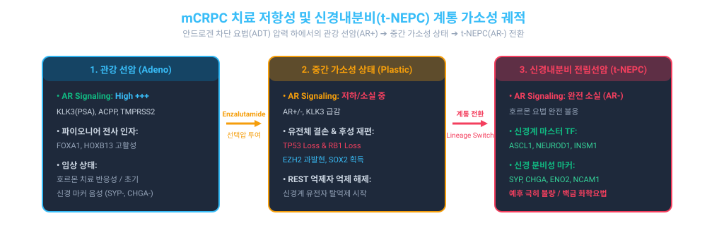

# Chapter 06. 전이암 고급 분석: 배치 통합, 계통 가소성 궤적, 전사조절망 (pySCENIC)

> **Cognitive Goal**: 원발암 및 다기관 전이암(mCRPC) 코호트의 배치 효과(Batch effect)를 인공신경망(`scVI`)과 `Harmony`로 통합하고, 호르몬 치료 저항성 과정에서 일어나는 신경내분비 전립선암(NEPC) 계통 가소성(Lineage plasticity) 궤적 및 전사조절망(`pySCENIC`)의 핵심 레귤론(Regulon) 활성도를 정밀 추적하는 원리를 정립한다.

---

## 1. 다중 환자/배치 효과 보정 (Batch Effect Correction & Integration)

원발암과 전이암 환자 검체는 채취 시기, 시퀀싱 일자, 10x 칩 채널이 모두 다릅니다. 이로 인해 생물학적 차이가 아닌 **기술적 배치 효과(Technical batch effect)**로 인해 환자별로 세포가 엉뚱하게 갈라지는 현상이 발생합니다.

```
[배치 보정 전 (Before)]                        [배치 보정 후 (After)]
  환자 1 (원발암):  [ 환자1 Luminal ]            Luminal 클러스터: [ 환자1 + 환자2 + 환자3 ]
  환자 2 (전이암):  [ 환자2 Luminal ]   ──►      T세포 클러스터:   [ 환자1 + 환자2 + 환자3 ]
  환자 3 (정상):    [ 환자3 Luminal ]            CAF 클러스터:     [ 환자1 + 환자2 + 환자3 ]
  (환자별로 군집이 찢어짐: 기술적 오류)          (동일 세포 계통끼리 통합되고 생물학적 차이만 보존)
```

### 1.1 Harmony: PCA 공간에서의 고속 선형 클러스터 정렬
- **알고리즘**: PCA 축 상에서 각 배치의 세포들을 소프트 $k$-means로 클러스터링한 후, 각 클러스터의 중심점(Centroid)이 일치하도록 최대 다양성 정규화(Maximum diversity regularization)를 적용하여 선형 변환합니다.
- **장점**: 연산 속도가 매우 빠르고 CPU 환경에서도 수만 개의 세포를 수 분 내에 통합 가능.

### 1.2 scVI (single-cell Variational Inference): 딥러닝 잠재 공간 모델링
scVI는 변분 오토인코더(Variational Autoencoder, VAE)를 기반으로 카운트 데이터를 직접 모델링합니다:

$$x_{c, g} \sim \text{NegativeBinomial}(\ell_c \cdot \mu(z_c, s_c), \theta_g)$$

(scvi-tools의 기본 `gene_likelihood`는 `'zinb'`(제로 팽창 NB)이며 `'nb'`는 옵션으로 선택합니다. 위 식은 NB를 선택한 경우의 표기입니다.)

- $z_c$: $d$차원(보통 10~30차원)의 순수한 생물학적 잠재 변수 (Latent space)
- $s_c$: 환자 ID, 배치, 시퀀싱 채널 등 기술적 범주형 변수 (Batch condition)
- $\ell_c$: 라이브러리 크기 (Library scaling factor)
- **Cognitive Rule**: 배치 $s_c$ 정보를 디코더(Decoder)에 조건부로 입력함으로써, 잠재 공간 $z_c$가 **배치 효과를 줄인 생물학적 표현**이 되도록 유도합니다(디코더 조건화만으로 $z_c$의 배치 독립성이 수학적으로 보장되는 것은 아니며 잔여 배치 효과가 남을 수 있습니다).

```python
import scvi

# 1. scVI 모델 셋업 (배치 키: patient_id)
# - 원시 정수 카운트 레이어를 지정 (04장에서 저장한 layers["raw_counts"]; adata.X는 log-normalized)
# - 원발 vs 골전이(tissue_source)는 분석 대상 생물학이므로 categorical_covariate_keys(제거 대상 nuisance 요인)에 넣지 않음
# - patient_id를 batch_key로 쓰면 환자 특이 종양 생물학도 보정될 수 있으니 §1.3의 과보정 경고 참고 (기술적 배치 키 권장)
# - HVG 부분집합에서 실행하는 것을 권장
scvi.model.SCVI.setup_anndata(
    adata, 
    layer="raw_counts",
    batch_key="patient_id"
)

# 2. VAE 모델 학습 (GPU 가속)
vae = scvi.model.SCVI(adata, n_latent=30)
vae.train(max_epochs=200)

# 3. 배치 제거된 잠재 표현 추출
adata.obsm["X_scVI"] = vae.get_latent_representation()

# 4. scVI 공간 기반 kNN 및 UMAP 재구축
sc.pp.neighbors(adata, use_rep="X_scVI")
sc.tl.umap(adata)
```

### 1.3 배치-생물학적 조건 교란 (Batch × Site Confounding)과 과보정(Over-correction) 진단

임상 코호트 설계에서 가장 치명적인 함정은 **배치와 생물학적 조건이 1:1로 완전 교란(Complete Confounding)**되는 실험 설계입니다.

- **실험 설계 함정 (Confounding Trap)**:
  - 원발암(Primary Prostate) 검체 5개를 Batch 1에서 시퀀싱하고, 골전이암(Bone Metastasis) 검체 5개를 수개월 뒤 Batch 2에서 시퀀싱한 경우:
  - "Batch 1 vs Batch 2"의 기술적 차이와 "원발암 vs 골전이"의 생물학적 차이가 수학적으로 완전히 겹치게 됩니다.
  - 이 상태에서 공격적인 배치 보정 알고리즘(예: 과도한 `scVI` 에포크 또는 무리한 Harmony 정렬)을 적용하면, 원발암과 골전이암 고유의 침습/전이 전사체 시그니처나 환자 특이적 악성 서브클론(Patient-specific subclones)까지 "기술적 노이즈"로 간주하여 강제로 병합(Over-correction)해 버립니다.
- **scIB (Single-cell Integration Benchmarking) 기반 정량 평가**:
  - 배치 통합 후에는 단순히 UMAP 상에서 배치가 섞였는지를 육안으로 확인하는 것에 그치지 않고, **배치 혼합도(Batch Mixing)**와 **생물학적 보존도(Biological Conservation)**의 균형을 계량화해야 합니다.
  
| 평가 축 (Axis) | 핵심 메트릭 (Metrics) | 정상 기준 및 생물학적 판정 가이드 |
|:---|:---|:---|
| **배치 혼합도 (Batch Mixing)** | **iLISI** (integration LISI) | 1.0(완전 분리)에서 배치 수에 근접할수록 배치가 잘 섞임(배치가 2개면 최댓값이 2이므로 '2.0 이상' 같은 고정 기준은 달성 불가; scIB는 0~1로 스케일). 완전 교란 설계에서는 높은 iLISI가 오히려 과보정 신호일 수 있음 |
| | **kBET** (k-nearest neighbor batch effect test) | 기각률(Rejection rate)이 낮을수록 국소 이웃 세포들의 배치 분포가 균일함 |
| **생물학적 보존도 (Bio Conservation)** | **cLISI** (cell-type LISI) | 1.0에 가까울수록 서로 다른 세포 유형 간의 경계가 무너지지 않고 분리 유지됨 |
| | **ARI** (Adjusted Rand Index) | (scIB 정의) 통합 후 클러스터링 결과와 정답 세포 유형 라벨의 일치도 |
| | **Isolated Label F1 Score** | (scIB 정의) 가장 적은 수의 배치에만 공유된 라벨(예: 일부 샘플에만 있는 **희귀 신경내분비암 세포(*SYP+* NEPC)** 등)이 독립 군집으로 보존되는지 검증(희귀 세포 '<1%' 기준이 아님) |

---

## 2. 계통 가소성 추적: 전립선 선암에서 NEPC로의 분화 궤적 (Trajectory)



mCRPC 환자에서 안드로겐 수용체 표적 치료(Enzalutamide)를 장기 투여하면, 종양 세포는 생존을 위해 관강세포의 정체성(*AR*, *KLK3*, *FOXA1*)을 버리고 신경내분비 표현형(*SYP*, *CHGA*, *ASCL1*)으로 전환되는 **계통 가소성(Lineage Plasticity / t-NEPC)**을 획득하거나, 안드로겐과 신경내분비 축을 모두 우회하는 등 다채로운 저항성 스펙트럼을 나타냅니다.

```
                  ┌──► [Amphicrine State (AR+ / NE+)]  (AR/SYP 동시 발현 하이브리드 아형)
                  │
[AR+ Adenocarcinoma] ──► [t-NEPC (AR- / NE+)]          (TP53/RB1 결손, ASCL1/INSM1 마스터 스위치)
  (AR+ / NE-)     │
                  └──► [DNPC (AR- / NE-)]              (Double-Negative: FGFR/MAPK 활성화)
```

| 가소성 상태 (Plasticity State) | 표면 및 핵심 마커 발현 | 구동 기전 및 임상적 의미 |
|:---|:---|:---|
| **AR+ 선암 (AR+ Adenocarcinoma)** | `AR+++`, `KLK3+++`, `FOXA1+++` | 전형적인 안드로겐 의존성 관강 선암세포; AR 저해제 1차 표적 |
| **양방향 분비암 (Amphicrine)** | `AR+`, `KLK3+`, `SYP+`, `CHGA+` | 선암 마커와 신경내분비 마커를 단일 세포 내에서 공발현하는 과도기 하이브리드 상태 |
| **치료 유도 신경내분비암 (t-NEPC)**| `AR-` (완전 소실), `SYP+++`, `CHGA+++`, `ASCL1+++` | *TP53* 및 *RB1* 복합 결손 하에서 발생; 극도의 증식능 및 백금계 항암요법 적응증 |
| **이중 음성 전립선암 (DNPC)** | `AR-` (음성), `SYP-` / `CHGA-` (음성) | 안드로겐 및 신경내분비 경로 모두 독립적; *FGFR/MAPK* 경로 우회 활성화로 생존 |

### 2.1 Diffusion Pseudotime (DPT) 원리
1. **루트 세포(Root cell) 지정**: 가장 미분화된 악성 관강세포 또는 원발암 세포를 시발점으로 설정.
2. **확산 거리(Diffusion Distance)**: 세포 간 kNN 전이 확률 행렬(Transition matrix) 상에서 무작위 보행(Random walk)을 시뮬레이션하여 가상 시간(Pseudotime) 축을 계산합니다.

```python
# 루트 세포 지정 후 Diffusion Map 및 DPT 실행
adata.uns['iroot'] = root_cell_index
sc.tl.diffmap(adata)
sc.tl.dpt(adata)

# 궤적을 따른 유전자 발현 다이내믹스 시각화
for gene in ['AR', 'KLK3', 'SOX2', 'EZH2', 'SYP', 'CHGA']:
    sc.pl.scatter(adata, x='dpt_pseudotime', y=gene)  # 의사시간(x)에 따른 유전자 발현(y)
```

### 2.2 snRNA-seq에서의 RNA Velocity (scVelo) 적용 시 핵심 주의점
- **비정상적 Spliced/Unspliced 비율**: 일반 scRNA-seq과 달리 snRNA-seq은 미성숙 pre-mRNA(unspliced)가 전체의 절반을 차지하고 성숙 mRNA(spliced)가 적어, 기존 scVelo의 정상 상태(Steady-state) 스플라이싱 동역학 가정이 흔들릴 수 있습니다.
- **선행 조건 (spliced/unspliced 레이어)**: scVelo는 spliced/unspliced 레이어가 필요한데 02장 파이프라인(`--include-introns`)만으로는 생성되지 않습니다. STARsolo에서는 `--soloFeatures Gene GeneFull Velocyto`로 Velocyto 출력을 만들거나 velocyto/alevin-fry(USA)로 레이어를 생성해 AnnData에 추가해야 합니다.
- **권장 베스트 프랙티스**:
  1. 단순 정적 모델(Deterministic) 대신 동적 모델(`scv.tl.recover_dynamics`)을 적용하십시오.
  2. Velocity 벡터가 가리키는 방향을 맹신하지 말고, 반드시 **Diffusion Pseudotime(DPT)** 및 **pySCENIC 전사 인자 활성도**와 교차 검증하여 생물학적 일관성을 확보해야 합니다.

### 2.3 궤적 분석의 본질적 한계: 계산적 상태 정렬 vs 클론 계통 추적 (Clonal Lineage Tracing)
- **가상 시간(Pseudotime)의 개념적 한계**:
  - Diffusion Pseudotime(DPT) 및 RNA Velocity(scVelo)는 단일 시점(Snapshot)에서 캡처한 세포들의 전사체 유사성을 바탕으로 한 **계산적 전사 상태의 정렬(Computational Ordering of Transcriptomic States)**일 뿐입니다.
  - 전사체 궤적이 부드럽게 이어진다고 해서, 세포 A가 물리적으로 분열하여 세포 B로 분화했음을 입증하는 **직접적인 클론 계통 추적(Direct Clonal Lineage Tracing)**이 될 수 없습니다. 서로 다른 독립된 기원의 서브클론이 치료 압력 하에서 유사한 전사 프로파일로 수렴 진화(Convergent Evolution)했을 가능성이 항상 존재합니다.
- **진정한 계통 검증을 위한 직교 전략**:
  1. **단일세포 미토콘드리아 DNA 계통 바코딩 (Lineage Tracing via Somatic mtDNA Mutations / `MAESTER`)**: 세포 분열 시 자연 축적되는 내인성 미토콘드리아 DNA(mtDNA) 체세포 돌연변이를 검출하여(MAESTER는 3′ scRNA-seq cDNA에 미토콘드리아 전사체 enrichment를 추가해 mtDNA 커버리지를 높이는 방법으로, 일반 snRNA-seq 리드만으로는 mt 리드가 부족해 적용성이 제한됩니다) 클론 계통수(Phylogenetic clonal tree)를 복원하고, 선암 세포와 t-NEPC/DNPC 세포가 동일 클론 조상에서 기원했는지 판별합니다.
  2. **종단적 전후 짝지은 생검 (Longitudinal Paired Biopsies)**: 동일 환자의 엔잘루타마이드 치료 시작 전(AR+ 선암)과 치료 저항성 획득 후(t-NEPC/DNPC) 시점의 짝지은 생검 검체를 분석하여 환자 내 진화 궤적을 실증합니다.

---

## 3. 전사조절망 (Gene Regulatory Network) 분석: pySCENIC

단순히 개별 유전자의 발현량만 보는 것으로는 "어떤 핵심 전사 인자(Master Transcription Factor)가 이 세포의 운명을 통제하는가?"를 알 수 없습니다.
**SCENIC**은 전사 인자(TF)와 그 직접적 표적 유전자들의 결합체인 **레귤론(Regulon)**을 복원합니다.

```
Step 1. 공발현 네트워크 (GRNBoost2): TF와 후보 표적 유전자 간 상관관계 도출
              │
              ▼
Step 2. DNA 모티프 정밀 검증 (RcisTarget): 전사시작점(TSS) 주변 cis-모티프 결합 검증 (간접 상관관계 배제)
              │
              ▼
Step 3. 세포별 레귤론 활성도 점수화 (AUCell): 각 단일 핵에서 해당 레귤론의 유전자 세트 활성도(AUC) 산출
```

### 3.1 전립선암의 핵심 마스터 레귤론
- **AR 레귤론 (`AR(+)`)**: 정상 및 원발암 선암세포의 전사 회로 유지.
- **FOXA1 / HOXB13 레귤론**: 전립선 계통 특이적 파이오니어 전사 인자(Pioneer factors).
- **ERG 레귤론 (`ERG(+)`)**: *TMPRSS2-ERG* 염색체 전좌 양성 환자에서 종양 침습성 유도.
- **ASCL1 / NEUROD1 레귤론**: NEPC 전환을 주도하는 신경계 마스터 스위치.
- **REST 레귤론 (`REST(-)`)**: 정상 상피세포에서 신경계 유전자 발현을 억제하다가, NEPC 전환 시 기능 소실.
- **DNPC 후보 레귤론 (가설: `ETV4(+)`, `ELK1(+)`, `FOSL1(+)`)**: *AR*과 *ASCL1*이 모두 음성(`AR- / NE-`)인 이중 음성 표현형에서는 *FGFR/MAPK* 경로 활성화가 보고되었으며(Bluemn et al. 2017, bulk 데이터), 그 하류의 ETS/AP-1 계열 레귤론이 후보로 거론됩니다. 다만 이 세 레귤론을 DNPC의 '마스터 레귤론'으로 확정한 문헌은 확인되지 않았으며, pySCENIC 결과로 검증해야 하는 가설입니다.
- **Amphicrine 레귤론 상태**: `AR(+)` 관강 분화 프로그램과 신경내분비 유전자 탈억제가 단일 세포 내에서 공존하는 혼합 활성 프로파일.

---

## 4. 종양 미세환경 세포 간 통신 (Cell-Cell Communication)

골전이 mCRPC 병변에서 암세포와 뼈 미세환경 간의 상호작용은 질환 악화의 핵심입니다:
- **RANKL (*TNFSF11*) - RANK (*TNFRSF11A*)**: 파골세포 분화 촉진 및 골용해 유발.
- **WNT / BMP 신호**: 조골세포 활성화 및 비정상적 골형성(Osteoblastic lesion) 유도.
- **TGF-β (*TGFB1*) - TGFBR2**: CAF의 섬유화 촉진 및 T세포 면역 배제(Immune exclusion).

---

## 5. 결론 및 다음 단계 연결

배치 통합을 통해 다기관 코호트를 성공적으로 하나로 묶고, AR 신호에서 NEPC로 향하는 분화 궤적과 마스터 레귤론 네트워크를 규명했습니다.

이제 이러한 전사체 정보를 후성유전체(Chromatin Accessibility) 및 공간적 위치 정보와 결합하는 최신 기술로 확장할 때입니다. 다음 장 [Chapter 07. 멀티오믹스 및 차세대 공간전사체](07_MULTIOMICS_AND_FUTURE.md)에서는 10x Multiome(snRNA + snATAC)과 공간전사체 연계를 배웁니다.

---

## 6. 단원 핵심 점검 (Cognitive Checkpoint & Case Study)

### Q1. [능동 회상 (Active Recall)] 다기관 전립선암 코호트에서 원발암 검체와 골전이암 검체가 서로 다른 날짜/배치로 시퀀싱되었을 때 발생할 수 있는 배치 교란(Batch-Site Confounding)과 과보정(Over-correction)의 위험성을 설명하고, `scIB`의 2대 평가 축(배치 혼합도 vs 생물학적 보존도)에서 각각 핵심 메트릭(iLISI, cLISI, Isolated Label F1)의 판정 기준을 서술하시오.

<details>
<summary>💡 모범 답안 및 해설 확인</summary>

- **과보정(Over-correction) 위험성**:
  - 원발암과 골전이암 검체가 특정 배치에 1:1로 결속되면 배치 효과(기술적 분산)와 조직 기원/전이 상태(생물학적 분산)가 완전히 교란됩니다.
  - 알고리즘이 배치 효과를 지우기 위해 무리하게 정렬을 시도하면, 골전이 특이적 침습 시그니처나 환자 고유의 악성 서브클론까지 기술적 노이즈로 오인하여 원발암 클러스터와 강제로 합쳐버리는 과보정이 일어납니다.
- **scIB 2대 평가 축 및 메트릭 기준**:
  1. **배치 혼합도 (Batch Mixing)**:
     - **`iLISI`**: 국소 이웃 세포들 사이에 서로 다른 배치가 얼마나 균일하게 섞여 있는지를 측정(1.0은 완전 분리, 배치 수에 가까울수록 잘 섞임; 고정 임계값은 없음).
     - **`kBET`**: 이웃 세포들의 배치 비율이 전체 배치 비율과 동일한지 카이제곱 검정하여 기각률이 낮을수록 우수.
  2. **생물학적 보존도 (Biological Conservation)**:
     - **`cLISI`**: 서로 다른 세포 유형이 뒤섞이지 않고 뚜렷이 구분되는지 측정(1.0에 가까울수록 세포 유형 정체성이 잘 보존됨).
     - **`Isolated Label F1 Score`**: 가장 적은 배치에만 공유된 라벨(예: 일부 샘플에만 존재하는 **희귀 *SYP+* NEPC 세포**나 특정 전이 서브클론)이 일반 선암 클러스터에 휩쓸려 사라지지 않고 독립적으로 보존되는지 정량 검증.

</details>

---

### Q2. [능동 회상 (Active Recall)] mCRPC 환자에서 나타나는 4가지 계통 가소성 아형(AR+ 선암, Amphicrine, t-NEPC, DNPC)의 분자적 특성을 비교하고, 특히 *AR*과 *ASCL1*이 모두 결핍된 이중 음성(DNPC) 아형에서 종양 증식을 견인하는 핵심 마스터 레귤론 3가지와 상류 활성화 신호 경로를 설명하시오.

<details>
<summary>💡 모범 답안 및 해설 확인</summary>

- **4대 가소성 아형 비교**:
  1. **AR+ 선암 (`AR+ / NE-`)**: *AR*, *KLK3*, *FOXA1* 고발현, 전형적 호르몬 의존성.
  2. **Amphicrine (`AR+ / NE+`)**: 단일 세포 내에서 *AR*/*KLK3*와 *SYP*/*CHGA*를 동시 발현하는 하이브리드 상태.
  3. **t-NEPC (`AR- / NE+`)**: *AR* 발현이 완전히 소실되고 *TP53*/*RB1* 결손 하에서 *ASCL1*, *NEUROD1*, *INSM1* 마스터 레귤론이 폭발적으로 활성화된 고등급 신경내분비암.
  4. **DNPC (`AR- / NE-`)**: 안드로겐 수용체와 신경내분비 마커가 모두 결손된 상태로 기존 호르몬 요법에 완전 불응.
- **DNPC 후보 레귤론(가설) 및 상류 경로**:
  - **상류 신호 경로**: *FGFR* (섬유아세포 성장인자 수용체) 과발현 및 *MAPK/ERK* 신호 전달계의 비정상적 상시 활성화.
  - **후보 레귤론(가설)**: **`ETV4(+)`**, **`ELK1(+)`**, **`FOSL1(+)`** — MAPK 하류의 ETS 전사 인자 및 AP-1 복합체 레귤론이 활성화되어 있다면 AR 비의존적 세포 주기 진행 및 상피-간엽 전이(EMT) 유사 침습에 기여할 수 있다는 가설입니다(pySCENIC으로 검증 필요).

</details>

---

### Q3. [임상 케이스 해석 (Clinical Interpretation)] 한 연구원이 엔잘루타마이드 치료를 받은 환자의 snRNA-seq 데이터에서 DPT 및 RNA Velocity 분석을 수행한 후, "선암 세포가 치료 압력에 의해 신경내분비암(NEPC)으로 직접 분화 전환(Direct Transdifferentiation)되었음이 컴퓨터 분석으로 완전히 입증되었다"고 논문에 기술하였다. 이 주장의 개념적 오류를 비판하고, 실제 클론 계통(Clonal Lineage)을 증명하기 위해 요구되는 2가지 직교 분석 전략을 제시하시오.

<details>
<summary>💡 모범 답안 및 해설 확인</summary>

- **개념적 오류 비판**:
  - Diffusion Pseudotime(DPT)과 RNA Velocity는 단일 시점(Snapshot)에서 관찰된 세포들의 전사체 유사성에 근거한 **'계산적 전사 상태의 정렬(Computational Ordering of Transcriptomic States)'**일 뿐입니다.
  - 치료 전 생검에 이미 존재하던 극미량의 기존(pre-existing) NEPC 서브클론이 엔잘루타마이드에 의해 선택적 증식(Clonal Selection)했을 가능성과, 독립된 두 클론이 치료 압력 하에 수렴 진화(Convergent Evolution)했을 가능성을 배제할 수 없으므로 계산적 궤적만으로 직접적 세포 운명 전환을 단정할 수 없습니다.
- **2대 직교 계통 증명 전략**:
  1. **단일세포 미토콘드리아 DNA 계통 바코딩 (`MAESTER` / mtDNA Somatic Mutations; mtDNA enrichment 필요, snRNA-seq에는 적용성 제한. 대안: 공유 체세포 변이/CNA 클론 기반 추적)**:
     - 세포 분열 시 자연적으로 발생하는 체세포 mtDNA 돌연변이는 비가역적인 내인성 바코드 역할을 합니다. 선암 세포와 NEPC 세포가 동일한 미토콘드리아 돌연변이 프로파일을 공유하는지 확인하여 두 아형이 공통 클론 기원(Common clonal ancestor)에서 유래했음을 계통학적으로 입증해야 합니다.
  2. **종단적 전후 짝지은 생검(Longitudinal Paired Biopsies) 및 체세포 변이 추적**:
     - 동일 환자에서 엔잘루타마이드 투여 전(기저 시점)과 투여 후 저항성 발생 시점에 채취한 짝지은 생검 검체에서 *TMPRSS2-ERG* 융합 접합점 염기서열이나 환자 고유의 체세포 SNV를 추적하여, 치료 전 선암 클론에서 직접 파생되었음을 분자유전학적으로 확증해야 합니다.

</details>

---

<!-- REFERENCES:BEGIN (generated by scripts/apply_references.py; do not edit by hand) -->
## 참고문헌 (References)
### 본문 인용 문헌
1. Bluemn EG, Coleman IM, Lucas JM, et al. Androgen Receptor Pathway-Independent Prostate Cancer Is Sustained through FGF Signaling. *Cancer Cell*. 2017;32(4):474-489.e6. PMID: 29017058. doi: 10.1016/j.ccell.2017.09.003
### 검수 근거 문헌
1. Luecken MD, Büttner M, Chaichoompu K, et al. Benchmarking atlas-level data integration in single-cell genomics. *Nat Methods*. 2022;19(1):41-50. PMID: 34949812. doi: 10.1038/s41592-021-01336-8
2. Miller TE, Lareau CA, Verga JA, et al. Mitochondrial variant enrichment from high-throughput single-cell RNA sequencing resolves clonal populations. *Nat Biotechnol*. 2022;40(7):1030-1034. PMID: 35210612. doi: 10.1038/s41587-022-01210-8
3. Tang F, Xu D, Wang S, et al. Chromatin profiles classify castration-resistant prostate cancers suggesting therapeutic targets. *Science*. 2022;376(6596):eabe1505. PMID: 35617398. doi: 10.1126/science.abe1505
### 소프트웨어 (표기 버전은 검수 시 API를 확인한 버전이며, 파이프라인 실행 환경은 requirements-pipelines.txt 참조)
- scvi-tools 1.5.1 (github.com/scverse/scvi-tools). 원 논문: Gayoso A, Lopez R, Xing G, et al. A Python library for probabilistic analysis of single-cell omics data. *Nat Biotechnol*. 2022;40(2):163-166. PMID: 35132262. doi: 10.1038/s41587-021-01206-w
<!-- REFERENCES:END -->
