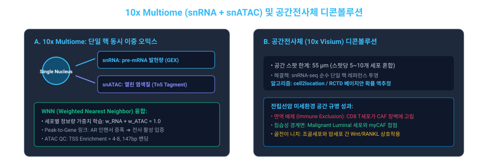

# Chapter 07. 멀티오믹스 및 차세대 공간전사체 연계 (10x Multiome & Spatial)

> **Cognitive Goal**: 동일 단일 핵에서 전사체와 염색질 접근성을 동시 측정하는 10x Multiome(snRNA + snATAC)의 기술적 메커니즘과 WNN(Weighted Nearest Neighbor) 분석 원리를 이해하고, 공간전사체(Spatial Transcriptomics)와의 디콘볼루션(Deconvolution) 융합 전략을 습득한다.

---

## 1. 10x Multiome (snRNA-seq + snATAC-seq): 동일 핵 기반 이중 오믹스



기존에는 별도의 튜브에서 RNA 시퀀싱과 ATAC 시퀀싱을 진행한 후 계산적(In silico)으로 세포를 짝지어야 했으나, 이는 이질성이 극심한 종양 조직에서 수많은 매칭 오류를 초래했습니다.
**10x Multiome**은 **단 하나의 동일한 물리적 핵(Single Nucleus)** 내부에서 RNA와 열린 염색질(Open chromatin)을 동시에 포획합니다.

```
[동결 전립선암 조직] ──► 단일 핵 분리 (Nuclear Isolation)
                                │
                                ▼
[Tn5 트랜스포사제 사전 처리] (열린 염색질 부위에 시퀀싱 어댑터 삽입: Bulk Tagmentation)
                                │
                                ▼
[10x Gel Bead Droplet 생성] (동일 바코드가 장착된 비드에 개별 핵 캡슐화)
                                │
          ┌─────────────────────┴─────────────────────┐
          ▼                                           ▼
[GEX 라이브러리 (RNA)]                     [ATAC 라이브러리 (DNA)]
  - pre-mRNA 역전사 (cDNA)                   - 전치된 개방 염색질 DNA 단편
  - 동일 Cell Barcode 부여                   - 동일 Cell Barcode 부여
```

### 1.1 암 후성유전체학적 가치 (Epigenetic Mechanisms)
- **전립선암 인핸서 재프로그래밍**: *AR* 유전자의 상류 인핸서 증폭(Enhancer duplication) 여부와 *AR* 발현량의 직결 관계 규명.
- **파이오니어 전사 인자(*FOXA1*)의 염색질 개방**: 닫혀 있던 염색질을 *FOXA1*이 물리적으로 열어젖힌 후 안드로겐 수용체(*AR*)가 결합하여 *KLK3*, *TMPRSS2* 전사를 유도한다는 가설을 단일 핵 수준의 공접근성-발현 상관으로 생성(인과는 섭동·ChIP 등 별도 실험으로 검증 필요; Multiome은 동시 측정 상관 분석이지 인과의 직접 입증이 아님).

### 1.2 snATAC-seq 핵심 품질 관리(QC) 2대 지표
Multiome 분석 시 RNA 품질(Mito% < 2%)뿐 아니라 다음 ATAC 고유 지표를 동시 만족해야 합니다:
1. **TSS Enrichment Score (전사시작점 신호 대 잡음비)**:
   - 프로모터(TSS) 주변 ±1,000 bp 영역의 개방 염색질 리드 집중도.
   - **판정 기준**: 최소 4~8 이상이어야 고품질 핵으로 분류 (낮을 경우 무작위 비특이적 DNA 단편화).
2. **뉴클레오솜 밴딩 패턴 (Nucleosome Banding Pattern)**:
   - 전치 단편 길이 분포에서 **~200 bp 간격의 뉴클레오솜 래더(Periodicity)** 확인 (뉴클레오솜 프리 단편 < 100 bp, 모노뉴클레오솜 ~180–250 bp, 디뉴클레오솜 ~400 bp의 뚜렷한 피크 계단 구조; 147 bp는 히스톤에 감긴 DNA 길이이며 주기가 아님).

---

## 2. 멀티모달 데이터 객체(MuData)와 WNN 분석

단일세포 멀티오믹스는 RNA 계층과 ATAC 계층을 동시에 다루기 위해 **`MuData` (Multimodal Data)** 구조를 사용합니다.

```
                               ┌─────────────────────────────────┐
                               │       MuData 객체 (mdata)        │
                               └─────────────────────────────────┘
                                                │
                      ┌─────────────────────────┴─────────────────────────┐
                      ▼                                                   ▼
       ┌──────────────────────────────┐                   ┌──────────────────────────────┐
       │     mdata.mod['rna']         │                   │     mdata.mod['atac']        │
       │  (AnnData: Gene Expression)  │                   │   (AnnData: Chromatin Peaks) │
       │  n_obs x n_genes (36,000)    │                   │   n_obs x n_peaks (150,000)  │
       └──────────────────────────────┘                   └──────────────────────────────┘
```

### 2.1 WNN (Weighted Nearest Neighbor) 원리
어떤 세포에서는 RNA 신호가 뚜렷하고, 어떤 세포에서는 ATAC 신호가 풍부할 수 있습니다. WNN 알고리즘은 각 세포마다 두 모달리티의 정보 예측력(within-modality 예측 대비 cross-modality 예측의 커널 비)을 평가하고 모달리티 간 소프트맥스로 가중치를 동적으로 할당한 뒤(Hao et al., Cell 2021), 모달리티별 커널 친화도(affinity)를 이 가중치로 합산하여 이웃을 고릅니다:

$$\theta_{c, c'}^{\text{WNN}} = w_{c, \text{RNA}} \cdot \theta_{c, c'}^{\text{RNA}} + w_{c, \text{ATAC}} \cdot \theta_{c, c'}^{\text{ATAC}}$$

- 가중치 합: $w_{c, \text{RNA}} + w_{c, \text{ATAC}} = 1$ (세포 $c$ 기준이므로 비대칭)
- 결과적으로 두 오믹스가 상호 보완되어 단일 모달리티로는 보이지 않던 미세 아형(예: AR-active vs AR-low 잠재 전이 클론)을 분리하는 데 도움이 될 수 있습니다.

---

## 3. 공간전사체 (Spatial Transcriptomics)와의 융합: 디콘볼루션 (Deconvolution)

snRNA-seq은 세포 해상도가 완벽하지만, 조직을 파쇄했기 때문에 **"이 세포가 종양 중심부(Tumor core)에 있었는가, 침습성 경계면(Invasive front)에 있었는가?"**라는 공간적 맥락(Spatial context)을 잃어버립니다.

```
[10x Visium 공간 슬라이드]                     [snRNA-seq 참조 아틀라스]
  55 µm 스팟 (Spot당 대략 5~15개 세포 혼합; 조직 밀도 의존)             단일 핵 단위 고순도 세포 프로파일
        │                                              │
        └──────────────────────┬───────────────────────┘
                               ▼
            [디콘볼루션 알고리즘: cell2location / RCTD]
                               ▼
[결과: 전립선암 조직 절편 위 스팟별 실제 세포 조성 비율 복원]
  Spot (X=120, Y=450): 60% Malignant Luminal, 30% CAF, 10% CD8+ T Cell
```

### 3.1 전립선암 공간 면역 미세환경 분석의 임상적 의의
- **면역 배제(Cold Tumor) 기전 탐색**: CD8+ T세포가 종양 실질(Tumor parenchyma) 내부로 들어가지 못하고 CAF가 형성한 콜라겐 기질 장벽 외곽에 위치하는 패턴을 공간적으로 관찰(원인은 가설이며 면역 사막형(desert) 패턴도 흔함).
- **저산소증(Hypoxia) 니치 확인**: 혈관에서 먼 저산소 영역에서 NEPC 전이 마커를 발현하는 암세포의 물리적 위치 특정.

### 3.2 주요 공간전사체 플랫폼 해상도 비교 및 전립선 골전이 적용 전략

전립선암, 특히 무기질 골질과 조골/파골세포, 면역 억제성 기질세포가 혼재된 골전이(Bone metastasis) 병변을 분석할 때는 연구 목적에 부합하는 공간전사체 플랫폼의 선택이 결정적입니다.

| 플랫폼 (Platform) | 물리적 해상도 (Resolution) | 유전자 탐지 범위 (Throughput) | 데이터 특성 및 분석 기법 | 전립선 골전이(Bone Met) 특화 적용 전략 |
|:---|:---|:---|:---|:---|
| **10x Visium (Standard)** | **55 µm 스팟** (Spot당 대략 5~15개 세포 혼합; 조직 밀도 의존) | **전장 전사체 (Whole Transcriptome)** (~18,000 유전자) | 차세대 염기서열분석(NGS) 기반; `cell2location`(계층 베이지안) 또는 `RCTD`(Poisson-lognormal 확률 모형, 최대우도 추정)를 통한 **디콘볼루션(Deconvolution) 권장**(연구 목적에 따라 spot 수준 분석도 가능) | 골전이 병변의 거시적 종양 구역화(Macro-architecture); 종양 중심부(Tumor core) vs 골용해/골형성 경계면의 전사체 경로 탐색 |
| **10x Visium HD** | **2 µm × 2 µm binned grid** (세포보다 작은 bin; 단일 세포 수준 분석은 분할·집계 필요) | **전장 전사체 (Whole Transcriptome)** (Probe 기반, FFPE/동결 조직 호환) | 비드가 아닌 올리고 바코딩된 2 µm 정사각 픽셀의 연속 그리드; 2 µm bin은 단일 세포보다 작아(세포당 다수 bin) 분석은 통상 8 µm bin 또는 세포 분할 집계로 수행 | 뼈-종양 침습 최전선(Invasive front)에서 단일 암세포와 파골세포 간의 미세 접촉면 및 고밀도 콜라겐 CAF 장벽의 공간적 정밀 매핑 |
| **10x Xenium / Nanostring CosMx** | **아세포 수준 분자 국소화** (정밀도 수십~수백 nm; 광학 회절 한계 ~0.2 µm와 구분) 단일 분자 좌표 | **타깃 유전자 패널** (패널 규모는 제품 버전에 따라 변동, 예: 수백~수천 유전자) | 형광 동일계 시퀀싱(ISS/FISH) 기반; 세포막/핵 염색을 통한 고정밀 단일 세포 분할(Cell segmentation) | snRNA-seq에서 도출된 핵심 전이/저항성 리간드-수용체 상호작용(*RANKL-RANK*, *CXCL12-CXCR4*, *TGFB1-TGFBR2*, CD8+ T세포-CAF 공간 배제)의 현장 직접 분자 검증 |

---

## 4. 결론 및 다음 단계 연결

단일 핵 수준의 전사체와 염색질 접근성, 그리고 조직 절편의 공간 좌표가 결합함으로써 전립선암의 종양 생물학을 다각도로 완벽히 규명할 수 있게 되었습니다.

그러나 실제 임상 샘플을 분석할 때는 배치 효과, 과도한 Ambient 오염, 그리고 가짜 반복(Pseudoreplication)으로 인한 통계적 오류 등 무수한 함정이 도사리고 있습니다. 마지막 장 [Chapter 08. 실전 트러블슈팅 및 베스트 프랙티스](08_TROUBLESHOOTING_AND_BEST_PRACTICES.md)에서 연구 현장의 문제 해결 노하우를 정리합니다.

---

## 5. 단원 핵심 점검 (Cognitive Checkpoint & Case Study)

### Q1. [능동 회상 (Active Recall)] 10x Multiome(snRNA-seq + snATAC-seq) 데이터 분석 시, snATAC 품질 관리(QC)를 위해 반드시 통과해야 하는 2대 핵심 지표(TSS Enrichment Score, Nucleosome Banding Pattern)의 생물학적 원리와 정상 판정 기준을 서술하시오.

<details>
<summary>💡 모범 답안 및 해설 확인</summary>

- **1. TSS Enrichment Score (전사시작점 신호 대 잡음비)**:
  - **생물학적 원리**: 활성 상태의 프로모터(TSS) 주변은 전사 인자 결합 및 전사 개시를 위해 뉴클레오솜이 제거되어 열린 염색질(Open chromatin) 구조를 유지하므로 Tn5 트랜스포사제에 의한 절단 빈도가 극도로 높습니다.
  - **판정 기준**: TSS 주변 ±1,000 bp의 리드 깊이를 인접 플랭킹(Flanking) 배경 영역과 비교하여 **최소 4~8 이상**이어야 고품질 핵으로 인정되며, 점수가 낮으면 세포 사멸로 인한 무작위 DNA 파쇄 노이즈를 의미합니다.
- **2. 뉴클레오솜 밴딩 패턴 (Nucleosome Banding Pattern)**:
  - **생물학적 원리**: 온전한 진핵생물 염색질은 히스톤 8량체에 감긴 ~147 bp 단위의 뉴클레오솜 복합체를 이룹니다. Tn5는 뉴클레오솜 사이의 링커 DNA만을 절단할 수 있습니다.
  - **판정 기준**: 단편 길이 분포도에서 뉴클레오솜 프리 단편(< 100 bp), 모노뉴클레오솜(~200 bp), 디뉴클레오솜(~400 bp)이 규칙적인 **~200 bp 간격의 계단 피크**를 형성해야 하며, 주기성이 상실된 평탄한 분포는 핵막 붕괴 및 자가분해(Autolysis)를 나타냅니다.

</details>

---

### Q2. [능동 회상 (Active Recall)] 표준 10x Visium(55 µm spot) 공간전사체 데이터를 해석할 때 `cell2location`이나 `RCTD` 같은 베이지안 디콘볼루션(Deconvolution)이 필수적인 수학적/조직학적 이유를 설명하고, 10x Visium HD(2 µm) 및 Xenium(아세포 수준) 플랫폼과 비교할 때의 공간 분해능과 유전자 커버리지 간의 트레이드오프(Trade-off)를 서술하시오.

<details>
<summary>💡 모범 답안 및 해설 확인</summary>

- **디콘볼루션이 필수적인 이유**:
  - 표준 10x Visium의 직경 55 µm 스팟은 단일 세포 크기(10~15 µm)보다 훨씬 커서 하나의 스팟에 대략 5~15개(조직 밀도 의존)의 서로 다른 세포(예: 암세포 60% + CAF 30% + CD8+ T세포 10%)가 물리적으로 혼합됩니다.
  - 스팟 단위의 유전자 발현량은 여러 세포의 혼합 합산치이므로, 사전에 구축된 snRNA-seq 단일 핵 전사체 참조 아틀라스를 확률 모델(`cell2location`은 계층 베이지안, `RCTD`는 최대우도 기반)에 투입하여 각 스팟에 존재하는 세포 유형별 비율을 수학적으로 역산(Deconvolution)하지 않으면 순수한 세포 간 상호작용을 분리해낼 수 없습니다.
- **플랫폼 간 트레이드오프**:
  - **10x Visium (Standard)**: 전장 전사체(~18,000 유전자)를 모두 측정할 수 있어 신규 경로 탐색에 유리하지만 해상도가 55 µm로 낮아 다세포 혼합이 불가피함.
  - **10x Visium HD**: 2 µm × 2 µm 고해상도로 단일 세포 수준에 근접하면서 전장 전사체(Probe 기반)를 지원하여 미세 조직 경계면 분석에 최적이지만 막대한 시퀀싱 비용 발생.
  - **10x Xenium**: < 0.1 µm의 아세포 단일 분자 형광 좌표로 진정한 세포 내 위치를 규명하지만, 300~5,000개로 한정된 사전 설계 타깃 패널만을 관찰할 수 있어 탐색적 발견보다는 snRNA-seq 발굴 마커의 현장 확증에 적합함.

</details>

---

### Q3. [임상 케이스 해석 (Clinical Interpretation)] mCRPC 전립선암 환자의 골전이 생검 snRNA-seq 데이터에서 면역 억제 표현형의 CAF(*FAP+*, *COL1A1+*)와 탈진(Exhausted) CD8+ T세포(*PDCD1+*, *LAG3+*)가 대량 관찰되었다. 한 임상의가 "탈진 T세포가 다수 존재하므로 면역관문억제제(Anti-PD-1) 단독 투여 시 좋은 반응이 기대된다"고 예측했다. 공간전사체(Xenium 또는 Visium HD)를 통해 공간적 배치 구조를 사전에 확인해야 하는 병리학적 이유를 설명하고, 치료 반응을 좌우하는 2가지 상반된 공간적 침윤 패턴을 제시하시오.

<details>
<summary>💡 모범 답안 및 해설 확인</summary>

- **공간적 배치를 확인해야 하는 병리학적 이유**:
  - snRNA-seq은 조직을 물리적으로 파쇄하여 단일 핵을 분리하므로, T세포와 CAF의 '총량'은 알 수 있으나 이들이 종양 실질 내부에서 암세포와 직접 접촉하고 있는지, 아니면 종양 외곽에 고립되어 있는지 알 수 없습니다.
  - 전립선암은 대표적인 면역학적 **'차가운 종양(Cold tumor)'**으로, T세포가 존재하더라도 두꺼운 기질 장벽에 막혀 암세포에 물리적으로 도달하지 못하는 면역 배제 현상이 빈번합니다.
- **2가지 상반된 공간적 침윤 패턴**:
  1. **면역 배제형 (Immune-Excluded Pattern)**:
     - CD8+ T세포들이 종양 침습 경계면 외곽의 CAF 콜라겐 섬유성 기질층(Peritumoral stroma)에 빽빽하게 갇혀 있고, 종양 실질(Tumor core) 내부로는 전혀 침투하지 못하는 상태입니다.
     - 이 경우 Anti-PD-1 단독 요법은 효과가 제한적일 것이라는 가설 하에 TGF-β 저해제나 FAP 표적 기질 완화제와의 병용이 *연구되고 있으나* 확립된 표준은 아닙니다(전립선암은 전반적으로 면역학적 cold이며 항-PD-1 단독 반응이 낮다는 점은 알려져 있음).
  2. **면역 침윤형 (Immune-Inflamed Pattern)**:
     - CD8+ T세포가 종양 실질 내부 깊숙이 침투하여 악성 상피세포와 가까운 거리(예시 기준, 문헌상 고정 임계값 없음)에서 접촉하는 상태입니다. 이 패턴이 확인되어야 비로소 Anti-PD-1 요법에 대한 실질적인 임상 반응을 기대할 수 있습니다.

</details>

---

<!-- REFERENCES:BEGIN (generated by scripts/apply_references.py; do not edit by hand) -->
## 참고문헌 (References)
### 본문 인용 문헌
1. Hao Y, Hao S, Andersen-Nissen E, et al. Integrated analysis of multimodal single-cell data. *Cell*. 2021;184(13):3573-3587.e29. PMID: 34062119. doi: 10.1016/j.cell.2021.04.048
### 검수 근거 문헌
1. Buenrostro JD, Giresi PG, Zaba LC, et al. Transposition of native chromatin for fast and sensitive epigenomic profiling of open chromatin, DNA-binding proteins and nucleosome position. *Nat Methods*. 2013;10(12):1213-8. PMID: 24097267. doi: 10.1038/nmeth.2688
2. Cable DM, Murray E, Zou LS, et al. Robust decomposition of cell type mixtures in spatial transcriptomics. *Nat Biotechnol*. 2022;40(4):517-526. PMID: 33603203. doi: 10.1038/s41587-021-00830-w
3. Kleshchevnikov V, Shmatko A, Dann E, et al. Cell2location maps fine-grained cell types in spatial transcriptomics. *Nat Biotechnol*. 2022;40(5):661-671. PMID: 35027729. doi: 10.1038/s41587-021-01139-4
<!-- REFERENCES:END -->
