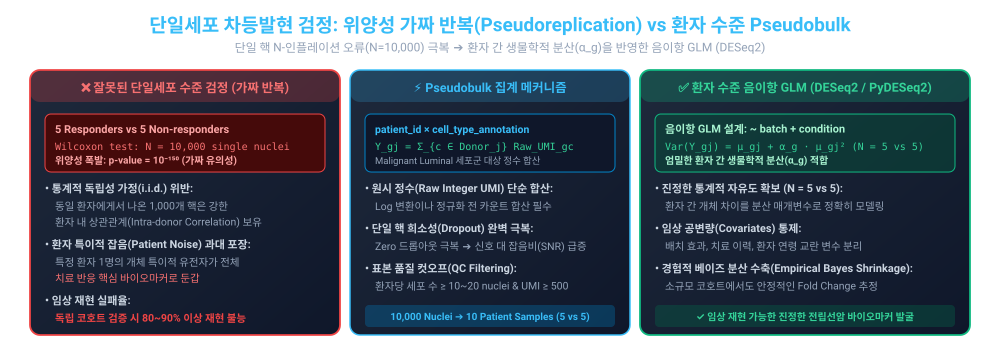

# Chapter 08. 실전 트러블슈팅, Pseudobulk 검증 및 베스트 프랙티스

> **Cognitive Goal**: 단일 핵 데이터 분석 시 발생하는 흔한 오류(Overclustering, 심각한 Ambient 잔여물, 가짜 반복 Pseudoreplication)의 근본 원인을 진단하고, 엄밀한 환자 단위의 Pseudobulk 차등발현 검증법과 재현 가능한 연구 체크리스트를 완비한다.

---

## 1. 단일 핵 차등발현 분석의 치명적 함정: 가짜 반복 (Pseudoreplication)



임상 암 연구(예: 전립선암 환자 대조군 5명 vs 치료 저항성 환자 5명)에서 흔히 저지르는 가장 심각한 통계적 오류는, 각 환자에서 얻은 수천 개의 핵을 **"독립적인 표본($N=10,000$)"**으로 취급하여 Wilcoxon rank-sum 검정을 수행하는 것입니다.

```
[잘못된 접근: Single-cell Level Testing]
  (군당 환자 3명 이상 가정) 환자 A·B·C ... 의 핵 각 1,000개  ──►  N = 수천으로 계산
  결과: 환자 A 한 명의 개인적 유전적 특이성이 p = 10^-120의 가짜 유의성으로 둔갑 (위양성 폭발!)

[올바른 접근: Pseudobulk Level Testing]
  환자별 특정 세포 유형 카운트 합산 (Bulk화) ──►  환자 1명당 표본 1개
  군당 환자 3명 이상(군당 N=1~2에서는 분산 추정 불가)을 확보한 뒤,
  결과: 진정한 생물학적 반복(Biological replicates) 간의 분산을 DESeq2/edgeR로 검정 (위양성 억제)
```

### 1.1 Pseudobulk 집계 및 DESeq2 워크플로우
```python
import decoupler as dc
import scanpy as sc

# 1. 샘플별, 세포 유형별로 Raw Count 합산 (Pseudobulk 생성)
pbulk = dc.pp.pseudobulk(
    adata,
    sample_col="patient_id",
    groups_col="cell_type_annotation",
    mode="sum",
    layer="counts"    # 원시 카운트 레이어를 지정 (X가 로그 정규화되어 있으면 합산이 부적절)
)
# 세포 수·카운트가 부족한 샘플 제거 (decoupler 2.x: in-place)
dc.pp.filter_samples(pbulk, min_cells=10, min_counts=500)

# 2. 특정 세포 유형(예: Malignant Luminal)에 대해 환자 군별(치료 반응군 vs 저항군) DEG 수행
# pbulk 객체는 DESeq2 또는 PyDESeq2로 전달되어 환자 간 생물학적 분산을 반영한 엄밀한 통계 검정 수행
```

### 1.2 대응 표본 설계(Paired Longitudinal Design)와 공변량 통제

임상 코호트에서는 환자마다 유전적 배경, 기저 치료 이력, 면역 활성도가 다르기 때문에 **환자 간 기저 변이(Donor-level baseline variance)**가 치료 효과보다 훨씬 클 수 있습니다. 
또한 원발암, 림프절 전이, 골전이 등 전이 부위나 시퀀싱 배치 같은 기술적/생물학적 공변량(Covariates)을 통계 모델에 명시적으로 반영해야 합니다.

`PyDESeq2` 또는 R `DESeq2`에서는 일반화 선형 모델(GLM)의 설계 공식(Design Formula)을 통해 이를 체계적으로 통제합니다:

```python
from pydeseq2.dds import DeseqDataSet
from pydeseq2.ds import DeseqStats

# 시나리오 A: 동일 환자 전후 대응 표본 설계 (Paired Longitudinal Biopsies)
# 엔잘루타마이드 치료 전(Pre)과 저항성 발생 후(Post) 짝지은 생검 검체 분석
# 환자 고유의 기저선(patient_id)을 블록화(Blocking factor)하여 환자 간 차이를 상쇄하고 순수 치료 효과 추출
pbulk_counts = pbulk.to_df().round().astype(int)   # 위 1.1의 pseudobulk 결과
sample_metadata = pbulk.obs
dds_paired = DeseqDataSet(
    counts=pbulk_counts,
    metadata=sample_metadata,
    design="~ patient_id + treatment_status",   # design_factors는 deprecated
    refit_cooks=True
)
dds_paired.deseq2()
stat_res = DeseqStats(dds_paired, contrast=["treatment_status", "Post", "Pre"])
stat_res.summary()

# 시나리오 B: 다기관 복합 공변량 설계 (Batch & Metastatic Site Control)
# 기술적 배치(batch)와 생물학적 전이 부위(metastatic_site)의 효과를 회귀 통제
# Design Formula: ~ batch + metastatic_site + condition
dds_multi = DeseqDataSet(
    counts=pbulk_counts,
    metadata=sample_metadata,
    design="~ batch + metastatic_site + condition",
    refit_cooks=True
)
dds_multi.deseq2()
```

- **설계 공식의 통계적 이점**:
  - `~ patient_id + treatment_status`: 대응 $t$-검정(Paired $t$-test)을 음이항 회귀 모델로 확장한 것으로, 환자 간 전사체 기저선의 거대한 차이를 소거하여 실제 약제 반응에 기인한 미세한 유전자 발현 변화를 높은 검정력(Statistical power)으로 포착합니다.
  - `~ batch + metastatic_site + condition`: 배치 효과와 전이 부위별 차이를 공변량으로 흡수함으로써, 배치·전이 부위의 효과를 통계적으로 분리해 위양성을 줄이는 데 도움이 됩니다. 단, 특정 배치가 특정 전이 부위와 완전히 교란된 설계에서는 설계 행렬의 랭크가 부족해 분리할 수 없고(06장 §1.3 경고), 부분적으로 겹치는 경우에도 억제가 보장되지는 않습니다.

---

## 2. 전립선암 snRNA-seq 실전 문제 해결 가이드 (Troubleshooting)

### 이슈 1. CellBender 처리 후에도 여전히 면역세포에서 *KLK3*(PSA) 신호가 검출됨
- **원인 진단**: 전립선암 조직의 PSA 농도가 너무 극단적으로 높아 CellBender의 기본 False Positive Rate(`--fpr 0.01`) 설정이 배경을 보수적으로 제거함.
- **해결 방안**:
  1. `--fpr 0.05` 또는 `0.08`로 상향 조정하여 더 공격적인 배경 제거 수행.
  2. 다운스트림 단계에서 면역세포 및 기질세포 클러스터의 *KLK3* 발현량을 점검하여 음성 대조군 기준 잔여 오염도 재확인.

### 이슈 2. inferCNV 실행 시 암세포와 정상 상피세포가 분리되지 않음
- **원인 진단**:
  1. 참조 그룹(Reference)으로 지정한 세포군이 부적절함 (참조 선택 문제: 기질·면역세포 참조는 계통 특이 발현 차이를 CNA로 오인할 위험이, 정상 상피세포 참조는 확실한 benign 상피를 확보할 때 계통 특이 위양성을 줄이는 장점이 있으나 benign 여부 확신이 필요함. 또는 참조 세포 수가 너무 적음).
  2. 유전자 윈도우 크기가 너무 작아(예: `window_size=30`) 유전자 고유 발현 노이즈가 CNA 신호를 압도함.
- **해결 방안**:
  1. 참조 세포를 명확한 2배체 기질세포(T세포, 혈관내피세포)로 지정.
  2. `window_size`를 100~150으로 확대하여 대규모 염색체 팔 변이 신호를 부각.

### 이슈 3. 골전이(Bone metastasis) 검체의 낮은 전사체 수율 및 파편
- **원인 진단**: 뼈 조직의 무기질(하이드록시아파타이트)과 골수 지방질이 Dounce lysis 시 핵막을 손상시키거나 RNase 비활성화를 방해.
- **해결 방안**:
  1. Lysis 버퍼 내 RNase Inhibitor 농도를 2배 상향 (1.0 U/µL).
  2. 파쇄 후 OptiPrep(Iodixanol) 35%/29% 밀도 구배(01장 §3.3 프로토콜과 동일) 원심분리를 반드시 거쳐 지방질과 무기질 파편을 완전히 분리.

---

## 3. 연구 재현성 및 논문 게재 체크리스트 (Best Practices)

- [ ] **원시 데이터 무결성**: FASTQ 및 Cell Ranger 정렬 시 `--include-introns` 사용 여부 명시.
- [ ] **QC 필터링 기준의 투명성**: 일반 scRNA-seq과 다른 snRNA-seq의 미토콘드리아 컷오프(샘플 분포 기반; 예시 1~3%) 설정 근거 기술.
- [ ] **Ambient RNA 보정 보고**: 사용한 도구(CellBender 버전, 파라미터) 및 보정 전후 마커 특이도 비교 도표 제시.
- [ ] **악성 클론 검증**: 마커 유전자뿐 아니라 inferCNV/CopyKAT 기반의 이수성(Aneuploidy) 검증 결과 첨부.
- [ ] **통계적 엄밀성**: 환자 간 비교 실험 시 단순 단일세포 Wilcoxon 검정이 아닌 **Pseudobulk 기반 환자 수준 통계 검정** 수행.
- [ ] **코드 및 환경 공개**: Conda 환경 파일(`environment.yml`) 및 분석 코드(GitHub/Zenodo) 공개.

---

## 4. 전립선암 snRNA-seq 완주 캡스톤 프로젝트 루브릭 (End-to-End Capstone Rubric)

단일 핵 전사체 연구의 A부터 Z까지 독립적으로 수행할 수 있는 실무 역량을 검증하기 위한 5단계 캡스톤 프로젝트 졸업 평가 기준입니다.

| 단계 (Stage) | 평가 영역 (Domain) | 핵심 과업 및 구현 내용 (Core Implementation) | 합격 판정 기준 (Acceptance Criteria) |
|:---|:---|:---|:---|
| **Stage 1** | **Upstream & Ambient QC** | - Cell Ranger 정렬 시 `--include-introns` 적용 검증<br>- CellBender로 배경 RNA 노이즈 제거<br>- Scrublet/DoubletFinder 이중체 제거 | - snRNA 미토콘드리아 카운트 비율 < 1~2% 엄격 준수<br>- 음성 대조군(T세포) 내 *KLK3*(PSA) 오염 발현율 감소 확인(예시 기준: < 1%; 임계값은 데이터 의존)<br>- 예상 이중체율(5~8%) 제거 확인 |
| **Stage 2** | **Lineage & CNA Malignancy** | - 표준 마커 Dotplot으로 상피/기질/면역 계통 확정<br>- `inferCNV`/`CopyKAT`으로 염색체 이수성 분석<br>- `Numbat` BAF 대립유전자 분석으로 LOH 및 위양성 배제 | - Chr 19q 칼리크레인 유전자 밀집 클러스터 위양성 배제 완료<br>- 8p 결손, 8q 증폭, 10q(*PTEN*) 결손 기반으로 Benign Luminal과 Malignant Luminal 완벽 분리 |
| **Stage 3** | **Integration & Plasticity** | - 다중 환자 코호트 `scVI` / `Harmony` 배치 보정<br>- `scIB` 지표(iLISI, cLISI, Isolated F1)로 과보정 진단<br>- AR+/Amphicrine/t-NEPC/DNPC 4대 가소성 상태 스코어링 | - 배치 혼합(iLISI)과 세포 유형 보존(cLISI)을 scIB 정규화 점수로 동시에 보고(고정 임계값 없음; 아래 수치는 예시일 뿐: 예 iLISI 0.8 이상, cLISI 높음)<br>- 희귀 *SYP+* NEPC 클러스터의 보존(Isolated label F1을 보고)<br>- DNPC 레귤론 활성은 예시 가설이며 합격 기준이 아니라 탐색 항목으로 점검 |
| **Stage 4** | **Donor-Aware Pseudobulk DEG** | - 세포 단위 Wilcoxon rank-sum 검정 배제<br>- 환자/샘플 단위 카운트 합산(`decoupler`)<br>- `PyDESeq2` 기반 환자 공변량 통제 모델링 | - 음이항 분포 기반 Pseudobulk 모델 구축<br>- 대응 표본 설계(`~ patient_id + treatment`) 적용으로 환자 간 기저 분산 통제 완료<br>- Benjamini-Hochberg FDR < 0.05 기준 유의 유전자 도출 |
| **Stage 5** | **Reproducible Packaging** | - Conda 환경 명세서(`environment.yml`) 동결<br>- 전처리부터 통계 검정까지 전체 분석 파이프라인 자동화<br>- HGP / Zenodo 연구 산출물 메타데이터 패키징 | - 단일 명령어로 원시 카운트부터 최종 도표까지 재현 실행 성공<br>- 시드(Random seed) 고정으로 허용오차 내 재현(GPU 비결정성·병렬 UMAP 등으로 비트 단위 동일성은 보장되지 않음)<br>- 분석 중간 산출물(AnnData h5ad) 및 메타데이터 무결성 검증 |

---

## 5. 단원 핵심 점검 (Cognitive Checkpoint & Case Study)

### Q1. [능동 회상 (Active Recall)] 단일 세포/핵 차등발현(DEG) 분석에서 환자별 수천 개의 핵을 독립 표본으로 간주하여 세포 단위 검정(Wilcoxon rank-sum 등)을 수행할 때 발생하는 '가짜 반복(Pseudoreplication)'의 통계적 메커니즘을 설명하고, 왜 Pseudobulk 접근법(또는 환자를 random effect로 두는 혼합모형)이 Type I Error(위양성)를 제어하는 데 권장되는지 서술하시오.

<details>
<summary>💡 모범 답안 및 해설 확인</summary>

- **가짜 반복의 통계적 메커니즘**:
  - 동일 환자의 단일 조직 생검에서 분리된 1,000개의 핵은 서로 유전적 배경, 미세환경 노출 이력, 검체 처리 배치가 완벽히 동일하므로 통계적으로 **독립 사건(Independent events)이 아닙니다.**
  - 세포 단위 검정은 자유도(Degrees of Freedom)를 표본 수($N=1,000$)에 맞춰 부풀림으로써 표준오차(Standard Error)를 0에 가깝게 인위적으로 축소시킵니다. 그 결과 환자 한 명의 사소한 개인차나 배치 특이성이 $p = 10^{-100}$과 같은 가짜 통계적 유의성(Type I Error 폭발)으로 둔갑합니다.
- **Pseudobulk가 권장되는 이유 (유일한 방법은 아님)**:
  - 동일 환자의 특정 세포 유형별 카운트를 합산(Summation)하여 환자당 단 하나의 가상 Bulk 프로파일($N=1$)로 축약합니다.
  - 환자 간 생물학적 변산도(Biological variance across donors)를 직접 추정하여 음이항 GLM(DESeq2/edgeR)으로 검정하므로, 위양성률을 명목 수준에 가깝게 통제하고 환자 군 간에 재현될 가능성이 높은 유의 유전자를 보수적으로 선별합니다(개체를 random effect로 둔 GLMM도 대안이며, 표본 수가 매우 작으면 분산 추정이 불안정하고 검정력이 낮습니다).

</details>

---

### Q2. [능동 회상 (Active Recall)] 전립선암 환자 코호트에서 엔잘루타마이드 치료 전(Pre)과 치료 저항성 획득 후(Post) 동일 환자 짝지은 생검(Paired Longitudinal Biopsies) 데이터를 분석할 때, 환자 간 기저 발현 변이를 소거하기 위한 DESeq2 설계 공식(Design Formula)을 작성하고, 배치(batch) 및 전이 부위(metastatic_site) 공변량을 추가로 보정하는 확장 공식을 제시하시오.

<details>
<summary>💡 모범 답안 및 해설 확인</summary>

- **1. 동일 환자 대응 표본 설계 공식**:
  - `~ patient_id + treatment_status`
  - **원리**: `patient_id`를 차단 인자(Blocking factor)로 모델에 투입하여 환자 고유의 기저 전사체 차이를 회귀 상쇄하고, 순수하게 치료 상태(`Pre` vs `Post`)에 의해서만 유도된 발현 변화(대응 표본 $t$-검정의 다변량 확장)를 정확히 추출합니다.
- **2. 다기관 복합 공변량 확장 공식**:
  - `~ batch + metastatic_site + condition`
  - **원리**: 관심 대상인 `condition`(저항군 vs 반응군) 이전에 기술적 `batch`와 조직학적 `metastatic_site`(림프절, 뼈, 간 등)를 선행 공변량으로 배치하여, 전이 장기 특이적 기질 효과와 실험실 간 기술적 편향을 제거한 순수 약제 저항성 시그니처만을 검출합니다.

</details>

---

### Q3. [임상 케이스 해석 (Clinical Interpretation)] 한 바이오인포매틱스 연구원이 전립선암 환자 3명의 snRNA-seq 데이터를 분석하여, 치료 저항군에서 1,200개의 DEG가 $p < 10^{-50}$으로 유의하다고 보고하였다. 그러나 동일 환자군에 대해 환자 단위 Pseudobulk DESeq2를 실행하자 유의한 유전자가 15개로 급감하였다. 연구원은 "Pseudobulk가 검정력이 너무 낮아 의미 있는 바이오마커를 놓쳤다"고 불평한다. 시니어 연구자로서 이 현상의 근본 원인을 해설하고, 왜 1,200개가 아닌 15개가 진정한 생물학적 재현성을 담보하는지 임상적 관점에서 설득하시오.

<details>
<summary>💡 모범 답안 및 해설 확인</summary>

- **현상의 근본 원인 해설**:
  - 환자가 3명($N=3$)에 불과한 상황에서 세포 수($N=10,000$ 세포)를 표본 수로 착각한 단일세포 검정은 환자 3명 중 단 1명에게만 우연히 높았던 유전자들까지 극소한 $p$-value로 채택하여 1,200개의 위양성 목록(False positives)을 만들어낸 것입니다.
  - Pseudobulk 검정은 $N=3$이라는 실제 생물학적 표본 크기를 직시하고 환자 간 분산을 엄격하게 반영하므로, 세 환자 모두에게서 일관되게 변화하지 않은 유전자들을 자연스럽게 걸러내어 15개만 남긴 것입니다.
- **임상적 관점에서의 설득 논리**:
  - 1,200개의 유전자를 바탕으로 신약 타깃이나 바이오마커 검증(IHC, qPCR)을 진행할 경우, 다음 독립 코호트 환자 검체에서 다수가 재현되지 않아 막대한 연구비와 임상 시험 비용이 낭비될 수 있습니다.
  - $N=3$의 극소 표본에서도 pseudobulk 검정을 통과한 15개 유전자는 환자 간 이질성(Inter-patient heterogeneity)을 고려하고도 남은 후보이므로, 단일세포 검정의 1,200개보다 우선 검증할 가치가 있습니다. 다만 환자 3명으로는 치료군 간 비교 설계 자체가 제한적이며(군당 표본 수 부족), 소표본에서 살아남은 유전자를 곧바로 '드라이버 바이오마커'로 단정할 수 없으므로 효과 크기, 검정력 한계, 독립 코호트 검증을 함께 제시하고 환자 수(N) 확충을 권고해야 합니다.

</details>

---

<!-- REFERENCES:BEGIN (generated by scripts/apply_references.py; do not edit by hand) -->
## 참고문헌 (References)
### 검수 근거 문헌
1. Zimmerman KD, Espeland MA, Langefeld CD. A practical solution to pseudoreplication bias in single-cell studies. *Nat Commun*. 2021;12(1):738. PMID: 33531494. doi: 10.1038/s41467-021-21038-1
2. Squair JW, Gautier M, Kathe C, et al. Confronting false discoveries in single-cell differential expression. *Nat Commun*. 2021;12(1):5692. PMID: 34584091. doi: 10.1038/s41467-021-25960-2
### 소프트웨어 (표기 버전은 검수 시 API를 확인한 버전이며, 파이프라인 실행 환경은 requirements-pipelines.txt 참조)
- decoupler 2.2.0 (github.com/scverse/decoupler). 원 논문: Badia-I-Mompel P, Vélez Santiago J, Braunger J, et al. decoupleR: ensemble of computational methods to infer biological activities from omics data. *Bioinform Adv*. 2022;2(1):vbac016. PMID: 36699385. doi: 10.1093/bioadv/vbac016
- Scanpy 1.12.4 (github.com/scverse/scanpy). 원 논문: Wolf FA, Angerer P, Theis FJ. SCANPY: large-scale single-cell gene expression data analysis. *Genome Biol*. 2018;19(1):15. PMID: 29409532. doi: 10.1186/s13059-017-1382-0
- PyDESeq2 (github.com/owkin/PyDESeq2). 원 논문: Muzellec B, Teleńczuk M, Cabeli V, et al. PyDESeq2: a python package for bulk RNA-seq differential expression analysis. *Bioinformatics*. 2023;39(9). PMID: 37669147. doi: 10.1093/bioinformatics/btad547
<!-- REFERENCES:END -->
