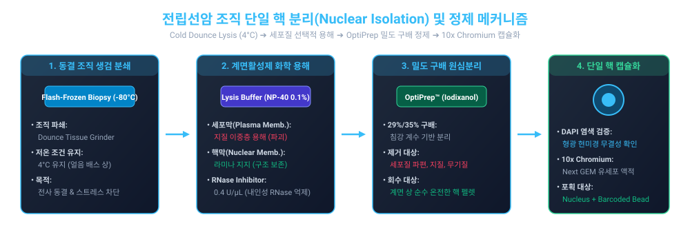
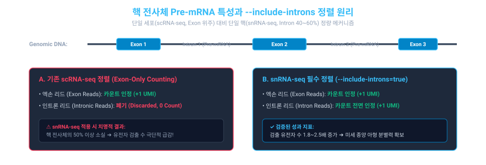
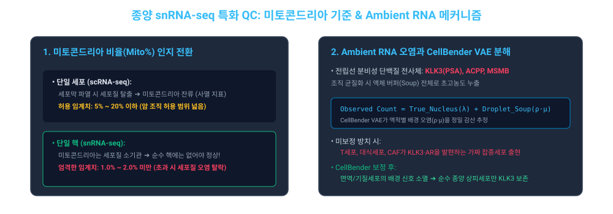
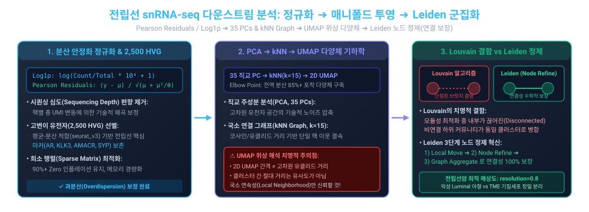
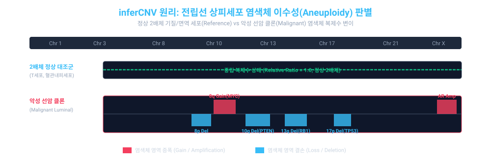
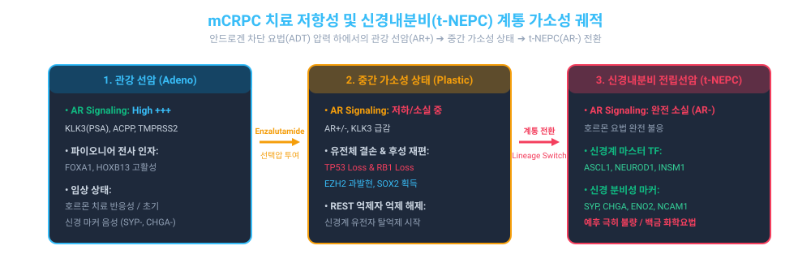
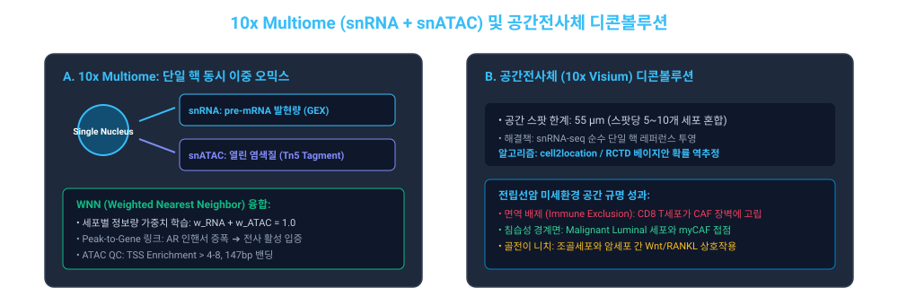
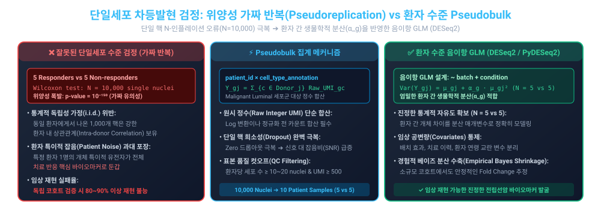

# 전립선암 단일핵 전사체 분석 (snRNA-seq) 마스터 교재
**Single-Nucleus RNA Sequencing for Prostate Cancer: From Foundations to Clinical Multiomics**

---

## 📚 교재 전체 목차 (Table of Contents)

- [Part 00. Chapter 00. 커리큘럼 소개 및 전립선암 snRNA-seq 학습 로드맵](#part-00-chapter-00-커리큘럼-소개-및-전립선암-snrna-seq-학습-로드맵)
- [Part 01. Chapter 01. 실험 원리 및 생물학: 전립선암 조직과 snRNA-seq](#part-01-chapter-01-실험-원리-및-생물학-전립선암-조직과-snrna-seq)
- [Part 02. Chapter 02. 업스트림 데이터 처리: 전립선암 FASTQ에서 카운트 매트릭스까지](#part-02-chapter-02-업스트림-데이터-처리-전립선암-fastq에서-카운트-매트릭스까지)
- [Part 03. Chapter 03. 종양 조직 특화 QC 및 데이터 클리닝 (Ambient RNA & Doublets)](#part-03-chapter-03-종양-조직-특화-qc-및-데이터-클리닝-ambient-rna--doublets)
- [Part 04. Chapter 04. 핵심 다운스트림 분석 파이프라인: 수학적 원리와 알고리즘 인지](#part-04-chapter-04-핵심-다운스트림-분석-파이프라인-수학적-원리와-알고리즘-인지)
- [Part 05. Chapter 05. 세포 유형 어노테이션 및 악성 세포 판별 (inferCNV & TME)](#part-05-chapter-05-세포-유형-어노테이션-및-악성-세포-판별-infercnv--tme)
- [Part 06. Chapter 06. 전이암 고급 분석: 배치 통합, 계통 가소성 궤적, 전사조절망 (pySCENIC)](#part-06-chapter-06-전이암-고급-분석-배치-통합-계통-가소성-궤적-전사조절망-pyscenic)
- [Part 07. Chapter 07. 멀티오믹스 및 차세대 공간전사체 연계 (10x Multiome & Spatial)](#part-07-chapter-07-멀티오믹스-및-차세대-공간전사체-연계-10x-multiome--spatial)
- [Part 08. Chapter 08. 실전 트러블슈팅, Pseudobulk 검증 및 베스트 프랙티스](#part-08-chapter-08-실전-트러블슈팅-pseudobulk-검증-및-베스트-프랙티스)

---

# Part 00. Chapter 00. 커리큘럼 소개 및 전립선암 snRNA-seq 학습 로드맵
> **출처 원본 파일**: `docs/00_CURRICULUM_AND_ROADMAP.md`


> **Cognitive Goal**: 본 과정의 학습 목표, 전립선암 연구에서 snRNA-seq이 요구되는 통계적/생물학적 맥락, 필요한 사전 지식 및 재현 가능한 컴퓨팅 환경을 설정할 수 있다.

---

## 1. 전립선암 전사체 연구에서 왜 snRNA-seq인가?

전립선암(Prostate Cancer, PCa)은 전 세계 남성 암 발생률 상위권을 차지하며, 임상적 경과는 양호한 국소 원발암(Primary localized PCa)부터 치명적인 전이성 거세저항성 전립선암(**mCRPC**, metastatic Castration-Resistant Prostate Cancer)까지 매우 광범위한 스펙트럼을 보입니다.

기존의 단일 세포 RNA 시퀀싱(**scRNA-seq**)은 효소 기반의 조직 해리(enzymatic dissociation) 과정이 필수적입니다. 그러나 전립선암 조직은 다음과 같은 치명적인 한계가 존재합니다:
1. **풍부한 세포외기질(ECM)과 섬유화(Fibrosis)**: 전립선 조직 및 암 연관 기질(Reactive stroma)은 콜라겐과 평활근 세포가 밀집되어 있어 세포 해리가 극히 어렵고, 강한 효소 처리 과정에서 상피세포(epithelial cells)와 암세포가 대량 사멸합니다.
2. **냉동 생검 검체(Frozen Biopsy Specimens)**: 다기관 임상 코호트, 전이성/다기관 코호트(예: SU2C/PCF 드림팀 코호트), 골전이(bone metastasis) 및 림프절 전이 생검 조직은 대부분 영하 80도에 급속 동결(flash-frozen) 보관됩니다. 급속 동결 후 보존제 없이 보관된 조직을 해리하면 세포막이 파괴되어 intact한 살아있는 세포를 얻기 어렵습니다(DMSO 등으로 생세포 동결보존한 검체는 예외).
3. **취약한 대형 세포 및 골조직 특이성**: 골전이 병변(골용해성/골형성성 혼합 병변)은 탈회(decalcification) 과정과 기질 특성상 온전한 단일 세포 분리가 어렵고 수율·생존율 저하에 따른 편향 위험이 큽니다(예: Kfoury et al. 2021은 골전이 신선 조직과 골수의 scRNA-seq을 수행했으나, 이는 신선 검체를 확보한 경우에 한합니다).

**단일 핵 전사체 분석(snRNA-seq)**은 동결된 조직에서 온전한 **핵(nuclei)**을 기계적/화학적으로 분리하여 시퀀싱하므로, **효소 기반 조직 해리 편향을 크게 줄이고 동결 검체의 희귀 세포 및 악성 세포를 분석**할 수 있게 하는 방법입니다(다만 세포 유형별 핵 회수율 차이 등 고유한 편향이 있습니다).

---

## 2. 학습 로드맵 및 인지 단계 (Cognitive Levels)

```
[Level 1: Foundation]
  ├── Ch 01. 실험 원리 및 생물학 (sc vs sn, 핵 분리, 전립선 암 생물학)
  └── Ch 02. 업스트림 처리 (FASTQ, Cell Ranger --include-introns, AnnData 구조)
          │
[Level 2: Data Cleaning & Cognition]
  ├── Ch 03. 암 조직 특화 QC (Mito% 인지, CellBender 배경 제거, Scrublet)
  └── Ch 04. 다운스트림 파이프라인 (정규화, HVG, PCA/UMAP 기하학, Leiden)
          │
[Level 3: Biological Interpretation]
  ├── Ch 05. 세포 주석 및 악성 판별 (전립선 TME, inferCNV 악성 상피 감별)
  └── Ch 06. 전이암 고급 분석 (Harmony/scVI 배치 통합, AR/NEPC 궤적, pySCENIC)
          │
[Level 4: Expert Mastery]
  ├── Ch 07. 멀티오믹스 & 공간전사체 (10x Multiome, snRNA + snATAC, Visium 연계)
  └── Ch 08. 실전 트러블슈팅 & Pseudobulk (배치 효과 분리, 위양성 극복)
```

---

## 3. 선수 지식 점검 (Prerequisites)

- **생물학적 기초**: 
  - 중심원리(Central Dogma): DNA -> pre-mRNA -> mature mRNA -> Protein.
  - 전립선암의 드라이버 유전자: *AR*(안드로겐 수용체), *PTEN* 결손, *TP53* 변이, *RB1* 결손, *TMPRSS2-ERG* 유전자 융합.
- **컴퓨팅 및 통계 기초**:
  - Python 기초 문법 및 객체 지향 개념 (`AnnData` 객체의 슬라이싱 및 메서드 활용).
  - 다차원 행렬 연산(`numpy`, `scipy.sparse`), 데이터 프레임 조작(`pandas`).
  - 통계적 가설 검정: 귀무가설, $p$-value, False Discovery Rate (FDR, Benjamini-Hochberg 교정).

---

## 4. 재현 가능한 분석 환경 구축 (Environment Setup)

단일 핵 분석은 딥러닝 기반 Ambient RNA 제거 도구(`cellbender`) 및 Variational Autoencoder 기반 통합 도구(`scvi-tools`)를 사용하므로, 환경 충돌을 방지하기 위해 격리된 Python 가상환경 구축을 권장합니다.

```bash
# 1. Conda 가상환경 생성 (Python 3.10 예시. 주의: 최신 scanpy/scvi-tools는 Python >=3.12, decoupler 2.x는 >=3.11을 요구하므로
#    버전을 고정하고(environment.yml / pip freeze 기록) 도구에 맞는 Python을 선택할 것. pySCENIC은 numpy/pandas 충돌 보고가 있어 별도 환경 권장)
conda create -n snrna_prostate python=3.10 -y
conda activate snrna_prostate

# 2. 필수 단일세포 핵심 라이브러리 설치
pip install scanpy anndata scrublet

# 3. 딥러닝 기반 고급 분석 도구 설치 (PyTorch 기반)
pip install cellbender scvi-tools

# 4. 전사조절망, 유전자 세트 활성 분석 및 복제수 변이(inferCNV) 도구 설치
pip install pyscenic decoupler infercnvpy scikit-misc

# 5. 시각화 및 인터랙티브 지원 라이브러리
pip install matplotlib seaborn ipykernel jupyterlab leidenalg

# 6. Jupyter 커널 등록
python -m ipykernel install --user --name snrna_prostate --display-name "Python (snRNA Prostate)"
```

### 환경 정상 설치 확인 스크립트
```python
import scanpy as sc
import anndata as ad
import scvi
import cellbender

print(f"Scanpy Version: {sc.__version__}")
print(f"AnnData Version: {ad.__version__}")
print(f"scvi-tools Version: {scvi.__version__}")
print("All core dependencies successfully loaded.")
```

---

## 5. 전립선암 핵심 분석 체크포인트 요약

| 단계 | 일반 scRNA-seq 통념 | 전립선암 snRNA-seq 인지 전환 |
|:---|:---|:---|
| **미토콘드리아 비율** | 5~20% 이하를 정상으로 간주 | 대개 **낮게 관찰됨** (예: 수 % 이하이나 조직·프로토콜별 분포로 임계값 설정; 높으면 세포질 잔여물/오염 가능성) |
| **인트론(Intron) 처리** | 성숙 mRNA(Exon) 위주 카운트 | **Pre-mRNA(Intron) 필수 포함** (핵 내 RNA 중 인트론 비율은 조직 의존적으로 상당하며 대략 수십 %) |
| **Ambient RNA 오염** | 세척 후 경미한 수준 | **매우 심각** (조직 파쇄 시 용출된 AR, PSA(KLK3) 등이 전 세포에 번짐) |
| **암세포 판별** | 단순 클러스터 마커 발현으로 판별 | **inferCNV/CopyKAT 활용** (이배체 정상 상피세포와 이수체 악성세포 분리; CNA가 없거나 약한 종양에서는 실패할 수 있어 직교 근거 병행) |
| **치료 저항성 추적** | 별도 구분 없음 | **AR signaling score vs NEPC transdifferentiation** 연속적 궤적 추적 |

---

## 6. 실전 연습용 전립선암 공개 데이터셋 카탈로그 (Public Benchmark Datasets)

전립선암의 단일세포 및 단일핵 전사체 연구는 국소 원발암부터 거세저항성 전이암(mCRPC), 골전이 미세환경까지 다양한 임상 스펙트럼을 아우릅니다. 실전 분석 파이프라인 학습과 벤치마킹을 위해 권장되는 대표적 공개 데이터셋 카탈로그는 다음과 같습니다:

| 연구 (참고문헌) | 데이터 번호 (Accession) | 분석 모달리티 | 샘플 구성 및 환자 코호트 | 핵심 생물학적 발견 및 분석 포인트 |
|:---|:---|:---|:---|:---|
| **Kfoury et al. (*Cancer Cell*, 2021)** | `GSE143791` | scRNA-seq (10x 3′ v2) | 전립선암 골전이 환자 9명(각 환자의 종양·병변 인접 골수·원위 골수 3개 분획)과 양성 골수 대조 7명 (GEO 시리즈에는 비전립선 전이·마우스 샘플도 함께 등록) | 골전이 면역억제 미세환경(T 세포 소진, 골전이 특이 대식세포, CCL20-CCR6 축) |
| **Song et al. (*Nat Commun*, 2022)** | `GSE176031` | scRNA-seq (Seq-Well S³, 10x 아님) | 국소 원발성 전립선 선암 환자 11명(생검·근치적 절제 검체 혼합; 근접 정상 조직 포함) | 악성 관강세포(ERG+/ERG-) 이질성 및 클럽(Club) 세포 염증 신호 |
| **Chen et al. (*Nat Cell Biol*, 2021)** | `GSE141445` | scRNA-seq | 근치적 전립선 절제술 원발 종양 13개 (36,424 세포; GEO 요약), 논문은 별도 11개 샘플을 추가 시퀀싱(CRPC 포함) | 진행성 연관 상피 하위집단, 미세환경의 KLK3 이소성 발현, 종양과 활발히 통신하는 내피세포 하위집단(aEC) |
| **Tang et al. (*Science*, 2022)** | `GSE199190` (SuperSeries) | bulk ATAC-seq + RNA-seq (단일세포 아님) | 인간 CRPC 오가노이드·PDX·세포주 | 크로마틴 프로파일 기반 CRPC 4군 분류 (AR-dependent, NE, Wnt, SCL) 및 군별 치료 표적 |
| **Karthaus et al. (*Science*, 2020)** | `SCP864` (인간, Single Cell Portal) / `SCP859` (마우스; GEO `GSE146811`) | scRNA-seq (10x) | 마우스 안드로겐 차단(Castration) 및 재투여 전후 전립선 관강세포 재생 아틀라스, 인간 전립선 조직은 SCP864 (종별 accession이 다름에 주의) | 거세 후 분화된 관강세포가 강화된 재생능을 획득함을 추적 (희귀 Lum-P 집단 포함) |

> **실전 메타데이터 검증 가이드 (Integration 전 필수 확인 사항)**:
> 서로 다른 논문 및 코호트의 공개 데이터를 결합(Merge)하거나 배치 통합(Harmony, scVI)을 수행하기 전, `adata.obs`에 다음 메타데이터 컬럼을 사전에 반드시 검사하고 정제해야 합니다:
> 1. **기증자/환자 ID (`donor_id` / `patient_id`)**: 동일 환자에게서 채취된 다중 생검 코어가 서로 다른 독립 샘플로 오인되지 않도록 확인.
> 2. **조직 부위 (`tissue_site`)**: 전립선 원발부(Prostate PZ/TZ) vs 원격 전이 장기(Bone marrow, Lymph node, Liver) 간의 조직 특이적 배경 전사체(예: 골수계 헤모글로빈, 조골세포 기질 유전자) 차이를 인지.
> 3. **치료 이력 (`treatment_history`)**: 치료 이력이 없는 환자(Treatment-naive), 안드로겐 차단 요법(ADT), 차세대 AR 표적 치료제(Enzalutamide/Abiraterone), 백금 기반 항암화학요법 여부에 따라 세포 상태가 급변하므로 배치 공변량 또는 그룹화 변수로 보존.
> 4. **해리 프로토콜 (`protocol_type`)**: 전세포 효소 해리(`scRNA-seq`)와 동결 핵 분리(`snRNA-seq`)는 포획되는 미토콘드리아 비율 및 인트론(Pre-mRNA) 비율이 완전히 다르므로, 이를 단일 배치 키(batch key)로 명시하여 배치 통합 모델에 기술적 교정 파라미터로 제공해야 합니다.

---

<!-- REFERENCES:BEGIN (generated by scripts/apply_references.py; do not edit by hand) -->
## 참고문헌 (References)
### 본문 인용 문헌
1. Kfoury Y, Baryawno N, Severe N, et al. Human prostate cancer bone metastases have an actionable immunosuppressive microenvironment. *Cancer Cell*. 2021;39(11):1464-1478.e8. PMID: 34719426. doi: 10.1016/j.ccell.2021.09.005
2. Song H, Weinstein HNW, Allegakoen P, et al. Single-cell analysis of human primary prostate cancer reveals the heterogeneity of tumor-associated epithelial cell states. *Nat Commun*. 2022;13(1):141. PMID: 35013146. doi: 10.1038/s41467-021-27322-4
3. Chen S, Zhu G, Yang Y, et al. Single-cell analysis reveals transcriptomic remodellings in distinct cell types that contribute to human prostate cancer progression. *Nat Cell Biol*. 2021;23(1):87-98. PMID: 33420488. doi: 10.1038/s41556-020-00613-6
4. Tang F, Xu D, Wang S, et al. Chromatin profiles classify castration-resistant prostate cancers suggesting therapeutic targets. *Science*. 2022;376(6596):eabe1505. PMID: 35617398. doi: 10.1126/science.abe1505
5. Karthaus WR, Hofree M, Choi D, et al. Regenerative potential of prostate luminal cells revealed by single-cell analysis. *Science*. 2020;368(6490):497-505. PMID: 32355025. doi: 10.1126/science.aay0267
### 검수 근거 문헌
1. Denisenko E, Guo BB, Jones M, et al. Systematic assessment of tissue dissociation and storage biases in single-cell and single-nucleus RNA-seq workflows. *Genome Biol*. 2020;21(1):130. PMID: 32487174. doi: 10.1186/s13059-020-02048-6
2. Osorio D, Cai JJ. Systematic determination of the mitochondrial proportion in human and mice tissues for single-cell RNA-sequencing data quality control. *Bioinformatics*. 2021;37(7):963-967. PMID: 32840568. doi: 10.1093/bioinformatics/btaa751
3. Gupta A, Shamsi F, Altemose N, et al. Characterization of transcript enrichment and detection bias in single-nucleus RNA-seq for mapping of distinct human adipocyte lineages. *Genome Res*. 2022;32(2):242-257. PMID: 35042723. doi: 10.1101/gr.275509.121
4. Chan JM, Zaidi S, Love JR, et al. Lineage plasticity in prostate cancer depends on JAK/STAT inflammatory signaling. *Science*. 2022;377(6611):1180-1191. PMID: 35981096. doi: 10.1126/science.abn0478
5. Hippen AA, Falco MM, Weber LM, et al. miQC: An adaptive probabilistic framework for quality control of single-cell RNA-sequencing data. *PLoS Comput Biol*. 2021;17(8):e1009290. PMID: 34428202. doi: 10.1371/journal.pcbi.1009290
### 소프트웨어 (표기 버전은 검수 시 API를 확인한 버전이며, 파이프라인 실행 환경은 requirements-pipelines.txt 참조)
- anndata 0.13.4 (github.com/scverse/anndata). 원 논문: Virshup I, Rybakov S, Theis FJ, et al. anndata: Access and store annotated data matrices. *JOSS*. 2024;9(101):4371. doi: 10.21105/joss.04371
- CellBender (github.com/broadinstitute/CellBender). 원 논문: Fleming SJ, Chaffin MD, Arduini A, et al. Unsupervised removal of systematic background noise from droplet-based single-cell experiments using CellBender. *Nat Methods*. 2023;20(9):1323-1335. PMID: 37550580. doi: 10.1038/s41592-023-01943-7
- Scanpy 1.12.4 (github.com/scverse/scanpy). 원 논문: Wolf FA, Angerer P, Theis FJ. SCANPY: large-scale single-cell gene expression data analysis. *Genome Biol*. 2018;19(1):15. PMID: 29409532. doi: 10.1186/s13059-017-1382-0
- scvi-tools 1.5.1 (github.com/scverse/scvi-tools). 원 논문: Gayoso A, Lopez R, Xing G, et al. A Python library for probabilistic analysis of single-cell omics data. *Nat Biotechnol*. 2022;40(2):163-166. PMID: 35132262. doi: 10.1038/s41587-021-01206-w
<!-- REFERENCES:END -->


---

# Part 01. Chapter 01. 실험 원리 및 생물학: 전립선암 조직과 snRNA-seq
> **출처 원본 파일**: `docs/01_FOUNDATIONS_AND_WET_LAB.md`


> **Cognitive Goal**: 전립선암(원발암 및 mCRPC 전이암) 조직의 병리학적 특성을 이해하고, 왜 온전한 단일 세포(scRNA-seq) 대신 단일 핵(snRNA-seq)을 분리해야 하는지 생물학적/실험적 메커니즘 관점에서 명확히 인지한다.

---

## 1. 전립선암 조직 구조와 단일 세포 해리의 한계

### 1.1 정상 전립선 및 원발암(Primary Adenocarcinoma)의 조직학적 특성
전립선 상피(Prostate epithelium)는 크게 세 가지 세포층으로 구성됩니다:
- **기저세포 (Basal cells)**: 기저막(Basement membrane)에 접하며 줄기세포능을 보유 (*TP63*, *KRT5*, *KRT14* 발현).
- **분비성 관강세포 (Luminal secretory cells)**: 안드로겐 수용체(*AR*) 및 전립선 특이 항원(*KLK3/PSA*)을 고발현하며 정액 분비 담당 (*KRT8*, *KRT18*, *CD26/DPP4* 발현).
- **신경내분비 세포 (Neuroendocrine cells)**: 드물게 분포하며 분비 조절 담당 (*CHGA*, *SYP* 발현).

**원발성 전립선 선암(Adenocarcinoma)**이 발생하면 기저세포층이 소실되고 비정형 관강세포(Atypical luminal cells)가 무질서하게 증식하며, 주변 기질은 반응성 기질(Reactive stroma)로 전환되어 **암 연관 섬유아세포(CAF)**와 밀집된 콜라겐 섬유망을 형성합니다.

```
[정상 전립선 샘(Gland)]
 기저막 ── Basal Cell (TP63+) ── Luminal Cell (AR+, KLK3+) ── 샘강(Lumen)

[전립선 선암(Adenocarcinoma)]
 기저막 파괴 & Basal 소실 ── 무질서한 악성 Luminal 증식 ── 극심한 기질 섬유화(CAF, ECM)
```

### 1.2 전립선 구역 해부학 및 글리슨 점수(Gleason Score / ISUP Grade)
전립선암 연구 시 조직 검체의 채취 위치와 병리학적 등급을 정확히 인지해야 합니다:
- **말초대 (Peripheral Zone, PZ)**: 전체 전립선의 약 70%를 차지하며, **전립선 선암의 70~80%가 발생하는 주 호발 부위**입니다. 분비성 샘 조직이 밀집되어 있어 snRNA-seq 시 상피세포 포획률이 높습니다.
- **이행대 (Transition Zone, TZ)**: 요도를 둘러싼 부위로, 양성 전립선 비대증(BPH)의 주요 부위이자 약 20%의 암이 발생합니다.
- **중심대 (Central Zone, CZ)**: 사정관이 통과하는 부위로 암 발생률은 5% 미만입니다.
- **ISUP 등급 체계 (Grade Group 1~5)**:
  - Grade Group 1 (Gleason 3+3=6): 개별적인 잘 형성된 샘 구조 (인돌런트 종양).
  - Grade Group 2~3 (Gleason 3+4=7, 4+3=7): 융합된 샘 및 사상형(Cribriform) 구조 출현 (전이 위험 증가).
  - Grade Group 4~5 (Gleason 4+4=8, 4+5/5+5=9-10): 분화 소실, 시트상 증식, 면포괴사(Comedonecrosis), 높은 전이 위험.

### 1.3 전이성 거세저항성 전립선암 (mCRPC)의 분자 병태생리
원발암 환자에게 안드로겐 차단 요법(ADT, Enzalutamide/Abiraterone 등)을 시행하면 초기에는 극적인 반응을 보이지만, 병기·치료에 따라 다르지만 대략 1~2년 전후에 **mCRPC**로 진행하는 경우가 많습니다. mCRPC 종양의 계통 가소성과 약제 저항성은 Labrecque et al. (2019; bulk RNA-seq·IHC 기반 ARPC/ARLPC/AMPC/DNPC/SCNPC 분류)와 Bluemn et al. (2017; DNPC 보고) 등에 근거하여 다음 **mCRPC 4대 분자 표현형**으로 정리합니다(본 교재의 편의상 분류이며 'Four-State Lineage Model'이라는 표준 명칭은 아닙니다. Tang et al. 2022는 bulk ATAC/RNA-seq로 AR-dependent/NE/Wnt-dependent/stem-cell-like 4군을 제시한 별개 분류입니다):

1. **AR-Positive Adenocarcinoma (`AR+ / NE-`)**:
   - 고전적 안드로겐 수용체 의존성 종양.
   - *AR* 유전자 좌위 증폭(Amplification) 및 업스트림 인핸서 중복(Enhancer duplication).
   - 리간드 결합 도메인(LBD) 점돌연변이: *T878A* (프로게스테론/에스트로겐에 교차 반응), *W742C* (비칼루타마이드 역전 활성화), *F877L* (구 표기 F876L; 엔잘루타마이드 작용제로 전환).
   - *AR-V7* 스플라이스 변이체: 유전체 결실이 아니라 대체 스플라이싱으로 exon 3 뒤에 잠재 엑손(Cryptic Exon 3, CE3)이 연결되어 LBD 코딩 exon 4~8이 전사체에 포함되지 않으며, 안드로겐 리간드 없이 구성적(constitutive) 전사 활성을 유지.
2. **Amphicrine PCa (`AR+ / NE+`)**:
   - 단일 세포 내에서 안드로겐 수용체(*AR*, *KLK3*) 신호와 신경내분비 분화 마커(*SYP*, *CHGA*)를 동시에 발현하는 혼합 상태(전이 이전 단계라는 해석은 가설 수준).
   - 선암에서 신경내분비 계통으로 전이되는 과도기적(Transitional) 가소성 단계일 수 있다는 가설이 제안됨.
3. **Double-Negative PCa (DNPC, `AR- / NE-`)**:
   - mCRPC 환자의 일부를 차지하며(비율은 코호트와 DNPC 정의에 따라 달라 단일 수치로 단정할 수 없음), AR 발현과 신경내분비 마커가 모두 결손된 난치성 아형.
   - 안드로겐 신호 차단 환경에서 생존하기 위해 **FGF / MAPK 신호 전달 경로 및 *ETV4 / FGFR* 활성**을 대체 구동축으로 가동.
4. **Treatment-Emergent Neuroendocrine PCa (t-NEPC, `AR- / NE+`)**:
   - 강력한 2세대 AR 억제제(Enzalutamide) 치료 압력 하에서 발생하는 극단적인 계통 가소성(Lineage Plasticity) 암종.
   - *TP53* 및 *RB1* 복합 결손에 의해 관강세포 계통 정체성을 완전히 소실.
   - *EZH2* 히스톤 메틸전달효소의 후성유전학적 재편 및 다능성 전사인자 *SOX2* 유도.
   - 신경계 억제자인 *REST* 소실 및 *ASCL1*, *INSM1*, *NEUROD1* 발현 획득 ➔ 고도 악성 신경내분비 분화 (*SYP*, *CHGA* 발현).

또한 임상적으로 가장 치명적인 **골전이(Bone metastasis) 미세환경**에서는 원발암에서 유탈된 암세포가 골수강으로 침투하여 파골세포(*RANKL/RANK*)와 조골세포(*Wnt/BMP/ET-1*)의 항상성을 파괴하며 골형성성/골용해성 혼합 병변을 형성합니다.

---

## 2. 왜 scRNA-seq이 아닌 snRNA-seq인가? (Comparative Analysis)

임상 암 조직에서 전통적인 단일 세포 분리(Warm enzymatic dissociation)를 적용할 경우 발생하는 치명적인 세 가지 왜곡 현상이 있습니다:

| 비교 항목 | 단일 세포 RNA 시퀀싱 (scRNA-seq) | 단일 핵 RNA 시퀀싱 (snRNA-seq) |
|:---|:---|:---|
| **검체 요구조건** | 갓 채취한 신선 조직(Fresh tissue) 필수 | **급속 동결 조직(Flash-frozen, -80°C)** 및 OCT 블록, FFPE 가능 |
| **조직 해리 방식** | 37°C 효소 처리 (Collagenase, Dispase 등 30~60분) | **4°C 저온 기계적/화학적 균질화 (Dounce lysis, 5~10분)** |
| **인공적 유전자 유도 (Stress Artifacts)** | **극심함** (37°C 해리 스트레스로 *FOS*, *JUN*, *HSPA1A* 등 즉시-초기 유전자 폭발적 유도) | **크게 감소** (저온·단시간 처리로 스트레스 반응이 줄어들지만 완전히 없지는 않음) |
| **세포 포획 편향 (Capture Bias)** | 취약한 대형 암세포, 분비 상피세포, 골전이 세포가 효소 처리 중 용해·사멸되어 **손실(Drop-out)**될 수 있음 | **효소 해리 편향은 줄지만 핵 회수 편향은 존재** (조직·세포 유형에 따라 핵 회수율이 달라지고 핵 전사체는 긴 유전자·lncRNA 쪽으로 치우치므로 세포 비율 해석에 주의) |
| **골전이/생검 조직 적용성** | 탈회 및 해리 불가로 사실상 적용 불가 | **극소량 바늘 생검(Core needle biopsy) 및 골전이 검체 분석 최적화** |

> **Cognitive Insight**: 
> 암 환자의 예후를 결정하는 핵심 세포군(약제 내성 악성 관강세포, 전이암 줄기세포, 희귀 신경내분비세포)은 세포막이 약하여 효소 처리 시 먼저 파괴됩니다. 따라서 일부 조직에서는 scRNA-seq 시 취약한 세포가 선택적으로 손실되어 **전립선암 종양 이질성(tumor heterogeneity)이 왜곡**될 수 있습니다. snRNA-seq은 이러한 효소 해리 유래 세포 손실을 크게 줄입니다(다만 핵 회수 효율의 유형별 편향은 남습니다).

---

## 3. 단일 핵 분리(Nuclear Isolation) 메커니즘 및 실전 프로토콜



snRNA-seq의 성공은 **세포질(cytoplasm)을 완전히 용해하여 제거하되, 핵막(nuclear envelope)의 구조적 무결성을 유지하고 핵 내 RNA의 분해를 막는 것**에 달려 있습니다.

### 3.1 검증된 조직 라이시스 버퍼(Lysis Buffer) 표준 레시피
- **10 mM Tris-HCl (pH 7.4)**: 완충 용액 (생체 생리적 pH 유지)
- **10 mM NaCl**: 이온 강도 조절
- **3 mM MgCl₂**: 이가 양이온을 공급하여 염색질 응축 및 핵막 구조 안정화
- **0.1% IGEPAL CA-630 (또는 NP-40)**: 비이온성 계면활성제로 외부 세포막 선택적 파괴
- **0.1% Tween-20**: 온화한 세척 촉진
- **0.01% Digitonin**: 콜레스테롤 복합체 제거 및 막 투과성 유도
- **1.0% Bovine Serum Albumin (BSA, Molecular Biology Grade)**: 핵 응집 방지 및 표면 비특이 결합 차단
- **0.4 ~ 1.0 U/µL Recombinant RNase Inhibitor**: 내인성 리소좀 RNase 즉각 비활성화

### 3.2 Dounce Homogenization 절차 및 클리어런스
1. 영하 80°C 동결 전립선 생검 조직(10~30 mg)을 냉각된 Lysis Buffer 1 mL가 든 2 mL Dounce 조직 분쇄기에 투입합니다.
2. **Pestle A (Loose Pestle, Clearance 0.003~0.005 in)**: 얼음 위에서 기포가 발생하지 않도록 천천히 20~25회 스트로크하여 거친 조직 덩어리를 1차 분쇄합니다.
3. **Pestle B (Tight Pestle, Clearance 0.001~0.003 in)**: 20~25회 정밀 스트로크하여 세포막을 찢고 온전한 단일 핵을 부유액으로 방출합니다.
4. 현탁액을 40 µm 멸균 셀 스트레이너(Cell Strainer)에 통과시켜 미분쇄 결합조직 파편을 걸러냅니다.

### 3.3 OptiPrep™ (Iodixanol) 밀도 구배 정제
골전이 조직의 뼈 무기질 파편, 지방 방울, 파괴된 세포질 잔해물을 제거하기 위해 밀도 구배 원심분리를 수행합니다:
- **하층**: 35% Iodixanol 쿠션 (700 µL)
- **중간층**: 29% Iodixanol 층 (700 µL)
- **상층**: 1차 여과된 단일 핵 현탁액
- **원심분리**: 4°C, 스윙잉 버킷 로터(Swinging-bucket rotor)에서 **10,000 × g로 30분간** 가속/감속 무브레이크(Brake OFF) 조건으로 원심분리합니다.
- 순수한 단일 핵은 29%와 35% 계면(Interface)에 얇은 백색 밴드로 모이며, 피펫으로 정밀 회수합니다.

```
[세포질 용출 및 유리 핵 방출] (Cytoplasm lysis, Nuclei released)
       │
       ▼  Filter (35~40 µm strainer) & Density Gradient (Iodixanol / OptiPrep)
[원심분리 & 파편(Debris) 제거]
       │
       ▼  DAPI / DRAQ7 염색 후 FACS 정제 (또는 직접 세척)
[순수 단일 핵 현탁액] ──> 10x Chromium 유세포 채널 투입
```

### 3.4 라이시스 버퍼(Lysis Buffer)의 계면활성제(Detergent) 화학 및 골전이 탈회(Decalcification) 주의점
- **Nonidet P-40 (NP-40) / IGEPAL CA-630 (0.1%)**: 비이온성 계면활성제로, 낮은 농도·단시간·저온 조건에서 형질막(Plasma membrane)을 우선 용해하면서 핵막은 상대적으로 보존합니다(NP-40은 비선택적 계면활성제이며 핵 보존은 농도·시간·완충액 조건에 의존; 콜레스테롤 선택성은 digitonin의 특성).
- **Triton X-100 (0.1%)**: 기질이 강한 전립선암 조직에서 세포막 분리를 촉진합니다.
- **RNase Inhibitor (0.2~1.0 U/µL)**: 조직 파쇄 시 세포질 리소좀에서 방출되는 내인성 RNase를 즉각 비활성화하여 핵 내 전사체를 보호합니다.
- **골전이 검체 탈회(Decalcification) 시 주의점 (Critical Warning)**:
  - 전립선암 골전이 생검 검체의 통상적인 병리 조직 처리에 사용되는 **강산(Formic acid, HCl) 기반 급속 탈회**는 포르말린 고정과 함께 핵산을 심하게 단편화·손상시켜 RNA 무결성을 크게 떨어뜨릴 수 있습니다(예: RIN이 2 이하로 측정된 사례; FFPE RNA는 RIN보다 DV200 지표를 주로 사용).
  - 따라서 snRNA-seq 분석용 골전이 검체는 **반드시 비탈회 동결 생검 코어(Non-decalcified flash-frozen bone core)**를 확보하여 사용해야 하며, 골질 분리가 불가피한 경우에 한해 **4°C 중성 EDTA(0.5 M, pH 7.4~8.0) 완속 킬레이트 탈회 조건**만 극히 제한적으로 허용됩니다.

### 3.5 핵 무결성(Integrity) 평가 기준
현미경 하에서 트립판 블루(Trypan Blue) 또는 DAPI 형광 염색을 통해 분리된 핵을 관찰할 때:
- **합격(Good)**: 핵막이 매끄러운 타원형/원형을 유지하고, 핵 내 염색질 덩어리가 뚜렷하며, 세포질 파편(clump)이 붙어있지 않음.
- **불합격(Blebbing / Damaged)**: 핵막에 소포(bleb)가 돌출되어 있거나, 핵이 팽창하여 터진 상태 (RNA 누출로 이어져 시퀀싱 QC 실패 유발).

---

## 4. 핵 전사체(Nuclear Transcriptome)의 분자적 특성

snRNA-seq 라이브러리를 시퀀싱하면 기존 scRNA-seq과 근본적으로 다른 유전자 발현 프로파일이 관찰됩니다:

### 4.1 높은 인트론(Intron) 비율: Pre-mRNA의 포획
세포질에는 스플라이싱(splicing)이 완료된 성숙 mRNA(mature mRNA, 엑손만 존재)가 주로 위치하지만, **핵 내부에는 전사 직후의 미성숙 pre-mRNA가 다량 존재**합니다.
- 인트론 매핑 리드 비율은 조직·칩·읽기 위치에 따라 크게 달라지며 대략 수십 %에 이릅니다(이 문서에서는 단위를 '리드 기준'으로 통일; 분자 기준 비율과 구분).
- 따라서 업스트림 분석 도구(Cell Ranger 등)에서 인트론을 포함하지 않고 엑손만 카운트할 경우, **신호의 상당 부분을 버리게 되어 검출 유전자 수(Gene count)가 급감**합니다.

### 4.2 세포질 유전자 vs 핵 잔류 유전자 (Long Non-Coding RNA)
- **미토콘드리아 전사체 (*MT-CO1*, *MT-ND1* 등)**: 미토콘드리아는 세포질 소기관이므로 정상적으로 분리된 순수 핵에서는 **대개 낮게(예시: 수 % 이하, 조직·프로토콜별 분포로 임계 설정)** 관찰됩니다.
- **핵 보유 전사체 (Nuclear-retained transcripts)**: 스플라이싱 복합체 및 핵 구조를 이루는 lncRNA인 *MALAT1*, *NEAT1*이 압도적으로 높게 검출됩니다. 이는 snRNA-seq 데이터의 정상적인 품질 지표입니다.

---

## 5. 결론 및 다음 단계 연결

전립선암의 악성 관강세포, 전이암의 약제 내성 계통, 면역세포 및 기질세포를 손실 없이 포획하기 위한 최선의 선택은 동결 조직 기반 **snRNA-seq**입니다.

이렇게 생성된 서열 리드는 대량의 인트론을 포함하고 있으므로, 다음 장 [Chapter 02. 업스트림 데이터 처리](docs/02_UPSTREAM_PROCESSING.md)에서는 원시 FASTQ 파일로부터 전립선암 인트론 전사체를 온전히 카운트 매트릭스로 전환하는 원리를 다룹니다.

---

## 6. 단원 핵심 점검 (Cognitive Checkpoint & Case Study)

### [문제 1. 핵심 개념 능동 회상 (Active Recall)]
전립선암 동결 생검 검체에서 온전한 전세포 scRNA-seq 대신 단일 핵 전사체 분석(snRNA-seq)을 필수적으로 선택해야 하는 3가지 결정적 이유를 조직학적/실험적 관점에서 기술하고, 라이브러리 정렬 시 pre-mRNA 인트론 영역을 반드시 포함해야 하는 분자생물학적 이유를 설명하시오.

<details>
<summary>💡 모범 답안 및 해설 확인</summary>

1. **전립선암에서 snRNA-seq이 필수적인 3대 이유**:
   - **조직 해리 편향(Dissociation Bias) 감소**: 전립선암은 풍부한 콜라겐과 암 연관 섬유아세포(CAF)로 인해 극심한 섬유화(Fibrosis)를 띱니다. 효소 해리(37°C Collagenase 등) 적용 시 취약한 악성 관강세포 및 희귀 신경내분비세포가 용해·사멸되어 소실될 수 있는 반면, 저온 물리적 핵 분리는 이러한 효소 유래 손실을 줄입니다(단, 핵 회수율은 세포 유형에 따라 다르므로 세포 비율은 보수적으로 해석).
   - **동결 보관 임상 검체(-80°C Flash-frozen) 활용**: 전립선암 생검 검체 및 다기관 임상 코호트(골전이, 림프절 전이)는 채취 즉시 급속 냉동되므로 세포막이 파괴되어 생세포 분리가 불가능하지만, 핵막(Nuclear envelope)은 온전하게 보존되어 분리가 가능합니다.
   - **인공적 스트레스 반응 유전자(Stress Artifacts) 배제**: 37°C 효소 처리 중 급격히 유도되는 즉시-초기 유전자(*FOS*, *JUN*, *HSPA1A* 등)의 인공적 발현을 차단하고 4°C 저온 환경에서 전사 상태를 즉시 동결합니다.
2. **인트론(Pre-mRNA) 포함이 필수적인 이유**:
   - 핵 내부에는 스플라이싱 전 단계인 미성숙 pre-mRNA가 풍부하여 전체 시퀀싱 리드의 **40% ~ 60%**가 인트론 영역에 매핑됩니다. 만약 엑손 리드만 카운트하면 시퀀싱 신호의 절반 이상을 손실하여 세포당 검출 유전자 수(Gene count)와 UMI가 급감하고 저발현 전사인자 검출력이 붕괴합니다.

</details>

---

### [문제 2. 핵심 개념 능동 회상 (Active Recall)]
전이성 거세저항성 전립선암(mCRPC)의 4대 분자 표현형(AR+, Amphicrine, DNPC, t-NEPC; Labrecque 2019·Bluemn 2017 기반 분류)을 정의하고, 각 군의 핵심 마커 및 치료 저항성 우회 기전을 비교하여 서술하시오.

<details>
<summary>💡 모범 답안 및 해설 확인</summary>

| 분자 아형 | 수용체/신경내분비 상태 | 핵심 분자 마커 | 치료 저항성 및 생존 우회 메커니즘 |
|:---|:---|:---|:---|
| **AR-Positive Adenocarcinoma** | `AR+ / NE-` | *AR*, *KLK3*, *NKX3-1*, *TMPRSS2* | *AR* 유전자 좌위 증폭, LBD 돌연변이(*T878A*, *F877L*), 리간드 비의존적 *AR-V7* 스플라이스 변이체 활성 |
| **Amphicrine PCa** | `AR+ / NE+` | *AR*, *KLK3* + *SYP*, *CHGA* | 단일 세포 내에서 AR 경로와 신경내분비 계통 프로그램이 동시 공존하는 계통 가소성 과도기 상태 |
| **Double-Negative PCa (DNPC)** | `AR- / NE-` | *ETV4*, *FGFR1*, *MAPK* pathway | mCRPC의 일부(비율은 코호트·정의에 따라 상이)를 차지하며, AR과 신경내분비 모두 결손된 상태에서 **FGF/MAPK 신호 축 및 *ETV4* 전사인자**를 대체 구동축으로 가동 |
| **t-NEPC** | `AR- / NE+` | *ASCL1*, *INSM1*, *NEUROD1*, *SYP*, *CHGA* | *TP53/RB1* 동시 결손, *SOX2/EZH2* 후성유전학적 재편, *REST* 억제자 소실을 통한 완전한 신경내분비 계통 전이 (엔잘루타마이드 완전 불응) |

</details>

---

### [문제 3. 임상 사례 분석 (Clinical Interpretation Case Study)]
**[임상 시나리오]**
골전이(Bone metastasis)가 확인된 mCRPC 환자의 장골(Iliac crest) 코어 생검 검체를 병리과 조직 처리 루틴에 따라 포르말린 고정 후 10% 포름산(Formic acid) 급속 탈회액에 48시간 처리하여 파라핀 블록을 제작했습니다. 연구팀이 이 블록에서 단일 핵을 분리하여 snRNA-seq을 시도하였으나, Agilent Bioanalyzer 측정 결과 RNA Integrity Number (RIN)가 1.6으로 측정되었고, Cell Ranger 실행 후 세포당 중간 검출 유전자 수가 120개에 불과하여 분석이 전면 실패했습니다.

**[질문]**
1. 이 실험이 실패한 근본 원인을 분자생물학적/생화학적 탈회 메커니즘 관점에서 규명하시오.
2. 향후 골전이 환자 코호트에서 성공적인 snRNA-seq 라이브러리를 확보하기 위해 병리 검체 채취실 및 습식 실험실에서 변경해야 할 표준 작업 절차(SOP)를 제시하시오.

<details>
<summary>💡 모범 답안 및 해설 확인</summary>

1. **실패의 근본 원인**:
   - **강산(Formic acid)에 의한 RNA 화학적 절단**: 포름산(또는 염산)과 같은 강산 기반 급속 탈회제는 하이드록시아파타이트 무기질을 빠르게 녹이지만, 극단적인 산성 환경(pH < 2.0)에서 핵산 손상(주로 DNA에서 알려진 N-glycosidic bond 가수분해에 의한 탈퓨린화 등)이 촉진되며, 포르말린 고정에 의한 손상과 복합되어 RNA 단편화가 심해집니다.
   - 이로 인해 전사체 길이가 50~100 nt 이하로 분해되어 올리고 dT 프라이밍이 불가능해지고, RIN 값이 매우 낮게(본 사례 1.6) 측정되어 역전사 효소가 온전한 cDNA를 합성하지 못하게 됩니다.
2. **개선된 표준 작업 절차 (SOP)**:
   - **원칙: 비탈회 급속 동결(Flash-Freezing without Decalcification)**: 골전이 코어 생검 채취 즉시 포르말린 고정이나 산 탈회를 거치지 않고, 액체 질소(LN2)에 급속 동결하여 영하 80°C에 보관합니다.
   - **물리적 분쇄 및 밀도 구배 정제**: 동결된 골 검체를 분쇄(Cryo-pulverization)한 후 Dounce homogenization을 수행하고, 뼈 무기질 파편과 지방층은 **OptiPrep™ (29%/35% Iodixanol) 밀도 구배 원심분리**를 통해 순수한 핵만 회수합니다.
   - **불가피한 탈회 시 대안**: 만약 병리학적 이유로 탈회가 불가피한 경우 강산을 전면 배제하고, **4°C 저온에서 중성 EDTA (0.5 M, pH 7.4~8.0) 완속 킬레이트 완충액**을 사용하여 RNA 분해를 최소화하면서 킬레이션 탈회를 진행해야 합니다.

</details>

---

<!-- REFERENCES:BEGIN (generated by scripts/apply_references.py; do not edit by hand) -->
## 참고문헌 (References)
### 본문 인용 문헌
1. Labrecque MP, Coleman IM, Brown LG, et al. Molecular profiling stratifies diverse phenotypes of treatment-refractory metastatic castration-resistant prostate cancer. *J Clin Invest*. 2019;129(10):4492-4505. PMID: 31361600. doi: 10.1172/JCI128212
2. Bluemn EG, Coleman IM, Lucas JM, et al. Androgen Receptor Pathway-Independent Prostate Cancer Is Sustained through FGF Signaling. *Cancer Cell*. 2017;32(4):474-489.e6. PMID: 29017058. doi: 10.1016/j.ccell.2017.09.003
3. Tang F, Xu D, Wang S, et al. Chromatin profiles classify castration-resistant prostate cancers suggesting therapeutic targets. *Science*. 2022;376(6596):eabe1505. PMID: 35617398. doi: 10.1126/science.abe1505
### 검수 근거 문헌
1. Mu P, Zhang Z, Benelli M, et al. SOX2 promotes lineage plasticity and antiandrogen resistance in TP53- and RB1-deficient prostate cancer. *Science*. 2017;355(6320):84-88. PMID: 28059768. doi: 10.1126/science.aah4307
2. Wu H, Kirita Y, Donnelly EL, et al. Advantages of Single-Nucleus over Single-Cell RNA Sequencing of Adult Kidney: Rare Cell Types and Novel Cell States Revealed in Fibrosis. *J Am Soc Nephrol*. 2019;30(1):23-32. PMID: 30510133. doi: 10.1681/ASN.2018090912
3. Denisenko E, Guo BB, Jones M, et al. Systematic assessment of tissue dissociation and storage biases in single-cell and single-nucleus RNA-seq workflows. *Genome Biol*. 2020;21(1):130. PMID: 32487174. doi: 10.1186/s13059-020-02048-6
4. Osorio D, Cai JJ. Systematic determination of the mitochondrial proportion in human and mice tissues for single-cell RNA-sequencing data quality control. *Bioinformatics*. 2021;37(7):963-967. PMID: 32840568. doi: 10.1093/bioinformatics/btaa751
5. Chen S, Zhu G, Yang Y, et al. Single-cell analysis reveals transcriptomic remodellings in distinct cell types that contribute to human prostate cancer progression. *Nat Cell Biol*. 2021;23(1):87-98. PMID: 33420488. doi: 10.1038/s41556-020-00613-6
6. Song H, Weinstein HNW, Allegakoen P, et al. Single-cell analysis of human primary prostate cancer reveals the heterogeneity of tumor-associated epithelial cell states. *Nat Commun*. 2022;13(1):141. PMID: 35013146. doi: 10.1038/s41467-021-27322-4
7. Gupta A, Shamsi F, Altemose N, et al. Characterization of transcript enrichment and detection bias in single-nucleus RNA-seq for mapping of distinct human adipocyte lineages. *Genome Res*. 2022;32(2):242-257. PMID: 35042723. doi: 10.1101/gr.275509.121
<!-- REFERENCES:END -->


---

# Part 02. Chapter 02. 업스트림 데이터 처리: 전립선암 FASTQ에서 카운트 매트릭스까지
> **출처 원본 파일**: `docs/02_UPSTREAM_PROCESSING.md`


> **Cognitive Goal**: 시퀀서에서 출력된 원시 서열(FASTQ)의 구조를 이해하고, 핵 전사체의 인트론을 온전히 정량화하기 위한 정렬(Alignment) 알고리즘 원리(`Cell Ranger --include-introns`, `STARsolo GeneFull`)와 `AnnData` 희소 행렬(Sparse Matrix) 구조를 깊이 인지한다.

---

## 1. 10x Genomics 단일 핵 시퀀싱 라이브러리 구조

10x Genomics Chromium 시스템(예: Chromium Next GEM Single Cell 3' 또는 Multiome)으로 시퀀싱을 진행하면 샘플당 최소 2개의 FASTQ 파일이 생성됩니다:

```
[Read 1 (28 bp)] ───► [Cell Barcode: 16 bp] + [UMI (Unique Molecular Identifier): 12 bp]
[Read 2 (91+ bp)] ──► [cDNA Fragment (전립선 전사체 서열: pre-mRNA / mRNA)]
[Sample Index (8~10 bp)] ──► [Illumina i7/i5 인덱스: 샘플 멀티플렉싱 식별용]
```

- **Cell Barcode (16 bp)**: 어느 액적(droplet) 또는 어느 핵에서 유래했는지를 구분 ($4^{16} \approx 4.29 \times 10^9$개의 고유 조합 중 10x의 검증된 화이트리스트 바코드(v2는 737,280개, v3/v3.1은 `3M-february-2018` 목록)와 매핑, 해밍 거리 1 이내 오류 자동 교정).
- **UMI (12 bp in v3/v3.1)**: $4^{12} \approx 1.67 \times 10^7$개의 분자 태그. PCR 증폭 과정에서 발생하는 복제 바이어스를 보정하여 1개의 고유 전사체로 디덥(deduplication) 정량.
- **시퀀싱 포화도 (Sequencing Saturation)**:
  $$\text{Saturation} = 1 - \frac{N_{\text{deduplicated UMI}}}{N_{\text{total valid reads}}}$$
  시퀀싱 포화도 자체에 보편적인 목표 수치는 없으며(snRNA-seq처럼 복잡도가 높고 UMI가 적은 라이브러리에서는 낮아도 정상일 수 있음), 추가 시퀀싱의 이득은 depth-saturation 곡선(깊이에 따른 검출 유전자·UMI 증가)으로 판단합니다. 포화도가 낮으면 극저발현 전사 인자(*FOXA1*, *AR*, *ASCL1*) 검출력이 저하될 수 있습니다.

---

## 2. 왜 `--include-introns`가 필수적인가? (정렬 알고리즘의 핵심 인지)



전통적인 scRNA-seq에서는 전사체 주석(Transcriptome annotation) 데이터베이스의 **엑손(Exon)**에 겹치는 리드만을 유전자 카운트로 인정했습니다.

그러나 단일 핵 내부의 전사체는 전사 직후의 **미완성 pre-mRNA가 상당 부분(조직 의존, 대략 수십 %)**을 차지합니다.

```
[Genomic DNA]      ──[ Exon 1 ]─────( Intron 1 )─────[ Exon 2 ]──
                          │              │                │
[snRNA Read A]            └── Exon 매핑   │                │   ──► 일반 scRNA: 카운트 인정 (1 Count)
[snRNA Read B]                           └── Intron 매핑   │   ──► 일반 scRNA: 폐기 (0 Count) ── [손실!]
                                                              ──► snRNA-seq: 인정 (1 Count) ── [필수!]
```

### 2.1 Cell Ranger 실행 명령
Cell Ranger 7.0 이상부터는 기본값으로 인트론이 포함되지만, 파이프라인 무결성을 보장하기 위해 항상 명시적으로 확인해야 합니다:

```bash
# 10x Cell Ranger 카운트 실행
cellranger count \
  --id=Prostate_mCRPC_Patient01 \
  --transcriptome=/ref/refdata-gex-GRCh38-2024-A \
  --fastqs=/data/fastqs/Patient01/ \
  --sample=Patient01_mCRPC \
  --include-introns=true \
  --localcores=16 \
  --localmem=64
```

### 2.2 오픈소스 대안: STARsolo 및 Alevin-fry
클러스터 환경이나 대규모 코호트 분석 시 10x 라이선스 종속성을 피하고 속도를 10배 이상 향상시키기 위해 **STARsolo**를 활용할 수 있습니다:

```bash
STAR --genomeDir /ref/STAR_GRCh38/ \
     --readFilesIn /data/fastqs/Patient01_R2.fastq.gz /data/fastqs/Patient01_R1.fastq.gz \
     --readFilesCommand zcat \
     --soloType CB_UMI_Simple \
     --soloCBwhitelist /opt/cellranger/lib/python/cellranger/barcodes/3M-february-2018.txt \
     --soloUMIlen 12 \
     --soloFeatures GeneFull \
     --soloCellFilter EmptyDrops_CR
```
> **Key Parameter**: `--soloFeatures GeneFull` 옵션이 바로 인트론과 엑손을 합산한 pre-mRNA 전체를 카운트하도록 지시하는 옵션입니다.
> **화이트리스트/UMI 길이**: 위 명령은 10x v3/v3.1(UMI 12 bp)용입니다. v3 화이트리스트는 `3M-february-2018.txt.gz`를 `gunzip`한 파일을 쓰고 `--soloUMIlen 12`를 지정해야 합니다(STARsolo 기본값 CB 16 bp/UMI 10 bp와 `737K-august-2016.txt`는 v2용). Multiome GEX는 별도 화이트리스트를 사용합니다.

---

## 3. EmptyDrops 알고리즘: 핵 바코드 판별 원리

시퀀싱 결과 생성된 수백만 개의 바코드 중, **"진짜 온전한 핵이 들어있는 액적"**과 **"유리된 배경 RNA(Ambient RNA)만 떠다니는 빈 액적"**을 어떻게 통계적으로 분리할까요? Cell Ranger는 **EmptyDrops의 변형(EmptyDrops_CR)**을, STARsolo는 옵션(`--soloCellFilter EmptyDrops_CR`)으로 같은 방식을 제공합니다(STARsolo 기본값은 CellRanger2.2 knee 방식). 아래는 원 알고리즘(Lun 2019)의 설명이며 파라미터는 구현마다 다릅니다.

```
Total UMI Count
     ▲
10^5 │  ═══════ [Knee Point: 고순도 온전한 핵]
     │         \
10^3 │          ══════ [Inflection Point: 세포 경계선]
     │                \
10^1 │                 ══════════════════ [Ambient RNA Background Profile]
     └────────────────────────────────────────► Barcode Rank (내림차순)
```

1. **상위 임계값 (Knee Point)**: UMI 수가 매우 높은 바코드는 즉시 "세포(핵)"로 분류.
2. **배경 프로파일 모델링 (Background Profile, $T_b$)**: UMI 수가 매우 적은 하위 바코드들의 발현 빈도를 합산하여(DropletUtils 기본은 UMI < 100; Cell Ranger/STARsolo `EmptyDrops_CR`은 UMI 순위 45,000~90,000 구간을 ambient로 사용하고 umiMin 500, 후보 20,000, simN 10,000을 쓰며 선행 knee 호출 뒤 추가 세포를 호출), 주변 수용액에 떠다니는 Ambient RNA의 다항분포(Multinomial distribution)를 추정.
3. **통계적 가설 검정**: 중간 영역의 바코드들에 대해 "이 바코드의 발현 패턴이 배경 RNA 다항분포와 동일한가?"를 검정하여, FDR < 0.01(Cell Ranger/STARsolo `EmptyDrops_CR` 값; DropletUtils 관례는 0.001)로 유의하게 다른 바코드만을 진정한 핵으로 선별.

### 3.1 Barcode Rank Plot (Knee Plot) 이상 패턴 진단
Cell Ranger 웹 리포트(`web_summary.html`)의 Barcode Rank Plot은 라이브러리의 전반적 건전성과 핵막 무결성을 즉각 판별할 수 있는 핵심 지표입니다:

- **정상적인 snRNA-seq 패턴 (Sharp Cliff-and-Knee Curve)**:
  - 상위 고농도 바코드 구간(Plateau)에서 세포 경계점(Inflection point)에 도달하면 **수직에 가까운 급격한 절벽(Cliff)**을 그리며 하강한 뒤, 완만한 바닥 배경 구간(Ambient RNA plateau)으로 연결됩니다.
  - 온전한 핵 내부의 고농도 전사체와 부유액 내 저농도 배경 전사체 사이의 경계가 명확함을 의미합니다.
- **핵막 파열 및 세포 용해(lysis) 이상 패턴 (Loss of Knee Point / 완만한 대각선 붕괴)**:
  - 과도한 Dounce 물리적 스트로크, Lysis buffer 계면활성제 과노출, 또는 조직의 반복 동결-해동(Freeze-thaw damage)으로 핵막이 광범위하게 파열되면, 핵 내부 pre-mRNA/mRNA가 세포 외 완충액(Soup)으로 완전히 쏟아져 나옵니다.
  - 이로 인해 **"핵 내부 전사체 농도 $\approx$ 부유액 배경 RNA 농도"** 상태가 되어 무릎 점(Knee)과 절벽이 완전히 소멸하고 **완만한 우하향 대각선(Diagonal gradual drop)** 형태로 그래프가 붕괴합니다.
  - 결과적으로 EmptyDrops가 배경 노이즈와 실제 핵을 분리하지 못해 빈 액적(Droplets)을 세포로 대량 오인식하거나 유효 핵을 대량 탈락시키는 심각한 오류가 초래됩니다.

---

## 4. 출력 카운트 매트릭스와 AnnData 아키텍처

Cell Ranger 실행이 완료되면 `outs/` 폴더에 두 가지 버전의 매트릭스가 산출됩니다:
- `raw_feature_bc_matrix/`: 필터링되지 않은 전체 바코드 매트릭스(화이트리스트 규모: v2 약 73.7만, v3/v3.1 약 680만 개) (**CellBender 배경 제거의 필수 입력값**).
- `filtered_feature_bc_matrix/`: EmptyDrops를 통과한 유효 핵 매트릭스.

### 4.1 Market Exchange Format (MEX) 3종 세트
- `matrix.mtx.gz`: 실제 카운트 값 (희소 행렬 형태: Row ID, Col ID, Count).
- `barcodes.tsv.gz`: 각 열(Column)에 대응하는 세포 바코드 목록 (예: `AAACCCAAGTCGACAT-1`).
- `features.tsv.gz`: 각 행(Row)에 대응하는 유전자 정보 (Ensembl ID, Gene Symbol, Feature Type).

### 4.2 Python `AnnData` 객체의 구조 해부
단일세포/핵 분석 표준 데이터 구조인 `AnnData`는 다음과 같이 다차원 메타데이터를 통합 관리합니다:

```
                  ┌──────────────────────────────┐
                  │          var (유전자 메타)    │
                  │   (Gene Symbol, Ensembl ID)  │
                  └──────────────────────────────┘
                                 ▲
                                 │
┌──────────────┐  ┌──────────────────────────────┐  ┌────────────────────────┐
│ obs (세포    │  │              X               │  │  obsm (다차원 임베딩)    │
│    메타데이터)│◄─┤   (Sparse Matrix: N x M)     ├──┤ (X_pca, X_umap,       │
│(n_counts,    │  │    [Cells x Genes Count]     │  │  X_scvi, X_harmony)    │
│ cell_type)   │  └──────────────────────────────┘  └────────────────────────┘
└──────────────┘                 │
                                 ▼
                  ┌──────────────────────────────┐
                  │ layers (대체 카운트 레이어)   │
                  │   (spliced, unspliced, raw)  │
                  └──────────────────────────────┘
```

```python
import scanpy as sc

# Filtered Matrix 로드
adata = sc.read_10x_mtx(
    path="outs/filtered_feature_bc_matrix/",
    var_names="gene_symbols",
    cache=True
)

# AnnData 기본 사양 확인
print(adata)
# Output 예시:
# AnnData object with n_obs × n_vars = 6842 × 36601   (예시 출력: 유전자 수는 레퍼런스 버전(2020-A/2024-A 등)에 따라 다름)
#     var: 'gene_ids', 'feature_types'
```

---

## 5. 결론 및 다음 단계 연결

전립선암 snRNA-seq의 업스트림 정렬 시 `--include-introns`를 포함하여 pre-mRNA를 포획함으로써 정상적으로 카운트 매트릭스를 확보했습니다.

그러나 조직 파쇄 과정에서 전립선 상피세포의 주 분비 단백질인 *KLK3*(PSA)나 *ACPP* 등의 RNA가 세포 밖으로 다량 용출되어 모든 액적에 섞여 들어가는 **Ambient RNA 오염**이 발생합니다. 다음 장 [Chapter 03. 암 조직 특화 QC 및 클리닝](docs/03_QC_AND_CLEANING.md)에서는 딥러닝 기반 CellBender를 통해 이러한 오염을 수학적으로 제거하고 이중핵(Doublet)을 선별하는 원리를 배웁니다.

---

## 6. 단원 핵심 점검 (Cognitive Checkpoint & Case Study)

### [문제 1. 핵심 개념 능동 회상 (Active Recall)]
Cell Ranger 카운트 수행 시 `--include-introns=true` 옵션(또는 STARsolo `--soloFeatures GeneFull`)이 전립선암 snRNA-seq 분석에서 생물학적/통계적으로 필수적인 이유와, 이 옵션을 실수로 누락했을 때 발생하는 구체적인 데이터 왜곡 현상 2가지를 기술하시오.

<details>
<summary>💡 모범 답안 및 해설 확인</summary>

1. **옵션의 필수성**:
   - 단일 핵(Nucleus) 내부의 전사체는 스플라이싱 전 단계인 미성숙 pre-mRNA가 상당 부분(조직 의존, 대략 수십 %)을 차지합니다. `--include-introns=true`를 활성화해야 인트론 영역에 매핑되는 대량의 리드를 온전한 유전자 카운트로 포함할 수 있습니다.
2. **누락 시 발생하는 2대 왜곡 현상**:
   - **세포당 검출 유전자 수 및 UMI의 급격한 감소**: 상당 비율의 시퀀싱 리드가 버려져 세포당 중간 유전자 검출 수(Median Genes per Cell)가 크게 감소합니다(감소 폭은 조직·시퀀싱 깊이에 의존하므로 자체 샘플에서 인트론 포함 on/off를 비교해 확인).
   - **저발현 핵심 전사인자의 위음성(Drop-out) 증가**: 전립선암의 분자 아형과 계통 가소성을 규정하는 핵심 전사인자(*AR*, *FOXA1*, *ASCL1*, *SOX2*, *ETV4*) 등은 기초 발현량이 낮아, 인트론 리드를 버릴 경우 검출 신호가 약해지거나 소실되어 클러스터링 및 전사조절망(pySCENIC) 분석이 불안정해질 수 있습니다.

</details>

---

### [문제 2. 핵심 개념 능동 회상 (Active Recall)]
Cell Ranger의 Barcode Rank Plot(Knee Plot)에서 온전한 핵 검체(Sharp Cliff-and-Knee)와 세포 용해/파열된 검체(완만한 대각선 붕괴)의 형태학적 차이가 발생하는 생화학적 메커니즘을 설명하고, EmptyDrops 알고리즘이 배경 액적과 실제 핵을 통계적으로 분리하는 3단계 원리를 서술하시오.

<details>
<summary>💡 모범 답안 및 해설 확인</summary>

1. **생화학적 메커니즘과 Knee Plot 형태의 차이**:
   - **정상 검체**: 세포막만 선택적으로 용해되고 핵막이 온전한 경우, 액적 내부의 핵 RNA 농도는 매우 높고 완충액의 배경 RNA 농도는 낮습니다. 따라서 세포 바코드와 배경 액적 사이에 UMI 수의 급격한 단차가 형성되어 뚜렷한 "절벽-무릎(Cliff-and-Knee)" 패턴이 나타납니다.
   - **파열 검체**: 과도한 균질화나 동결 손상으로 핵막이 터지면 핵 전사체가 버퍼로 쏟아져 나와 "핵 내부 농도 $\approx$ 부유액 배경 농도"가 됩니다. 농도 구배가 사라지며 절벽이 붕괴하고 완만하게 감소하는 직선/대각선 붕괴 형태를 보입니다.
2. **EmptyDrops 3단계 분리 원리**:
   - **1단계 (High UMI cutoff)**: Knee point 상위의 UMI가 극히 높은 바코드는 즉각 확실한 핵/세포로 확정.
   - **2단계 (배경 다항분포 모델링)**: UMI가 극히 낮은 하위 바코드(보통 UMI < 100)의 전사체 프로파일을 통합하여, 주변 용액에 떠다니는 Ambient RNA의 다항분포(Multinomial model)를 추정.
   - **3단계 (통계적 가설 검정)**: 중간 바코드들에 대해 "이 액적의 RNA 구성이 주변 Ambient RNA 다항분포와 동일한가(귀무가설)?"를 검정하여, FDR < 0.01로 배경 프로파일과 유의하게 다른 바코드만을 진정한 핵으로 선별.

</details>

---

### [문제 3. 데이터 분석 트러블슈팅 사례 (Bioinformatics Case Study)]
**[분석 시나리오]**
전립선암 골전이 생검 검체에서 분리한 단일 핵 라이브러리를 시퀀싱한 후 Cell Ranger `web_summary.html`을 확인했더니 다음과 같은 결과가 나타났습니다:
- Estimated Number of Cells: **18,450개** (실험 투입 목표 핵 수: 6,000개 대비 3배 초과)
- Fraction Reads in Cells: **26.8%** (표준 권장치: > 70%)
- Barcode Rank Plot: 상위 1,000개 바코드 이후 Knee point 없이 바닥까지 완만한 대각선 형태로 지속 하강

**[질문]**
1. 이 라이브러리의 품질 문제를 진단하고 발생 원인을 추정하시오.
2. Cell Ranger가 제공한 `filtered_feature_bc_matrix`를 필터링 없이 그대로 Scanpy 다운스트림 파이프라인(PCA/UMAP)에 투입할 경우 어떤 치명적인 분석 오류가 발생하는지 설명하시오.
3. 이 데이터를 구제하기 위해 업스트림 및 QC 단계에서 즉각 취해야 할 수습 조치를 제시하시오.

<details>
<summary>💡 모범 답안 및 해설 확인</summary>

1. **품질 진단 및 원인**:
   - **극심한 핵막 파열 및 Ambient RNA 과다 오염**: 전체 리드 중 실제 세포(핵)에 할당된 비율이 26.8%에 불과하고, 세포 수가 기대치의 3배로 과대 추정된 것은 완충액 내 용출된 배경 RNA 농도가 너무 높아 EmptyDrops가 수만 개의 빈 액적(Ambient droplets)을 세포로 잘못 통과시켰음을 의미합니다. 조직 채취 시 반복 해동 또는 과도한 Dounce 분쇄로 핵막이 파열되었을 가능성이 높습니다.
2. **다운스트림 직접 투입 시 오류**:
   - 세포로 판정된 18,450개 중 대다수가 핵이 없는 빈 액적(Ghost droplets)이므로, UMAP 상에서 실제 생물학적 세포 집단 대신 라이브러리 크기(n_counts)에 따라 길게 늘어지는 연속적 노이즈 스미어(Smear) 클러스터가 형성됩니다.
   - *KLK3*, *ACPP*, *COL1A1* 등 배경에 고농도로 녹아든 유전자가 모든 가짜 세포에서 검출되어 위양성 마커 및 가짜 세포 상태(Artifactual hybrid cell)를 유발합니다.
3. **수습 및 데이터 구제 조치**:
   - **1단계 (Raw Matrix 기반 CellBender 필수 적용)**: Cell Ranger의 `filtered` 매트릭스를 폐기하고, 70만 개 전체 바코드가 담긴 `raw_feature_bc_matrix`를 입력으로 하여 **CellBender `remove-background`**를 실행합니다. 딥러닝 VAE를 통해 빈 액적과 오염 Soup을 정밀하게 분리해 냅니다.
   - **2단계 (엄격한 UMI 및 유전자 수 하한선 재설정)**: `n_genes_by_counts`의 바이모달 분포를 시각화하여 배경 피크에 해당하는 바코드(예시값: n_genes < 600 또는 total_counts < 1,000 — 03장의 MAD 적응형 기준과 다른 임의 예시이며 실제로는 분포를 보고 정함)를 엄격하게 하드 필터링합니다.
   - **3단계 (Scrublet 및 이중핵 제거)**: 높은 배경 농도 하에서는 이중핵 예측 알고리즘의 오류가 커지므로, CellBender로 정제된 카운트 레이어에서 Scrublet을 재실행합니다.

</details>

---

<!-- REFERENCES:BEGIN (generated by scripts/apply_references.py; do not edit by hand) -->
## 참고문헌 (References)
### 본문 인용 문헌
1. Lun ATL, Riesenfeld S, Andrews T, et al. EmptyDrops: distinguishing cells from empty droplets in droplet-based single-cell RNA sequencing data. *Genome Biol*. 2019;20(1):63. PMID: 30902100. doi: 10.1186/s13059-019-1662-y
### 소프트웨어 (표기 버전은 검수 시 API를 확인한 버전이며, 파이프라인 실행 환경은 requirements-pipelines.txt 참조)
- Scanpy 1.12.4 (github.com/scverse/scanpy). 원 논문: Wolf FA, Angerer P, Theis FJ. SCANPY: large-scale single-cell gene expression data analysis. *Genome Biol*. 2018;19(1):15. PMID: 29409532. doi: 10.1186/s13059-017-1382-0
- STAR 2.7.11 (github.com/alexdobin/STAR). 원 논문: Dobin A, Davis CA, Schlesinger F, et al. STAR: ultrafast universal RNA-seq aligner. *Bioinformatics*. 2013;29(1):15-21. PMID: 23104886. doi: 10.1093/bioinformatics/bts635
- Cell Ranger (10xgenomics.com/support/software/cell-ranger).
<!-- REFERENCES:END -->


---

# Part 03. Chapter 03. 종양 조직 특화 QC 및 데이터 클리닝 (Ambient RNA & Doublets)
> **출처 원본 파일**: `docs/03_QC_AND_CLEANING.md`


> **Cognitive Goal**: snRNA-seq과 scRNA-seq의 품질 관리(QC) 기준의 결정적 차이를 인지하고, 전립선암 조직 파쇄 과정에서 발생하는 극심한 배경 RNA(Ambient RNA) 오염과 이중핵(Doublet)이 유발하는 가짜 생물학적 신호(Artifacts)를 수학적/통계적으로 제거하는 원리를 체득한다.

---

## 1. snRNA-seq 특화 QC 지표와 인지적 전환



일반적인 scRNA-seq의 QC 룰(예: Mito% < 10~20%, 최소 유전자 수 > 1,000)을 전립선암 snRNA-seq에 그대로 적용하면 **유효한 면역세포를 몰살시키거나 세포질이 덜 떨어진 오염된 핵을 정상으로 오인**하는 치명적 실수를 범하게 됩니다.

```
                      [scRNA-seq (온전한 단일 세포)]               [snRNA-seq (분리된 단일 핵)]
  미토콘드리아 %      사멸 세포(Apoptosis) 시 급증 (예: 5~20%)    세포질 소기관이므로 대개 낮음 (예: 수 % 이하)
  정상 범위           조직·프로토콜별 분포로 설정 (예시: 0~10%)   조직·프로토콜별 분포로 설정 (예시: 0~2%)  # 모두 예시값
  
  총 UMI 수           세포 전체 mRNA 포획 (예: 3,000 ~ 20,000)    핵 내 pre-mRNA 위주 (예: 800 ~ 4,000)  # 예시값
  소형 세포 판정      고정 UMI 기준은 저전사 세포에 불리         고정 기준 적용 시 저전사 림프구가 선택적으로 탈락할 수 있음
```

### 1.1 미토콘드리아 비율 (`pct_counts_mt`)의 생물학적 재해석
- **scRNA-seq**: 세포막이 찢어지면 세포질 단백질과 일반 mRNA는 유출되지만, 미토콘드리아는 크기가 커 세포 내에 남아 상대적 미토콘드리아 RNA 비율이 치솟습니다 (사멸 세포의 지표).
- **snRNA-seq**: 미토콘드리아는 **핵막 바깥의 세포질(cytoplasm)**에 존재합니다. 순수하게 정제된 핵에서는 미토콘드리아 전사체(*MT-CO1*, *MT-ND2* 등)가 소량만 검출되는 것이 일반적입니다(0은 아님).
- **Cognitive Rule**: snRNA-seq에서 `pct_counts_mt`가 샘플 분포상 높은 쪽(예시: 2~3% 이상, 조직·프로토콜 의존)에 속하는 바코드는 사멸 세포가 아니라, **Dounce homogenization 과정에서 세포질이 깨끗하게 벗겨지지 않고 핵막에 덕지덕지 붙어 있는 불완전 분리 핵(Cytoplasmic remnant)**이므로 엄격히 필터링해야 합니다.

### 1.2 UMI 및 유전자 수의 세포 유형별 편차
- (아래 UMI 수치는 시퀀싱 깊이·칩 버전·조직에 따라 크게 달라지는 예시값입니다.) 암세포(Malignant Luminal)는 대개 이수체(Aneuploidy)이며 전사 활성이 매우 높아 핵 내 UMI 수가 예를 들어 3,000~8,000에 달할 수 있습니다.
- 반면, 전립선 TME에 침투한 **종양 침윤 림프구(TILs: CD4/CD8 T세포, NK세포)**는 세포질뿐 아니라 핵 자체의 크기도 작고 전사 활성이 낮아 정상적인 핵의 UMI 수가 상대적으로 낮습니다(예시: 600~1,500).
- 따라서 일률적인 고정 컷오프(Hard cutoff) 대신, 밀도 분포(Bimodal density curve)를 확인하고 최소 UMI를 자체 분포(예시: 500~800 선)에 맞춰 낮게 설정해야 종양 면역 미세환경을 보존할 수 있습니다.

### 1.3 고정 임계치(Hard Cutoff)의 한계와 적응형 MAD (Median Absolute Deviation) 필터링
`pct_counts_mt < 2%`는 잘 보존된 신선 동결 전립선 조직에 대한 훌륭한 벤치마크 기준이지만, 대사적 변이가 심한 mCRPC 전이암이나 복잡한 골전이 검체에서는 샘플 간 차이가 존재할 수 있습니다.

일률적인 고정 수치(Hard threshold)만을 고집할 경우:
1. 라이브러리 제작 배치가 약간 다른 샘플에서 정상 핵을 과도하게 대량 탈락시키거나,
2. 전사량이 본래 적은 림프구(TILs)나 희귀 아형을 선별적으로 제거하는 **선택적 탈락 편향(Selective Drop-out Bias)**이 발생합니다.

따라서 데이터 자체의 분포를 반영하는 **적응형 이상치 탐지 (Adaptive Outlier Detection)** 기법인 **MAD (Median Absolute Deviation)** 필터링을 표준적으로 병행합니다:

$$\text{Upper Threshold} = \text{Median}(X) + k \cdot \text{MAD}(X)$$
$$\text{Lower Threshold} = \text{Median}(X) - k \cdot \text{MAD}(X)$$
$$\text{MAD}(X) = \text{Median}(|X - \text{Median}(X)|)$$

- 통상적으로 $k = 3 \sim 5$를 적용합니다. 정규분포에서 원시 MAD는 $\sigma$의 약 $0.6745$배이므로, 약 $3\sigma$ 밖을 절단하려면 scaled MAD($1.4826 \times \text{MAD}$)를 사용해야 합니다(원시 MAD 기준 $k=3$은 약 $2\sigma$, $k=5$는 약 $3.4\sigma$). `pct_counts_mt`는 상한만 의미가 있으며, 값이 0 근처에 몰려 MAD가 0에 가까워지는 경우를 대비해 하한(floor)/상한(cap)을 병행합니다 ($X$는 $\log_{10}(\text{total\_counts})$, $\log_{10}(\text{n\_genes\_by\_counts})$, $\text{pct\_counts\_mt}$).
- **QC 민감도 검증 (Sensitivity Check)**:
  - 필터링을 적용하기 전, 탈락 대상 세포들이 특정 생물학적 마커(*SYP*, *CHGA* 발현 희귀 t-NEPC 세포 또는 *CD8A*, *CD3D* 발현 세포독성 T세포)에 편중되어 있지 않은지 산점도(Scatter plot) 상에서 교차 검증해야 합니다.
  - 이를 통해 희귀하지만 임상적으로 치명적인 종양 하위 집단이 전처리 과정에서 부당하게 유실되는 참사를 방지합니다.

---

## 2. Ambient RNA 오염: 전립선암 분석의 최대 복병

### 2.1 생물학적 메커니즘과 가짜 신호(Artifact)의 탄생
전립선 상피세포와 선암세포는 *KLK3*(PSA), *ACPP*, *MSMB* 같은 분비 단백질 RNA를 정상 세포보다 훨씬 높은 수준으로 발현합니다(*FOLH1*/PSMA는 분비 단백질이 아니라 막 결합 당단백질이며, 구체적 배수는 검체마다 달라 수치는 제시하지 않음). 
조직 균질화(Homogenization) 과정에서 수백만 개의 세포가 파괴되면, 이 분비성 RNA들이 액체 버퍼(Soup) 전체에 고농도로 용출됩니다.

```
[Ambient RNA 오염 전]
  T 세포 액적:      [T 세포 핵] ──► TCR, CD3D, CD3E 발현 (KLK3 발현 없음: 정상)
  CAF 액적:         [섬유아세포 핵] ──► ACTA2, COL1A1 발현 (KLK3 발현 없음: 정상)

[버퍼 내 암세포 파편 RNA (Soup) 유입 후]
  T 세포 액적:      [T 세포 핵] + [Soup: KLK3, ACPP, AR] ──► T세포가 PSA와 AR을 발현하는 것처럼 왜곡!
  CAF 액적:         [섬유아세포 핵] + [Soup: KLK3, ACPP, AR] ──► 섬유아세포가 암세포로 변환된 것처럼 왜곡!
```
> **Catastrophic Impact**: Ambient RNA를 제거하지 않으면, 면역세포나 혈관내피세포가 안드로겐 수용체(*AR*)나 종양 마커를 발현하는 **가짜 중간 세포(Transitional state / Hybrid cell)**로 클러스터링되어, 약제 타깃 분석이나 세포 간 상호작용(Cell-Cell Communication) 네트워크를 완전히 왜곡합니다.

### 2.2 해결책: CellBender 딥러닝 생성 모델 (Deep Generative Model)
CellBender의 `remove-background`는 비지도 딥러닝(Variational Autoencoder) 프레임워크를 기반으로 각 액적의 발현 프로파일을 다음과 같은 통계 모델로 분해합니다:

$$\text{Observed Count}_{c, g} \sim \text{NegativeBinomial}(\lambda_{c, g}^{\text{true}} + \rho_c \cdot \mu_g^{\text{ambient}}, \phi)$$

- $\lambda_{c, g}^{\text{true}}$: 핵 자체에서 방출된 순수 전사체 발현량
- $\rho_c \cdot \mu_g^{\text{ambient}}$: 액적의 크기와 주변 용액(Soup)의 유전자별 배경 농도에 의해 섞여 들어간 오염량

```bash
# CellBender CLI 실행 (GPU 권장)
cellbender remove-background \
  --input outs/raw_feature_bc_matrix.h5 \
  --output cellbender_cleaned.h5 \
  --expected-cells 6000 \
  --total-droplets-included 25000 \
  --fpr 0.01 \
  --epochs 150 \
  --cuda   # GPU 사용 시 필요 (GPU가 없으면 이 줄을 제외; 미지정 시 CPU로 실행됨)
```
(`--expected-cells`는 예상 세포 수, `--total-droplets-included`는 바코드 순위 플롯에서 ambient 안정 구간 이후까지 포함하도록 정하며, `--fpr 0.01`과 `--epochs 150`은 CellBender 기본값입니다.)

> **컴퓨팅 인프라 팁 (CellBender vs SoupX)**:
> - **CellBender**: 심층 생성 모델이므로 **NVIDIA GPU 가속이 강력히 권장**됩니다 (샘플당 약 20~40분 소요; CPU 실행 시 수 시간 소요).
> - **SoupX**: GPU 환경이 없는 경우 R 환경의 `SoupX`를 대안으로 활용할 수 있습니다. 사전 클러스터링 기반으로 배경 오염률($\rho$)을 빠르게 추정하여 수 분 내에 CPU로 처리가 가능합니다.

---

## 3. 이중핵 (Doublet) 검출 및 필터링

### 3.1 동종 이중핵(Homotypic) vs 이종 이중핵(Heterotypic)
미세유체 액적 내에 2개 이상의 핵이 우연히 동시에 캡슐화되는 현상입니다.
- **동종 이중핵 (Homotypic)**: 암세포 + 암세포. 발현 프로파일이 유사하여 단순히 UMI가 높은 세포로 보임.
- **이종 이중핵 (Heterotypic)**: **악성 관강세포 + CAF** 또는 **암세포 + 대식세포(Macrophage)**.
  - 이종 이중핵은 두 세포의 마커가 1:1로 섞여 나와, 연구자에게 "상피-간엽 이행(EMT) 중간 상태" 또는 "새로운 약제 내성 줄기세포 하위집단"이라는 **거짓 발견(False discovery)**을 유발합니다.

### 3.2 Scrublet 알고리즘의 원리와 적용
Scrublet은 실제 데이터셋의 바코드들을 무작위로 2개씩 짝지어 **가상의 인공 이중핵(Synthetic doublets)**을 시뮬레이션합니다:

```python
import scrublet as scr
import numpy as np
import scanpy as sc

# Scrublet은 캡처(샘플)별로 따로, 원시(정규화 전) UMI 카운트에 실행해야 합니다.
# (병합 데이터에서는 세포 유형 비율이 샘플 대표성을 잃어 성능이 떨어집니다. 이 시점의 adata.X는 원시 카운트로 가정)
adata.obs['doublet_score'] = np.nan
adata.obs['is_doublet'] = False
for sample in adata.obs['sample_id'].unique():   # sample_id: 캡처/라이브러리 ID 열
    mask = (adata.obs['sample_id'] == sample).values
    counts_matrix = adata.X[mask]

    # 1. Scrublet 객체 초기화 (expected_doublet_rate는 로딩 세포 수에 맞춰 설정; 0.06은 예시값)
    scrub = scr.Scrublet(counts_matrix, expected_doublet_rate=0.06)

    # 2. 이중핵 점수(Doublet score) 계산 및 자동 임계값 결정
    doublet_scores, predicted_doublets = scrub.scrub_doublets(
        min_counts=2, 
        min_cells=3, 
        min_gene_variability_pctl=85, 
        n_prin_comps=30
    )

    # 3. AnnData 메타데이터에 기록
    adata.obs.loc[mask, 'doublet_score'] = doublet_scores
    adata.obs.loc[mask, 'is_doublet'] = predicted_doublets

# 4. 필터링 (싱글렛만 보존)
adata = adata[~adata.obs['is_doublet']].copy()
print(f"Remaining high-quality singlets: {adata.n_obs}")
```

---

## 4. 전립선암 정제 전후 비교 체크리스트

```
[Raw Count Matrix]
   │
   ├─► 1. CellBender 적용: KLK3, ACPP 등 Ambient RNA 배경 제거 완료
   │
   ├─► 2. QC Filtering:
   │      - MAD 기반 적응형 임계 + 안전 하한/상한 (샘플·세포군별로 분포를 보고 결정)
   │        (예시값: pct_counts_mt < 2.5%, n_genes_by_counts > 500, total_counts > 800 — 임의 예시이며
   │         고정 상한은 대형 악성 핵을 자를 수 있어 상한은 분포·이중핵 판정으로 정함)
   │
   └─► 3. Scrublet 필터링: 이종 이중핵 배제
   │
[Cleaned Singlet AnnData] ──► 다운스트림 분석으로 전달 준비 완료
```

---

## 5. 결론 및 다음 단계 연결

CellBender와 Scrublet을 통과하여 비로소 세포질 오염, 배경 분비성 RNA 오염, 이중핵 인공물이 제거된 진정한 전립선암 단일 핵 데이터셋이 준비되었습니다.

다음 장 [Chapter 04. 핵심 다운스트림 분석 파이프라인](docs/04_CORE_DOWNSTREAM_PIPELINE.md)에서는 이 청정 데이터를 바탕으로 분산 안정화 정규화, PCA/UMAP 차원축소의 수학적 원리, Leiden 그래프 클러스터링을 심층 분석합니다.

---

## 6. 단원 핵심 점검 (Cognitive Checkpoint & Case Study)

### [문제 1. 핵심 개념 능동 회상 (Active Recall)]
전립선암 scRNA-seq과 snRNA-seq에서 미토콘드리아 전사체 비율(`pct_counts_mt`)이 지니는 생물학적/기술적 의미의 근본적 차이를 설명하고, snRNA-seq 데이터에서 `pct_counts_mt`가 높은 바코드(예시 임계: 2~3%)를 엄격하게 필터링해야 하는 이유를 세포 소기관 구조 관점에서 설명하시오.

<details>
<summary>💡 모범 답안 및 해설 확인</summary>

1. **scRNA-seq과 snRNA-seq의 미토콘드리아 비율 차이**:
   - **scRNA-seq (단일 세포)**: 세포막이 손상되면 세포질의 가용성 mRNA가 세포 밖으로 누출되지만, 미토콘드리아는 소기관 크기가 커 손상된 세포막 안에 갇혀 상대적 비율이 10~30%까지 치솟습니다. 즉, **사멸 세포(Apoptotic/dying cells)**를 식별하는 지표입니다.
   - **snRNA-seq (단일 핵)**: 미토콘드리아는 핵 외부의 **세포질(Cytoplasm)**에 존재하는 소기관입니다. 정상적인 분리 과정을 거친 순수 핵 현탁액에서는 세포질이 대부분 박리되므로 미토콘드리아 전사체는 소량만 검출되는 것이 일반적입니다 (예시: 수 % 이하).
2. **분포상 높은 pct_counts_mt(예시: 2~3% 초과) 바코드를 필터링해야 하는 이유**:
   - snRNA-seq에서 미토콘드리아 비율이 높다는 것은 사멸 세포가 아니라, Dounce homogenization 및 세척 과정에서 **세포질이 깨끗하게 떨어져 나가지 않고 핵막 외벽에 파편(Cytoplasmic debris/remnant) 형태로 덕지덕지 부착된 불완전 분리 핵**임을 나타냅니다.
   - 이 세포질 찌꺼기가 잔류하면 세포질 mRNA가 핵 전사체에 무작위로 섞여 들어가 순수 핵 전사체 프로파일을 오염시키고 다운스트림 클러스터링을 왜곡하므로 엄격히 제거해야 합니다.

</details>

---

### [문제 2. 핵심 개념 능동 회상 (Active Recall)]
전립선암 조직에서 발생하는 극심한 Ambient RNA 오염의 분자생물학적 원인과, 이를 제거(CellBender 등)하지 않고 그대로 방치했을 때 면역세포/기질세포 클러스터링 및 세포 간 상호작용(Cell-Cell Communication) 네트워크 분석에서 초래되는 가짜 발견(Artifacts) 2가지를 설명하시오.

<details>
<summary>💡 모범 답안 및 해설 확인</summary>

1. **극심한 Ambient RNA 오염의 분자생물학적 원인**:
   - 전립선 관강 상피세포 및 선암세포는 *KLK3*(PSA), *ACPP*, *MSMB* 등 분비성 단백질 유전자를 매우 높은 수준으로 발현합니다(구체적 카피 수는 근거 없어 제시하지 않음).
   - 단일 핵 분리를 위한 조직 기계적/화학적 균질화 과정에서 수백만 개의 세포질이 한꺼번에 터지면서, 이 초고발현 RNA들이 완충액 용액(Soup) 전체로 대량 용출되어 모든 미세유체 액적 내부로 균일하게 유입됩니다.
2. **방치 시 발생하는 2대 가짜 발견(Artifacts)**:
   - **가짜 전이/혼합 세포 상태(Artifactual Transition/Hybrid Cells) 발생**: 순수한 종양 침윤 T세포나 암 연관 섬유아세포(CAF)의 액적에 주변 Soup의 *KLK3*, *ACPP*, *AR* 전사체가 섞여 들어가면서, 연구자로 하여금 "상피-면역 융합 세포"나 "안드로겐 수용체를 발현하는 기질 줄기세포"라는 치명적인 허위 클러스터를 발견했다고 오판하게 만듭니다.
   - **세포 간 상호작용(Cell-Cell Communication) 네트워크의 전면 왜곡**: CellChat, SingleCellSignalR 등의 리간드-수용체 분석 시, Soup에 섞인 종양 분비 리간드가 모든 면역/내피세포에서 발현되는 것으로 계산되어 가짜 자가분비(Autocrine) 및 비특이적 범세포 상호작용 신호가 폭발적으로 생성됩니다.

</details>

---

### [문제 3. 데이터 품질 관리 트러블슈팅 사례 (Case Study)]
**[임상/생물정보학 시나리오]**
연구원이 mCRPC 환자 10명의 골전이 및 원발암 snRNA-seq 데이터를 처리하면서, 파이프라인의 일관성을 위해 단일한 고정 임계치(`pct_counts_mt < 1.0%`, `total_counts > 1,500`)를 전체 샘플에 일괄 적용했습니다. 필터링 후 결과를 시각화했더니 다음과 같은 심각한 문제가 관찰되었습니다:
1. 원발암 검체는 85%의 핵이 보존되었으나, 골전이 검체 3개에서는 전체 바코드의 **72%가 대량 탈락**함.
2. 보존된 세포들로 UMAP을 그린 결과, 골전이 미세환경의 핵심인 **종양 침윤 T세포(`CD8A+`, `CD3D+`)**와 **신경내분비 암세포(`SYP+`, `CHGA+`)** 군집이 완전히 소멸하고 거대한 악성 관강세포만 남음.

**[질문]**
1. 이 현상이 발생한 통계적 및 생물학적 메커니즘을 분석하시오.
2. 특정 희귀 계통이나 면역세포를 보존하면서도 노이즈를 제거하기 위해 도입해야 할 **적응형 MAD(Median Absolute Deviation) 필터링 프로토콜**과 **QC 민감도 검증(Sensitivity Check)** 방안을 제시하시오.

<details>
<summary>💡 모범 답안 및 해설 확인</summary>

1. **실패 원인 분석**:
   - **세포 유형별 고유 전사 활성 차이 무시**: 악성 관강세포는 대개 이수체(Aneuploidy)이며 핵 크기가 크고 전사량이 왕성한 경우가 많아 total_counts가 예를 들어 3,000~8,000에 달할 수 있습니다(예시 수치이며, 이수체성과 전사 활성의 인과는 단정할 수 없고 핵 크기·ploidy·세포 상태가 복합 작용). 반면 면역 침윤 T세포(`CD8A+`)나 휴면 상태의 신경내분비세포는 세포 크기와 핵 용적이 작아 정상적인 핵의 total_counts가 600~1,400 수준에 불과합니다. 따라서 고정 임계값 `total_counts > 1,500`은 소형 림프구와 저전사 종양 아형을 물리적으로 100% 절멸시키는 편향을 낳았습니다.
   - **골전이 검체의 배경 편차**: 골전이 조직은 무기질 기질 파편으로 인해 기초 라이브러리 포획 효율에 샘플별 차이가 큼에도 불구하고 일률적 고정 컷오프를 적용하여 정상 세포를 대량 폐기했습니다.
2. **해결을 위한 개선 프로토콜**:
   - **적응형 MAD 기반 이상치 탐지 적용**:
     $$\text{Lower Cutoff} = \text{Median}(\log_{10}(\text{counts})) - 3 \times \text{MAD}(\log_{10}(\text{counts}))$$
     각 샘플 내부의 고유한 분포 중앙값과 MAD 편차를 기준으로 하한선을 설정하여 라이브러리 배치 간 효율 차이를 자동 흡수합니다.
   - **이중 임계치 및 밀도 곡선 기반 하한선(Bimodal Threshold)**: `log1p(total_counts)`의 바이모달 밀도 분포에서 배경 노이즈 피크(Ambient peak)와 진정한 세포 피크(Cellular peak) 사이의 골짜기(Valley)를 탐색하여 최소 UMI 하한선을 500~700 선으로 유연하게 낮춥니다.
   - **QC 민감도 검증 (Sensitivity Check)**:
     필터링 전후의 세포들에 대해 `CD8A`, `CD3D`, `NCAM1`, `SYP`, `CHGA` 등 핵심 기능 마커의 발현 밀도를 플롯하고, 특정 마커 양성 세포가 전체 탈락 세포의 상위 백분위에 치우쳐 제거되지 않았는지 확인 후 필터링 임계값을 최종 확정합니다.

</details>

---

<!-- REFERENCES:BEGIN (generated by scripts/apply_references.py; do not edit by hand) -->
## 참고문헌 (References)
### 검수 근거 문헌
1. Osorio D, Cai JJ. Systematic determination of the mitochondrial proportion in human and mice tissues for single-cell RNA-sequencing data quality control. *Bioinformatics*. 2021;37(7):963-967. PMID: 32840568. doi: 10.1093/bioinformatics/btaa751
2. Heumos L, Schaar AC, Lance C, et al. Best practices for single-cell analysis across modalities. *Nat Rev Genet*. 2023;24(8):550-572. PMID: 37002403. doi: 10.1038/s41576-023-00586-w
3. Fleming SJ, Chaffin MD, Arduini A, et al. Unsupervised removal of systematic background noise from droplet-based single-cell experiments using CellBender. *Nat Methods*. 2023;20(9):1323-1335. PMID: 37550580. doi: 10.1038/s41592-023-01943-7
### 소프트웨어 (표기 버전은 검수 시 API를 확인한 버전이며, 파이프라인 실행 환경은 requirements-pipelines.txt 참조)
- CellBender (github.com/broadinstitute/CellBender). 원 논문: Fleming SJ, Chaffin MD, Arduini A, et al. Unsupervised removal of systematic background noise from droplet-based single-cell experiments using CellBender. *Nat Methods*. 2023;20(9):1323-1335. PMID: 37550580. doi: 10.1038/s41592-023-01943-7
- NumPy 2.5.4 (numpy.org). 원 논문: Harris CR, Millman KJ, van der Walt SJ, et al. Array programming with NumPy. *Nature*. 2020;585(7825):357-362. PMID: 32939066. doi: 10.1038/s41586-020-2649-2
- Scanpy 1.12.4 (github.com/scverse/scanpy). 원 논문: Wolf FA, Angerer P, Theis FJ. SCANPY: large-scale single-cell gene expression data analysis. *Genome Biol*. 2018;19(1):15. PMID: 29409532. doi: 10.1186/s13059-017-1382-0
- Scrublet 0.2.3 (github.com/swolock/scrublet). 원 논문: Wolock SL, Lopez R, Klein AM. Scrublet: Computational Identification of Cell Doublets in Single-Cell Transcriptomic Data. *Cell Syst*. 2019;8(4):281-291.e9. PMID: 30954476. doi: 10.1016/j.cels.2018.11.005
<!-- REFERENCES:END -->


---

# Part 04. Chapter 04. 핵심 다운스트림 분석 파이프라인: 수학적 원리와 알고리즘 인지
> **출처 원본 파일**: `docs/04_CORE_DOWNSTREAM_PIPELINE.md`


> **Cognitive Goal**: 정규화(Normalization), 고변이 유전자(HVG) 선별, PCA/UMAP 차원축소, Leiden 그래프 클러스터링 및 차등발현검정(DEG)의 수학적·기하학적 원리를 깊이 이해하고, 각 단계의 하이퍼파라미터가 생물학적 해석에 미치는 영향을 비판적으로 인지한다.

---

## 1. 정규화 및 분산 안정화 (Normalization & Variance Stabilization)

시퀀싱 과정에서 각 핵(nucleus)이 포획되는 액적마다 시퀀싱 깊이(Sequencing depth, 라이브러리 크기)가 제각각 다릅니다. 이 기술적 변이(Technical noise)를 보정하지 않으면 발현량 차이가 생물학적 차이가 아닌 단순 시퀀싱 깊이 차이로 왜곡됩니다.

### 1.1 Shifted Log-Normalization의 원리와 한계
가장 보편적인 방법은 각 핵의 총 카운트를 특정 스케일 팩터($10,000$; Seurat의 기본값이며 Scanpy `normalize_total`의 기본은 `target_sum=None`, 즉 중앙값 스케일. 아래 코드는 1e4를 명시)로 맞추고 자연로그를 취하는 것입니다:

$$\tilde{X}_{c, g} = \ln \left( \frac{X_{c, g}}{\sum_{g'} X_{c, g'}} \times 10^4 + 1 \right)$$

- **`+ 1` (`log1p`)의 의미**: 카운트가 $0$인 경우 $\ln(0)$(음의 무한대) 발산을 막고, $0$은 그대로 $0$으로 보존하기 위한 가산 상수(pseudocount).
- **한계점**: 단일세포/핵 카운트 데이터는 분산이 평균에 따라 달라지는 **평균-분산 종속성(Mean-variance dependency)**을 갖습니다(Poisson은 $\text{Var}=\mu$, 음이항은 $\text{Var}=\mu+\mu^2/\theta$이며, 평균이 낮을수록 커지는 것은 상대 산포 $\text{CV}^2$입니다). 단순 로그 변환 후에도 이 이분산성(heteroscedasticity)이 남아 HVG 선별과 차원 축소에 영향을 줄 수 있습니다.

### 1.2 대안: 정규화 음이항 회귀 (SCTransform / Pearson Residuals)
각 유전자 $g$에 대해 시퀀싱 깊이 $m_c$를 공변량(covariate)으로 두는 정규화 음이항 회귀를 수행하여 피어슨 잔차(Pearson residuals)를 계산합니다:

$$r_{c, g} = \frac{X_{c, g} - \mu_{c, g}}{\sqrt{\mu_{c, g} + \mu_{c, g}^2 / \theta_g}}$$

- **Cognitive Insight**: 시퀀싱 깊이에 따른 기술적 변이를 크게 줄이고 생물학적 변이를 잔차에 더 잘 남깁니다(다만 잔차 클램핑, $\theta_g$ 고정 등 모델 가정에 의존하며 완전 제거는 아닙니다). 전립선암의 미세한 아형(subtype) 분리에 도움이 될 수 있습니다.
- **Python 구현 (Scanpy Native)**: R의 Seurat SCTransform에 대응하여 Scanpy에서도 `sc.experimental.pp.normalize_pearson_residuals(adata)` 함수를 통해 순수 Python 환경에서 피어슨 잔차 정규화를 직접 실행할 수 있습니다.

---

## 2. 고변이 유전자 (HVG: Highly Variable Genes) 선별

인간 유전체 3만여 개 유전자 중 대부분은 모든 세포에서 고르게 발현되는 하우스키핑 유전자(Housekeeping genes)이거나 노이즈 수준의 저발현 유전자입니다.
- **선별 목적**: 세포 간 이질성을 설명하는 핵심 유전자 **2,000 ~ 3,000개**만을 선별하여 차원의 저주(Curse of Dimensionality)를 피하고 연산 효율을 극대화합니다.
- **선별 메커니즘**: 두 계열이 있습니다. (a) `flavor='seurat'`/`'cell_ranger'`: 유전자들을 평균 발현량 구간별로 비닝(binning)한 뒤 각 빈 내에서 분산($\sigma^2 / \mu$)을 정규화(로그 정규화 데이터 입력). (b) `flavor='seurat_v3'`(아래 코드): 원시 카운트에서 분산 안정화 변환(VST, 평균-분산 추세 적합 후 표준화 분산)으로 선별. 아래 코드는 (b)입니다.

```python
import scanpy as sc

# 1. 정규화 및 로그 변환 (seurat_v3 HVG가 원시 카운트를 요구하므로 변환 전에 레이어로 보존)
adata.layers["raw_counts"] = adata.X.copy()
sc.pp.normalize_total(adata, target_sum=1e4)
sc.pp.log1p(adata)

# 2. HVG 선별 (상위 2,500개) — seurat_v3 플레이버는 log 변환된 X가 아닌 원시 카운트 입력 필요
sc.pp.highly_variable_genes(
    adata, 
    layer="raw_counts",
    n_top_genes=2500, 
    subset=False, 
    flavor="seurat_v3"
)
```

---

## 3. 차원 축소의 기하학: 선형 PCA에서 비선형 UMAP까지



```
[초고차원 공간: 2,500개 HVG] 
         │
         ▼  주성분 분석 (PCA, Linear): 전역적 공분산 축 보존 & 노이즈 압축
[저차원 선형 공간: Top 30~50 PCs]
         │
         ▼  k-최근접 이웃 그래프 (kNN Graph Construction)
[세포 간 연결 토폴로지 (Manifold Topology)]
         │
         ▼  비선형 매니폴드 투영 (UMAP, Non-linear): 국소 구조 보존 시각화
[2차원 시각화 평면: UMAP1 vs UMAP2]
```

### 3.1 PCA (Principal Component Analysis): 직교 좌표계로의 압축
- 2,500차원의 데이터 공분산 행렬에서 고유값(Eigenvalue)이 가장 큰 고유벡터(Eigenvector) 축을 순서대로 찾습니다.
- **Elbow Plot의 인지**: PC의 설명 분산(Variance explained)이 완만해지는 변곡점을 데이터에서 찾고, jackstraw·견고성 점검 등으로 확인하여 PC 수를 정합니다(고정된 규칙은 없음).
  - 전립선암 복합 조직(암세포, TME, 면역세포, 골전이 기질)은 다양한 세포 계통이 공존하므로 PC 수가 너무 작으면 정보 손실이 있을 수 있습니다. 아래 30~40 PCs는 이 튜토리얼의 *예시값*입니다(Luecken & Theis 2019는 데이터 의존적 선택을 권고).

### 3.2 UMAP (Uniform Manifold Approximation and Projection)의 원리와 오해
리만 기하학(Riemannian geometry)과 퍼지 단순 집합(Fuzzy simplicial sets) 이론을 기반으로, 고차원 kNN 그래프의 국소적 연결 구조를 2차원 평면에 최적화하여 투영합니다.

#### 핵심 하이퍼파라미터 인지
- **`n_neighbors` (기본값 15~30)**:
  - 값이 작을수록(5~10): 극소수 세포 간의 미세 구조에 집중 (국소적 파편화).
  - 값이 클수록(30~50): 세포 계통의 거시적 연속성 및 전역 구조 보존.
- **`min_dist` (기본값 0.1~0.5)**:
  - 2차원 평면에서 세포들이 얼마나 빽빽하게 뭉칠지 결정. 값이 작으면 클러스터가 좁은 점으로 뭉치고, 값이 크면 넓게 퍼짐.

> **CRITICAL WARNING (UMAP 거리 해석의 오류)**:
> 1. UMAP 상에서 두 클러스터 간의 기하학적 유클리드 거리는 **생물학적 진화 거리나 발현 유사도에 정비례하지 않습니다**.
> 2. 클러스터의 크기나 퍼짐 정도는 세포 집단의 분산이 아니라 **단순 시각화 투영 알고리즘의 비선형 왜곡**일 수 있습니다.

---

## 4. 그래프 기반 클러스터링: Louvain vs Leiden 알고리즘

단일세포 분석에서 $k$-means 대신 그래프 클러스터링을 사용하는 이유는, 세포 매니폴드가 구형(Spherical)이 아니라 구불구불한 비선형 곡면(Non-linear manifold) 형태를 띠기 때문입니다.

```
[Louvain의 치명적 결함]                        [Leiden의 노드 정제 (Node Refinement)]
   노드 A ──── 노드 B (연결 없음)               연결이 끊어진 노드를 독립 서브클러스터로 강제 분리
      \       /                                  │
       커뮤니티 X (단일 군집으로 오인)            ▼
                                              안정적이고 연결이 보장된 군집 확정
```

### 4.1 Leiden 알고리즘이 표준인 이유
- **모듈러리티(Modularity) 최적화**: 네트워크 내에서 무작위 기대치 대비 군집 내부의 연결 밀도를 극대화.
- **Louvain의 한계 극복**: Louvain은 빠르게 수렴하지만 **임의로 잘 연결되지 않은(badly connected) 커뮤니티를 만들 수 있습니다**(Traag et al., Sci Rep 2019: 실험에서 최대 25%의 커뮤니티가 badly connected, 최대 16%가 disconnected; 최악 사례 기준). Leiden은 연결성을 보장합니다. Leiden은 노드 정제(Refinement step)를 거쳐 모든 클러스터가 그래프 상에서 완전히 연결됨을 수학적으로 증명합니다.

### 4.2 `resolution` 파라미터의 인지적 조율
- `resolution = 0.2 ~ 0.5`: 대분류 (상피세포, 섬유아세포, T세포, 골수계세포 등 메이저 계통 분리).
- `resolution = 0.8 ~ 1.5`: 세부 아형 분류 (Malignant Luminal 아형, CAF 아형, 조골세포/파골세포 분리).

```python
# PCA 후 kNN 그래프 생성 및 Leiden 클러스터링 (HVG 선별 후 스케일·PCA를 명시; 생략하면 neighbors가 내부에서 암묵적으로 PCA를 계산)
sc.pp.scale(adata, max_value=10)
sc.tl.pca(adata, n_comps=50, svd_solver="arpack")
sc.pp.neighbors(adata, n_neighbors=25, n_pcs=35)
# flavor="igraph"(권장, 훨씬 빠름): n_iterations=2, directed=False 지정
sc.tl.leiden(adata, resolution=0.8, key_added="leiden_res0.8", flavor="igraph", n_iterations=2, directed=False)
sc.tl.umap(adata, min_dist=0.3)
```

---

## 5. 차등 발현 분석 (DEG: Differential Expression Analysis)

클러스터가 정의된 후, 각 클러스터의 정체성을 밝히기 위해 특이적 마커 유전자를 발굴합니다.

### 5.1 Wilcoxon Rank-Sum vs Logistic Regression
- **Wilcoxon Rank-Sum (비모수 검정)**: 정규분포를 가정하지 않고 발현량의 순위(Rank)를 비교하므로, 마커 탐색(순위화)에서 경험적으로 양호한 성능을 보입니다(zero-inflation에 '가장 안정적'이라는 일반화는 근거가 부족하며, 조건 간 비교에는 pseudobulk가 필요 — 08장 참조).
- **MAST / Model-based**: 결측률(cellular detection rate)을 공변량으로 모델링하여 민감도를 높임.

### 5.2 마커 선별 시 3대 핵심 판정 지표 (탐색적 가이드)
단순히 $p$-value만으로 마커를 결정하지 말고 다음 세 가지를 함께 살펴보는 것이 일반적입니다(아래 임계값은 임의의 휴리스틱 예시이며, *ASCL1*, *AR*처럼 저발현 전사 인자는 $\text{pct.1} > 0.5$를 넘기 어려울 수 있어 데이터에 맞게 조정합니다. 또한 클러스터링에 쓴 동일 데이터로 클러스터 대 나머지를 검정하면 순환(double dipping)이므로 $p$-value는 순위 용도로만 해석합니다):
1. **$\text{log}_2\text{FC} > 1.0$**: 해당 클러스터에서 타 클러스터 대비 발현량이 최소 2배 이상 높을 것.
2. **$\text{pct.1} > 0.5$**: 해당 클러스터 세포의 과반수 이상에서 발현될 것.
3. **$\text{pct.2} < 0.2$**: 다른 클러스터 세포에서는 20% 미만으로만 발현될 것 (배경 잡음 배제).

```python
# 클러스터별 마커 식별 (Wilcoxon 검정)
sc.tl.rank_genes_groups(
    adata, 
    groupby="leiden_res0.8", 
    method="wilcoxon", 
    pts=True # 각 군집별 발현 세포 비율(pct) 계산
)
```

---

## 6. 결론 및 다음 단계 연결

차원축소와 Leiden 클러스터링을 거쳐 전립선 조직 내 세포 군집들이 2차원 평면 위에 분리되었습니다.

그러나 이 클러스터 번호(0, 1, 2...)가 실제로 어떤 세포 유형(Luminal, Basal, CAF, TAM)인지, 그리고 **정상 상피세포와 염색체 변이를 지닌 악성 암세포를 어떻게 분리할 것인가**는 전혀 다른 차원의 문제입니다. 다음 장 [Chapter 05. 세포 유형 어노테이션 및 악성 세포 판별](docs/05_CELL_TYPE_ANNOTATION.md)에서 이를 심층 학습합니다.

---

## 7. 단원 핵심 점검 (Cognitive Checkpoint & Case Study)

### [문제 1. 핵심 개념 능동 회상 (Active Recall)]
단일세포/핵 전사체 분석에서 전통적인 Shifted Log-Normalization(`sc.pp.normalize_total` + `log1p`)이 지니는 통계적 한계(평균-분산 종속성)를 설명하고, 피어슨 잔차 정규화(Pearson Residuals / SCTransform)가 이 한계를 수학적으로 극복하여 전립선암 미세 아형 분리에 기여하는 원리를 기술하시오.

<details>
<summary>💡 모범 답안 및 해설 확인</summary>

1. **Shifted Log-Normalization의 통계적 한계**:
   - 단일 핵 RNA-seq 카운트 데이터는 본질적으로 음이항(Negative Binomial) 분포를 따르며, 분산이 발현량 평균에 따라 달라지는 **평균-분산 종속성(Mean-Variance Dependency)**을 보입니다.
   - 단순 스케일링 후 $\log(x+1)$ 변환을 취해도 평균에 따른 분산 의존성(이분산성)이 남고 pseudocount·size factor 선택에 결과가 민감해, HVG 선별 및 차원 축소 시 왜곡이 발생할 수 있습니다.
2. **피어슨 잔차(Pearson Residuals)의 수학적 극복 원리**:
   - 각 유전자별로 전체 라이브러리 크기(시퀀싱 깊이)를 설명변수로 하는 정규화 음이항 회귀 모델을 적합하여 기대치($\mu_{c,g}$)와 분산($\sigma^2_{c,g} = \mu + \mu^2/\theta$)을 추정합니다.
   - 관측치에서 기대치를 뺀 편차를 표준편차로 나눈 **피어슨 잔차($r_{c,g} = \frac{X_{c,g} - \mu_{c,g}}{\sqrt{\mu_{c,g} + \mu_{c,g}^2/\theta_g}}$)**를 계산함으로써, 시퀀싱 깊이에 따른 기술적 변이를 크게 줄이고 생물학적 초과 분산을 더 잘 보존합니다.
   - 이를 통해 전립선암 조직 내 *AR*, *ETV4*, *ASCL1* 등 전사량이 낮은 핵심 계통 마커의 미세한 발현 차이를 더 잘 드러내 서브타입 분리에 도움이 될 수 있습니다.

</details>

---

### [문제 2. 핵심 개념 능동 회상 (Active Recall)]
단일세포/핵 클러스터링에서 Louvain 알고리즘 대신 Leiden 알고리즘이 현대 생물정보학의 표준으로 자리잡은 결정적 이유를 그래프 토폴로지(Disconnected Community 문제) 관점에서 설명하고, `resolution` 파라미터가 군집 경계에 미치는 영향을 서술하시오.

<details>
<summary>💡 모범 답안 및 해설 확인</summary>

1. **Leiden이 Louvain을 대체한 결정적 이유**:
   - **Louvain의 연결성 결함 (Disconnected Communities)**: Louvain 알고리즘은 국소 모듈러리티(Modularity)를 탐욕적으로 최적화하는 과정에서, kNN 그래프 상에서 **잘 연결되지 않거나 끊어진(disconnected) 커뮤니티**를 만들 수 있습니다(Traag 2019: 최대 25% badly connected, 최대 16% disconnected라는 최악 사례 보고).
   - **Leiden의 노드 정제 (Node Refinement)**: Leiden은 (1) 국소 이동, (2) 파티션 정제(Refinement), (3) 축약 그래프 생성의 3단계를 거치며, 각 군집 내부의 모든 서브커뮤니티가 그래프 상에서 완전히 연결(connected)되어 있음을 보장합니다. 따라서 연결되지 않은 커뮤니티가 생기는 문제는 피할 수 있습니다(Leiden이 희귀 세포군 흡수 같은 모든 군집 인공물을 막아 주는 것은 아닙니다).
2. **`resolution` 파라미터의 영향**:
   - 해상도(resolution)가 낮을수록($0.2 \sim 0.5$) 모듈러리티 계산 시 군집 간 페널티가 완화되어 상피, 섬유아세포, 면역계 등 대분류 계통 단위로 묶입니다.
   - 해상도가 높을수록($0.8 \sim 1.5$) 군집 분할 페널티가 강화되어 악성 관강세포의 세부 클론(AR+ vs DNPC vs NEPC)이나 대식세포 세부 활성형(M1-like vs M2-like) 등 미세 아형이 정밀하게 분리됩니다.

</details>

---

### [문제 3. 차원 축소 해석 오류 트러블슈팅 사례 (Case Study)]
**[임상/생물정보학 시나리오]**
전립선암 코호트의 snRNA-seq 다운스트림 분석을 수행한 연구원이 UMAP 산점도를 보고서에 첨부하며 다음과 같이 결론을 기술했습니다:
- *"UMAP 2차원 평면에서 클러스터 A(AR-Positive Luminal)와 클러스터 B(t-NEPC) 간의 물리적 유클리드 거리가 멀리 떨어져 있으므로 두 종양 집단 간 전사체적/진화적 거리는 매우 멀며 상호 변환이 불가능하다."*
- *"클러스터 A의 점들이 2차원 평면상에서 넓은 면적으로 퍼져 있는 반면 클러스터 C(Basal)는 조밀한 작은 점 형태로 뭉쳐 있으므로, 클러스터 A가 클러스터 C보다 유전체적 이질성(Heterogeneity)과 세포 간 발현 분산이 훨씬 높다."*

**[질문]**
1. 위 두 가지 결론이 UMAP 알고리즘의 기하학적·수학적 특성에 비추어 왜 치명적인 오류인지 비판하시오.
2. 두 군 간의 실제 생물학적 발현 유사도 및 분산을 정확하게 비교하기 위해 적용해야 할 정량적 대안 분석법 2가지를 제시하시오.

<details>
<summary>💡 모범 답안 및 해설 확인</summary>

1. **연구원의 해석 오류 비판**:
   - **오류 1: UMAP 상의 전역적 거리(Global distance) 과대해석**: UMAP은 고차원 다양체(Manifold)의 국소 이웃 관계(Local topology)를 최적화하여 보존하는 비선형 투영 기법입니다. 서로 다른 두 클러스터 간의 2차원 유클리드 거리는 임의의 초기화(Random seed)나 하이퍼파라미터(`n_neighbors`, `min_dist`)에 의해 극심하게 왜곡되며, 실제 고차원 상의 진화적 거리나 계통 발생 거리와 비례하지 않습니다.
   - **오류 2: 클러스터 면적(Volume)을 분산으로 착각**: UMAP 평면에서 점들이 넓게 퍼져 보이는 현상은 세포 집단의 생물학적 발현 분산이 아니라, UMAP 알고리즘이 균일한 다양체 분포(Uniform distribution assumption)를 강제하면서 발생하는 국소 밀도 왜곡의 결과일 뿐입니다.
2. **올바른 정량적 대안 분석법**:
   - **고차원 PCA/잠재 공간 기반 거리 측정**: UMAP 2차원 좌표 대신, 노이즈가 제거된 **상위 30~50개 주성분(PC) 공간 또는 scVI 잠재 변수 공간**에서 두 군 간의 **마할라노비스 거리(Mahalanobis distance)** 또는 유클리드 중심점 거리를 계산해야 합니다.
   - **의사시간 궤적(Pseudotime) 및 전사조절망 분석**: 두 집단 간의 상호 변환 가능성을 검증하기 위해서는 Palantir/Diffusion Pseudotime 또는 RNA Velocity(scVelo)를 적용하여 방향성 있는 계통 전이 확률을 계산해야 합니다.
   - **다양성 지수(Heterogeneity metric)의 직접 계산**: 세포 내 이질성을 비교할 때는 클러스터 면적이 아닌, 고변이 유전자 발현 행렬에 대한 세포 간 평균 피어슨 상관계수(Mean pairwise correlation)나 분산 분석을 수행해야 합니다.

</details>

---

<!-- REFERENCES:BEGIN (generated by scripts/apply_references.py; do not edit by hand) -->
## 참고문헌 (References)
### 본문 인용 문헌
1. Luecken MD, Theis FJ. Current best practices in single-cell RNA-seq analysis: a tutorial. *Mol Syst Biol*. 2019;15(6):e8746. PMID: 31217225. doi: 10.15252/msb.20188746
2. Traag VA, Waltman L, van Eck NJ. From Louvain to Leiden: guaranteeing well-connected communities. *Sci Rep*. 2019;9(1):5233. PMID: 30914743. doi: 10.1038/s41598-019-41695-z
### 검수 근거 문헌
1. Hafemeister C, Satija R. Normalization and variance stabilization of single-cell RNA-seq data using regularized negative binomial regression. *Genome Biol*. 2019;20(1):296. PMID: 31870423. doi: 10.1186/s13059-019-1874-1
2. Lause J, Berens P, Kobak D. Analytic Pearson residuals for normalization of single-cell RNA-seq UMI data. *Genome Biol*. 2021;22(1):258. PMID: 34488842. doi: 10.1186/s13059-021-02451-7
3. Squair JW, Gautier M, Kathe C, et al. Confronting false discoveries in single-cell differential expression. *Nat Commun*. 2021;12(1):5692. PMID: 34584091. doi: 10.1038/s41467-021-25960-2
### 소프트웨어 (표기 버전은 검수 시 API를 확인한 버전이며, 파이프라인 실행 환경은 requirements-pipelines.txt 참조)
- Scanpy 1.12.4 (github.com/scverse/scanpy). 원 논문: Wolf FA, Angerer P, Theis FJ. SCANPY: large-scale single-cell gene expression data analysis. *Genome Biol*. 2018;19(1):15. PMID: 29409532. doi: 10.1186/s13059-017-1382-0
<!-- REFERENCES:END -->


---

# Part 05. Chapter 05. 세포 유형 어노테이션 및 악성 세포 판별 (inferCNV & TME)
> **출처 원본 파일**: `docs/05_CELL_TYPE_ANNOTATION.md`


> **Cognitive Goal**: 전립선 정상 상피세포와 종양 미세환경(TME)의 표준 분자 마커를 체계화하고, 발현 프로파일만으로 구분이 어려운 "정상 관강세포"와 "악성 암세포"를 대규모 염색체 복제수 변이(CNA) 분석 도구인 `inferCNV`를 통해 명확히 감별하는 원리를 마스터한다.

---

## 1. 전립선 세포 계통과 종양 미세환경 (TME) 표준 마커

단일세포/핵 데이터에서 세포 유형을 명명할 때는 문헌으로 검증된 표준 마커(Canonical markers)의 발현 조합을 확인해야 합니다.

| 대분류 계통 | 세부 세포 유형 (Cell Type) | 핵심 표준 마커 유전자 (Canonical Markers) | 생물학적 기능 및 임상적 의미 |
|:---|:---|:---|:---|
| **상피 계통** | **기저세포 (Basal)** | *TP63*, *KRT5*, *KRT14*, *DST* | 기저막 지지 및 줄기세포능; 원발암 발생 시 소실 |
| (Epithelial) | **정상 관강세포 (Luminal)** | *KRT8*, *KRT18*, *KLK3*, *ACPP*, *MSMB* | 성숙 분비 세포; 안드로겐 수용체(*AR*) 의존적 |
| | **클럽/힐록 세포 (Club/Hillock)**| *SCGB1A1*, *KRT13*, *PSCA* | 요도 주변부 전이대(Transition zone) 완충 세포 |
| | **신경내분비 (Neuroendocrine)** | *CHGA*, *SYP*, *ENO2*, *INSM1* | 분비 조절 희귀 세포; t-NEPC 전이의 기원 또는 표적 |
| **악성 종양** | **악성 관강세포 (Malignant)** | *AMACR*, *ERG* (융합 시), *PCA3*, *AR* | 전립선 선암세포; 침습 및 증식 |
| **기질 계통** | **암 연관 섬유아세포 (CAF)** | *ACTA2*, *COL1A1*, *FAP*, *TAGLN*, *PDGFRB* | 콜라겐 분비, 세포외기질(ECM) 리모델링, 면역 차단 |
| (Stromal) | **평활근세포 (Smooth Muscle)** | *MYH11*, *ACTG2*, *CNN1* | 전립선 피막 및 혈관 주변 수축 조절 |
| | **혈관내피세포 (Endothelial)** | *PECAM1*(CD31), *CDH5*, *VWF*, *ENG* | 혈관 신생(Angiogenesis) 및 종양 관류 |
| **면역 계통** | **T / NK 세포** | *CD3D*, *CD3E*, *CD8A*, *CD4*, *NKG7* | 종양 침윤 림프구 (TILs); 항종양 면역 반응 |
| (Immune) | **종양 연관 대식세포 (TAM)** | *CD68*, *CD163*, *MRC1*, *C1QA* | M2-like/면역 억제 경향 상태를 포함하는 연속적 상태(M1/M2 이분법은 단순화), 종양 촉진 |
| | **B / 형질세포 (Plasma)** | *MS4A1*(CD20), *CD79A*, *MZB1*, *JCHAIN* | 체액성 면역, 항체 분비 |

---

## 2. 악성 세포(Malignant) vs 정상 상피(Normal Luminal) 감별의 딜레마

전립선암 조직 분석에서 가장 흔한 오류 중 하나는, *KLK3*(PSA)와 *KRT8*을 발현하는 세포군을 통째로 "암세포"로 주석하는 것입니다.
- 전립선 생검 검체에는 종양 세포뿐 아니라 **종양 주변의 정상 관강 상피세포(Normal Luminal)**가 대량 섞여 있습니다.
- 정상 관강세포와 고분화 선암세포는 기본적인 전사체 발현 프로파일이 매우 흡사하여, 단순 클러스터링만으로는 완벽히 분리되지 않고 하나의 큰 군집으로 묶이기도 합니다.

---

## 3. inferCNV 알고리즘: 단일 핵 전사체 기반 염색체 이수성(Aneuploidy) 판별



대다수의 암세포는 유전체 불안정성(Genomic instability)으로 인해 특정 염색체 팔(chromosome arm)의 대규모 결손(deletion) 또는 증폭(duplication)을 겪습니다:
- **8p21-23 결손 (Loss of *NKX3-1*)**: 전립선암 초기 발암의 핵심 드라이버 사건 (arm-level 복제수 손실 호출 기준 대략 60~80%이며 데이터셋·방법 의존; FISH/array 기반 NKX3-1 결손 보고는 이보다 낮음).
- **8q24.21 증폭 (Gain of *MYC*)**: 종양 증식 및 대사 가속화, 침습성 획득.
- **10q23.31 결손 (Loss of *PTEN*)**: PI3K/AKT/mTOR 신호 경로 상시 활성화, 공격적 암 진행.
- **13q14.2 결손 (Loss of *RB1*)**: 세포 주기 체크포인트 붕괴, TP53과 함께 결손될 때 NEPC 가소성 전환을 허용하는 흔한 동반 사건(필수·충분 조건은 아님).
- **17p13.1 결손 (Loss of *TP53*)**: 게놈 안정성 수호자 상실, 치료 저항성 획득.
- **Xq12 증폭 (Amplification of *AR*)**: mCRPC에서 흔한 안드로겐 수용체 초과발현 사건(빈도는 코호트·정의 의존). 단, infercnvpy `infercnv`는 기본값 `exclude_chromosomes=('chrX','chrY')`이므로 기본 설정으로는 AR(Xq12) 증폭이 평가되지 않으며, AR 증폭은 FISH/WES 등 DNA 수준으로 확인해야 합니다.
- 반면, 기질세포(CAF, 내피세포)와 면역세포(T세포, 대식세포)는 유전적으로 정상인 **2배체(Diploid)**입니다.

```
[유전체 염색체 좌표 정렬] (Chr 1 ──────────────────────────────► Chr 22)
  
  기준 2배체 세포 (T세포/CAF):  ════════════════════════════════════ (기준선 1.0)
  
  정상 Luminal 상피세포:        ════════════════════════════════════ (변이 없음 -> 2배체 확인)
  
  악성 Luminal 암세포:          ═══▼▼▼(8p 결손)═══▲▲▲(8q 증폭)══════ (CNA 발생 -> 악성 판정!)
```

### 3.1 inferCNV의 수학적 원리
1. **게놈 좌표 정렬**: 인간 염색체 1번부터 22번까지 유전자의 물리적 위치(Chromosome start/end) 순서대로 발현 매트릭스를 정렬합니다.
2. **이동 윈도우 스무딩 (Moving Window Smoothing)**: 100개 단위의 유전자 이동 윈도우를 통해 국소적 발현량의 평균을 산출하여 개별 유전자 발현 변동 노이즈를 상쇄합니다.
3. **참조 2배체(Reference Diploid) 발현량 감산**: 사전에 검증된 정상 기질/면역세포의 평균 발현 프로파일을 감산합니다.
4. **결과 판정**: 잔차 발현량이 1보다 유의하게 높은 영역은 증폭(Amplification), 낮은 영역은 결손(Deletion)으로 확정합니다.

### 3.2 Python 환경에서 `infercnvpy` 실행
```python
import infercnvpy as cpy
import scanpy as sc

# 1. 염색체 위치 정보 주석 (GRCh38 GTF 기반)
cpy.io.genomic_position_from_gtf("gencode.v46.annotation.gtf", adata=adata, gtf_gene_id="gene_name")

# 2. inferCNV 계산 (참조 그룹: T세포 및 혈관내피세포)
cpy.tl.infercnv(
    adata,
    reference_key="cell_type_major",
    reference_cat=["T_cell", "Endothelial"],
    window_size=100,
    step=10
)

# 3. CNA 점수 기반 악성 클론(Malignant) 클러스터링
#    infercnvpy 공식 튜토리얼 절차: cnv.tl.pca → cnv.pp.neighbors(기본 use_rep='cnv_pca') → cnv.tl.leiden.
#    (obsm["X_cnv"]에 직접 kNN을 구성하는 use_rep="cnv"도 동작하지만 수천 차원이라 느리고 비표준입니다.)
cpy.tl.pca(adata)
cpy.pp.neighbors(adata)
cpy.tl.leiden(adata)   # 기본 key_added='cnv_leiden'
cpy.pl.chromosome_heatmap(adata, groupby="cnv_leiden", save="_prostate_cna.png")
```

### 3.3 전사체 기반 CNA 추론의 한계와 교차 검증 (Orthogonal Validation)

단일 핵 전사체 기반의 이동 윈도우 스무딩(`inferCNV`, `CopyKAT`)은 강력하지만, 전사 조절 기전과 유전체 구조적 특성으로 인해 위양성(False-positive) 파동 아티팩트(Wave artifact)가 발생할 수 있습니다.

- **국소 유전자 고밀도 발현 아티팩트 (Gene-dense Cluster Artifacts)**:
  - 6번 염색체의 **MHC 유전자 클러스터(HLA-A, B, C 등)**나 19번 염색체(Chr 19q13)의 **칼리크레인(Kallikrein) / 케라틴(Keratin) 유전자 클러스터**처럼 물리적으로 인접한 유전자들이 특정 자극이나 분화 상태에서 동시에 고발현되는 영역이 존재합니다.
  - 일반적으로 고발현·유전자 밀집 영역은 DNA 수준의 증폭이 없어도 이동 윈도우 스무딩 상 국소 gain으로 보일 수 있습니다(예: HLA 6p21). 전립선 관강세포의 Chr 19q13 *KLK3*(PSA), *KLK2*, *KLK4* 고발현도 이런 위양성의 가설적 사례로 거론되나, KLK 좌위는 소수 유전자 구간이라 염색체 팔 전체의 증폭으로 보이는지는 검증되지 않았습니다.

따라서 전사체 기반 CNA만으로 악성 세포를 단정 짓지 않고, 다음 3가지 독립적 교차 검증(Orthogonal Validation) 전략을 병행해야 합니다:

1. **단상형 기반 대립유전자 불균형 분석 (Haplotype-aware Allelic Imbalance: `Numbat`; BAFExtract는 CaSpER 계열의 별개 도구)**:
   - snRNA-seq BAM 파일의 리드에 존재하는 이형접합 단일염기다형성(Heterozygous SNPs)의 B-대립유전자 빈도(B-allele Frequency, BAF)를 1000 Genomes 위상 정렬(Phasing) 참조 패널과 결합합니다(Numbat은 `pileup_and_phase.R`: cellsnp-lite 픽업 + Eagle2 위상 보정).
   - 전사체 총 발현량과 대립유전자 비율 불균형(BAF deviation)을 결합 은닉 마르코프 모델(HMM)로 통합 분석함으로써, 발현량 변동이 없는 **복제 중립성 이형접합성 상실(Copy-Neutral LOH)**을 정확히 포착하고 국소 고발현 아티팩트에 의한 위양성 CNA를 배제합니다.
2. **체세포 변이 및 융합 전사체 직접 검출 (Somatic Fusion & Variant Read Detection)**:
   - 환자의 단일 핵 시퀀싱 BAM 파일에서 전립선암의 대표적 드라이버 구조 변이인 *TMPRSS2-ERG* 융합 접합부(Fusion junction) 리드를 전용 도구(`scFusion` 등)로 직접 탐색합니다(단, 10x 3′ 라이브러리는 전사체 3′ 말단에 편향되어 5′ 쪽의 *TMPRSS2*–*ERG* 접합부 리드는 거의 포획되지 않으므로, 실무적으로는 *ERG* 발현을 대리지표로 쓰고 접합부 탐색은 5′ 라이브러리·롱리드에서만 현실적입니다).
   - 단일 핵 리드에서 *SPOP*, *FOXA1*, *TP53* 등 전립선암 체세포 점돌연변이(Somatic SNVs)를 지닌 세포 바코드를 추출하여, inferCNV에서 이수성이 검출된 클러스터와 일치하는지 교차 검증합니다.
3. **실험적 직교 검증 (Orthogonal Experimental Confirmation)**:
   - **동일 환자 매칭 bulk WES/WGS**: 순수 종양 조직 및 매칭 정상 혈액의 전장 엑솜/유전체 시퀀싱(WES/WGS)을 통해 실제 DNA 수준의 CNA 프로파일과 snRNA-seq 기반 inferCNV 예측 프로파일을 1:1 대조합니다.
   - **조직 형광 동일계교잡법 (FISH)**: 전립선암 핵심 유전자 결손/증폭 부위(*PTEN* 10q23 결손, *MYC* 8q24 증폭, *AR* Xq12 증폭)에 대한 형광 프로브를 포르말린 고정 파라핀 포매(FFPE) 연속 절편에 적용하여 세포 단위에서 이수성을 현미경으로 최종 확증합니다.

---

## 4. 자동 어노테이션 도구와 교차 검증 (Cross-Validation)

수동 마커 검증과 병행하여 레퍼런스 아틀라스 기반 자동 어노테이션을 활용합니다:
- **CellTypist**: 면역세포 및 기질세포 판별에 최적화된 로지스틱 회귀 모델.
- **Azimuth / SingleR**: 사전 구축된 참조 데이터셋과 투영(Projection) 비교. (Azimuth 공식 참조에는 전립선이 없으므로 공개 전립선 아틀라스 등을 원문 확인 후 직접 reference로 구성해야 하며, 사용 가능한 참조가 없으면 CellTypist 등과 수동 마커 검증을 병행합니다.)

> **Golden Rule of Annotation**:
> 1. 자동 주석 도구(CellTypist 등)로 1차 스크리닝을 진행합니다.
> 2. 표준 마커 유전자 Dotplot으로 상피/기질/면역 계통을 명확히 확인합니다.
> 3. 상피세포 군집에 대해 `inferCNV`를 실행하여 **Benign Luminal**과 **Malignant Luminal**을 구분합니다(CNA 양성이면 악성을 강하게 시사하지만, CNA가 적거나 CN-LOH인 종양은 놓칠 수 있으므로 CNA 음성이면 판정을 보류하고 다른 근거를 병행합니다).

---

## 5. 결론 및 다음 단계 연결

이제 정상 세포와 악성 암세포, 그리고 주변 TME 구성 세포들이 완벽하게 라벨링되었습니다.

전립선암 환자가 원발암에서 치명적인 전이암(mCRPC)으로 악화되거나, 호르몬 치료에 저항하여 신경내분비암(NEPC)으로 변환되는 메커니즘을 파헤치기 위해서는 다중 환자 샘플의 통합과 분화 궤적 분석이 필요합니다. 다음 장 [Chapter 06. 전이암 고급 분석: 배치 통합, 궤적, 전사조절망](docs/06_ADVANCED_INTEGRATION_AND_NETWORKS.md)에서 이를 다룹니다.

---

## 6. 단원 핵심 점검 (Cognitive Checkpoint & Case Study)

### Q1. [능동 회상 (Active Recall)] 전립선암 snRNA-seq 데이터셋에서 상피세포 군집이 단일 클러스터로 묶여 있을 때, 단순 마커 유전자(*KLK3*, *AMACR*) 발현량만으로 정상 관강세포(Normal Luminal)와 악성 관강세포(Malignant Luminal)를 분리해서는 안 되는 생물학적 이유와, 이를 해결하는 계산적 원리는 무엇인가?

<details>
<summary>💡 모범 답안 및 해설 확인</summary>

- **생물학적 한계**: 정상 전립선 관강세포와 고분화 전립선 선암세포는 모두 안드로겐 수용체(*AR*) 경로에 의존하므로 *KLK3*(PSA), *ACPP*, *KRT8*, *KRT18* 등 관강 계통 마커를 공유하며, 전립선 비대증이나 국소 염증 상태에서도 *AMACR* 발현이 일부 정상 상피에서 관찰될 수 있어 단순 발현량 기준 분리는 심각한 오분류(Misclassification)를 유발합니다.
- **계산적 해결 원리 (`inferCNV`)**: 정상 관강세포는 유전적으로 2배체(Diploid, $2n$)인 반면, 악성 관강세포는 발암 과정에서 8p 결손, 8q 증폭, 10q(*PTEN*) 결손 등 대규모 염색체 복제수 변이(CNA)를 겪습니다. 따라서 확실한 2배체 세포군(T세포, 내피세포 등)을 참조군으로 두고 유전체 좌표 순으로 100개 유전자 이동 윈도우 발현량을 스무딩 및 감산함으로써 염색체 이수성(Aneuploidy) 신호를 추출하여 악성 세포를 유전체 수준에서 명확히 분리합니다.

</details>

---

### Q2. [능동 회상 (Active Recall)] `inferCNV` 실행 시 Chr 19q 염색체 팔 전체가 대규모로 증폭된 것처럼 보이는 위양성(False-positive) 파동 신호가 나타났다. 이 현상이 발생하는 메커니즘을 설명하고, 이것이 진정한 염색체 변이인지 확인하기 위한 Haplotype-aware 대립유전자 분석법의 명칭과 분석 원리를 서술하시오.

<details>
<summary>💡 모범 답안 및 해설 확인</summary>

- **발생 메커니즘**: 19번 염색체(Chr 19q13)에는 전립선 상피세포의 대표적 분비 단백질인 칼리크레인 유전자군(*KLK1*, *KLK2*, *KLK3*, *KLK4* 등)이 극도로 밀집(Gene-dense cluster)되어 있습니다. 전립선 세포에서 이 유전자들이 일제히 초고발현되면 국소 이동 윈도우 스무딩 값이 상승하여, 실제 DNA 복제수 증가가 없음에도 국소 gain으로 오인될 수 있는 유전자 밀집 발현 아티팩트가 가설적으로 발생할 수 있습니다(KLK 사례는 미검증).
- **분석법 명칭 및 원리 (`Numbat`; BAFExtract는 CaSpER 계열의 별개 도구)**: 단상형 기반 대립유전자 불균형(Haplotype-aware Allelic Imbalance) 분석 도구인 `Numbat`을 적용합니다. 단일 핵 시퀀싱 리드에서 이형접합(Heterozygous) SNP의 B-대립유전자 빈도(BAF)를 추출하고 외부 참조 패널을 이용해 단상형 위상(Phase)을 정렬합니다. 실제 염색체 증폭이나 결손이 발생했다면 대립유전자 비율이 0.5에서 유의하게 편향(BAF imbalance)되어야 합니다. 발현량만 높고 BAF가 정확히 0.5(균형)를 유지한다면 이는 순수한 전사 촉진에 의한 위양성 아티팩트로 판정하여 배제합니다.

</details>

---

### Q3. [임상 케이스 해석 (Clinical Interpretation)] 전이성 거세저항성 전립선암(mCRPC) 환자의 바늘생검 조직에서 단일 핵 시퀀싱을 진행하였다. UMAP 상에서 *AR*과 *KLK3* 발현이 거의 0에 가까우며 *CHGA*, *SYP* 발현도 미미한 미지의 상피세포 군집(Cluster X)이 발견되었다. 이 군집이 악성 종양인지 정상 세포 잔여물인지 감별하기 위한 다단계 검증 파이프라인(4단계)을 설계하고, 만약 악성 세포로 판정되었을 때 임상적으로 의심해야 할 질환 아형을 제시하시오.

<details>
<summary>💡 모범 답안 및 해설 확인</summary>

- **4단계 다단계 감별 파이프라인**:
  1. **inferCNV 이수성 스크리닝**: T세포/기질세포를 대조군으로 지정하여 Cluster X의 염색체 복제수 변이를 분석하고, 전립선암 특이적 CNA(8p 결손, 8q 증폭, 13q(*RB1*) 결손, 17p(*TP53*) 결손) 존재 여부를 확인합니다.
  2. **체세포 변이 및 융합 리드 마이닝**: snRNA-seq BAM 파일에서 *TMPRSS2-ERG* 융합 접합부 리드 및 *TP53*/*RB1* 기능상실 돌연변이 리드가 Cluster X의 바코드에서 검출되는지 확인합니다.
  3. **대립유전자 BAF 불균형(`Numbat`) 검증**: 10q(*PTEN*) 또는 13q(*RB1*) 부위의 Copy-Neutral LOH 및 대립유전자 편향을 확인하여 악성 클론임을 유전체적으로 확증합니다.
  4. **병리학적 직교 검증(IHC/FISH)**: 동일 생검 블록 연속 절편에서 PTEN/RB1 단백질 소실 면역화학염색 및 *PTEN*/*AR* FISH 분석을 수행합니다.
- **임상적으로 의심할 질환 아형**: 
  - *AR* 음성이면서 전형적 신경내분비 마커(*CHGA*, *SYP*)도 발현하지 않는 **이중 음성 전립선암 (Double-Negative Prostate Cancer, DNPC)** 또는 초기 미분화 원형질 전이 상태(Plastic Lineage State)를 의심해야 합니다. 
  - 이 경우 *FGF/MAPK* 경로 활성화 및 *ETV4*, *FOSL1* 전사 인자 발현 여부를 추가로 추적해야 합니다.

</details>

---

<!-- REFERENCES:BEGIN (generated by scripts/apply_references.py; do not edit by hand) -->
## 참고문헌 (References)
### 검수 근거 문헌
1. Barnabas N, Xu L, Savera A, et al. Chromosome 8 markers of metastatic prostate cancer in African American men: gain of the MIR151 gene and loss of the NKX3-1 gene. *Prostate*. 2011;71(8):857-71. PMID: 21456068. doi: 10.1002/pros.21302
2. Mu P, Zhang Z, Benelli M, et al. SOX2 promotes lineage plasticity and antiandrogen resistance in TP53- and RB1-deficient prostate cancer. *Science*. 2017;355(6320):84-88. PMID: 28059768. doi: 10.1126/science.aah4307
3. Albawardi A, Livingstone J, Almarzooqi S, et al. Copy Number Profiles of Prostate Cancer in Men of Middle Eastern Ancestry. *Cancers (Basel)*. 2021;13(10). PMID: 34068856. doi: 10.3390/cancers13102363
4. Gao T, Soldatov R, Sarkar H, et al. Haplotype-aware analysis of somatic copy number variations from single-cell transcriptomes. *Nat Biotechnol*. 2023;41(3):417-426. PMID: 36163550. doi: 10.1038/s41587-022-01468-y
### 소프트웨어 (표기 버전은 검수 시 API를 확인한 버전이며, 파이프라인 실행 환경은 requirements-pipelines.txt 참조)
- infercnvpy 0.6.1 (github.com/icbi-lab/infercnvpy).
- Scanpy 1.12.4 (github.com/scverse/scanpy). 원 논문: Wolf FA, Angerer P, Theis FJ. SCANPY: large-scale single-cell gene expression data analysis. *Genome Biol*. 2018;19(1):15. PMID: 29409532. doi: 10.1186/s13059-017-1382-0
<!-- REFERENCES:END -->


---

# Part 06. Chapter 06. 전이암 고급 분석: 배치 통합, 계통 가소성 궤적, 전사조절망 (pySCENIC)
> **출처 원본 파일**: `docs/06_ADVANCED_INTEGRATION_AND_NETWORKS.md`


> **Cognitive Goal**: 원발암 및 다기관 전이암(mCRPC) 코호트의 배치 효과(Batch effect)를 인공신경망(`scVI`)과 `Harmony`로 통합하고, 호르몬 치료 저항성 과정에서 일어나는 신경내분비 전립선암(NEPC) 계통 가소성(Lineage plasticity) 궤적 및 전사조절망(`pySCENIC`)의 핵심 레귤론(Regulon) 활성도를 정밀 추적하는 원리를 정립한다.

---

## 1. 다중 환자/배치 효과 보정 (Batch Effect Correction & Integration)

원발암과 전이암 환자 검체는 채취 시기, 시퀀싱 일자, 10x 칩 채널이 모두 다릅니다. 이로 인해 생물학적 차이가 아닌 **기술적 배치 효과(Technical batch effect)**로 인해 환자별로 세포가 엉뚱하게 갈라지는 현상이 발생합니다.

```
[배치 보정 전 (Before)]                        [배치 보정 후 (After)]
  환자 1 (원발암):  [ 환자1 Luminal ]            Luminal 클러스터: [ 환자1 + 환자2 + 환자3 ]
  환자 2 (전이암):  [ 환자2 Luminal ]   ──►      T세포 클러스터:   [ 환자1 + 환자2 + 환자3 ]
  환자 3 (정상):    [ 환자3 Luminal ]            CAF 클러스터:     [ 환자1 + 환자2 + 환자3 ]
  (환자별로 군집이 찢어짐: 기술적 오류)          (동일 세포 계통끼리 통합되고 생물학적 차이만 보존)
```

### 1.1 Harmony: PCA 공간에서의 고속 선형 클러스터 정렬
- **알고리즘**: PCA 축 상에서 각 배치의 세포들을 소프트 $k$-means로 클러스터링한 후, 각 클러스터의 중심점(Centroid)이 일치하도록 최대 다양성 정규화(Maximum diversity regularization)를 적용하여 선형 변환합니다.
- **장점**: 연산 속도가 매우 빠르고 CPU 환경에서도 수만 개의 세포를 수 분 내에 통합 가능.

### 1.2 scVI (single-cell Variational Inference): 딥러닝 잠재 공간 모델링
scVI는 변분 오토인코더(Variational Autoencoder, VAE)를 기반으로 카운트 데이터를 직접 모델링합니다:

$$x_{c, g} \sim \text{NegativeBinomial}(\ell_c \cdot \mu(z_c, s_c), \theta_g)$$

(scvi-tools의 기본 `gene_likelihood`는 `'zinb'`(제로 팽창 NB)이며 `'nb'`는 옵션으로 선택합니다. 위 식은 NB를 선택한 경우의 표기입니다.)

- $z_c$: $d$차원(보통 10~30차원)의 순수한 생물학적 잠재 변수 (Latent space)
- $s_c$: 환자 ID, 배치, 시퀀싱 채널 등 기술적 범주형 변수 (Batch condition)
- $\ell_c$: 라이브러리 크기 (Library scaling factor)
- **Cognitive Rule**: 배치 $s_c$ 정보를 디코더(Decoder)에 조건부로 입력함으로써, 잠재 공간 $z_c$가 **배치 효과를 줄인 생물학적 표현**이 되도록 유도합니다(디코더 조건화만으로 $z_c$의 배치 독립성이 수학적으로 보장되는 것은 아니며 잔여 배치 효과가 남을 수 있습니다).

```python
import scvi

# 1. scVI 모델 셋업 (배치 키: patient_id)
# - 원시 정수 카운트 레이어를 지정 (04장에서 저장한 layers["raw_counts"]; adata.X는 log-normalized)
# - 원발 vs 골전이(tissue_source)는 분석 대상 생물학이므로 categorical_covariate_keys(제거 대상 nuisance 요인)에 넣지 않음
# - patient_id를 batch_key로 쓰면 환자 특이 종양 생물학도 보정될 수 있으니 §1.3의 과보정 경고 참고 (기술적 배치 키 권장)
# - HVG 부분집합에서 실행하는 것을 권장
scvi.model.SCVI.setup_anndata(
    adata, 
    layer="raw_counts",
    batch_key="patient_id"
)

# 2. VAE 모델 학습 (GPU 가속)
vae = scvi.model.SCVI(adata, n_latent=30)
vae.train(max_epochs=200)

# 3. 배치 제거된 잠재 표현 추출
adata.obsm["X_scVI"] = vae.get_latent_representation()

# 4. scVI 공간 기반 kNN 및 UMAP 재구축
sc.pp.neighbors(adata, use_rep="X_scVI")
sc.tl.umap(adata)
```

### 1.3 배치-생물학적 조건 교란 (Batch × Site Confounding)과 과보정(Over-correction) 진단

임상 코호트 설계에서 가장 치명적인 함정은 **배치와 생물학적 조건이 1:1로 완전 교란(Complete Confounding)**되는 실험 설계입니다.

- **실험 설계 함정 (Confounding Trap)**:
  - 원발암(Primary Prostate) 검체 5개를 Batch 1에서 시퀀싱하고, 골전이암(Bone Metastasis) 검체 5개를 수개월 뒤 Batch 2에서 시퀀싱한 경우:
  - "Batch 1 vs Batch 2"의 기술적 차이와 "원발암 vs 골전이"의 생물학적 차이가 수학적으로 완전히 겹치게 됩니다.
  - 이 상태에서 공격적인 배치 보정 알고리즘(예: 과도한 `scVI` 에포크 또는 무리한 Harmony 정렬)을 적용하면, 원발암과 골전이암 고유의 침습/전이 전사체 시그니처나 환자 특이적 악성 서브클론(Patient-specific subclones)까지 "기술적 노이즈"로 간주하여 강제로 병합(Over-correction)해 버립니다.
- **scIB (Single-cell Integration Benchmarking) 기반 정량 평가**:
  - 배치 통합 후에는 단순히 UMAP 상에서 배치가 섞였는지를 육안으로 확인하는 것에 그치지 않고, **배치 혼합도(Batch Mixing)**와 **생물학적 보존도(Biological Conservation)**의 균형을 계량화해야 합니다.
  
| 평가 축 (Axis) | 핵심 메트릭 (Metrics) | 정상 기준 및 생물학적 판정 가이드 |
|:---|:---|:---|
| **배치 혼합도 (Batch Mixing)** | **iLISI** (integration LISI) | 1.0(완전 분리)에서 배치 수에 근접할수록 배치가 잘 섞임(배치가 2개면 최댓값이 2이므로 '2.0 이상' 같은 고정 기준은 달성 불가; scIB는 0~1로 스케일). 완전 교란 설계에서는 높은 iLISI가 오히려 과보정 신호일 수 있음 |
| | **kBET** (k-nearest neighbor batch effect test) | 기각률(Rejection rate)이 낮을수록 국소 이웃 세포들의 배치 분포가 균일함 |
| **생물학적 보존도 (Bio Conservation)** | **cLISI** (cell-type LISI) | 1.0에 가까울수록 서로 다른 세포 유형 간의 경계가 무너지지 않고 분리 유지됨 |
| | **ARI** (Adjusted Rand Index) | (scIB 정의) 통합 후 클러스터링 결과와 정답 세포 유형 라벨의 일치도 |
| | **Isolated Label F1 Score** | (scIB 정의) 가장 적은 수의 배치에만 공유된 라벨(예: 일부 샘플에만 있는 **희귀 신경내분비암 세포(*SYP+* NEPC)** 등)이 독립 군집으로 보존되는지 검증(희귀 세포 '<1%' 기준이 아님) |

---

## 2. 계통 가소성 추적: 전립선 선암에서 NEPC로의 분화 궤적 (Trajectory)



mCRPC 환자에서 안드로겐 수용체 표적 치료(Enzalutamide)를 장기 투여하면, 종양 세포는 생존을 위해 관강세포의 정체성(*AR*, *KLK3*, *FOXA1*)을 버리고 신경내분비 표현형(*SYP*, *CHGA*, *ASCL1*)으로 전환되는 **계통 가소성(Lineage Plasticity / t-NEPC)**을 획득하거나, 안드로겐과 신경내분비 축을 모두 우회하는 등 다채로운 저항성 스펙트럼을 나타냅니다.

```
                  ┌──► [Amphicrine State (AR+ / NE+)]  (AR/SYP 동시 발현 하이브리드 아형)
                  │
[AR+ Adenocarcinoma] ──► [t-NEPC (AR- / NE+)]          (TP53/RB1 결손, ASCL1/INSM1 마스터 스위치)
  (AR+ / NE-)     │
                  └──► [DNPC (AR- / NE-)]              (Double-Negative: FGFR/MAPK 활성화)
```

| 가소성 상태 (Plasticity State) | 표면 및 핵심 마커 발현 | 구동 기전 및 임상적 의미 |
|:---|:---|:---|
| **AR+ 선암 (AR+ Adenocarcinoma)** | `AR+++`, `KLK3+++`, `FOXA1+++` | 전형적인 안드로겐 의존성 관강 선암세포; AR 저해제 1차 표적 |
| **양방향 분비암 (Amphicrine)** | `AR+`, `KLK3+`, `SYP+`, `CHGA+` | 선암 마커와 신경내분비 마커를 단일 세포 내에서 공발현하는 과도기 하이브리드 상태 |
| **치료 유도 신경내분비암 (t-NEPC)**| `AR-` (완전 소실), `SYP+++`, `CHGA+++`, `ASCL1+++` | *TP53* 및 *RB1* 복합 결손 하에서 발생; 극도의 증식능 및 백금계 항암요법 적응증 |
| **이중 음성 전립선암 (DNPC)** | `AR-` (음성), `SYP-` / `CHGA-` (음성) | 안드로겐 및 신경내분비 경로 모두 독립적; *FGFR/MAPK* 경로 우회 활성화로 생존 |

### 2.1 Diffusion Pseudotime (DPT) 원리
1. **루트 세포(Root cell) 지정**: 가장 미분화된 악성 관강세포 또는 원발암 세포를 시발점으로 설정.
2. **확산 거리(Diffusion Distance)**: 세포 간 kNN 전이 확률 행렬(Transition matrix) 상에서 무작위 보행(Random walk)을 시뮬레이션하여 가상 시간(Pseudotime) 축을 계산합니다.

```python
# 루트 세포 지정 후 Diffusion Map 및 DPT 실행
adata.uns['iroot'] = root_cell_index
sc.tl.diffmap(adata)
sc.tl.dpt(adata)

# 궤적을 따른 유전자 발현 다이내믹스 시각화
for gene in ['AR', 'KLK3', 'SOX2', 'EZH2', 'SYP', 'CHGA']:
    sc.pl.scatter(adata, x='dpt_pseudotime', y=gene)  # 의사시간(x)에 따른 유전자 발현(y)
```

### 2.2 snRNA-seq에서의 RNA Velocity (scVelo) 적용 시 핵심 주의점
- **비정상적 Spliced/Unspliced 비율**: 일반 scRNA-seq과 달리 snRNA-seq은 미성숙 pre-mRNA(unspliced)가 전체의 절반을 차지하고 성숙 mRNA(spliced)가 적어, 기존 scVelo의 정상 상태(Steady-state) 스플라이싱 동역학 가정이 흔들릴 수 있습니다.
- **선행 조건 (spliced/unspliced 레이어)**: scVelo는 spliced/unspliced 레이어가 필요한데 02장 파이프라인(`--include-introns`)만으로는 생성되지 않습니다. STARsolo에서는 `--soloFeatures Gene GeneFull Velocyto`로 Velocyto 출력을 만들거나 velocyto/alevin-fry(USA)로 레이어를 생성해 AnnData에 추가해야 합니다.
- **권장 베스트 프랙티스**:
  1. 단순 정적 모델(Deterministic) 대신 동적 모델(`scv.tl.recover_dynamics`)을 적용하십시오.
  2. Velocity 벡터가 가리키는 방향을 맹신하지 말고, 반드시 **Diffusion Pseudotime(DPT)** 및 **pySCENIC 전사 인자 활성도**와 교차 검증하여 생물학적 일관성을 확보해야 합니다.

### 2.3 궤적 분석의 본질적 한계: 계산적 상태 정렬 vs 클론 계통 추적 (Clonal Lineage Tracing)
- **가상 시간(Pseudotime)의 개념적 한계**:
  - Diffusion Pseudotime(DPT) 및 RNA Velocity(scVelo)는 단일 시점(Snapshot)에서 캡처한 세포들의 전사체 유사성을 바탕으로 한 **계산적 전사 상태의 정렬(Computational Ordering of Transcriptomic States)**일 뿐입니다.
  - 전사체 궤적이 부드럽게 이어진다고 해서, 세포 A가 물리적으로 분열하여 세포 B로 분화했음을 입증하는 **직접적인 클론 계통 추적(Direct Clonal Lineage Tracing)**이 될 수 없습니다. 서로 다른 독립된 기원의 서브클론이 치료 압력 하에서 유사한 전사 프로파일로 수렴 진화(Convergent Evolution)했을 가능성이 항상 존재합니다.
- **진정한 계통 검증을 위한 직교 전략**:
  1. **단일세포 미토콘드리아 DNA 계통 바코딩 (Lineage Tracing via Somatic mtDNA Mutations / `MAESTER`)**: 세포 분열 시 자연 축적되는 내인성 미토콘드리아 DNA(mtDNA) 체세포 돌연변이를 검출하여(MAESTER는 3′ scRNA-seq cDNA에 미토콘드리아 전사체 enrichment를 추가해 mtDNA 커버리지를 높이는 방법으로, 일반 snRNA-seq 리드만으로는 mt 리드가 부족해 적용성이 제한됩니다) 클론 계통수(Phylogenetic clonal tree)를 복원하고, 선암 세포와 t-NEPC/DNPC 세포가 동일 클론 조상에서 기원했는지 판별합니다.
  2. **종단적 전후 짝지은 생검 (Longitudinal Paired Biopsies)**: 동일 환자의 엔잘루타마이드 치료 시작 전(AR+ 선암)과 치료 저항성 획득 후(t-NEPC/DNPC) 시점의 짝지은 생검 검체를 분석하여 환자 내 진화 궤적을 실증합니다.

---

## 3. 전사조절망 (Gene Regulatory Network) 분석: pySCENIC

단순히 개별 유전자의 발현량만 보는 것으로는 "어떤 핵심 전사 인자(Master Transcription Factor)가 이 세포의 운명을 통제하는가?"를 알 수 없습니다.
**SCENIC**은 전사 인자(TF)와 그 직접적 표적 유전자들의 결합체인 **레귤론(Regulon)**을 복원합니다.

```
Step 1. 공발현 네트워크 (GRNBoost2): TF와 후보 표적 유전자 간 상관관계 도출
              │
              ▼
Step 2. DNA 모티프 정밀 검증 (RcisTarget): 전사시작점(TSS) 주변 cis-모티프 결합 검증 (간접 상관관계 배제)
              │
              ▼
Step 3. 세포별 레귤론 활성도 점수화 (AUCell): 각 단일 핵에서 해당 레귤론의 유전자 세트 활성도(AUC) 산출
```

### 3.1 전립선암의 핵심 마스터 레귤론
- **AR 레귤론 (`AR(+)`)**: 정상 및 원발암 선암세포의 전사 회로 유지.
- **FOXA1 / HOXB13 레귤론**: 전립선 계통 특이적 파이오니어 전사 인자(Pioneer factors).
- **ERG 레귤론 (`ERG(+)`)**: *TMPRSS2-ERG* 염색체 전좌 양성 환자에서 종양 침습성 유도.
- **ASCL1 / NEUROD1 레귤론**: NEPC 전환을 주도하는 신경계 마스터 스위치.
- **REST 레귤론 (`REST(-)`)**: 정상 상피세포에서 신경계 유전자 발현을 억제하다가, NEPC 전환 시 기능 소실.
- **DNPC 후보 레귤론 (가설: `ETV4(+)`, `ELK1(+)`, `FOSL1(+)`)**: *AR*과 *ASCL1*이 모두 음성(`AR- / NE-`)인 이중 음성 표현형에서는 *FGFR/MAPK* 경로 활성화가 보고되었으며(Bluemn et al. 2017, bulk 데이터), 그 하류의 ETS/AP-1 계열 레귤론이 후보로 거론됩니다. 다만 이 세 레귤론을 DNPC의 '마스터 레귤론'으로 확정한 문헌은 확인되지 않았으며, pySCENIC 결과로 검증해야 하는 가설입니다.
- **Amphicrine 레귤론 상태**: `AR(+)` 관강 분화 프로그램과 신경내분비 유전자 탈억제가 단일 세포 내에서 공존하는 혼합 활성 프로파일.

---

## 4. 종양 미세환경 세포 간 통신 (Cell-Cell Communication)

골전이 mCRPC 병변에서 암세포와 뼈 미세환경 간의 상호작용은 질환 악화의 핵심입니다:
- **RANKL (*TNFSF11*) - RANK (*TNFRSF11A*)**: 파골세포 분화 촉진 및 골용해 유발.
- **WNT / BMP 신호**: 조골세포 활성화 및 비정상적 골형성(Osteoblastic lesion) 유도.
- **TGF-β (*TGFB1*) - TGFBR2**: CAF의 섬유화 촉진 및 T세포 면역 배제(Immune exclusion).

---

## 5. 결론 및 다음 단계 연결

배치 통합을 통해 다기관 코호트를 성공적으로 하나로 묶고, AR 신호에서 NEPC로 향하는 분화 궤적과 마스터 레귤론 네트워크를 규명했습니다.

이제 이러한 전사체 정보를 후성유전체(Chromatin Accessibility) 및 공간적 위치 정보와 결합하는 최신 기술로 확장할 때입니다. 다음 장 [Chapter 07. 멀티오믹스 및 차세대 공간전사체](docs/07_MULTIOMICS_AND_FUTURE.md)에서는 10x Multiome(snRNA + snATAC)과 공간전사체 연계를 배웁니다.

---

## 6. 단원 핵심 점검 (Cognitive Checkpoint & Case Study)

### Q1. [능동 회상 (Active Recall)] 다기관 전립선암 코호트에서 원발암 검체와 골전이암 검체가 서로 다른 날짜/배치로 시퀀싱되었을 때 발생할 수 있는 배치 교란(Batch-Site Confounding)과 과보정(Over-correction)의 위험성을 설명하고, `scIB`의 2대 평가 축(배치 혼합도 vs 생물학적 보존도)에서 각각 핵심 메트릭(iLISI, cLISI, Isolated Label F1)의 판정 기준을 서술하시오.

<details>
<summary>💡 모범 답안 및 해설 확인</summary>

- **과보정(Over-correction) 위험성**:
  - 원발암과 골전이암 검체가 특정 배치에 1:1로 결속되면 배치 효과(기술적 분산)와 조직 기원/전이 상태(생물학적 분산)가 완전히 교란됩니다.
  - 알고리즘이 배치 효과를 지우기 위해 무리하게 정렬을 시도하면, 골전이 특이적 침습 시그니처나 환자 고유의 악성 서브클론까지 기술적 노이즈로 오인하여 원발암 클러스터와 강제로 합쳐버리는 과보정이 일어납니다.
- **scIB 2대 평가 축 및 메트릭 기준**:
  1. **배치 혼합도 (Batch Mixing)**:
     - **`iLISI`**: 국소 이웃 세포들 사이에 서로 다른 배치가 얼마나 균일하게 섞여 있는지를 측정(1.0은 완전 분리, 배치 수에 가까울수록 잘 섞임; 고정 임계값은 없음).
     - **`kBET`**: 이웃 세포들의 배치 비율이 전체 배치 비율과 동일한지 카이제곱 검정하여 기각률이 낮을수록 우수.
  2. **생물학적 보존도 (Biological Conservation)**:
     - **`cLISI`**: 서로 다른 세포 유형이 뒤섞이지 않고 뚜렷이 구분되는지 측정(1.0에 가까울수록 세포 유형 정체성이 잘 보존됨).
     - **`Isolated Label F1 Score`**: 가장 적은 배치에만 공유된 라벨(예: 일부 샘플에만 존재하는 **희귀 *SYP+* NEPC 세포**나 특정 전이 서브클론)이 일반 선암 클러스터에 휩쓸려 사라지지 않고 독립적으로 보존되는지 정량 검증.

</details>

---

### Q2. [능동 회상 (Active Recall)] mCRPC 환자에서 나타나는 4가지 계통 가소성 아형(AR+ 선암, Amphicrine, t-NEPC, DNPC)의 분자적 특성을 비교하고, 특히 *AR*과 *ASCL1*이 모두 결핍된 이중 음성(DNPC) 아형에서 종양 증식을 견인하는 핵심 마스터 레귤론 3가지와 상류 활성화 신호 경로를 설명하시오.

<details>
<summary>💡 모범 답안 및 해설 확인</summary>

- **4대 가소성 아형 비교**:
  1. **AR+ 선암 (`AR+ / NE-`)**: *AR*, *KLK3*, *FOXA1* 고발현, 전형적 호르몬 의존성.
  2. **Amphicrine (`AR+ / NE+`)**: 단일 세포 내에서 *AR*/*KLK3*와 *SYP*/*CHGA*를 동시 발현하는 하이브리드 상태.
  3. **t-NEPC (`AR- / NE+`)**: *AR* 발현이 완전히 소실되고 *TP53*/*RB1* 결손 하에서 *ASCL1*, *NEUROD1*, *INSM1* 마스터 레귤론이 폭발적으로 활성화된 고등급 신경내분비암.
  4. **DNPC (`AR- / NE-`)**: 안드로겐 수용체와 신경내분비 마커가 모두 결손된 상태로 기존 호르몬 요법에 완전 불응.
- **DNPC 후보 레귤론(가설) 및 상류 경로**:
  - **상류 신호 경로**: *FGFR* (섬유아세포 성장인자 수용체) 과발현 및 *MAPK/ERK* 신호 전달계의 비정상적 상시 활성화.
  - **후보 레귤론(가설)**: **`ETV4(+)`**, **`ELK1(+)`**, **`FOSL1(+)`** — MAPK 하류의 ETS 전사 인자 및 AP-1 복합체 레귤론이 활성화되어 있다면 AR 비의존적 세포 주기 진행 및 상피-간엽 전이(EMT) 유사 침습에 기여할 수 있다는 가설입니다(pySCENIC으로 검증 필요).

</details>

---

### Q3. [임상 케이스 해석 (Clinical Interpretation)] 한 연구원이 엔잘루타마이드 치료를 받은 환자의 snRNA-seq 데이터에서 DPT 및 RNA Velocity 분석을 수행한 후, "선암 세포가 치료 압력에 의해 신경내분비암(NEPC)으로 직접 분화 전환(Direct Transdifferentiation)되었음이 컴퓨터 분석으로 완전히 입증되었다"고 논문에 기술하였다. 이 주장의 개념적 오류를 비판하고, 실제 클론 계통(Clonal Lineage)을 증명하기 위해 요구되는 2가지 직교 분석 전략을 제시하시오.

<details>
<summary>💡 모범 답안 및 해설 확인</summary>

- **개념적 오류 비판**:
  - Diffusion Pseudotime(DPT)과 RNA Velocity는 단일 시점(Snapshot)에서 관찰된 세포들의 전사체 유사성에 근거한 **'계산적 전사 상태의 정렬(Computational Ordering of Transcriptomic States)'**일 뿐입니다.
  - 치료 전 생검에 이미 존재하던 극미량의 기존(pre-existing) NEPC 서브클론이 엔잘루타마이드에 의해 선택적 증식(Clonal Selection)했을 가능성과, 독립된 두 클론이 치료 압력 하에 수렴 진화(Convergent Evolution)했을 가능성을 배제할 수 없으므로 계산적 궤적만으로 직접적 세포 운명 전환을 단정할 수 없습니다.
- **2대 직교 계통 증명 전략**:
  1. **단일세포 미토콘드리아 DNA 계통 바코딩 (`MAESTER` / mtDNA Somatic Mutations; mtDNA enrichment 필요, snRNA-seq에는 적용성 제한. 대안: 공유 체세포 변이/CNA 클론 기반 추적)**:
     - 세포 분열 시 자연적으로 발생하는 체세포 mtDNA 돌연변이는 비가역적인 내인성 바코드 역할을 합니다. 선암 세포와 NEPC 세포가 동일한 미토콘드리아 돌연변이 프로파일을 공유하는지 확인하여 두 아형이 공통 클론 기원(Common clonal ancestor)에서 유래했음을 계통학적으로 입증해야 합니다.
  2. **종단적 전후 짝지은 생검(Longitudinal Paired Biopsies) 및 체세포 변이 추적**:
     - 동일 환자에서 엔잘루타마이드 투여 전(기저 시점)과 투여 후 저항성 발생 시점에 채취한 짝지은 생검 검체에서 *TMPRSS2-ERG* 융합 접합점 염기서열이나 환자 고유의 체세포 SNV를 추적하여, 치료 전 선암 클론에서 직접 파생되었음을 분자유전학적으로 확증해야 합니다.

</details>

---

<!-- REFERENCES:BEGIN (generated by scripts/apply_references.py; do not edit by hand) -->
## 참고문헌 (References)
### 본문 인용 문헌
1. Bluemn EG, Coleman IM, Lucas JM, et al. Androgen Receptor Pathway-Independent Prostate Cancer Is Sustained through FGF Signaling. *Cancer Cell*. 2017;32(4):474-489.e6. PMID: 29017058. doi: 10.1016/j.ccell.2017.09.003
### 검수 근거 문헌
1. Luecken MD, Büttner M, Chaichoompu K, et al. Benchmarking atlas-level data integration in single-cell genomics. *Nat Methods*. 2022;19(1):41-50. PMID: 34949812. doi: 10.1038/s41592-021-01336-8
2. Miller TE, Lareau CA, Verga JA, et al. Mitochondrial variant enrichment from high-throughput single-cell RNA sequencing resolves clonal populations. *Nat Biotechnol*. 2022;40(7):1030-1034. PMID: 35210612. doi: 10.1038/s41587-022-01210-8
3. Tang F, Xu D, Wang S, et al. Chromatin profiles classify castration-resistant prostate cancers suggesting therapeutic targets. *Science*. 2022;376(6596):eabe1505. PMID: 35617398. doi: 10.1126/science.abe1505
### 소프트웨어 (표기 버전은 검수 시 API를 확인한 버전이며, 파이프라인 실행 환경은 requirements-pipelines.txt 참조)
- scvi-tools 1.5.1 (github.com/scverse/scvi-tools). 원 논문: Gayoso A, Lopez R, Xing G, et al. A Python library for probabilistic analysis of single-cell omics data. *Nat Biotechnol*. 2022;40(2):163-166. PMID: 35132262. doi: 10.1038/s41587-021-01206-w
<!-- REFERENCES:END -->


---

# Part 07. Chapter 07. 멀티오믹스 및 차세대 공간전사체 연계 (10x Multiome & Spatial)
> **출처 원본 파일**: `docs/07_MULTIOMICS_AND_FUTURE.md`


> **Cognitive Goal**: 동일 단일 핵에서 전사체와 염색질 접근성을 동시 측정하는 10x Multiome(snRNA + snATAC)의 기술적 메커니즘과 WNN(Weighted Nearest Neighbor) 분석 원리를 이해하고, 공간전사체(Spatial Transcriptomics)와의 디콘볼루션(Deconvolution) 융합 전략을 습득한다.

---

## 1. 10x Multiome (snRNA-seq + snATAC-seq): 동일 핵 기반 이중 오믹스



기존에는 별도의 튜브에서 RNA 시퀀싱과 ATAC 시퀀싱을 진행한 후 계산적(In silico)으로 세포를 짝지어야 했으나, 이는 이질성이 극심한 종양 조직에서 수많은 매칭 오류를 초래했습니다.
**10x Multiome**은 **단 하나의 동일한 물리적 핵(Single Nucleus)** 내부에서 RNA와 열린 염색질(Open chromatin)을 동시에 포획합니다.

```
[동결 전립선암 조직] ──► 단일 핵 분리 (Nuclear Isolation)
                                │
                                ▼
[Tn5 트랜스포사제 사전 처리] (열린 염색질 부위에 시퀀싱 어댑터 삽입: Bulk Tagmentation)
                                │
                                ▼
[10x Gel Bead Droplet 생성] (동일 바코드가 장착된 비드에 개별 핵 캡슐화)
                                │
          ┌─────────────────────┴─────────────────────┐
          ▼                                           ▼
[GEX 라이브러리 (RNA)]                     [ATAC 라이브러리 (DNA)]
  - pre-mRNA 역전사 (cDNA)                   - 전치된 개방 염색질 DNA 단편
  - 동일 Cell Barcode 부여                   - 동일 Cell Barcode 부여
```

### 1.1 암 후성유전체학적 가치 (Epigenetic Mechanisms)
- **전립선암 인핸서 재프로그래밍**: *AR* 유전자의 상류 인핸서 증폭(Enhancer duplication) 여부와 *AR* 발현량의 직결 관계 규명.
- **파이오니어 전사 인자(*FOXA1*)의 염색질 개방**: 닫혀 있던 염색질을 *FOXA1*이 물리적으로 열어젖힌 후 안드로겐 수용체(*AR*)가 결합하여 *KLK3*, *TMPRSS2* 전사를 유도한다는 가설을 단일 핵 수준의 공접근성-발현 상관으로 생성(인과는 섭동·ChIP 등 별도 실험으로 검증 필요; Multiome은 동시 측정 상관 분석이지 인과의 직접 입증이 아님).

### 1.2 snATAC-seq 핵심 품질 관리(QC) 2대 지표
Multiome 분석 시 RNA 품질(Mito% < 2%)뿐 아니라 다음 ATAC 고유 지표를 동시 만족해야 합니다:
1. **TSS Enrichment Score (전사시작점 신호 대 잡음비)**:
   - 프로모터(TSS) 주변 ±1,000 bp 영역의 개방 염색질 리드 집중도.
   - **판정 기준**: 최소 4~8 이상이어야 고품질 핵으로 분류 (낮을 경우 무작위 비특이적 DNA 단편화).
2. **뉴클레오솜 밴딩 패턴 (Nucleosome Banding Pattern)**:
   - 전치 단편 길이 분포에서 **~200 bp 간격의 뉴클레오솜 래더(Periodicity)** 확인 (뉴클레오솜 프리 단편 < 100 bp, 모노뉴클레오솜 ~180–250 bp, 디뉴클레오솜 ~400 bp의 뚜렷한 피크 계단 구조; 147 bp는 히스톤에 감긴 DNA 길이이며 주기가 아님).

---

## 2. 멀티모달 데이터 객체(MuData)와 WNN 분석

단일세포 멀티오믹스는 RNA 계층과 ATAC 계층을 동시에 다루기 위해 **`MuData` (Multimodal Data)** 구조를 사용합니다.

```
                               ┌─────────────────────────────────┐
                               │       MuData 객체 (mdata)        │
                               └─────────────────────────────────┘
                                                │
                      ┌─────────────────────────┴─────────────────────────┐
                      ▼                                                   ▼
       ┌──────────────────────────────┐                   ┌──────────────────────────────┐
       │     mdata.mod['rna']         │                   │     mdata.mod['atac']        │
       │  (AnnData: Gene Expression)  │                   │   (AnnData: Chromatin Peaks) │
       │  n_obs x n_genes (36,000)    │                   │   n_obs x n_peaks (150,000)  │
       └──────────────────────────────┘                   └──────────────────────────────┘
```

### 2.1 WNN (Weighted Nearest Neighbor) 원리
어떤 세포에서는 RNA 신호가 뚜렷하고, 어떤 세포에서는 ATAC 신호가 풍부할 수 있습니다. WNN 알고리즘은 각 세포마다 두 모달리티의 정보 예측력(within-modality 예측 대비 cross-modality 예측의 커널 비)을 평가하고 모달리티 간 소프트맥스로 가중치를 동적으로 할당한 뒤(Hao et al., Cell 2021), 모달리티별 커널 친화도(affinity)를 이 가중치로 합산하여 이웃을 고릅니다:

$$\theta_{c, c'}^{\text{WNN}} = w_{c, \text{RNA}} \cdot \theta_{c, c'}^{\text{RNA}} + w_{c, \text{ATAC}} \cdot \theta_{c, c'}^{\text{ATAC}}$$

- 가중치 합: $w_{c, \text{RNA}} + w_{c, \text{ATAC}} = 1$ (세포 $c$ 기준이므로 비대칭)
- 결과적으로 두 오믹스가 상호 보완되어 단일 모달리티로는 보이지 않던 미세 아형(예: AR-active vs AR-low 잠재 전이 클론)을 분리하는 데 도움이 될 수 있습니다.

---

## 3. 공간전사체 (Spatial Transcriptomics)와의 융합: 디콘볼루션 (Deconvolution)

snRNA-seq은 세포 해상도가 완벽하지만, 조직을 파쇄했기 때문에 **"이 세포가 종양 중심부(Tumor core)에 있었는가, 침습성 경계면(Invasive front)에 있었는가?"**라는 공간적 맥락(Spatial context)을 잃어버립니다.

```
[10x Visium 공간 슬라이드]                     [snRNA-seq 참조 아틀라스]
  55 µm 스팟 (Spot당 대략 5~15개 세포 혼합; 조직 밀도 의존)             단일 핵 단위 고순도 세포 프로파일
        │                                              │
        └──────────────────────┬───────────────────────┘
                               ▼
            [디콘볼루션 알고리즘: cell2location / RCTD]
                               ▼
[결과: 전립선암 조직 절편 위 스팟별 실제 세포 조성 비율 복원]
  Spot (X=120, Y=450): 60% Malignant Luminal, 30% CAF, 10% CD8+ T Cell
```

### 3.1 전립선암 공간 면역 미세환경 분석의 임상적 의의
- **면역 배제(Cold Tumor) 기전 탐색**: CD8+ T세포가 종양 실질(Tumor parenchyma) 내부로 들어가지 못하고 CAF가 형성한 콜라겐 기질 장벽 외곽에 위치하는 패턴을 공간적으로 관찰(원인은 가설이며 면역 사막형(desert) 패턴도 흔함).
- **저산소증(Hypoxia) 니치 확인**: 혈관에서 먼 저산소 영역에서 NEPC 전이 마커를 발현하는 암세포의 물리적 위치 특정.

### 3.2 주요 공간전사체 플랫폼 해상도 비교 및 전립선 골전이 적용 전략

전립선암, 특히 무기질 골질과 조골/파골세포, 면역 억제성 기질세포가 혼재된 골전이(Bone metastasis) 병변을 분석할 때는 연구 목적에 부합하는 공간전사체 플랫폼의 선택이 결정적입니다.

| 플랫폼 (Platform) | 물리적 해상도 (Resolution) | 유전자 탐지 범위 (Throughput) | 데이터 특성 및 분석 기법 | 전립선 골전이(Bone Met) 특화 적용 전략 |
|:---|:---|:---|:---|:---|
| **10x Visium (Standard)** | **55 µm 스팟** (Spot당 대략 5~15개 세포 혼합; 조직 밀도 의존) | **전장 전사체 (Whole Transcriptome)** (~18,000 유전자) | 차세대 염기서열분석(NGS) 기반; `cell2location`(계층 베이지안) 또는 `RCTD`(Poisson-lognormal 확률 모형, 최대우도 추정)를 통한 **디콘볼루션(Deconvolution) 권장**(연구 목적에 따라 spot 수준 분석도 가능) | 골전이 병변의 거시적 종양 구역화(Macro-architecture); 종양 중심부(Tumor core) vs 골용해/골형성 경계면의 전사체 경로 탐색 |
| **10x Visium HD** | **2 µm × 2 µm binned grid** (세포보다 작은 bin; 단일 세포 수준 분석은 분할·집계 필요) | **전장 전사체 (Whole Transcriptome)** (Probe 기반, FFPE/동결 조직 호환) | 비드가 아닌 올리고 바코딩된 2 µm 정사각 픽셀의 연속 그리드; 2 µm bin은 단일 세포보다 작아(세포당 다수 bin) 분석은 통상 8 µm bin 또는 세포 분할 집계로 수행 | 뼈-종양 침습 최전선(Invasive front)에서 단일 암세포와 파골세포 간의 미세 접촉면 및 고밀도 콜라겐 CAF 장벽의 공간적 정밀 매핑 |
| **10x Xenium / Nanostring CosMx** | **아세포 수준 분자 국소화** (정밀도 수십~수백 nm; 광학 회절 한계 ~0.2 µm와 구분) 단일 분자 좌표 | **타깃 유전자 패널** (패널 규모는 제품 버전에 따라 변동, 예: 수백~수천 유전자) | 형광 동일계 시퀀싱(ISS/FISH) 기반; 세포막/핵 염색을 통한 고정밀 단일 세포 분할(Cell segmentation) | snRNA-seq에서 도출된 핵심 전이/저항성 리간드-수용체 상호작용(*RANKL-RANK*, *CXCL12-CXCR4*, *TGFB1-TGFBR2*, CD8+ T세포-CAF 공간 배제)의 현장 직접 분자 검증 |

---

## 4. 결론 및 다음 단계 연결

단일 핵 수준의 전사체와 염색질 접근성, 그리고 조직 절편의 공간 좌표가 결합함으로써 전립선암의 종양 생물학을 다각도로 완벽히 규명할 수 있게 되었습니다.

그러나 실제 임상 샘플을 분석할 때는 배치 효과, 과도한 Ambient 오염, 그리고 가짜 반복(Pseudoreplication)으로 인한 통계적 오류 등 무수한 함정이 도사리고 있습니다. 마지막 장 [Chapter 08. 실전 트러블슈팅 및 베스트 프랙티스](docs/08_TROUBLESHOOTING_AND_BEST_PRACTICES.md)에서 연구 현장의 문제 해결 노하우를 정리합니다.

---

## 5. 단원 핵심 점검 (Cognitive Checkpoint & Case Study)

### Q1. [능동 회상 (Active Recall)] 10x Multiome(snRNA-seq + snATAC-seq) 데이터 분석 시, snATAC 품질 관리(QC)를 위해 반드시 통과해야 하는 2대 핵심 지표(TSS Enrichment Score, Nucleosome Banding Pattern)의 생물학적 원리와 정상 판정 기준을 서술하시오.

<details>
<summary>💡 모범 답안 및 해설 확인</summary>

- **1. TSS Enrichment Score (전사시작점 신호 대 잡음비)**:
  - **생물학적 원리**: 활성 상태의 프로모터(TSS) 주변은 전사 인자 결합 및 전사 개시를 위해 뉴클레오솜이 제거되어 열린 염색질(Open chromatin) 구조를 유지하므로 Tn5 트랜스포사제에 의한 절단 빈도가 극도로 높습니다.
  - **판정 기준**: TSS 주변 ±1,000 bp의 리드 깊이를 인접 플랭킹(Flanking) 배경 영역과 비교하여 **최소 4~8 이상**이어야 고품질 핵으로 인정되며, 점수가 낮으면 세포 사멸로 인한 무작위 DNA 파쇄 노이즈를 의미합니다.
- **2. 뉴클레오솜 밴딩 패턴 (Nucleosome Banding Pattern)**:
  - **생물학적 원리**: 온전한 진핵생물 염색질은 히스톤 8량체에 감긴 ~147 bp 단위의 뉴클레오솜 복합체를 이룹니다. Tn5는 뉴클레오솜 사이의 링커 DNA만을 절단할 수 있습니다.
  - **판정 기준**: 단편 길이 분포도에서 뉴클레오솜 프리 단편(< 100 bp), 모노뉴클레오솜(~200 bp), 디뉴클레오솜(~400 bp)이 규칙적인 **~200 bp 간격의 계단 피크**를 형성해야 하며, 주기성이 상실된 평탄한 분포는 핵막 붕괴 및 자가분해(Autolysis)를 나타냅니다.

</details>

---

### Q2. [능동 회상 (Active Recall)] 표준 10x Visium(55 µm spot) 공간전사체 데이터를 해석할 때 `cell2location`이나 `RCTD` 같은 베이지안 디콘볼루션(Deconvolution)이 필수적인 수학적/조직학적 이유를 설명하고, 10x Visium HD(2 µm) 및 Xenium(아세포 수준) 플랫폼과 비교할 때의 공간 분해능과 유전자 커버리지 간의 트레이드오프(Trade-off)를 서술하시오.

<details>
<summary>💡 모범 답안 및 해설 확인</summary>

- **디콘볼루션이 필수적인 이유**:
  - 표준 10x Visium의 직경 55 µm 스팟은 단일 세포 크기(10~15 µm)보다 훨씬 커서 하나의 스팟에 대략 5~15개(조직 밀도 의존)의 서로 다른 세포(예: 암세포 60% + CAF 30% + CD8+ T세포 10%)가 물리적으로 혼합됩니다.
  - 스팟 단위의 유전자 발현량은 여러 세포의 혼합 합산치이므로, 사전에 구축된 snRNA-seq 단일 핵 전사체 참조 아틀라스를 확률 모델(`cell2location`은 계층 베이지안, `RCTD`는 최대우도 기반)에 투입하여 각 스팟에 존재하는 세포 유형별 비율을 수학적으로 역산(Deconvolution)하지 않으면 순수한 세포 간 상호작용을 분리해낼 수 없습니다.
- **플랫폼 간 트레이드오프**:
  - **10x Visium (Standard)**: 전장 전사체(~18,000 유전자)를 모두 측정할 수 있어 신규 경로 탐색에 유리하지만 해상도가 55 µm로 낮아 다세포 혼합이 불가피함.
  - **10x Visium HD**: 2 µm × 2 µm 고해상도로 단일 세포 수준에 근접하면서 전장 전사체(Probe 기반)를 지원하여 미세 조직 경계면 분석에 최적이지만 막대한 시퀀싱 비용 발생.
  - **10x Xenium**: < 0.1 µm의 아세포 단일 분자 형광 좌표로 진정한 세포 내 위치를 규명하지만, 300~5,000개로 한정된 사전 설계 타깃 패널만을 관찰할 수 있어 탐색적 발견보다는 snRNA-seq 발굴 마커의 현장 확증에 적합함.

</details>

---

### Q3. [임상 케이스 해석 (Clinical Interpretation)] mCRPC 전립선암 환자의 골전이 생검 snRNA-seq 데이터에서 면역 억제 표현형의 CAF(*FAP+*, *COL1A1+*)와 탈진(Exhausted) CD8+ T세포(*PDCD1+*, *LAG3+*)가 대량 관찰되었다. 한 임상의가 "탈진 T세포가 다수 존재하므로 면역관문억제제(Anti-PD-1) 단독 투여 시 좋은 반응이 기대된다"고 예측했다. 공간전사체(Xenium 또는 Visium HD)를 통해 공간적 배치 구조를 사전에 확인해야 하는 병리학적 이유를 설명하고, 치료 반응을 좌우하는 2가지 상반된 공간적 침윤 패턴을 제시하시오.

<details>
<summary>💡 모범 답안 및 해설 확인</summary>

- **공간적 배치를 확인해야 하는 병리학적 이유**:
  - snRNA-seq은 조직을 물리적으로 파쇄하여 단일 핵을 분리하므로, T세포와 CAF의 '총량'은 알 수 있으나 이들이 종양 실질 내부에서 암세포와 직접 접촉하고 있는지, 아니면 종양 외곽에 고립되어 있는지 알 수 없습니다.
  - 전립선암은 대표적인 면역학적 **'차가운 종양(Cold tumor)'**으로, T세포가 존재하더라도 두꺼운 기질 장벽에 막혀 암세포에 물리적으로 도달하지 못하는 면역 배제 현상이 빈번합니다.
- **2가지 상반된 공간적 침윤 패턴**:
  1. **면역 배제형 (Immune-Excluded Pattern)**:
     - CD8+ T세포들이 종양 침습 경계면 외곽의 CAF 콜라겐 섬유성 기질층(Peritumoral stroma)에 빽빽하게 갇혀 있고, 종양 실질(Tumor core) 내부로는 전혀 침투하지 못하는 상태입니다.
     - 이 경우 Anti-PD-1 단독 요법은 효과가 제한적일 것이라는 가설 하에 TGF-β 저해제나 FAP 표적 기질 완화제와의 병용이 *연구되고 있으나* 확립된 표준은 아닙니다(전립선암은 전반적으로 면역학적 cold이며 항-PD-1 단독 반응이 낮다는 점은 알려져 있음).
  2. **면역 침윤형 (Immune-Inflamed Pattern)**:
     - CD8+ T세포가 종양 실질 내부 깊숙이 침투하여 악성 상피세포와 가까운 거리(예시 기준, 문헌상 고정 임계값 없음)에서 접촉하는 상태입니다. 이 패턴이 확인되어야 비로소 Anti-PD-1 요법에 대한 실질적인 임상 반응을 기대할 수 있습니다.

</details>

---

<!-- REFERENCES:BEGIN (generated by scripts/apply_references.py; do not edit by hand) -->
## 참고문헌 (References)
### 본문 인용 문헌
1. Hao Y, Hao S, Andersen-Nissen E, et al. Integrated analysis of multimodal single-cell data. *Cell*. 2021;184(13):3573-3587.e29. PMID: 34062119. doi: 10.1016/j.cell.2021.04.048
### 검수 근거 문헌
1. Buenrostro JD, Giresi PG, Zaba LC, et al. Transposition of native chromatin for fast and sensitive epigenomic profiling of open chromatin, DNA-binding proteins and nucleosome position. *Nat Methods*. 2013;10(12):1213-8. PMID: 24097267. doi: 10.1038/nmeth.2688
2. Cable DM, Murray E, Zou LS, et al. Robust decomposition of cell type mixtures in spatial transcriptomics. *Nat Biotechnol*. 2022;40(4):517-526. PMID: 33603203. doi: 10.1038/s41587-021-00830-w
3. Kleshchevnikov V, Shmatko A, Dann E, et al. Cell2location maps fine-grained cell types in spatial transcriptomics. *Nat Biotechnol*. 2022;40(5):661-671. PMID: 35027729. doi: 10.1038/s41587-021-01139-4
<!-- REFERENCES:END -->


---

# Part 08. Chapter 08. 실전 트러블슈팅, Pseudobulk 검증 및 베스트 프랙티스
> **출처 원본 파일**: `docs/08_TROUBLESHOOTING_AND_BEST_PRACTICES.md`


> **Cognitive Goal**: 단일 핵 데이터 분석 시 발생하는 흔한 오류(Overclustering, 심각한 Ambient 잔여물, 가짜 반복 Pseudoreplication)의 근본 원인을 진단하고, 엄밀한 환자 단위의 Pseudobulk 차등발현 검증법과 재현 가능한 연구 체크리스트를 완비한다.

---

## 1. 단일 핵 차등발현 분석의 치명적 함정: 가짜 반복 (Pseudoreplication)



임상 암 연구(예: 전립선암 환자 대조군 5명 vs 치료 저항성 환자 5명)에서 흔히 저지르는 가장 심각한 통계적 오류는, 각 환자에서 얻은 수천 개의 핵을 **"독립적인 표본($N=10,000$)"**으로 취급하여 Wilcoxon rank-sum 검정을 수행하는 것입니다.

```
[잘못된 접근: Single-cell Level Testing]
  (군당 환자 3명 이상 가정) 환자 A·B·C ... 의 핵 각 1,000개  ──►  N = 수천으로 계산
  결과: 환자 A 한 명의 개인적 유전적 특이성이 p = 10^-120의 가짜 유의성으로 둔갑 (위양성 폭발!)

[올바른 접근: Pseudobulk Level Testing]
  환자별 특정 세포 유형 카운트 합산 (Bulk화) ──►  환자 1명당 표본 1개
  군당 환자 3명 이상(군당 N=1~2에서는 분산 추정 불가)을 확보한 뒤,
  결과: 진정한 생물학적 반복(Biological replicates) 간의 분산을 DESeq2/edgeR로 검정 (위양성 억제)
```

### 1.1 Pseudobulk 집계 및 DESeq2 워크플로우
```python
import decoupler as dc
import scanpy as sc

# 1. 샘플별, 세포 유형별로 Raw Count 합산 (Pseudobulk 생성)
pbulk = dc.pp.pseudobulk(
    adata,
    sample_col="patient_id",
    groups_col="cell_type_annotation",
    mode="sum",
    layer="counts"    # 원시 카운트 레이어를 지정 (X가 로그 정규화되어 있으면 합산이 부적절)
)
# 세포 수·카운트가 부족한 샘플 제거 (decoupler 2.x: in-place)
dc.pp.filter_samples(pbulk, min_cells=10, min_counts=500)

# 2. 특정 세포 유형(예: Malignant Luminal)에 대해 환자 군별(치료 반응군 vs 저항군) DEG 수행
# pbulk 객체는 DESeq2 또는 PyDESeq2로 전달되어 환자 간 생물학적 분산을 반영한 엄밀한 통계 검정 수행
```

### 1.2 대응 표본 설계(Paired Longitudinal Design)와 공변량 통제

임상 코호트에서는 환자마다 유전적 배경, 기저 치료 이력, 면역 활성도가 다르기 때문에 **환자 간 기저 변이(Donor-level baseline variance)**가 치료 효과보다 훨씬 클 수 있습니다. 
또한 원발암, 림프절 전이, 골전이 등 전이 부위나 시퀀싱 배치 같은 기술적/생물학적 공변량(Covariates)을 통계 모델에 명시적으로 반영해야 합니다.

`PyDESeq2` 또는 R `DESeq2`에서는 일반화 선형 모델(GLM)의 설계 공식(Design Formula)을 통해 이를 체계적으로 통제합니다:

```python
from pydeseq2.dds import DeseqDataSet
from pydeseq2.ds import DeseqStats

# 시나리오 A: 동일 환자 전후 대응 표본 설계 (Paired Longitudinal Biopsies)
# 엔잘루타마이드 치료 전(Pre)과 저항성 발생 후(Post) 짝지은 생검 검체 분석
# 환자 고유의 기저선(patient_id)을 블록화(Blocking factor)하여 환자 간 차이를 상쇄하고 순수 치료 효과 추출
pbulk_counts = pbulk.to_df().round().astype(int)   # 위 1.1의 pseudobulk 결과
sample_metadata = pbulk.obs
dds_paired = DeseqDataSet(
    counts=pbulk_counts,
    metadata=sample_metadata,
    design="~ patient_id + treatment_status",   # design_factors는 deprecated
    refit_cooks=True
)
dds_paired.deseq2()
stat_res = DeseqStats(dds_paired, contrast=["treatment_status", "Post", "Pre"])
stat_res.summary()

# 시나리오 B: 다기관 복합 공변량 설계 (Batch & Metastatic Site Control)
# 기술적 배치(batch)와 생물학적 전이 부위(metastatic_site)의 효과를 회귀 통제
# Design Formula: ~ batch + metastatic_site + condition
dds_multi = DeseqDataSet(
    counts=pbulk_counts,
    metadata=sample_metadata,
    design="~ batch + metastatic_site + condition",
    refit_cooks=True
)
dds_multi.deseq2()
```

- **설계 공식의 통계적 이점**:
  - `~ patient_id + treatment_status`: 대응 $t$-검정(Paired $t$-test)을 음이항 회귀 모델로 확장한 것으로, 환자 간 전사체 기저선의 거대한 차이를 소거하여 실제 약제 반응에 기인한 미세한 유전자 발현 변화를 높은 검정력(Statistical power)으로 포착합니다.
  - `~ batch + metastatic_site + condition`: 배치 효과와 전이 부위별 차이를 공변량으로 흡수함으로써, 배치·전이 부위의 효과를 통계적으로 분리해 위양성을 줄이는 데 도움이 됩니다. 단, 특정 배치가 특정 전이 부위와 완전히 교란된 설계에서는 설계 행렬의 랭크가 부족해 분리할 수 없고(06장 §1.3 경고), 부분적으로 겹치는 경우에도 억제가 보장되지는 않습니다.

---

## 2. 전립선암 snRNA-seq 실전 문제 해결 가이드 (Troubleshooting)

### 이슈 1. CellBender 처리 후에도 여전히 면역세포에서 *KLK3*(PSA) 신호가 검출됨
- **원인 진단**: 전립선암 조직의 PSA 농도가 너무 극단적으로 높아 CellBender의 기본 False Positive Rate(`--fpr 0.01`) 설정이 배경을 보수적으로 제거함.
- **해결 방안**:
  1. `--fpr 0.05` 또는 `0.08`로 상향 조정하여 더 공격적인 배경 제거 수행.
  2. 다운스트림 단계에서 면역세포 및 기질세포 클러스터의 *KLK3* 발현량을 점검하여 음성 대조군 기준 잔여 오염도 재확인.

### 이슈 2. inferCNV 실행 시 암세포와 정상 상피세포가 분리되지 않음
- **원인 진단**:
  1. 참조 그룹(Reference)으로 지정한 세포군이 부적절함 (참조 선택 문제: 기질·면역세포 참조는 계통 특이 발현 차이를 CNA로 오인할 위험이, 정상 상피세포 참조는 확실한 benign 상피를 확보할 때 계통 특이 위양성을 줄이는 장점이 있으나 benign 여부 확신이 필요함. 또는 참조 세포 수가 너무 적음).
  2. 유전자 윈도우 크기가 너무 작아(예: `window_size=30`) 유전자 고유 발현 노이즈가 CNA 신호를 압도함.
- **해결 방안**:
  1. 참조 세포를 명확한 2배체 기질세포(T세포, 혈관내피세포)로 지정.
  2. `window_size`를 100~150으로 확대하여 대규모 염색체 팔 변이 신호를 부각.

### 이슈 3. 골전이(Bone metastasis) 검체의 낮은 전사체 수율 및 파편
- **원인 진단**: 뼈 조직의 무기질(하이드록시아파타이트)과 골수 지방질이 Dounce lysis 시 핵막을 손상시키거나 RNase 비활성화를 방해.
- **해결 방안**:
  1. Lysis 버퍼 내 RNase Inhibitor 농도를 2배 상향 (1.0 U/µL).
  2. 파쇄 후 OptiPrep(Iodixanol) 35%/29% 밀도 구배(01장 §3.3 프로토콜과 동일) 원심분리를 반드시 거쳐 지방질과 무기질 파편을 완전히 분리.

---

## 3. 연구 재현성 및 논문 게재 체크리스트 (Best Practices)

- [ ] **원시 데이터 무결성**: FASTQ 및 Cell Ranger 정렬 시 `--include-introns` 사용 여부 명시.
- [ ] **QC 필터링 기준의 투명성**: 일반 scRNA-seq과 다른 snRNA-seq의 미토콘드리아 컷오프(샘플 분포 기반; 예시 1~3%) 설정 근거 기술.
- [ ] **Ambient RNA 보정 보고**: 사용한 도구(CellBender 버전, 파라미터) 및 보정 전후 마커 특이도 비교 도표 제시.
- [ ] **악성 클론 검증**: 마커 유전자뿐 아니라 inferCNV/CopyKAT 기반의 이수성(Aneuploidy) 검증 결과 첨부.
- [ ] **통계적 엄밀성**: 환자 간 비교 실험 시 단순 단일세포 Wilcoxon 검정이 아닌 **Pseudobulk 기반 환자 수준 통계 검정** 수행.
- [ ] **코드 및 환경 공개**: Conda 환경 파일(`environment.yml`) 및 분석 코드(GitHub/Zenodo) 공개.

---

## 4. 전립선암 snRNA-seq 완주 캡스톤 프로젝트 루브릭 (End-to-End Capstone Rubric)

단일 핵 전사체 연구의 A부터 Z까지 독립적으로 수행할 수 있는 실무 역량을 검증하기 위한 5단계 캡스톤 프로젝트 졸업 평가 기준입니다.

| 단계 (Stage) | 평가 영역 (Domain) | 핵심 과업 및 구현 내용 (Core Implementation) | 합격 판정 기준 (Acceptance Criteria) |
|:---|:---|:---|:---|
| **Stage 1** | **Upstream & Ambient QC** | - Cell Ranger 정렬 시 `--include-introns` 적용 검증<br>- CellBender로 배경 RNA 노이즈 제거<br>- Scrublet/DoubletFinder 이중체 제거 | - snRNA 미토콘드리아 카운트 비율 < 1~2% 엄격 준수<br>- 음성 대조군(T세포) 내 *KLK3*(PSA) 오염 발현율 감소 확인(예시 기준: < 1%; 임계값은 데이터 의존)<br>- 예상 이중체율(5~8%) 제거 확인 |
| **Stage 2** | **Lineage & CNA Malignancy** | - 표준 마커 Dotplot으로 상피/기질/면역 계통 확정<br>- `inferCNV`/`CopyKAT`으로 염색체 이수성 분석<br>- `Numbat` BAF 대립유전자 분석으로 LOH 및 위양성 배제 | - Chr 19q 칼리크레인 유전자 밀집 클러스터 위양성 배제 완료<br>- 8p 결손, 8q 증폭, 10q(*PTEN*) 결손 기반으로 Benign Luminal과 Malignant Luminal 완벽 분리 |
| **Stage 3** | **Integration & Plasticity** | - 다중 환자 코호트 `scVI` / `Harmony` 배치 보정<br>- `scIB` 지표(iLISI, cLISI, Isolated F1)로 과보정 진단<br>- AR+/Amphicrine/t-NEPC/DNPC 4대 가소성 상태 스코어링 | - 배치 혼합(iLISI)과 세포 유형 보존(cLISI)을 scIB 정규화 점수로 동시에 보고(고정 임계값 없음; 아래 수치는 예시일 뿐: 예 iLISI 0.8 이상, cLISI 높음)<br>- 희귀 *SYP+* NEPC 클러스터의 보존(Isolated label F1을 보고)<br>- DNPC 레귤론 활성은 예시 가설이며 합격 기준이 아니라 탐색 항목으로 점검 |
| **Stage 4** | **Donor-Aware Pseudobulk DEG** | - 세포 단위 Wilcoxon rank-sum 검정 배제<br>- 환자/샘플 단위 카운트 합산(`decoupler`)<br>- `PyDESeq2` 기반 환자 공변량 통제 모델링 | - 음이항 분포 기반 Pseudobulk 모델 구축<br>- 대응 표본 설계(`~ patient_id + treatment`) 적용으로 환자 간 기저 분산 통제 완료<br>- Benjamini-Hochberg FDR < 0.05 기준 유의 유전자 도출 |
| **Stage 5** | **Reproducible Packaging** | - Conda 환경 명세서(`environment.yml`) 동결<br>- 전처리부터 통계 검정까지 전체 분석 파이프라인 자동화<br>- HGP / Zenodo 연구 산출물 메타데이터 패키징 | - 단일 명령어로 원시 카운트부터 최종 도표까지 재현 실행 성공<br>- 시드(Random seed) 고정으로 허용오차 내 재현(GPU 비결정성·병렬 UMAP 등으로 비트 단위 동일성은 보장되지 않음)<br>- 분석 중간 산출물(AnnData h5ad) 및 메타데이터 무결성 검증 |

---

## 5. 단원 핵심 점검 (Cognitive Checkpoint & Case Study)

### Q1. [능동 회상 (Active Recall)] 단일 세포/핵 차등발현(DEG) 분석에서 환자별 수천 개의 핵을 독립 표본으로 간주하여 세포 단위 검정(Wilcoxon rank-sum 등)을 수행할 때 발생하는 '가짜 반복(Pseudoreplication)'의 통계적 메커니즘을 설명하고, 왜 Pseudobulk 접근법(또는 환자를 random effect로 두는 혼합모형)이 Type I Error(위양성)를 제어하는 데 권장되는지 서술하시오.

<details>
<summary>💡 모범 답안 및 해설 확인</summary>

- **가짜 반복의 통계적 메커니즘**:
  - 동일 환자의 단일 조직 생검에서 분리된 1,000개의 핵은 서로 유전적 배경, 미세환경 노출 이력, 검체 처리 배치가 완벽히 동일하므로 통계적으로 **독립 사건(Independent events)이 아닙니다.**
  - 세포 단위 검정은 자유도(Degrees of Freedom)를 표본 수($N=1,000$)에 맞춰 부풀림으로써 표준오차(Standard Error)를 0에 가깝게 인위적으로 축소시킵니다. 그 결과 환자 한 명의 사소한 개인차나 배치 특이성이 $p = 10^{-100}$과 같은 가짜 통계적 유의성(Type I Error 폭발)으로 둔갑합니다.
- **Pseudobulk가 권장되는 이유 (유일한 방법은 아님)**:
  - 동일 환자의 특정 세포 유형별 카운트를 합산(Summation)하여 환자당 단 하나의 가상 Bulk 프로파일($N=1$)로 축약합니다.
  - 환자 간 생물학적 변산도(Biological variance across donors)를 직접 추정하여 음이항 GLM(DESeq2/edgeR)으로 검정하므로, 위양성률을 명목 수준에 가깝게 통제하고 환자 군 간에 재현될 가능성이 높은 유의 유전자를 보수적으로 선별합니다(개체를 random effect로 둔 GLMM도 대안이며, 표본 수가 매우 작으면 분산 추정이 불안정하고 검정력이 낮습니다).

</details>

---

### Q2. [능동 회상 (Active Recall)] 전립선암 환자 코호트에서 엔잘루타마이드 치료 전(Pre)과 치료 저항성 획득 후(Post) 동일 환자 짝지은 생검(Paired Longitudinal Biopsies) 데이터를 분석할 때, 환자 간 기저 발현 변이를 소거하기 위한 DESeq2 설계 공식(Design Formula)을 작성하고, 배치(batch) 및 전이 부위(metastatic_site) 공변량을 추가로 보정하는 확장 공식을 제시하시오.

<details>
<summary>💡 모범 답안 및 해설 확인</summary>

- **1. 동일 환자 대응 표본 설계 공식**:
  - `~ patient_id + treatment_status`
  - **원리**: `patient_id`를 차단 인자(Blocking factor)로 모델에 투입하여 환자 고유의 기저 전사체 차이를 회귀 상쇄하고, 순수하게 치료 상태(`Pre` vs `Post`)에 의해서만 유도된 발현 변화(대응 표본 $t$-검정의 다변량 확장)를 정확히 추출합니다.
- **2. 다기관 복합 공변량 확장 공식**:
  - `~ batch + metastatic_site + condition`
  - **원리**: 관심 대상인 `condition`(저항군 vs 반응군) 이전에 기술적 `batch`와 조직학적 `metastatic_site`(림프절, 뼈, 간 등)를 선행 공변량으로 배치하여, 전이 장기 특이적 기질 효과와 실험실 간 기술적 편향을 제거한 순수 약제 저항성 시그니처만을 검출합니다.

</details>

---

### Q3. [임상 케이스 해석 (Clinical Interpretation)] 한 바이오인포매틱스 연구원이 전립선암 환자 3명의 snRNA-seq 데이터를 분석하여, 치료 저항군에서 1,200개의 DEG가 $p < 10^{-50}$으로 유의하다고 보고하였다. 그러나 동일 환자군에 대해 환자 단위 Pseudobulk DESeq2를 실행하자 유의한 유전자가 15개로 급감하였다. 연구원은 "Pseudobulk가 검정력이 너무 낮아 의미 있는 바이오마커를 놓쳤다"고 불평한다. 시니어 연구자로서 이 현상의 근본 원인을 해설하고, 왜 1,200개가 아닌 15개가 진정한 생물학적 재현성을 담보하는지 임상적 관점에서 설득하시오.

<details>
<summary>💡 모범 답안 및 해설 확인</summary>

- **현상의 근본 원인 해설**:
  - 환자가 3명($N=3$)에 불과한 상황에서 세포 수($N=10,000$ 세포)를 표본 수로 착각한 단일세포 검정은 환자 3명 중 단 1명에게만 우연히 높았던 유전자들까지 극소한 $p$-value로 채택하여 1,200개의 위양성 목록(False positives)을 만들어낸 것입니다.
  - Pseudobulk 검정은 $N=3$이라는 실제 생물학적 표본 크기를 직시하고 환자 간 분산을 엄격하게 반영하므로, 세 환자 모두에게서 일관되게 변화하지 않은 유전자들을 자연스럽게 걸러내어 15개만 남긴 것입니다.
- **임상적 관점에서의 설득 논리**:
  - 1,200개의 유전자를 바탕으로 신약 타깃이나 바이오마커 검증(IHC, qPCR)을 진행할 경우, 다음 독립 코호트 환자 검체에서 다수가 재현되지 않아 막대한 연구비와 임상 시험 비용이 낭비될 수 있습니다.
  - $N=3$의 극소 표본에서도 pseudobulk 검정을 통과한 15개 유전자는 환자 간 이질성(Inter-patient heterogeneity)을 고려하고도 남은 후보이므로, 단일세포 검정의 1,200개보다 우선 검증할 가치가 있습니다. 다만 환자 3명으로는 치료군 간 비교 설계 자체가 제한적이며(군당 표본 수 부족), 소표본에서 살아남은 유전자를 곧바로 '드라이버 바이오마커'로 단정할 수 없으므로 효과 크기, 검정력 한계, 독립 코호트 검증을 함께 제시하고 환자 수(N) 확충을 권고해야 합니다.

</details>

---

<!-- REFERENCES:BEGIN (generated by scripts/apply_references.py; do not edit by hand) -->
## 참고문헌 (References)
### 검수 근거 문헌
1. Zimmerman KD, Espeland MA, Langefeld CD. A practical solution to pseudoreplication bias in single-cell studies. *Nat Commun*. 2021;12(1):738. PMID: 33531494. doi: 10.1038/s41467-021-21038-1
2. Squair JW, Gautier M, Kathe C, et al. Confronting false discoveries in single-cell differential expression. *Nat Commun*. 2021;12(1):5692. PMID: 34584091. doi: 10.1038/s41467-021-25960-2
### 소프트웨어 (표기 버전은 검수 시 API를 확인한 버전이며, 파이프라인 실행 환경은 requirements-pipelines.txt 참조)
- decoupler 2.2.0 (github.com/scverse/decoupler). 원 논문: Badia-I-Mompel P, Vélez Santiago J, Braunger J, et al. decoupleR: ensemble of computational methods to infer biological activities from omics data. *Bioinform Adv*. 2022;2(1):vbac016. PMID: 36699385. doi: 10.1093/bioadv/vbac016
- Scanpy 1.12.4 (github.com/scverse/scanpy). 원 논문: Wolf FA, Angerer P, Theis FJ. SCANPY: large-scale single-cell gene expression data analysis. *Genome Biol*. 2018;19(1):15. PMID: 29409532. doi: 10.1186/s13059-017-1382-0
- PyDESeq2 (github.com/owkin/PyDESeq2). 원 논문: Muzellec B, Teleńczuk M, Cabeli V, et al. PyDESeq2: a python package for bulk RNA-seq differential expression analysis. *Bioinformatics*. 2023;39(9). PMID: 37669147. doi: 10.1093/bioinformatics/btad547
<!-- REFERENCES:END -->


---

