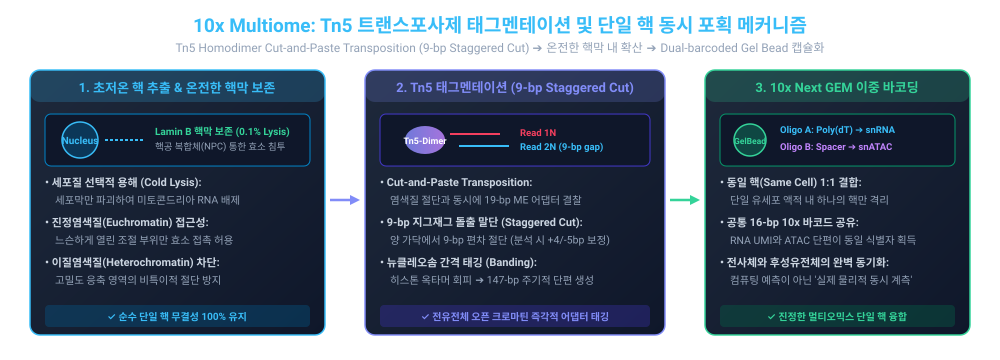
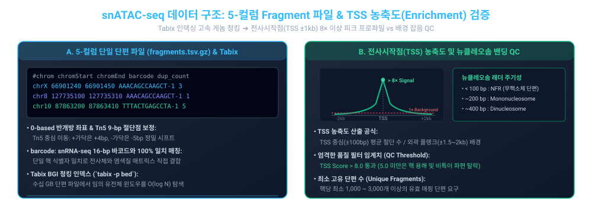
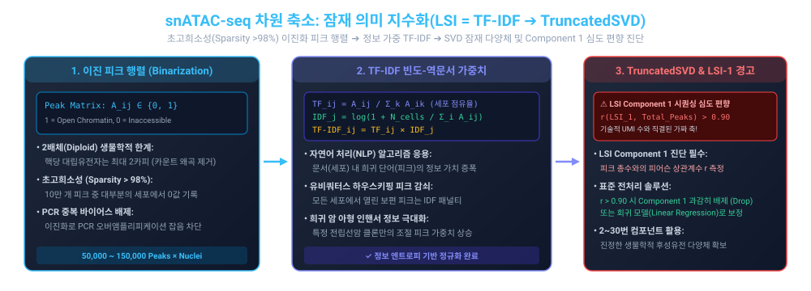
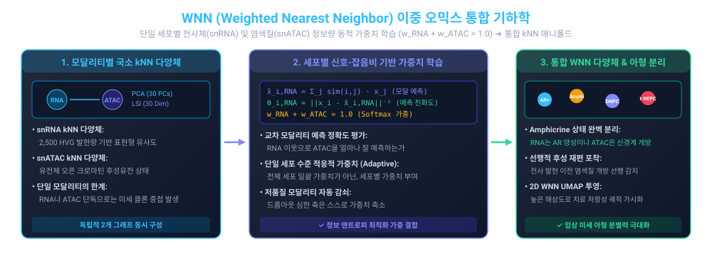
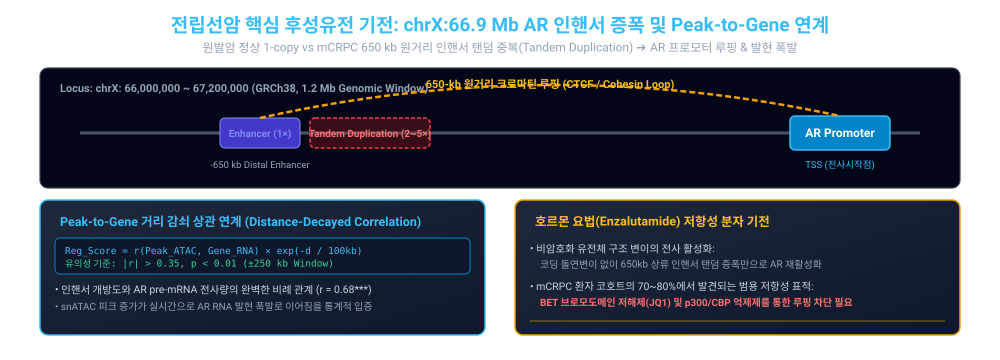
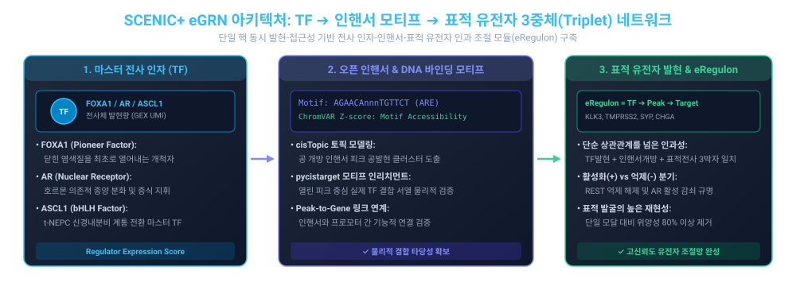

# 전립선암 10x Multiome (snRNA + snATAC) & 후성유전학 마스터 교재
**Single-Nucleus Multiome Sequencing for Cancer Epigenomics: From Tn5 Tagmentation to SCENIC+ eGRN**

---

## 📚 교재 전체 목차 (Table of Contents)

- [Part 00. Chapter 00. Track 01 로드맵: 전립선암 10x Multiome (snRNA + snATAC) 학습 과정](#part-00-chapter-00-track-01-로드맵-전립선암-10x-multiome-snrna--snatac-학습-과정)
- [Part 01. Chapter 01. 후성유전학 원리와 Tn5 트랜스포세이스 절단-접합 화학 (Tagmentation Chemistry)](#part-01-chapter-01-후성유전학-원리와-tn5-트랜스포세이스-절단-접합-화학-tagmentation-chemistry)
- [Part 02. Chapter 02. 업스트림 정렬 및 Fragment 파일 구조: FASTQ에서 게놈 좌표까지](#part-02-chapter-02-업스트림-정렬-및-fragment-파일-구조-fastq에서-게놈-좌표까지)
- [Part 03. Chapter 03. snATAC 특화 품질 관리(QC) 지표와 염색질 무결성 판별](#part-03-chapter-03-snatac-특화-품질-관리qc-지표와-염색질-무결성-판별)
- [Part 04. Chapter 04. 피크 콜링(MACS3)과 LSI 차원 축소의 기하학](#part-04-chapter-04-피크-콜링macs3과-lsi-차원-축소의-기하학)
- [Part 05. Chapter 05. WNN 멀티모달 통합 및 계통 미세 클론 규명 (Weighted Nearest Neighbor)](#part-05-chapter-05-wnn-멀티모달-통합-및-계통-미세-클론-규명-weighted-nearest-neighbor)
- [Part 06. Chapter 06. 원거리 인핸서-프로모터 루핑 및 Peak-to-Gene 연계 분석 (Cicero & AR Enhancer)](#part-06-chapter-06-원거리-인핸서-프로모터-루핑-및-peak-to-gene-연계-분석-cicero--ar-enhancer)
- [Part 07. Chapter 07. 전사 인자 풋프린팅 및 단일 핵 모티프 편차 분석 (ChromVAR & TOBIAS)](#part-07-chapter-07-전사-인자-풋프린팅-및-단일-핵-모티프-편차-분석-chromvar--tobias)
- [Part 08. Chapter 08. 인핸서 주도 전사조절망 복원: SCENIC+ 및 삼중 eRegulon 아키텍처](#part-08-chapter-08-인핸서-주도-전사조절망-복원-scenic-및-삼중-eregulon-아키텍처)
- [Part 09. Chapter 09. 멀티오믹스 실전 트러블슈팅 및 5단계 캡스톤 프로젝트 루브릭](#part-09-chapter-09-멀티오믹스-실전-트러블슈팅-및-5단계-캡스톤-프로젝트-루브릭)

---

# Part 00. Chapter 00. Track 01 로드맵: 전립선암 10x Multiome (snRNA + snATAC) 학습 과정
> **출처 원본 파일**: `tracks/01_multiome_snatac/docs/00_MULTIOME_ROADMAP.md`


> **Cognitive Goal**: 전립선암 후성유전체 연구에서 왜 단일 전사체(snRNA-seq)를 넘어 단일 핵 다중오믹스(10x Multiome: snRNA + snATAC)가 필수적인지 이해하고, 전체 학습 단계별 인지 구조, 공개 벤치마크 데이터셋 활용법 및 재현 가능한 멀티오믹스 컴퓨팅 환경을 구축할 수 있다.

---

## 1. 전립선암 연구에서 왜 10x Multiome (snRNA + snATAC)인가?

단일 핵 RNA 시퀀싱(snRNA-seq)은 종양 미세환경 내 이질적인 세포 계통과 악성 클론을 식별하는 강력한 도구입니다. 그러나 **전사체(Transcriptome)는 세포가 "현재 실행 중인 결과(Consequence)"만을 반영**할 뿐, **"왜 그 유전자가 전사되었는지" 또는 "앞으로 어떤 세포 상태로 전이할 잠재력을 지녔는지"를 설명하는 후성유전학적 메커니즘(Mechanism & Potential)**을 직접 보여주지 못합니다.

```
[후성유전학적 인과 사슬 (Epigenetic Causality)]
크로마틴 개방 (Chromatin Accessibility) ──► 전사인자 결합 (TF Binding) ──► 전사 개시 (Transcription) ──► 단백질 번역
         ▲                                                ▲
    snATAC-seq (조절 기전: 원인)                     snRNA-seq (발현 상태: 결과)
```

### 1.1 RNA 단독 분석의 생물학적 한계
1. **잠재(Primed) 상태 vs 침묵(Repressed) 상태의 식별 불가**:
   - 어떤 유전자의 mRNA 카운트가 $0$일 때, snRNA-seq 데이터로는 해당 프로모터/인핸서가 이질염색질(Heterochromatin)로 완전히 닫혀 있는 **불가역적 억제 상태(Repressed)**인지, 크로마틴은 이미 활짝 열려 있으나 적절한 전사인자 신호만을 기다리는 **기능적 준비 상태(Primed)**인지 구분할 수 없습니다.
2. **원격 시스-조절 인핸서(Distal Enhancers) 활성의 추적 불가**:
   - 전립선암의 핵심 종양 유전자들은 수십~수백 kb 떨어진 원격 인핸서 복합체에 의해 구동됩니다. mRNA 발현량만으로는 어떤 비코딩(Non-coding) 조절 좌위가 실제 해당 유전자의 전사를 구동하는지 추론할 수 없습니다.
3. **선구자 전사인자(Pioneer Transcription Factors)의 후성유전적 각인**:
   - *FOXA1*, *HOXB13*과 같은 선구자 인자는 응축된 염색질에 먼저 결합하여 크로마틴을 열어젖히며, 이후 안드로겐 수용체(*AR*)가 접근할 수 있는 통로를 개방합니다. 이러한 전사 네트워크의 선후 관계는 염색질 개방성 데이터 없이는 해석이 불가능합니다.

### 1.2 전산적 가상 매칭(In-silico Pairing)의 치명적 위양성
초기 단일세포 연구에서는 scRNA-seq과 scATAC-seq을 별도의 세포 샘플에서 독립적으로 수행한 뒤, 유전자 활성 점수(Gene Activity Score)나 공통 잠재 공간 투영(Co-embedding)을 통해 사후 전산 매칭(In-silico pairing)을 시도했습니다.

그러나 이는 극심한 종양 이질성을 지닌 전립선암에서 다음과 같은 치명적 오류를 낳습니다:
- **잘못된 세포 쌍 매칭(False-positive Pairing)**: 이종 세포 집단(예: *AR* 발현이 유사하지만 크로마틴 상태가 완전히 다른 두 클론)이 알고리즘에 의해 강제로 동일 세포로 묶입니다.
- **다대일/일대다 왜곡**: 크로마틴 변화는 유전자 발현 변화에 선행하는 경향이 보고되어 있으므로(시간 척도는 맥락 의존적), 발현 유사도만으로 세포 상태를 매핑하면 분화 궤적의 인과 관계가 역전됩니다.

**10x Multiome 기술**은 **동일한 물리적 단일 핵(The very same physical nucleus)**에서 snRNA와 snATAC 라이브러리를 물리적으로 1:1 바코딩하여 동시 포획하므로, 동일 GEM 내 동시 포획이므로 사후 전산 매칭에 따른 오류가 없는 결합 오믹스(Paired Multiomics)를 제공합니다. 다만 다중 핵 GEM(doublet), 앰비언트 RNA/DNA 오염, 바코드 변환 불일치 등은 여전히 QC가 필요하므로 '완전한 ground truth'는 아닙니다.

---

## 2. Track 01 학습 로드맵 및 인지 단계 (Cognitive Levels)

```
[Level 1: Biophysical Foundation]
  ├── Ch 01. 후성유전학 원리와 Tn5 트랜스포세이스 절단-접합 화학 (Tagmentation)
  └── Ch 02. 업스트림 정렬(Cell Ranger ARC, Chromap) 및 Fragment 파일 구조
          │
[Level 2: Data Cleaning & Low-Dimensional Geometry]
  ├── Ch 03. snATAC 특화 QC 지표 (TSS Enrichment Score, 147bp 뉴클레오솜 래더)
  └── Ch 04. 슈도벌크 MACS3 피크 콜링 및 LSI (TF-IDF + SVD) 차원 축소 기하학
          │
[Level 3: Dual-Modal Integration & Biological Discovery]
  ├── Ch 05. WNN (Weighted Nearest Neighbor) 멀티모달 통합 및 클러스터링
  └── Ch 06. Peak-to-Gene 연관 분석 (Chromatin-Gene Linkage & Distance Filtering)
          │
[Level 4: Expert Mastery: Gene Regulatory Networks]
  ├── Ch 07. 전사조절망 추론 (pycisTopic 모티프 디스커버리 & SCENIC+ eGRN 구축)
  └── Ch 08. 전립선암 치료 저항성 및 계통 가소성 후성유전체 마스터클래스
```

---

## 3. 선수 지식 점검 (Prerequisites)

- **후성유전학 기초**:
  - 진정염색질(Euchromatin) vs 이질염색질(Heterochromatin).
  - 뉴클레오솜(Nucleosome) 구조: 코어 히스톤 8량체 ($H2A, H2B, H3, H4 \times 2$)를 147 bp DNA가 1.65바퀴 감고 있는 형태.
  - 주요 히스톤 번역 후 수식화(PTM): 활성 마커($H3K27ac$, $H3K4me3$) vs 억제 마커($H3K27me3$, $H3K9me3$).
- **전립선암 전사 조절 기구**:
  - 마스터 선구자 인자: *FOXA1*, *HOXB13*.
  - 안드로겐 수용체 축: *AR*, *NKX3-1*, 상류 거대 인핸서 증폭 좌위.
  - 신경내분비 계통 전사인자: *ASCL1*, *NEUROD1*, *INSM1*, *REST*(억제자).
- **컴퓨팅 및 수학적 기초**:
  - 고차원 희소 행렬(Sparse Matrix) 연산 (`scipy.sparse.csr_matrix`).
  - 자연어 처리 및 정보 검색 모델: TF-IDF (Term Frequency - Inverse Document Frequency).
  - 선형대수: Truncated Singular Value Decomposition (SVD), 직교 투영.
  - 멀티모달 데이터 컨테이너: Python `muon` 라이브러리의 `MuData` 데이터 구조.

---

## 4. 재현 가능한 멀티오믹스 분석 환경 구축 (Environment Setup)

10x Multiome 분석은 대용량 지놈 정렬, Fragment 파싱, MACS3 피크 콜링 및 딥러닝/그래프 기반 멀티모달 통합 도구를 광범위하게 요구합니다. 격리된 Conda 가상환경을 구축합니다:

```bash
# 1. Multiome 전용 가상환경 생성 (Python 3.10 권장)
conda create -n multiome_env python=3.10 -y
conda activate multiome_env

# 2. 필수 바이오인포매틱스 C/C++ 기반 업스트림 유틸리티 설치
conda install -c bioconda samtools tabix bedtools ucsc-bedgraphtobigwig chromap -y

# 3. MACS3 피크 콜러 설치 (Python 3.10 호환)
pip install macs3

# 4. 단일세포 및 멀티오믹스 핵심 프레임워크 설치
pip install scanpy anndata muon episcanpy snapatac2

# 5. 후성유전학 모티프 분석 및 확장 전사조절망 도구 (SCENIC+)
pip install pycistopic pybiomart pygenometracks
# 08장 코드는 SCENIC+ v1.0.0 API 기준이므로 태그를 고정 (태그 존재는 GitHub에서 확인했으나, 이 설치 명령과
# 의존성 해결은 직접 실행해 검증하지 않았음; git main은 snakemake 중심으로 함수 시그니처가 다름)
pip install git+https://github.com/aertslab/scenicplus.git@v1.0.0

# 6. Jupyter 커널 등록
python -m ipykernel install --user --name multiome_env --display-name "Python (Multiome snATAC)"
```

### 설치 무결성 검증 스크립트
```python
import muon as mu
import scanpy as sc
import snapatac2 as snap
import pycisTopic

print(f"Muon Version: {mu.__version__}")
print(f"Scanpy Version: {sc.__version__}")
print(f"SnapATAC2 Version: {snap.__version__}")
print("All core multiome dependencies successfully verified.")
```

---

## 5. 실전 벤치마크 공개 멀티오믹스 데이터셋 카탈로그 (Public Multiome Datasets)

전립선암 10x Multiome 연구 및 방법론 검증을 위한 핵심 공개 데이터셋 카탈로그입니다:

| 연구 (논문) | 접근 번호 (Accession) | 플랫폼 / 모달리티 | 샘플 구성 및 환자 코호트 | 핵심 후성유전학적 분석 포인트 |
|:---|:---|:---|:---|:---|
| **10x Genomics Official Dataset** | `10x Genomics Dataset Hub` | Chromium Multiome (Cell Ranger ARC 2.0.0 배포본) | PBMC granulocyte-sorted 10k (전립선 종양 아님) | 10x 공개 Multiome 예제; Cell Ranger ARC 파이프라인 및 WNN 검증용 (공개 전립선 종양 Multiome 10x 데이터는 확인하지 못함) |

> **데이터셋 출처 주의**: 이전에 이 표에 있던 `GSE175634`(심근 분화 scRNA-seq)와 `GSE210358`(마우스 GEMM·오가노이드와 인간 mCRPC 시료의 RNA-seq, Chan et al. 2022)는 전립선 10x Multiome이 아님이 확인되어 삭제했습니다. 공개 전립선 Multiome accession은 아직 확정하지 못했습니다(accession 미확정: 원 논문의 Data Availability 확인 필요).

### 10x 공개 Multiome 예제(PBMC granulocyte-sorted 10k) 다운로드 가이드

> 아래 URL은 HTTP HEAD로 존재를 확인한 PBMC 예제이다(fragments 파일 약 2.4 GB). 이전에 적혀 있던 `human_prostate_tumor_multiome` 경로는 실재하지 않아(HTTP 403) 삭제했다. 전립선 종양 데이터를 쓰려면 원 논문의 Data Availability에서 확인된 accession/URL만 사용한다.
```bash
# 작업 디렉토리 생성
mkdir -p data/10x_pbmc_multiome && cd data/10x_pbmc_multiome

# 1. 필터링된 멀티오믹스 특성 매트릭스 (H5 형식: GEX + ATAC 동시 수록)
curl -O https://cf.10xgenomics.com/samples/cell-arc/2.0.0/pbmc_granulocyte_sorted_10k/pbmc_granulocyte_sorted_10k_filtered_feature_bc_matrix.h5

# 2. snATAC 골드 스탠다드 Fragment 파일 및 인덱스 (필수)
curl -O https://cf.10xgenomics.com/samples/cell-arc/2.0.0/pbmc_granulocyte_sorted_10k/pbmc_granulocyte_sorted_10k_atac_fragments.tsv.gz
curl -O https://cf.10xgenomics.com/samples/cell-arc/2.0.0/pbmc_granulocyte_sorted_10k/pbmc_granulocyte_sorted_10k_atac_fragments.tsv.gz.tbi

# 3. 종합 QC 및 정렬 요약 보고서 (Web Summary)
curl -O https://cf.10xgenomics.com/samples/cell-arc/2.0.0/pbmc_granulocyte_sorted_10k/pbmc_granulocyte_sorted_10k_web_summary.html
```

---

## 6. 단원 핵심 점검 (Cognitive Checkpoint & Case Study)

### [문제 1. 핵심 개념 능동 회상 (Active Recall)]
단일 핵 전사체(snRNA-seq) 단독 분석 대비 10x Multiome (snRNA + snATAC) 기술이 종양 생물학 연구자에게 제공하는 3가지 결정적 분자생물학적 정보를 기술하고, 서로 다른 환자 검체에서 개별적으로 생성된 scRNA와 scATAC 데이터를 알고리즘으로 사후 매칭(In-silico pairing)할 때 발생하는 통계적 위험성을 설명하시오.

<details>
<summary>💡 모범 답안 및 해설 확인</summary>

1. **10x Multiome이 제공하는 3대 결정적 정보**:
   - **유전자 발현 잠재력(Primed vs Repressed)의 규명**: 현재 mRNA 발현이 0인 휴면 유전자에 대해 크로마틴이 열려 있어 즉각 반응 가능한 상태인지, 헤테로크로마틴으로 단단히 잠겨 영구 억제된 상태인지 명확히 구별할 수 있습니다.
   - **원격 비코딩 시스-조절 인핸서(Distal Cis-Regulatory Elements)와 표적 유전자의 1:1 결합**: 수십~수백 kb 떨어진 인핸서 피크의 개방성과 동일 물리적 핵 내 mRNA 발현 간의 상관계수(Peak-to-Gene Linkage)를 직접 연산하여 표적 암 유전자를 정확히 도출합니다.
   - **선구자 전사인자(Pioneer TFs)의 염색질 개방과 하류 유전자 전사의 인과관계 규명**: *FOXA1*, *HOXB13* 등의 결합 모티프 개방성과 하류 종양 신호 경로 활성화를 동일 세포 단위에서 직접 연계합니다.
2. **사후 전산 매칭(In-silico Pairing)의 통계적 위험성**:
   - 전립선암은 환자 간, 클론 간 유전적/후성유전적 이질성이 극심합니다. 사후 전산 매칭은 "발현 패턴이 비슷하면 염색질 구조도 비슷할 것"이라는 가정을 전제하지만, 실제 생물학에서는 염색질 개방이 전사 개시보다 수 시간~수일 선행하므로 중간 과도기 세포(Plastic/intermediate cells)가 엉뚱한 성숙 세포로 강제 매핑되는 **위양성 매칭 오류(False-positive Pairing Artifact)**를 초래합니다.

</details>

---

### [문제 2. 핵심 개념 능동 회상 (Active Recall)]
Python 기반 멀티오믹스 분석 프레임워크인 `MuData` (Muon 라이브러리)의 데이터 저장 구조를 설명하고, 전통적인 단일 모달리티 `AnnData` 객체와 비교하여 다중 모달리티 간 바코드 공유 및 슬라이싱이 어떻게 작동하는지 서술하시오.

<details>
<summary>💡 모범 답안 및 해설 확인</summary>

1. **`MuData` 아키텍처**:
   - `MuData` (Multimodal Data)는 서로 다른 생물학적 모달리티를 담당하는 개별 `AnnData` 객체들을 하위 모달리티 슬롯(`mdata.mod['rna']`, `mdata.mod['atac']`)으로 계층적 포함하는 상위 컨테이너 구조입니다.
2. **`AnnData`와의 비교 및 바코드 슬라이싱**:
   - 기존 `AnnData`는 단일 특성 행렬(예: 세포 × 유전자)만을 관리하지만, `MuData`는 공유된 세포 바코드(`obs`)를 축으로 하여 `rna`의 유전자 카운트 행렬(세포 × 36,000 유전자)과 `atac`의 게놈 피크 행렬(세포 × 150,000 피크)을 동시에 인덱싱합니다.
   - `mdata.obs`는 두 모달리티의 공통 메타데이터(예: 환자 ID, 세포 유형, 이중핵 판정)를 관리하며, `mdata[selected_cells, :]`와 같이 슬라이싱을 수행하면 두 모달리티(`rna`, `atac`)의 내부 행렬이 완벽한 정렬 상태를 유지하며 동시에 필터링됩니다.

</details>

---

### [문제 3. 임상 사례 분석 (Clinical Interpretation Case Study)]
**[임상 시나리오]**
원발암 수술 후 안드로겐 차단 요법(ADT: Leuprolide + Enzalutamide) 치료를 받던 중 생화학적 재발(PSA 상승)과 함께 간 전이가 발생한 mCRPC 환자의 간 생검 조직을 채취하여 10x Multiome 시퀀싱을 수행했습니다.
분석 결과, 간 전이 악성 암세포 클러스터에서 *AR*(안드로겐 수용체)과 *KLK3*(PSA)의 mRNA 발현량은 거의 $0$에 가까웠으나, 염색질 분석 결과 *AR* 유전자 상류 650 kb에 위치한 거대 증폭 인핸서(Centromeric Super-Enhancer) 영역과 *AR* 프로모터의 크로마틴 개방성(ATAC Peak)은 정상 전립선 상피세포 대비 8배 이상 강력하게 열려 있었습니다.

**[질문]**
1. 이 암세포 클러스터의 상태를 mCRPC 4대 분자 표현형 모델 관점에서 진단하고, mRNA 발현과 염색질 개방성 간의 불일치(Discrepancy)가 발생하는 분자생물학적 메커니즘을 설명하시오.
2. 만약 연구팀이 snRNA-seq 단독 분석만을 수행했을 경우 어떤 잘못된 결론을 내렸을지 비판하고, 10x Multiome 데이터를 토대로 제안할 수 있는 차세대 병용 표적 치료 전략을 제시하시오.

<details>
<summary>💡 모범 답안 및 해설 확인</summary>

1. **분자 진단 및 메커니즘 분석**:
   - **진단 (가설)**: 이 세포군을 '후성유전학적으로 AR 신호가 재활성화될 준비가 된 잠재 상태(Epigenetically Primed AR State)'로 볼 수 있다는 것은 하나의 *가설*이며, t-NEPC/DNPC와 구별하려면 신경내분비 마커 발현·병리·*RB1*/*TP53* 상태 같은 직교 근거가 필요합니다.
   - **불일치 메커니즘에 대한 주의**: 항안드로겐(엔잘루타마이드)은 AR의 활성(핵 내 전위, DNA 결합)을 억제할 뿐 *AR* mRNA를 0으로 만들지 않으며, 항안드로겐 저항 모델에서는 오히려 *AR* mRNA가 증가한다고 보고되었습니다(Chen et al., Nat Med 2004, PMID 14702632). 따라서 '약물이 mRNA 검출을 막았다'는 설명은 성립하지 않습니다. 또한 ATAC 신호는 DNA 카피수에 비례하므로, mCRPC에서 흔한 *AR* 상류 인핸서 중복(70–87%, Viswanathan et al., Cell 2018, PMID 29909985)이 있다면 '8배 개방'은 카피수 효과일 수 있어 카피수 보정(예: CNV 추정) 없이는 'primed' 상태로 해석할 수 없습니다. 이 시나리오는 가상이며, PSA 상승의 공급원은 이 클러스터가 아닌 다른 AR 활성 세포일 가능성도 있습니다.
2. **단독 분석의 오류 및 치료 전략**:
   - **단독 분석 시의 위험**: snRNA-seq만 보았다면 *AR* 음성이므로 "AR 경로가 결손된 AR-비의존성 종양"으로 해석할 수 있으나, 위 이유로 ATAC 단독 해석도 카피수 교란에 취약하므로 두 모달리티와 카피수·NE 마커를 함께 확인해야 합니다.
   - **치료 전략 (가설적 탐색)**: 열린 인핸서가 실제로 AR 재활성화 경로임이 확인된다면, 전사 조절 복합체를 표적하는 **BET 브로모도메인 억제제** 또는 CDK7/CDK9 억제제를 AR 길항제와 병용하는 접근이 *연구 가설*로 제안될 수 있으나, 이는 확립된 표준 치료가 아니며 이 시나리오로부터 임상 권고를 도출할 수 없습니다.

</details>

---

<!-- REFERENCES:BEGIN (generated by scripts/apply_references.py; do not edit by hand) -->
## 참고문헌 (References)
### 본문 인용 문헌
1. Chan JM, Zaidi S, Love JR, et al. Lineage plasticity in prostate cancer depends on JAK/STAT inflammatory signaling. *Science*. 2022;377(6611):1180-1191. PMID: 35981096. doi: 10.1126/science.abn0478
2. Chen CD, Welsbie DS, Tran C, et al. Molecular determinants of resistance to antiandrogen therapy. *Nat Med*. 2004;10(1):33-9. PMID: 14702632. doi: 10.1038/nm972
3. Viswanathan SR, Ha G, Hoff AM, et al. Structural Alterations Driving Castration-Resistant Prostate Cancer Revealed by Linked-Read Genome Sequencing. *Cell*. 2018;174(2):433-447.e19. PMID: 29909985. doi: 10.1016/j.cell.2018.05.036
### 검수 근거 문헌
1. Ma S, Zhang B, LaFave LM, et al. Chromatin Potential Identified by Shared Single-Cell Profiling of RNA and Chromatin. *Cell*. 2020;183(4):1103-1116.e20. PMID: 33098772. doi: 10.1016/j.cell.2020.09.056
2. Elorbany R, Popp JM, Rhodes K, et al. Single-cell sequencing reveals lineage-specific dynamic genetic regulation of gene expression during human cardiomyocyte differentiation. *PLoS Genet*. 2022;18(1):e1009666. PMID: 35061661. doi: 10.1371/journal.pgen.1009666
3. Tang F, Xu D, Wang S, et al. Chromatin profiles classify castration-resistant prostate cancers suggesting therapeutic targets. *Science*. 2022;376(6596):eabe1505. PMID: 35617398. doi: 10.1126/science.abe1505
### 소프트웨어 (표기 버전은 검수 시 API를 확인한 버전이며, 파이프라인 실행 환경은 requirements-pipelines.txt 참조)
- muon 0.2.0 (github.com/scverse/muon). 원 논문: Bredikhin D, Kats I, Stegle O. MUON: multimodal omics analysis framework. *Genome Biol*. 2022;23(1):42. PMID: 35105358. doi: 10.1186/s13059-021-02577-8
- Scanpy 1.12.4 (github.com/scverse/scanpy). 원 논문: Wolf FA, Angerer P, Theis FJ. SCANPY: large-scale single-cell gene expression data analysis. *Genome Biol*. 2018;19(1):15. PMID: 29409532. doi: 10.1186/s13059-017-1382-0
- SnapATAC2 2.10.0 (github.com/scverse/SnapATAC2). 원 논문: Zhang K, Zemke NR, Armand EJ, et al. A fast, scalable and versatile tool for analysis of single-cell omics data. *Nat Methods*. 2024;21(2):217-227. PMID: 38191932. doi: 10.1038/s41592-023-02139-9
- pycisTopic (github.com/aertslab/pycisTopic).
<!-- REFERENCES:END -->


---

# Part 01. Chapter 01. 후성유전학 원리와 Tn5 트랜스포세이스 절단-접합 화학 (Tagmentation Chemistry)
> **출처 원본 파일**: `tracks/01_multiome_snatac/docs/01_EPIGENOMICS_AND_TN5_CHEMISTRY.md`


> **Cognitive Goal**: 진핵세포 염색질의 생물물리학적 패키징 구조와 크로마틴 개방성의 분자적 정의를 이해하고, 초활성 Tn5 트랜스포세이스(Hyperactive Tn5 Transposase)의 9-bp 엇갈림 절단 및 어댑터 결찰(Tagmentation) 화학 메커니즘, 그리고 10x Multiome에서 핵막 무결성을 유지하며 수행되는 핵 내 일괄 태그멘테이션(Bulk In-Nuclei Tagmentation) 원리를 체득한다.

---

## 1. 진핵세포 염색질 구조와 크로마틴 개방성 (Chromatin Accessibility)

인간 세포 1개에 담긴 약 2미터 길이의 게놈 DNA는 직경 약 5~10 $\mu\text{m}$의 핵 내부에 고도로 압축되어 패키징되어 있습니다. 이 압축의 기본 단위를 **염색질(Chromatin)**이라 부릅니다.

### 1.1 뉴클레오솜(Nucleosome)의 기하학적 구조
- **코어 히스톤 8량체(Histone Octamer)**: 양전하를 띠는 단백질 복합체로, 2개의 $H2A-H2B$ 이량체(heterodimer)와 1개의 $(H3-H4)_2$ 사량체(tetramer)로 구성됩니다.
- **DNA 감김**: 음전하를 띤 인산 골격의 147 bp 이중가닥 DNA가 히스톤 8량체 외벽을 **1.65바퀴** 왼손잡이 방향으로 견고하게 감싸고 있습니다.
- **링커 DNA (Linker DNA)**: 뉴클레오솜과 뉴클레오솜 사이를 잇는 20~80 bp의 노출된 DNA 구간으로, 링커 히스톤인 $H1$이 결합하여 상위 차수의 염색질 응축을 유도합니다.

```
                    ┌── 147 bp DNA (1.65바퀴 감김) ──┐
                    ▼                                │
            [ H2A-H2B ]───[ H3-H4 ]                  │
               │             │                       ▼
               └──[ H3-H4 ]───[ H2A-H2B ] ◄── Histone Octamer Core
                    ▲
                    └─── Linker DNA (20~80 bp, Tn5가 접근 가능한 열린 영역)
```

### 1.2 진정염색질(Euchromatin) vs 이질염색질(Heterochromatin)
1. **진정염색질 (Euchromatin - Open / Accessible Chromatin)**:
   - 전사인자 및 RNA 중합효소 복합체가 자유롭게 접근할 수 있도록 뉴클레오솜 간격이 넓게 벌어져 있는 상태(**NDR: Nucleosome-Depleted Regions**).
   - 프로모터(Promoter) 및 활성 인핸서(Active Enhancer) 영역에 해당하며, 활성 히스톤 마크($H3K27ac$, $H3K4me3$)가 농축되어 있습니다.
   - **ATAC-seq 시퀀싱 리드가 집중적으로 생성되는 영역**입니다.
2. **이질염색질 (Heterochromatin - Closed / Inaccessible Chromatin)**:
   - 뉴클레오솜이 빽빽하게 밀집되어 전사 인자의 DNA 접촉이 물리적으로 차단된 비활성 상태.
   - 통성 이질염색질(Facultative: $H3K27me3$ 매개, 계통 분화에 따라 가역적 개폐)과 구성적 이질염색질(Constitutive: $H3K9me3$ 매개, 텔로미어/센트로미어의 영구적 침묵)로 나뉩니다.

---

## 2. 초활성(Hyperactive) Tn5 트랜스포세이스 분자 화학

**ATAC-seq (Assay for Transposase-Accessible Chromatin using sequencing)**은 세균의 전위 효소인 **Tn5 트랜스포세이스**가 지닌 고유한 절단 및 결찰 반응(Tagmentation)을 역이용하여 열린 염색질만을 유전체 수준에서 포획합니다.



### 2.1 효소 엔지니어링: Hyperactive Tn5
야생형(Wild-type) 대장균 Tn5 효소는 세포 독성을 방지하기 위해 자연 상태에서 전위 활성이 매우 낮습니다. 현대 ATAC-seq에 사용되는 Tn5는 유전공학적으로 점돌연변이(문헌상 **E54K**, **M56A**, **L372P**; Goryshin & Reznikoff 1998, J Biol Chem — 이 교재에서는 원문의 변이 목록을 직접 확인하지 못했으며 상용 효소의 정확한 변이 구성은 제조사별로 다를 수 있음)가 도입된 초활성(Hyperactive) 변이체입니다. 야생형 대비 전위 활성이 크게 높아진 것이 핵심이며, 구체적 증가 배수와 분자 기전은 변이체·조건에 따라 달라 여기서는 수치를 제시하지 않습니다.
- 19 bp의 특이적 이중가닥 DNA 서열인 **모자이크 엔드(Mosaic End, ME: `5'-AGATGTGTATAAGAGACAG-3'`)**를 높은 친화도로 인식합니다.

### 2.2 태그멘테이션(Tagmentation)의 3단계 생화학 반응
Tn5 효소는 Illumina 시퀀싱용 Nextera 어댑터(Read 1 프라이밍 서열과 Read 2 프라이밍 서열)가 각각 결합된 두 개의 단량체가 모여 **호모다이머(Homodimer)** 복합체를 형성합니다:

1. **표적 DNA 스캔 및 결합**:
   - Tn5 다이머는 크기가 약 11 nm로 매우 거대하여, 뉴클레오솜으로 단단히 포장된 이질염색질 내부로는 침투할 수 없습니다. 오직 뉴클레오솜 사이의 노출된 열린 염색질(Linker DNA 및 NDR)에만 선택적으로 결합합니다.
2. **엇갈림 이중가닥 절단 (9-bp Staggered Cut)**:
   - 두 촉매 활성 부위가 DNA의 양쪽 가닥에서 정확히 **9 bp 간격을 두고** 인산디에스테르 결합을 가수분해(Hydrolysis)합니다.
3. **동시 어댑터 결찰 (Transesterification & Simultaneous Ligation)**:
   - 절단과 동시에 효소에 장전되어 있던 ME 서열의 3'-OH 말단을 표적 게놈 DNA의 5' 말단에 공유결합으로 직접 전이(Transesterification)시킵니다.
   - 결과적으로 외래 어댑터가 결찰된 DNA 단편 양 말단에는 **9 bp의 단일가닥 오버행(Single-stranded gap)**이 남게 됩니다.

```
[Tn5 엇갈림 절단 및 어댑터 결찰 메커니즘]

5' ──[Genome DNA]───────┐ 9 bp ┌────────[Genome DNA]── 3'
                        │ Gap  │
3' ──[Genome DNA]───────┴──────┴────────[Genome DNA]── 5'
       ▲                            ▲
       │ Tn5 Cut 1                  │ Tn5 Cut 2 (+9 bp)

결과물:
5' ──[Nextera Read 1]──► [Genome DNA 5'──...] 
                      (9-bp Gap) 
[...──3' Genome DNA] ◄──[Nextera Read 2]── 5'
```

> **바이오인포매틱스 필수 인지 (+4 bp / -5 bp Shifting)**:
> Tn5가 9 bp의 엇갈림 절단을 일으키므로, 시퀀싱 리드의 실제 5' 정렬 위치는 실제 효소의 물리적 중심점보다 **양성 가닥(+)에서는 4 bp 뒤쪽에, 음성 가닥(-)에서는 5 bp 앞쪽에** 위치합니다.
> 따라서 고해상도 전사인자 풋프린팅(Footprinting) 분석 시 **BAM의 리드 5' 좌표를 직접 사용하는 경우** 양성 가닥 리드는 +4 bp, 음성 가닥 리드는 -5 bp 시프트(Tn5 shift correction)하여 정확한 1 bp 효소 중심점을 복원해야 합니다. 10x Cell Ranger ARC·Chromap이 만든 `fragments.tsv.gz`는 이미 +4/-5가 반영된 좌표이므로(02장 참조) 이 입력에 다시 적용하면 이중 시프트가 됩니다.

---

## 3. 10x Multiome의 핵 내 일괄 태그멘테이션 (Bulk In-Nuclei Tagmentation)

10x 독립 scATAC(v1/v1.1/v2)과 10x Multiome(snRNA + snATAC)은 모두 핵 현탁액을 시험관에서 먼저 일괄 태그멘테이션한 뒤 GEM으로 분배·바코딩합니다. 따라서 둘의 결정적 차이는 태그멘테이션 시점이 아니라 **Multiome이 같은 GEM에서 RNA(역전사)와 ATAC를 함께 바코딩한다는 점**입니다. 태그멘테이션 시점의 차이는 미세유체 칩에서 개별 세포를 포획한 뒤 반응하는 Fluidigm C1류 방식과의 비교에서 의미가 있습니다.

### 3.1 개별 세포 포획 반응(C1류) vs 핵 내 일괄 반응(10x) 비교
- **개별 포획형 scATAC-seq (예: Fluidigm C1)**: 미세유체 칩에서 단일 세포를 먼저 포획한 뒤, 각 챔버 내부에서 Tn5 반응과 바코딩을 수행. (10x 독립 scATAC은 이 방식이 아니라 아래 10x Multiome과 같이 핵 내 일괄 태그멘테이션을 사용.)
- **10x Multiome (snRNA + snATAC)**:
  - 단일 핵 현탁액 상태에서 **세포를 미세유체 칩에 투입하기 전(Pre-GEM), 시험관(Tube) 내에서 모든 핵에 대해 일괄적으로 Tn5 태그멘테이션을 먼저 수행**합니다.
  - 이후 세척된 핵을 10x Chromium 칩에 투입하여 같은 GEM 안에서 snRNA 역전사(RT)와 ATAC 바코딩을 함께 진행합니다(이것이 독립 scATAC과의 차이).

```
[10x Multiome 습식 워크플로우 순서]
동결 전립선 조직 
   │
   ▼  Dounce 저온 균질화 & Detergent 처리 (외부 세포막만 파괴)
온전한 단일 핵 현탁액 (Intact Nuclei)
   │
   ▼  ★ Bulk In-Nuclei Tagmentation: 시험관 내에서 투과화된 핵 내부로 Tn5 침투 절단
태그멘테이션이 완료된 intact한 핵들
   │
   ▼  세척 및 10x Chromium 유세포 채널 투입
단일 액적(GEM) 형성: [단일 핵] + [Dual-Barcode Gel Bead] + [RT/PCR Reagents]
   │
   ├──► RNA 분자: Gel bead의 Oligo-dT/UMI 프라이머로 역전사 ──► snRNA Library
   └──► ATAC 단편: Gel bead의 ATAC 바코드 프라이머로 선형 증폭 ──► snATAC Library
```

### 3.2 핵막(Nuclear Envelope)의 보존과 선택적 투과화 화학
어떻게 거대한 Tn5 효소가 핵 내부로 들어가 염색질을 자르는데, 절단된 DNA 조각들은 핵 밖으로 유출되지 않고 온전히 유지될까요?
1. **온화한 비이온성 계면활성제(Digitonin)의 역할**:
   - 콜레스테롤 친화성이 높은 **Digitonin(0.01%)**은 외부 세포막은 완전히 용해하지만, 핵 라미나(Nuclear lamina) 단백질 망으로 지지되는 내핵막/외핵막의 구조적 형태는 붕괴시키지 않습니다.
   - 이렇게 투과화된 핵 내부로 완충액에 든 Tn5 효소 호모다이머가 접근하여 염색질을 절단합니다(Tn5가 핵 내부로 들어가는 구체적 경로, 예: 핵공 통과 여부는 이 교재에서 확인하지 못한 부분입니다).
2. **염색질의 핵 매트릭스 고정 효과 (Steric Hindrance)**:
   - 게놈 DNA는 메가베이스 단위의 거대한 고분자 사슬이며 핵 골격에 결합되어 있으므로, Tn5에 의해 단편화되더라도 대부분 핵 내부에 물리적으로 머문다고 설명됩니다.
   - 반응 후 핵을 원심분리하여 상층액의 여분 Tn5 효소를 세척해 냄으로써, **반응 후 배경 비특이적 DNA 절단을 줄일** 수 있습니다.

---

## 4. 결론 및 다음 단계 연결

초활성 Tn5 트랜스포세이스는 열린 염색질에 침투하여 9-bp 엇갈림 절단과 동시에 시퀀싱 어댑터를 결찰시킵니다. 10x Multiome은 핵막의 선택적 투과성을 활용하여 단일 시험관 내에서 고효율 태그멘테이션을 완수한 뒤, 10x 미세유체 채널을 통해 단일 핵 단위로 RNA와 ATAC 바코드를 동시에 부여합니다.

이렇게 시퀀싱되어 출력된 원시 FASTQ 파일로부터 바이오인포매틱스 분석의 표준 규격인 Fragment 파일을 생성하고 정렬하는 원리는 다음 장 [Chapter 02. 업스트림 정렬 및 Fragment 파일 구조](docs/02_UPSTREAM_AND_FRAGMENTS.md)에서 심층 학습합니다.

---

## 5. 단원 핵심 점검 (Cognitive Checkpoint & Case Study)

### [문제 1. 핵심 개념 능동 회상 (Active Recall)]
초활성 Tn5 트랜스포세이스가 열린 염색질을 절단할 때 발생하는 화학 반응의 분자적 특성을 설명하고, 이로 인해 바이오인포매틱스 분석(MACS3 피크 콜링, 전사인자 풋프린팅) 시 BAM 리드의 5' 말단 좌표를 직접 사용할 때 적용해야 하는 **+4 bp / -5 bp 시프트 보정(Shift Correction)**의 기하학적 이유를 서술하시오.

<details>
<summary>💡 모범 답안 및 해설 확인</summary>

1. **Tn5 절단 화학의 분자적 특성**:
   - Tn5 효소는 호모다이머 형태로 결합하여 이중가닥 DNA의 양 가닥에서 인산디에스테르 결합을 동시에 절단하는데, 두 단량체의 활성 부위가 정확히 **9 bp 간격을 두고 비대칭적(Staggered)으로 절단**합니다.
   - 절단과 동시에 장전된 어댑터 서열을 5' 말단에 결찰시키므로, 절단된 단편 양 끝단에는 9 bp의 단일가닥 갭(Gap)이 형성됩니다.
2. **+4 bp / -5 bp 시프트 보정의 기하학적 이유**:
   - 시퀀서에서 읽어 들이는 Read 1과 Read 2의 시작 좌표(5' 말단)는 9 bp 엇갈림의 바깥쪽 말단에 해당합니다. 실제 Tn5 효소가 결합했던 물리적 중심점(Center of Tn5 binding)은 양 가닥 절단 위치의 정중앙에 위치합니다.
   - 따라서 정밀한 염색질 개방 중심점 및 전사인자 결합 부위(Footprint)를 복원하기 위해서는, **양성 가닥(+)에 정렬된 리드는 시작 위치를 게놈 하류 방향으로 +4 bp 이동**시키고, **음성 가닥(-)에 정렬된 리드는 시작 위치를 게놈 상류 방향으로 -5 bp 이동**시켜야 정확히 동일한 1 bp 중심 절단 좌표로 수렴하게 됩니다.
   - 단, 이 보정은 BAM에서 리드 좌표를 직접 읽을 때만 필요하다. 10x `fragments.tsv.gz`와 Chromap 출력은 이미 +4/-5가 적용된 좌표이므로 추가로 시프트하지 않는다(ArchR도 `offsetPlus/offsetMinus`를 BAM 입력에만 적용한다).

</details>

---

### [문제 2. 핵심 개념 능동 회상 (Active Recall)]
10x Multiome(snRNA + snATAC) 기술에서 Tn5 태그멘테이션 반응을 10x Chromium 미세유체 칩의 액적 분주(GEM generation) "이전"에 단일 시험관 내에서 대량(Bulk)으로 선행할 수 있는 세포생물학적 메커니즘을 설명하고, 단일세포 분리 시 라이시스 버퍼 내 디지토닌(Digitonin) 농도 조절이 실험의 성패를 가르는 이유를 서술하시오.

<details>
<summary>💡 모범 답안 및 해설 확인</summary>

1. **핵 내 일괄 태그멘테이션의 세포생물학적 원리**:
   - 세포막은 용해되었지만 **핵막(Nuclear envelope)과 핵 라미나(Nuclear lamina)**가 물리적으로 온전하게 보존되어 있기 때문입니다.
   - 온화한 계면활성제 처리를 통해 핵막에 미세한 구멍이 뚫리면 외부 완충액의 Tn5 효소는 내부 염색질로 자유 확산하여 열린 부위를 자르고 어댑터를 붙입니다. 하지만 잘려 나간 게놈 DNA 조각들은 거대한 염색질 복합체 상태로 핵 골격에 고정되어 있어 핵막 밖으로 유출되지 않습니다. 따라서 핵들이 섞인 단일 튜브에서 태그멘테이션을 완수한 뒤 세척하여 단일 액적으로 투입할 수 있습니다.
2. **디지토닌(Digitonin) 농도 조절의 중요성**:
   - **과소 처리 시**: 핵막 투과화가 불충분하여 거대한 Tn5 효소가 핵 내부로 침투하지 못해 라이브러리 수율이 급감하고 유효 피크 검출이 불가능해집니다.
   - **과다 처리 시**: 핵막 지질층이 완전히 붕괴(Over-lysis)되어 핵이 터지고 내부 DNA가 완충액으로 쏟아져 나옵니다. 이 경우 핵 내부 염색질의 물리적 구획이 파괴되어 게놈 DNA가 무차별적으로 엉키고 단일 핵 바코딩이 불가능해지는 치명적 실패를 초래합니다.

</details>

---

### [문제 3. 실험 트러블슈팅 사례 연구 (Wet-lab Troubleshooting Case Study)]
**[실험실 시나리오]**
연구원이 전립선암 동결 조직에서 단일 핵을 분리하여 10x Multiome 라이브러리를 제작했습니다. 그러나 Bioanalyzer로 최종 snATAC 시퀀싱 라이브러리를 검사했을 때 뉴클레오솜 특유의 사다리 패턴(Banding ladder)이 전혀 나타나지 않고 150 bp 이하의 극도로 짧은 단편들만 압도적인 피크로 나타났습니다. Cell Ranger ARC 시퀀싱 결과 TSS Enrichment Score는 1.8(정상치 > 7.0)로 심각하게 낮았고, 게놈 전반에 걸쳐 피크가 없는 균일한 노이즈 배경만이 관찰되었습니다.

**[질문]**
1. 이 현상이 발생한 가장 유력한 생화학적/실험적 원인을 분자 수준에서 규명하시오.
2. 향후 동일 검체에서 성공적인 snATAC 라이브러리를 얻기 위해 습식 실험실 단계에서 수정해야 할 2가지 핵심 프로토콜 매개변수를 제시하시오.

<details>
<summary>💡 모범 답안 및 해설 확인</summary>

1. **실패 원인 규명**:
   - **과도한 핵막 파괴 및 나체 DNA(Naked DNA) 무차별 과절단**: 라이시스 버퍼의 계면활성제(Detergent) 농도가 너무 높았거나 기계적 Dounce 스트로크가 과도하여 핵막이 완전히 찢어지고 핵 내 보호 단백질(히스톤 8량체)이 염색질에서 해리된 상태에서 Tn5 반응이 일어났습니다.
   - 히스톤에 의해 보호받지 못하는 노출된 나체 DNA(Naked genomic DNA)는 Tn5 효소에 무방비로 노출되어, 정상적인 열린 크로마틴(NDR)뿐 아니라 게놈 전체가 균일하고 무작위하게 잘려 나갑니다. 이로 인해 뉴클레오솜 주기성(147 bp)이 사라지고 초미세 단편만 증폭되며, 프로모터 특이적 농축(TSS Enrichment)이 바닥으로 추락하게 됩니다.
2. **습식 프로토콜 수정 대책**:
   - **Lysis Buffer 계면활성제 농도 및 노출 시간 축소**: NP-40/IGEPAL 농도를 $0.1\%$에서 $0.05\%$로 낮추고, Digitonin 농도를 정확히 $0.01\%$ 이하로 제한하며, 얼음 상에서의 라이시스 시간을 기존 10분에서 3~5분으로 엄격히 단축합니다.
   - **현미경 하 핵 무결성(Integrity) 전수 검사 도입**: Tn5 투입 전 DAPI 또는 트립판 블루 염색을 통해 핵막 표면에 소포(Blebbing)가 돌출되지 않고 매끄러운 타원형을 유지하는지 형광 현미경으로 검증한 후 합격된 검체에 한해서만 태그멘테이션을 진행합니다.

</details>

---

<!-- REFERENCES:BEGIN (generated by scripts/apply_references.py; do not edit by hand) -->
## 참고문헌 (References)
### 본문 인용 문헌
1. Goryshin IY, Reznikoff WS. Tn5 in vitro transposition. *J Biol Chem*. 1998;273(13):7367-74. PMID: 9516433. doi: 10.1074/jbc.273.13.7367
<!-- REFERENCES:END -->


---

# Part 02. Chapter 02. 업스트림 정렬 및 Fragment 파일 구조: FASTQ에서 게놈 좌표까지
> **출처 원본 파일**: `tracks/01_multiome_snatac/docs/02_UPSTREAM_AND_FRAGMENTS.md`


> **Cognitive Goal**: 10x Multiome의 듀얼 라이브러리(snRNA + snATAC) 시퀀싱 리드 레이아웃의 차이점을 파악하고, Cell Ranger ARC 및 차세대 초고속 정렬기 Chromap의 매핑 원리, 그리고 snATAC 분석의 절대 표준인 Tabix 인덱싱 기반 Fragment 파일(`fragments.tsv.gz`)의 데이터 아키텍처를 완벽히 이해한다.

---

## 1. 10x Multiome 듀얼 라이브러리 리드 레이아웃

10x Multiome 시퀀싱은 단 하나의 물리적 핵으로부터 **전사체(Gene Expression, GEX)** 라이브러리와 **염색질 개방성(Chromatin Accessibility, ATAC)** 라이브러리를 각각 분리 제작하여 시퀀서에 독립적으로 로딩합니다. 따라서 샘플 1개당 두 세트의 FASTQ 파일이 생성됩니다.

```
[10x Multiome 시퀀싱 리드 아키텍처]

1. GEX Library (snRNA-seq)
Read 1 (28 bp)   : [16 bp Cell Barcode] + [12 bp UMI]
Read 2 (91+ bp)  : [cDNA Fragment: Exon / Pre-mRNA Intron 서열]
Index 1 / 2      : [Illumina i7 / i5 샘플 인덱스 (각 8~10 bp)]

2. ATAC Library (snATAC-seq)
Read 1 (50 bp)   : [게놈 DNA 단편 전방향 서열 (Paired-end 1)]
Read 2 (16 bp)   : [16 bp Cell Barcode (단일 핵 식별 태그)]
Read 3 (50 bp)   : [게놈 DNA 단편 역방향 서열 (Paired-end 2)]
Index (8 bp)     : [Illumina i7 샘플 인덱스]
```

### 1.1 바코드 변환 매핑 (Barcode Translation)의 필수 인지
많은 초심자가 범하는 치명적 오해는 "동일한 핵이므로 GEX FASTQ의 세포 바코드와 ATAC FASTQ의 세포 바코드 염기서열이 100% 동일할 것"이라는 착각입니다.

- **실제 물리적 구조**: 10x Multiome 젤비드 표면에는 RNA 역전사용 올리고(Poly-dT + GEX Barcode)와 ATAC 증폭용 올리고(Spacer + ATAC Barcode)가 물리적으로 함께 결합되어 있습니다.
- 그러나 두 올리고의 16 bp 바코드 서열은 **합성 공정상 서로 다른 염기서열**을 갖습니다.
- **해결책 (Barcode Translation Table)**: 10x Genomics는 737,280개의 GEX 바코드와 그에 1:1 대응하는 ATAC 바코드의 변환 테이블(`737K-arc-v1.txt`)을 제공합니다. `cellranger-arc`는 이 화이트리스트를 참조하여 두 라이브러리의 바코드를 단일한 표준 식별자(Unified Cell ID)로 자동 통합합니다.

---

## 2. 업스트림 정렬 및 카운팅 엔진 (Upstream Engines)

원시 FASTQ 파일들로부터 RNA 유전자 발현량과 ATAC 게놈 절단 단편을 동시 정량화하기 위해 표준 파이프라인을 실행합니다.

### 2.1 Cell Ranger ARC 표준 파이프라인
Cell Ranger ARC는 RNA 리드는 STAR를 통해 게놈 및 전사체(Exon+Intron)에 매핑하고, ATAC 리드는 BWA-MEM 기반 변형 알고리즘을 통해 게놈(GRCh38)에 정렬합니다.

```csv
# libraries.csv (Multiome 입력 설정 파일)
fastqs,sample,library_type
/data/fastqs/GEX_Patient01,Patient01_GEX,Gene Expression
/data/fastqs/ATAC_Patient01,Patient01_ATAC,Chromatin Accessibility
```

```bash
# Cell Ranger ARC 카운트 실행
cellranger-arc count \
  --id=Prostate_mCRPC_Multiome_01 \
  --reference=/ref/refdata-cellranger-arc-GRCh38-2020-A-2.0.0 \
  --libraries=libraries.csv \
  --localcores=32 \
  --localmem=128
```

### 2.2 차세대 대안: Chromap (초고속 정렬기)
수십 개의 환자 코호트를 분석할 때 `cellranger-arc`의 ATAC 정렬 단계는 수십 시간이 소요될 수 있습니다. **Chromap**은 미니마이저(Minimizer) 기반 인덱스를 사용하는 근사 매핑(염기 수준 정렬 없음) 방식으로, 보고된 바로는 BWA 계열 대비 10~20배 빠르면서 유사한 정확도를 보입니다(Chromap README, Zhang et al. 2021):

```bash
# Chromap 초고속 snATAC 정렬 및 Fragment 생성
chromap \
  --preset atac \
  -x /ref/chromap_index/GRCh38.index \
  -r /ref/GRCh38.fa \
  -1 /data/fastqs/ATAC_R1.fastq.gz \
  -2 /data/fastqs/ATAC_R3.fastq.gz \
  -b /data/fastqs/ATAC_R2.fastq.gz \
  --barcode-whitelist /ref/737K-arc-v1.txt \
  --barcode-translate /ref/atac_to_gex_barcode_translate.tsv \
  -o chromap_atac_fragments.tsv \
  -t 32

# Tabix 질의를 위해 정렬 → bgzip 압축 → 인덱싱 (평문 TSV/BED는 tabix 질의 불가)
sort -k1,1 -k2,2n chromap_atac_fragments.tsv | bgzip > chromap_atac_fragments.tsv.gz
tabix -p bed chromap_atac_fragments.tsv.gz
```

> **Multiome 주의**: 10x Multiome에서는 scATAC과 scRNA가 서로 다른 바코드 집합을 쓰므로, Chromap의 `--barcode-translate`(2열 tsv/csv: 첫 열=변환 후 바코드, 둘째 열=원래 바코드; Chromap README)로 ATAC 바코드를 GEX 바코드로 변환해야 Seurat/Signac 객체와 일치한다. 화이트리스트·번역 파일의 실제 파일명과 열 형식은 사용 중인 cellranger-arc 참조 패키지에서 확인할 것(위 경로는 자리표시자). Tn5 shift는 `--preset atac`에서 자동 적용된다.

---

## 3. snATAC의 절대 표준: Fragment 파일 (`fragments.tsv.gz`)

정렬이 완료되면 수백 기가바이트(GB)에 달하는 정렬 BAM 파일(`atac_possorted_bam.bam`)이 생성됩니다. 그러나 다운스트림 후성유전학 분석에서는 **BAM 파일을 거의 사용하지 않으며**, 오직 압축된 **Fragment 파일(`atac_fragments.tsv.gz`)**만을 골드 스탠다드로 사용합니다.



### 3.1 BAM 대신 Fragment 파일을 사용하는 이유
1. **극적인 용량 압축 ($1/10 \sim 1/20$)**:
   - BAM 파일은 시퀀싱 품질 점수(Phred score), CIGAR 문자열, PCR 중복 리드들을 개별적으로 중복 저장하여 샘플당 50~150 GB에 달합니다.
   - Fragment 파일은 PCR 중복(Duplicates)을 제거하고 오직 **"세포 바코드 하나당 고유하게 잘려 나간 게놈 DNA 조각의 양 끝 좌표"**만을 텍스트로 압축 저장하여 2~5 GB 수준으로 경량화됩니다.
2. **정보의 완전성**:
   - ATAC-seq에서 필요한 유일한 생물학적 정보는 "어느 세포에서 어느 게놈 좌표 사이가 열려 있었는가"입니다. Fragment의 시작점과 끝점은 두 번의 독립적인 Tn5 절단 이벤트를 완벽하게 대변합니다.

### 3.2 Fragment 파일의 5대 핵심 열(Columns) 구조
`fragments.tsv.gz`는 탭(Tab)으로 구분된 무손실 텍스트 파일이며, 엄격한 5개 컬럼으로 구성됩니다:

```tsv
chr1    10042   10235   AAACAGCCAAGCTACA-1    1
chr1    10045   10420   AAACAGCCAAGCTACA-1    2
chr1    180510  180695  TTATGTCAGTGTCATC-1    1
chr2    452100  452280  AAACAGCCAAGCTACA-1    1
```

1. **`chrom` (염색체 명칭)**: 게놈 참조 서열 염색체 (예: `chr1`, `chrX`).
2. **`chromStart` (절단 시작 좌표)**:
   - 0-based 좌표계(BED와 동일).
   - **중요**: 리드 1의 5' 정렬 위치에 이미 **+4 bp Tn5 시프트 보정**이 반영된 최종 좌표입니다.
3. **`chromEnd` (절단 종료 좌표)**:
   - 0-based half-open 좌표계(BED와 동일: 마지막 염기의 다음 위치).
   - 리드 2(R3)의 5' 정렬 위치에 **-5 bp Tn5 시프트 보정**이 반영된 최종 좌표입니다.
4. **`barcode` (세포 바코드)**: 단일 핵을 식별하는 16 bp 고유 바코드 + GEM 웰 번호 (예: `AAACAGCCAAGCTACA-1`).
5. **`duplicate_count` (PCR 중복 횟수)**: 동일한 시작-끝 좌표를 공유하는 단편이 PCR 증폭 과정에서 몇 번 읽혔는지를 기록 (보통 1 이상의 정수).

### 3.3 Tabix 인덱싱 (`.tbi`)과 초고속 구간 질의
Fragment 파일의 진정한 위력은 게놈 좌표 기반 인덱서인 **Tabix**와 결합할 때 발휘됩니다:
- `atac_fragments.tsv.gz`는 염색체 번호 및 시작 좌표 순(`sort -k1,1 -k2,2n`)으로 정렬되어 있습니다.
- 동반되는 `atac_fragments.tsv.gz.tbi` 인덱스 파일은 BAI와 같은 계층적 빈(Bin) 인덱스와 16 kb 단위 선형 인덱스를 포함합니다.
- 연구자가 전립선암 마커인 *AR* 프로모터(`chrX:67,540,000-67,545,000`)에 속한 단편들만을 가져오고자 할 때, 수억 줄의 파일을 처음부터 읽을 필요 없이 **Tabix 인덱스를 통해 해당 구간이 들어 있는 BGZF 블록으로 직접 이동하여 필요한 블록만 읽음으로써 밀리초~초 단위로 단편을 추출**할 수 있습니다(질의 비용은 겹치는 빈 수와 읽는 레코드 수에 비례하며 $O(1)$은 아닙니다).

---

## 4. Python 기반 Fragment 고속 핸들링 실전

Python 환경에서는 `pysam` 라이브러리를 사용하여 Fragment 파일에 초고속으로 접근할 수 있습니다:

```python
import pysam

# Tabix 인덱싱된 Fragment 파일 열기
fragment_path = "outs/atac_fragments.tsv.gz"
tbx = pysam.TabixFile(fragment_path)

# 전립선암 핵심 유전자 KLK3(PSA) 프로모터 영역 질의 (GRCh38)
# KLK3 hg38 = chr19:50,854,915-50,860,764 (+ 가닥, NM_001648.2); TSS 상하류 약 2 kb
chrom = "chr19"
start = 50853000
end = 50857000

print(f"Querying fragments in {chrom}:{start}-{end} ...")
count = 0
for row in tbx.fetch(chrom, start, end):
    fields = row.split('\t')
    f_chrom, f_start, f_end, barcode, dup = fields[0], int(fields[1]), int(fields[2]), fields[3], int(fields[4])
    fragment_length = f_end - f_start
    count += 1
    if count <= 3:
        print(f"  Barcode: {barcode} | Length: {fragment_length} bp | Range: {f_start}-{f_end}")

print(f"Total overlapping fragments captured: {count}")
```

---

## 5. 결론 및 다음 단계 연결

10x Multiome의 FASTQ 리드는 GEX와 ATAC 라이브러리로 분리 시퀀싱된 후, 변환 화이트리스트 테이블을 통해 단일 핵 바코드로 재통합됩니다. 업스트림 정렬을 거쳐 산출된 `fragments.tsv.gz`는 Tn5 시프트가 보정된 게놈 절단 단편들을 수록하는 핵심 표준 파일입니다.

그러나 이렇게 생성된 수백만 개의 바코드 중 "진짜 온전한 염색질을 가진 핵"과 "핵막이 파열되어 쏟아진 나체 DNA 파편"을 어떻게 분리할까요? 다음 장 [Chapter 03. snATAC 특화 품질 관리(QC) 지표](docs/03_SNATAC_QC_METRICS.md)에서는 TSS 농축 점수와 147 bp 뉴클레오솜 주기성을 통한 엄밀한 품질 검증법을 학습합니다.

---

## 6. 단원 핵심 점검 (Cognitive Checkpoint & Case Study)

### [문제 1. 핵심 개념 능동 회상 (Active Recall)]
10x Multiome(snRNA + snATAC) 플랫폼에서 GEX 라이브러리와 ATAC 라이브러리의 시퀀싱 리드 레이아웃(Read 1, 2, 3)의 구성적 차이점을 비교 설명하고, 두 라이브러리 간 세포 바코드 염기서열이 물리적으로 다름에도 불구하고 단일 핵 단위로 완벽하게 1:1 결합될 수 있는 바코드 변환 매핑(Barcode Translation Table)의 원리를 기술하시오.

<details>
<summary>💡 모범 답안 및 해설 확인</summary>

1. **리드 레이아웃의 구성적 차이점**:
   - **GEX 라이브러리**: Read 1(28 bp)에 16 bp Cell Barcode와 12 bp UMI가 함께 위치하며, Read 2(91+ bp)가 전사체 cDNA 서열을 포획합니다.
   - **ATAC 라이브러리**: Paired-end 게놈 시퀀싱 구조를 가집니다. Read 1(50 bp)과 Read 3(50 bp)이 절단된 게놈 DNA 단편의 양 끝 말단 서열을 읽으며, 독립된 중간 리드인 Read 2(16 bp)가 단일 핵 식별용 16 bp Cell Barcode만을 전담 포획합니다 (UMI는 DNA 특성상 존재하지 않고 PCR duplicate count로 대체).
2. **바코드 변환 매핑(Barcode Translation)의 원리**:
   - 단일 젤비드 표면에 고정된 GEX 올리고와 ATAC 올리고는 합성 공정상 서로 다른 염기서열을 갖습니다.
   - 10x Genomics는 비드 제조 시 두 올리고의 서열 조합을 1:1로 매핑해 둔 표준 화이트리스트 테이블(`737K-arc-v1.txt`)을 제공합니다.
   - `cellranger-arc`는 시퀀싱 완료 후 ATAC 바코드를 이 테이블을 통해 대응하는 표준 GEX 바코드 서열로 변환(Translation)하여, 두 독립적인 FASTQ 데이터셋을 단일한 공통 세포 ID로 완벽히 병합합니다.

</details>

---

### [문제 2. 핵심 개념 능동 회상 (Active Recall)]
수백 기가바이트에 달하는 정렬 BAM 파일(`atac_possorted_bam.bam`) 대신 `fragments.tsv.gz` 파일이 snATAC 다운스트림 분석의 골드 스탠다드로 채택된 2가지 이유를 데이터 저장 구조 관점에서 설명하고, Tabix 인덱싱(`.tbi`)이 유전체 특정 유전자 좌위 질의 속도를 극적으로 단축시키는 수학적/전산학적 메커니즘을 서술하시오.

<details>
<summary>💡 모범 답안 및 해설 확인</summary>

1. **Fragment 파일 채택의 2대 이유**:
   - **데이터 중복 배제 및 압축성**: BAM 파일은 개별 시퀀싱 리드 쌍(R1, R3), 염기별 품질 점수, CIGAR 문자열, 수많은 PCR 중복 리드를 중복 저장하여 용량이 100 GB에 달합니다. Fragment 파일은 PCR 중복을 duplicate_count로 합산하고 단편의 양 끝 게놈 좌표(Start, End)만을 기록하여 용량을 $90\%$ 이상 압축(2~5 GB)합니다.
   - **생물학적 정보의 충분성**: 크로마틴 개방성 분석에 필요한 핵심 신호는 "어느 세포에서 어떤 게놈 영역이 Tn5에 의해 절단되었는가"뿐이므로, Fragment 파일의 5개 컬럼만으로 모든 피크 콜링, 전사조절망, 모티프 분석을 무손실로 수행할 수 있습니다.
2. **Tabix 인덱싱의 전산학적 메커니즘**:
   - Tabix는 계층적 빈 인덱스(Binning index)와 16 kb 단위 선형 인덱스(Linear index)를 `.tbi`로 생성합니다(B-tree가 아닙니다).
   - 특정 유전자 좌표(예: *KLK3* 프로모터)를 질의할 때, 수억 줄의 대용량 텍스트 파일을 처음부터 선형 탐색($O(N)$)하지 않고, 인덱스를 참조하여 해당 구간이 위치한 BGZF 블록의 바이트 오프셋(Byte offset)으로 건너뛰고 겹치는 블록만 읽으므로(비용은 읽는 레코드 수에 비례) 질의를 빠르게 완료합니다.

</details>

---

### [문제 3. 데이터 파이프라인 트러블슈팅 사례 (Case Study)]
**[생물정보학 분석 시나리오]**
연구원이 Cell Ranger ARC 실행 후 생성된 `atac_fragments.tsv.gz`에서 전립선암 핵심 500개 인핸서 영역의 단편 카운트를 추출하는 Python 스크립트를 작성했습니다. 그러나 일반 텍스트 읽기 방식(`gzip.open()`)으로 500개 영역을 반복 루프를 돌며 질의했더니 스크립트 실행 시간이 4시간 이상 소요되었고, 서버의 RAM 점유율이 64 GB를 초과하여 프로세스가 강제 종료(OOM Kill)되었습니다.

**[질문]**
1. 이 스크립트가 비효율적으로 동작하고 OOM 에러를 유발한 전산학적 원인을 진단하시오.
2. `pysam.TabixFile`을 사용하여 메모리 사용량을 100 MB 이하로 유지하면서 500개 영역의 단편을 수 초 내에 추출하는 최적화된 Python 함수를 작성하시오.

<details>
<summary>💡 모범 답안 및 해설 확인</summary>

1. **실패 원인 진단**:
   - **반복적인 전체 게놈 선형 탐색(Full Scan)**: `gzip.open()`을 사용하여 500개 영역을 루프로 순회할 때마다 수억 줄에 달하는 수 기가바이트의 압축 파일을 처음부터 끝까지 500번 반복해서 압축 해제하고 메모리에 로드했습니다. 시간 복잡도가 $O(500 \times N)$으로 폭증하여 수 시간이 걸립니다.
   - **메모리 누수**: 파일 전체를 파싱하며 생성된 수억 개의 문자열 객체가 파이썬 가비지 컬렉터에 의해 즉각 수거되지 않아 RAM이 폭발적으로 고갈되었습니다.
2. **Tabix 기반 최적화 Python 코드**:
```python
import pysam
from collections import defaultdict

def extract_enhancer_counts(fragment_gz_path, bed_regions):
    """
    Tabix 인덱스 질의를 사용하여 메모리 효율적으로 인핸서별 세포 카운트 추출
    bed_regions: [("chr1", 10000, 11000), ("chr2", 50000, 52000), ...]
    """
    # 1. Tabix 파일 열기 (인덱스만 메모리에 로드하므로 RAM < 50 MB)
    tbx = pysam.TabixFile(fragment_gz_path)
    enhancer_cell_counts = defaultdict(lambda: defaultdict(int))
    
    # 2. 각 영역별 즉각 점프 질의
    for chrom, start, end in bed_regions:
        region_key = f"{chrom}:{start}-{end}"
        try:
            # fetch는 해당 게놈 청크만 스트리밍으로 읽음
            for row in tbx.fetch(chrom, start, end):
                fields = row.split('\t')
                barcode = fields[3]
                dup_count = int(fields[4])
                enhancer_cell_counts[region_key][barcode] += dup_count
        except ValueError:
            # 해당 염색체가 파일에 없는 경우 예외 처리
            continue
            
    tbx.close()
    return enhancer_cell_counts
```
이 코드는 Tabix 인덱스를 통해 디스크 상에서 필요한 게놈 블록만 스트리밍 방식으로 읽고 버리므로, 500개 영역 질의를 수 초 이내에 완수하며 메모리 사용량은 수십 메가바이트로 일정하게 유지됩니다.

</details>

---

<!-- REFERENCES:BEGIN (generated by scripts/apply_references.py; do not edit by hand) -->
## 참고문헌 (References)
### 본문 인용 문헌
1. Zhang H, Song L, Wang X, et al. Fast alignment and preprocessing of chromatin profiles with Chromap. *Nat Commun*. 2021;12(1):6566. PMID: 34772935. doi: 10.1038/s41467-021-26865-w
### 소프트웨어 (표기 버전은 검수 시 API를 확인한 버전이며, 파이프라인 실행 환경은 requirements-pipelines.txt 참조)
- HTSlib (tabix, bgzip) (github.com/samtools/htslib). 원 논문: Bonfield JK, Marshall J, Danecek P, et al. HTSlib: C library for reading/writing high-throughput sequencing data. *Gigascience*. 2021;10(2). PMID: 33594436. doi: 10.1093/gigascience/giab007
- Chromap (github.com/haowenz/chromap). 원 논문: Zhang H, Song L, Wang X, et al. Fast alignment and preprocessing of chromatin profiles with Chromap. *Nat Commun*. 2021;12(1):6566. PMID: 34772935. doi: 10.1038/s41467-021-26865-w
- pysam 0.24.1 (github.com/pysam-developers/pysam).
<!-- REFERENCES:END -->


---

# Part 03. Chapter 03. snATAC 특화 품질 관리(QC) 지표와 염색질 무결성 판별
> **출처 원본 파일**: `tracks/01_multiome_snatac/docs/03_SNATAC_QC_METRICS.md`


> **Cognitive Goal**: snATAC-seq의 품질을 결정하는 타협할 수 없는 2대 핵심 지표인 전사 시작점 농축 점수(TSS Enrichment Score)와 약 200 bp 주기의 뉴클레오솜 사다리(Nucleosome Banding Periodicity; 147 bp는 코어 DNA 길이)의 생물물리학적 원리를 체득하고, 고품질 단일 핵과 저품질 파편(Debris) 및 나체 DNA 오염을 수학적·통계적으로 완벽히 분리한다.

---

## 1. snATAC 품질 판정의 2대 절대 기준 (The Two Non-Negotiable Pillars)

snRNA-seq에서는 UMI 수, 유전자 검출 수, 그리고 세포질 잔여 미토콘드리아 비율(`pct_counts_mt`)을 통해 세포의 품질을 평가했습니다.

그러나 snATAC-seq은 DNA 수준의 분석이므로 RNA 품질 지표를 그대로 적용할 수 없습니다. 단순히 "단편 수(Total fragments)가 많다"고 해서 좋은 세포가 아닙니다. 세포막과 핵막이 터져 세포 밖으로 쏟아져 나온 **나체 게놈 DNA(Naked DNA debris)** 역시 Tn5 효소에 의해 수만 개의 단편으로 잘려 나갈 수 있기 때문입니다.

진정한 고품질 단일 핵을 감별하기 위해 후성유전학 분야에서는 다음 **2대 절대 품질 기준**을 필수로 적용합니다:

```
[snATAC 2대 핵심 품질 지표]
1. TSS Enrichment Score (신호 대 잡음비: S/N Ratio)
   ──► 열려 있어야 할 핵심 유전자 프로모터에 단편이 집중적으로 농축되었는가?
2. ~200 bp Nucleosome Banding Periodicity (염색질 구조 무결성)
   ──► 히스톤 8량체가 DNA를 규칙적으로 보호하고 있는 구조적 주기성이 유지되는가?
```

---

## 2. 전사 시작점 농축 점수 (TSS Enrichment Score)

**TSS (Transcription Start Site) Enrichment Score**는 게놈 전체의 무작위 비특이적 절단 신호 대비, 활성 프로모터의 뉴클레오솜 결핍 영역(NDR)에 떨어진 진정한 생물학적 신호의 강도를 나타내는 **신호 대 잡음비(Signal-to-Noise Ratio)**입니다.

### 2.1 수학적 정의 및 계산 공식
인간 유전체 내 검증된 하우스키핑 및 표준 유전자 수만 개의 전사시작점(TSS, $0 \text{ bp}$)을 기준으로, 양쪽 $\pm 2,000 \text{ bp}$ 영역의 단편 삽입 중심점(Tn5 insertion sites)의 빈도를 정규화하여 집계합니다:

$$\text{TSS Enrichment Score} = \frac{\text{Mean Insertion Signal at TSS Center } [-50 \text{ bp}, +50 \text{ bp}]}{\text{Mean Background Signal in Flanking Regions } [-2000 \text{ bp}, -1900 \text{ bp}] \cup [+1900 \text{ bp}, +2000 \text{ bp}]}$$

위 정의는 ArchR의 구현(TSS 중심 101 bp 창을 양쪽 끝 1,900~2,000 bp의 100 bp 구간으로 정규화)에 따른 것입니다. Signac은 ENCODE의 TSS enrichment 정의를 따르며 창 크기·정규화 세부가 도구마다 조금씩 다르므로, 도구가 달라지면 같은 임계값을 그대로 옮겨 쓰지 않습니다.

```
Relative Signal
     ▲
 12x │                ┌──┐ [TSS Center Peak: 고농축 열린 프로모터]
  8x │               ┌┘  └┐
  4x │              ┌┘    └┐
  1x │══════════════┘      └══════════════ [Flanking Background Baseline = 1.0]
     └─────────────┬────────┬─────────────►
                -2000 bp   TSS   +2000 bp
```

### 2.2 TSS 농축 점수의 품질 판정 기준치 (경험적 가이드; 09장 등급표와 동일)
등급 경계는 ENCODE나 10x가 공식 제시한 표준이 아니라, 도구 기본값(ArchR `minTSS=4`·`minFragments=1000`, Signac PBMC 예시 `TSS.enrichment > 4`)을 참고한 경험적 가이드이며 조직·키트·참조 TSS 세트에 따라 달라집니다.
- **Ideal (최우수)**: $\text{TSS Score} \ge 10.0$
  - 핵막이 잘 보존되어 프로모터에 Tn5 삽입이 고도로 집중된 검체.
- **Good (우수)**: $6.0 \le \text{TSS Score} < 10.0$
  - 표준 분석에 적합한 범위.
- **Acceptable (통과)**: $4.0 \le \text{TSS Score} < 6.0$
  - 다기관 동결 생검, 골전이 검체 등 섬유화/석회화가 심한 조직에서 흔히 얻는 하한 범위. 피크 필터링을 엄격히 적용.
- **Poor / Failed (실패/폐기)**: $\text{TSS Score} < 4.0$
  - 세포질 및 핵막 파열로 인해 프로모터 특이적 신호가 사라지고 게놈 전반에 균일한 배경 잡음이 덮인 검체. **다운스트림 분석 투입 불가**.

### 2.3 TSS 외 보완 QC 지표: nucleosome signal, FRiP, blacklist ratio
TSS 농축 점수와 함께 Signac·ArchR 워크플로우에서 표준적으로 계산하는 세 지표입니다. 임계값은 데이터셋별 예시이며 분포를 보고 정합니다.

| 지표 | 정의 | Signac PBMC 예시 임계값 |
| :--- | :--- | :--- |
| **nucleosome signal** | 세포별 모노뉴클레오솜 단편(147~294 bp) 수 / 뉴클레오솜 결핍(NFR) 단편(< 147 bp) 수의 비. 과도하면 NFR 신호 부족을 의미 | `nucleosome_signal < 4` |
| **FRiP** (`pct_reads_in_peaks`) | 피크 영역에 떨어진 단편 수 / 세포의 전체 유효 단편 수 × 100 | `pct_reads_in_peaks > 40` |
| **blacklist ratio** | ENCODE blacklist 영역에 떨어진 카운트 / 피크 영역 카운트(비율). 높으면 인공 신호 | `blacklist_ratio < 0.01` |

```r
# Signac (PBMC 튜토리얼 방식; 임계값은 해당 데이터 기준 예시)
pbmc <- NucleosomeSignal(pbmc)    # nucleosome_signal
pbmc <- TSSEnrichment(pbmc)       # TSS.enrichment
pbmc$pct_reads_in_peaks <- pbmc$peak_region_fragments / pbmc$passed_filters * 100
pbmc$blacklist_ratio <- FractionCountsInRegion(pbmc, assay = "peaks", regions = blacklist_regions)
pbmc <- subset(pbmc, subset = pct_reads_in_peaks > 40 & blacklist_ratio < 0.01 &
                              nucleosome_signal < 4 & TSS.enrichment > 4)
```

SnapATAC2에서는 `snap.metrics.frag_size_distr`(단편 길이 분포)와 `snap.metrics.frip`(영역 dict를 받아 세포별 FRiP 계산)을 사용할 수 있습니다.

---

## 3. 뉴클레오솜 사다리 주기성 (Nucleosome Banding Periodicity)

단일 핵 ATAC 라이브러리의 절단 단편 길이(Fragment Length)를 $0 \text{ bp}$부터 $800 \text{ bp}$까지 플롯하면, 염색질의 물리적 구조를 대변하는 **약 200 bp 간격(모노뉴클레오솜 ≈180–220, 다이뉴클레오솜 ≈380–420)의 주기적 사다리 패턴(Banding Ladder)**이 나타납니다. (147 bp는 히스톤 코어에 감긴 DNA 길이이며 사다리의 주기가 아니라 NFR/모노 경계 컷오프로 쓰인다.)

```
Fragment Density
     ▲
     │  [1. NFR: < 100 bp]
     │       ▲
     │      ╱ ╲
     │     ╱   ╲      [2. Mononucleosome: ~200 bp]
     │    ╱     ╲           ▲
     │   ╱       ╲         ╱ ╲      [3. Dinucleosome: ~400 bp]
     │  ╱         ╲       ╱   ╲           ▲
     │ ╱           ╲─────╱     ╲─────────╱ ╲─────────
     └────────────────────────────────────────────────► Fragment Length (bp)
       0         100     147   200       300 400   (147 = 코어 DNA 길이, 주기 아님)
```

### 3.1 단편 길이 히스토그램의 3대 핵심 영역
1. **뉴클레오솜 결핍 단편 (NFR: Nucleosome-Free Region, $< 100 \text{ bp}$)**:
   - 두 개의 인접한 히스톤 단백질 사이의 벌어진 링커 DNA나 활성 인핸서의 전사인자 결합 부위 내부에서 두 번의 Tn5 절단이 일어난 경우.
   - **전사인자 모티프 발굴 및 피크 콜링 신호의 핵심 원천**입니다.
2. **단일 뉴클레오솜 단편 (Mononucleosome Peak, $\sim 180 - 220 \text{ bp}$)**:
   - 히스톤 8량체 코어(147 bp)를 둘러싼 양쪽 링커 DNA 부위를 한 번씩 절단하여, 1개의 뉴클레오솜을 온전히 포함하는 길이의 단편.
3. **이중 뉴클레오솜 단편 (Dinucleosome Peak, $\sim 380 - 420 \text{ bp}$)**:
   - 2개의 연속된 뉴클레오솜을 포함하는 단편 ($147 \times 2 + \text{Linkers} \approx 400 \text{ bp}$).

### 3.2 주기성 붕괴에 따른 라이브러리 병리 진단
- **정상 (Intact Chromatin)**: 명확한 NFR 피크와 함께 200 bp, 400 bp의 감쇠하는 파동형 뉴클레오솜 피크가 선명히 관찰됨.
- **과절단 (Over-tagmentation)**: Tn5 효소 과다 투입으로 인해 뉴클레오솜 피크가 완전히 소멸하고 $80 \text{ bp}$ 이하의 초미세 단편만 비정상적으로 치솟음.
- **나체 DNA 오염 (Naked DNA Degradation)**: 핵막 붕괴 및 히스톤 박리로 인해 뉴클레오솜 사다리 주기가 완전히 평탄화(Flat)되어, 단순 무작위 분해 곡선인 **지수적 단조 감소 곡선(Monotonic exponential decay)**을 나타냄.

---

## 4. 미토콘드리아 DNA (mtDNA) 단편 오염 및 필터링

미토콘드리아는 자체적인 원형 이중가닥 DNA(약 16.5 kb)를 세포당 수백~수천 카피 보유하고 있습니다.

### 4.1 미토콘드리아 DNA의 특성: 보호막 없는 나체 DNA
- 미토콘드리아 DNA는 **진핵세포의 핵 뉴클레오솜(코어 히스톤)으로 포장되어 있지 않습니다**. (히스톤이 없을 뿐 TFAM 등으로 핵양체(nucleoid)에 포장되어 있어 완전한 '나체 DNA'는 아니지만, 핵 염색질에 비해 Tn5 접근성이 높습니다.)
- 따라서 mtDNA는 핵 게놈보다 Tn5에 훨씬 잘 절단되는 표적이 됩니다.
- 단일 핵 분리 과정에서 세포질이 완벽히 제거되지 않은 채 Tn5 효소에 노출되면, 고활성 Tn5 효소가 미토콘드리아 DNA를 무차별적으로 과절단(Hyper-tagmentation)합니다.
- 이로 인해 시퀀싱 리드의 상당 부분이 미토콘드리아 DNA에 낭비 매핑되어 시퀀싱 비용 손실과 게놈 피크 검출력 저하를 초래합니다. 핵 분리가 잘 된 snATAC에서는 chrM 비율이 경험적으로 수 % 이하이고 ($f_{\text{mt}} > 5\%$ 경고, $> 20\%$ 심각; 09장 기준과 동일), 세포 전체를 쓰는 scATAC이나 세포질 오염이 큰 프로토콜에서는 이보다 훨씬 높게 나타날 수 있습니다(조직·프로토콜 의존적인 경험적 가이드).

### 4.2 필터링 전략
업스트림 및 QC 단계에서 염색체 `chrM`에 정렬된 모든 단편을 집계한 뒤, 각 바코드별 `pct_counts_mitochondrial`을 계산하여 **단일 핵 ATAC 데이터셋에서 chrM 유래 단편을 전량 제거**한 후 게놈 상염색체 분석을 진행해야 합니다.

---

## 5. Python 기반 snATAC 2차원 품질 필터링 파이프라인

단일 차원(예: 단편 수만으로 필터링)의 한계를 극복하기 위해, **$\log_{10}(\text{Unique Fragments})$ vs $\text{TSS Enrichment Score}$ 2차원 산점도**를 기반으로 진정한 세포를 선별합니다:

```python
import snapatac2 as snap
import muon as mu
import matplotlib.pyplot as plt

# 1. Fragment 파일로부터 AnnData/SnapATAC2 객체 로드
data = snap.pp.import_fragments(
    fragment_file="outs/atac_fragments.tsv.gz",
    chrom_sizes=snap.genome.hg38,
    min_num_fragments=500,
    sorted_by_barcode=False
)

# 2. TSS Enrichment Score 계산
snap.metrics.tsse(data, snap.genome.hg38)

# 3. 2차원 필터링 기준 수립
# - 예시 임계값(조직·키트 의존): TSS Score >= 6.0 AND 1,500 <= Unique Fragments <= 80,000
#   (참고: snapatac2 filter_cells 기본값 min_counts=1000, min_tsse=5.0 / ArchR 기본 minTSS=4, minFrags=1000)
snap.pp.filter_cells(
    data, 
    min_counts=1500, 
    max_counts=80000, 
    min_tsse=6.0
)

print(f"Filtered High-Quality Nuclei: {data.n_obs}")
```

```
TSS Score
     ▲
  15 │        ┌─────────────────────────┐
     │        │ ★ High-Quality Nuclei   │
  10 │        │ (TSS > 6, Frags > 1500) │
     │        └─────────────────────────┘
   6 ├───────────────────────────────────── [TSS Threshold]
     │    Low TSS / High Noise
   2 │    (Naked DNA / Broken Nuclei)
     └────────┬─────────────────────────►
             10^3   10^4   10^5   Unique Fragments
```

---

## 6. 결론 및 다음 단계 연결

TSS Enrichment Score($\ge 6$)와 뉴클레오솜 주기성을 모두 만족하는 고품질 단일 핵만을 선별함으로써, 전립선암 조직 파쇄 과정에서 발생한 나체 DNA 파편과 세포질 잔해물을 효과적으로 걸러냈습니다.

그러나 단일 핵 ATAC 데이터는 세포 1개당 두 벌의 대립유전자(Diploid)만 존재하므로 극도로 희소(Sparse)합니다. 다음 장 [Chapter 04. 피크 콜링과 LSI 차원 축소 기하학](docs/04_PEAK_CALLING_AND_LSI.md)에서는 세포 집단을 슈도벌크(Pseudobulk)로 묶어 MACS3로 고감도 피크를 콜링하고, TF-IDF와 SVD를 결합한 Latent Semantic Indexing(LSI)으로 크로마틴 지형을 차원 축소하는 수학적 원리를 학습합니다.

---

## 7. 단원 핵심 점검 (Cognitive Checkpoint & Case Study)

### [문제 1. 핵심 개념 능동 회상 (Active Recall)]
snATAC-seq의 핵심 품질 관리 지표인 전사 시작점 농축 점수(TSS Enrichment Score)의 수학적 계산식을 서술하고, 온전하게 분리된 단일 핵과 파열된 세포질/핵막 파편(Debris) 사이에서 TSS 점수의 극단적인 차이가 발생하는 후성유전학적 메커니즘을 설명하시오.

<details>
<summary>💡 모범 답안 및 해설 확인</summary>

1. **TSS Enrichment Score 수학 공식**:
   $$\text{TSS Score} = \frac{\text{Mean Normalized Insertions at TSS Center } [-50 \text{ bp}, +50 \text{ bp}]}{\text{Mean Background Insertions at Flanking Regions } [-2000 \text{ bp}, -1900 \text{ bp}] \cup [+1900 \text{ bp}, +2000 \text{ bp}]}$$
   즉, 전사시작점 정중앙($\pm 50 \text{ bp}$)의 Tn5 절단 빈도를 프로모터 양 외곽($\pm 1,900 \sim 2,000 \text{ bp}$)의 배경 기저 절단 빈도로 나눈 비율입니다.
2. **품질 차이의 후성유전학적 메커니즘**:
   - **온전한 핵**: 살아있거나 정상 동결된 핵 내부에서는 필수 유전자의 프로모터 영역이 뉴클레오솜이 비어 있는 열린 염색질(NDR) 상태를 유지합니다. 따라서 크기가 큰 Tn5 효소는 응축된 게놈 영역을 피해 프로모터 중심부에 집중적으로 결합하여 높은 TSS 피크를 형성합니다 (위 등급표 기준 우수 이상, $\text{TSS} \ge 6$).
   - **파열된 파편(Debris) 및 나체 DNA**: 핵막이 터지거나 히스톤 단백질이 박리되어 게놈 DNA가 노출되면, 히스톤에 의한 물리적 차단막이 소실되어 Tn5가 프로모터뿐 아니라 비코딩 영역, 유전자 간 영역 등 게놈 전체를 무차별적이고 균일하게 절단합니다. 이로 인해 분모인 배경 신호가 급증하여 TSS Score가 $1 \sim 3$ 수준으로 폭락하게 됩니다.

</details>

---

### [문제 2. 핵심 개념 능동 회상 (Active Recall)]
snATAC-seq 라이브러리의 절단 단편 길이(Fragment Length) 분포 곡선에서 약 200 bp 간격의 주기적인 뉴클레오솜 래더(Ladder) 패턴이 관찰되는 생물물리학적 이유를 설명하고, 라이브러리 제작 과정에서 효소 과절단(Over-tagmentation)이 일어났을 때 히스토그램 형태가 어떻게 변하는지 서술하시오.

<details>
<summary>💡 모범 답안 및 해설 확인</summary>

1. **뉴클레오솜 래더(~200 bp 주기) 형성의 생물물리학적 원리**:
   - 진핵세포 DNA는 코어 히스톤 8량체를 약 147 bp 길이로 1.65바퀴 감싸고 있습니다.
   - Tn5 트랜스포세이스는 히스톤 단백질과 결합된 147 bp DNA 내부로는 침투하여 자를 수 없으며, 뉴클레오솜과 뉴클레오솜 사이의 노출된 링커 DNA(Linker DNA)만을 선택적으로 절단합니다.
   - 따라서 두 번의 절단 이벤트가 일어날 때:
     - 링커 DNA 내부에서 두 번 잘리면 뉴클레오솜 결핍 단편(NFR, $< 100 \text{ bp}$)이 생성됩니다.
     - 1개의 뉴클레오솜 양쪽 링커에서 잘리면 $147 \text{ bp} + \text{링커} \approx 200 \text{ bp}$ (모노뉴클레오솜)가 생성됩니다.
     - 2개의 뉴클레오솜을 건너뛰어 잘리면 $\sim 400 \text{ bp}$ (다이뉴클레오솜)가 생성됩니다.
   - 결과적으로 약 200 bp(모노 ≈180–220, 다이 ≈380–420)의 정수배에 가까운 주기적 파동 피크가 관찰됩니다. 147 bp는 코어 DNA 길이이고 링커가 더해진 값이 주기이므로 '147의 정수배'가 아닙니다.
2. **과절단(Over-tagmentation) 시의 히스토그램 변화**:
   - 반응 시간 과다 또는 Tn5 효소 농도가 과도하면, 링커 DNA뿐 아니라 뉴클레오솜 경계면까지 효소가 과도하게 침투하여 잘게 부숩니다.
   - 200 bp 이상의 모노/다이뉴클레오솜 피크가 완전히 소멸하고, $50 \sim 80 \text{ bp}$ 이하의 초미세 단편만이 비정상적으로 높게 치솟는 단일 첨두형 분포로 왜곡됩니다.

</details>

---

### [문제 3. 데이터 품질 트러블슈팅 사례 연구 (Case Study)]
**[임상 데이터 분석 시나리오]**
연구원이 mCRPC 환자 8명의 생검 조직 10x Multiome 데이터를 처리하면서, scRNA-seq의 통념에 익숙하여 snATAC 파이프라인에서도 단순히 "단편 수가 많은 세포가 좋은 세포"라고 판단하고 `n_fragments > 2,000` 조건만을 단일 필터로 적용하여 세포를 선별했습니다.
그 결과, 세포 수는 12,000개로 넉넉하게 확보되었으나, 이후 MACS3 피크 콜링 결과 유의한 피크가 거의 검출되지 않았고, UMAP 시각화 시 세포들이 유형별 클러스터를 형성하지 못하고 UMAP 중앙에 거대한 무정형의 노이즈 덩어리(Continuous Noise Smear)로 뭉개져 버렸습니다.

**[질문]**
1. 이 분석 실패의 근본 원인을 snATAC 품질 지표(TSS Score 및 Fragment Length) 관점에서 진단하시오.
2. 이 데이터셋에서 진정한 악성 종양 세포 및 면역세포를 구제하기 위해 즉각 적용해야 할 **2차원 결합 QC 필터링 파라미터와 진단 플롯 생성 절차**를 제시하시오.

<details>
<summary>💡 모범 답안 및 해설 확인</summary>

1. **실패 원인 진단**:
   - **나체 DNA 및 파열된 세포질 잔해물(Ghost Debris)의 대량 유입**: 단편 수(`n_fragments`)가 많다는 것은 세포가 온전하다는 증거가 아닙니다. 세포막과 핵막이 터져 세포질이나 용액 상에 떠돌던 나체 게놈 DNA 덩어리(Naked DNA clump)가 단일 액적에 들어가면 수만 개의 무작위 단편을 생성합니다.
   - 이 바코드들은 단편 수는 높지만 TSS Enrichment Score가 $1 \sim 2$ 수준으로 바닥이며, 뉴클레오솜 주기성이 없는 순수 노이즈입니다.
   - 연구원이 TSS Score를 검사하지 않고 단편 수만으로 필터링했기 때문에, 유효 세포보다 수배 이상 많은 가짜 파편 바코드가 데이터셋에 대량 잔류하여 게놈 전반의 신호 대 잡음비를 파괴하고 UMAP 상에서 무정형 노이즈 스미어를 형성한 것입니다.
2. **구제 및 2차원 결합 QC 해결책**:
   - **진단 플롯 생성**: $X$축을 $\log_{10}(\text{n\_fragments})$, $Y$축을 $\text{TSS Enrichment Score}$로 하는 2차원 육각형 빈 산점도(Hexbin scatter plot)를 생성하여 세포 집단과 노이즈 집단의 바이모달(Bimodal) 분리 지점을 시각적으로 확인합니다.
   - **엄격한 2차원 교차 필터링 적용**:
     $$\text{TSS Enrichment Score} \ge 6.0 \quad \text{AND} \quad 1,500 \le \text{n\_fragments} \le 80,000$$
     TSS 점수가 6.0 미만인 모든 저순도 바코드를 전량 폐기합니다.
   - **뉴클레오솜 사다리 검증**: 필터링 통과 세포들만을 대상으로 Fragment length distribution을 재플롯하여 모노/다이뉴클레오솜 주기성이 회복되었는지 최종 검증한 후 피크 콜링을 재수행합니다.

</details>

---

<!-- REFERENCES:BEGIN (generated by scripts/apply_references.py; do not edit by hand) -->
## 참고문헌 (References)
### 검수 근거 문헌
1. Buenrostro JD, Giresi PG, Zaba LC, et al. Transposition of native chromatin for fast and sensitive epigenomic profiling of open chromatin, DNA-binding proteins and nucleosome position. *Nat Methods*. 2013;10(12):1213-8. PMID: 24097267. doi: 10.1038/nmeth.2688
2. Granja JM, Corces MR, Pierce SE, et al. ArchR is a scalable software package for integrative single-cell chromatin accessibility analysis. *Nat Genet*. 2021;53(3):403-411. PMID: 33633365. doi: 10.1038/s41588-021-00790-6
3. Stuart T, Srivastava A, Madad S, et al. Single-cell chromatin state analysis with Signac. *Nat Methods*. 2021;18(11):1333-1341. PMID: 34725479. doi: 10.1038/s41592-021-01282-5
### 소프트웨어 (표기 버전은 검수 시 API를 확인한 버전이며, 파이프라인 실행 환경은 requirements-pipelines.txt 참조)
- Matplotlib 3.11.2 (github.com/matplotlib/matplotlib). 원 논문: Hunter JD. Matplotlib: A 2D Graphics Environment. *Comput. Sci. Eng*. 2007;9(3):90-95. doi: 10.1109/mcse.2007.55
- muon 0.2.0 (github.com/scverse/muon). 원 논문: Bredikhin D, Kats I, Stegle O. MUON: multimodal omics analysis framework. *Genome Biol*. 2022;23(1):42. PMID: 35105358. doi: 10.1186/s13059-021-02577-8
- SnapATAC2 2.10.0 (github.com/scverse/SnapATAC2). 원 논문: Zhang K, Zemke NR, Armand EJ, et al. A fast, scalable and versatile tool for analysis of single-cell omics data. *Nat Methods*. 2024;21(2):217-227. PMID: 38191932. doi: 10.1038/s41592-023-02139-9
<!-- REFERENCES:END -->


---

# Part 04. Chapter 04. 피크 콜링(MACS3)과 LSI 차원 축소의 기하학
> **출처 원본 파일**: `tracks/01_multiome_snatac/docs/04_PEAK_CALLING_AND_LSI.md`


> **Cognitive Goal**: 단일 핵 ATAC의 극단적 희소성(Sparsity)을 극복하기 위한 슈도벌크(Pseudobulk) MACS3 피크 콜링의 통계적 필연성을 이해하고, 컨센서스 피크 세트의 이진화(Binarization) 원리, 그리고 자연어 처리에서 유래한 TF-IDF 및 Truncated SVD 기반 Latent Semantic Indexing (LSI)의 수학적 기하학을 완전히 정복한다.

---

## 1. 단일 핵 수준 피크 콜링의 근본적 불가능성과 슈도벌크(Pseudobulk) 풀링

벌크 ATAC-seq이나 ChIP-seq에서는 조직 전체에서 추출한 수백만 개 세포의 DNA 단편이 연속적인 신호 강도(Signal intensity)를 형성하므로, 포아송(Poisson) 또는 음이항(Negative Binomial) 배경 모델을 기반으로 게놈 피크(Peak)를 직접 콜링할 수 있습니다.

그러나 **단일 핵 ATAC-seq(snATAC-seq)에서는 개별 세포 단위의 피크 콜링이 물리적·통계적으로 완전히 불가능**합니다:

```
[단일 세포의 물리적 대립유전자 한계]
인간 상염색체 = 2배체 (Diploid, 2 Copies per locus)
  ├── Allele A (상동염색체 1) : [열림: Cut 1회] (1)
  └── Allele B (상동염색체 2) : [닫힘: Cut 0회] (0)
  
결과: 단일 세포에서 관측 가능한 신호는 오직 {0, 1, 2}뿐!
전체 게놈 피크의 98% 이상이 "0" (Extreme Sparsity > 98%)
```

### 1.1 통계적 검정력 부족 (Lack of Statistical Power)
세포 1개에서 특정 500 bp 유전자 좌위에 단편이 1개 떨어졌을 때, 이것이 "진정한 활성 인핸서의 개방 신호"인지, 아니면 "배경에서 우연히 발생한 무작위 절단 잡음"인지 단일 세포의 카운트만으로는 통계적 유의성($p$-value)을 계산할 수 없습니다.

### 1.2 해결책: 슈도벌크(Pseudobulk) 풀링 전략
따라서 단일 핵 분석에서는 먼저 RNA 발현 유사도나 게놈 타일(Tile matrix, 500 bp bin) 기반의 대략적인 초기 클러스터링을 수행한 뒤, **동일한 세포 유형에 속하는 수백~수천 개 단일 핵의 Fragment들을 가상으로 하나로 병합(Pseudobulk Pooling)**합니다:

```
[클러스터 1: 악성 관강세포 2,000개 핵] ──► Fragment 통합 (총 1,000만 단편) ──► 고감도 MACS3 피크 콜링
[클러스터 2: 종양 연관 CAF 1,500개 핵] ──► Fragment 통합 (총 800만 단편)   ──► 세포 특이적 인핸서 피크 검출
[클러스터 3: CD8+ T세포 800개 핵]       ──► Fragment 통합 (총 400만 단편)   ──► 면역 특이적 프로모터 피크 검출
```

---

## 2. MACS3 알고리즘 원리와 전립선암 피크 콜링

슈도벌크로 병합된 단편들에 대해 전사조절 연구의 표준 피크 콜러인 **MACS3 (Model-based Analysis of ChIP-Seq / ATAC-seq v3)**를 실행합니다.

```bash
# MACS3 슈도벌크 ATAC 피크 콜링 명령 (scATAC fragments 전용 FRAG 모드)
# luminal_cancer_barcodes.txt: 해당 클러스터 바코드 목록(한 줄에 하나)
macs3 callpeak \
  -t outs/atac_fragments.tsv.gz \
  -f FRAG \
  --barcodes luminal_cancer_barcodes.txt \
  -g hs \
  -n Luminal_Cancer \
  --outdir macs3_output/ \
  --call-summits \
  -q 0.01
```

### 핵심 파라미터의 생물학적/수학적 의미
- `-f FRAG`: scATAC 5열 fragments 파일 전용 모드(`--barcodes`로 클러스터의 세포만 추출). 단편 양 끝점 전체를 pile-up하는 paired-end 모드이므로 `--shift`/`--extsize`는 적용되지 않으며, 이 모드에서는 `--keep-dup`이 항상 `all`로 동작한다. (일반 `-f BEDPE`는 `--keep-dup` 기본값 1이라 풀링된 pseudobulk에서 같은 좌표의 단편이 여러 세포에서 나와도 1개로 축약되어 고접근 영역의 신호가 손실될 수 있으므로, BEDPE를 쓰려면 `--keep-dup all`을 명시한다.) 참고로 ArchR는 절단 위치(cut-site) BED에 `--keep-dup all --shift -75 --extsize 150`을 적용하므로 전체 단편 pile-up과 피크 모양이 다를 수 있다. (참고: 단일 말단 리드(`-f BAM`)에서는 `--nomodel --shift -100 --extsize 200`으로 Tn5 절단 중심점 좌우 200 bp 윈도우로 균일 확장하는 것이 표준 절차이다.)
- `-g hs`: 인간 유효 게놈 크기 (MACS3 단축키 `hs`는 $2{,}913{,}022{,}398 \text{ bp}$; MACS2의 $2.7 \times 10^9$와 다름).
- `--call-summits`: 피크 내부에서 신호가 가장 집중된 단일 염기 중심점(Summit, 1 bp)을 정밀 탐색.
- `-q 0.01`: Benjamini-Hochberg FDR 보정 유의수준 1% 미만의 극도로 신뢰할 수 있는 피크만 선별.

---

## 3. 컨센서스 피크 세트(Consensus Peak Set) 및 이진 행렬(Binary Matrix) 구축

각 세포 클러스터에서 독립적으로 콜링된 수만 개의 피크들은 서로 겹치거나 경계가 약간씩 다릅니다. 이들을 하나의 통일된 게놈 좌표계로 병합해야 단일 세포 분석을 위한 공통 특성 행렬을 구성할 수 있습니다.

```
클러스터 A 피크:        [───────────────] (Summit A)
클러스터 B 피크:            [─────────────────] (Summit B)
                                   ▼
반복적 비중복 병합:     [─────── 500 bp ───────] ◄── Consensus Unified Peak
```

### 3.1 컨센서스 피크 병합 규칙 (Iterative Non-Overlapping Removal)
1. 모든 클러스터에서 도출된 Summit 좌표를 유의성 점수($- \log_{10} q\text{-value}$) 순으로 내림차순 정렬합니다.
2. 가장 점수가 높은 최상위 Summit을 중심으로 **고정 너비 500 bp ($\pm 250 \text{ bp}$)**의 윈도우를 확정합니다.
3. 이 윈도우와 겹치는 하위 점수의 다른 모든 피크들을 제거합니다. (Corces et al. 2018의 iterative overlap 방식. ArchR는 여기에 클러스터 간 점수 비교를 위해 클러스터별 점수를 정규화한 뒤 병합하고, 가상 반복(pseudo-replicate) 간 재현성(기본 2개 이상)을 요구하며, 폭 501 bp(summit ±250), MACS2 q 컷오프 0.1을 기본값으로 쓴다.)
4. 이 과정을 반복하여 유전체 전반에 걸쳐 서로 겹치지 않는 **15만 ~ 25만 개의 표준 참조 컨센서스 피크 세트(Consensus Peak Set)**를 구축합니다.

### 3.2 카운트의 이진화 (Binarization: $0$ 또는 $1$)
각 단일 핵 $c$와 컨센서스 피크 $p$ 간의 중첩 카운트 행렬 $X_{p, c}$를 구축한 후, 이를 **이진화(Binarization)**하는 접근을 흔히 사용합니다(ArchR IterativeLSI 기본 `binarize=TRUE`; Signac `RunTFIDF`는 카운트를 입력으로 받아 이진화가 필수가 아니며 선택 사항):

$$X_{p, c}^{\text{binary}} = \begin{cases} 1 & \text{if } X_{p, c} > 0 \\ 0 & \text{if } X_{p, c} = 0 \end{cases}$$

> **왜 ATAC 행렬은 이진화해야 하는가?**:
> 인간 세포는 2배체이므로 유전자 좌위당 대립유전자는 2개뿐입니다. 단일 핵에서 카운트가 1이든 4이든, 이는 해당 염색질이 열려 있음을 의미하는 동일한 사건으로 간주할 수 있습니다(fragments는 이미 중복 제거되어 있으나, 한 500 bp 피크 안에 서로 다른 단편·삽입 위치가 여러 개 떨어지면 카운트가 2를 넘을 수 있으며, '2배체이므로 최대 2'는 휴리스틱입니다). 이진화는 극도의 희소성과 깊이 편차의 영향을 완화하려는 선택으로, 정량적 수치 대신 **"열림(1) vs 닫힘(0)"**의 이진 상태로 변환하는 것이 기술적 노이즈를 제거하는 가장 로버스트한 수학적 처리입니다.

---

## 4. 잠재 의미 인덱싱(LSI: Latent Semantic Indexing)의 기하학

snRNA-seq에서는 Shifted Log-Normalization 후 주성분 분석(PCA)을 수행했습니다. 그러나 snATAC-seq의 이진 희소 행렬($98\%$ 이상의 결측치)에 표준 PCA를 직접 적용하면, 유전자 발현과 다른 극단적인 희소성으로 인해 유클리드 거리 공간이 왜곡됩니다.

따라서 단일 핵 후성유전학에서는 검색 엔진 및 자연어 처리(NLP) 분야에서 문서 내 단어 빈도를 분석하던 **잠재 의미 인덱싱(LSI: Latent Semantic Indexing)**을 도입했습니다:

```
[자연어 처리 (NLP)]              [단일 핵 후성유전학 (snATAC-seq)]
문서 (Document)         ◄────►   단일 핵 (Single Cell / Nucleus)
단어 (Word / Term)      ◄────►   게놈 피크 (Genomic Peak / CRE)
문서 내 단어 출현 빈도    ◄────►   특정 핵에서 피크 개방 여부 (0 또는 1)
```



### 4.1 1단계: TF-IDF (Term Frequency - Inverse Document Frequency) 변환
이진 카운트 행렬 $X$에 대해 두 가지 요소를 동시에 보정하는 정규화를 수행합니다:

$$\text{TF-IDF}_{p, c} = \text{TF}_{p, c} \times \text{IDF}_p$$

1. **Term Frequency ($\text{TF}_{p, c}$)**:
   $$\text{TF}_{p, c} = \frac{X_{p, c}}{\sum_{p'} X_{p', c}}$$
   - 세포 $c$의 총 시퀀싱 깊이(총 단편 수)로 각 피크 값을 나누어, **세포별 라이브러리 크기 차이(Sequencing Depth Noise)**를 보정합니다.
2. **Inverse Document Frequency ($\text{IDF}_p$)**:
   $$\text{IDF}_p = \ln\left(1 + \frac{N}{\sum_{c=1}^N \mathbb{I}(X_{p, c} > 0)}\right)$$
   - $N$은 데이터셋의 총 세포 수, 분모는 피크 $p$가 열려 있는 세포 수입니다.
   - **생물학적 의미**: 모든 세포(Luminal, Basal, T세포, 내피세포)에서 다 열려 있는 범용 하우스키핑 프로모터 피크는 $\text{IDF}$가 하한 $\ln 2 \approx 0.69$에 가까워져 상대적으로 가중치가 억제됩니다(이 식에서는 0이 되지 않습니다). TF-IDF 변형은 도구마다 다릅니다(이 식은 Cusanovich 2018 계열이며 Signac `RunTFIDF` method 2에 해당. Signac 기본 method 1은 $\log(1 + \text{TF} \times N/n_p \times 10^4)$, muon `tfidf` 기본은 $\log(\text{TF}) \times \log(\text{IDF})$). 반면 극소수의 전립선암 세포에서만 열리는 **세포 특이적 인핸서(Super-Enhancers, t-NEPC Markers)는 $\text{IDF}$ 가중치가 극대화**됩니다.

### 4.2 2단계: Truncated SVD (Singular Value Decomposition)
정규화된 $\text{TF-IDF}$ 행렬 $M$ ($P \text{ 피크} \times N \text{ 세포}$)에 대해 특이값 분해(SVD)를 수행하여 상위 $k$개(보통 30~50차원)의 직교 잠재 축으로 압축합니다:

$$M \approx U_k \Sigma_k V_k^T$$

- $V_k \Sigma_k$: 각 세포의 저차원 LSI 임베딩 좌표 (세포 간 후성유전학적 다양체 좌표).
- $U_k$: 각 피크의 기여도(Loading).

---

## 5. LSI Component 1(PC1)의 시퀀싱 깊이 상관관계와 처리 기준

LSI를 실행한 직후, 연구자가 **반드시 확인해야 하는 치명적인 진단 지표**가 있습니다. 바로 **LSI 제1성분(Component 1)과 세포별 총 단편 수($\log_{10} \text{Total Fragments}$) 간의 피어슨 상관계수($r$)**입니다.

```
LSI Component 1 vs Sequencing Depth Correlation
  r = 0.96 (극단적 기술적 노이즈 상관성!)
  
LSI 1
  ▲         .  .  .  .  .  . 
    │       .  .  .  .  .  .  
    │     .  .  .  .  .  
    │   .  .  .  . 
    │ .  . 
    └─────────────────────────────► log10(Total Fragments)
```

### 5.1 왜 LSI 1은 기술적 노이즈를 대변하는가?
$\text{TF-IDF}$ 변환과 SVD 분해 과정에서, 피크 수가 수십만 개에 달하고 행렬이 극도로 희소하기 때문에 전체 게놈에 걸친 전역적 신호의 총량(Total Depth)이 제1 분산 축(First Principal Axis)을 지배하는 현상이 빈번히 발생합니다.

이 상태에서 LSI 1을 포함하여 UMAP을 그리면, **생물학적 세포 계통이 아니라 단편 수가 적은 세포부터 많은 세포 순서대로 긴 지렁이 모양의 무의미한 아크(Arc) 스미어**가 형성됩니다.

### 5.2 엄격한 판정 및 대처 프로토콜
```python
import numpy as np
from scipy.stats import pearsonr

# LSI 1과 총 시퀀싱 깊이 간의 피어슨 상관계수 계산
depth = np.log10(data.obs['n_fragment'])
lsi_1 = data.obsm['X_lsi'][:, 0]
r_val, _ = pearsonr(depth, lsi_1)

print(f"LSI Component 1 vs Depth Pearson r: {r_val:.3f}")

if abs(r_val) > 0.75:
    print("WARNING: LSI Component 1 is strongly dominated by technical sequencing depth!")
    print("ACTION: Discarding LSI Component 1. Using components 2..30 for downstream UMAP & kNN.")
    # Component 2부터 30까지 슬라이싱하여 kNN 및 UMAP 구축
    data.obsm['X_lsi_clean'] = data.obsm['X_lsi'][:, 1:30]
else:
    print("LSI Component 1 retains biological variance. Retaining all components.")
    data.obsm['X_lsi_clean'] = data.obsm['X_lsi'][:, 0:30]
```

---

## 6. 결론 및 다음 단계 연결

슈도벌크 풀링을 통해 통계적 한계를 극복하고 MACS3로 고순도 컨센서스 피크 세트를 도출했습니다. 또한 이진화된 피크 행렬에 TF-IDF와 SVD를 결합한 LSI를 적용하여 기술적 노이즈를 배제하고 크로마틴 개방성 다양체를 저차원 공간에 성공적으로 압축했습니다.

이제 우리는 단일 핵의 **전사체 다양체(snRNA PCA)**와 **후성유전체 다양체(snATAC LSI)**라는 두 개의 서로 다른 고품질 저차원 좌표계를 확보했습니다. 다음 장 [Chapter 05. WNN 멀티모달 통합 및 클러스터링](docs/05_WNN_MULTIMODAL_INTEGRATION.md)에서는 두 모달리티를 세포별 정보 강도에 따라 유기적으로 융합하는 Weighted Nearest Neighbor(WNN) 알고리즘의 수학적 원리를 학습합니다.

---

## 7. 단원 핵심 점검 (Cognitive Checkpoint & Case Study)

### [문제 1. 핵심 개념 능동 회상 (Active Recall)]
단일 핵 ATAC-seq 데이터에서 개별 세포 단위로 피크 콜링(Peak Calling)을 수행하는 것이 생물물리학적·통계적으로 불가능한 근본 이유를 인간 게놈의 대립유전자(Diploid) 수와 결측률 관점에서 설명하고, 이를 해결하기 위한 슈도벌크(Pseudobulk) 풀링의 원리를 기술하시오.

<details>
<summary>💡 모범 답안 및 해설 확인</summary>

1. **단일 세포 피크 콜링의 불가능성**:
   - **물리적 대립유전자 한계**: 인간 세포는 2배체(Diploid)이므로 특정 게놈 좌위에 존재하는 DNA 분자는 상동염색체 2카피뿐입니다. 따라서 단일 세포 1개에서 얻을 수 있는 신호는 오직 $0, 1, 2$의 극단적인 이진/희소 카운트뿐입니다.
   - **통계적 검정력 부재**: 유전체 전반의 98% 이상이 카운트 0이며, 관측된 1개의 절단이 진정한 생물학적 인핸서 개방 신호인지 무작위 배경 잡음인지 단일 세포 데이터로는 포아송/음이항 통계 모델의 $p$-value를 유의하게 산출할 수 없습니다.
2. **슈도벌크 풀링의 원리**:
   - 유사한 전사체 발현이나 게놈 타일 프로파일을 공유하는 동일 세포 유형(예: 관강암세포 1,000개)의 Fragment들을 전산적으로 하나로 병합(Pool)하여, 수백만 개의 리드를 지닌 고품질 가상 벌크 라이브러리를 합성합니다.
   - 이를 통해 통계적 검정력을 복원하여 MACS3와 같은 전통적 피크 콜러가 통계적으로 유의미한(FDR < 0.01) 진정한 크로마틴 개방 피크를 고감도로 식별할 수 있게 만듭니다.

</details>

---

### [문제 2. 핵심 개념 능동 회상 (Active Recall)]
snATAC-seq의 차원 축소 파이프라인인 LSI(Latent Semantic Indexing)에서 TF-IDF 변환의 수학적 공식을 서술하고, $\text{TF}$ 항과 $\text{IDF}$ 항이 각각 (1) 세포별 시퀀싱 깊이의 기술적 편차와 (2) 모든 세포에서 공통적으로 열려 있는 하우스키핑 프로모터 피크의 잡음을 어떻게 수학적으로 보정하는지 설명하시오.

<details>
<summary>💡 모범 답안 및 해설 확인</summary>

1. **TF-IDF 수학 공식**:
   $$\text{TF-IDF}_{p, c} = \text{TF}_{p, c} \times \text{IDF}_p$$
   $$\text{TF}_{p, c} = \frac{X_{p, c}}{\sum_{p'} X_{p', c}}, \quad \text{IDF}_p = \ln\left(1 + \frac{N}{\sum_{c=1}^N \mathbb{I}(X_{p, c} > 0)}\right)$$
2. **$\text{TF}$와 $\text{IDF}$의 보정 메커니즘**:
   - **$\text{TF}$ (Term Frequency)의 시퀀싱 깊이 보정**: 특정 피크의 카운트($X_{p,c}$)를 해당 세포의 총 카운트 합($\sum_{p'} X_{p',c}$)으로 나눔으로써, 단순히 시퀀싱 깊이가 깊어서 카운트가 많이 잡힌 세포와 얕게 시퀀싱된 세포 간의 기술적 라이브러리 크기 편차를 정규화합니다.
   - **$\text{IDF}$ (Inverse Document Frequency)의 범용 피크 억제**: 특정 피크가 열려 있는 세포의 수($\sum_{c} \mathbb{I}(X_{p,c}>0)$)가 전체 세포 수($N$)에 가까울수록(모든 세포에서 열리는 하우스키핑 유전자 프로모터), $N / \sum \approx 1$이 되어 $\text{IDF} = \ln(1 + 1) \approx 0.69$로 매우 낮은 가중치를 부여받습니다. 반면 특정 전립선암 클론에서만 드물게 열리는 특이적 인핸서 피크는 분모가 매우 작아져 $\text{IDF}$가 매우 큰 값을 가지므로, 생물학적 세포 이질성을 결정하는 핵심 피크들의 분산 가중치를 선택적으로 극대화합니다.

</details>

---

### [문제 3. 차원 축소 트러블슈팅 사례 연구 (Case Study)]
**[생물정보학 분석 시나리오]**
연구원이 전립선암 환자 10명의 snATAC 데이터를 처리하여 MACS3 피크 콜링 후, TF-IDF 변환 및 Truncated SVD(상위 30개 성분 추출)를 수행했습니다. 이후 30개 성분 전체(`X_lsi[:, 0:30]`)를 입력으로 하여 UMAP을 생성했습니다.
그러나 생성된 UMAP 플롯을 확인했더니, 악성 관강세포, T세포, 섬유아세포 등 서로 완전히 다른 세포 계통들이 고유한 클러스터로 분리되지 않고, 단 하나의 가늘고 긴 원호(Arc / C-shape curve)를 따라 세포들이 연속적으로 일렬 정렬되는 전형적인 형태학적 왜곡이 관찰되었습니다.

**[질문]**
1. 이 기하학적 왜곡 현상이 발생한 근본 원인을 LSI 제1성분(Component 1)의 수학적 특성과 시퀀싱 깊이 관점에서 진단하시오.
2. 이 문제를 해결하기 위해 연구원이 취해야 할 정량적 상관관계 검정 절차와 구체적인 다운스트림 수정 코드를 제시하시오.

<details>
<summary>💡 모범 답안 및 해설 확인</summary>

1. **기하학적 왜곡 원인 진단**:
   - **LSI Component 1의 기술적 시퀀싱 깊이 지배 (Depth Domination)**: snATAC 행렬은 피크 수가 수십만 개에 달하고 극도로 희소하므로, SVD 분해 시 첫 번째 주성분(LSI 1)이 생물학적 계통 차이가 아니라 **세포별 총 단편 수(Total Sequencing Depth / Library Size)**의 전역적 분산에 의해 완전히 압도당하는 현상이 발생합니다.
   - LSI 1과 총 단편 수 간의 피어슨 상관계수가 $r > 0.9$에 달할 때, UMAP 투영 알고리즘은 전체 분산의 가장 큰 축인 LSI 1을 주축으로 인식하여, 단편 수가 적은 세포부터 많은 세포 순으로 나열하는 인공적인 단일 원호(Horseshoe / Arc effect) 스미어를 형성하게 됩니다.
2. **정량적 검정 및 해결 코드**:
   - **검정 절차**: $\log_{10}(\text{n\_fragments})$와 각 LSI 성분 간의 피어슨 상관계수를 계산하여, LSI 1이 시퀀싱 깊이와 강한 상관성($|r| > 0.75$; ArchR `corCutOff` 기본값)을 보이는지 확인합니다.
   - **수정 코드**:
   ```python
   import numpy as np
   from scipy.stats import pearsonr
   import scanpy as sc

   # 1. 상관계수 확인
   depth = np.log10(adata.obs['n_fragments'])
   r_lsi1, _ = pearsonr(depth, adata.obsm['X_lsi'][:, 0])
   print(f"LSI 1 vs Depth correlation: {r_lsi1:.3f}")

   # 2. LSI Component 1 제거 (Component 2 ~ 30 사용)
   if abs(r_lsi1) > 0.75:
       print("Dropping LSI Component 1 due to technical depth confounding.")
       adata.obsm['X_lsi_clean'] = adata.obsm['X_lsi'][:, 1:30]
   else:
       adata.obsm['X_lsi_clean'] = adata.obsm['X_lsi'][:, 0:30]

   # 3. 보정된 LSI 잠재 공간을 기반으로 kNN 및 UMAP 재계산
   sc.pp.neighbors(adata, use_rep='X_lsi_clean', n_neighbors=30)
   sc.tl.umap(adata, min_dist=0.3)
   ```
   LSI 1을 제거하고 생물학적 크로마틴 변이를 대변하는 Component 2~30을 사용하여 kNN 그래프를 재구축하면, 가짜 원호가 해체되고 관강세포, 면역세포, 기질세포가 생물학적 고유 클러스터로 명확히 분리됩니다.

</details>

---

<!-- REFERENCES:BEGIN (generated by scripts/apply_references.py; do not edit by hand) -->
## 참고문헌 (References)
### 본문 인용 문헌
1. Cusanovich DA, Reddington JP, Garfield DA, et al. The cis-regulatory dynamics of embryonic development at single-cell resolution. *Nature*. 2018;555(7697):538-542. PMID: 29539636. doi: 10.1038/nature25981
2. Corces MR, Granja JM, Shams S, et al. The chromatin accessibility landscape of primary human cancers. *Science*. 2018;362(6413). PMID: 30361341. doi: 10.1126/science.aav1898
### 소프트웨어 (표기 버전은 검수 시 API를 확인한 버전이며, 파이프라인 실행 환경은 requirements-pipelines.txt 참조)
- MACS3 3.0.5 (github.com/macs3-project/MACS). 원 논문: Zhang Y, Liu T, Meyer CA, et al. Model-based analysis of ChIP-Seq (MACS). *Genome Biol*. 2008;9(9):R137. PMID: 18798982. doi: 10.1186/gb-2008-9-9-r137
- NumPy 2.5.4 (numpy.org). 원 논문: Harris CR, Millman KJ, van der Walt SJ, et al. Array programming with NumPy. *Nature*. 2020;585(7825):357-362. PMID: 32939066. doi: 10.1038/s41586-020-2649-2
- Scanpy 1.12.4 (github.com/scverse/scanpy). 원 논문: Wolf FA, Angerer P, Theis FJ. SCANPY: large-scale single-cell gene expression data analysis. *Genome Biol*. 2018;19(1):15. PMID: 29409532. doi: 10.1186/s13059-017-1382-0
- SciPy 1.16.3 (github.com/scipy/scipy). 원 논문: Virtanen P, Gommers R, Oliphant TE, et al. SciPy 1.0: fundamental algorithms for scientific computing in Python. *Nat Methods*. 2020;17(3):261-272. PMID: 32015543. doi: 10.1038/s41592-019-0686-2
<!-- REFERENCES:END -->


---

# Part 05. Chapter 05. WNN 멀티모달 통합 및 계통 미세 클론 규명 (Weighted Nearest Neighbor)
> **출처 원본 파일**: `tracks/01_multiome_snatac/docs/05_WNN_MULTIMODAL_INTEGRATION.md`


> **Cognitive Goal**: 동일 단일 핵에서 포획된 전사체(snRNA-seq)와 염색질 접근성(snATAC-seq) 데이터를 통합하는 `MuData` 다차원 컨테이너 구조를 이해하고, 모달리티별 신호 대 잡음비(SNR)를 세포 단위로 정량화하여 결합하는 Weighted Nearest Neighbor (WNN) 알고리즘의 수학적 원리를 유도한다. 나아가 RNA 발현만으로는 구별할 수 없는 전립선암의 미세 저항성 클론이 후성유전학적 정보에 의해 어떻게 명확히 감별되는지 생물학적 기전을 정립한다.

---

## 1. 단일 핵 멀티모달 데이터 객체: MuData 컨테이너 아키텍처

10x Multiome 기술은 단 하나의 물리적 핵 내부에서 pre-mRNA(cDNA)와 열린 염색질 DNA 단편을 동시에 시퀀싱하므로, 두 데이터 계층은 **완벽히 동일한 세포 바코드(Cell Barcode)**를 공유합니다. 이 복합 데이터를 단일 파이썬 환경에서 메모리 효율적으로 관리하기 위해 `muon` 생태계의 표준 객체인 **`MuData` (Multimodal Data)** 구조를 채택합니다.

```
                               ┌──────────────────────────────────────────────┐
                               │             MuData 객체 (mdata)              │
                               │   obs: 공유 세포 메타데이터 (Cell Barcodes)  │
                               │   obsm: 멀티모달 통합 좌표 (X_wnn_umap)      │
                               │   obsp: WNN 결합 연결성 행렬 (connectivities)│
                               └──────────────────────┬───────────────────────┘
                                                      │
                       ┌──────────────────────────────┴──────────────────────────────┐
                       ▼                                                             ▼
        ┌──────────────────────────────┐                              ┌──────────────────────────────┐
        │       mdata.mod['rna']       │                              │       mdata.mod['atac']      │
        │  (AnnData: Gene Expression)  │                              │   (AnnData: Chromatin Peaks) │
        ├──────────────────────────────┤                              ├──────────────────────────────┤
        │ X: 유전자 발현 카운트        │                              │ X: 피크 접근성 카운트        │
        │ obs: RNA 고유 QC 지표        │                              │ obs: ATAC 고유 QC 지표       │
        │ var: 유전자 심볼 및 주석     │                              │ var: 게놈 좌표 (chr:start-end)│
        │ obsm: X_pca (30차원)         │                              │ obsm: X_lsi (2~30차원)       │
        │ obsp: rna_connectivities     │                              │ obsp: atac_connectivities    │
        └──────────────────────────────┘                              └──────────────────────────────┘
```

### 1.1 계층적 데이터 동기화 메커니즘
`MuData`는 두 개의 독립적인 `AnnData` 객체를 하위 모듈(`mdata.mod['rna']`, `mdata.mod['atac']`)로 내장하면서, 상위 수준에서 세포(Row)와 특징(Column)의 연산을 유기적으로 동기화합니다:
1. **관측치 동기화 (`mdata.obs`)**: RNA와 ATAC의 QC 필터링을 거친 공통 세포 바코드 집합을 교집합 또는 합집합으로 관리하며, 세포 유형 주석이나 환자 임상 정보 등 공통 메타데이터를 전역 슬롯에 기록합니다.
2. **모달리티별 독립적 공간 (`mdata.mod[...].obsm`)**: RNA는 대수 정규화 후 PCA 공간(`X_pca`)을 생성하고, ATAC는 TF-IDF 정규화 후 LSI 공간(`X_lsi`)을 독립적으로 유지합니다.
3. **통합 연결성 그래프 (`mdata.obsp['connectivities']`)**: 뒤이어 설명할 WNN 알고리즘에 의해 계산된 가중 결합 친화도 행렬(Affinity Matrix)이 상위 객체의 쌍대 관계 슬롯에 저장되어, 최종 멀티모달 UMAP과 Leiden 클러스터링의 직접적 입력으로 사용됩니다.

---

## 2. Weighted Nearest Neighbor (WNN) 알고리즘의 수학적 유도

단일 세포 멀티오믹스에서 단순한 결합(Concatenation, 예: PCA와 LSI 좌표를 단순히 붙여넣기)을 적용하면 심각한 왜곡이 발생합니다. 예를 들어, 시퀀싱 뎁스가 높은 모달리티가 거리 계산을 완전히 압도하거나, 특정 세포 유형에서 한쪽 오믹스의 기술적 노이즈가 다른 쪽 오믹스의 진정한 생물학적 신호를 오염시키기 때문입니다.

Seurat v4 및 Muon에 구현된 **WNN (Weighted Nearest Neighbor)** 알고리즘은 **"각 세포마다 정보량이 풍부하고 신뢰성이 높은 모달리티에 동적으로 더 높은 가중치를 부여한다"**는 원리로 설계되었습니다.



### 2.1 단일 모달리티 내 친화도 그래프 구축
먼저 RNA와 ATAC 공간에서 각 세포 $c$의 국소 이웃 구조를 독립적으로 정의합니다:
- RNA 공간: 정규화된 30개 주성분(PC) 공간 상의 유클리드 거리 $d_{c, c'}^{\text{RNA}}$
- ATAC 공간: 뎁스 상관성을 배제한 LSI(2~30차원) 공간 상의 코사인 또는 유클리드 거리 $d_{c, c'}^{\text{ATAC}}$

각 모달리티 $M \in \{\text{RNA}, \text{ATAC}\}$에 대해, 세포 $c$의 $k$번째 최근접 이웃까지의 거리 $\sigma_{c, M}$을 커널 대역폭(Bandwidth)으로 설정하여 점근적 친화도(Affinity) 행렬 $A_{c, c'}^{M}$을 산출합니다:

$$A_{c, c'}^{M} = \exp\left( - \frac{\max(0, d_{c, c'}^{M} - d_{c, (1)}^{M})}{\sigma_{c, M} - d_{c, (1)}^{M}} \right)$$

여기서 $d_{c, (1)}^{M}$은 세포 $c$의 가장 가까운 첫 번째 이웃까지의 거리입니다.

### 2.2 모달리티 간 교차 예측 (Cross-Modal Prediction)
모달리티 $M_1$이 세포 $c$의 상태를 얼마나 충실히 반영하는지 평가하기 위해, **모달리티 $M_1$의 이웃 구조를 사용하여 모달리티 $M_2$의 분자 프로파일을 얼마나 잘 예측할 수 있는가**를 측정합니다:

1. **내부 모달리티 예측 (Intra-modal Prediction)**:
   - 모달리티 $M_1$의 최근접 이웃 세포들의 가중 평균으로 세포 $c$의 $M_1$ 특징 벡터를 재구성:
   $$\hat{x}_{c, M_1}^{(M_1)} = \sum_{c' \in N_k^{M_1}(c)} \tilde{A}_{c, c'}^{M_1} x_{c', M_1}$$
2. **교차 모달리티 예측 (Cross-modal Prediction)**:
   - 반대편 모달리티 $M_2$의 이웃 세포들을 기반으로 세포 $c$의 $M_1$ 특징 벡터를 예측:
   $$\hat{x}_{c, M_1}^{(M_2)} = \sum_{c' \in N_k^{M_2}(c)} \tilde{A}_{c, c'}^{M_2} x_{c', M_1}$$

만약 세포 $c$에서 모달리티 $M_2$가 기술적 결손(Dropout)이나 노이즈로 훼손되었다면, $M_2$의 이웃 세포들은 세포 $c$의 실제 생물학적 정체성과 무관한 세포들로 채워질 것이며, 따라서 $\hat{x}_{c, M_1}^{(M_2)}$의 예측 오차는 극대화됩니다.

### 2.3 세포별 동적 가중치(Cell-Specific Modality Weights) 산출
각 세포 $c$와 모달리티 $M$에 대해, 실제 프로파일 $x_{c, M}$과 (i) 내부 모달리티 예측 $\hat{x}_{c, M}^{(M)}$ 사이의 거리 $d_{\text{within}}$, (ii) 교차 모달리티 예측 $\hat{x}_{c, M}^{(M')}$ 사이의 거리 $d_{\text{cross}}$를 구하고, 세포별 대역폭 $\sigma_{c, M}$을 갖는 지수 커널로 변환합니다:

$$\kappa_{\text{within}} = \exp\left(-\frac{d_{\text{within}}}{\sigma_{c, M}}\right), \qquad \kappa_{\text{cross}} = \exp\left(-\frac{d_{\text{cross}}}{\sigma_{c, M}}\right)$$

모달리티 점수는 두 커널의 비로 정의하고(Seurat 구현에서는 분모에 $10^{-4}$를 더하고 0~200으로 clip), 모달리티 간 소프트맥스(Softmax)로 정규화하여 각 세포의 상대적 가중치 $w_{c, \text{RNA}}$, $w_{c, \text{ATAC}}$를 결정합니다:

$$\text{score}_{c, M} = \frac{\kappa_{\text{within}}}{\kappa_{\text{cross}} + 10^{-4}}, \qquad w_{c, M} = \frac{e^{\text{score}_{c, M}}}{\sum_{M'} e^{\text{score}_{c, M'}}}$$

- 가중치 제약 조건:
  $$w_{c, \text{RNA}} + w_{c, \text{ATAC}} = 1 \quad (\forall c)$$
- 모달리티별 스케일 보정용 $\theta_M$ 같은 하이퍼파라미터는 없으며, 가중치는 세포 $c$ 기준으로 정의되므로 $w_{c, M} \ne w_{c', M}$이고 $c$에서 $c'$로의 가중치와 $c'$에서 $c$로의 가중치도 일반적으로 다릅니다(비대칭).

### 2.4 WNN 가중 친화도와 복합 그래프 생성
최종적으로 세포 $c$에서 세포 $c'$로의 WNN 친화도(Weighted Affinity)는 2.1에서 정의한 모달리티별 친화도 $A_{c, c'}^{M}$을 세포 $c$의 가중치로 합한 값입니다(거리의 가중 제곱합이 아닙니다):

$$\theta_{c, c'}^{\text{WNN}} = \sum_{M} w_{c, M} \, A_{c, c'}^{M} = w_{c, \text{RNA}} \, A_{c, c'}^{\text{RNA}} + w_{c, \text{ATAC}} \, A_{c, c'}^{\text{ATAC}}$$

각 세포 $c$의 이웃은 $\theta_{c, c'}^{\text{WNN}}$이 큰 순서로 선택되어 가중 kNN 그래프 $G^{\text{WNN}} = (V, E)$를 이루고, 이 복합 그래프 상에서 UMAP 투영과 Leiden 군집화가 실행됩니다.

---

## 3. 전립선암 미세 저항성 클론 분리에서의 임상 생물학적 우위

임상 전립선암 생검 검체에서 단순 snRNA-seq 단독 분석을 수행할 때 흔히 직면하는 난제는, 호르몬 치료 저항성 획득 과정에 있는 **AR-active 선암세포(Adenocarcinoma)**와 **AR-low 가소성 중간 세포(Plastic Intermediate Clones)**가 단일 RNA 군집 내에 모호하게 뭉개져 분리되지 않는 현상입니다.

```
[전사체 단독 (snRNA-seq Only)]
  클러스터 1: [ 성숙 AR+ 관강세포 (KLK3 +++)  &  치료 저항 초기 잠재 클론 (KLK3 ++) ]
  ==> (가상 예시) 전사체 프로파일이 크게 중첩되어 구분이 어려울 수 있음
  ==> 저항성 클론의 조기 감별 실패 가능

[WNN 멀티모달 통합 (snRNA + snATAC Multiome) — 아래 가중치는 가상 예시 수치]
  성숙 AR+ 관강세포:       w_RNA = 0.52, w_ATAC = 0.48 ──► [클러스터 A: 순수 AR+ 선암]
                           (AR 인핸서 열림 + KLK3 고발현)

  초기 가소성 중간 클론:   w_RNA = 0.41, w_ATAC = 0.59 ──► [클러스터 B: 후성유전 재프로그래밍 클론]
                           (AR 인핸서 폐쇄 시작, SOX2/ASCL1 인핸서 사전 개방!)
```

### 3.1 후성유전적 프라이밍(Epigenetic Priming)과 전사 지연(Transcriptional Lag)
1. **염색질 리모델링의 선행성**: 치료 압력(엔잘루타마이드 투여) 하에서 종양 세포의 운명이 전환될 때, 염색질의 물리적 개폐(Chromatin Opening/Closing)는 유전자 발현 변화에 선행하는 경향이 있는 것으로 보고되었습니다(예: SHARE-seq의 chromatin potential, Ma et al. 2020, Cell). 다만 선행 시간의 척도는 분화 맥락에 따라 다르며 일반화된 값은 없습니다.
2. **전사체 완충 효과의 극복**: 단일 핵 내 pre-mRNA가 이미 스플라이싱되어 세포질로 이동한 성숙 mRNA 잔여물은 세포의 현재 전사 상태를 지연 반영할 수 있습니다. 반면 snATAC-seq은 핵 내 DNA의 직접적인 물리적 상태를 측정하므로, *AR* 결합 인핸서의 폐쇄와 *SOX2*/*ASCL1* 파이오니어 전사 인자 결합 부위의 사전 개방(Epigenetic Priming)을 즉각적으로 포착합니다.
3. **WNN의 분별력**: 전사체 친화도가 높은 두 세포일지라도, ATAC 친화도 $A_{c, c'}^{\text{ATAC}}$가 낮고 $w_{c, \text{ATAC}}$가 충분히 크다면 가중 친화도 $\theta_{c, c'}^{\text{WNN}}$가 낮아져 서로의 이웃으로 선택될 가능성이 줄어듭니다(분리 정도는 가중치와 친화도에 의존).

---

## 4. 실전 워크플로우: MuData 및 WNN 파이썬 파이프라인

다음은 QC가 완료된 RNA와 ATAC 원시 카운트 매트릭스로부터 WNN 결합 그래프를 도출하는 실전 Python 코드입니다:

```python
import muon as mu
from muon import atac, pp
import scanpy as sc

# 1. 개별 모달리티 전처리
# RNA: Log-정규화 및 고변이 유전자 기반 PCA
sc.pp.normalize_total(mdata.mod['rna'], target_sum=1e4)
sc.pp.log1p(mdata.mod['rna'])
sc.pp.highly_variable_genes(mdata.mod['rna'], n_top_genes=3000, subset=True)
sc.pp.scale(mdata.mod['rna'], max_value=10)
sc.tl.pca(mdata.mod['rna'], n_comps=30)
mu.pp.l2norm(mdata, mod='rna', rep='X_pca')   # Seurat WNN에 가깝게: 모달리티별 이웃 탐색 전 단위 L2 정규화(muon 문서)
sc.pp.neighbors(mdata.mod['rna'], n_neighbors=20, use_rep='X_pca', n_pcs=30)

# ATAC: TF-IDF 정규화 및 LSI (Component 1은 시퀀싱 뎁스 상관성으로 제외 가능)
mu.atac.pp.tfidf(mdata.mod['atac'], scale_factor=1e4)
mu.atac.tl.lsi(mdata.mod['atac'], n_comps=31)   # muon lsi는 기본 scale_embeddings=True(성분 표준화; Signac은 미표준화)
# LSI 1을 제외한 성분 2~31(30개)을 별도 obsm에 두고 단위 L2 정규화 후 이웃 계산
# (use_rep='X_lsi', n_pcs=30만 쓰면 LSI 1이 포함됨)
mdata.mod['atac'].obsm['X_lsi_2plus'] = mdata.mod['atac'].obsm['X_lsi'][:, 1:]
mu.pp.l2norm(mdata, mod='atac', rep='X_lsi_2plus')
sc.pp.neighbors(mdata.mod['atac'], n_neighbors=20, use_rep='X_lsi_2plus')

# 2. WNN (Weighted Nearest Neighbor) 알고리즘 실행
# 각 세포별 모달리티 가중치 산출 및 복합 그래프 생성
mu.pp.neighbors(
    mdata,
    key_added="wnn",
    weight_key="mod_weight",
    n_neighbors=25
)

# 3. WNN 복합 공간 기반 다차원 축소 및 클러스터링
mu.tl.umap(mdata, neighbors_key="wnn")
sc.tl.leiden(mdata, neighbors_key="wnn", key_added="leiden_wnn", resolution=0.6)

# 4. 결과 진단: RNA vs ATAC 가중치 분포 시각화
# mdata.obs['rna:mod_weight'], mdata.obs['atac:mod_weight'] 확인
mu.pl.umap(
    mdata, 
    color=["leiden_wnn", "rna:mod_weight", "atac:mod_weight", "rna:KLK3", "rna:ASCL1"],
    wspace=0.3
)
```

---

## 5. 결론 및 다음 단계 연결

WNN 분석을 통해 RNA와 ATAC 두 독립적 오믹스 레이어가 수학적으로 완벽히 정렬되었으며, 각 단일 핵은 전사체 발현량과 염색질 개방 상태의 상호 검증된 가중치로 위치가 결정되었습니다.

그러나 단순히 "염색질이 열려 있다"는 사실만으로는 "이 열린 염색질이 수십만 염기쌍(kb) 떨어진 어떤 암 유전자의 전사를 직접 유도하는가?"를 증명할 수 없습니다. 다음 장 [Chapter 06. 원거리 인핸서-프로모터 루핑 및 Peak-to-Gene 연계 분석](docs/06_PEAK_TO_GENE_AND_ENHANCERS.md)에서는 3차원 유전체 거리 감쇠 효과를 극복하고 전립선암 *AR* 650 kb 상류 인핸서 증폭 구조를 규명하는 공접근성 모델링을 다룹니다.

---

## 6. 단원 핵심 점검 (Cognitive Checkpoint & Case Study)

### Q1. [능동 회상 (Active Recall)] 10x Multiome 데이터를 통합할 때, RNA PCA 좌표와 ATAC LSI 좌표를 단순히 수평 결합(Simple Concatenation)하여 kNN을 계산하는 방식이 치명적인 오류를 초래하는 2가지 수학적/기술적 이유를 설명하시오.

<details>
<summary>💡 모범 답안 및 해설 확인</summary>

- **1. 차원 간 분산 및 스케일 불균형 (Scale & Variance Dominance)**:
  - RNA PCA 좌표(연속형 가우시안 가정)와 ATAC LSI 좌표(희소 이진 카운트의 SVD 변환)는 고유값(Eigenvalue)과 분산의 크기 스케일이 근본적으로 다릅니다. 두 행렬을 단순히 결합하면 총 분산이 크거나 차원 축소 스케일이 큰 한쪽 모달리티가 유클리드 거리 계산을 완전히 지배하여 다른 모달리티의 정보가 사장됩니다.
- **2. 세포별 신호 대 잡음비(SNR) 이질성 무시**:
  - 특정 세포는 RNA 시퀀싱 깊이가 얕아 심각한 전사체 드롭아웃을 겪을 수 있고, 다른 세포는 핵 파편으로 인해 ATAC 비특이적 절단 노이즈가 높을 수 있습니다. 단순 결합은 모든 세포에 대해 두 모달리티를 50:50으로 강제 반영하므로, 저품질 모달리티의 노이즈가 고품질 모달리티의 순수 생물학적 신호를 오염시켜 클러스터 분해능을 떨어뜨립니다.

</details>

---

### Q2. [능동 회상 (Active Recall)] WNN 알고리즘에서 세포 $c$의 모달리티 $M_1$ 가중치 $w_{c, M_1}$을 결정하기 위해 '교차 모달리티 예측(Cross-modal Prediction)'을 사용하는 원리를 서술하고, 가중치 산출 수식에서 $\sum w_M = 1$이 만족되는 수학적 장치를 설명하시오.

<details>
<summary>💡 모범 답안 및 해설 확인</summary>

- **교차 모달리티 예측 원리**:
  - 모달리티 $M_1$의 이웃 세포들을 사용하여 모달리티 $M_2$의 분자 상태를 예측해 봅니다. 만약 $M_1$의 이웃 구조가 진정한 생물학적 계통을 올바르게 반영하고 있다면, 그 이웃들의 $M_2$ 프로파일 평균값은 세포 $c$의 실제 $M_2$ 프로파일과 매우 높은 정확도로 일치할 것입니다.
  - 반대로 $M_1$이 기술적 노이즈에 오염되어 있다면 이웃들이 무작위 세포들로 구성되어 교차 예측 오차가 극대화됩니다. 즉, 교차 예측 오차의 크기를 역산함으로써 모달리티 $M_1$의 상대적 정보 품질(Affinity)을 정량화합니다.
- **수학적 합계 1 보장 장치 (Softmax Normalization)**:
  - 각 모달리티의 점수($\text{score}_{c, M} = \kappa_{\text{within}} / (\kappa_{\text{cross}} + 10^{-4})$, 즉 내부/교차 모달리티 예측 커널의 비)를 소프트맥스 함수의 지수 항으로 변환하여, 분모에 모든 모달리티의 지수 합($e^{\text{score}_{c, \text{RNA}}} + e^{\text{score}_{c, \text{ATAC}}}$)을 배치합니다. 이에 따라 확률 분포와 동일한 수학적 성질을 가지므로 모든 세포 $c$에서 $w_{c, \text{RNA}} + w_{c, \text{ATAC}} = 1$이 항등적으로 성립합니다.

</details>

---

### Q3. [임상 케이스 해석 (Clinical Interpretation)] 전이성 거세저항성 전립선암(mCRPC) 환자의 골전이 생검 10x Multiome 데이터를 WNN으로 분석하였다. UMAP 상에서 *AR*과 *KLK3* 유전자 발현량이 거의 동일하게 높은 두 개의 인접 서브클러스터(Cluster 1, Cluster 2)가 분리되었다. 모달리티 가중치를 조사한 결과 Cluster 1은 $w_{\text{RNA}} = 0.60, w_{\text{ATAC}} = 0.40$이었으나, Cluster 2는 $w_{\text{RNA}} = 0.35, w_{\text{ATAC}} = 0.65$로 나타났다. ATAC 차등 접근성 분석 결과 Cluster 2에서 신경내분비 계통 파이오니어 인자인 *ASCL1* 및 *SOX2* 유전자 인핸서 영역의 접근성이 유의하게 개방되어 있었다. 이 환자의 분자병리학적 상태를 진단하고, 향후 안드로겐 차단 치료(엔잘루타마이드) 지속 시 발생할 임상 경과를 예측하시오.

<details>
<summary>💡 모범 답안 및 해설 확인</summary>

- **분자병리학적 진단**:
  - Cluster 2는 전사체 수준에서는 여전히 안드로겐 수용체 경로 유전자(*KLK3*, PSA)를 분비하고 있어 겉으로는 전형적인 선암(Adenocarcinoma)으로 보이지만, 후성유전체 수준에서는 이미 신경내분비암(t-NEPC) 분화 프로그램 인핸서가 사전 개방된 **'후성유전적 프라이밍 중간 가소성 클론(Epigenetically Primed Plastic Intermediate Clone)'**입니다.
  - WNN 가중치는 세포별로 어느 모달리티의 이웃 구조가 그 세포의 프로파일을 더 잘 예측하는지를 나타낼 뿐입니다. $w_{\text{ATAC}} = 0.65$는 이 클러스터에서 ATAC 이웃 구조의 정보량이 상대적으로 크다는 *가설 생성용 지표*이며, 염색질이 정체성을 규정한다는 입증이 아닙니다(시퀀싱 깊이·품질 차이로도 달라짐). 이 수치는 가상 예시입니다.
- **임상 경과 예측**:
  - 이 가상 시나리오에서 가능한 *가설*은 Cluster 2가 신경내분비 프로그램 쪽으로 전환할 가능성이 있다는 것입니다. 그러나 ASCL1/SOX2 접근성만으로는 t-NEPC를 판정할 수 없으며, 신경내분비 마커 발현, 병리 소견, *RB1*/*TP53* 상태 등 직교 근거로 확인해야 합니다.
  - 치료 경과(AR 소실, PSA 변화)나 백금 기반 화학요법 같은 임상 결정은 이 데이터로부터 도출할 수 없으며, 위 직교 검증 후 임상 가이드라인에 따라 결정해야 합니다.

</details>

---

<!-- REFERENCES:BEGIN (generated by scripts/apply_references.py; do not edit by hand) -->
## 참고문헌 (References)
### 본문 인용 문헌
1. Ma S, Zhang B, LaFave LM, et al. Chromatin Potential Identified by Shared Single-Cell Profiling of RNA and Chromatin. *Cell*. 2020;183(4):1103-1116.e20. PMID: 33098772. doi: 10.1016/j.cell.2020.09.056
### 검수 근거 문헌
1. Hao Y, Hao S, Andersen-Nissen E, et al. Integrated analysis of multimodal single-cell data. *Cell*. 2021;184(13):3573-3587.e29. PMID: 34062119. doi: 10.1016/j.cell.2021.04.048
### 소프트웨어 (표기 버전은 검수 시 API를 확인한 버전이며, 파이프라인 실행 환경은 requirements-pipelines.txt 참조)
- muon 0.2.0 (github.com/scverse/muon). 원 논문: Bredikhin D, Kats I, Stegle O. MUON: multimodal omics analysis framework. *Genome Biol*. 2022;23(1):42. PMID: 35105358. doi: 10.1186/s13059-021-02577-8
- Scanpy 1.12.4 (github.com/scverse/scanpy). 원 논문: Wolf FA, Angerer P, Theis FJ. SCANPY: large-scale single-cell gene expression data analysis. *Genome Biol*. 2018;19(1):15. PMID: 29409532. doi: 10.1186/s13059-017-1382-0
<!-- REFERENCES:END -->


---

# Part 06. Chapter 06. 원거리 인핸서-프로모터 루핑 및 Peak-to-Gene 연계 분석 (Cicero & AR Enhancer)
> **출처 원본 파일**: `tracks/01_multiome_snatac/docs/06_PEAK_TO_GENE_AND_ENHANCERS.md`


> **Cognitive Goal**: 3차원 유전체 상에서 일어나는 염색질 루핑(Chromatin Looping)의 생물물리학적 메커니즘과 물리적 거리 감쇠(Distance Decay) 모델을 이해하고, 단일 핵 멀티오믹스 데이터를 통해 원거리 인핸서(Distal Enhancer)와 표적 유전자 프로모터를 통계적으로 연결하는 Peak-to-Gene 알고리즘을 체계화한다. 특히 전립선암 거세저항성(mCRPC)의 핵심 드라이버인 *AR* 650 kb 상류 원거리 인핸서 증폭 및 활성화 기전을 심층 분석한다.

---

## 1. 3차원 크로마틴 루핑의 생물물리학과 인핸서-프로모터 상호작용

진핵생물 유전체에서 유전자 발현을 조절하는 cis-조절 인자(cis-Regulatory Elements, cCREs)의 80% 이상은 표적 유전자의 전사시작점(TSS) 프로모터에 직접 붙어 있지 않고, 수만 염기쌍(kb)에서 수백만 염기쌍(Mb) 떨어진 **원거리 인핸서(Distal Enhancer)**에 위치합니다.

```
       [원거리 인핸서 (Enhancer)]                      [프로모터 (Promoter / TSS)]
       chrX: 66,900,000 bp                             chrX: 67,545,000 bp
          │                                                    │
          ▼                                                    ▼
       ┌──────────┐                                     ┌─────────────┐
       │ FOXA1/AR │                                     │  RNA Pol II │
       │ Binding  │                                     │  Basal TFs  │
       └─────┬────┘                                     └──────┬──────┘
             │                                                 │
             └───────────────┐                 ┌───────────────┘
                             ▼                 ▼
                       ┌─────────────────────────────┐
                       │     Mediator 복합체 가교    │
                       │   (Chromatin Condensate)    │
                       └──────────────┬──────────────┘
                                      │
              ════════════════════════╪════════════════════════ (650 kb DNA 루프)
                                 CTCF │ CTCF
                                ┌─────┴─────┐
                                │  Cohesin  │ (Extrusion Ring)
                                └───────────┘
```

### 1.1 루프 압출 모델 (Loop Extrusion Model)과 전사 응축체
1. **코헤신(Cohesin)과 CTCF 절연체(Insulator)**:
   - 코헤신 링 복합체는 DNA 섬유를 양방향으로 미끄러뜨리며 루프를 형성(Loop extrusion)하다가, 서로 마주 보는 방향(Convergent orientation)의 CTCF 결합 모티프를 만나면 정지하여 **위상 결합 도메인(TAD, Topologically Associating Domain)** 경계를 형성합니다.
2. **미디에이터(Mediator) 가교와 위상 분리(Phase Separation)**:
   - TAD 내부에서 원거리 인핸서에 결합한 계통 특이적 파이오니어 전사 인자(*FOXA1*, *HOXB13*) 및 호르몬 수용체(*AR*)는 전사 조절 보조인자(p300/CBP)와 **Mediator 복합체**를 끌어들입니다.
   - 가설적 모형(논쟁 중): 고밀도 전사 복합체가 액체-액체 상분리(Liquid-liquid Phase Separation)로 전사 응축체(Transcriptional Condensate)를 형성하여 원거리 프로모터의 RNA 중합효소 II(Pol II)와 3차원 접촉을 돕는다는 제안이 있으나, 응축체의 기능적 역할은 아직 확립되지 않았습니다. 루프 압출·CTCF 방향성에 의한 TAD 형성(위 1번)이 비교적 널리 받아들여진 기전입니다.

---

## 2. 유전체 거리 감쇠 효과 vs 공접근성 모델링 (Cicero)

단일 핵 ATAC-seq 데이터에서 두 피크 사이의 열림/닫힘 상관관계를 단순 피어슨 상관계수로 계산하면 심각한 위양성(False-positive)에 빠집니다. 왜냐하면 중합체(Polymer) 물리 법칙에 의해 **물리적으로 가까운 DNA 영역들은 기능적 상호작용이 전혀 없더라도 우연히 함께 열려 있을 확률이 지수적으로 높기 때문**입니다.



### 2.1 3차원 유전체 거리 감쇠 법칙 (Distance Decay Law)
고분자 크로마틴 섬유의 무작위 충돌 확률 $P(s)$는 유전체 직선 거리 $s$에 대해 멱법칙(Power-law)으로 급격히 감쇠합니다:

$$P(s) \propto s^{-\gamma} \quad (\gamma \approx 0.75 \sim 1.0)$$

즉, 5 kb 떨어진 두 피크는 기능적 연관이 없어도 물리적 기저 접촉 빈도가 매우 높으며, 500 kb 떨어진 피크는 강력한 인핸서 루핑이 존재하더라도 기저 접촉 빈도 자체가 매우 낮게 측정됩니다.

### 2.2 Cicero 알고리즘: 정규화된 Graphical Lasso 공접근성
Cole Trapnell 연구팀이 개발한 `Cicero`는 이 거리 감쇠 현상을 수학적으로 보정하여 진정한 조절성 루프를 발굴합니다:

1. **유사 세포 집계 (k-nearest neighbor aggregation)**:
   - 단일 핵 ATAC 데이터의 극심한 드롭아웃(희소성)을 극복하기 위해, 세포 간 kNN 그래프 상에서 유사 세포(Cicero `make_cicero_cds` 기본 k=50)를 묶어 덴스(Dense)한 메타셀(Metacell) 프로파일을 생성합니다.
2. **거리 의존적 역공분산 추정 (Regularized Graphical Lasso)**:
   - 특정 유전체 윈도우(Cicero 기본 500 kb, 피크 쌍 거리 상한 `distance_constraint` 기본 250 kb) 내의 피크 쌍에 대해 공분산 행렬을 구성하고, 거리 $d$에 의존하는 페널티 $\rho$를 적용하여 희소 정밀도 행렬(Precision Matrix, $\Theta = \Sigma^{-1}$)을 풉니다:

$$\min_{\Theta \succ 0} \left( -\log \det \Theta + \text{tr}(S \Theta) + \sum_{i \neq j} \rho(s_{i,j}) |\Theta_{i,j}| \right)$$

$$\rho(d) = \lambda\left(1 - \left(\frac{x_{\min}}{d}\right)^{s}\right), \quad x_{\min}=1000,\ s=0.75$$

(Cicero 소스 `get_rho_mat` 기준. 거리 $d$가 **가까울수록** 페널티가 0에 가깝고 **멀수록** $\lambda$로 포화한다. $\lambda$는 윈도우마다 조정된다.)

3. **Cicero 공접근성 점수 (Co-accessibility Score)**:
   - 페널티를 통과한 역공분산 원소로부터 거리 편향이 완화된 정규화 상관계수(-1.0 ~ 1.0)를 산출합니다. 통상 **0.25 이상**의 점수를 갖는 연결을 유의한 잠재적 인핸서-프로모터 루프로 확정합니다.

---

## 3. Peak-to-Gene 통계적 연계 알고리즘

단일 핵 Multiome(snRNA + snATAC)의 가장 강력한 강점은 **"피크의 열림(Accessibility)"**과 **"표적 유전자의 실제 전사량(Expression)"**을 동일한 단일 핵 단위에서 1:1로 직접 상관시킬 수 있다는 점입니다.

### 3.1 Peak-to-Gene 상관계수 계산 메커니즘
1. **윈도우 정의**: 유전자 전사시작점(TSS) 기준 상류/하류 일정 범위에 위치한 모든 후보 ATAC 피크 집합 $\{P_1, P_2, \dots, P_m\}$을 탐색합니다. 도구 기본값은 다릅니다(Signac `LinkPeaks` $\pm 500\text{ kb}$, ArchR `maxDist` $250\text{ kb}$, Cicero `distance_constraint` $250\text{ kb}$). 이 장에서 다루는 *AR* 상류 650 kb 인핸서는 이 기본 윈도우들로는 후보에 포함되지 않으므로, 650 kb 이상(예: $\pm 1\text{ Mb}$)으로 윈도우를 확대해야 합니다.
2. **단일 핵 발현-접근성 상관성 검정**:
   - 세포 집합 $C$에 대해 피크 $P_j$의 정규화 카운트 벡터 $A_j$와 유전자 $G$의 정규화 전사 카운트 벡터 $E_G$ 간의 상관계수를 계산합니다:
   $$r(P_j, G) = \text{Corr}(A_j, E_G)$$
3. **배경 매칭 순열 검정 (Permutation Testing with Background Matching)**:
   - 단순히 $p$-value를 구하는 것에 그치지 않고, GC 함량(GC content)과 평균 접근성(Average accessibility)이 유사한 다수의 대조군 배경 피크를 추출하여 순열 상관계수 분포를 생성합니다(Signac `LinkPeaks` 기본은 GC·접근성·길이를 맞춘 200개).
   - 경험적 누적분포함수(Empirical CDF)를 통해 거짓 발견율(FDR)을 계산하고, 예시 임계값 $\text{FDR} < 0.05$ 및 $r > 0.30$을 동시에 만족하는 링크를 **Peak-to-Gene 조절선**으로 채택합니다. (이 조합은 교육용 예시이며 도구별 기본값은 다릅니다: Signac은 z-점수 $p < 0.05$·$|\text{score}| > 0.05$, ArchR는 메타셀 $k=100$·`corCutOff` 0.45·FDR $10^{-4}$.)

```python
# Scanpy / Muon 환경에서의 Peak-to-Gene 상관성 도출 개념도(의사 코드)
# get_gene_tss, find_peaks_in_window, calculate_distance는 정의되지 않은 보조 함수 자리표시자이며,
# 실제 분석은 메타셀 집계(아래 Q3)와 배경 피크 순열 검정을 함께 적용한다.
import muon as mu
import numpy as np
import pandas as pd
from scipy.stats import spearmanr
from statsmodels.stats.multitest import multipletests

def compute_peak_to_gene_links(mdata, gene_name, window_bp=1_000_000, fdr_cutoff=0.05):  # AR 650 kb 인핸서 포착을 위해 1 Mb
    # 1. 유전자 TSS 게놈 좌표 추출
    gene_chrom, tss_pos = get_gene_tss(mdata.mod['rna'], gene_name)
    
    # 2. TSS 반경 window_bp 내의 ATAC 피크 필터링
    candidate_peaks = find_peaks_in_window(mdata.mod['atac'], gene_chrom, tss_pos, window_bp)
    
    # 3. 동일 단일 핵 바코드 매칭 발현량 및 피크 카운트 추출
    expr_vec = mdata.mod['rna'][:, gene_name].X.toarray().flatten()
    
    results = []
    for peak in candidate_peaks:
        peak_vec = mdata.mod['atac'][:, peak].X.toarray().flatten()
        corr, pval = spearmanr(peak_vec, expr_vec)
        dist = calculate_distance(peak, tss_pos)
        results.append({"peak": peak, "distance": dist, "corr": corr, "pval": pval})
        
    df_links = pd.DataFrame(results)
    # Benjamini-Hochberg 다중 검정 보정
    df_links['fdr'] = multipletests(df_links['pval'], method='fdr_bh')[1]
    return df_links[df_links['fdr'] < fdr_cutoff]
```

---

## 4. 전립선암 임상 심층 사례: *AR* 650 kb 상류 원거리 인핸서 증폭

전립선암이 안드로겐 차단 치료(ADT) 및 2세대 AR 저해제(Enzalutamide, Abiraterone)에 저항성을 획득하여 치명적인 거세저항성 전이암(mCRPC)으로 진행할 때, 가장 흔하게 관찰되는 후성유전학적 드라이버 사건은 **X 염색체 상의 *AR* 650 kb 상류 인핸서 증폭(Distal Enhancer Amplification)**입니다.

```
[Chr X 유전체 좌표]  66.9 Mb                                                     67.55 Mb
                    ┌─────────────────────────┐                                 ┌─────────┐
                    │ *AR* 650 kb Upstream    │ ═══════════════════════════════►│ *AR* 유전자
                    │ Focal Enhancer          │      (Chromatin Looping)        │ 프로모터│
                    └───────────┬─────────────┘                                 └────┬────┘
                                │                                                    │
                 [mCRPC에서 70~87%, 원발암 <2% (Viswanathan 2018)]                                      │
                 1. 인핸서 부위의 국소 탠덤 복제(Tandem Duplication)                ▼
                 2. FOXA1, HOXB13, AR 결합 부위 ──► AR 전사 증가 (정량 배수는 출처 없음)
                 3. 저농도 안드로겐 하에서도 초고감도 생존 회로 가동!
```

### 4.1 생물학적 메커니즘 및 다중오믹스 증거
1. **탠덤 복제에 의한 인핸서 카피수 증가**:
   - *AR* 상류 인핸서 탠덤 중복은 linked-read WGS에서 mCRPC의 70–87%, 원발 전립선암의 2% 미만으로 보고되었습니다(Viswanathan et al., Cell 2018, PMID 29909985). 이 중복은 *AR* 유전자 증폭·복합 재배열과 함께 나타나는 경우가 많아 'AR 본체는 2배체이고 인핸서만 증폭'으로 일반화할 수 없습니다.
2. **초강력 전사 활성화 허브 구축**:
   - 이 650 kb 인핸서 영역은 전립선암 파이오니어 전사 인자인 *FOXA1*과 *HOXB13*, 그리고 안드로겐 수용체(*AR*) 자신의 결합 모티프가 극단적으로 밀집된 슈퍼 인핸서(Super-Enhancer) 구조를 띱니다.
   - 단일 핵 Multiome 분석 시, 치료 반응군에서는 이 부위의 피크가 닫혀 있거나 평이한 수준이지만, 엔잘루타마이드 저항성 mCRPC 환자의 악성 클론에서는 이 피크의 접근성이 증가하고 *AR* 전사량과 양의 상관을 보일 수 있습니다(배수·상관계수·FDR 수치는 출처 없는 예시이며 실제 값이 아닙니다). snATAC 단편 수는 DNA 카피수에 비례하므로 이 '접근성 증가'와 peak-to-gene 상관은 클론 간 카피수 차이의 결과일 수 있어, 카피수 보정(예: inferCNV/WGS 기반 CN 추정) 없이 후성유전학적 개방으로 해석할 수 없습니다.
3. **다운스트림 안드로겐 표적 유전자 연계**:
   - 과발현된 AR 단백질은 다시 19q13의 *KLK3*(PSA), 21q22의 *TMPRSS2*, 8p21의 *NKX3-1* 조절 인핸서로 날아가 결합함으로써, 호르몬이 고갈된 환경에서도 정상 상피 신호를 초월하는 강력한 선암 생존 전사 프로그램을 영속화합니다.

---

## 5. 결론 및 다음 단계 연결

거리 감쇠 효과를 극복하는 Cicero 공접근성 모델과 단일 핵 Peak-to-Gene 연계 분석을 통해, 수백 kb 떨어진 원거리 인핸서가 어떻게 유전자 프로모터와 물리적으로 소통하며 전립선암의 치료 저항성을 지배하는지 규명했습니다.

그러나 인핸서 피크가 열려 있다는 것만으로는 "구체적으로 어떤 마스터 전사 인자가 그 자리에 물리적으로 직접 안착해 있는가?"를 단정할 수 없습니다. 다음 장 [Chapter 07. 전사 인자 풋프린팅 및 단일 핵 모티프 편차 분석](docs/07_TF_FOOTPRINTING_AND_CHROMVAR.md)에서는 Tn5 효소의 입체 장애를 역이용하여 전사 인자의 결합을 1 bp 해상도로 증명하는 풋프린팅(Footprinting)과 `ChromVAR` 편차 분석을 마스터합니다.

---

## 6. 단원 핵심 점검 (Cognitive Checkpoint & Case Study)

### Q1. [능동 회상 (Active Recall)] 염색질 물리 법칙에서 '거리 감쇠 효과(Distance Decay Effect)'란 무엇이며, 단순 피어슨 상관계수 대신 `Cicero`의 거리 의존적 정규화 Graphical Lasso 알고리즘을 사용해야만 하는 이유를 서술하시오.

<details>
<summary>💡 모범 답안 및 해설 확인</summary>

- **거리 감쇠 효과(Distance Decay Effect)**:
  - 3차원 유전체 상에서 두 DNA 단편 사이의 물리적 무작위 충돌 확률은 유전체 직선 거리 $s$가 멀어질수록 멱법칙($P(s) \propto s^{-\gamma}, \gamma \approx 0.75 \sim 1.0$)에 따라 급격히 감소합니다.
  - 따라서 10 kb 이내로 가까운 피크들은 전사 조절 기능과 무관하게 항상 물리적으로 인접하여 공접근성(Co-accessibility) 상관계수가 매우 높게 측정되는 반면, 500 kb 이상 떨어진 진정한 조절 루프는 기저 접촉 빈도가 낮아 단순 상관계수로는 통계적 유의성을 얻기 어렵습니다.
- **Cicero의 해결 원리**:
  - `Cicero`는 거리 $d$에 의존하는 페널티 $\rho(d) = \lambda(1-(x_{\min}/d)^{s})$를 Graphical Lasso 목적함수에 도입합니다. 이 형태에서는 가까운 쌍에는 페널티가 작고(그 쌍은 거리 기반 기대 상관이 높음을 반영) 먼 쌍에는 페널티가 커져 희소 정밀도 행렬(Sparse Precision Matrix)에서 먼 쌍은 더 강한 근거가 있어야 남습니다.
  - 이로써 단순 거리 편향이 완화되지만 위양성이 없는 것은 아니며, 공접근성은 물리적 루핑의 직접 증거가 아니므로 Hi-C/CRISPRi 등 직교 검증이 필요합니다.

</details>

---

### Q2. [능동 회상 (Active Recall)] 전립선암 환자의 거세저항성(mCRPC) 획득 과정에서 발견되는 '*AR* 650 kb 상류 인핸서'의 유전체적 구조 변이 특성과, 이 인핸서가 저농도 안드로겐 환경에서도 종양 세포의 생존을 가능하게 만드는 분자 전사 기전을 설명하시오.

<details>
<summary>💡 모범 답안 및 해설 확인</summary>

- **유전체적 구조 변이 특성**:
  - mCRPC 환자의 약 70~87%에서(Viswanathan 2018) X 염색체(chrX:66.9 Mb 부근)에 위치한 *AR* TSS 상류 650 kb 원거리 인핸서 영역이 국소적으로 탠덤 복제(Focal Tandem Duplication)되거나 고밀도로 증폭됩니다. 종양 유전체 시퀀싱 시 이 인핸서 영역의 카피수가 *AR* 증폭과 함께 또는 독립적으로 증가하는 현상이 흔히 관찰됩니다.
- **분자 전사 기전**:
  - 이 인핸서 영역에는 전립선 파이오니어 전사 인자인 *FOXA1*, *HOXB13* 및 안드로겐 수용체(*AR*)의 결합 모티프가 극도로 밀집되어 있습니다.
  - 카피수 증폭과 염색질 개방이 결합되면 거대한 Mediator 복합체를 형성하여 650 kb 루프를 통해 *AR* 프로모터와 상시 접촉합니다. 그 결과 안드로겐이 거세 수준(거의 0)으로 결핍된 환경에서도 *AR* 자체의 전사를 증가시켜(정량 배수는 출처 없음), 극미량의 리간드로도 세포 증식 회로를 완전히 가동시킵니다.

</details>

---

### Q3. [실전 트러블슈팅 및 임상 해석 (Clinical & Troubleshooting Case)] 한 연구원이 전립선암 환자 10명의 Multiome 데이터에서 Peak-to-Gene 분석을 수행하여, 치료 저항군에서 15,000개의 유의한 Peak-to-Gene 링크($p < 0.01$)를 발굴했다고 보고하였다. 그러나 상위 80% 이상의 링크가 프로모터로부터 $\pm 5\text{ kb}$ 이내에만 몰려 있었고, 이미 잘 알려진 *AR* 상류 650 kb 인핸서 링크는 완전히 누락되어 있었다. 파이프라인의 2가지 설계적 결함을 진단하고, 이를 정상적인 원거리 조절선 발굴로 전환하기 위한 개선 방안을 제시하시오.

<details>
<summary>💡 모범 답안 및 해설 확인</summary>

- **결함 1: 과도하게 좁은 게놈 검색 윈도우 및 거리 페널티 부재**:
  - **진단**: 분석 파이프라인의 탐색 윈도우가 기본값(예: $\pm 10\text{ kb}$ 또는 $\pm 50\text{ kb}$)으로 설정되어 650 kb 떨어진 원거리 인핸서 자체가 후보군에 포함되지 않았거나, 거리 감쇠 보정 없이 단순 상관계수를 사용하여 물리적 인접성 노이즈가 상위 랭킹을 완전히 독식함.
  - **개선 방안**: 탐색 윈도우를 TSS 기준 $\pm 500\text{ kb} \sim 1\text{ Mb}$로 확대하고, 거리 감쇠 페널티를 수학적으로 보정하는 `Cicero` 공접근성 모델을 적용해야 합니다.
- **결함 2: 단일 핵 드롭아웃 및 배경 매칭 순열(Permutation) 결여**:
  - **진단**: 단일 핵 ATAC의 희소 카운트를 메타셀(Metacell kNN aggregation)로 보정하지 않고 개별 핵 단위의 0-과잉(Zero-inflated) 벡터로 직접 계산하여, 원거리의 정교한 공변 신호를 드롭아웃 노이즈로 유실함. 또한 GC 함량과 뎁스를 고려한 배경 피크 순열 검정을 거치지 않아 프로모터 인근의 기초 개방 피크들이 위양성 $p$-value로 과다 선별됨.
  - **개선 방안**: kNN 유사 세포 집계(20~30 cells per metacell)를 통해 신호 대 잡음비를 복원한 후 상관계수를 재계산하고, GC 함량과 기본 접근성 빈도가 일치하는 배경 피크(Signac 기본 200개)를 대조군으로 사용하는 순열 검정 기반 FDR 필터링(예시 임계값 $\text{FDR} < 0.05, r > 0.30$)을 도입해야 합니다.

</details>

---

<!-- REFERENCES:BEGIN (generated by scripts/apply_references.py; do not edit by hand) -->
## 참고문헌 (References)
### 본문 인용 문헌
1. Viswanathan SR, Ha G, Hoff AM, et al. Structural Alterations Driving Castration-Resistant Prostate Cancer Revealed by Linked-Read Genome Sequencing. *Cell*. 2018;174(2):433-447.e19. PMID: 29909985. doi: 10.1016/j.cell.2018.05.036
### 검수 근거 문헌
1. Pliner HA, Packer JS, McFaline-Figueroa JL, et al. Cicero Predicts cis-Regulatory DNA Interactions from Single-Cell Chromatin Accessibility Data. *Mol Cell*. 2018;71(5):858-871.e8. PMID: 30078726. doi: 10.1016/j.molcel.2018.06.044
### 소프트웨어 (표기 버전은 검수 시 API를 확인한 버전이며, 파이프라인 실행 환경은 requirements-pipelines.txt 참조)
- muon 0.2.0 (github.com/scverse/muon). 원 논문: Bredikhin D, Kats I, Stegle O. MUON: multimodal omics analysis framework. *Genome Biol*. 2022;23(1):42. PMID: 35105358. doi: 10.1186/s13059-021-02577-8
- NumPy 2.5.4 (numpy.org). 원 논문: Harris CR, Millman KJ, van der Walt SJ, et al. Array programming with NumPy. *Nature*. 2020;585(7825):357-362. PMID: 32939066. doi: 10.1038/s41586-020-2649-2
- pandas 2.3.3 (github.com/pandas-dev/pandas). 원 논문: McKinney W. Data Structures for Statistical Computing in Python. *Proceedings of the Python in Science Conference*. 2010:56-61. doi: 10.25080/majora-92bf1922-00a
- SciPy 1.16.3 (github.com/scipy/scipy). 원 논문: Virtanen P, Gommers R, Oliphant TE, et al. SciPy 1.0: fundamental algorithms for scientific computing in Python. *Nat Methods*. 2020;17(3):261-272. PMID: 32015543. doi: 10.1038/s41592-019-0686-2
- statsmodels 0.15.0 (github.com/statsmodels/statsmodels).
<!-- REFERENCES:END -->


---

# Part 07. Chapter 07. 전사 인자 풋프린팅 및 단일 핵 모티프 편차 분석 (ChromVAR & TOBIAS)
> **출처 원본 파일**: `tracks/01_multiome_snatac/docs/07_TF_FOOTPRINTING_AND_CHROMVAR.md`


> **Cognitive Goal**: 전사 인자(TF)가 DNA 모티프에 물리적으로 결합할 때 발생하는 Tn5 트랜스포사제의 입체 장애(Steric Hindrance)와 풋프린트(Footprint)의 생물물리학적 원리를 이해하고, Tn5 고유의 염기서열 삽입 편향(Sequence Bias)을 수학적으로 보정하는 알고리즘을 체계화한다. 아울러 단일 핵 단위에서 전사 인자 패밀리별 활성도를 정량화하는 `ChromVAR` 편차(Deviation) 점수화 모델과 전립선암 파이오니어 전사 인자(*FOXA1*, *HOXB13*)의 염색질 개방 기전을 마스터한다.

---

## 1. 전사 인자 풋프린팅(Footprinting)의 생물물리학적 원리

ATAC-seq의 기본 원리는 Tn5 트랜스포사제가 닫힌 염색질(히스톤에 감긴 DNA)을 피해 열린 염색질 부위에 무작위로 침투하여 시퀀싱 어댑터를 삽입(Tagmentation)하는 것입니다. 그러나 열린 염색질 영역 내부에서도 **전사 인자(Transcription Factor, TF) 단백질이 자신의 동족 DNA 모티프(Cognate Motif, 10~20 bp)에 강력하게 결합해 있다면**, 거대한 전사 인자 단백질의 물리적 질량이 Tn5의 접근을 물리적으로 차단하는 **입체 장애(Steric Hindrance)**가 발생합니다.

```
                  [전사 인자 단백질 (예: FOXA1 / AR)]
                  ┌─────────────────────────────────┐
                  │        Transcription Factor     │  (물리적 차폐 장벽: ~15 bp)
                  └────────────────┬────────────────┘
                                   ▼
[열린 염색질 (Flank)]     [동족 결합 모티프 (Core)]     [열린 염색질 (Flank)]
  Tn5 침투 활발 ──►       Tn5 절단 완전 차단!        ◄── Tn5 침투 활발
 (High Cleavage)            (Zero Cleavage)             (High Cleavage)
══════════════════════╤═════════════════════╤══════════════════════
                      │  T A A A C A A A G  │
                      └─────────────────────┘
                                   │
                                   ▼
 [Tn5 절단 빈도 프로파일 (Cleavage Count Profile at 1 bp Resolution)]
 절단수
   ▲          ▲▲▲                                   ▲▲▲
   │         ▲▲▲▲▲                                 ▲▲▲▲▲
   │        ▲▲▲▲▲▲▲                               ▲▲▲▲▲▲▲
   │       ▲▲▲▲▲▲▲▲▲                             ▲▲▲▲▲▲▲▲▲
   │      ▲▲▲▲▲▲▲▲▲▲▲                           ▲▲▲▲▲▲▲▲▲▲▲
 0 ┼─────┴───────────┴──────▼▼▼▼▼▼▼▼▼▼▼▼▼──────┴───────────┴────► 게놈 좌표 (bp)
                         [깊은 계곡 (Footprint Valley)]
```

### 1.1 1 bp 해상도의 풋프린트 계곡 (Footprint Valley)
- **플랭킹 피크(Flanking Shoulders)**: 결합 부위 양옆의 노출된(열린) DNA는 Tn5 절단 빈도가 상대적으로 높게 나타납니다.
- **코어 계곡(Core Footprint Valley)**: 전사 인자가 직접 덮고 있는 모티프 중심부(Core 10~15 bp)는 절단 카운트가 0에 가깝게 푹 꺼지는 깊은 계곡(Valley/Dip)을 형성합니다.
- **생물학적 판정**: 이 계곡의 깊이(Footprint Depth)는 해당 전사 인자의 결합 점유율을 가늠하는 **정성적 지표**입니다. 정비례 관계가 아니며 TF별 DNA 체류 시간, Tn5의 서열 편향, 시퀀싱 깊이에 의존합니다(집계 신호에서 풋프린트가 검출되는 TF는 50% 수준이고 개별 TFBS 수준의 지지는 더 낮다고 보고됨; Bentsen et al. 2020).

---

## 2. Tn5 시퀀싱 서열 편향(Sequence Bias)과 수학적 디바이아싱 (TOBIAS)

풋프린팅 분석에서 가장 치명적인 함정은, **Tn5 트랜스포사제 자체가 특정 DNA 염기서열(특정 서열 문맥, 이중뉴클레오타이드 수준의 편향이 보고됨)을 선호하여 비대칭적으로 삽입되는 내인성 서열 편향(Intrinsic Sequence Preference)**을 지닌다는 점입니다.

```
[원시 절단 신호 (Raw Cuts)]    = [진정한 TF 풋프린트]  +  [Tn5 효소 서열 선호도 노이즈]
                                          │
                                          ▼
           [위양성 위험: 모티프 서열 자체가 Tn5 비선호 염기일 경우,
            단백질이 붙지 않았음에도 계곡(Valley)이 형성되어 TF 결합으로 오인!]
```

### 2.1 TOBIAS (ATACorrect) 알고리즘의 서열 보정 수식
`TOBIAS`나 `HINT-ATAC` 같은 차세대 풋프린팅 도구는 게놈 전체의 무단백질 시험관 내(In vitro) naked DNA Tn5 절단 데이터 또는 전사 인자가 결합하지 않는 비활성 영역의 리드를 기반으로 **Tn5 서열 편향 모델**을 구축합니다(TOBIAS ATACorrect는 이중뉴클레오타이드 가중치 행렬(dinucleotide weight matrix, DWM) 기반; Bentsen et al., Nat Commun 2020, PMID 32848148):

1. **예측 배경 절단율 ($E_i$) 모델링**:
   - 게놈 위치 $i$ 주변 염기서열 $S_i$에 대해, DWM으로부터 서열 편향에 따른 기대 절단 확률 $p(S_i)$를 도출하고 국소 신호량 $N_{\text{local}}$에 곱하여 기대 절단 수(개념식)를 얻습니다:
   $$E_i = N_{\text{local}} \cdot p(S_i)$$
2. **보정 절단 점수 (Corrected Cleavage Score, $C_i$) 도출**:
   - ATACorrect는 관측 신호에서 기대(편향) 신호를 **차감**하여 보정 신호를 만듭니다(Bentsen 2020: expected cuts를 uncorrected signal에서 subtract). 로그 비율이 아닙니다:
   $$C_i = O_i - E_i$$
3. **풋프린트 점수 (Footprint Score, FPS)**:
   - TOBIAS ScoreBigwig(`--score footprint`)는 보정 신호에서 좌우 플랭크의 **양의 신호 평균**과 중앙(footprint) 구간의 **음의 신호 평균**의 차, $\text{FPS}=\overline{\text{flank}^{+}}-\overline{\text{core}^{-}}$를 계산하고, 여러 플랭크/코어 너비 조합 중 최댓값을 취합니다(TOBIAS 소스 `tobias_footprint_array`). 단순한 '플랭크 평균 − 코어 최솟값'이 아닙니다.

---

## 3. 전립선암의 파이오니어 전사 인자: *FOXA1*과 *HOXB13*의 크로마틴 개방

전립선암의 발암 및 계통 가소성 전이 과정에서 가장 중요한 후성유전학적 개척자는 **파이오니어 전사 인자(Pioneer Transcription Factor)**인 **FOXA1**과 **HOXB13**입니다.

```
[닫힌 응축 염색질 (Heterochromatin)]
  히스톤 8량체에 단단히 감겨 일반 전사 인자(AR 등)가 결합 불가능한 상태
                      │
                      ▼
[Step 1. FOXA1 단백질의 파이오니어 침투]
  - Winged-helix 도메인이 히스톤 코어를 깨지 않고 누클레오솜 외곽에 직접 안착
  - SWI/SNF (BAF) 크로마틴 리모델러 및 p300/CBP 히스톤 아세틸화 효소 동원
                      │
                      ▼
[Step 2. 국소 염색질 개방 및 H3K27ac 마킹]
  - 히스톤이 물리적으로 밀려나며 광범위한 열린 염색질(Open Chromatin Peak) 형성
                      │
                      ▼
[Step 3. 안드로겐 수용체(AR) 2차 결합 및 전사 폭발]
  - 열린 공간으로 활성화된 AR 이합체가 결합하여 KLK3, TMPRSS2 전사 가동!
```

| 전사 인자 (TF) | 구조적 계열 (Family) | 파이오니어 기능 및 전립선암 특이적 역할 | Multiome 풋프린트 특성 |
|:---|:---|:---|:---|
| **FOXA1** | Forkhead / Winged-helix | 누클레오솜 침투 마스터 스위치; *AR* 및 *HOXB13* 결합 부위 사전 개방; 점돌연변이 시 결합 선호도 변경 | 뚜렷하고 대칭적인 ~12 bp 코어 풋프린트 계곡 형성 |
| **HOXB13** | Homeodomain | 전립선 상피 계통 결정 인자(파이오니어로 분류하는 것은 논쟁적이며 FOXA1과 협동하는 인자로 보는 문헌이 많음); G84E 생식세포 변이 시 전립선암 발병률 급증; FOXA1과 협동하여 인핸서 규정 | ~10 bp의 정밀한 홈 저해 신호 |
| **AR** (Androgen Receptor) | Nuclear Receptor | 호르몬 의존성 핵 수용체; 전립선 세포에서 많은 AR 결합 인핸서가 FOXA1·HOXB13이 사전에 열어둔 염색질 맥락에서 결합하지만 이는 맥락 의존적이며 FOXA1만이 유일한 결정 요인은 아님 | 리간드 결합 시에만 15 bp 인버티드 리피트 풋프린트 출현 |
| **ASCL1** | Basic Helix-Loop-Helix (bHLH) | 신경내분비(t-NEPC) 전환과 연관된 bHLH 인자; ARPI 이후 염색질 재편(AR 프로그램 약화, 신경계 프로그램 개방)을 유도한다는 보고가 있음(Nouruzi et al. 2022) | E-box 모티프(`CANNTG`) 상에서 고강도 풋프린트 검출 |

---

## 4. 단일 핵 수준의 모티프 활성도 정량화: ChromVAR 알고리즘

단일 핵 ATAC-seq 데이터는 개별 세포 단위에서 풋프린트 계곡을 그리기에는 리드 뎁스(Depth per cell)가 너무 얕습니다(보통 세포당 5,000~30,000 리드).
Greenleaf 연구실이 개발한 **`ChromVAR`**는 단일 핵 수준에서 특정 전사 인자 패밀리의 총체적 조절 활성도를 측정하기 위해, **게놈 전체에 퍼져 있는 수천 개의 동일 TF 모티프 피크를 단일 세포 내에서 집계(Aggregation)하는 통계적 편차(Deviation) 모델**을 사용합니다.

### 4.1 ChromVAR 수학적 정규화 단계
1. **관측 모티프 카운트 ($O_{i, j}$)**:
   - 세포 $j$에서 전사 인자 모티프 $i$를 포함하는 모든 피크 $k \in P_i$에 떨어진 리드 수의 합산:
   $$O_{i, j} = \sum_{k \in P_i} X_{k, j}$$
2. **기대 모티프 카운트 ($E_{i, j}$)**:
   - 피크 $k$의 전체 세포 평균 접근성과 세포 $j$의 총 시퀀싱 뎁스를 바탕으로 산출된 기대값:
   $$E_{i, j} = \sum_{k \in P_i} \left( \frac{\sum_{j'} X_{k, j'}}{\sum_{k', j'} X_{k', j'}} \right) \cdot \left( \sum_{k'} X_{k', j} \right)$$
3. **GC 함량 및 뎁스 매칭 배경 피크 집합 생성 (Background Matching)**:
   - 모티프 $i$를 포함하는 피크들과 **(1) GC 함량, (2) 평균 발현 빈도**가 동일하지만 해당 모티프는 없는 배경 피크 집합을 50세트($b = 1, \dots, 50$) 무작위 추출하여 배경 기대치 분포 $\mu_{\text{bg}}, \sigma_{\text{bg}}$를 계산합니다.
4. **Z-편차 점수 (Z-score of Deviation)**:
   - chromVAR의 원시 편차(raw deviation)는 기대값으로 나눈 상대 편차 $Y_{i,j} = (O_{i,j} - E_{i,j}) / E_{i,j}$이며, 배경 세트에서 같은 방식으로 계산한 $Y^{(b)}_{i,j}$의 평균·표준편차로 편향 보정 편차와 Z-점수를 구합니다(Schep et al. 2017). 이를 통해 시퀀싱 뎁스·GC 편향이 상당 부분 보정된 세포별 TF 모티프 활성도를 얻습니다:

$$\text{bias-corrected deviation}_{i,j} = Y_{i,j} - \mu_{\text{bg}}(i,j), \qquad Z_{i, j} = \frac{Y_{i,j} - \mu_{\text{bg}}(i, j)}{\sigma_{\text{bg}}(i, j)}$$

   - 여기서 $\mu_{\text{bg}}, \sigma_{\text{bg}}$는 배경 세트의 $Y^{(b)}_{i,j}$ 평균과 표준편차입니다.

```python
# ChromVAR 편차 계산 워크플로우 (Python / pychromVAR + Muon 인터페이스)
# 주의: muon(mu.atac)에는 chromVAR 구현이 없다(mu.atac.tl.chromvar, mu.atac.tl.motif_enrichment 없음).
# Python에서는 별도 패키지 pychromvar(pip install pychromvar)가 chromVAR 알고리즘을 구현한다.
# (pychromvar 0.0.4는 AnnData(dtype=)를 사용하므로 anndata 0.13 이상에서는 compute_deviations가 TypeError; anndata<0.13 사용)
# R 대안: Bioconductor chromVAR(computeDeviations) 또는 ArchR(addDeviationsMatrix)
import pandas as pd
import muon as mu
import scanpy as sc
import pychromvar as pc
from pyjaspar import jaspardb

atac = mdata.mod['atac']   # 피크 이름은 "chr1-1000-1500" 형식이어야 함

# 1. 피크 서열 추출 및 피크별 GC 편향 계산 (hg38 FASTA 필요)
pc.add_peak_seq(atac, genome_file="hg38.fa", delimiter="-")   # atac.uns['peak_seq']
pc.add_gc_bias(atac)                                           # atac.var['gc_bias']

# 2. GC 함량·평균 접근성이 비슷한 배경 피크 50세트 선정 (atac.varm['bg_peaks'])
pc.get_bg_peaks(atac, niterations=50)

# 3. JASPAR 2024 CORE 전사 인자 모티프 매칭 (MOODS 기반; atac.varm['motif_match'])
jdb = jaspardb(release="JASPAR2024")
motifs = jdb.fetch_motifs(collection="CORE", tax_group=["vertebrates"])
pc.match_motif(atac, motifs=motifs)

# 4. ChromVAR Z-score 편차 계산
# 반환값은 AnnData(Cells x Motifs)이며 var_names는 "MA0148.4.FOXA1"처럼 "매트릭스ID.TF이름" 형식
dev = pc.compute_deviations(atac)

def motif_col(tf):
    # JASPAR 이름은 대소문자가 섞여 있어(예: AR 모티프 MA0007.4는 "Ar") 대문자로 비교; 동일 TF의 모티프가 여럿이면 첫 번째 사용
    return dev.var_names[dev.var_names.str.split(".").str[-1].str.upper() == tf][0]

# 5. 전립선암 핵심 전사 인자 모티프 활성도 UMAP 시각화
for tf in ['FOXA1', 'AR', 'ASCL1']:
    mdata.obs[f'chromvar_{tf}'] = pd.Series(dev[:, motif_col(tf)].X.ravel(), index=dev.obs_names)

mu.pl.umap(mdata, color=['leiden_wnn', 'chromvar_FOXA1', 'chromvar_AR', 'chromvar_ASCL1'], cmap='coolwarm')
```

---

## 5. 결론 및 다음 단계 연결

풋프린팅의 입체 장애 메커니즘과 서열 편향 보정, 그리고 `ChromVAR`를 통한 단일 핵 단위의 Z-편차 점수화를 통해, 전립선암 세포 내부에서 어떤 전사 인자가 후성유전학적으로 염색질을 개방하고 활성화되었는지 정량화할 수 있게 되었습니다.

이제 개별적으로 규명된 **(1) 전사 인자 발현량, (2) 인핸서 개방성 및 풋프린트, (3) 표적 유전자 발현**의 세 요소를 하나로 묶어, 세포 운명을 결정짓는 궁극의 조절 회로를 재구성할 때입니다. 다음 장 [Chapter 08. 인핸서 주도 전사조절망 복원: SCENIC+ 및 삼중 eRegulon 아키텍처](docs/08_EGRN_AND_SCENICPLUS.md)에서는 원거리 인핸서를 매개로 하는 차세대 유전자 조절망 복원 기술을 배웁니다.

---

## 6. 단원 핵심 점검 (Cognitive Checkpoint & Case Study)

### Q1. [능동 회상 (Active Recall)] ATAC-seq 풋프린팅(Footprinting) 분석 시 Tn5 트랜스포사제의 고유한 염기서열 선호도(Sequence Insertion Bias)를 수학적으로 보정하지 않을 경우 발생하는 치명적인 위양성(False-positive) 발생 메커니즘을 설명하시오.

<details>
<summary>💡 모범 답안 및 해설 확인</summary>

- **위양성 발생 메커니즘**:
  - Tn5 효소는 완전히 무작위로 절단하는 것이 아니라, 특정 염기서열 문맥에 우선적으로 삽입되는 내인성 서열 선호도를 지닙니다(이중뉴클레오타이드 수준의 편향이 보고되었으며, 단일 consensus로 환원되지 않습니다).
  - 만약 특정 전사 인자의 동족 모티프(Cognate motif) 염기서열이 우연히 Tn5가 물리적으로 삽입되기 극도로 꺼려하는 비선호 염기 조합으로 이루어져 있다면, 단백질이 전혀 결합하지 않은 벌거벗은 상태(Unbound/Naked DNA)에서도 해당 위치의 Tn5 절단 빈도가 0에 가깝게 낮아집니다.
  - 서열 편향을 보정하지 않으면 알고리즘은 이 자연적인 절단 결손을 전사 인자의 물리적 입체 장애로 오인하여, 실제로는 비활성 상태인 전사 인자가 강력하게 결합해 있다는 정반대의 가짜 풋프린트(False-positive footprint)를 보고하게 됩니다. 따라서 `TOBIAS`처럼 기대 편향 절단($E_i$)을 관측 신호에서 차감($C_i = O_i - E_i$)하는 디바이아싱을 거쳐야 합니다.

</details>

---

### Q2. [능동 회상 (Active Recall)] `ChromVAR` 알고리즘이 단일 세포 내에서 단순 모티프 카운트가 아닌 '배경 매칭 순열(Background Peak Matching Z-score)'을 사용하여 편차(Deviation)를 산출하는 이유와, 배경 피크를 선정할 때 반드시 통제해야 하는 2가지 물리적/기술적 변수를 서술하시오.

<details>
<summary>💡 모범 답안 및 해설 확인</summary>

- **배경 매칭 순열을 사용하는 이유**:
  - 단일 핵 ATAC 데이터는 세포마다 시퀀싱 뎁스(포획된 총 단편 수) 편차가 극심하며, 게놈 상에 수천 개가 존재하는 모티프와 수십 개만 존재하는 모티프 간의 원시 카운트 불균형이 큽니다. 단순 카운트를 사용하면 단순히 뎁스가 깊은 세포가 모든 TF의 활성이 높은 것처럼 왜곡됩니다.
- **반드시 통제해야 하는 2대 변수**:
  1. **GC 함량 (GC Content)**: PCR 증폭 편향 및 Tn5 침투율은 국소 GC 비율에 민감하게 좌우되므로, 모티프 피크와 동일한 GC% 분포를 갖는 배경 피크를 추출해야 염기 조성에 의한 기술적 왜곡을 상쇄할 수 있습니다.
  2. **전체 세포 평균 접근성 (Average Accessibility / Peak Depth)**: 유전체 상에서 상시 열려 있는 하우스키핑 프로모터 피크와 세포 특이적 원거리 인핸서 피크는 기저 접근성 빈도가 완전히 다릅니다. 기저 접근성 빈도가 일치하는 배경 피크 집합(50세트)을 기준으로 관측치의 표준편차 거리($Z = (O - E - \mu_{\text{bg}}) / \sigma_{\text{bg}}$)를 환산해야만 순수한 세포 유형 특이적 모티프 활성도를 추출할 수 있습니다.

</details>

---

### Q3. [임상 케이스 해석 (Clinical Interpretation)] 호르몬 치료에 저항성을 보이는 mCRPC 환자의 Multiome 검체를 분석하였다. 종양 세포의 전사체 데이터에서는 *AR*(안드로겐 수용체) mRNA 발현량이 대조군 대비 5배 높게 유지되고 있었다. 그러나 `ChromVAR` 분석 결과 AR 모티프의 Z-편차 점수는 음수($Z = -2.4$)로 급락해 있었고, 반대로 파이오니어 인자인 *ASCL1* 및 *NEUROD1* 모티프의 Z-편차 점수는 극단적인 양수($Z > +6.5$)로 치솟아 있었다. 풋프린트 프로파일에서도 *AR* 결합 부위의 계곡은 완전히 소실되어 있었고 *ASCL1* 모티프의 깊은 계곡이 관찰되었다. 이 종양 세포 내부에서 일어나고 있는 전사 조절 기전을 해석하고, 임상의가 환자에게 차세대 AR 저해제(다롤루타마이드)를 투여하려 할 때 이를 중단시켜야 하는 병리학적 근거를 제시하시오.

<details>
<summary>💡 모범 답안 및 해설 확인</summary>

- **전사 조절 기전 해석 (가설)**:
  - chromVAR 편차는 해당 모티프를 가진 피크 집합의 접근성 증감(Schep 2017: 같은 모티프를 공유하는 피크의 접근성 gain/loss)일 뿐 TF의 단백질 점유율이 아닙니다. 따라서 AR 모티프 $Z<0$는 AR 표적 피크의 접근성 감소를, ASCL1/NEUROD1 모티프 $Z>+6.5$는 bHLH E-box(`CANNTG`) 모티프를 가진 피크의 접근성 증가를 시사할 뿐입니다. E-box는 ASCL1·NEUROD1을 포함한 여러 bHLH TF가 공유하므로 TF 특이성이 낮습니다.
  - *AR* mRNA가 5배 높은 점은 AR 증폭이나 음성 되먹임 같은 다른 설명과도 양립하므로, '신경내분비 계통 전환이 완료되었다'고 결론 내리려면 신경내분비 마커(*SYP*, *CHGA* 등) 발현, 병리 소견, *RB1*/*TP53* 상태 같은 직교 근거가 필요합니다. 이 시나리오는 가상이며, 해석은 '신경내분비 프로그램 개방 가설'로 제한됩니다.
- **치료 방침에 대하여**:
  - 이 데이터만으로 AR 표적 치료 중단이나 백금 기반 화학요법, EZH2/DLL3 표적 치료로의 전환을 권고할 수 없습니다(이들은 확립된 표준 권고가 아니며 위 직교 검증과 임상 가이드라인에 따라 결정해야 함).

</details>

---

<!-- REFERENCES:BEGIN (generated by scripts/apply_references.py; do not edit by hand) -->
## 참고문헌 (References)
### 본문 인용 문헌
1. Schep AN, Wu B, Buenrostro JD, et al. chromVAR: inferring transcription-factor-associated accessibility from single-cell epigenomic data. *Nat Methods*. 2017;14(10):975-978. PMID: 28825706. doi: 10.1038/nmeth.4401
2. Bentsen M, Goymann P, Schultheis H, et al. ATAC-seq footprinting unravels kinetics of transcription factor binding during zygotic genome activation. *Nat Commun*. 2020;11(1):4267. PMID: 32848148. doi: 10.1038/s41467-020-18035-1
3. Nouruzi S, Ganguli D, Tabrizian N, et al. ASCL1 activates neuronal stem cell-like lineage programming through remodeling of the chromatin landscape in prostate cancer. *Nat Commun*. 2022;13(1):2282. PMID: 35477723. doi: 10.1038/s41467-022-29963-5
### 소프트웨어 (표기 버전은 검수 시 API를 확인한 버전이며, 파이프라인 실행 환경은 requirements-pipelines.txt 참조)
- muon 0.2.0 (github.com/scverse/muon). 원 논문: Bredikhin D, Kats I, Stegle O. MUON: multimodal omics analysis framework. *Genome Biol*. 2022;23(1):42. PMID: 35105358. doi: 10.1186/s13059-021-02577-8
- pandas 2.3.3 (github.com/pandas-dev/pandas). 원 논문: McKinney W. Data Structures for Statistical Computing in Python. *Proceedings of the Python in Science Conference*. 2010:56-61. doi: 10.25080/majora-92bf1922-00a
- Scanpy 1.12.4 (github.com/scverse/scanpy). 원 논문: Wolf FA, Angerer P, Theis FJ. SCANPY: large-scale single-cell gene expression data analysis. *Genome Biol*. 2018;19(1):15. PMID: 29409532. doi: 10.1186/s13059-017-1382-0
- pychromVAR (github.com/pinellolab/pychromvar).
- pyJASPAR (github.com/asntech/pyjaspar).
<!-- REFERENCES:END -->


---

# Part 08. Chapter 08. 인핸서 주도 전사조절망 복원: SCENIC+ 및 삼중 eRegulon 아키텍처
> **출처 원본 파일**: `tracks/01_multiome_snatac/docs/08_EGRN_AND_SCENICPLUS.md`


> **Cognitive Goal**: 기존 SCENIC의 프로모터 중심 분석 한계를 극복하고, 원거리 인핸서와 염색질 개방성을 통합하여 전사 인자-인핸서-표적 유전자의 후보 조절 연결망(eRegulon)을 추론하는 `SCENIC+` (Enhancer-driven Gene Regulatory Network, eGRN) 프레임워크를 마스터한다. 아울러 전립선 선암(`AR_extended`), 파이오니어 네트워크(`FOXA1_extended`), 신경내분비 가소성(`ASCL1_extended`), 이중 음성 표현형(`ETV4_extended`)을 지배한다고 가정하는 4대 eRegulon 회로를 (가설적 예시로) 학습한다.

---

## 1. SCENIC에서 SCENIC+로의 진화: 왜 원거리 인핸서인가?

전통적인 유전자 전사조절망(GRN) 분석 도구인 1세대 **SCENIC**은 단일 세포 전사체(scRNA-seq) 데이터에 기반하여, 전사 인자(TF)와 표적 유전자 사이의 공발현 상관관계를 프로모터 주변($\pm 10\text{ kb}$) cis-모티프 농축으로 필터링하는 방식이었습니다.

그러나 암 생물학 및 계통 분화 연구에서 이는 치명적인 사각지대를 남겼습니다:
1. **프로모터 중심의 정보 결손**: 포유류 세포에서 세포 유형 특이적(Cell-type specific)이거나 종양 악성화에 의해 새로 획득되는 cis-조절 신호의 **80% 이상은 TSS로부터 수십~수백 kb 떨어진 원거리 인핸서(Distal Enhancer)**에 위치합니다.
2. **프로모터의 비특이성**: 대부분의 프로모터 영역은 CpG 아일랜드로 구성되어 여러 세포 유형에서 기본적으로 항상 열려 있는 경우가 많아, 진정한 종양 계통 스위치를 구별해 내지 못합니다.
3. **인과관계 검증의 부재**: 전사체 상관관계만으로는 "전사 인자가 실제로 해당 DNA에 물리적으로 결합하여 염색질을 열어젖혔는가?"를 직접 증명할 수 없습니다.

Aerts 연구실이 개발한 **`SCENIC+`**는 동일한 단일 핵에서 포획된 **snRNA-seq(전사체)**과 **snATAC-seq(후성유전체)**을 통합하여, **[전사 인자] ──► [원거리 인핸서] ──► [표적 유전자]**로 이어지는 완벽한 **삼중 조절자 복합체(Triplet eRegulon)**를 재구성합니다.



---

## 2. 삼중 eRegulon 발굴 4단계 워크플로우

`SCENIC+`는 엄밀한 생물정보학적 필터링을 통해 기술적 위양성을 철저히 배제하는 4단계 파이프라인으로 구성됩니다:

```
[Step 1. pycisTopic]        단일 핵 ATAC 매트릭스 ──► 잠재 토픽 모델링 (LDA)
                                                       │ (공접근성 조절 토픽 도출)
                                                       ▼
[Step 2. pycistarget]       후보 인핸서 영역 서열 ──► cisTarget 모티프 데이터베이스 스크리닝
                                                       │ (NES > 3.0 고신뢰도 TF 모티프 발굴)
                                                       ▼
[Step 3. Enhancer-to-Gene]  원거리 인핸서 접근성  ──► 표적 유전자 mRNA 발현량 (Gradient Boosting)
                                                       │ (세포 간 동시 발현-접근성 상관성; SCENIC+ 기본 rho 임계 0.03)
                                                       ▼
[Step 4. Triplet Assembly]  [ TF ] ──────► [ Distal Enhancer ] ──────► [ Target Gene ]
                                                       │
                                                       ▼
[AUCell 점수화]             단일 핵별 활성 eRegulon(+) 및 억제 eRegulon(-) 정량화
```

### 2.1 Step 1: `pycisTopic`을 통한 후보 조절 인핸서 선별
- 단일 핵 ATAC의 희소 이진 매트릭스에 자연어 처리 알고리즘인 **잠재 디리클레 할당(Latent Dirichlet Allocation, LDA)**을 적용합니다.
- 단어(피크)와 문서(세포)의 관계를 분석하여, 생물학적으로 함께 열리고 닫히는 **공접근성 조절 토픽(Cis-regulatory Topics)**을 추출하고, 토픽 기여도가 높은 고신뢰도 후보 인핸서 세트를 선별합니다.

### 2.2 Step 2: `pycistarget`을 통한 TF 모티프 농축 분석
- 선별된 인핸서 DNA 서열(보통 피크 중심 $\pm 250\text{ bp}$)을 수만 개의 전사 인자 위치 가중치 행렬(PWM) 데이터베이스와 대조합니다.
- 복구 곡선 하 면적(AUC) 기반의 **정규화 농축 점수(Normalized Enrichment Score, NES > 3.0)**를 통과한 전사 인자만을 후보 마스터 조절자로 채택합니다.

### 2.3 Step 3: Enhancer-to-Gene (e2g) 기계학습 모델링
- 유전자 전사시작점(TSS) 기준 검색 공간(`get_search_space` 기본값: 상·하류 각각 1 kb ~ 150 kb) 내의 모든 후보 인핸서의 접근성을 설명변수로 두고, 표적 유전자의 mRNA 발현량을 예측하는 **Gradient Boosting Machine (GBM)** 회귀 모델을 학습합니다. 기본 검색 공간 밖에 있는 인핸서(예: *AR* 상류 650 kb)는 링크될 수 없으므로, 이를 포착하려면 `upstream`/`downstream` 상한을 650 kb 이상(예: 700 kb)으로 확장해야 합니다.
- 피처 중요도(Feature Importance)와 피어슨/스피어만 상관계수를 결합하여 통계적으로 유의미한 인핸서-유전자 링크를 확정합니다.

### 2.4 Step 4: 삼중체 결합 및 eRegulon 조립
최종적으로 다음 3가지 조건이 동시에 충족될 때만 진정한 `eRegulon`으로 공인됩니다:
1. **TF ──► Gene**: 전사 인자의 발현량과 표적 유전자의 발현량이 단일 세포들 사이에서 유의하게 상관될 것.
2. **TF ──► Enhancer**: 전사 인자의 결합 모티프가 인핸서 피크 내에 통계적으로 농축되어 있을 것.
3. **Enhancer ──► Gene**: 인핸서의 물리적 접근성이 표적 유전자의 전사량과 강력한 공접근성/상관성을 나타낼 것.

- **활성화 eRegulon (`+`)**: TF 발현 증가 시 표적 유전자 발현과 인핸서 접근성이 동시에 증가하는 회로.
- **억제 eRegulon (`-`)**: TF 결합 시 인핸서가 닫히거나 표적 유전자 전사가 억제되는 침묵 회로.

---

## 3. 전립선암의 4대 핵심 eRegulon 회로망

`SCENIC+`를 임상 전립선암 Multiome 코호트에 적용하면, 종양의 악성화 단계 및 치료 저항성 아형을 규정하는 후보로서 아래 4대 마스터 eRegulon을 가정해 볼 수 있습니다(실제 코호트에서 이 4개가 확정적으로 도출되었다고 보고한 문헌은 확인되지 않았으며, 이하 회로도와 표는 설명을 위한 가설적 예시입니다).

```
[1. AR_extended(+)]          [2. FOXA1_extended(+)]       [3. ASCL1_extended(+)]       [4. ETV4_extended(+)]
   ┌─────────────┐              ┌─────────────┐              ┌─────────────┐              ┌─────────────┐
   │  AR 단백질  │              │ FOXA1 단백질│              │ ASCL1 단백질│              │  ETV4 단백질│
   └──────┬──────┘              └──────┬──────┘              └──────┬──────┘              └──────┬──────┘
          │ (Distal Looping)           │ (Pioneer Opening)          │ (NE Switching)             │ (MAPK Driving)
          ▼                            ▼                            ▼                            ▼
   ┌─────────────┐              ┌─────────────┐              ┌─────────────┐              ┌─────────────┐
   │ 650kb Enh   │              │ Pro Enhancer│              │ E-box Enh   │              │ AP-1/ETS Enh│
   └──────┬──────┘              └──────┬──────┘              └──────┬──────┘              └──────┬──────┘
          │                            │                            │                            │
          ▼                            ▼                            ▼                            ▼
   *KLK3*, *TMPRSS2*            *HOXB13*, *NKX3-1*           *SYP*, *CHGA*, *INSM1*       *MMP9*, *TWIST1*, *SNAI1*
   [성숙 관강 선암 정체성]      [전립선 계통 후성유전 개척]  [치료 유도 신경내분비암]     [이중음성 DNPC / EMT 침습]
```

### 3.1 4대 마스터 eRegulon의 분자적 특성

| eRegulon 명칭 | 핵심 결합 모티프 | 주요 조절 원거리 인핸서 부위 | 임상적 의의 및 질환 아형 |
|:---|:---|:---|:---|
| **`AR_extended(+)`** | ARE (Androgen Response Element) | *AR* 상류 650 kb 인핸서(기본 ±150 kb 검색 공간 밖이므로 확장 필요), *KLK3* 상류 4 kb 인핸서 | 전형적인 안드로겐 의존성 선암(Adenocarcinoma)의 분화 회로 유지; 호르몬 차단 요법(ADT)의 1차 표적 |
| **`FOXA1_extended(+)`** | Forkhead motif (`TGTTTAC`) | 전립선 계통 특이적 슈퍼 인핸서 클러스터 | 파이오니어 전사 인자; 히스톤 누클레오솜을 열어젖혀 AR의 결합 자리를 마련함 |
| **`ASCL1_extended(+)`** | E-box motif (`CANNTG`) | *SYP*, *CHGA*, *INSM1*, *RET* 상류 인핸서 | 엔잘루타마이드 치료 저항성 t-NEPC(신경내분비암)와 연관된 전사 인자(마스터 조절자로 단정하기는 어려움); 관강 프로그램 억제와 신경계 분화 유도에 관여한다는 보고가 있음 |
| **`ETV4_extended(+)`** | ETS motif (`GGAA/T`) | *FGFR1*, *MYC*, *MMP2* 조절 인핸서 | *AR*과 *ASCL1*이 모두 음성인 이중 음성 전립선암(DNPC)과 연관될 수 있는 가설적 후보(DNPC의 FGF/MAPK 활성은 보고되었으나 ETV4가 마스터 조절자라는 근거는 확립되지 않음); *MAPK* 신호와 관련한 침습성 가설 |

---

## 4. 실전 워크플로우: SCENIC+ 분석 파이프라인

다음은 단일 핵 Multiome 데이터로부터 `SCENIC+` 객체를 빌드하고 eRegulon 활성도를 평가하는 표준 파이썬 워크플로우입니다:

```python
# SCENIC+ v1.0.0 소스(aertslab/scenicplus, 태그 v1.0.0)의 API 기준.
# git main(1.0a2+)은 snakemake 워크플로 중심으로 함수 시그니처가 달라 아래 코드가 그대로 동작하지 않습니다.
import scenicplus
from scenicplus.scenicplus_class import create_SCENICPLUS_object
from scenicplus.preprocessing.filtering import filter_genes, filter_regions

# 1. SCENIC+ 분석 객체 초기화 (RNA 카운트 + ATAC 피크 매트릭스 결합)
scplus_obj = create_SCENICPLUS_object(
    GEX_anndata=mdata.mod['rna'],
    cisTopic_obj=cistopic_obj,
    menr=motif_enrichment_results
)

# 2. Enhancer-to-Gene (e2g) 기계학습 모델링
# 먼저 TSS 기준 검색 공간을 만든다: 최소 1 kb ~ 최대 150 kb (상·하류; SCENIC+ 기본값)
# 주의: AR 상류 650 kb 인핸서를 링크하려면 upstream=[1000, 700000]처럼 상한을 확장해야 한다.
from scenicplus.enhancer_to_gene import get_search_space, calculate_regions_to_genes_relationships
get_search_space(
    scplus_obj,
    species='hsapiens',
    assembly='hg38',
    upstream=[1000, 150000],
    downstream=[1000, 150000]
)
calculate_regions_to_genes_relationships(
    scplus_obj,
    search_space_key='search_space',
    ray_n_cpu=8
)

# 3. TF-to-Gene (tf2g) 상관관계 모델링
# tf_file: TF 유전자 이름 목록 파일(한 줄에 하나)이 필수 인자
from scenicplus.TF_to_gene import calculate_TFs_to_genes_relationships
calculate_TFs_to_genes_relationships(scplus_obj, tf_file='allTFs_hg38.txt', ray_n_cpu=8)
# 참고: SCENIC+ 소스(TF_to_gene.py)의 기본 rho 임계(RHO_THRESHOLD)는 0.03이며, 다른 값을 쓰려면 근거를 명시한다.

# 4. 삼중체 조립 (eRegulon Formulation)
from scenicplus.cistromes import merge_cistromes
from scenicplus.grn_builder.gsea_approach import build_grn
from scenicplus.utils import format_egrns
merge_cistromes(scplus_obj)   # build_grn의 기본 cistromes_key='Unfiltered'에 필요
build_grn(
    scplus_obj,
    min_target_genes=5,
    ray_n_cpu=8
)
format_egrns(scplus_obj, eregulons_key='eRegulons', TF2G_key='TF2G_adj', key_added='eRegulon_metadata')

# 5. AUCell 기반 단일 핵별 eRegulon 활성도 점수화
from scenicplus.eregulon_enrichment import get_eRegulons_as_signatures, make_rankings, score_eRegulons
get_eRegulons_as_signatures(scplus_obj)
region_ranking = make_rankings(scplus_obj, target='region')
score_eRegulons(scplus_obj, ranking=region_ranking, enrichment_type='region', auc_threshold=0.05)

# 핵심 eRegulon 활성도 추출
# scplus_obj.uns['eRegulon_AUC']['Region_based']  (핵 x eRegulon AUC 표; AR/ASCL1/ETV4 해당 열을 조회)
```

---

## 5. 결론 및 다음 단계 연결

`SCENIC+`를 통해 유전자 발현 상관관계라는 1차원적 가설을 넘어, 원거리 인핸서의 개방성과 전사 인자의 물리적 모티프 결합이라는 후성유전학적 연결을 단일 핵 수준에서 추론하는 삼중 eRegulon 프레임워크를 학습했습니다(SCENIC+는 후보 TF-인핸서-표적 유전자 연결을 예측하므로 결과는 실험적 검증이 필요한 후보입니다).

그러나 실제 멀티오믹스 실험은 단일 오믹스보다 실패 위험이 두 배로 높습니다. 핵 분리 시의 과도한 파쇄, 불충분한 Tn5 전치 반응, 뼈 조직 탈회 과정에서의 염색질 손상 등 수많은 기술적 아티팩트가 데이터 무결성을 위협합니다. 마지막 장 [Chapter 09. 멀티오믹스 실전 트러블슈팅 및 캡스톤 프로젝트 루브릭](docs/09_TROUBLESHOOTING_AND_BEST_PRACTICES.md)에서는 연구 현장의 문제 해결 노하우와 5단계 완주 루브릭을 총정리합니다.

---

## 6. 단원 핵심 점검 (Cognitive Checkpoint & Case Study)

### Q1. [능동 회상 (Active Recall)] 전통적인 1세대 `SCENIC`과 비교할 때, 차세대 `SCENIC+`가 유전자 조절망 복원에서 달성한 '원거리 인핸서로의 도약(The Enhancer Leap)'의 개념적/생물학적 의의를 2가지 서술하시오.

<details>
<summary>💡 모범 답안 및 해설 확인</summary>

- **1. 세포 유형 특이적 조절 인핸서의 완벽한 포섭**:
  - 기존 SCENIC은 유전자 TSS 기준 $\pm 10\text{ kb}$의 좁은 프로모터 영역만 탐색하므로, 전립선암의 악성화나 치료 저항성을 주도하는 핵심 cis-조절 인자의 대다수인 **원거리 인핸서(Distal Enhancers, $\pm 150\text{ kb} \sim 1\text{ Mb}$)**를 원천적으로 배제하는 치명적 한계가 있었습니다.
  - SCENIC+는 동일 단일 핵에서 얻은 snATAC-seq의 열린 피크 정보를 결합하여, 유전자로부터 수백 kb 떨어진 원거리 인핸서까지 조절망의 구성 요소로 온전히 복원합니다.
- **2. 삼중 Triplet 아키텍처에 의한 후보 조절망 추론 (인과성의 증명이 아님)**:
  - 1세대 SCENIC은 전사체 공발현 상관관계에 의존하여 간접적 상관관계를 배제하기 어려웠습니다.
  - SCENIC+는 **(1) TF 발현, (2) 원거리 인핸서 내 TF 결합 모티프 농축 및 염색질 개방, (3) 인핸서-프로모터 공접근성 및 표적 유전자 발현**이라는 3중 조건을 동시에 검증함으로써, 단순 상관관계를 넘어 후보 전사 조절 연결망(eGRN)을 예측·재구성합니다(인과성은 별도의 실험 검증이 필요).

</details>

---

### Q2. [능동 회상 (Active Recall)] mCRPC 환자에서 안드로겐 차단 요법(엔잘루타마이드)에 불응하는 두 가지 비전형적 아형인 't-NEPC'와 'DNPC(Double-Negative)'를 지배하는 핵심 마스터 eRegulon 후보(가설적 예시)의 명칭을 각각 제시하고, 이들의 활성화 기전과 표적 유전자 특성을 비교하시오.

<details>
<summary>💡 모범 답안 및 해설 확인</summary>

- **1. t-NEPC (치료 유도 신경내분비암) ──► `ASCL1_extended(+)` / `NEUROD1_extended(+)`**:
  - **활성화 기전**: *TP53* 및 *RB1* 복합 결손 하에서 엔잘루타마이드 치료 압력이 지속될 때, 관강 계통 억제 신호가 붕괴되면서 신경계 마스터 스위치인 bHLH 전사 인자 *ASCL1*이 발현되고 E-box 모티프 인핸서를 개방합니다.
  - **표적 유전자**: *SYP*, *CHGA*, *INSM1* 등 성숙 신경내분비 마커를 직접 활성화하고 관강 유전자를 억제합니다.
- **2. DNPC (이중 음성 전립선암) ──► `ETV4_extended(+)` / `ELK1_extended(+)`**:
  - **활성화 기전**: 안드로겐 수용체(*AR*)와 신경내분비 마커(*ASCL1*)가 모두 음성(`AR- / NE-`)인 상태에서, 우회 신호 전달계인 *FGFR* 과발현 및 *MAPK/ERK* 경로의 상시 활성화에 의해 ETS 패밀리 전사 인자인 *ETV4*가 인산화되어 활성화됩니다.
  - **표적 유전자**: 상피-간엽 전이(EMT) 인자(*SNAI1*, *TWIST1*) 및 세포외기질 분해 효소(*MMP2*, *MMP9*)의 인핸서를 개방하여 고도의 침습성과 전이능을 유도합니다.

</details>

---

### Q3. [임상 케이스 해석 (Clinical Interpretation)] mCRPC 환자의 다기관 생검 검체에서 `SCENIC+` 분석을 수행하였다. UMAP 상에서 완벽히 중첩되어 하나의 세포 군집으로 묶인 암세포군 내부에서, AUCell 점수 분석 결과 절반의 세포는 `AR_extended(+)` eRegulon 활성도가 상위 5%에 속했으나 나머지 절반은 `AR_extended(+)` 활성도가 바닥이었고 대신 `ETV4_extended(+)` eRegulon 활성도가 비정상적으로 높았다. 이 환자의 종양 이질성(Intra-tumoral Heterogeneity)을 임상 생물학적 관점에서 진단하고, 기존 표준 AR 저해제 단독 치료를 고수할 경우 발생할 클론 진화(Clonal Evolution) 결과를 예측하여 복합 치료 전략을 제안하시오.

<details>
<summary>💡 모범 답안 및 해설 확인</summary>

- **종양 이질성 진단**:
  - 이 종양은 형태학적으로나 전사체 클러스터링 수준에서는 단일한 관강 선암으로 보이지만, 내부적으로는 **호르몬 의존성 선암 클론(`AR_extended` 활성)**과 **FGFR/MAPK 경로에 의해 구동되는 잠재적 이중 음성 전립선암 클론(`ETV4_extended` 활성, DNPC 전구체)**이 공존하는 **치명적인 다클론성 이질 종양(Polyclonal Heterogeneity)**입니다.
- **클론 진화 예측**:
  - 환자에게 엔잘루타마이드 단독 요법을 지속할 경우, `AR_extended` 양성 클론은 사멸하거나 억제되겠지만, 이미 AR 경로와 무관하게 생존 회로를 구축한 `ETV4_extended` 양성 클론이 선택적 생존 이점(Selective Clonal Advantage)을 얻어 급속도로 증식할 것입니다. 그 결과 종양 전체가 치료 불응성 DNPC로 전환되어 급격한 질환 진행(Progression)을 맞게 됩니다.
- **복합 치료 전략 제안**:
  - AR 신호를 차단하는 호르몬 치료제(엔잘루타마이드)와 함께, `ETV4` eRegulon의 상류 구동 축인 **FGFR 티로신 키나제 저해제(예: Erdafitinib) 또는 MEK/ERK 저해제(예: Trametinib)**의 병용을 이론상 고려해 볼 수 있습니다. 다만 이는 전립선암에서 임상적으로 입증된 요법이 아니라 이 가설적 시나리오에서의 **전임상 수준 가설**이며, 효과·독성은 별도 실험과 임상시험으로 검증되어야 합니다.

</details>

---

<!-- REFERENCES:BEGIN (generated by scripts/apply_references.py; do not edit by hand) -->
## 참고문헌 (References)
### 검수 근거 문헌
1. Bravo González-Blas C, De Winter S, Hulselmans G, et al. SCENIC+: single-cell multiomic inference of enhancers and gene regulatory networks. *Nat Methods*. 2023;20(9):1355-1367. PMID: 37443338. doi: 10.1038/s41592-023-01938-4
### 소프트웨어 (표기 버전은 검수 시 API를 확인한 버전이며, 파이프라인 실행 환경은 requirements-pipelines.txt 참조)
- SCENIC+ (github.com/aertslab/scenicplus). 원 논문: Bravo González-Blas C, De Winter S, Hulselmans G, et al. SCENIC+: single-cell multiomic inference of enhancers and gene regulatory networks. *Nat Methods*. 2023;20(9):1355-1367. PMID: 37443338. doi: 10.1038/s41592-023-01938-4
<!-- REFERENCES:END -->


---

# Part 09. Chapter 09. 멀티오믹스 실전 트러블슈팅 및 5단계 캡스톤 프로젝트 루브릭
> **출처 원본 파일**: `tracks/01_multiome_snatac/docs/09_TROUBLESHOOTING_AND_BEST_PRACTICES.md`


> **Cognitive Goal**: 멀티오믹스(snRNA-seq + snATAC-seq) 연구 현장에서 빈번히 발생하는 4대 치명적 기술 결함(미토콘드리아 오염, TSS 농축도 붕괴, LSI 배치 아티팩트, 골전이 조직 탈회 손상)의 분자생물학적 메커니즘을 규명하고 즉각적인 트러블슈팅 솔루션을 도출한다. 아울러 원시 데이터 품질 관리부터 삼중 eRegulon 전사조절망 복원 및 재현 가능한 파이프라인 패키징에 이르는 '5단계 멀티오믹스 캡스톤 프로젝트 완주 루브릭'을 체계적으로 정립한다.

---

## 1. 서론: 왜 멀티오믹스 실험은 실패 확률이 두 배 높은가?

단일 세포 전사체(sc/snRNA-seq)와 후성유전체(snATAC-seq)를 단일 핵 내부에서 동시에 포획하는 멀티오믹스(Multiome) 플랫폼은 세포의 유전형-표현형 연결고리를 규명하는 가장 강력한 무기입니다. 그러나 두 가지 서로 다른 생화학 반응—**mRNA 역전사(Reverse Transcription)**와 **Tn5 트랜스포사제 전치 반응(Tagmentation)**—을 단일 반응 챔버(GEM) 안에서 완벽히 양립시켜야 하므로, 실험적 실패율과 기술적 노이즈가 단일 오믹스에 비해 기하급수적으로 증가합니다.

핵막의 미세한 손상은 snATAC의 크로마틴 구조를 붕괴시키고, 세척(Wash)의 불완전성은 미토콘드리아 오염을 유발하며, 조직 파쇄 시의 기계적 전단력은 뉴클레오솜 래더(Nucleosome ladder; 약 200 bp 주기)를 완전히 지워버립니다. 따라서 고급 생물정보학자는 원시 FASTQ부터 최종 조절망까지 각 단계의 잠재적 위험 요소를 사전에 감지하고 구제(Rescue)할 수 있는 심층적 진단 역량을 갖추어야 합니다.

---

## 2. 현장 중심 멀티오믹스 4대 치명적 결함 및 트러블슈팅 가이드

```
+---------------------------------------------------------------------------------------------------+
|                           멀티오믹스 4대 실패 모드 및 대응 아키텍처                               |
+---------------------------------------------------------------------------------------------------+
|  [Issue 1: 미토콘드리아 오염]  chrM 리드 > 20%  ──► Lysis 세척 실패, OptiPrep 밀도구배 원심분리   |
|  [Issue 2: TSS 농축도 붕괴]   TSS Score < 4.0   ──► Dounce 과파쇄, 저온 제어 및 핵 형태학 검경   |
|  [Issue 3: LSI 배치 왜곡]     LSI 1 심도 상관성 ──► LSI 1 배제, LSI 2-30 Harmony & iLISI 검증    |
|  [Issue 4: 골전이 탈회 손상]  DNA 가수분해/가교 ──► 강산 배제, 4℃ 0.5M EDTA 온화 탈회 프로토콜 |
+---------------------------------------------------------------------------------------------------+
```

### 2.1 Issue 1: snATAC에서 비정상적인 미토콘드리아 DNA 분율 ($> 20\%$)

#### 1) 분자적 근본 원인 (Root Cause)
- 본래 세포 전체를 사용하는 scATAC-seq과 달리, **단일 핵 ATAC(snATAC-seq)**은 세포막을 파쇄(Cell lysis)하여 세포질을 제거하므로 이론적으로 미토콘드리아 DNA($\text{mtDNA}$, `chrM`)가 거의 검출되지 않아야 합니다 ($\le 2 \sim 5\%$).
- 그러나 용해 완충액(Lysis buffer)의 계면활성제 강도가 부적절하여 세포질 막이 불완전하게 제거되었거나, 원심분리 후 세척(Wash) 단계가 불충분할 경우 파괴된 미토콘드리아 막 잔해(Mitochondrial debris)가 핵막 외벽에 비특이적으로 달라붙게 됩니다.
- 노출된 순수 원형 이중나선인 mtDNA는 뉴클레오솜으로 보호되지 않으므로, Tn5 효소의 무제한 표적이 되어 엄청난 양의 tagmentation 단편을 생성합니다.

#### 2) 데이터에 미치는 악영향
- 시퀀싱 리드의 $20 \sim 50\%$가 불필요한 미토콘드리아 게놈(16.5 kb)에 집중되어 핵 게놈(Nuclear genome, 3.2 Gb)의 시퀀싱 깊이(Sequencing Depth)가 급감합니다.
- 세포당 유효 핵 게놈 피크 단편(FRiP)이 바닥나 전사 인자 모티프 탐색 및 원거리 인핸서 공접근성 검출력이 붕괴됩니다.

#### 3) 진단 기준 및 해결책
$$f_{\text{mt}} = \frac{N_{\text{fragments, chrM}}}{N_{\text{total fragments}}} \times 100\%$$
- **경고 기준**: $f_{\text{mt}} > 5\%$, **심각한 결함**: $f_{\text{mt}} > 20\%$
- **Wet-lab 해결책**:
  1. **계면활성제 미세 적정(Lysis Buffer Titration)**: IGEPAL CA-630(0.1%), Tween-20(0.1%), Digitonin(0.01%)의 농도와 용해 시간을 조직 종류별로 단계별 최적화합니다.
  2. **OptiPrep 밀도 구배 원심분리(Iodixanol Density Gradient)**: $29\% / 35\%$ OptiPrep 불연속 구배를 통과시켜 밀도가 낮은 미토콘드리아 막 잔해와 세포 파편을 상층액으로 분리하고 순수한 Intact Nuclei 펠릿만을 회수합니다.
  3. **형광 검경**: DAPI 염색 후 공초점 현미경으로 핵막 외곽에 부착된 세포질/미토콘드리아 형광 잔해가 없는지 사전 확인합니다.

---

### 2.2 Issue 2: TSS Enrichment Score 붕괴 ($< 4$) 및 뉴클레오솜 래더(Nucleosome Ladder) 소실

#### 1) 분자적 근본 원인 (Root Cause)
- **TSS Enrichment Score**는 활성 유전자의 전사시작점(TSS) 주변 열린 크로마틴 영역에 Tn5 삽입이 얼마나 특이적으로 집중되었는지를 측정하는 신호 대 잡음비(Signal-to-Noise Ratio) 지표입니다.
- 조직 분쇄(Dounce homogenization) 과정에서 과도한 물리적 전단력(Over-shearing), 마찰열 발생, 혹은 검체의 반복적인 동결-해동(Freeze-thaw cycles)은 뉴클레오솜에 감겨 있던 닫힌 염색질(Heterochromatin)을 강제로 풀어헤치고 DNA 가닥을 무작위로 절단합니다.
- 이 상태에서 Tn5를 투입하면 프로모터/인핸서 특이성 없이 게놈 전역에 무작위로 삽입되는 **과전치(Over-tagmentation) 및 무작위 백그라운드 노이즈**가 발생합니다.

#### 2) 데이터에 미치는 악영향
- 유전자의 프로모터 피크가 검출되지 않고 시퀀싱 커버리지가 게놈 전체에 평평하게 퍼집니다.
- 단편 크기 분포(Fragment Size Distribution)에서 단일 뉴클레오솜(약 $180\sim220\text{ bp}$), 디뉴클레오솜(약 $380\sim420\text{ bp}$)의 뚜렷한 주기성 피크가 사라지고, 단편 크기가 $100\text{ bp}$ 미만으로 완전히 부서진 단일 붕괴 분포를 보입니다.

#### 3) 진단 기준 및 해결책
$$\text{TSS Enrichment} = \frac{\text{Mean normalized coverage at TSS center } (\pm 50\text{ bp})}{\text{Mean normalized coverage at flanking flanks } (\pm 1900 \sim 2000\text{ bp})}$$

| TSS Score 등급 | 기준 수치 | 품질 평가 및 조치 |
| :--- | :--- | :--- |
| **Fail (실패)** | $\text{TSS} < 4.0$ | 분석 불가 (백그라운드 노이즈 지배, 재실험 필수) |
| **Acceptable (통과)** | $4.0 \le \text{TSS} < 6.0$ | 기본 분석 가능 (엄격한 피크 필터링 필요) |
| **Good (우수)** | $6.0 \le \text{TSS} < 10.0$ | 표준 멀티오믹스 분석 최적 |
| **Ideal (최우수)** | $\text{TSS} \ge 10.0$ | 고해상도 TF 풋프린팅 및 SCENIC+ 분석 최적 |

- **Wet-lab 해결책**:
  1. **Dounce 스트로크 수 감소 및 완충**: 조직 분쇄 시 느슨한 Pestle A(10~15회) 후 팽팽한 Pestle B는 5~10회 이내로 최소화합니다.
  2. **철저한 $4^\circ\text{C}$ 저온 유지**: 분쇄용 튜브, 완충액, 원심분리기를 사전 냉각하고 얼음 위에서 신속히 조작하여 내인성 뉴클레아제(DNase) 활성을 원천 억제합니다.
  3. **핵 형태학(Nuclear Morphology) 품질 검증**: 현미경 하에서 핵이 둥글고 매끄러운 원형을 유지하는지 확인하며, 핵막이 쭈그러들거나 블레빙(Blebbing)이 관찰되면 즉시 분쇄 강도를 낮춥니다.

---

### 2.3 Issue 3: snATAC 잠재 시맨틱 인덱싱(LSI) 공간에서의 심각한 배치 효과 (Batch Effects)

#### 1) 통계적/생물학적 근본 원인 (Root Cause)
- snATAC-seq의 원시 카운트 매트릭스는 $98\%$ 이상이 0으로 채워진 극도의 희소(Sparse) 이진 행렬입니다. 이를 다루기 위해 자연어 처리 기법인 **TF-IDF 정규화 후 특이값 분해(SVD)**를 수행하는 **LSI(Latent Semantic Indexing)**를 표준 차원 축소로 사용합니다.
- 그러나 LSI의 첫 번째 성분(**LSI Component 1**)은 거의 전적으로 각 단일 핵의 **총 시퀀싱 깊이(Total Sequencing Depth / Total Fragments per Nucleus)**와 극단적인 양의 상관관계($r > 0.90$)를 갖습니다:
$$r(\text{LSI}_1, \log_{10}(\text{Total Fragments})) \ge 0.90$$
- 서로 다른 실험 날짜, 라이브러리 제작 배치, Tn5 로트(Lot) 번호에 따라 평균 시퀀싱 깊이가 다르면, LSI 공간에서 세포들이 생물학적 계통이 아니라 실험 배치별로 완전히 갈라지게 됩니다.

#### 2) 분석 시의 치명적 함정
- LSI 1을 제거하지 않으면 깊이 편차가 배치 구조와 섞여 보정 알고리즘(Harmony, Scanorama, BBKNN)이 깊이 신호를 무리하게 맞추려 할 수 있습니다. 한편 **과보정(Over-correction)**은 배치와 생물학적 변이가 교락된 경우(예: 환자=배치) 강하게 보정할 때 일어나며, 이는 LSI 1 포함 여부와 별개의 문제입니다(LSI 1 제외는 깊이 교란을 줄이는 독립 단계, Signac `dims = 2:30`).

#### 3) 해결책 및 벤치마크 워크플로우
1. **LSI 1 성분 배제**: 다운스트림 UMAP 차원 축소 및 이웃 그래프 구축 시 LSI 1을 강제로 제외하고 **LSI 2~30 성분만 활용**합니다.
2. **LSI 2~30 공간에 Harmony 적용**:
   - `sc.external.pp.harmony_integrate(adata, key='batch', basis='X_lsi', adjusted_basis='X_lsi_harmony')`
3. **통합 품질 정량화 (LISI 지표 산출)**:
   - **iLISI (integration LISI)**: 배치 간 혼합도로서, 동일 이웃 내에 서로 다른 배치가 얼마나 골고루 섞였는지 측정. 값의 범위는 $1 \sim B$($B$=배치 수)이며 $B$에 가까울수록 잘 섞인 것입니다(배치가 2개일 때만 목표치가 2.0에 해당). 배치 수가 다른 데이터 간 비교에는 0~1로 정규화한 iLISI를 사용하며, 정규화 값은 1에 가까울수록 좋습니다.
   - **cLISI (cell-type LISI)**: 세포 유형 분리도로서, 동일 이웃 내에 서로 다른 세포 유형이 섞이지 않고 잘 보존되었는지 측정 ($\text{목표치} \to 1.0$).

---

### 2.4 Issue 4: 진행성 전립선암(mCRPC) 골전이(Bone Metastasis) 조직의 탈회(Decalcification) 손상

#### 1) 분자적 근본 원인 (Root Cause)
- 전립선암 환자의 원격 전이 중 $80 \sim 90\%$가 골격계(Bone)로 침윤하며, 이 골전이 병변은 치명적인 치료 저항성이 발현되는 핵심 부위입니다.
- 그러나 뼈 조직 검체는 단단한 수산화인회석(Hydroxyapatite) 무기질 칼슘 결정으로 둘러싸여 있어, 전통적인 병리학적 절편 제작을 위해 **강산(Strong acids: 포름산, 염산, 질산 등)**을 처리하는 급속 탈회 과정을 거칩니다.
- 강산에 노출된 조직은 pH가 1~2 수준으로 급격히 떨어지며, DNA의 퓨린 염기 탈락(Depurination) 및 인산디에스테르 골격의 비가역적 가수분해(Hydrolysis)가 일어나 **게놈 DNA가 산산조각 파편화**됩니다. 또한 산성 환경은 포르말린 고정 시의 크로마틴 가교를 왜곡하여 Tn5 효소의 접근을 방해할 수 있습니다.

#### 2) 해결책: 온화한 저온 EDTA 탈회 프로토콜
골전이 임상 검체에서 강산 탈회는 핵산 손상이 크므로 피하고, 아래와 같은 온화한 EDTA 탈회를 대안으로 고려할 수 있습니다. 다만 이는 이 교재가 제시하는 가정적 프로토콜이며 Multiome(RNA+ATAC)에 대한 검증된 출처는 제시하지 못했습니다. 일반적으로 Multiome은 고정하지 않은 동결 조직에서 핵을 분리하며, 수일간의 EDTA 처리는 RNA 무결성을 해칠 수 있고 잔류 EDTA는 Mg²⁺ 의존적인 Tn5 반응을 억제하므로 철저한 세척과 RNA 품질(RIN/DV200) 확인이 필요합니다:
1. **중성 완충 킬레이트제 사용**: 강산 대신 칼슘 이온만을 선택적으로 포획하는 **$0.5\text{ M}$ EDTA ($\text{pH } 7.4 \sim 8.0$)** 용액을 사용합니다.
2. **저온 장시간 탈회**: DNA 단편화와 단백질 분해 효소의 활성을 차단하기 위해 반드시 **$4^\circ\text{C}$ 저온 회전 교반기**에서 $3 \sim 7\text{일}$ 동안 천천히 탈회합니다.
3. **골용해성 병변 미세 절제(Osteolytic Microdissection)**: 치밀골(Cortical bone) 전체를 처리하지 않고, CT/방사선 가이드 하에 종양 세포가 집중된 골용해성 연조직 부위만을 큐렛(Curette) 또는 레이저 캡처로 긁어내어 탈회 시간 자체를 최소화합니다.

---

## 3. 멀티오믹스 5단계 캡스톤 프로젝트 완주 루브릭 (Capstone Rubric)

단일 세포 멀티오믹스(snRNA + snATAC) 연구의 전 과정을 완성도 높은 논문급 포트폴리오로 승화시키기 위해, 전산 및 분자생물학적 검증 요건을 5단계로 체계화한 평가 루브릭입니다.

```
[ Stage 1: Dual-modal QC ]  ──►  [ Stage 2: Peak & LSI ]  ──►  [ Stage 3: WNN Integration ]
       │                                 │                                    │
       ▼                                 ▼                                    ▼
- snRNA Mito < 10%              - MACS3 Pseudobulk Peak              - MuData WNN 통합 그래프
- snATAC chrM < 5%              - TF-IDF + SVD                       - RNA/ATAC 가중치 산출
- TSS > 6.0, nucleosome ladder      - LSI 1 심도 상관성 배제             - 통합 클러스터링 최적화
- AMULET 더블렛 제거            - Harmony 배치 보정                  - 모달리티 기여도 검증
                                                                              │
                                                                              ▼
[ Stage 5: eGRN & Packaging ] ◄── [ Stage 4: Peak-to-Gene & Enhancer Dissection ]
       │                                 │
       ▼                                 ▼
- pycisTopic 토픽 모델링        - Cicero 정규화 그래피컬 라쏘
- pycistarget 모티프 탐색       - 순열 검정 기반 P2G 링크 확립
- Triplet eRegulon 복원         - AR 650 kb 원거리 인핸서 분석
- Nextflow/Snakemake 패키징     - 3D 루핑 연계 생물학적 해석
```

### [표] 멀티오믹스 캡스톤 프로젝트 5단계 상세 평가 루브릭

| 단계 (Stage) | 핵심 평가 항목 | 최우수 달성 기준 (Exemplary, 100점) | 보통 (Proficient, 80점) | 미흡 및 결함 (Needs Work, <60점) |
| :--- | :--- | :--- | :--- | :--- |
| **Stage 1: 이중 모달리티 품질 관리 (Dual-modal QC)** | • snRNA 품질<br>• snATAC 품질<br>• 이중체(Doublet) 제거 | • RNA mito $< 10\%$, ATAC chrM $< 5\%$ 달성<br>• TSS Score $\ge 6.0$(03장 등급표 우수 이상) 및 선명한 ~200 bp 뉴클레오솜 래더 확인<br>• `AMULET` 및 `Scrublet`으로 동시 이중체 완벽 제거 | • RNA mito $< 15\%$, ATAC chrM $< 10\%$<br>• TSS Score $4.0 \sim 5.9$<br>• 단일 모달리티 기반 이중체만 필터링 | • ATAC chrM $> 20\%$ 방치<br>• TSS Score $< 4.0$ 방치<br>• 이중체 필터링 생략 |
| **Stage 2: 피크 콜링 및 LSI 차원 축소** | • MACS3 피크 동정<br>• LSI 차원 축소<br>• LSI 1 심도 보정 | • 세포 유형별 Pseudobulk 분할 후 MACS3 피크 콜링<br>• 재현 가능한 Consensus Peakset ($150\text{k} \sim 250\text{k}$) 수립<br>• LSI 1 깊이 상관성($|r| > 0.75$, ArchR `corCutOff` 기본값) 확인 후 LSI 1 제외, Harmony 보정 완료 | • 전체 세포 통합 1회 MACS3 피크 콜링<br>• LSI 1 상관성은 확인했으나 LSI 1을 포함하여 보정 진행 | • 10x 기본 피크셋을 무검증 사용<br>• LSI 1 상관성 검증 생략<br>• 배치 효과 미보정 |
| **Stage 3: WNN 멀티모달 통합 및 클러스터링** | • MuData 데이터 구조화<br>• WNN 친화도 가중치 산출<br>• 모달리티 기여도 평가 | • `MuData` 기반 표준 컨테이너 구축<br>• RNA/ATAC 각각의 최근접 이웃 예측 오차 기반 WNN 가중치 산출<br>• 희귀 아형(t-NEPC 등)에서 특정 모달리티 기여도 상승 해석 완료 | • WNN 통합을 수행했으나 가중치 분포 분석 누락<br>• 단순히 두 임베딩을 물리적으로 결합(Concatenation)하여 클러스터링 | • WNN을 적용하지 않고 단일 RNA UMAP에 의존<br>• 두 모달리티 간 클러스터 불일치 방치 |
| **Stage 4: Peak-to-Gene 링크 및 원거리 인핸서 규명** | • Cicero 공접근성<br>• P2G 유의성 검정<br>• *AR* 원거리 인핸서 추적 | • Regularized Graphical Lasso 기반 거리 감쇄 보정 공접근성 산출<br>• 배경 피크 순열 검정 기반 FDR로 유의 P2G 링크 확립(06장 예시 기준 FDR $< 0.05$)<br>• *AR* 유전자 $650\text{ kb}$ 원거리 인핸서 중복 영역의 활성화 링크 증명 | • 단순 피어슨 상관계수만으로 P2G 링크 산출<br>• 순열 검정 생략<br>• 거리 감쇄 보정 미비 | • 프로모터 $\pm 2\text{ kb}$ 영역만 분석하고 원거리 인핸서 배제<br>• 통계적 유의성 검정 부재 |
| **Stage 5: eGRN 복원 및 재현 가능한 파이프라인** | • SCENIC+ 파이프라인<br>• Triplet eRegulon 검증<br>• 워크플로우 패키징 | • `pycisTopic` LDA 토픽 모델링 $\to$ `pycistarget` 모티프 탐색 $\to$ GBM 회귀 완주<br>• 4대 핵심 eRegulon(`AR`, `FOXA1`, `ASCL1`, `ETV4`) 단일 핵 활성도 점수화<br>• Nextflow 또는 Snakemake 기반 전 과정 자동화 및 MultiQC 리포트 패키징 | • SCENIC+를 구동했으나 기본 eRegulon 일부 누락<br>• 주피터 노트북 형태로만 스크립트 보존 | • 1세대 SCENIC 결과로 대체<br>• 파이프라인 자동화 및 재현성 검증 실패 |

---

## 4. 프로덕션 레벨 실전 코드: LSI 배치 보정 및 iLISI/cLISI 벤치마크

실제 연구 현장에서 snATAC 시퀀싱 깊이 편차를 극복하고 LSI 1을 올바르게 배제하여 Harmony 배치를 보정하는 Python 파이프라인 스크립트입니다:

```python
import muon as mu
import scanpy as sc
import numpy as np
import pandas as pd
from scipy.stats import pearsonr
import harmonypy as hm

def process_snatac_lsi_and_harmony(mdata, batch_key='patient_id', n_comps=30):
    """
    snATAC 데이터에 대해 LSI 차원 축소를 수행하고,
    LSI 1의 시퀀싱 깊이 상관성을 검증한 뒤 LSI 2~30에 대해 Harmony를 실행합니다.
    """
    atac = mdata['atac']
    
    print("[1] Calculating Total Fragments and QC Metrics...")
    if 'total_fragments' not in atac.obs.columns:
        atac.obs['total_fragments'] = np.array(atac.X.sum(axis=1)).flatten()
    
    print("[2] Running TF-IDF and SVD (LSI)...")
    # muon TF-IDF: 기본값은 log(TF) x log(IDF)이며 Signac 기본(log1p(TF x IDF x 1e4))과는 다른 변형이다
    # sc.tl.pca(zero_center=False)는 TruncatedSVD와 유사하나 muon lsi와 달리 성분 표준화가 없다
    mu.atac.pp.tfidf(atac, scale_factor=10000)
    sc.tl.pca(atac, n_comps=n_comps, zero_center=False, svd_solver='arpack')
    atac.obsm['X_lsi'] = atac.obsm['X_pca'].copy()
    
    # LSI 1과 총 단편 수(Total fragments) 사이의 피어슨 상관계수 산출
    lsi1 = atac.obsm['X_lsi'][:, 0]
    depth = np.log10(atac.obs['total_fragments'] + 1)
    corr, pval = pearsonr(lsi1, depth)
    print(f"[*] Pearson correlation between LSI_1 and log10(Total Fragments): {corr:.4f} (p-value: {pval:.2e})")
    
    # LSI 1이 시퀀싱 심도와 강하게 상관된 경우 (|r| > 0.75, ArchR corCutOff 기본값) LSI 1 제외
    if abs(corr) > 0.75:
        print("[!] Strong depth correlation detected. Excluding LSI_1 from batch correction!")
        lsi_for_harmony = atac.obsm['X_lsi'][:, 1:n_comps]  # LSI 2 to n_comps
    else:
        print("[+] Weak depth correlation. Using all LSI components.")
        lsi_for_harmony = atac.obsm['X_lsi'][:, 0:n_comps]
        
    print(f"[3] Running Harmony batch correction across '{batch_key}'...")
    harmony_res = hm.run_harmony(
        lsi_for_harmony,
        atac.obs,
        batch_key,
        max_iter_harmony=20,
        random_state=42
    )
    
    # 보정된 임베딩 저장
    atac.obsm['X_lsi_harmony'] = harmony_res.Z_corr.T
    
    print("[4] Computing Neighbor Graph and UMAP on Harmony-corrected LSI space...")
    sc.pp.neighbors(atac, use_rep='X_lsi_harmony', n_neighbors=30, metric='cosine')
    sc.tl.umap(atac, min_dist=0.3)
    
    print("[✓] snATAC LSI Integration and Harmony Complete.")
    return mdata
```

---

## 5. 트랙 01 완주 총괄 결론 및 거대한 지평의 연결

본 멀티오믹스 트랙([Track 01: Multiome snRNA + snATAC])을 통해 여러분은 현대 단일 세포 생물학의 가장 심오한 영역을 완주하셨습니다:

1. **Chapter 01~04 (전반부)**: 단일 세포에서 단일 핵으로의 전환 패러다임, 미토콘드리아 및 이중체 QC, 10x Multiome GEM 생화학, 그리고 MACS3 기반 정밀 Pseudobulk 피크셋 구축을 달성했습니다.
2. **Chapter 05 (WNN 통합)**: 전사체와 염색질 개방성이 서로 다른 노이즈 수준을 가질 때, 각 모달리티가 이웃 세포 상태를 얼마나 잘 예측하는지(커널 기반 예측 비교)를 통해 두 모달리티를 세포별로 유연하게 가중 결합하는 Weighted Nearest Neighbors 원리를 정립했습니다.
3. **Chapter 06 (원거리 인핸서)**: 선형 게놈의 한계를 깨고 3차원 크로마틴 루핑 모델, 거리 감쇄 함수, Cicero 그래피컬 라쏘를 통해 *AR* 유전자 650 kb 상류의 슈퍼 인핸서 중복을 단일 세포 수준에서 규명했습니다.
4. **Chapter 07 (TF 풋프린팅)**: 단순 개방을 넘어 1 bp 단위의 Tn5 입체 장해(Steric hindrance) 풋프린트를 복원하고, ChromVAR 편차 모델을 통해 전립선암 파이오니어 전사 인자(*FOXA1*, *HOXB13*)의 모티프 접근성 편차(활성도)를 정량화했습니다.
5. **Chapter 08 (SCENIC+ eGRN)**: [TF] ──► [Enhancer] ──► [Target Gene]으로 이어지는 3차원 삼중 조절자 복합체를 복원하여, 거세저항성 전립선암의 4대 악성화 계통 회로(`AR`, `FOXA1`, `ASCL1`, `ETV4`)를 완성했습니다.
6. **Chapter 09 (트러블슈팅 & 루브릭)**: 현장의 4대 기술 결함을 극복하는 생물물리학적 통찰과 5단계 캡스톤 프로젝트 완주 기준을 확보했습니다.

이제 염색질의 문(Gate)을 열어 전사 조절의 인과율을 손에 쥔 여러분은, 세포들이 조직이라는 3차원 물리적 생태계에서 이웃 세포들과 어떻게 대화하고 종양 미세환경(TME)을 구축하는지를 탐구하는 **[Track 02: 공간 전사체학 (Spatial Transcriptomics: Visium & Xenium)]**으로 당당히 나아갈 준비가 되었습니다.

---

## 6. 단원 핵심 점검 (Cognitive Checkpoint & Case Study)

### Q1. [능동 회상 (Active Recall)] snATAC-seq의 LSI(Latent Semantic Indexing) 차원 축소에서 'LSI Component 1'이 지니는 고유한 수학적/기술적 특성을 설명하고, 배치 보정(Harmony 등)을 적용할 때 LSI 1을 반드시 검증하고 제외해야 하는 이유를 서술하시오.

<details>
<summary>💡 모범 답안 및 해설 확인</summary>

- **LSI Component 1의 기술적 특성**:
  - snATAC-seq 데이터에 TF-IDF(용어 빈도-역문서 빈도) 정규화 후 특이값 분해(SVD)를 적용하는 LSI 알고리즘에서, 제1 특이벡터(Singular Vector 1, LSI 1)는 데이터의 변량(Variance) 중 가장 큰 축을 설명합니다.
  - 그런데 단일 핵 ATAC의 희소 이진 특성상, 가장 큰 변량을 차지하는 요인은 생물학적 세포 유형 차이가 아니라 각 단일 핵 라이브러리가 획득한 **총 시퀀싱 깊이(Total Sequencing Depth / Total Fragment Count per Nucleus)**입니다. 따라서 LSI 1은 단편 수의 로그값($\log_{10}(\text{Depth})$)과 거의 완벽한 양의 상관관계($r > 0.85 \sim 0.95$)를 보입니다.
- **배치 보정 시 LSI 1을 제외해야 하는 이유**:
  - 만약 서로 다른 실험 배치 간에 평균 시퀀싱 깊이 편차가 존재할 때 LSI 1을 포함하여 Harmony나 Scanorama 등의 배치 보정 도구에 투입하면, 알고리즘은 '기술적 깊이 차이'를 '배치 편차'로 오인하여 강제로 세포들을 뒤섞어 버립니다.
  - 이 과정에서 고증식성 암세포(풍부한 개방 염색질과 높은 리드 수)와 정지기/분화 세포(낮은 리드 수) 사이의 **진정한 생물학적 염색질 활성 변이가 완전히 지워지는 치명적인 과보정(Over-correction)**이 발생합니다. 따라서 배치 보정 및 이웃 그래프 구축 시에는 LSI 1을 배제하고 생물학적 구조를 담고 있는 **LSI 2~30 성분만을 선별하여 사용**해야 합니다.

</details>

---

### Q2. [능동 회상 (Active Recall)] mCRPC 환자의 골전이(Bone metastasis) 생검 조직에서 멀티오믹스(snRNA + snATAC) 라이브러리를 제작하고자 할 때, 통상적인 임상 병리 검체 탈회 기법인 '강산(포름산, 질산 등) 급속 탈회'가 초래하는 치명적인 분자생물학적 손상 기전을 서술하고, 이를 대체할 온화한 탈회 프로토콜의 3대 핵심 조건(화합물, pH, 온도)을 제시하시오.

<details>
<summary>💡 모범 답안 및 해설 확인</summary>

- **강산 급속 탈회의 치명적 손상 기전**:
  - 뼈 조직의 무기질 칼슘을 신속히 제거하기 위해 사용하는 질산, 염산, 포름산 등은 반응 용액의 pH를 $1.0 \sim 2.0$의 강산성으로 급강하시킵니다.
  - 이 극단적인 산성 환경은 DNA 이중나선의 퓨린 염기를 탈락(Depurination)시키고 **인산디에스테르 결합(Phosphodiester bond)을 무작위로 가수분해(Hydrolysis)**하여 게놈 DNA를 수십 bp 단위로 산산조각 냅니다.
  - 그 결과 온전한 고분자량 크로마틴 구조가 소실되어 snATAC을 위한 뉴클레오솜 래더가 붕괴되고, mRNA 역시 분해되어 역전사 반응이 어려워져 멀티오믹스 라이브러리 제작이 사실상 어려워집니다.
- **대체 온화 탈회 프로토콜의 3대 핵심 조건**:
  1. **화합물**: 강산 대신 칼슘 이온을 온화하게 킬레이트 결합으로 포획하는 **EDTA (Ethylenediaminetetraacetic acid)**를 사용합니다.
  2. **농도 및 pH**: **$0.5\text{ M}$ EDTA**, 생리적 중성 상태인 **$\text{pH } 7.4 \sim 8.0$**으로 완충하여 산에 의한 핵산 가수분해를 방지합니다.
  3. **온도 및 환경**: 내인성 뉴클레아제와 단백질 분해 효소의 활성을 차단하기 위해 반드시 **$4^\circ\text{C}$ 저온**에서 회전 교반(Agitation)하며 수일간 천천히 진행합니다.

</details>

---

### Q3. [임상/트러블슈팅 케이스 스터디 (Troubleshooting Case Study)]

**[임상 및 실험 시나리오]**
귀하의 연구팀은 전이성 거세저항성 전립선암(mCRPC) 환자 12명의 다기관 생검 코호트 검체로 10x Genomics Multiome(snRNA + snATAC) 시퀀싱을 완료하였다. 그러나 1차 파이프라인 분석 보고서에서 다음과 같은 3가지 중대한 기술적 이상 징후가 보고되었다:

1. **환자 A, B 검체**: snATAC 시퀀싱 리드 중 미토콘드리아 게놈(`chrM`) 할당 비율이 **$34\%$**에 달하며, 핵 게놈 피크 영역 단편 비율(FRiP)이 $15\%$ 미만으로 급감함.
2. **환자 C, D 검체**: snATAC의 **TSS Enrichment Score가 $2.6$**으로 추락하였고, 단편 크기 히스토그램에서 단일(~200 bp)·디뉴클레오솜(~400 bp) 피크가 전혀 관찰되지 않고 $<100\text{ bp}$ 영역에 뭉개져 있음.
3. **전체 데이터 통합 단계**: 분석 담당자가 LSI 1부터 30까지 모든 성분을 그대로 투입하여 환자 ID를 기준으로 Harmony 배치 보정을 강하게 수행했더니, UMAP 상에서 12명 환자의 종양 세포가 완벽히 하나로 섞여버렸고 환자 고유의 클론 변이 및 *AR* 인핸서 복제 신호가 통째로 사라짐.

**[질의]**
- (1) 위 3가지 이상 징후 각각의 근본적인 원인(Root Cause)을 실험적/전산학적 관점에서 정확히 진단하시오.
- (2) 이미 시퀀싱이 완료된 데이터 단계에서 수행할 수 있는 '생물정보학적 구제(In silico Rescue) 조치'와, 향후 재실험 시 습식 실험(Wet-lab) 현장에 적용해야 할 '긴급 프로토콜 수정안'을 각각 구체적으로 제시하시오.

<details>
<summary>💡 모범 답안 및 해설 확인</summary>

#### (1) 이상 징후별 근본 원인(Root Cause) 진단
1. **환자 A, B (chrM 34%)**:
   - **원인**: 단일 핵 분리 과정에서 세포 용해 완충액(Lysis buffer) 세척 단계가 미흡하여, 파괴된 세포질 내 미토콘드리아 막 잔해가 핵막 외벽에 대량으로 부착된 상태로 Tn5 반응에 투입되었습니다. 비보호 상태의 원형 mtDNA에 Tn5 효소가 집중 결합하여 시퀀싱 리드를 잠식했습니다.
2. **환자 C, D (TSS 2.6, 래더 소실)**:
   - **원인**: 조직 파쇄(Dounce homogenization) 시 과도한 기계적 전단력(Over-shearing, Pestle 스트로크 과다)이 가해졌거나, 검체 채취 및 운송 과정에서 해동-동결이 반복되어 크로마틴 입체 구조가 완전히 파괴되었습니다. 염색질이 풀려 게놈 전역에 Tn5가 무작위 삽입되는 과전치(Over-tagmentation) 및 비특이적 백그라운드 노이즈가 발생했습니다.
3. **전체 데이터 통합 (환자 클론 신호 소실)**:
   - **원인**: 환자 ID를 배치 변수로 Harmony를 강하게 적용하면 환자 고유의 카피수 변이(CNA), *AR* 인핸서 증폭, 종양 특이적 클론 이질성처럼 환자 특이적인 **진정한 생물학적 변이가 배치 효과로 간주되어 제거되는 과보정(Over-correction)**이 일어날 수 있습니다(환자=배치의 교락). LSI 1을 포함했다는 사실은 깊이 교란을 추가하는 별도 문제이며 이 신호 소실의 주원인으로 단정할 수 없습니다. 해결은 theta 하향, 종양 세포는 환자 단위 보정 생략, 보정 전후 비교입니다.

#### (2) 생물정보학적 구제(In silico) 및 습식 실험(Wet-lab) 해결책
- **1. 환자 A, B 구제 및 개선책**:
  - **In silico Rescue**: 분석 파이프라인에서 `chrM` 리드를 완전 필터링한 후, 세포별 최소 핵 게놈 피크 카운트(FRiP $> 0.2$, Non-mito fragments $> 3,000$) 기준을 엄격히 상향 조정하여 온전한 핵만을 다운스트림에 통과시킵니다.
  - **Wet-lab 개선안**: 핵 분리 프로토콜에 **OptiPrep (Iodixanol 29%/35%) 밀도 구배 원심분리**를 즉각 도입하여 미토콘드리아 및 세포질 잔해를 물리적으로 완벽히 분리하고, DAPI 형광 검경으로 핵막 순도를 확인한 후 반응을 개시합니다.
- **2. 환자 C, D 구제 및 개선책**:
  - **In silico Rescue**: TSS Score 2.6 검체는 크로마틴 물리 구조가 손상되었으므로 단독 피크 콜링은 불가능합니다. 타 환자들의 고품질 검체로 생성한 'Consensus Peakset'을 참조 피크로 삼아 카운트 매트릭스만 추출하거나, 신뢰도가 유지된 snRNA-seq 모달리티를 주축으로 삼고 ATAC은 클러스터 수준 pseudobulk 평균치로 제한 활용합니다. (단, TF 풋프린팅이나 P2G 분석에서는 해당 검체를 반드시 제외해야 함).
  - **Wet-lab 개선안**: 신선 동결 검체 프로토콜을 점검하여 해동을 엄격히 방지하고, Dounce Pestle B 스트로크 수를 기존 대비 절반 이하(5~8회)로 줄이며 모든 과정을 $4^\circ\text{C}$ 얼음 위에서 초저온으로 진행합니다.
- **3. 전체 데이터 통합 구제 및 개선책**:
  - **In silico Rescue**: 즉시 기존 Harmony 결과를 파기합니다. SVD 후 LSI 1과 $\log_{10}(\text{Depth})$의 피어슨 상관계수를 확인하여 LSI 1을 강제로 제외하고, **LSI 2~30 성분만을 추출**합니다. 환자 고유의 클론 변이를 보존하기 위해 Harmony의 군집화 다양성 페널티 파라미터(`theta`)를 대폭 낮추거나, 정상 기질/면역 세포에 대해서만 배치를 보정하고 종양 세포는 환자별 고유 클러스터로 분리되도록 파라미터를 재조정합니다. 보정 후 반드시 **iLISI 및 cLISI**를 산출하여(환자 12명을 배치로 두면 iLISI의 범위는 1~12이므로 1.8 같은 값은 거의 보정되지 않은 상태에 해당합니다. 정규화 iLISI(0~1)로 보고하는 것이 해석에 유리합니다. cLISI는 1에 가까울수록 세포 유형이 잘 보존된 것입니다) 생물학적 보존도를 검증합니다.

</details>

---

<!-- REFERENCES:BEGIN (generated by scripts/apply_references.py; do not edit by hand) -->
## 참고문헌 (References)
### 검수 근거 문헌
1. Korsunsky I, Millard N, Fan J, et al. Fast, sensitive and accurate integration of single-cell data with Harmony. *Nat Methods*. 2019;16(12):1289-1296. PMID: 31740819. doi: 10.1038/s41592-019-0619-0
### 소프트웨어 (표기 버전은 검수 시 API를 확인한 버전이며, 파이프라인 실행 환경은 requirements-pipelines.txt 참조)
- muon 0.2.0 (github.com/scverse/muon). 원 논문: Bredikhin D, Kats I, Stegle O. MUON: multimodal omics analysis framework. *Genome Biol*. 2022;23(1):42. PMID: 35105358. doi: 10.1186/s13059-021-02577-8
- NumPy 2.5.4 (numpy.org). 원 논문: Harris CR, Millman KJ, van der Walt SJ, et al. Array programming with NumPy. *Nature*. 2020;585(7825):357-362. PMID: 32939066. doi: 10.1038/s41586-020-2649-2
- pandas 2.3.3 (github.com/pandas-dev/pandas). 원 논문: McKinney W. Data Structures for Statistical Computing in Python. *Proceedings of the Python in Science Conference*. 2010:56-61. doi: 10.25080/majora-92bf1922-00a
- Scanpy 1.12.4 (github.com/scverse/scanpy). 원 논문: Wolf FA, Angerer P, Theis FJ. SCANPY: large-scale single-cell gene expression data analysis. *Genome Biol*. 2018;19(1):15. PMID: 29409532. doi: 10.1186/s13059-017-1382-0
- SciPy 1.16.3 (github.com/scipy/scipy). 원 논문: Virtanen P, Gommers R, Oliphant TE, et al. SciPy 1.0: fundamental algorithms for scientific computing in Python. *Nat Methods*. 2020;17(3):261-272. PMID: 32015543. doi: 10.1038/s41592-019-0686-2
- harmonypy 2.1.0 (github.com/slowkow/harmonypy). 원 논문: Korsunsky I, Millard N, Fan J, et al. Fast, sensitive and accurate integration of single-cell data with Harmony. *Nat Methods*. 2019;16(12):1289-1296. PMID: 31740819. doi: 10.1038/s41592-019-0619-0
<!-- REFERENCES:END -->


---

