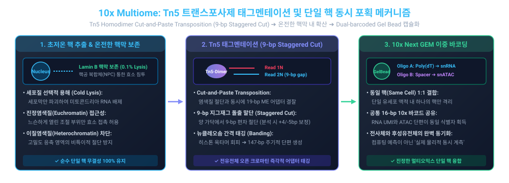

# Chapter 01. 후성유전학 원리와 Tn5 트랜스포세이스 절단-접합 화학 (Tagmentation Chemistry)

> **Cognitive Goal**: 진핵세포 염색질의 생물물리학적 패키징 구조와 크로마틴 개방성의 분자적 정의를 이해하고, 초활성 Tn5 트랜스포세이스(Hyperactive Tn5 Transposase)의 9-bp 엇갈림 절단 및 어댑터 결찰(Tagmentation) 화학 메커니즘, 그리고 10x Multiome에서 핵막 무결성을 유지하며 수행되는 핵 내 일괄 태그멘테이션(Bulk In-Nuclei Tagmentation) 원리를 체득한다.

---

## 1. 진핵세포 염색질 구조와 크로마틴 개방성 (Chromatin Accessibility)

인간 세포 1개에 담긴 약 2미터 길이의 게놈 DNA는 직경 약 5~10 $\mu\text{m}$의 핵 내부에 고도로 압축되어 패키징되어 있습니다. 이 압축의 기본 단위를 **염색질(Chromatin)**이라 부릅니다.

### 1.1 뉴클레오솜(Nucleosome)의 기하학적 구조
- **코어 히스톤 8량체(Histone Octamer)**: 양전하를 띠는 단백질 복합체로, 2개의 $H2A-H2B$ 이량체(heterodimer)와 1개의 $(H3-H4)_2$ 사량체(tetramer)로 구성됩니다.
- **DNA 감김**: 음전하를 띤 인산 골격의 147 bp 이중가닥 DNA가 히스톤 8량체 외벽을 **1.65바퀴** 왼손잡이 방향으로 견고하게 감싸고 있습니다.
- **링커 DNA (Linker DNA)**: 뉴클레오솜과 뉴클레오솜 사이를 잇는 20~80 bp의 노출된 DNA 구간으로, 링커 히스톤인 $H1$이 결합하여 상위 차수의 염색질 응축을 유도합니다.

```
                    ┌── 147 bp DNA (1.65바퀴 감김) ──┐
                    ▼                                │
            [ H2A-H2B ]───[ H3-H4 ]                  │
               │             │                       ▼
               └──[ H3-H4 ]───[ H2A-H2B ] ◄── Histone Octamer Core
                    ▲
                    └─── Linker DNA (20~80 bp, Tn5가 접근 가능한 열린 영역)
```

### 1.2 진정염색질(Euchromatin) vs 이질염색질(Heterochromatin)
1. **진정염색질 (Euchromatin - Open / Accessible Chromatin)**:
   - 전사인자 및 RNA 중합효소 복합체가 자유롭게 접근할 수 있도록 뉴클레오솜 간격이 넓게 벌어져 있는 상태(**NDR: Nucleosome-Depleted Regions**).
   - 프로모터(Promoter) 및 활성 인핸서(Active Enhancer) 영역에 해당하며, 활성 히스톤 마크($H3K27ac$, $H3K4me3$)가 농축되어 있습니다.
   - **ATAC-seq 시퀀싱 리드가 집중적으로 생성되는 영역**입니다.
2. **이질염색질 (Heterochromatin - Closed / Inaccessible Chromatin)**:
   - 뉴클레오솜이 빽빽하게 밀집되어 전사 인자의 DNA 접촉이 물리적으로 차단된 비활성 상태.
   - 통성 이질염색질(Facultative: $H3K27me3$ 매개, 계통 분화에 따라 가역적 개폐)과 구성적 이질염색질(Constitutive: $H3K9me3$ 매개, 텔로미어/센트로미어의 영구적 침묵)로 나뉩니다.

---

## 2. 초활성(Hyperactive) Tn5 트랜스포세이스 분자 화학

**ATAC-seq (Assay for Transposase-Accessible Chromatin using sequencing)**은 세균의 전위 효소인 **Tn5 트랜스포세이스**가 지닌 고유한 절단 및 결찰 반응(Tagmentation)을 역이용하여 열린 염색질만을 유전체 수준에서 포획합니다.



### 2.1 효소 엔지니어링: Hyperactive Tn5
야생형(Wild-type) 대장균 Tn5 효소는 세포 독성을 방지하기 위해 자연 상태에서 전위 활성이 매우 낮습니다. 현대 ATAC-seq에 사용되는 Tn5는 유전공학적으로 점돌연변이(문헌상 **E54K**, **M56A**, **L372P**; Goryshin & Reznikoff 1998, J Biol Chem — 이 교재에서는 원문의 변이 목록을 직접 확인하지 못했으며 상용 효소의 정확한 변이 구성은 제조사별로 다를 수 있음)가 도입된 초활성(Hyperactive) 변이체입니다. 야생형 대비 전위 활성이 크게 높아진 것이 핵심이며, 구체적 증가 배수와 분자 기전은 변이체·조건에 따라 달라 여기서는 수치를 제시하지 않습니다.
- 19 bp의 특이적 이중가닥 DNA 서열인 **모자이크 엔드(Mosaic End, ME: `5'-AGATGTGTATAAGAGACAG-3'`)**를 높은 친화도로 인식합니다.

### 2.2 태그멘테이션(Tagmentation)의 3단계 생화학 반응
Tn5 효소는 Illumina 시퀀싱용 Nextera 어댑터(Read 1 프라이밍 서열과 Read 2 프라이밍 서열)가 각각 결합된 두 개의 단량체가 모여 **호모다이머(Homodimer)** 복합체를 형성합니다:

1. **표적 DNA 스캔 및 결합**:
   - Tn5 다이머는 크기가 약 11 nm로 매우 거대하여, 뉴클레오솜으로 단단히 포장된 이질염색질 내부로는 침투할 수 없습니다. 오직 뉴클레오솜 사이의 노출된 열린 염색질(Linker DNA 및 NDR)에만 선택적으로 결합합니다.
2. **엇갈림 이중가닥 절단 (9-bp Staggered Cut)**:
   - 두 촉매 활성 부위가 DNA의 양쪽 가닥에서 정확히 **9 bp 간격을 두고** 인산디에스테르 결합을 가수분해(Hydrolysis)합니다.
3. **동시 어댑터 결찰 (Transesterification & Simultaneous Ligation)**:
   - 절단과 동시에 효소에 장전되어 있던 ME 서열의 3'-OH 말단을 표적 게놈 DNA의 5' 말단에 공유결합으로 직접 전이(Transesterification)시킵니다.
   - 결과적으로 외래 어댑터가 결찰된 DNA 단편 양 말단에는 **9 bp의 단일가닥 오버행(Single-stranded gap)**이 남게 됩니다.

```
[Tn5 엇갈림 절단 및 어댑터 결찰 메커니즘]

5' ──[Genome DNA]───────┐ 9 bp ┌────────[Genome DNA]── 3'
                        │ Gap  │
3' ──[Genome DNA]───────┴──────┴────────[Genome DNA]── 5'
       ▲                            ▲
       │ Tn5 Cut 1                  │ Tn5 Cut 2 (+9 bp)

결과물:
5' ──[Nextera Read 1]──► [Genome DNA 5'──...] 
                      (9-bp Gap) 
[...──3' Genome DNA] ◄──[Nextera Read 2]── 5'
```

> **바이오인포매틱스 필수 인지 (+4 bp / -5 bp Shifting)**:
> Tn5가 9 bp의 엇갈림 절단을 일으키므로, 시퀀싱 리드의 실제 5' 정렬 위치는 실제 효소의 물리적 중심점보다 **양성 가닥(+)에서는 4 bp 뒤쪽에, 음성 가닥(-)에서는 5 bp 앞쪽에** 위치합니다.
> 따라서 고해상도 전사인자 풋프린팅(Footprinting) 분석 시 **BAM의 리드 5' 좌표를 직접 사용하는 경우** 양성 가닥 리드는 +4 bp, 음성 가닥 리드는 -5 bp 시프트(Tn5 shift correction)하여 정확한 1 bp 효소 중심점을 복원해야 합니다. 10x Cell Ranger ARC·Chromap이 만든 `fragments.tsv.gz`는 이미 +4/-5가 반영된 좌표이므로(02장 참조) 이 입력에 다시 적용하면 이중 시프트가 됩니다.

---

## 3. 10x Multiome의 핵 내 일괄 태그멘테이션 (Bulk In-Nuclei Tagmentation)

10x 독립 scATAC(v1/v1.1/v2)과 10x Multiome(snRNA + snATAC)은 모두 핵 현탁액을 시험관에서 먼저 일괄 태그멘테이션한 뒤 GEM으로 분배·바코딩합니다. 따라서 둘의 결정적 차이는 태그멘테이션 시점이 아니라 **Multiome이 같은 GEM에서 RNA(역전사)와 ATAC를 함께 바코딩한다는 점**입니다. 태그멘테이션 시점의 차이는 미세유체 칩에서 개별 세포를 포획한 뒤 반응하는 Fluidigm C1류 방식과의 비교에서 의미가 있습니다.

### 3.1 개별 세포 포획 반응(C1류) vs 핵 내 일괄 반응(10x) 비교
- **개별 포획형 scATAC-seq (예: Fluidigm C1)**: 미세유체 칩에서 단일 세포를 먼저 포획한 뒤, 각 챔버 내부에서 Tn5 반응과 바코딩을 수행. (10x 독립 scATAC은 이 방식이 아니라 아래 10x Multiome과 같이 핵 내 일괄 태그멘테이션을 사용.)
- **10x Multiome (snRNA + snATAC)**:
  - 단일 핵 현탁액 상태에서 **세포를 미세유체 칩에 투입하기 전(Pre-GEM), 시험관(Tube) 내에서 모든 핵에 대해 일괄적으로 Tn5 태그멘테이션을 먼저 수행**합니다.
  - 이후 세척된 핵을 10x Chromium 칩에 투입하여 같은 GEM 안에서 snRNA 역전사(RT)와 ATAC 바코딩을 함께 진행합니다(이것이 독립 scATAC과의 차이).

```
[10x Multiome 습식 워크플로우 순서]
동결 전립선 조직 
   │
   ▼  Dounce 저온 균질화 & Detergent 처리 (외부 세포막만 파괴)
온전한 단일 핵 현탁액 (Intact Nuclei)
   │
   ▼  ★ Bulk In-Nuclei Tagmentation: 시험관 내에서 투과화된 핵 내부로 Tn5 침투 절단
태그멘테이션이 완료된 intact한 핵들
   │
   ▼  세척 및 10x Chromium 유세포 채널 투입
단일 액적(GEM) 형성: [단일 핵] + [Dual-Barcode Gel Bead] + [RT/PCR Reagents]
   │
   ├──► RNA 분자: Gel bead의 Oligo-dT/UMI 프라이머로 역전사 ──► snRNA Library
   └──► ATAC 단편: Gel bead의 ATAC 바코드 프라이머로 선형 증폭 ──► snATAC Library
```

### 3.2 핵막(Nuclear Envelope)의 보존과 선택적 투과화 화학
어떻게 거대한 Tn5 효소가 핵 내부로 들어가 염색질을 자르는데, 절단된 DNA 조각들은 핵 밖으로 유출되지 않고 온전히 유지될까요?
1. **온화한 비이온성 계면활성제(Digitonin)의 역할**:
   - 콜레스테롤 친화성이 높은 **Digitonin(0.01%)**은 외부 세포막은 완전히 용해하지만, 핵 라미나(Nuclear lamina) 단백질 망으로 지지되는 내핵막/외핵막의 구조적 형태는 붕괴시키지 않습니다.
   - 이렇게 투과화된 핵 내부로 완충액에 든 Tn5 효소 호모다이머가 접근하여 염색질을 절단합니다(Tn5가 핵 내부로 들어가는 구체적 경로, 예: 핵공 통과 여부는 이 교재에서 확인하지 못한 부분입니다).
2. **염색질의 핵 매트릭스 고정 효과 (Steric Hindrance)**:
   - 게놈 DNA는 메가베이스 단위의 거대한 고분자 사슬이며 핵 골격에 결합되어 있으므로, Tn5에 의해 단편화되더라도 대부분 핵 내부에 물리적으로 머문다고 설명됩니다.
   - 반응 후 핵을 원심분리하여 상층액의 여분 Tn5 효소를 세척해 냄으로써, **반응 후 배경 비특이적 DNA 절단을 줄일** 수 있습니다.

---

## 4. 결론 및 다음 단계 연결

초활성 Tn5 트랜스포세이스는 열린 염색질에 침투하여 9-bp 엇갈림 절단과 동시에 시퀀싱 어댑터를 결찰시킵니다. 10x Multiome은 핵막의 선택적 투과성을 활용하여 단일 시험관 내에서 고효율 태그멘테이션을 완수한 뒤, 10x 미세유체 채널을 통해 단일 핵 단위로 RNA와 ATAC 바코드를 동시에 부여합니다.

이렇게 시퀀싱되어 출력된 원시 FASTQ 파일로부터 바이오인포매틱스 분석의 표준 규격인 Fragment 파일을 생성하고 정렬하는 원리는 다음 장 [Chapter 02. 업스트림 정렬 및 Fragment 파일 구조](02_UPSTREAM_AND_FRAGMENTS.md)에서 심층 학습합니다.

---

## 5. 단원 핵심 점검 (Cognitive Checkpoint & Case Study)

### [문제 1. 핵심 개념 능동 회상 (Active Recall)]
초활성 Tn5 트랜스포세이스가 열린 염색질을 절단할 때 발생하는 화학 반응의 분자적 특성을 설명하고, 이로 인해 바이오인포매틱스 분석(MACS3 피크 콜링, 전사인자 풋프린팅) 시 BAM 리드의 5' 말단 좌표를 직접 사용할 때 적용해야 하는 **+4 bp / -5 bp 시프트 보정(Shift Correction)**의 기하학적 이유를 서술하시오.

<details>
<summary>💡 모범 답안 및 해설 확인</summary>

1. **Tn5 절단 화학의 분자적 특성**:
   - Tn5 효소는 호모다이머 형태로 결합하여 이중가닥 DNA의 양 가닥에서 인산디에스테르 결합을 동시에 절단하는데, 두 단량체의 활성 부위가 정확히 **9 bp 간격을 두고 비대칭적(Staggered)으로 절단**합니다.
   - 절단과 동시에 장전된 어댑터 서열을 5' 말단에 결찰시키므로, 절단된 단편 양 끝단에는 9 bp의 단일가닥 갭(Gap)이 형성됩니다.
2. **+4 bp / -5 bp 시프트 보정의 기하학적 이유**:
   - 시퀀서에서 읽어 들이는 Read 1과 Read 2의 시작 좌표(5' 말단)는 9 bp 엇갈림의 바깥쪽 말단에 해당합니다. 실제 Tn5 효소가 결합했던 물리적 중심점(Center of Tn5 binding)은 양 가닥 절단 위치의 정중앙에 위치합니다.
   - 따라서 정밀한 염색질 개방 중심점 및 전사인자 결합 부위(Footprint)를 복원하기 위해서는, **양성 가닥(+)에 정렬된 리드는 시작 위치를 게놈 하류 방향으로 +4 bp 이동**시키고, **음성 가닥(-)에 정렬된 리드는 시작 위치를 게놈 상류 방향으로 -5 bp 이동**시켜야 정확히 동일한 1 bp 중심 절단 좌표로 수렴하게 됩니다.
   - 단, 이 보정은 BAM에서 리드 좌표를 직접 읽을 때만 필요하다. 10x `fragments.tsv.gz`와 Chromap 출력은 이미 +4/-5가 적용된 좌표이므로 추가로 시프트하지 않는다(ArchR도 `offsetPlus/offsetMinus`를 BAM 입력에만 적용한다).

</details>

---

### [문제 2. 핵심 개념 능동 회상 (Active Recall)]
10x Multiome(snRNA + snATAC) 기술에서 Tn5 태그멘테이션 반응을 10x Chromium 미세유체 칩의 액적 분주(GEM generation) "이전"에 단일 시험관 내에서 대량(Bulk)으로 선행할 수 있는 세포생물학적 메커니즘을 설명하고, 단일세포 분리 시 라이시스 버퍼 내 디지토닌(Digitonin) 농도 조절이 실험의 성패를 가르는 이유를 서술하시오.

<details>
<summary>💡 모범 답안 및 해설 확인</summary>

1. **핵 내 일괄 태그멘테이션의 세포생물학적 원리**:
   - 세포막은 용해되었지만 **핵막(Nuclear envelope)과 핵 라미나(Nuclear lamina)**가 물리적으로 온전하게 보존되어 있기 때문입니다.
   - 온화한 계면활성제 처리를 통해 핵막에 미세한 구멍이 뚫리면 외부 완충액의 Tn5 효소는 내부 염색질로 자유 확산하여 열린 부위를 자르고 어댑터를 붙입니다. 하지만 잘려 나간 게놈 DNA 조각들은 거대한 염색질 복합체 상태로 핵 골격에 고정되어 있어 핵막 밖으로 유출되지 않습니다. 따라서 핵들이 섞인 단일 튜브에서 태그멘테이션을 완수한 뒤 세척하여 단일 액적으로 투입할 수 있습니다.
2. **디지토닌(Digitonin) 농도 조절의 중요성**:
   - **과소 처리 시**: 핵막 투과화가 불충분하여 거대한 Tn5 효소가 핵 내부로 침투하지 못해 라이브러리 수율이 급감하고 유효 피크 검출이 불가능해집니다.
   - **과다 처리 시**: 핵막 지질층이 완전히 붕괴(Over-lysis)되어 핵이 터지고 내부 DNA가 완충액으로 쏟아져 나옵니다. 이 경우 핵 내부 염색질의 물리적 구획이 파괴되어 게놈 DNA가 무차별적으로 엉키고 단일 핵 바코딩이 불가능해지는 치명적 실패를 초래합니다.

</details>

---

### [문제 3. 실험 트러블슈팅 사례 연구 (Wet-lab Troubleshooting Case Study)]
**[실험실 시나리오]**
연구원이 전립선암 동결 조직에서 단일 핵을 분리하여 10x Multiome 라이브러리를 제작했습니다. 그러나 Bioanalyzer로 최종 snATAC 시퀀싱 라이브러리를 검사했을 때 뉴클레오솜 특유의 사다리 패턴(Banding ladder)이 전혀 나타나지 않고 150 bp 이하의 극도로 짧은 단편들만 압도적인 피크로 나타났습니다. Cell Ranger ARC 시퀀싱 결과 TSS Enrichment Score는 1.8(정상치 > 7.0)로 심각하게 낮았고, 게놈 전반에 걸쳐 피크가 없는 균일한 노이즈 배경만이 관찰되었습니다.

**[질문]**
1. 이 현상이 발생한 가장 유력한 생화학적/실험적 원인을 분자 수준에서 규명하시오.
2. 향후 동일 검체에서 성공적인 snATAC 라이브러리를 얻기 위해 습식 실험실 단계에서 수정해야 할 2가지 핵심 프로토콜 매개변수를 제시하시오.

<details>
<summary>💡 모범 답안 및 해설 확인</summary>

1. **실패 원인 규명**:
   - **과도한 핵막 파괴 및 나체 DNA(Naked DNA) 무차별 과절단**: 라이시스 버퍼의 계면활성제(Detergent) 농도가 너무 높았거나 기계적 Dounce 스트로크가 과도하여 핵막이 완전히 찢어지고 핵 내 보호 단백질(히스톤 8량체)이 염색질에서 해리된 상태에서 Tn5 반응이 일어났습니다.
   - 히스톤에 의해 보호받지 못하는 노출된 나체 DNA(Naked genomic DNA)는 Tn5 효소에 무방비로 노출되어, 정상적인 열린 크로마틴(NDR)뿐 아니라 게놈 전체가 균일하고 무작위하게 잘려 나갑니다. 이로 인해 뉴클레오솜 주기성(147 bp)이 사라지고 초미세 단편만 증폭되며, 프로모터 특이적 농축(TSS Enrichment)이 바닥으로 추락하게 됩니다.
2. **습식 프로토콜 수정 대책**:
   - **Lysis Buffer 계면활성제 농도 및 노출 시간 축소**: NP-40/IGEPAL 농도를 $0.1\%$에서 $0.05\%$로 낮추고, Digitonin 농도를 정확히 $0.01\%$ 이하로 제한하며, 얼음 상에서의 라이시스 시간을 기존 10분에서 3~5분으로 엄격히 단축합니다.
   - **현미경 하 핵 무결성(Integrity) 전수 검사 도입**: Tn5 투입 전 DAPI 또는 트립판 블루 염색을 통해 핵막 표면에 소포(Blebbing)가 돌출되지 않고 매끄러운 타원형을 유지하는지 형광 현미경으로 검증한 후 합격된 검체에 한해서만 태그멘테이션을 진행합니다.

</details>

---

<!-- REFERENCES:BEGIN (generated by scripts/apply_references.py; do not edit by hand) -->
## 참고문헌 (References)
### 본문 인용 문헌
1. Goryshin IY, Reznikoff WS. Tn5 in vitro transposition. *J Biol Chem*. 1998;273(13):7367-74. PMID: 9516433. doi: 10.1074/jbc.273.13.7367
<!-- REFERENCES:END -->
