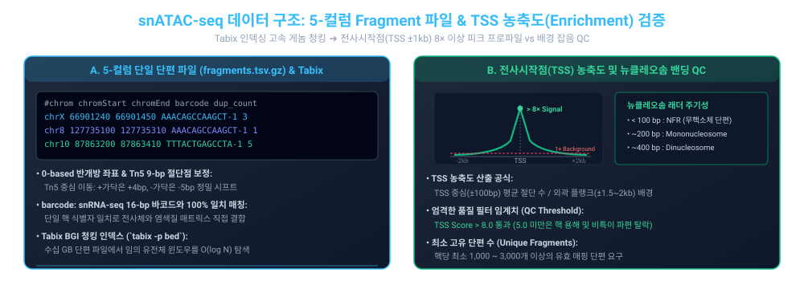

# Chapter 02. 업스트림 정렬 및 Fragment 파일 구조: FASTQ에서 게놈 좌표까지

> **Cognitive Goal**: 10x Multiome의 듀얼 라이브러리(snRNA + snATAC) 시퀀싱 리드 레이아웃의 차이점을 파악하고, Cell Ranger ARC 및 차세대 초고속 정렬기 Chromap의 매핑 원리, 그리고 snATAC 분석의 절대 표준인 Tabix 인덱싱 기반 Fragment 파일(`fragments.tsv.gz`)의 데이터 아키텍처를 완벽히 이해한다.

---

## 1. 10x Multiome 듀얼 라이브러리 리드 레이아웃

10x Multiome 시퀀싱은 단 하나의 물리적 핵으로부터 **전사체(Gene Expression, GEX)** 라이브러리와 **염색질 개방성(Chromatin Accessibility, ATAC)** 라이브러리를 각각 분리 제작하여 시퀀서에 독립적으로 로딩합니다. 따라서 샘플 1개당 두 세트의 FASTQ 파일이 생성됩니다.

```
[10x Multiome 시퀀싱 리드 아키텍처]

1. GEX Library (snRNA-seq)
Read 1 (28 bp)   : [16 bp Cell Barcode] + [12 bp UMI]
Read 2 (91+ bp)  : [cDNA Fragment: Exon / Pre-mRNA Intron 서열]
Index 1 / 2      : [Illumina i7 / i5 샘플 인덱스 (각 8~10 bp)]

2. ATAC Library (snATAC-seq)
Read 1 (50 bp)   : [게놈 DNA 단편 전방향 서열 (Paired-end 1)]
Read 2 (16 bp)   : [16 bp Cell Barcode (단일 핵 식별 태그)]
Read 3 (50 bp)   : [게놈 DNA 단편 역방향 서열 (Paired-end 2)]
Index (8 bp)     : [Illumina i7 샘플 인덱스]
```

### 1.1 바코드 변환 매핑 (Barcode Translation)의 필수 인지
많은 초심자가 범하는 치명적 오해는 "동일한 핵이므로 GEX FASTQ의 세포 바코드와 ATAC FASTQ의 세포 바코드 염기서열이 100% 동일할 것"이라는 착각입니다.

- **실제 물리적 구조**: 10x Multiome 젤비드 표면에는 RNA 역전사용 올리고(Poly-dT + GEX Barcode)와 ATAC 증폭용 올리고(Spacer + ATAC Barcode)가 물리적으로 함께 결합되어 있습니다.
- 그러나 두 올리고의 16 bp 바코드 서열은 **합성 공정상 서로 다른 염기서열**을 갖습니다.
- **해결책 (Barcode Translation Table)**: 10x Genomics는 737,280개의 GEX 바코드와 그에 1:1 대응하는 ATAC 바코드의 변환 테이블(`737K-arc-v1.txt`)을 제공합니다. `cellranger-arc`는 이 화이트리스트를 참조하여 두 라이브러리의 바코드를 단일한 표준 식별자(Unified Cell ID)로 자동 통합합니다.

---

## 2. 업스트림 정렬 및 카운팅 엔진 (Upstream Engines)

원시 FASTQ 파일들로부터 RNA 유전자 발현량과 ATAC 게놈 절단 단편을 동시 정량화하기 위해 표준 파이프라인을 실행합니다.

### 2.1 Cell Ranger ARC 표준 파이프라인
Cell Ranger ARC는 RNA 리드는 STAR를 통해 게놈 및 전사체(Exon+Intron)에 매핑하고, ATAC 리드는 BWA-MEM 기반 변형 알고리즘을 통해 게놈(GRCh38)에 정렬합니다.

```csv
# libraries.csv (Multiome 입력 설정 파일)
fastqs,sample,library_type
/data/fastqs/GEX_Patient01,Patient01_GEX,Gene Expression
/data/fastqs/ATAC_Patient01,Patient01_ATAC,Chromatin Accessibility
```

```bash
# Cell Ranger ARC 카운트 실행
cellranger-arc count \
  --id=Prostate_mCRPC_Multiome_01 \
  --reference=/ref/refdata-cellranger-arc-GRCh38-2020-A-2.0.0 \
  --libraries=libraries.csv \
  --localcores=32 \
  --localmem=128
```

### 2.2 차세대 대안: Chromap (초고속 정렬기)
수십 개의 환자 코호트를 분석할 때 `cellranger-arc`의 ATAC 정렬 단계는 수십 시간이 소요될 수 있습니다. **Chromap**은 미니마이저(Minimizer) 기반 인덱스를 사용하는 근사 매핑(염기 수준 정렬 없음) 방식으로, 보고된 바로는 BWA 계열 대비 10~20배 빠르면서 유사한 정확도를 보입니다(Chromap README, Zhang et al. 2021):

```bash
# Chromap 초고속 snATAC 정렬 및 Fragment 생성
chromap \
  --preset atac \
  -x /ref/chromap_index/GRCh38.index \
  -r /ref/GRCh38.fa \
  -1 /data/fastqs/ATAC_R1.fastq.gz \
  -2 /data/fastqs/ATAC_R3.fastq.gz \
  -b /data/fastqs/ATAC_R2.fastq.gz \
  --barcode-whitelist /ref/737K-arc-v1.txt \
  --barcode-translate /ref/atac_to_gex_barcode_translate.tsv \
  -o chromap_atac_fragments.tsv \
  -t 32

# Tabix 질의를 위해 정렬 → bgzip 압축 → 인덱싱 (평문 TSV/BED는 tabix 질의 불가)
sort -k1,1 -k2,2n chromap_atac_fragments.tsv | bgzip > chromap_atac_fragments.tsv.gz
tabix -p bed chromap_atac_fragments.tsv.gz
```

> **Multiome 주의**: 10x Multiome에서는 scATAC과 scRNA가 서로 다른 바코드 집합을 쓰므로, Chromap의 `--barcode-translate`(2열 tsv/csv: 첫 열=변환 후 바코드, 둘째 열=원래 바코드; Chromap README)로 ATAC 바코드를 GEX 바코드로 변환해야 Seurat/Signac 객체와 일치한다. 화이트리스트·번역 파일의 실제 파일명과 열 형식은 사용 중인 cellranger-arc 참조 패키지에서 확인할 것(위 경로는 자리표시자). Tn5 shift는 `--preset atac`에서 자동 적용된다.

---

## 3. snATAC의 절대 표준: Fragment 파일 (`fragments.tsv.gz`)

정렬이 완료되면 수백 기가바이트(GB)에 달하는 정렬 BAM 파일(`atac_possorted_bam.bam`)이 생성됩니다. 그러나 다운스트림 후성유전학 분석에서는 **BAM 파일을 거의 사용하지 않으며**, 오직 압축된 **Fragment 파일(`atac_fragments.tsv.gz`)**만을 골드 스탠다드로 사용합니다.



### 3.1 BAM 대신 Fragment 파일을 사용하는 이유
1. **극적인 용량 압축 ($1/10 \sim 1/20$)**:
   - BAM 파일은 시퀀싱 품질 점수(Phred score), CIGAR 문자열, PCR 중복 리드들을 개별적으로 중복 저장하여 샘플당 50~150 GB에 달합니다.
   - Fragment 파일은 PCR 중복(Duplicates)을 제거하고 오직 **"세포 바코드 하나당 고유하게 잘려 나간 게놈 DNA 조각의 양 끝 좌표"**만을 텍스트로 압축 저장하여 2~5 GB 수준으로 경량화됩니다.
2. **정보의 완전성**:
   - ATAC-seq에서 필요한 유일한 생물학적 정보는 "어느 세포에서 어느 게놈 좌표 사이가 열려 있었는가"입니다. Fragment의 시작점과 끝점은 두 번의 독립적인 Tn5 절단 이벤트를 완벽하게 대변합니다.

### 3.2 Fragment 파일의 5대 핵심 열(Columns) 구조
`fragments.tsv.gz`는 탭(Tab)으로 구분된 무손실 텍스트 파일이며, 엄격한 5개 컬럼으로 구성됩니다:

```tsv
chr1    10042   10235   AAACAGCCAAGCTACA-1    1
chr1    10045   10420   AAACAGCCAAGCTACA-1    2
chr1    180510  180695  TTATGTCAGTGTCATC-1    1
chr2    452100  452280  AAACAGCCAAGCTACA-1    1
```

1. **`chrom` (염색체 명칭)**: 게놈 참조 서열 염색체 (예: `chr1`, `chrX`).
2. **`chromStart` (절단 시작 좌표)**:
   - 0-based 좌표계(BED와 동일).
   - **중요**: 리드 1의 5' 정렬 위치에 이미 **+4 bp Tn5 시프트 보정**이 반영된 최종 좌표입니다.
3. **`chromEnd` (절단 종료 좌표)**:
   - 0-based half-open 좌표계(BED와 동일: 마지막 염기의 다음 위치).
   - 리드 2(R3)의 5' 정렬 위치에 **-5 bp Tn5 시프트 보정**이 반영된 최종 좌표입니다.
4. **`barcode` (세포 바코드)**: 단일 핵을 식별하는 16 bp 고유 바코드 + GEM 웰 번호 (예: `AAACAGCCAAGCTACA-1`).
5. **`duplicate_count` (PCR 중복 횟수)**: 동일한 시작-끝 좌표를 공유하는 단편이 PCR 증폭 과정에서 몇 번 읽혔는지를 기록 (보통 1 이상의 정수).

### 3.3 Tabix 인덱싱 (`.tbi`)과 초고속 구간 질의
Fragment 파일의 진정한 위력은 게놈 좌표 기반 인덱서인 **Tabix**와 결합할 때 발휘됩니다:
- `atac_fragments.tsv.gz`는 염색체 번호 및 시작 좌표 순(`sort -k1,1 -k2,2n`)으로 정렬되어 있습니다.
- 동반되는 `atac_fragments.tsv.gz.tbi` 인덱스 파일은 BAI와 같은 계층적 빈(Bin) 인덱스와 16 kb 단위 선형 인덱스를 포함합니다.
- 연구자가 전립선암 마커인 *AR* 프로모터(`chrX:67,540,000-67,545,000`)에 속한 단편들만을 가져오고자 할 때, 수억 줄의 파일을 처음부터 읽을 필요 없이 **Tabix 인덱스를 통해 해당 구간이 들어 있는 BGZF 블록으로 직접 이동하여 필요한 블록만 읽음으로써 밀리초~초 단위로 단편을 추출**할 수 있습니다(질의 비용은 겹치는 빈 수와 읽는 레코드 수에 비례하며 $O(1)$은 아닙니다).

---

## 4. Python 기반 Fragment 고속 핸들링 실전

Python 환경에서는 `pysam` 라이브러리를 사용하여 Fragment 파일에 초고속으로 접근할 수 있습니다:

```python
import pysam

# Tabix 인덱싱된 Fragment 파일 열기
fragment_path = "outs/atac_fragments.tsv.gz"
tbx = pysam.TabixFile(fragment_path)

# 전립선암 핵심 유전자 KLK3(PSA) 프로모터 영역 질의 (GRCh38)
# KLK3 hg38 = chr19:50,854,915-50,860,764 (+ 가닥, NM_001648.2); TSS 상하류 약 2 kb
chrom = "chr19"
start = 50853000
end = 50857000

print(f"Querying fragments in {chrom}:{start}-{end} ...")
count = 0
for row in tbx.fetch(chrom, start, end):
    fields = row.split('\t')
    f_chrom, f_start, f_end, barcode, dup = fields[0], int(fields[1]), int(fields[2]), fields[3], int(fields[4])
    fragment_length = f_end - f_start
    count += 1
    if count <= 3:
        print(f"  Barcode: {barcode} | Length: {fragment_length} bp | Range: {f_start}-{f_end}")

print(f"Total overlapping fragments captured: {count}")
```

---

## 5. 결론 및 다음 단계 연결

10x Multiome의 FASTQ 리드는 GEX와 ATAC 라이브러리로 분리 시퀀싱된 후, 변환 화이트리스트 테이블을 통해 단일 핵 바코드로 재통합됩니다. 업스트림 정렬을 거쳐 산출된 `fragments.tsv.gz`는 Tn5 시프트가 보정된 게놈 절단 단편들을 수록하는 핵심 표준 파일입니다.

그러나 이렇게 생성된 수백만 개의 바코드 중 "진짜 온전한 염색질을 가진 핵"과 "핵막이 파열되어 쏟아진 나체 DNA 파편"을 어떻게 분리할까요? 다음 장 [Chapter 03. snATAC 특화 품질 관리(QC) 지표](03_SNATAC_QC_METRICS.md)에서는 TSS 농축 점수와 147 bp 뉴클레오솜 주기성을 통한 엄밀한 품질 검증법을 학습합니다.

---

## 6. 단원 핵심 점검 (Cognitive Checkpoint & Case Study)

### [문제 1. 핵심 개념 능동 회상 (Active Recall)]
10x Multiome(snRNA + snATAC) 플랫폼에서 GEX 라이브러리와 ATAC 라이브러리의 시퀀싱 리드 레이아웃(Read 1, 2, 3)의 구성적 차이점을 비교 설명하고, 두 라이브러리 간 세포 바코드 염기서열이 물리적으로 다름에도 불구하고 단일 핵 단위로 완벽하게 1:1 결합될 수 있는 바코드 변환 매핑(Barcode Translation Table)의 원리를 기술하시오.

<details>
<summary>💡 모범 답안 및 해설 확인</summary>

1. **리드 레이아웃의 구성적 차이점**:
   - **GEX 라이브러리**: Read 1(28 bp)에 16 bp Cell Barcode와 12 bp UMI가 함께 위치하며, Read 2(91+ bp)가 전사체 cDNA 서열을 포획합니다.
   - **ATAC 라이브러리**: Paired-end 게놈 시퀀싱 구조를 가집니다. Read 1(50 bp)과 Read 3(50 bp)이 절단된 게놈 DNA 단편의 양 끝 말단 서열을 읽으며, 독립된 중간 리드인 Read 2(16 bp)가 단일 핵 식별용 16 bp Cell Barcode만을 전담 포획합니다 (UMI는 DNA 특성상 존재하지 않고 PCR duplicate count로 대체).
2. **바코드 변환 매핑(Barcode Translation)의 원리**:
   - 단일 젤비드 표면에 고정된 GEX 올리고와 ATAC 올리고는 합성 공정상 서로 다른 염기서열을 갖습니다.
   - 10x Genomics는 비드 제조 시 두 올리고의 서열 조합을 1:1로 매핑해 둔 표준 화이트리스트 테이블(`737K-arc-v1.txt`)을 제공합니다.
   - `cellranger-arc`는 시퀀싱 완료 후 ATAC 바코드를 이 테이블을 통해 대응하는 표준 GEX 바코드 서열로 변환(Translation)하여, 두 독립적인 FASTQ 데이터셋을 단일한 공통 세포 ID로 완벽히 병합합니다.

</details>

---

### [문제 2. 핵심 개념 능동 회상 (Active Recall)]
수백 기가바이트에 달하는 정렬 BAM 파일(`atac_possorted_bam.bam`) 대신 `fragments.tsv.gz` 파일이 snATAC 다운스트림 분석의 골드 스탠다드로 채택된 2가지 이유를 데이터 저장 구조 관점에서 설명하고, Tabix 인덱싱(`.tbi`)이 유전체 특정 유전자 좌위 질의 속도를 극적으로 단축시키는 수학적/전산학적 메커니즘을 서술하시오.

<details>
<summary>💡 모범 답안 및 해설 확인</summary>

1. **Fragment 파일 채택의 2대 이유**:
   - **데이터 중복 배제 및 압축성**: BAM 파일은 개별 시퀀싱 리드 쌍(R1, R3), 염기별 품질 점수, CIGAR 문자열, 수많은 PCR 중복 리드를 중복 저장하여 용량이 100 GB에 달합니다. Fragment 파일은 PCR 중복을 duplicate_count로 합산하고 단편의 양 끝 게놈 좌표(Start, End)만을 기록하여 용량을 $90\%$ 이상 압축(2~5 GB)합니다.
   - **생물학적 정보의 충분성**: 크로마틴 개방성 분석에 필요한 핵심 신호는 "어느 세포에서 어떤 게놈 영역이 Tn5에 의해 절단되었는가"뿐이므로, Fragment 파일의 5개 컬럼만으로 모든 피크 콜링, 전사조절망, 모티프 분석을 무손실로 수행할 수 있습니다.
2. **Tabix 인덱싱의 전산학적 메커니즘**:
   - Tabix는 계층적 빈 인덱스(Binning index)와 16 kb 단위 선형 인덱스(Linear index)를 `.tbi`로 생성합니다(B-tree가 아닙니다).
   - 특정 유전자 좌표(예: *KLK3* 프로모터)를 질의할 때, 수억 줄의 대용량 텍스트 파일을 처음부터 선형 탐색($O(N)$)하지 않고, 인덱스를 참조하여 해당 구간이 위치한 BGZF 블록의 바이트 오프셋(Byte offset)으로 건너뛰고 겹치는 블록만 읽으므로(비용은 읽는 레코드 수에 비례) 질의를 빠르게 완료합니다.

</details>

---

### [문제 3. 데이터 파이프라인 트러블슈팅 사례 (Case Study)]
**[생물정보학 분석 시나리오]**
연구원이 Cell Ranger ARC 실행 후 생성된 `atac_fragments.tsv.gz`에서 전립선암 핵심 500개 인핸서 영역의 단편 카운트를 추출하는 Python 스크립트를 작성했습니다. 그러나 일반 텍스트 읽기 방식(`gzip.open()`)으로 500개 영역을 반복 루프를 돌며 질의했더니 스크립트 실행 시간이 4시간 이상 소요되었고, 서버의 RAM 점유율이 64 GB를 초과하여 프로세스가 강제 종료(OOM Kill)되었습니다.

**[질문]**
1. 이 스크립트가 비효율적으로 동작하고 OOM 에러를 유발한 전산학적 원인을 진단하시오.
2. `pysam.TabixFile`을 사용하여 메모리 사용량을 100 MB 이하로 유지하면서 500개 영역의 단편을 수 초 내에 추출하는 최적화된 Python 함수를 작성하시오.

<details>
<summary>💡 모범 답안 및 해설 확인</summary>

1. **실패 원인 진단**:
   - **반복적인 전체 게놈 선형 탐색(Full Scan)**: `gzip.open()`을 사용하여 500개 영역을 루프로 순회할 때마다 수억 줄에 달하는 수 기가바이트의 압축 파일을 처음부터 끝까지 500번 반복해서 압축 해제하고 메모리에 로드했습니다. 시간 복잡도가 $O(500 \times N)$으로 폭증하여 수 시간이 걸립니다.
   - **메모리 누수**: 파일 전체를 파싱하며 생성된 수억 개의 문자열 객체가 파이썬 가비지 컬렉터에 의해 즉각 수거되지 않아 RAM이 폭발적으로 고갈되었습니다.
2. **Tabix 기반 최적화 Python 코드**:
```python
import pysam
from collections import defaultdict

def extract_enhancer_counts(fragment_gz_path, bed_regions):
    """
    Tabix 인덱스 질의를 사용하여 메모리 효율적으로 인핸서별 세포 카운트 추출
    bed_regions: [("chr1", 10000, 11000), ("chr2", 50000, 52000), ...]
    """
    # 1. Tabix 파일 열기 (인덱스만 메모리에 로드하므로 RAM < 50 MB)
    tbx = pysam.TabixFile(fragment_gz_path)
    enhancer_cell_counts = defaultdict(lambda: defaultdict(int))
    
    # 2. 각 영역별 즉각 점프 질의
    for chrom, start, end in bed_regions:
        region_key = f"{chrom}:{start}-{end}"
        try:
            # fetch는 해당 게놈 청크만 스트리밍으로 읽음
            for row in tbx.fetch(chrom, start, end):
                fields = row.split('\t')
                barcode = fields[3]
                dup_count = int(fields[4])
                enhancer_cell_counts[region_key][barcode] += dup_count
        except ValueError:
            # 해당 염색체가 파일에 없는 경우 예외 처리
            continue
            
    tbx.close()
    return enhancer_cell_counts
```
이 코드는 Tabix 인덱스를 통해 디스크 상에서 필요한 게놈 블록만 스트리밍 방식으로 읽고 버리므로, 500개 영역 질의를 수 초 이내에 완수하며 메모리 사용량은 수십 메가바이트로 일정하게 유지됩니다.

</details>

---

<!-- REFERENCES:BEGIN (generated by scripts/apply_references.py; do not edit by hand) -->
## 참고문헌 (References)
### 본문 인용 문헌
1. Zhang H, Song L, Wang X, et al. Fast alignment and preprocessing of chromatin profiles with Chromap. *Nat Commun*. 2021;12(1):6566. PMID: 34772935. doi: 10.1038/s41467-021-26865-w
### 소프트웨어 (표기 버전은 검수 시 API를 확인한 버전이며, 파이프라인 실행 환경은 requirements-pipelines.txt 참조)
- HTSlib (tabix, bgzip) (github.com/samtools/htslib). 원 논문: Bonfield JK, Marshall J, Danecek P, et al. HTSlib: C library for reading/writing high-throughput sequencing data. *Gigascience*. 2021;10(2). PMID: 33594436. doi: 10.1093/gigascience/giab007
- Chromap (github.com/haowenz/chromap). 원 논문: Zhang H, Song L, Wang X, et al. Fast alignment and preprocessing of chromatin profiles with Chromap. *Nat Commun*. 2021;12(1):6566. PMID: 34772935. doi: 10.1038/s41467-021-26865-w
- pysam 0.24.1 (github.com/pysam-developers/pysam).
<!-- REFERENCES:END -->
