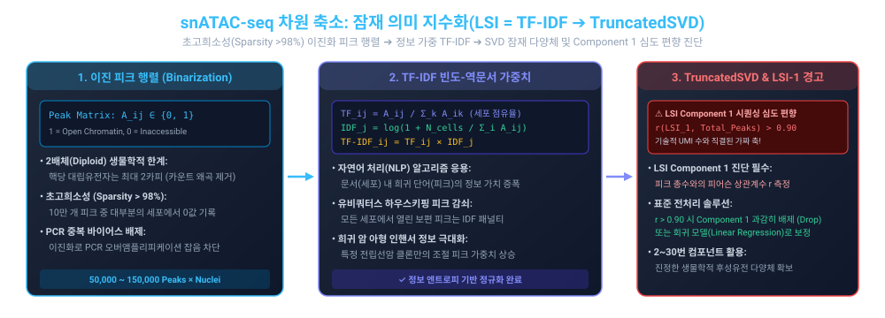

# Chapter 04. 피크 콜링(MACS3)과 LSI 차원 축소의 기하학

> **Cognitive Goal**: 단일 핵 ATAC의 극단적 희소성(Sparsity)을 극복하기 위한 슈도벌크(Pseudobulk) MACS3 피크 콜링의 통계적 필연성을 이해하고, 컨센서스 피크 세트의 이진화(Binarization) 원리, 그리고 자연어 처리에서 유래한 TF-IDF 및 Truncated SVD 기반 Latent Semantic Indexing (LSI)의 수학적 기하학을 완전히 정복한다.

---

## 1. 단일 핵 수준 피크 콜링의 근본적 불가능성과 슈도벌크(Pseudobulk) 풀링

벌크 ATAC-seq이나 ChIP-seq에서는 조직 전체에서 추출한 수백만 개 세포의 DNA 단편이 연속적인 신호 강도(Signal intensity)를 형성하므로, 포아송(Poisson) 또는 음이항(Negative Binomial) 배경 모델을 기반으로 게놈 피크(Peak)를 직접 콜링할 수 있습니다.

그러나 **단일 핵 ATAC-seq(snATAC-seq)에서는 개별 세포 단위의 피크 콜링이 물리적·통계적으로 완전히 불가능**합니다:

```
[단일 세포의 물리적 대립유전자 한계]
인간 상염색체 = 2배체 (Diploid, 2 Copies per locus)
  ├── Allele A (상동염색체 1) : [열림: Cut 1회] (1)
  └── Allele B (상동염색체 2) : [닫힘: Cut 0회] (0)
  
결과: 단일 세포에서 관측 가능한 신호는 오직 {0, 1, 2}뿐!
전체 게놈 피크의 98% 이상이 "0" (Extreme Sparsity > 98%)
```

### 1.1 통계적 검정력 부족 (Lack of Statistical Power)
세포 1개에서 특정 500 bp 유전자 좌위에 단편이 1개 떨어졌을 때, 이것이 "진정한 활성 인핸서의 개방 신호"인지, 아니면 "배경에서 우연히 발생한 무작위 절단 잡음"인지 단일 세포의 카운트만으로는 통계적 유의성($p$-value)을 계산할 수 없습니다.

### 1.2 해결책: 슈도벌크(Pseudobulk) 풀링 전략
따라서 단일 핵 분석에서는 먼저 RNA 발현 유사도나 게놈 타일(Tile matrix, 500 bp bin) 기반의 대략적인 초기 클러스터링을 수행한 뒤, **동일한 세포 유형에 속하는 수백~수천 개 단일 핵의 Fragment들을 가상으로 하나로 병합(Pseudobulk Pooling)**합니다:

```
[클러스터 1: 악성 관강세포 2,000개 핵] ──► Fragment 통합 (총 1,000만 단편) ──► 고감도 MACS3 피크 콜링
[클러스터 2: 종양 연관 CAF 1,500개 핵] ──► Fragment 통합 (총 800만 단편)   ──► 세포 특이적 인핸서 피크 검출
[클러스터 3: CD8+ T세포 800개 핵]       ──► Fragment 통합 (총 400만 단편)   ──► 면역 특이적 프로모터 피크 검출
```

---

## 2. MACS3 알고리즘 원리와 전립선암 피크 콜링

슈도벌크로 병합된 단편들에 대해 전사조절 연구의 표준 피크 콜러인 **MACS3 (Model-based Analysis of ChIP-Seq / ATAC-seq v3)**를 실행합니다.

```bash
# MACS3 슈도벌크 ATAC 피크 콜링 명령 (scATAC fragments 전용 FRAG 모드)
# luminal_cancer_barcodes.txt: 해당 클러스터 바코드 목록(한 줄에 하나)
macs3 callpeak \
  -t outs/atac_fragments.tsv.gz \
  -f FRAG \
  --barcodes luminal_cancer_barcodes.txt \
  -g hs \
  -n Luminal_Cancer \
  --outdir macs3_output/ \
  --call-summits \
  -q 0.01
```

### 핵심 파라미터의 생물학적/수학적 의미
- `-f FRAG`: scATAC 5열 fragments 파일 전용 모드(`--barcodes`로 클러스터의 세포만 추출). 단편 양 끝점 전체를 pile-up하는 paired-end 모드이므로 `--shift`/`--extsize`는 적용되지 않으며, 이 모드에서는 `--keep-dup`이 항상 `all`로 동작한다. (일반 `-f BEDPE`는 `--keep-dup` 기본값 1이라 풀링된 pseudobulk에서 같은 좌표의 단편이 여러 세포에서 나와도 1개로 축약되어 고접근 영역의 신호가 손실될 수 있으므로, BEDPE를 쓰려면 `--keep-dup all`을 명시한다.) 참고로 ArchR는 절단 위치(cut-site) BED에 `--keep-dup all --shift -75 --extsize 150`을 적용하므로 전체 단편 pile-up과 피크 모양이 다를 수 있다. (참고: 단일 말단 리드(`-f BAM`)에서는 `--nomodel --shift -100 --extsize 200`으로 Tn5 절단 중심점 좌우 200 bp 윈도우로 균일 확장하는 것이 표준 절차이다.)
- `-g hs`: 인간 유효 게놈 크기 (MACS3 단축키 `hs`는 $2{,}913{,}022{,}398 \text{ bp}$; MACS2의 $2.7 \times 10^9$와 다름).
- `--call-summits`: 피크 내부에서 신호가 가장 집중된 단일 염기 중심점(Summit, 1 bp)을 정밀 탐색.
- `-q 0.01`: Benjamini-Hochberg FDR 보정 유의수준 1% 미만의 극도로 신뢰할 수 있는 피크만 선별.

---

## 3. 컨센서스 피크 세트(Consensus Peak Set) 및 이진 행렬(Binary Matrix) 구축

각 세포 클러스터에서 독립적으로 콜링된 수만 개의 피크들은 서로 겹치거나 경계가 약간씩 다릅니다. 이들을 하나의 통일된 게놈 좌표계로 병합해야 단일 세포 분석을 위한 공통 특성 행렬을 구성할 수 있습니다.

```
클러스터 A 피크:        [───────────────] (Summit A)
클러스터 B 피크:            [─────────────────] (Summit B)
                                   ▼
반복적 비중복 병합:     [─────── 500 bp ───────] ◄── Consensus Unified Peak
```

### 3.1 컨센서스 피크 병합 규칙 (Iterative Non-Overlapping Removal)
1. 모든 클러스터에서 도출된 Summit 좌표를 유의성 점수($- \log_{10} q\text{-value}$) 순으로 내림차순 정렬합니다.
2. 가장 점수가 높은 최상위 Summit을 중심으로 **고정 너비 500 bp ($\pm 250 \text{ bp}$)**의 윈도우를 확정합니다.
3. 이 윈도우와 겹치는 하위 점수의 다른 모든 피크들을 제거합니다. (Corces et al. 2018의 iterative overlap 방식. ArchR는 여기에 클러스터 간 점수 비교를 위해 클러스터별 점수를 정규화한 뒤 병합하고, 가상 반복(pseudo-replicate) 간 재현성(기본 2개 이상)을 요구하며, 폭 501 bp(summit ±250), MACS2 q 컷오프 0.1을 기본값으로 쓴다.)
4. 이 과정을 반복하여 유전체 전반에 걸쳐 서로 겹치지 않는 **15만 ~ 25만 개의 표준 참조 컨센서스 피크 세트(Consensus Peak Set)**를 구축합니다.

### 3.2 카운트의 이진화 (Binarization: $0$ 또는 $1$)
각 단일 핵 $c$와 컨센서스 피크 $p$ 간의 중첩 카운트 행렬 $X_{p, c}$를 구축한 후, 이를 **이진화(Binarization)**하는 접근을 흔히 사용합니다(ArchR IterativeLSI 기본 `binarize=TRUE`; Signac `RunTFIDF`는 카운트를 입력으로 받아 이진화가 필수가 아니며 선택 사항):

$$X_{p, c}^{\text{binary}} = \begin{cases} 1 & \text{if } X_{p, c} > 0 \\ 0 & \text{if } X_{p, c} = 0 \end{cases}$$

> **왜 ATAC 행렬은 이진화해야 하는가?**:
> 인간 세포는 2배체이므로 유전자 좌위당 대립유전자는 2개뿐입니다. 단일 핵에서 카운트가 1이든 4이든, 이는 해당 염색질이 열려 있음을 의미하는 동일한 사건으로 간주할 수 있습니다(fragments는 이미 중복 제거되어 있으나, 한 500 bp 피크 안에 서로 다른 단편·삽입 위치가 여러 개 떨어지면 카운트가 2를 넘을 수 있으며, '2배체이므로 최대 2'는 휴리스틱입니다). 이진화는 극도의 희소성과 깊이 편차의 영향을 완화하려는 선택으로, 정량적 수치 대신 **"열림(1) vs 닫힘(0)"**의 이진 상태로 변환하는 것이 기술적 노이즈를 제거하는 가장 로버스트한 수학적 처리입니다.

---

## 4. 잠재 의미 인덱싱(LSI: Latent Semantic Indexing)의 기하학

snRNA-seq에서는 Shifted Log-Normalization 후 주성분 분석(PCA)을 수행했습니다. 그러나 snATAC-seq의 이진 희소 행렬($98\%$ 이상의 결측치)에 표준 PCA를 직접 적용하면, 유전자 발현과 다른 극단적인 희소성으로 인해 유클리드 거리 공간이 왜곡됩니다.

따라서 단일 핵 후성유전학에서는 검색 엔진 및 자연어 처리(NLP) 분야에서 문서 내 단어 빈도를 분석하던 **잠재 의미 인덱싱(LSI: Latent Semantic Indexing)**을 도입했습니다:

```
[자연어 처리 (NLP)]              [단일 핵 후성유전학 (snATAC-seq)]
문서 (Document)         ◄────►   단일 핵 (Single Cell / Nucleus)
단어 (Word / Term)      ◄────►   게놈 피크 (Genomic Peak / CRE)
문서 내 단어 출현 빈도    ◄────►   특정 핵에서 피크 개방 여부 (0 또는 1)
```



### 4.1 1단계: TF-IDF (Term Frequency - Inverse Document Frequency) 변환
이진 카운트 행렬 $X$에 대해 두 가지 요소를 동시에 보정하는 정규화를 수행합니다:

$$\text{TF-IDF}_{p, c} = \text{TF}_{p, c} \times \text{IDF}_p$$

1. **Term Frequency ($\text{TF}_{p, c}$)**:
   $$\text{TF}_{p, c} = \frac{X_{p, c}}{\sum_{p'} X_{p', c}}$$
   - 세포 $c$의 총 시퀀싱 깊이(총 단편 수)로 각 피크 값을 나누어, **세포별 라이브러리 크기 차이(Sequencing Depth Noise)**를 보정합니다.
2. **Inverse Document Frequency ($\text{IDF}_p$)**:
   $$\text{IDF}_p = \ln\left(1 + \frac{N}{\sum_{c=1}^N \mathbb{I}(X_{p, c} > 0)}\right)$$
   - $N$은 데이터셋의 총 세포 수, 분모는 피크 $p$가 열려 있는 세포 수입니다.
   - **생물학적 의미**: 모든 세포(Luminal, Basal, T세포, 내피세포)에서 다 열려 있는 범용 하우스키핑 프로모터 피크는 $\text{IDF}$가 하한 $\ln 2 \approx 0.69$에 가까워져 상대적으로 가중치가 억제됩니다(이 식에서는 0이 되지 않습니다). TF-IDF 변형은 도구마다 다릅니다(이 식은 Cusanovich 2018 계열이며 Signac `RunTFIDF` method 2에 해당. Signac 기본 method 1은 $\log(1 + \text{TF} \times N/n_p \times 10^4)$, muon `tfidf` 기본은 $\log(\text{TF}) \times \log(\text{IDF})$). 반면 극소수의 전립선암 세포에서만 열리는 **세포 특이적 인핸서(Super-Enhancers, t-NEPC Markers)는 $\text{IDF}$ 가중치가 극대화**됩니다.

### 4.2 2단계: Truncated SVD (Singular Value Decomposition)
정규화된 $\text{TF-IDF}$ 행렬 $M$ ($P \text{ 피크} \times N \text{ 세포}$)에 대해 특이값 분해(SVD)를 수행하여 상위 $k$개(보통 30~50차원)의 직교 잠재 축으로 압축합니다:

$$M \approx U_k \Sigma_k V_k^T$$

- $V_k \Sigma_k$: 각 세포의 저차원 LSI 임베딩 좌표 (세포 간 후성유전학적 다양체 좌표).
- $U_k$: 각 피크의 기여도(Loading).

---

## 5. LSI Component 1(PC1)의 시퀀싱 깊이 상관관계와 처리 기준

LSI를 실행한 직후, 연구자가 **반드시 확인해야 하는 치명적인 진단 지표**가 있습니다. 바로 **LSI 제1성분(Component 1)과 세포별 총 단편 수($\log_{10} \text{Total Fragments}$) 간의 피어슨 상관계수($r$)**입니다.

```
LSI Component 1 vs Sequencing Depth Correlation
  r = 0.96 (극단적 기술적 노이즈 상관성!)
  
LSI 1
  ▲         .  .  .  .  .  . 
    │       .  .  .  .  .  .  
    │     .  .  .  .  .  
    │   .  .  .  . 
    │ .  . 
    └─────────────────────────────► log10(Total Fragments)
```

### 5.1 왜 LSI 1은 기술적 노이즈를 대변하는가?
$\text{TF-IDF}$ 변환과 SVD 분해 과정에서, 피크 수가 수십만 개에 달하고 행렬이 극도로 희소하기 때문에 전체 게놈에 걸친 전역적 신호의 총량(Total Depth)이 제1 분산 축(First Principal Axis)을 지배하는 현상이 빈번히 발생합니다.

이 상태에서 LSI 1을 포함하여 UMAP을 그리면, **생물학적 세포 계통이 아니라 단편 수가 적은 세포부터 많은 세포 순서대로 긴 지렁이 모양의 무의미한 아크(Arc) 스미어**가 형성됩니다.

### 5.2 엄격한 판정 및 대처 프로토콜
```python
import numpy as np
from scipy.stats import pearsonr

# LSI 1과 총 시퀀싱 깊이 간의 피어슨 상관계수 계산
depth = np.log10(data.obs['n_fragment'])
lsi_1 = data.obsm['X_lsi'][:, 0]
r_val, _ = pearsonr(depth, lsi_1)

print(f"LSI Component 1 vs Depth Pearson r: {r_val:.3f}")

if abs(r_val) > 0.75:
    print("WARNING: LSI Component 1 is strongly dominated by technical sequencing depth!")
    print("ACTION: Discarding LSI Component 1. Using components 2..30 for downstream UMAP & kNN.")
    # Component 2부터 30까지 슬라이싱하여 kNN 및 UMAP 구축
    data.obsm['X_lsi_clean'] = data.obsm['X_lsi'][:, 1:30]
else:
    print("LSI Component 1 retains biological variance. Retaining all components.")
    data.obsm['X_lsi_clean'] = data.obsm['X_lsi'][:, 0:30]
```

---

## 6. 결론 및 다음 단계 연결

슈도벌크 풀링을 통해 통계적 한계를 극복하고 MACS3로 고순도 컨센서스 피크 세트를 도출했습니다. 또한 이진화된 피크 행렬에 TF-IDF와 SVD를 결합한 LSI를 적용하여 기술적 노이즈를 배제하고 크로마틴 개방성 다양체를 저차원 공간에 성공적으로 압축했습니다.

이제 우리는 단일 핵의 **전사체 다양체(snRNA PCA)**와 **후성유전체 다양체(snATAC LSI)**라는 두 개의 서로 다른 고품질 저차원 좌표계를 확보했습니다. 다음 장 [Chapter 05. WNN 멀티모달 통합 및 클러스터링](05_WNN_MULTIMODAL_INTEGRATION.md)에서는 두 모달리티를 세포별 정보 강도에 따라 유기적으로 융합하는 Weighted Nearest Neighbor(WNN) 알고리즘의 수학적 원리를 학습합니다.

---

## 7. 단원 핵심 점검 (Cognitive Checkpoint & Case Study)

### [문제 1. 핵심 개념 능동 회상 (Active Recall)]
단일 핵 ATAC-seq 데이터에서 개별 세포 단위로 피크 콜링(Peak Calling)을 수행하는 것이 생물물리학적·통계적으로 불가능한 근본 이유를 인간 게놈의 대립유전자(Diploid) 수와 결측률 관점에서 설명하고, 이를 해결하기 위한 슈도벌크(Pseudobulk) 풀링의 원리를 기술하시오.

<details>
<summary>💡 모범 답안 및 해설 확인</summary>

1. **단일 세포 피크 콜링의 불가능성**:
   - **물리적 대립유전자 한계**: 인간 세포는 2배체(Diploid)이므로 특정 게놈 좌위에 존재하는 DNA 분자는 상동염색체 2카피뿐입니다. 따라서 단일 세포 1개에서 얻을 수 있는 신호는 오직 $0, 1, 2$의 극단적인 이진/희소 카운트뿐입니다.
   - **통계적 검정력 부재**: 유전체 전반의 98% 이상이 카운트 0이며, 관측된 1개의 절단이 진정한 생물학적 인핸서 개방 신호인지 무작위 배경 잡음인지 단일 세포 데이터로는 포아송/음이항 통계 모델의 $p$-value를 유의하게 산출할 수 없습니다.
2. **슈도벌크 풀링의 원리**:
   - 유사한 전사체 발현이나 게놈 타일 프로파일을 공유하는 동일 세포 유형(예: 관강암세포 1,000개)의 Fragment들을 전산적으로 하나로 병합(Pool)하여, 수백만 개의 리드를 지닌 고품질 가상 벌크 라이브러리를 합성합니다.
   - 이를 통해 통계적 검정력을 복원하여 MACS3와 같은 전통적 피크 콜러가 통계적으로 유의미한(FDR < 0.01) 진정한 크로마틴 개방 피크를 고감도로 식별할 수 있게 만듭니다.

</details>

---

### [문제 2. 핵심 개념 능동 회상 (Active Recall)]
snATAC-seq의 차원 축소 파이프라인인 LSI(Latent Semantic Indexing)에서 TF-IDF 변환의 수학적 공식을 서술하고, $\text{TF}$ 항과 $\text{IDF}$ 항이 각각 (1) 세포별 시퀀싱 깊이의 기술적 편차와 (2) 모든 세포에서 공통적으로 열려 있는 하우스키핑 프로모터 피크의 잡음을 어떻게 수학적으로 보정하는지 설명하시오.

<details>
<summary>💡 모범 답안 및 해설 확인</summary>

1. **TF-IDF 수학 공식**:
   $$\text{TF-IDF}_{p, c} = \text{TF}_{p, c} \times \text{IDF}_p$$
   $$\text{TF}_{p, c} = \frac{X_{p, c}}{\sum_{p'} X_{p', c}}, \quad \text{IDF}_p = \ln\left(1 + \frac{N}{\sum_{c=1}^N \mathbb{I}(X_{p, c} > 0)}\right)$$
2. **$\text{TF}$와 $\text{IDF}$의 보정 메커니즘**:
   - **$\text{TF}$ (Term Frequency)의 시퀀싱 깊이 보정**: 특정 피크의 카운트($X_{p,c}$)를 해당 세포의 총 카운트 합($\sum_{p'} X_{p',c}$)으로 나눔으로써, 단순히 시퀀싱 깊이가 깊어서 카운트가 많이 잡힌 세포와 얕게 시퀀싱된 세포 간의 기술적 라이브러리 크기 편차를 정규화합니다.
   - **$\text{IDF}$ (Inverse Document Frequency)의 범용 피크 억제**: 특정 피크가 열려 있는 세포의 수($\sum_{c} \mathbb{I}(X_{p,c}>0)$)가 전체 세포 수($N$)에 가까울수록(모든 세포에서 열리는 하우스키핑 유전자 프로모터), $N / \sum \approx 1$이 되어 $\text{IDF} = \ln(1 + 1) \approx 0.69$로 매우 낮은 가중치를 부여받습니다. 반면 특정 전립선암 클론에서만 드물게 열리는 특이적 인핸서 피크는 분모가 매우 작아져 $\text{IDF}$가 매우 큰 값을 가지므로, 생물학적 세포 이질성을 결정하는 핵심 피크들의 분산 가중치를 선택적으로 극대화합니다.

</details>

---

### [문제 3. 차원 축소 트러블슈팅 사례 연구 (Case Study)]
**[생물정보학 분석 시나리오]**
연구원이 전립선암 환자 10명의 snATAC 데이터를 처리하여 MACS3 피크 콜링 후, TF-IDF 변환 및 Truncated SVD(상위 30개 성분 추출)를 수행했습니다. 이후 30개 성분 전체(`X_lsi[:, 0:30]`)를 입력으로 하여 UMAP을 생성했습니다.
그러나 생성된 UMAP 플롯을 확인했더니, 악성 관강세포, T세포, 섬유아세포 등 서로 완전히 다른 세포 계통들이 고유한 클러스터로 분리되지 않고, 단 하나의 가늘고 긴 원호(Arc / C-shape curve)를 따라 세포들이 연속적으로 일렬 정렬되는 전형적인 형태학적 왜곡이 관찰되었습니다.

**[질문]**
1. 이 기하학적 왜곡 현상이 발생한 근본 원인을 LSI 제1성분(Component 1)의 수학적 특성과 시퀀싱 깊이 관점에서 진단하시오.
2. 이 문제를 해결하기 위해 연구원이 취해야 할 정량적 상관관계 검정 절차와 구체적인 다운스트림 수정 코드를 제시하시오.

<details>
<summary>💡 모범 답안 및 해설 확인</summary>

1. **기하학적 왜곡 원인 진단**:
   - **LSI Component 1의 기술적 시퀀싱 깊이 지배 (Depth Domination)**: snATAC 행렬은 피크 수가 수십만 개에 달하고 극도로 희소하므로, SVD 분해 시 첫 번째 주성분(LSI 1)이 생물학적 계통 차이가 아니라 **세포별 총 단편 수(Total Sequencing Depth / Library Size)**의 전역적 분산에 의해 완전히 압도당하는 현상이 발생합니다.
   - LSI 1과 총 단편 수 간의 피어슨 상관계수가 $r > 0.9$에 달할 때, UMAP 투영 알고리즘은 전체 분산의 가장 큰 축인 LSI 1을 주축으로 인식하여, 단편 수가 적은 세포부터 많은 세포 순으로 나열하는 인공적인 단일 원호(Horseshoe / Arc effect) 스미어를 형성하게 됩니다.
2. **정량적 검정 및 해결 코드**:
   - **검정 절차**: $\log_{10}(\text{n\_fragments})$와 각 LSI 성분 간의 피어슨 상관계수를 계산하여, LSI 1이 시퀀싱 깊이와 강한 상관성($|r| > 0.75$; ArchR `corCutOff` 기본값)을 보이는지 확인합니다.
   - **수정 코드**:
   ```python
   import numpy as np
   from scipy.stats import pearsonr
   import scanpy as sc

   # 1. 상관계수 확인
   depth = np.log10(adata.obs['n_fragments'])
   r_lsi1, _ = pearsonr(depth, adata.obsm['X_lsi'][:, 0])
   print(f"LSI 1 vs Depth correlation: {r_lsi1:.3f}")

   # 2. LSI Component 1 제거 (Component 2 ~ 30 사용)
   if abs(r_lsi1) > 0.75:
       print("Dropping LSI Component 1 due to technical depth confounding.")
       adata.obsm['X_lsi_clean'] = adata.obsm['X_lsi'][:, 1:30]
   else:
       adata.obsm['X_lsi_clean'] = adata.obsm['X_lsi'][:, 0:30]

   # 3. 보정된 LSI 잠재 공간을 기반으로 kNN 및 UMAP 재계산
   sc.pp.neighbors(adata, use_rep='X_lsi_clean', n_neighbors=30)
   sc.tl.umap(adata, min_dist=0.3)
   ```
   LSI 1을 제거하고 생물학적 크로마틴 변이를 대변하는 Component 2~30을 사용하여 kNN 그래프를 재구축하면, 가짜 원호가 해체되고 관강세포, 면역세포, 기질세포가 생물학적 고유 클러스터로 명확히 분리됩니다.

</details>

---

<!-- REFERENCES:BEGIN (generated by scripts/apply_references.py; do not edit by hand) -->
## 참고문헌 (References)
### 본문 인용 문헌
1. Cusanovich DA, Reddington JP, Garfield DA, et al. The cis-regulatory dynamics of embryonic development at single-cell resolution. *Nature*. 2018;555(7697):538-542. PMID: 29539636. doi: 10.1038/nature25981
2. Corces MR, Granja JM, Shams S, et al. The chromatin accessibility landscape of primary human cancers. *Science*. 2018;362(6413). PMID: 30361341. doi: 10.1126/science.aav1898
### 소프트웨어 (표기 버전은 검수 시 API를 확인한 버전이며, 파이프라인 실행 환경은 requirements-pipelines.txt 참조)
- MACS3 3.0.5 (github.com/macs3-project/MACS). 원 논문: Zhang Y, Liu T, Meyer CA, et al. Model-based analysis of ChIP-Seq (MACS). *Genome Biol*. 2008;9(9):R137. PMID: 18798982. doi: 10.1186/gb-2008-9-9-r137
- NumPy 2.5.4 (numpy.org). 원 논문: Harris CR, Millman KJ, van der Walt SJ, et al. Array programming with NumPy. *Nature*. 2020;585(7825):357-362. PMID: 32939066. doi: 10.1038/s41586-020-2649-2
- Scanpy 1.12.4 (github.com/scverse/scanpy). 원 논문: Wolf FA, Angerer P, Theis FJ. SCANPY: large-scale single-cell gene expression data analysis. *Genome Biol*. 2018;19(1):15. PMID: 29409532. doi: 10.1186/s13059-017-1382-0
- SciPy 1.16.3 (github.com/scipy/scipy). 원 논문: Virtanen P, Gommers R, Oliphant TE, et al. SciPy 1.0: fundamental algorithms for scientific computing in Python. *Nat Methods*. 2020;17(3):261-272. PMID: 32015543. doi: 10.1038/s41592-019-0686-2
<!-- REFERENCES:END -->
