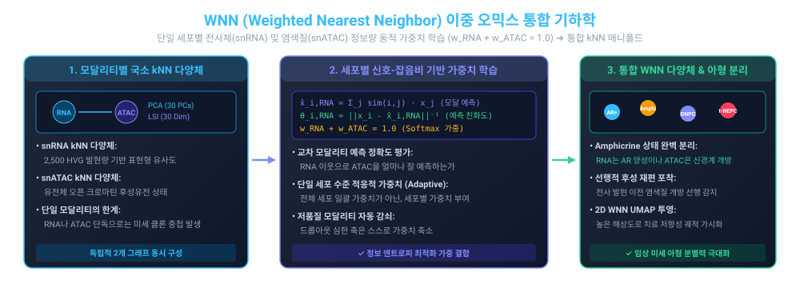

# Chapter 05. WNN 멀티모달 통합 및 계통 미세 클론 규명 (Weighted Nearest Neighbor)

> **Cognitive Goal**: 동일 단일 핵에서 포획된 전사체(snRNA-seq)와 염색질 접근성(snATAC-seq) 데이터를 통합하는 `MuData` 다차원 컨테이너 구조를 이해하고, 모달리티별 신호 대 잡음비(SNR)를 세포 단위로 정량화하여 결합하는 Weighted Nearest Neighbor (WNN) 알고리즘의 수학적 원리를 유도한다. 나아가 RNA 발현만으로는 구별할 수 없는 전립선암의 미세 저항성 클론이 후성유전학적 정보에 의해 어떻게 명확히 감별되는지 생물학적 기전을 정립한다.

---

## 1. 단일 핵 멀티모달 데이터 객체: MuData 컨테이너 아키텍처

10x Multiome 기술은 단 하나의 물리적 핵 내부에서 pre-mRNA(cDNA)와 열린 염색질 DNA 단편을 동시에 시퀀싱하므로, 두 데이터 계층은 **완벽히 동일한 세포 바코드(Cell Barcode)**를 공유합니다. 이 복합 데이터를 단일 파이썬 환경에서 메모리 효율적으로 관리하기 위해 `muon` 생태계의 표준 객체인 **`MuData` (Multimodal Data)** 구조를 채택합니다.

```
                               ┌──────────────────────────────────────────────┐
                               │             MuData 객체 (mdata)              │
                               │   obs: 공유 세포 메타데이터 (Cell Barcodes)  │
                               │   obsm: 멀티모달 통합 좌표 (X_wnn_umap)      │
                               │   obsp: WNN 결합 연결성 행렬 (connectivities)│
                               └──────────────────────┬───────────────────────┘
                                                      │
                       ┌──────────────────────────────┴──────────────────────────────┐
                       ▼                                                             ▼
        ┌──────────────────────────────┐                              ┌──────────────────────────────┐
        │       mdata.mod['rna']       │                              │       mdata.mod['atac']      │
        │  (AnnData: Gene Expression)  │                              │   (AnnData: Chromatin Peaks) │
        ├──────────────────────────────┤                              ├──────────────────────────────┤
        │ X: 유전자 발현 카운트        │                              │ X: 피크 접근성 카운트        │
        │ obs: RNA 고유 QC 지표        │                              │ obs: ATAC 고유 QC 지표       │
        │ var: 유전자 심볼 및 주석     │                              │ var: 게놈 좌표 (chr:start-end)│
        │ obsm: X_pca (30차원)         │                              │ obsm: X_lsi (2~30차원)       │
        │ obsp: rna_connectivities     │                              │ obsp: atac_connectivities    │
        └──────────────────────────────┘                              └──────────────────────────────┘
```

### 1.1 계층적 데이터 동기화 메커니즘
`MuData`는 두 개의 독립적인 `AnnData` 객체를 하위 모듈(`mdata.mod['rna']`, `mdata.mod['atac']`)로 내장하면서, 상위 수준에서 세포(Row)와 특징(Column)의 연산을 유기적으로 동기화합니다:
1. **관측치 동기화 (`mdata.obs`)**: RNA와 ATAC의 QC 필터링을 거친 공통 세포 바코드 집합을 교집합 또는 합집합으로 관리하며, 세포 유형 주석이나 환자 임상 정보 등 공통 메타데이터를 전역 슬롯에 기록합니다.
2. **모달리티별 독립적 공간 (`mdata.mod[...].obsm`)**: RNA는 대수 정규화 후 PCA 공간(`X_pca`)을 생성하고, ATAC는 TF-IDF 정규화 후 LSI 공간(`X_lsi`)을 독립적으로 유지합니다.
3. **통합 연결성 그래프 (`mdata.obsp['connectivities']`)**: 뒤이어 설명할 WNN 알고리즘에 의해 계산된 가중 결합 친화도 행렬(Affinity Matrix)이 상위 객체의 쌍대 관계 슬롯에 저장되어, 최종 멀티모달 UMAP과 Leiden 클러스터링의 직접적 입력으로 사용됩니다.

---

## 2. Weighted Nearest Neighbor (WNN) 알고리즘의 수학적 유도

단일 세포 멀티오믹스에서 단순한 결합(Concatenation, 예: PCA와 LSI 좌표를 단순히 붙여넣기)을 적용하면 심각한 왜곡이 발생합니다. 예를 들어, 시퀀싱 뎁스가 높은 모달리티가 거리 계산을 완전히 압도하거나, 특정 세포 유형에서 한쪽 오믹스의 기술적 노이즈가 다른 쪽 오믹스의 진정한 생물학적 신호를 오염시키기 때문입니다.

Seurat v4 및 Muon에 구현된 **WNN (Weighted Nearest Neighbor)** 알고리즘은 **"각 세포마다 정보량이 풍부하고 신뢰성이 높은 모달리티에 동적으로 더 높은 가중치를 부여한다"**는 원리로 설계되었습니다.



### 2.1 단일 모달리티 내 친화도 그래프 구축
먼저 RNA와 ATAC 공간에서 각 세포 $c$의 국소 이웃 구조를 독립적으로 정의합니다:
- RNA 공간: 정규화된 30개 주성분(PC) 공간 상의 유클리드 거리 $d_{c, c'}^{\text{RNA}}$
- ATAC 공간: 뎁스 상관성을 배제한 LSI(2~30차원) 공간 상의 코사인 또는 유클리드 거리 $d_{c, c'}^{\text{ATAC}}$

각 모달리티 $M \in \{\text{RNA}, \text{ATAC}\}$에 대해, 세포 $c$의 $k$번째 최근접 이웃까지의 거리 $\sigma_{c, M}$을 커널 대역폭(Bandwidth)으로 설정하여 점근적 친화도(Affinity) 행렬 $A_{c, c'}^{M}$을 산출합니다:

$$A_{c, c'}^{M} = \exp\left( - \frac{\max(0, d_{c, c'}^{M} - d_{c, (1)}^{M})}{\sigma_{c, M} - d_{c, (1)}^{M}} \right)$$

여기서 $d_{c, (1)}^{M}$은 세포 $c$의 가장 가까운 첫 번째 이웃까지의 거리입니다.

### 2.2 모달리티 간 교차 예측 (Cross-Modal Prediction)
모달리티 $M_1$이 세포 $c$의 상태를 얼마나 충실히 반영하는지 평가하기 위해, **모달리티 $M_1$의 이웃 구조를 사용하여 모달리티 $M_2$의 분자 프로파일을 얼마나 잘 예측할 수 있는가**를 측정합니다:

1. **내부 모달리티 예측 (Intra-modal Prediction)**:
   - 모달리티 $M_1$의 최근접 이웃 세포들의 가중 평균으로 세포 $c$의 $M_1$ 특징 벡터를 재구성:
   $$\hat{x}_{c, M_1}^{(M_1)} = \sum_{c' \in N_k^{M_1}(c)} \tilde{A}_{c, c'}^{M_1} x_{c', M_1}$$
2. **교차 모달리티 예측 (Cross-modal Prediction)**:
   - 반대편 모달리티 $M_2$의 이웃 세포들을 기반으로 세포 $c$의 $M_1$ 특징 벡터를 예측:
   $$\hat{x}_{c, M_1}^{(M_2)} = \sum_{c' \in N_k^{M_2}(c)} \tilde{A}_{c, c'}^{M_2} x_{c', M_1}$$

만약 세포 $c$에서 모달리티 $M_2$가 기술적 결손(Dropout)이나 노이즈로 훼손되었다면, $M_2$의 이웃 세포들은 세포 $c$의 실제 생물학적 정체성과 무관한 세포들로 채워질 것이며, 따라서 $\hat{x}_{c, M_1}^{(M_2)}$의 예측 오차는 극대화됩니다.

### 2.3 세포별 동적 가중치(Cell-Specific Modality Weights) 산출
각 세포 $c$와 모달리티 $M$에 대해, 실제 프로파일 $x_{c, M}$과 (i) 내부 모달리티 예측 $\hat{x}_{c, M}^{(M)}$ 사이의 거리 $d_{\text{within}}$, (ii) 교차 모달리티 예측 $\hat{x}_{c, M}^{(M')}$ 사이의 거리 $d_{\text{cross}}$를 구하고, 세포별 대역폭 $\sigma_{c, M}$을 갖는 지수 커널로 변환합니다:

$$\kappa_{\text{within}} = \exp\left(-\frac{d_{\text{within}}}{\sigma_{c, M}}\right), \qquad \kappa_{\text{cross}} = \exp\left(-\frac{d_{\text{cross}}}{\sigma_{c, M}}\right)$$

모달리티 점수는 두 커널의 비로 정의하고(Seurat 구현에서는 분모에 $10^{-4}$를 더하고 0~200으로 clip), 모달리티 간 소프트맥스(Softmax)로 정규화하여 각 세포의 상대적 가중치 $w_{c, \text{RNA}}$, $w_{c, \text{ATAC}}$를 결정합니다:

$$\text{score}_{c, M} = \frac{\kappa_{\text{within}}}{\kappa_{\text{cross}} + 10^{-4}}, \qquad w_{c, M} = \frac{e^{\text{score}_{c, M}}}{\sum_{M'} e^{\text{score}_{c, M'}}}$$

- 가중치 제약 조건:
  $$w_{c, \text{RNA}} + w_{c, \text{ATAC}} = 1 \quad (\forall c)$$
- 모달리티별 스케일 보정용 $\theta_M$ 같은 하이퍼파라미터는 없으며, 가중치는 세포 $c$ 기준으로 정의되므로 $w_{c, M} \ne w_{c', M}$이고 $c$에서 $c'$로의 가중치와 $c'$에서 $c$로의 가중치도 일반적으로 다릅니다(비대칭).

### 2.4 WNN 가중 친화도와 복합 그래프 생성
최종적으로 세포 $c$에서 세포 $c'$로의 WNN 친화도(Weighted Affinity)는 2.1에서 정의한 모달리티별 친화도 $A_{c, c'}^{M}$을 세포 $c$의 가중치로 합한 값입니다(거리의 가중 제곱합이 아닙니다):

$$\theta_{c, c'}^{\text{WNN}} = \sum_{M} w_{c, M} \, A_{c, c'}^{M} = w_{c, \text{RNA}} \, A_{c, c'}^{\text{RNA}} + w_{c, \text{ATAC}} \, A_{c, c'}^{\text{ATAC}}$$

각 세포 $c$의 이웃은 $\theta_{c, c'}^{\text{WNN}}$이 큰 순서로 선택되어 가중 kNN 그래프 $G^{\text{WNN}} = (V, E)$를 이루고, 이 복합 그래프 상에서 UMAP 투영과 Leiden 군집화가 실행됩니다.

---

## 3. 전립선암 미세 저항성 클론 분리에서의 임상 생물학적 우위

임상 전립선암 생검 검체에서 단순 snRNA-seq 단독 분석을 수행할 때 흔히 직면하는 난제는, 호르몬 치료 저항성 획득 과정에 있는 **AR-active 선암세포(Adenocarcinoma)**와 **AR-low 가소성 중간 세포(Plastic Intermediate Clones)**가 단일 RNA 군집 내에 모호하게 뭉개져 분리되지 않는 현상입니다.

```
[전사체 단독 (snRNA-seq Only)]
  클러스터 1: [ 성숙 AR+ 관강세포 (KLK3 +++)  &  치료 저항 초기 잠재 클론 (KLK3 ++) ]
  ==> (가상 예시) 전사체 프로파일이 크게 중첩되어 구분이 어려울 수 있음
  ==> 저항성 클론의 조기 감별 실패 가능

[WNN 멀티모달 통합 (snRNA + snATAC Multiome) — 아래 가중치는 가상 예시 수치]
  성숙 AR+ 관강세포:       w_RNA = 0.52, w_ATAC = 0.48 ──► [클러스터 A: 순수 AR+ 선암]
                           (AR 인핸서 열림 + KLK3 고발현)

  초기 가소성 중간 클론:   w_RNA = 0.41, w_ATAC = 0.59 ──► [클러스터 B: 후성유전 재프로그래밍 클론]
                           (AR 인핸서 폐쇄 시작, SOX2/ASCL1 인핸서 사전 개방!)
```

### 3.1 후성유전적 프라이밍(Epigenetic Priming)과 전사 지연(Transcriptional Lag)
1. **염색질 리모델링의 선행성**: 치료 압력(엔잘루타마이드 투여) 하에서 종양 세포의 운명이 전환될 때, 염색질의 물리적 개폐(Chromatin Opening/Closing)는 유전자 발현 변화에 선행하는 경향이 있는 것으로 보고되었습니다(예: SHARE-seq의 chromatin potential, Ma et al. 2020, Cell). 다만 선행 시간의 척도는 분화 맥락에 따라 다르며 일반화된 값은 없습니다.
2. **전사체 완충 효과의 극복**: 단일 핵 내 pre-mRNA가 이미 스플라이싱되어 세포질로 이동한 성숙 mRNA 잔여물은 세포의 현재 전사 상태를 지연 반영할 수 있습니다. 반면 snATAC-seq은 핵 내 DNA의 직접적인 물리적 상태를 측정하므로, *AR* 결합 인핸서의 폐쇄와 *SOX2*/*ASCL1* 파이오니어 전사 인자 결합 부위의 사전 개방(Epigenetic Priming)을 즉각적으로 포착합니다.
3. **WNN의 분별력**: 전사체 친화도가 높은 두 세포일지라도, ATAC 친화도 $A_{c, c'}^{\text{ATAC}}$가 낮고 $w_{c, \text{ATAC}}$가 충분히 크다면 가중 친화도 $\theta_{c, c'}^{\text{WNN}}$가 낮아져 서로의 이웃으로 선택될 가능성이 줄어듭니다(분리 정도는 가중치와 친화도에 의존).

---

## 4. 실전 워크플로우: MuData 및 WNN 파이썬 파이프라인

다음은 QC가 완료된 RNA와 ATAC 원시 카운트 매트릭스로부터 WNN 결합 그래프를 도출하는 실전 Python 코드입니다:

```python
import muon as mu
from muon import atac, pp
import scanpy as sc

# 1. 개별 모달리티 전처리
# RNA: Log-정규화 및 고변이 유전자 기반 PCA
sc.pp.normalize_total(mdata.mod['rna'], target_sum=1e4)
sc.pp.log1p(mdata.mod['rna'])
sc.pp.highly_variable_genes(mdata.mod['rna'], n_top_genes=3000, subset=True)
sc.pp.scale(mdata.mod['rna'], max_value=10)
sc.tl.pca(mdata.mod['rna'], n_comps=30)
mu.pp.l2norm(mdata, mod='rna', rep='X_pca')   # Seurat WNN에 가깝게: 모달리티별 이웃 탐색 전 단위 L2 정규화(muon 문서)
sc.pp.neighbors(mdata.mod['rna'], n_neighbors=20, use_rep='X_pca', n_pcs=30)

# ATAC: TF-IDF 정규화 및 LSI (Component 1은 시퀀싱 뎁스 상관성으로 제외 가능)
mu.atac.pp.tfidf(mdata.mod['atac'], scale_factor=1e4)
mu.atac.tl.lsi(mdata.mod['atac'], n_comps=31)   # muon lsi는 기본 scale_embeddings=True(성분 표준화; Signac은 미표준화)
# LSI 1을 제외한 성분 2~31(30개)을 별도 obsm에 두고 단위 L2 정규화 후 이웃 계산
# (use_rep='X_lsi', n_pcs=30만 쓰면 LSI 1이 포함됨)
mdata.mod['atac'].obsm['X_lsi_2plus'] = mdata.mod['atac'].obsm['X_lsi'][:, 1:]
mu.pp.l2norm(mdata, mod='atac', rep='X_lsi_2plus')
sc.pp.neighbors(mdata.mod['atac'], n_neighbors=20, use_rep='X_lsi_2plus')

# 2. WNN (Weighted Nearest Neighbor) 알고리즘 실행
# 각 세포별 모달리티 가중치 산출 및 복합 그래프 생성
mu.pp.neighbors(
    mdata,
    key_added="wnn",
    weight_key="mod_weight",
    n_neighbors=25
)

# 3. WNN 복합 공간 기반 다차원 축소 및 클러스터링
mu.tl.umap(mdata, neighbors_key="wnn")
sc.tl.leiden(mdata, neighbors_key="wnn", key_added="leiden_wnn", resolution=0.6)

# 4. 결과 진단: RNA vs ATAC 가중치 분포 시각화
# mdata.obs['rna:mod_weight'], mdata.obs['atac:mod_weight'] 확인
mu.pl.umap(
    mdata, 
    color=["leiden_wnn", "rna:mod_weight", "atac:mod_weight", "rna:KLK3", "rna:ASCL1"],
    wspace=0.3
)
```

---

## 5. 결론 및 다음 단계 연결

WNN 분석을 통해 RNA와 ATAC 두 독립적 오믹스 레이어가 수학적으로 완벽히 정렬되었으며, 각 단일 핵은 전사체 발현량과 염색질 개방 상태의 상호 검증된 가중치로 위치가 결정되었습니다.

그러나 단순히 "염색질이 열려 있다"는 사실만으로는 "이 열린 염색질이 수십만 염기쌍(kb) 떨어진 어떤 암 유전자의 전사를 직접 유도하는가?"를 증명할 수 없습니다. 다음 장 [Chapter 06. 원거리 인핸서-프로모터 루핑 및 Peak-to-Gene 연계 분석](06_PEAK_TO_GENE_AND_ENHANCERS.md)에서는 3차원 유전체 거리 감쇠 효과를 극복하고 전립선암 *AR* 650 kb 상류 인핸서 증폭 구조를 규명하는 공접근성 모델링을 다룹니다.

---

## 6. 단원 핵심 점검 (Cognitive Checkpoint & Case Study)

### Q1. [능동 회상 (Active Recall)] 10x Multiome 데이터를 통합할 때, RNA PCA 좌표와 ATAC LSI 좌표를 단순히 수평 결합(Simple Concatenation)하여 kNN을 계산하는 방식이 치명적인 오류를 초래하는 2가지 수학적/기술적 이유를 설명하시오.

<details>
<summary>💡 모범 답안 및 해설 확인</summary>

- **1. 차원 간 분산 및 스케일 불균형 (Scale & Variance Dominance)**:
  - RNA PCA 좌표(연속형 가우시안 가정)와 ATAC LSI 좌표(희소 이진 카운트의 SVD 변환)는 고유값(Eigenvalue)과 분산의 크기 스케일이 근본적으로 다릅니다. 두 행렬을 단순히 결합하면 총 분산이 크거나 차원 축소 스케일이 큰 한쪽 모달리티가 유클리드 거리 계산을 완전히 지배하여 다른 모달리티의 정보가 사장됩니다.
- **2. 세포별 신호 대 잡음비(SNR) 이질성 무시**:
  - 특정 세포는 RNA 시퀀싱 깊이가 얕아 심각한 전사체 드롭아웃을 겪을 수 있고, 다른 세포는 핵 파편으로 인해 ATAC 비특이적 절단 노이즈가 높을 수 있습니다. 단순 결합은 모든 세포에 대해 두 모달리티를 50:50으로 강제 반영하므로, 저품질 모달리티의 노이즈가 고품질 모달리티의 순수 생물학적 신호를 오염시켜 클러스터 분해능을 떨어뜨립니다.

</details>

---

### Q2. [능동 회상 (Active Recall)] WNN 알고리즘에서 세포 $c$의 모달리티 $M_1$ 가중치 $w_{c, M_1}$을 결정하기 위해 '교차 모달리티 예측(Cross-modal Prediction)'을 사용하는 원리를 서술하고, 가중치 산출 수식에서 $\sum w_M = 1$이 만족되는 수학적 장치를 설명하시오.

<details>
<summary>💡 모범 답안 및 해설 확인</summary>

- **교차 모달리티 예측 원리**:
  - 모달리티 $M_1$의 이웃 세포들을 사용하여 모달리티 $M_2$의 분자 상태를 예측해 봅니다. 만약 $M_1$의 이웃 구조가 진정한 생물학적 계통을 올바르게 반영하고 있다면, 그 이웃들의 $M_2$ 프로파일 평균값은 세포 $c$의 실제 $M_2$ 프로파일과 매우 높은 정확도로 일치할 것입니다.
  - 반대로 $M_1$이 기술적 노이즈에 오염되어 있다면 이웃들이 무작위 세포들로 구성되어 교차 예측 오차가 극대화됩니다. 즉, 교차 예측 오차의 크기를 역산함으로써 모달리티 $M_1$의 상대적 정보 품질(Affinity)을 정량화합니다.
- **수학적 합계 1 보장 장치 (Softmax Normalization)**:
  - 각 모달리티의 점수($\text{score}_{c, M} = \kappa_{\text{within}} / (\kappa_{\text{cross}} + 10^{-4})$, 즉 내부/교차 모달리티 예측 커널의 비)를 소프트맥스 함수의 지수 항으로 변환하여, 분모에 모든 모달리티의 지수 합($e^{\text{score}_{c, \text{RNA}}} + e^{\text{score}_{c, \text{ATAC}}}$)을 배치합니다. 이에 따라 확률 분포와 동일한 수학적 성질을 가지므로 모든 세포 $c$에서 $w_{c, \text{RNA}} + w_{c, \text{ATAC}} = 1$이 항등적으로 성립합니다.

</details>

---

### Q3. [임상 케이스 해석 (Clinical Interpretation)] 전이성 거세저항성 전립선암(mCRPC) 환자의 골전이 생검 10x Multiome 데이터를 WNN으로 분석하였다. UMAP 상에서 *AR*과 *KLK3* 유전자 발현량이 거의 동일하게 높은 두 개의 인접 서브클러스터(Cluster 1, Cluster 2)가 분리되었다. 모달리티 가중치를 조사한 결과 Cluster 1은 $w_{\text{RNA}} = 0.60, w_{\text{ATAC}} = 0.40$이었으나, Cluster 2는 $w_{\text{RNA}} = 0.35, w_{\text{ATAC}} = 0.65$로 나타났다. ATAC 차등 접근성 분석 결과 Cluster 2에서 신경내분비 계통 파이오니어 인자인 *ASCL1* 및 *SOX2* 유전자 인핸서 영역의 접근성이 유의하게 개방되어 있었다. 이 환자의 분자병리학적 상태를 진단하고, 향후 안드로겐 차단 치료(엔잘루타마이드) 지속 시 발생할 임상 경과를 예측하시오.

<details>
<summary>💡 모범 답안 및 해설 확인</summary>

- **분자병리학적 진단**:
  - Cluster 2는 전사체 수준에서는 여전히 안드로겐 수용체 경로 유전자(*KLK3*, PSA)를 분비하고 있어 겉으로는 전형적인 선암(Adenocarcinoma)으로 보이지만, 후성유전체 수준에서는 이미 신경내분비암(t-NEPC) 분화 프로그램 인핸서가 사전 개방된 **'후성유전적 프라이밍 중간 가소성 클론(Epigenetically Primed Plastic Intermediate Clone)'**입니다.
  - WNN 가중치는 세포별로 어느 모달리티의 이웃 구조가 그 세포의 프로파일을 더 잘 예측하는지를 나타낼 뿐입니다. $w_{\text{ATAC}} = 0.65$는 이 클러스터에서 ATAC 이웃 구조의 정보량이 상대적으로 크다는 *가설 생성용 지표*이며, 염색질이 정체성을 규정한다는 입증이 아닙니다(시퀀싱 깊이·품질 차이로도 달라짐). 이 수치는 가상 예시입니다.
- **임상 경과 예측**:
  - 이 가상 시나리오에서 가능한 *가설*은 Cluster 2가 신경내분비 프로그램 쪽으로 전환할 가능성이 있다는 것입니다. 그러나 ASCL1/SOX2 접근성만으로는 t-NEPC를 판정할 수 없으며, 신경내분비 마커 발현, 병리 소견, *RB1*/*TP53* 상태 등 직교 근거로 확인해야 합니다.
  - 치료 경과(AR 소실, PSA 변화)나 백금 기반 화학요법 같은 임상 결정은 이 데이터로부터 도출할 수 없으며, 위 직교 검증 후 임상 가이드라인에 따라 결정해야 합니다.

</details>

---

<!-- REFERENCES:BEGIN (generated by scripts/apply_references.py; do not edit by hand) -->
## 참고문헌 (References)
### 본문 인용 문헌
1. Ma S, Zhang B, LaFave LM, et al. Chromatin Potential Identified by Shared Single-Cell Profiling of RNA and Chromatin. *Cell*. 2020;183(4):1103-1116.e20. PMID: 33098772. doi: 10.1016/j.cell.2020.09.056
### 검수 근거 문헌
1. Hao Y, Hao S, Andersen-Nissen E, et al. Integrated analysis of multimodal single-cell data. *Cell*. 2021;184(13):3573-3587.e29. PMID: 34062119. doi: 10.1016/j.cell.2021.04.048
### 소프트웨어 (표기 버전은 검수 시 API를 확인한 버전이며, 파이프라인 실행 환경은 requirements-pipelines.txt 참조)
- muon 0.2.0 (github.com/scverse/muon). 원 논문: Bredikhin D, Kats I, Stegle O. MUON: multimodal omics analysis framework. *Genome Biol*. 2022;23(1):42. PMID: 35105358. doi: 10.1186/s13059-021-02577-8
- Scanpy 1.12.4 (github.com/scverse/scanpy). 원 논문: Wolf FA, Angerer P, Theis FJ. SCANPY: large-scale single-cell gene expression data analysis. *Genome Biol*. 2018;19(1):15. PMID: 29409532. doi: 10.1186/s13059-017-1382-0
<!-- REFERENCES:END -->
