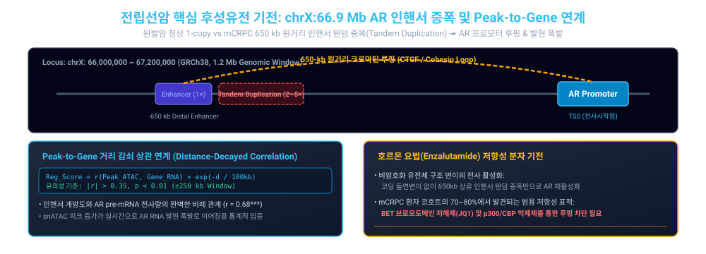

# Chapter 06. 원거리 인핸서-프로모터 루핑 및 Peak-to-Gene 연계 분석 (Cicero & AR Enhancer)

> **Cognitive Goal**: 3차원 유전체 상에서 일어나는 염색질 루핑(Chromatin Looping)의 생물물리학적 메커니즘과 물리적 거리 감쇠(Distance Decay) 모델을 이해하고, 단일 핵 멀티오믹스 데이터를 통해 원거리 인핸서(Distal Enhancer)와 표적 유전자 프로모터를 통계적으로 연결하는 Peak-to-Gene 알고리즘을 체계화한다. 특히 전립선암 거세저항성(mCRPC)의 핵심 드라이버인 *AR* 650 kb 상류 원거리 인핸서 증폭 및 활성화 기전을 심층 분석한다.

---

## 1. 3차원 크로마틴 루핑의 생물물리학과 인핸서-프로모터 상호작용

진핵생물 유전체에서 유전자 발현을 조절하는 cis-조절 인자(cis-Regulatory Elements, cCREs)의 80% 이상은 표적 유전자의 전사시작점(TSS) 프로모터에 직접 붙어 있지 않고, 수만 염기쌍(kb)에서 수백만 염기쌍(Mb) 떨어진 **원거리 인핸서(Distal Enhancer)**에 위치합니다.

```
       [원거리 인핸서 (Enhancer)]                      [프로모터 (Promoter / TSS)]
       chrX: 66,900,000 bp                             chrX: 67,545,000 bp
          │                                                    │
          ▼                                                    ▼
       ┌──────────┐                                     ┌─────────────┐
       │ FOXA1/AR │                                     │  RNA Pol II │
       │ Binding  │                                     │  Basal TFs  │
       └─────┬────┘                                     └──────┬──────┘
             │                                                 │
             └───────────────┐                 ┌───────────────┘
                             ▼                 ▼
                       ┌─────────────────────────────┐
                       │     Mediator 복합체 가교    │
                       │   (Chromatin Condensate)    │
                       └──────────────┬──────────────┘
                                      │
              ════════════════════════╪════════════════════════ (650 kb DNA 루프)
                                 CTCF │ CTCF
                                ┌─────┴─────┐
                                │  Cohesin  │ (Extrusion Ring)
                                └───────────┘
```

### 1.1 루프 압출 모델 (Loop Extrusion Model)과 전사 응축체
1. **코헤신(Cohesin)과 CTCF 절연체(Insulator)**:
   - 코헤신 링 복합체는 DNA 섬유를 양방향으로 미끄러뜨리며 루프를 형성(Loop extrusion)하다가, 서로 마주 보는 방향(Convergent orientation)의 CTCF 결합 모티프를 만나면 정지하여 **위상 결합 도메인(TAD, Topologically Associating Domain)** 경계를 형성합니다.
2. **미디에이터(Mediator) 가교와 위상 분리(Phase Separation)**:
   - TAD 내부에서 원거리 인핸서에 결합한 계통 특이적 파이오니어 전사 인자(*FOXA1*, *HOXB13*) 및 호르몬 수용체(*AR*)는 전사 조절 보조인자(p300/CBP)와 **Mediator 복합체**를 끌어들입니다.
   - 가설적 모형(논쟁 중): 고밀도 전사 복합체가 액체-액체 상분리(Liquid-liquid Phase Separation)로 전사 응축체(Transcriptional Condensate)를 형성하여 원거리 프로모터의 RNA 중합효소 II(Pol II)와 3차원 접촉을 돕는다는 제안이 있으나, 응축체의 기능적 역할은 아직 확립되지 않았습니다. 루프 압출·CTCF 방향성에 의한 TAD 형성(위 1번)이 비교적 널리 받아들여진 기전입니다.

---

## 2. 유전체 거리 감쇠 효과 vs 공접근성 모델링 (Cicero)

단일 핵 ATAC-seq 데이터에서 두 피크 사이의 열림/닫힘 상관관계를 단순 피어슨 상관계수로 계산하면 심각한 위양성(False-positive)에 빠집니다. 왜냐하면 중합체(Polymer) 물리 법칙에 의해 **물리적으로 가까운 DNA 영역들은 기능적 상호작용이 전혀 없더라도 우연히 함께 열려 있을 확률이 지수적으로 높기 때문**입니다.



### 2.1 3차원 유전체 거리 감쇠 법칙 (Distance Decay Law)
고분자 크로마틴 섬유의 무작위 충돌 확률 $P(s)$는 유전체 직선 거리 $s$에 대해 멱법칙(Power-law)으로 급격히 감쇠합니다:

$$P(s) \propto s^{-\gamma} \quad (\gamma \approx 0.75 \sim 1.0)$$

즉, 5 kb 떨어진 두 피크는 기능적 연관이 없어도 물리적 기저 접촉 빈도가 매우 높으며, 500 kb 떨어진 피크는 강력한 인핸서 루핑이 존재하더라도 기저 접촉 빈도 자체가 매우 낮게 측정됩니다.

### 2.2 Cicero 알고리즘: 정규화된 Graphical Lasso 공접근성
Cole Trapnell 연구팀이 개발한 `Cicero`는 이 거리 감쇠 현상을 수학적으로 보정하여 진정한 조절성 루프를 발굴합니다:

1. **유사 세포 집계 (k-nearest neighbor aggregation)**:
   - 단일 핵 ATAC 데이터의 극심한 드롭아웃(희소성)을 극복하기 위해, 세포 간 kNN 그래프 상에서 유사 세포(Cicero `make_cicero_cds` 기본 k=50)를 묶어 덴스(Dense)한 메타셀(Metacell) 프로파일을 생성합니다.
2. **거리 의존적 역공분산 추정 (Regularized Graphical Lasso)**:
   - 특정 유전체 윈도우(Cicero 기본 500 kb, 피크 쌍 거리 상한 `distance_constraint` 기본 250 kb) 내의 피크 쌍에 대해 공분산 행렬을 구성하고, 거리 $d$에 의존하는 페널티 $\rho$를 적용하여 희소 정밀도 행렬(Precision Matrix, $\Theta = \Sigma^{-1}$)을 풉니다:

$$\min_{\Theta \succ 0} \left( -\log \det \Theta + \text{tr}(S \Theta) + \sum_{i \neq j} \rho(s_{i,j}) |\Theta_{i,j}| \right)$$

$$\rho(d) = \lambda\left(1 - \left(\frac{x_{\min}}{d}\right)^{s}\right), \quad x_{\min}=1000,\ s=0.75$$

(Cicero 소스 `get_rho_mat` 기준. 거리 $d$가 **가까울수록** 페널티가 0에 가깝고 **멀수록** $\lambda$로 포화한다. $\lambda$는 윈도우마다 조정된다.)

3. **Cicero 공접근성 점수 (Co-accessibility Score)**:
   - 페널티를 통과한 역공분산 원소로부터 거리 편향이 완화된 정규화 상관계수(-1.0 ~ 1.0)를 산출합니다. 통상 **0.25 이상**의 점수를 갖는 연결을 유의한 잠재적 인핸서-프로모터 루프로 확정합니다.

---

## 3. Peak-to-Gene 통계적 연계 알고리즘

단일 핵 Multiome(snRNA + snATAC)의 가장 강력한 강점은 **"피크의 열림(Accessibility)"**과 **"표적 유전자의 실제 전사량(Expression)"**을 동일한 단일 핵 단위에서 1:1로 직접 상관시킬 수 있다는 점입니다.

### 3.1 Peak-to-Gene 상관계수 계산 메커니즘
1. **윈도우 정의**: 유전자 전사시작점(TSS) 기준 상류/하류 일정 범위에 위치한 모든 후보 ATAC 피크 집합 $\{P_1, P_2, \dots, P_m\}$을 탐색합니다. 도구 기본값은 다릅니다(Signac `LinkPeaks` $\pm 500\text{ kb}$, ArchR `maxDist` $250\text{ kb}$, Cicero `distance_constraint` $250\text{ kb}$). 이 장에서 다루는 *AR* 상류 650 kb 인핸서는 이 기본 윈도우들로는 후보에 포함되지 않으므로, 650 kb 이상(예: $\pm 1\text{ Mb}$)으로 윈도우를 확대해야 합니다.
2. **단일 핵 발현-접근성 상관성 검정**:
   - 세포 집합 $C$에 대해 피크 $P_j$의 정규화 카운트 벡터 $A_j$와 유전자 $G$의 정규화 전사 카운트 벡터 $E_G$ 간의 상관계수를 계산합니다:
   $$r(P_j, G) = \text{Corr}(A_j, E_G)$$
3. **배경 매칭 순열 검정 (Permutation Testing with Background Matching)**:
   - 단순히 $p$-value를 구하는 것에 그치지 않고, GC 함량(GC content)과 평균 접근성(Average accessibility)이 유사한 다수의 대조군 배경 피크를 추출하여 순열 상관계수 분포를 생성합니다(Signac `LinkPeaks` 기본은 GC·접근성·길이를 맞춘 200개).
   - 경험적 누적분포함수(Empirical CDF)를 통해 거짓 발견율(FDR)을 계산하고, 예시 임계값 $\text{FDR} < 0.05$ 및 $r > 0.30$을 동시에 만족하는 링크를 **Peak-to-Gene 조절선**으로 채택합니다. (이 조합은 교육용 예시이며 도구별 기본값은 다릅니다: Signac은 z-점수 $p < 0.05$·$|\text{score}| > 0.05$, ArchR는 메타셀 $k=100$·`corCutOff` 0.45·FDR $10^{-4}$.)

```python
# Scanpy / Muon 환경에서의 Peak-to-Gene 상관성 도출 개념도(의사 코드)
# get_gene_tss, find_peaks_in_window, calculate_distance는 정의되지 않은 보조 함수 자리표시자이며,
# 실제 분석은 메타셀 집계(아래 Q3)와 배경 피크 순열 검정을 함께 적용한다.
import muon as mu
import numpy as np
import pandas as pd
from scipy.stats import spearmanr
from statsmodels.stats.multitest import multipletests

def compute_peak_to_gene_links(mdata, gene_name, window_bp=1_000_000, fdr_cutoff=0.05):  # AR 650 kb 인핸서 포착을 위해 1 Mb
    # 1. 유전자 TSS 게놈 좌표 추출
    gene_chrom, tss_pos = get_gene_tss(mdata.mod['rna'], gene_name)
    
    # 2. TSS 반경 window_bp 내의 ATAC 피크 필터링
    candidate_peaks = find_peaks_in_window(mdata.mod['atac'], gene_chrom, tss_pos, window_bp)
    
    # 3. 동일 단일 핵 바코드 매칭 발현량 및 피크 카운트 추출
    expr_vec = mdata.mod['rna'][:, gene_name].X.toarray().flatten()
    
    results = []
    for peak in candidate_peaks:
        peak_vec = mdata.mod['atac'][:, peak].X.toarray().flatten()
        corr, pval = spearmanr(peak_vec, expr_vec)
        dist = calculate_distance(peak, tss_pos)
        results.append({"peak": peak, "distance": dist, "corr": corr, "pval": pval})
        
    df_links = pd.DataFrame(results)
    # Benjamini-Hochberg 다중 검정 보정
    df_links['fdr'] = multipletests(df_links['pval'], method='fdr_bh')[1]
    return df_links[df_links['fdr'] < fdr_cutoff]
```

---

## 4. 전립선암 임상 심층 사례: *AR* 650 kb 상류 원거리 인핸서 증폭

전립선암이 안드로겐 차단 치료(ADT) 및 2세대 AR 저해제(Enzalutamide, Abiraterone)에 저항성을 획득하여 치명적인 거세저항성 전이암(mCRPC)으로 진행할 때, 가장 흔하게 관찰되는 후성유전학적 드라이버 사건은 **X 염색체 상의 *AR* 650 kb 상류 인핸서 증폭(Distal Enhancer Amplification)**입니다.

```
[Chr X 유전체 좌표]  66.9 Mb                                                     67.55 Mb
                    ┌─────────────────────────┐                                 ┌─────────┐
                    │ *AR* 650 kb Upstream    │ ═══════════════════════════════►│ *AR* 유전자
                    │ Focal Enhancer          │      (Chromatin Looping)        │ 프로모터│
                    └───────────┬─────────────┘                                 └────┬────┘
                                │                                                    │
                 [mCRPC에서 70~87%, 원발암 <2% (Viswanathan 2018)]                                      │
                 1. 인핸서 부위의 국소 탠덤 복제(Tandem Duplication)                ▼
                 2. FOXA1, HOXB13, AR 결합 부위 ──► AR 전사 증가 (정량 배수는 출처 없음)
                 3. 저농도 안드로겐 하에서도 초고감도 생존 회로 가동!
```

### 4.1 생물학적 메커니즘 및 다중오믹스 증거
1. **탠덤 복제에 의한 인핸서 카피수 증가**:
   - *AR* 상류 인핸서 탠덤 중복은 linked-read WGS에서 mCRPC의 70–87%, 원발 전립선암의 2% 미만으로 보고되었습니다(Viswanathan et al., Cell 2018, PMID 29909985). 이 중복은 *AR* 유전자 증폭·복합 재배열과 함께 나타나는 경우가 많아 'AR 본체는 2배체이고 인핸서만 증폭'으로 일반화할 수 없습니다.
2. **초강력 전사 활성화 허브 구축**:
   - 이 650 kb 인핸서 영역은 전립선암 파이오니어 전사 인자인 *FOXA1*과 *HOXB13*, 그리고 안드로겐 수용체(*AR*) 자신의 결합 모티프가 극단적으로 밀집된 슈퍼 인핸서(Super-Enhancer) 구조를 띱니다.
   - 단일 핵 Multiome 분석 시, 치료 반응군에서는 이 부위의 피크가 닫혀 있거나 평이한 수준이지만, 엔잘루타마이드 저항성 mCRPC 환자의 악성 클론에서는 이 피크의 접근성이 증가하고 *AR* 전사량과 양의 상관을 보일 수 있습니다(배수·상관계수·FDR 수치는 출처 없는 예시이며 실제 값이 아닙니다). snATAC 단편 수는 DNA 카피수에 비례하므로 이 '접근성 증가'와 peak-to-gene 상관은 클론 간 카피수 차이의 결과일 수 있어, 카피수 보정(예: inferCNV/WGS 기반 CN 추정) 없이 후성유전학적 개방으로 해석할 수 없습니다.
3. **다운스트림 안드로겐 표적 유전자 연계**:
   - 과발현된 AR 단백질은 다시 19q13의 *KLK3*(PSA), 21q22의 *TMPRSS2*, 8p21의 *NKX3-1* 조절 인핸서로 날아가 결합함으로써, 호르몬이 고갈된 환경에서도 정상 상피 신호를 초월하는 강력한 선암 생존 전사 프로그램을 영속화합니다.

---

## 5. 결론 및 다음 단계 연결

거리 감쇠 효과를 극복하는 Cicero 공접근성 모델과 단일 핵 Peak-to-Gene 연계 분석을 통해, 수백 kb 떨어진 원거리 인핸서가 어떻게 유전자 프로모터와 물리적으로 소통하며 전립선암의 치료 저항성을 지배하는지 규명했습니다.

그러나 인핸서 피크가 열려 있다는 것만으로는 "구체적으로 어떤 마스터 전사 인자가 그 자리에 물리적으로 직접 안착해 있는가?"를 단정할 수 없습니다. 다음 장 [Chapter 07. 전사 인자 풋프린팅 및 단일 핵 모티프 편차 분석](07_TF_FOOTPRINTING_AND_CHROMVAR.md)에서는 Tn5 효소의 입체 장애를 역이용하여 전사 인자의 결합을 1 bp 해상도로 증명하는 풋프린팅(Footprinting)과 `ChromVAR` 편차 분석을 마스터합니다.

---

## 6. 단원 핵심 점검 (Cognitive Checkpoint & Case Study)

### Q1. [능동 회상 (Active Recall)] 염색질 물리 법칙에서 '거리 감쇠 효과(Distance Decay Effect)'란 무엇이며, 단순 피어슨 상관계수 대신 `Cicero`의 거리 의존적 정규화 Graphical Lasso 알고리즘을 사용해야만 하는 이유를 서술하시오.

<details>
<summary>💡 모범 답안 및 해설 확인</summary>

- **거리 감쇠 효과(Distance Decay Effect)**:
  - 3차원 유전체 상에서 두 DNA 단편 사이의 물리적 무작위 충돌 확률은 유전체 직선 거리 $s$가 멀어질수록 멱법칙($P(s) \propto s^{-\gamma}, \gamma \approx 0.75 \sim 1.0$)에 따라 급격히 감소합니다.
  - 따라서 10 kb 이내로 가까운 피크들은 전사 조절 기능과 무관하게 항상 물리적으로 인접하여 공접근성(Co-accessibility) 상관계수가 매우 높게 측정되는 반면, 500 kb 이상 떨어진 진정한 조절 루프는 기저 접촉 빈도가 낮아 단순 상관계수로는 통계적 유의성을 얻기 어렵습니다.
- **Cicero의 해결 원리**:
  - `Cicero`는 거리 $d$에 의존하는 페널티 $\rho(d) = \lambda(1-(x_{\min}/d)^{s})$를 Graphical Lasso 목적함수에 도입합니다. 이 형태에서는 가까운 쌍에는 페널티가 작고(그 쌍은 거리 기반 기대 상관이 높음을 반영) 먼 쌍에는 페널티가 커져 희소 정밀도 행렬(Sparse Precision Matrix)에서 먼 쌍은 더 강한 근거가 있어야 남습니다.
  - 이로써 단순 거리 편향이 완화되지만 위양성이 없는 것은 아니며, 공접근성은 물리적 루핑의 직접 증거가 아니므로 Hi-C/CRISPRi 등 직교 검증이 필요합니다.

</details>

---

### Q2. [능동 회상 (Active Recall)] 전립선암 환자의 거세저항성(mCRPC) 획득 과정에서 발견되는 '*AR* 650 kb 상류 인핸서'의 유전체적 구조 변이 특성과, 이 인핸서가 저농도 안드로겐 환경에서도 종양 세포의 생존을 가능하게 만드는 분자 전사 기전을 설명하시오.

<details>
<summary>💡 모범 답안 및 해설 확인</summary>

- **유전체적 구조 변이 특성**:
  - mCRPC 환자의 약 70~87%에서(Viswanathan 2018) X 염색체(chrX:66.9 Mb 부근)에 위치한 *AR* TSS 상류 650 kb 원거리 인핸서 영역이 국소적으로 탠덤 복제(Focal Tandem Duplication)되거나 고밀도로 증폭됩니다. 종양 유전체 시퀀싱 시 이 인핸서 영역의 카피수가 *AR* 증폭과 함께 또는 독립적으로 증가하는 현상이 흔히 관찰됩니다.
- **분자 전사 기전**:
  - 이 인핸서 영역에는 전립선 파이오니어 전사 인자인 *FOXA1*, *HOXB13* 및 안드로겐 수용체(*AR*)의 결합 모티프가 극도로 밀집되어 있습니다.
  - 카피수 증폭과 염색질 개방이 결합되면 거대한 Mediator 복합체를 형성하여 650 kb 루프를 통해 *AR* 프로모터와 상시 접촉합니다. 그 결과 안드로겐이 거세 수준(거의 0)으로 결핍된 환경에서도 *AR* 자체의 전사를 증가시켜(정량 배수는 출처 없음), 극미량의 리간드로도 세포 증식 회로를 완전히 가동시킵니다.

</details>

---

### Q3. [실전 트러블슈팅 및 임상 해석 (Clinical & Troubleshooting Case)] 한 연구원이 전립선암 환자 10명의 Multiome 데이터에서 Peak-to-Gene 분석을 수행하여, 치료 저항군에서 15,000개의 유의한 Peak-to-Gene 링크($p < 0.01$)를 발굴했다고 보고하였다. 그러나 상위 80% 이상의 링크가 프로모터로부터 $\pm 5\text{ kb}$ 이내에만 몰려 있었고, 이미 잘 알려진 *AR* 상류 650 kb 인핸서 링크는 완전히 누락되어 있었다. 파이프라인의 2가지 설계적 결함을 진단하고, 이를 정상적인 원거리 조절선 발굴로 전환하기 위한 개선 방안을 제시하시오.

<details>
<summary>💡 모범 답안 및 해설 확인</summary>

- **결함 1: 과도하게 좁은 게놈 검색 윈도우 및 거리 페널티 부재**:
  - **진단**: 분석 파이프라인의 탐색 윈도우가 기본값(예: $\pm 10\text{ kb}$ 또는 $\pm 50\text{ kb}$)으로 설정되어 650 kb 떨어진 원거리 인핸서 자체가 후보군에 포함되지 않았거나, 거리 감쇠 보정 없이 단순 상관계수를 사용하여 물리적 인접성 노이즈가 상위 랭킹을 완전히 독식함.
  - **개선 방안**: 탐색 윈도우를 TSS 기준 $\pm 500\text{ kb} \sim 1\text{ Mb}$로 확대하고, 거리 감쇠 페널티를 수학적으로 보정하는 `Cicero` 공접근성 모델을 적용해야 합니다.
- **결함 2: 단일 핵 드롭아웃 및 배경 매칭 순열(Permutation) 결여**:
  - **진단**: 단일 핵 ATAC의 희소 카운트를 메타셀(Metacell kNN aggregation)로 보정하지 않고 개별 핵 단위의 0-과잉(Zero-inflated) 벡터로 직접 계산하여, 원거리의 정교한 공변 신호를 드롭아웃 노이즈로 유실함. 또한 GC 함량과 뎁스를 고려한 배경 피크 순열 검정을 거치지 않아 프로모터 인근의 기초 개방 피크들이 위양성 $p$-value로 과다 선별됨.
  - **개선 방안**: kNN 유사 세포 집계(20~30 cells per metacell)를 통해 신호 대 잡음비를 복원한 후 상관계수를 재계산하고, GC 함량과 기본 접근성 빈도가 일치하는 배경 피크(Signac 기본 200개)를 대조군으로 사용하는 순열 검정 기반 FDR 필터링(예시 임계값 $\text{FDR} < 0.05, r > 0.30$)을 도입해야 합니다.

</details>

---

<!-- REFERENCES:BEGIN (generated by scripts/apply_references.py; do not edit by hand) -->
## 참고문헌 (References)
### 본문 인용 문헌
1. Viswanathan SR, Ha G, Hoff AM, et al. Structural Alterations Driving Castration-Resistant Prostate Cancer Revealed by Linked-Read Genome Sequencing. *Cell*. 2018;174(2):433-447.e19. PMID: 29909985. doi: 10.1016/j.cell.2018.05.036
### 검수 근거 문헌
1. Pliner HA, Packer JS, McFaline-Figueroa JL, et al. Cicero Predicts cis-Regulatory DNA Interactions from Single-Cell Chromatin Accessibility Data. *Mol Cell*. 2018;71(5):858-871.e8. PMID: 30078726. doi: 10.1016/j.molcel.2018.06.044
### 소프트웨어 (표기 버전은 검수 시 API를 확인한 버전이며, 파이프라인 실행 환경은 requirements-pipelines.txt 참조)
- muon 0.2.0 (github.com/scverse/muon). 원 논문: Bredikhin D, Kats I, Stegle O. MUON: multimodal omics analysis framework. *Genome Biol*. 2022;23(1):42. PMID: 35105358. doi: 10.1186/s13059-021-02577-8
- NumPy 2.5.4 (numpy.org). 원 논문: Harris CR, Millman KJ, van der Walt SJ, et al. Array programming with NumPy. *Nature*. 2020;585(7825):357-362. PMID: 32939066. doi: 10.1038/s41586-020-2649-2
- pandas 2.3.3 (github.com/pandas-dev/pandas). 원 논문: McKinney W. Data Structures for Statistical Computing in Python. *Proceedings of the Python in Science Conference*. 2010:56-61. doi: 10.25080/majora-92bf1922-00a
- SciPy 1.16.3 (github.com/scipy/scipy). 원 논문: Virtanen P, Gommers R, Oliphant TE, et al. SciPy 1.0: fundamental algorithms for scientific computing in Python. *Nat Methods*. 2020;17(3):261-272. PMID: 32015543. doi: 10.1038/s41592-019-0686-2
- statsmodels 0.15.0 (github.com/statsmodels/statsmodels).
<!-- REFERENCES:END -->
