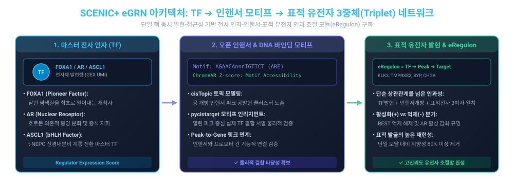

# Chapter 08. 인핸서 주도 전사조절망 복원: SCENIC+ 및 삼중 eRegulon 아키텍처

> **Cognitive Goal**: 기존 SCENIC의 프로모터 중심 분석 한계를 극복하고, 원거리 인핸서와 염색질 개방성을 통합하여 전사 인자-인핸서-표적 유전자의 후보 조절 연결망(eRegulon)을 추론하는 `SCENIC+` (Enhancer-driven Gene Regulatory Network, eGRN) 프레임워크를 마스터한다. 아울러 전립선 선암(`AR_extended`), 파이오니어 네트워크(`FOXA1_extended`), 신경내분비 가소성(`ASCL1_extended`), 이중 음성 표현형(`ETV4_extended`)을 지배한다고 가정하는 4대 eRegulon 회로를 (가설적 예시로) 학습한다.

---

## 1. SCENIC에서 SCENIC+로의 진화: 왜 원거리 인핸서인가?

전통적인 유전자 전사조절망(GRN) 분석 도구인 1세대 **SCENIC**은 단일 세포 전사체(scRNA-seq) 데이터에 기반하여, 전사 인자(TF)와 표적 유전자 사이의 공발현 상관관계를 프로모터 주변($\pm 10\text{ kb}$) cis-모티프 농축으로 필터링하는 방식이었습니다.

그러나 암 생물학 및 계통 분화 연구에서 이는 치명적인 사각지대를 남겼습니다:
1. **프로모터 중심의 정보 결손**: 포유류 세포에서 세포 유형 특이적(Cell-type specific)이거나 종양 악성화에 의해 새로 획득되는 cis-조절 신호의 **80% 이상은 TSS로부터 수십~수백 kb 떨어진 원거리 인핸서(Distal Enhancer)**에 위치합니다.
2. **프로모터의 비특이성**: 대부분의 프로모터 영역은 CpG 아일랜드로 구성되어 여러 세포 유형에서 기본적으로 항상 열려 있는 경우가 많아, 진정한 종양 계통 스위치를 구별해 내지 못합니다.
3. **인과관계 검증의 부재**: 전사체 상관관계만으로는 "전사 인자가 실제로 해당 DNA에 물리적으로 결합하여 염색질을 열어젖혔는가?"를 직접 증명할 수 없습니다.

Aerts 연구실이 개발한 **`SCENIC+`**는 동일한 단일 핵에서 포획된 **snRNA-seq(전사체)**과 **snATAC-seq(후성유전체)**을 통합하여, **[전사 인자] ──► [원거리 인핸서] ──► [표적 유전자]**로 이어지는 완벽한 **삼중 조절자 복합체(Triplet eRegulon)**를 재구성합니다.



---

## 2. 삼중 eRegulon 발굴 4단계 워크플로우

`SCENIC+`는 엄밀한 생물정보학적 필터링을 통해 기술적 위양성을 철저히 배제하는 4단계 파이프라인으로 구성됩니다:

```
[Step 1. pycisTopic]        단일 핵 ATAC 매트릭스 ──► 잠재 토픽 모델링 (LDA)
                                                       │ (공접근성 조절 토픽 도출)
                                                       ▼
[Step 2. pycistarget]       후보 인핸서 영역 서열 ──► cisTarget 모티프 데이터베이스 스크리닝
                                                       │ (NES > 3.0 고신뢰도 TF 모티프 발굴)
                                                       ▼
[Step 3. Enhancer-to-Gene]  원거리 인핸서 접근성  ──► 표적 유전자 mRNA 발현량 (Gradient Boosting)
                                                       │ (세포 간 동시 발현-접근성 상관성; SCENIC+ 기본 rho 임계 0.03)
                                                       ▼
[Step 4. Triplet Assembly]  [ TF ] ──────► [ Distal Enhancer ] ──────► [ Target Gene ]
                                                       │
                                                       ▼
[AUCell 점수화]             단일 핵별 활성 eRegulon(+) 및 억제 eRegulon(-) 정량화
```

### 2.1 Step 1: `pycisTopic`을 통한 후보 조절 인핸서 선별
- 단일 핵 ATAC의 희소 이진 매트릭스에 자연어 처리 알고리즘인 **잠재 디리클레 할당(Latent Dirichlet Allocation, LDA)**을 적용합니다.
- 단어(피크)와 문서(세포)의 관계를 분석하여, 생물학적으로 함께 열리고 닫히는 **공접근성 조절 토픽(Cis-regulatory Topics)**을 추출하고, 토픽 기여도가 높은 고신뢰도 후보 인핸서 세트를 선별합니다.

### 2.2 Step 2: `pycistarget`을 통한 TF 모티프 농축 분석
- 선별된 인핸서 DNA 서열(보통 피크 중심 $\pm 250\text{ bp}$)을 수만 개의 전사 인자 위치 가중치 행렬(PWM) 데이터베이스와 대조합니다.
- 복구 곡선 하 면적(AUC) 기반의 **정규화 농축 점수(Normalized Enrichment Score, NES > 3.0)**를 통과한 전사 인자만을 후보 마스터 조절자로 채택합니다.

### 2.3 Step 3: Enhancer-to-Gene (e2g) 기계학습 모델링
- 유전자 전사시작점(TSS) 기준 검색 공간(`get_search_space` 기본값: 상·하류 각각 1 kb ~ 150 kb) 내의 모든 후보 인핸서의 접근성을 설명변수로 두고, 표적 유전자의 mRNA 발현량을 예측하는 **Gradient Boosting Machine (GBM)** 회귀 모델을 학습합니다. 기본 검색 공간 밖에 있는 인핸서(예: *AR* 상류 650 kb)는 링크될 수 없으므로, 이를 포착하려면 `upstream`/`downstream` 상한을 650 kb 이상(예: 700 kb)으로 확장해야 합니다.
- 피처 중요도(Feature Importance)와 피어슨/스피어만 상관계수를 결합하여 통계적으로 유의미한 인핸서-유전자 링크를 확정합니다.

### 2.4 Step 4: 삼중체 결합 및 eRegulon 조립
최종적으로 다음 3가지 조건이 동시에 충족될 때만 진정한 `eRegulon`으로 공인됩니다:
1. **TF ──► Gene**: 전사 인자의 발현량과 표적 유전자의 발현량이 단일 세포들 사이에서 유의하게 상관될 것.
2. **TF ──► Enhancer**: 전사 인자의 결합 모티프가 인핸서 피크 내에 통계적으로 농축되어 있을 것.
3. **Enhancer ──► Gene**: 인핸서의 물리적 접근성이 표적 유전자의 전사량과 강력한 공접근성/상관성을 나타낼 것.

- **활성화 eRegulon (`+`)**: TF 발현 증가 시 표적 유전자 발현과 인핸서 접근성이 동시에 증가하는 회로.
- **억제 eRegulon (`-`)**: TF 결합 시 인핸서가 닫히거나 표적 유전자 전사가 억제되는 침묵 회로.

---

## 3. 전립선암의 4대 핵심 eRegulon 회로망

`SCENIC+`를 임상 전립선암 Multiome 코호트에 적용하면, 종양의 악성화 단계 및 치료 저항성 아형을 규정하는 후보로서 아래 4대 마스터 eRegulon을 가정해 볼 수 있습니다(실제 코호트에서 이 4개가 확정적으로 도출되었다고 보고한 문헌은 확인되지 않았으며, 이하 회로도와 표는 설명을 위한 가설적 예시입니다).

```
[1. AR_extended(+)]          [2. FOXA1_extended(+)]       [3. ASCL1_extended(+)]       [4. ETV4_extended(+)]
   ┌─────────────┐              ┌─────────────┐              ┌─────────────┐              ┌─────────────┐
   │  AR 단백질  │              │ FOXA1 단백질│              │ ASCL1 단백질│              │  ETV4 단백질│
   └──────┬──────┘              └──────┬──────┘              └──────┬──────┘              └──────┬──────┘
          │ (Distal Looping)           │ (Pioneer Opening)          │ (NE Switching)             │ (MAPK Driving)
          ▼                            ▼                            ▼                            ▼
   ┌─────────────┐              ┌─────────────┐              ┌─────────────┐              ┌─────────────┐
   │ 650kb Enh   │              │ Pro Enhancer│              │ E-box Enh   │              │ AP-1/ETS Enh│
   └──────┬──────┘              └──────┬──────┘              └──────┬──────┘              └──────┬──────┘
          │                            │                            │                            │
          ▼                            ▼                            ▼                            ▼
   *KLK3*, *TMPRSS2*            *HOXB13*, *NKX3-1*           *SYP*, *CHGA*, *INSM1*       *MMP9*, *TWIST1*, *SNAI1*
   [성숙 관강 선암 정체성]      [전립선 계통 후성유전 개척]  [치료 유도 신경내분비암]     [이중음성 DNPC / EMT 침습]
```

### 3.1 4대 마스터 eRegulon의 분자적 특성

| eRegulon 명칭 | 핵심 결합 모티프 | 주요 조절 원거리 인핸서 부위 | 임상적 의의 및 질환 아형 |
|:---|:---|:---|:---|
| **`AR_extended(+)`** | ARE (Androgen Response Element) | *AR* 상류 650 kb 인핸서(기본 ±150 kb 검색 공간 밖이므로 확장 필요), *KLK3* 상류 4 kb 인핸서 | 전형적인 안드로겐 의존성 선암(Adenocarcinoma)의 분화 회로 유지; 호르몬 차단 요법(ADT)의 1차 표적 |
| **`FOXA1_extended(+)`** | Forkhead motif (`TGTTTAC`) | 전립선 계통 특이적 슈퍼 인핸서 클러스터 | 파이오니어 전사 인자; 히스톤 누클레오솜을 열어젖혀 AR의 결합 자리를 마련함 |
| **`ASCL1_extended(+)`** | E-box motif (`CANNTG`) | *SYP*, *CHGA*, *INSM1*, *RET* 상류 인핸서 | 엔잘루타마이드 치료 저항성 t-NEPC(신경내분비암)와 연관된 전사 인자(마스터 조절자로 단정하기는 어려움); 관강 프로그램 억제와 신경계 분화 유도에 관여한다는 보고가 있음 |
| **`ETV4_extended(+)`** | ETS motif (`GGAA/T`) | *FGFR1*, *MYC*, *MMP2* 조절 인핸서 | *AR*과 *ASCL1*이 모두 음성인 이중 음성 전립선암(DNPC)과 연관될 수 있는 가설적 후보(DNPC의 FGF/MAPK 활성은 보고되었으나 ETV4가 마스터 조절자라는 근거는 확립되지 않음); *MAPK* 신호와 관련한 침습성 가설 |

---

## 4. 실전 워크플로우: SCENIC+ 분석 파이프라인

다음은 단일 핵 Multiome 데이터로부터 `SCENIC+` 객체를 빌드하고 eRegulon 활성도를 평가하는 표준 파이썬 워크플로우입니다:

```python
# SCENIC+ v1.0.0 소스(aertslab/scenicplus, 태그 v1.0.0)의 API 기준.
# git main(1.0a2+)은 snakemake 워크플로 중심으로 함수 시그니처가 달라 아래 코드가 그대로 동작하지 않습니다.
import scenicplus
from scenicplus.scenicplus_class import create_SCENICPLUS_object
from scenicplus.preprocessing.filtering import filter_genes, filter_regions

# 1. SCENIC+ 분석 객체 초기화 (RNA 카운트 + ATAC 피크 매트릭스 결합)
scplus_obj = create_SCENICPLUS_object(
    GEX_anndata=mdata.mod['rna'],
    cisTopic_obj=cistopic_obj,
    menr=motif_enrichment_results
)

# 2. Enhancer-to-Gene (e2g) 기계학습 모델링
# 먼저 TSS 기준 검색 공간을 만든다: 최소 1 kb ~ 최대 150 kb (상·하류; SCENIC+ 기본값)
# 주의: AR 상류 650 kb 인핸서를 링크하려면 upstream=[1000, 700000]처럼 상한을 확장해야 한다.
from scenicplus.enhancer_to_gene import get_search_space, calculate_regions_to_genes_relationships
get_search_space(
    scplus_obj,
    species='hsapiens',
    assembly='hg38',
    upstream=[1000, 150000],
    downstream=[1000, 150000]
)
calculate_regions_to_genes_relationships(
    scplus_obj,
    search_space_key='search_space',
    ray_n_cpu=8
)

# 3. TF-to-Gene (tf2g) 상관관계 모델링
# tf_file: TF 유전자 이름 목록 파일(한 줄에 하나)이 필수 인자
from scenicplus.TF_to_gene import calculate_TFs_to_genes_relationships
calculate_TFs_to_genes_relationships(scplus_obj, tf_file='allTFs_hg38.txt', ray_n_cpu=8)
# 참고: SCENIC+ 소스(TF_to_gene.py)의 기본 rho 임계(RHO_THRESHOLD)는 0.03이며, 다른 값을 쓰려면 근거를 명시한다.

# 4. 삼중체 조립 (eRegulon Formulation)
from scenicplus.cistromes import merge_cistromes
from scenicplus.grn_builder.gsea_approach import build_grn
from scenicplus.utils import format_egrns
merge_cistromes(scplus_obj)   # build_grn의 기본 cistromes_key='Unfiltered'에 필요
build_grn(
    scplus_obj,
    min_target_genes=5,
    ray_n_cpu=8
)
format_egrns(scplus_obj, eregulons_key='eRegulons', TF2G_key='TF2G_adj', key_added='eRegulon_metadata')

# 5. AUCell 기반 단일 핵별 eRegulon 활성도 점수화
from scenicplus.eregulon_enrichment import get_eRegulons_as_signatures, make_rankings, score_eRegulons
get_eRegulons_as_signatures(scplus_obj)
region_ranking = make_rankings(scplus_obj, target='region')
score_eRegulons(scplus_obj, ranking=region_ranking, enrichment_type='region', auc_threshold=0.05)

# 핵심 eRegulon 활성도 추출
# scplus_obj.uns['eRegulon_AUC']['Region_based']  (핵 x eRegulon AUC 표; AR/ASCL1/ETV4 해당 열을 조회)
```

---

## 5. 결론 및 다음 단계 연결

`SCENIC+`를 통해 유전자 발현 상관관계라는 1차원적 가설을 넘어, 원거리 인핸서의 개방성과 전사 인자의 물리적 모티프 결합이라는 후성유전학적 연결을 단일 핵 수준에서 추론하는 삼중 eRegulon 프레임워크를 학습했습니다(SCENIC+는 후보 TF-인핸서-표적 유전자 연결을 예측하므로 결과는 실험적 검증이 필요한 후보입니다).

그러나 실제 멀티오믹스 실험은 단일 오믹스보다 실패 위험이 두 배로 높습니다. 핵 분리 시의 과도한 파쇄, 불충분한 Tn5 전치 반응, 뼈 조직 탈회 과정에서의 염색질 손상 등 수많은 기술적 아티팩트가 데이터 무결성을 위협합니다. 마지막 장 [Chapter 09. 멀티오믹스 실전 트러블슈팅 및 캡스톤 프로젝트 루브릭](09_TROUBLESHOOTING_AND_BEST_PRACTICES.md)에서는 연구 현장의 문제 해결 노하우와 5단계 완주 루브릭을 총정리합니다.

---

## 6. 단원 핵심 점검 (Cognitive Checkpoint & Case Study)

### Q1. [능동 회상 (Active Recall)] 전통적인 1세대 `SCENIC`과 비교할 때, 차세대 `SCENIC+`가 유전자 조절망 복원에서 달성한 '원거리 인핸서로의 도약(The Enhancer Leap)'의 개념적/생물학적 의의를 2가지 서술하시오.

<details>
<summary>💡 모범 답안 및 해설 확인</summary>

- **1. 세포 유형 특이적 조절 인핸서의 완벽한 포섭**:
  - 기존 SCENIC은 유전자 TSS 기준 $\pm 10\text{ kb}$의 좁은 프로모터 영역만 탐색하므로, 전립선암의 악성화나 치료 저항성을 주도하는 핵심 cis-조절 인자의 대다수인 **원거리 인핸서(Distal Enhancers, $\pm 150\text{ kb} \sim 1\text{ Mb}$)**를 원천적으로 배제하는 치명적 한계가 있었습니다.
  - SCENIC+는 동일 단일 핵에서 얻은 snATAC-seq의 열린 피크 정보를 결합하여, 유전자로부터 수백 kb 떨어진 원거리 인핸서까지 조절망의 구성 요소로 온전히 복원합니다.
- **2. 삼중 Triplet 아키텍처에 의한 후보 조절망 추론 (인과성의 증명이 아님)**:
  - 1세대 SCENIC은 전사체 공발현 상관관계에 의존하여 간접적 상관관계를 배제하기 어려웠습니다.
  - SCENIC+는 **(1) TF 발현, (2) 원거리 인핸서 내 TF 결합 모티프 농축 및 염색질 개방, (3) 인핸서-프로모터 공접근성 및 표적 유전자 발현**이라는 3중 조건을 동시에 검증함으로써, 단순 상관관계를 넘어 후보 전사 조절 연결망(eGRN)을 예측·재구성합니다(인과성은 별도의 실험 검증이 필요).

</details>

---

### Q2. [능동 회상 (Active Recall)] mCRPC 환자에서 안드로겐 차단 요법(엔잘루타마이드)에 불응하는 두 가지 비전형적 아형인 't-NEPC'와 'DNPC(Double-Negative)'를 지배하는 핵심 마스터 eRegulon 후보(가설적 예시)의 명칭을 각각 제시하고, 이들의 활성화 기전과 표적 유전자 특성을 비교하시오.

<details>
<summary>💡 모범 답안 및 해설 확인</summary>

- **1. t-NEPC (치료 유도 신경내분비암) ──► `ASCL1_extended(+)` / `NEUROD1_extended(+)`**:
  - **활성화 기전**: *TP53* 및 *RB1* 복합 결손 하에서 엔잘루타마이드 치료 압력이 지속될 때, 관강 계통 억제 신호가 붕괴되면서 신경계 마스터 스위치인 bHLH 전사 인자 *ASCL1*이 발현되고 E-box 모티프 인핸서를 개방합니다.
  - **표적 유전자**: *SYP*, *CHGA*, *INSM1* 등 성숙 신경내분비 마커를 직접 활성화하고 관강 유전자를 억제합니다.
- **2. DNPC (이중 음성 전립선암) ──► `ETV4_extended(+)` / `ELK1_extended(+)`**:
  - **활성화 기전**: 안드로겐 수용체(*AR*)와 신경내분비 마커(*ASCL1*)가 모두 음성(`AR- / NE-`)인 상태에서, 우회 신호 전달계인 *FGFR* 과발현 및 *MAPK/ERK* 경로의 상시 활성화에 의해 ETS 패밀리 전사 인자인 *ETV4*가 인산화되어 활성화됩니다.
  - **표적 유전자**: 상피-간엽 전이(EMT) 인자(*SNAI1*, *TWIST1*) 및 세포외기질 분해 효소(*MMP2*, *MMP9*)의 인핸서를 개방하여 고도의 침습성과 전이능을 유도합니다.

</details>

---

### Q3. [임상 케이스 해석 (Clinical Interpretation)] mCRPC 환자의 다기관 생검 검체에서 `SCENIC+` 분석을 수행하였다. UMAP 상에서 완벽히 중첩되어 하나의 세포 군집으로 묶인 암세포군 내부에서, AUCell 점수 분석 결과 절반의 세포는 `AR_extended(+)` eRegulon 활성도가 상위 5%에 속했으나 나머지 절반은 `AR_extended(+)` 활성도가 바닥이었고 대신 `ETV4_extended(+)` eRegulon 활성도가 비정상적으로 높았다. 이 환자의 종양 이질성(Intra-tumoral Heterogeneity)을 임상 생물학적 관점에서 진단하고, 기존 표준 AR 저해제 단독 치료를 고수할 경우 발생할 클론 진화(Clonal Evolution) 결과를 예측하여 복합 치료 전략을 제안하시오.

<details>
<summary>💡 모범 답안 및 해설 확인</summary>

- **종양 이질성 진단**:
  - 이 종양은 형태학적으로나 전사체 클러스터링 수준에서는 단일한 관강 선암으로 보이지만, 내부적으로는 **호르몬 의존성 선암 클론(`AR_extended` 활성)**과 **FGFR/MAPK 경로에 의해 구동되는 잠재적 이중 음성 전립선암 클론(`ETV4_extended` 활성, DNPC 전구체)**이 공존하는 **치명적인 다클론성 이질 종양(Polyclonal Heterogeneity)**입니다.
- **클론 진화 예측**:
  - 환자에게 엔잘루타마이드 단독 요법을 지속할 경우, `AR_extended` 양성 클론은 사멸하거나 억제되겠지만, 이미 AR 경로와 무관하게 생존 회로를 구축한 `ETV4_extended` 양성 클론이 선택적 생존 이점(Selective Clonal Advantage)을 얻어 급속도로 증식할 것입니다. 그 결과 종양 전체가 치료 불응성 DNPC로 전환되어 급격한 질환 진행(Progression)을 맞게 됩니다.
- **복합 치료 전략 제안**:
  - AR 신호를 차단하는 호르몬 치료제(엔잘루타마이드)와 함께, `ETV4` eRegulon의 상류 구동 축인 **FGFR 티로신 키나제 저해제(예: Erdafitinib) 또는 MEK/ERK 저해제(예: Trametinib)**의 병용을 이론상 고려해 볼 수 있습니다. 다만 이는 전립선암에서 임상적으로 입증된 요법이 아니라 이 가설적 시나리오에서의 **전임상 수준 가설**이며, 효과·독성은 별도 실험과 임상시험으로 검증되어야 합니다.

</details>

---

<!-- REFERENCES:BEGIN (generated by scripts/apply_references.py; do not edit by hand) -->
## 참고문헌 (References)
### 검수 근거 문헌
1. Bravo González-Blas C, De Winter S, Hulselmans G, et al. SCENIC+: single-cell multiomic inference of enhancers and gene regulatory networks. *Nat Methods*. 2023;20(9):1355-1367. PMID: 37443338. doi: 10.1038/s41592-023-01938-4
### 소프트웨어 (표기 버전은 검수 시 API를 확인한 버전이며, 파이프라인 실행 환경은 requirements-pipelines.txt 참조)
- SCENIC+ (github.com/aertslab/scenicplus). 원 논문: Bravo González-Blas C, De Winter S, Hulselmans G, et al. SCENIC+: single-cell multiomic inference of enhancers and gene regulatory networks. *Nat Methods*. 2023;20(9):1355-1367. PMID: 37443338. doi: 10.1038/s41592-023-01938-4
<!-- REFERENCES:END -->
