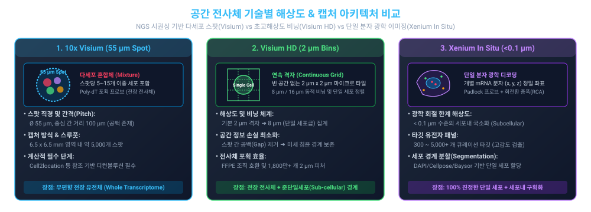
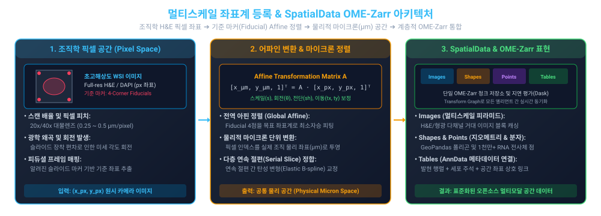
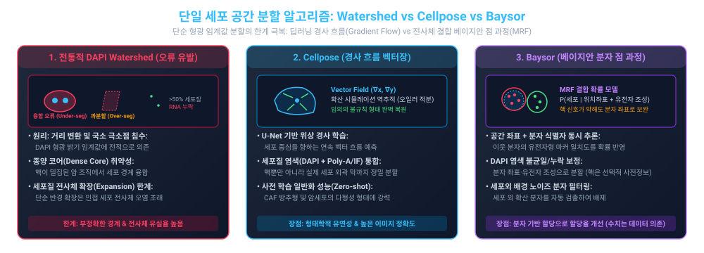
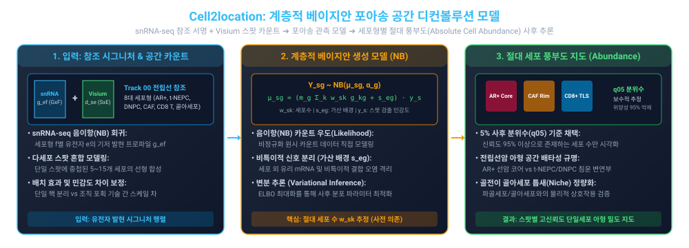
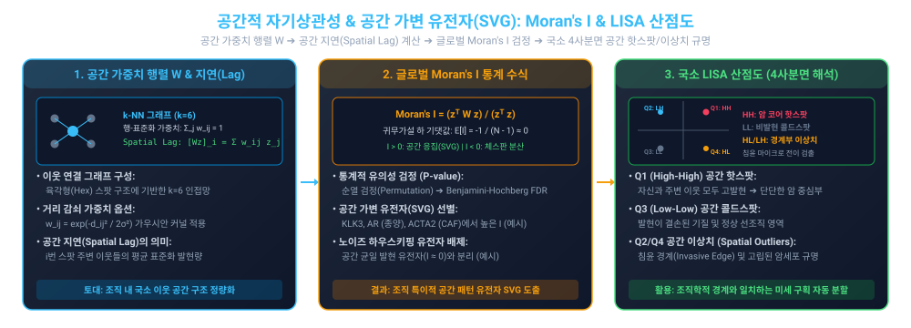
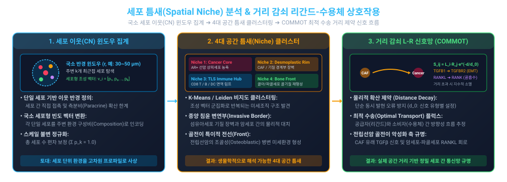

# 전립선암 공간전사체학 (Spatial Transcriptomics) 마스터 교재
**From Sequencing-Based Arrays (Visium & Visium HD) to Subcellular Imaging (Xenium & CosMx): Theory, Mathematics, and Clinical Implementation**

---

## 📚 교재 전체 목차 (Table of Contents)

- [Chapter 00. Track 02 로드맵: 전립선암 공간전사체학 학습 과정](#part-00-chapter-00-track-02-로드맵-전립선암-공간전사체학-spatial-transcriptomics-학습-과정)
- [Chapter 01. 공간전사체 기술 원리와 광학·생물물리학적 기초](#part-01-chapter-01-공간전사체-기술-원리와-광학생물물리학적-기초-spatial-technologies--biophysics)
- [Chapter 02. 조직병리학 영상 정합과 공간 좌표계 체계](#part-02-chapter-02-조직병리학-영상-정합과-공간-좌표계-체계-histology--coordinate-systems)
- [Chapter 03. 공간전사체 품질 관리(QC)와 전처리 기법](#part-03-chapter-03-공간전사체-품질-관리qc와-전처리-기법-spatial-qc--preprocessing)
- [Chapter 04. 고해상도 세포 분할 알고리즘과 전사체 할당](#part-04-chapter-04-고해상도-세포-분할-알고리즘과-전사체-할당-cell-segmentation-cellpose--baysor)
- [Chapter 05. 스팟 디콘볼루션 수학과 세포 구성 복원](#part-05-chapter-05-스팟-디콘볼루션-수학과-세포-구성-복원-spatial-deconvolution-mathematics)
- [Chapter 06. 공간 가변 유전자 규명과 통계적 검정](#part-06-chapter-06-공간-가변-유전자-규명과-통계적-검정-spatially-variable-genes-svgs)
- [Chapter 07. 세포 니치 및 공간 미세환경 클러스터링](#part-07-chapter-07-세포-니치-및-공간-미세환경-클러스터링-cellular-niches-and-microenvironments)
- [Chapter 08. 공간 리간드-수용체 상호작용 및 신호 플럭스 모델링](#part-08-chapter-08-공간-리간드-수용체-상호작용-및-신호-플럭스-모델링-spatial-ligand-receptor-signaling--commot)
- [Chapter 09. 트러블슈팅, 품질 제어 및 캡스톤 프로젝트 루브릭](#part-09-chapter-09-트러블슈팅-품질-제어-및-캡스톤-프로젝트-루브릭-troubleshooting-qc--capstone-rubric)

---

# Part 00. Chapter 00. Track 02 로드맵: 전립선암 공간전사체학 (Spatial Transcriptomics) 학습 과정
> **출처 원본 파일**: `tracks/02_spatial_transcriptomics/docs/00_SPATIAL_ROADMAP.md`


> **Cognitive Goal**: 단일세포 해리 시퀀싱(sc/snRNA-seq)의 공간적 한계를 극복하고, 전립선암 조직의 고유한 3차원 병리 아키텍처(Gleason 패턴, Cribriform 선암종, CAF 물리적 장벽)를 보존하는 공간전사체학(Spatial Transcriptomics)의 핵심 원리와 기술 분류체계를 이해하며, 재현 가능한 공간 컴퓨팅 환경을 구축하고 전체 학습 로드맵을 확립할 수 있다.

---

## 1. 왜 전립선암 연구에서 공간전사체학(Spatial Transcriptomics)인가?

단일세포/단일핵 RNA 시퀀싱(scRNA-seq / snRNA-seq)은 종양 미세환경(Tumor Microenvironment, TME)을 구성하는 세포들의 분자적 다양성을 규명하는 데 혁명적인 기여를 하였습니다. 그러나 전립선암(Prostate Adenocarcinoma, PRAD) 연구에서 전통적인 단일세포 해리 시퀀싱은 근본적인 생물학적 한계에 부딪힙니다.

```
[단일세포 해리 시퀀싱 (Dissociation-based)의 한계]
생검/수술 조직 ──► 효소 처리 및 기계적 파쇄 ──► 단일세포/핵 현탁액 ──► 시퀀싱
                     (조직 아키텍처 소실)            (해리 편향 발생)
                     - 세포 간 물리적 접촉 소실      - 단단한 기질/상피 세포 사멸
                     - 조직 침윤 경계면 붕괴          - 면역 세포 배제 패턴 관찰 불가

[공간전사체학 (Spatial Transcriptomics)의 패러다임]
온전한 조직 절편 (FFPE / Fresh Frozen) ──► 형태학적 영상 (H&E / IF) + 2차원 공간 발현 동시 획득
  - Gleason 패턴(Grade Group)과 전사체 1:1 대응
  - 암세포-기질세포-면역세포의 공간적 병치(Juxtacrine) 신호 포획
```

### 1.1 조직 해리(Dissociation)에 따른 공간적 정보 소실과 해리 편향
1. **공간적 위상 정보(Spatial Topology)의 완전한 소실**:
   - 해리된 세포 현탁액에서는 암세포가 관강(Lumen) 내부에 국한된 상태인지, 기저막(Basement Membrane)을 뚫고 기질로 침윤 중인 침윤 선단(Invasive Front)에 위치하는지 구분할 수 없습니다.
2. **효소 및 물리적 해리 편향(Dissociation Bias)**:
   - 전립선암 조직은 치밀한 결합조직성 기질(Desmoplastic Stroma)과 세포외 기질(ECM)로 둘러싸여 있습니다. 효소(Collagenase, Dispase) 처리 시 단단하게 얽힌 암세포 및 암 관련 섬유아세포(Cancer-Associated Fibroblasts, CAFs)는 저항성을 보이며 용해되거나 사멸하여, 최종 라이브러리에서 실제 비율보다 과소 대표(Under-represented)됩니다.
3. **근접 세포 간 상호작용(Juxtacrine Signaling) 단절**:
   - 리간드-수용체 상호작용은 세포 간 거리에 결정적으로 의존합니다. 해리된 상태에서는 공간적으로 수백 $\mu\text{m}$ 떨어져 있어 물리적으로 결합할 수 없는 세포 쌍 간에도 통계적 유의성이 나타나는 위양성(False-positive) 세포 간 통신 예측이 빈번하게 발생합니다.

### 1.2 전립선암의 독특한 병리학적 아키텍처와 Gleason Grading
전립선암의 예후 판정 및 치료 방침 결정은 여전히 H&E 염색 기반의 **Gleason Grading System**에 절대적으로 의존합니다:

- **Gleason Pattern 3**: 개별적이고 명확히 분리된 작은 원형 관강(Discrete, well-formed glands)을 형성하며 기질 침윤이 제한적임.
- **Gleason Pattern 4**: 관강 구조가 서로 융합(Fused glands)되거나 불완전하게 형성되며, 특히 중요한 아형으로 **체상 선암종(Cribriform Adenocarcinoma)**이 관찰됨.
  - *Cribriform 구조의 임상적 중요성*: 다공성 격자 형태를 띠며 중심부에 저산소증(Hypoxia)이 있을 것이라는 기전 가설(HIF 표적 유전자 $CA9$, $VEGFA$, $SLC2A1$ 등의 상승으로 평가; $HIF1A$ mRNA 자체는 단백질 안정화로 조절되므로 저산소 지표로 부적합)이 제시되며, 생화학적 재발(Biochemical Recurrence, BCR) 및 원격 전이 위험도가 급격히 상승함.
- **Gleason Pattern 5**: 관강 구조가 완전히 소실되어 시트상 고형 침윤(Sheet-like solid growth), 단일 세포 침윤(Single-cell cords), 또는 중심부 면포 괴사(Comedonecrosis)를 동반함.

공간전사체학은 이러한 미세 병리 구조를 파괴하지 않고, H&E 병리 영상 위에서 Gleason Pattern 3, 4, 5 영역 및 Cribriform 암소포의 전사체 프로파일을 직접 분리하여 정량화할 수 있습니다.

### 1.3 암 관련 섬유아세포(CAF)의 물리적 장벽과 면역 배제(Immune Exclusion)
전립선암은 대표적인 면역학적 "Cold Tumor"(면역 결핍/배제 종양)로 알려져 있습니다. 이는 면역관문억제제(Immune Checkpoint Inhibitors, ICI)에 대한 반응률이 극히 낮은 주요 원인입니다:
- **myCAF(Myofibroblastic CAF) 장벽**: $\alpha\text{-SMA}$($ACTA2$), $FAP$, 콜라겐 섬유($COL1A1, COL3A1$)를 고분비하는 활성화된 섬유아세포가 종양 소포 둘레에 빽빽한 피막 형태의 **결합조직 기질 장벽(Desmoplastic Barrier)**을 형성합니다.
- **CD8+ T 세포의 공간적 고립**: 세포독성 T 세포와 NK 세포는 이 기질 장벽을 뚫지 못하고 종양 외곽 기질(Peritumoral Stroma)에 물리적으로 갇히는 **면역 배제(Immune-excluded)** 패턴을 보입니다.
- 공간전사체학을 통해서만 면역 세포의 기질 내 트래핑 위치와 리간드-수용체 장벽(예: $CXCL12\text{-}CXCR4$, $TGFB1\text{-}TGFBR2$)의 공간 구배를 명확히 입증할 수 있습니다.

---

## 2. 공간전사체학 기술 분류체계 (Taxonomy of Spatial Transcriptomics)

현재 상용화된 공간전사체 기술은 분자 포획 및 판독 메커니즘에 따라 크게 **시퀀싱 기반(Sequencing-based Arrays)**과 **이미징 기반 인시츄(Imaging-based In Situ)** 기술로 양분됩니다.

```
                    ┌───────────────────────────────────────────────┐
                    │     공간전사체 기술 (Spatial Transcriptomics)   │
                    └───────────────────────┬───────────────────────┘
                                            │
            ┌───────────────────────────────┴───────────────────────────────┐
            ▼                                                               ▼
┌───────────────────────────────────────┐       ┌───────────────────────────────────────┐
│     시퀀싱 기반 (Sequencing-based)     │       │    이미징 기반 인시츄 (Imaging-based)  │
│  - 비표적 전장 전사체 (Whole-genome)   │       │  - 표적 유전자 패널 (Targeted Panel)  │
│  - NGS 시퀀싱 연계 (Poly-A / Probe)   │       │  - 형광 현미경 단일 분자 광학 검출   │
└───────────────────┬───────────────────┘       └───────────────────┬───────────────────┘
                    │                                               │
        ┌───────────┴───────────┐                       ┌───────────┴───────────┐
        ▼                       ▼                       ▼                       ▼
 10x Visium Standard      10x Visium HD            10x Xenium In Situ      NanoString CosMx SMI /
 (55 µm spot array)       (2 µm square bin)        (Padlock + RCA)         Vizgen MERSCOPE (MERFISH)
```

### 2.1 시퀀싱 기반 공간 어레이 (Sequencing-based Arrays)
- **10x Visium Standard**:
  - $6.5 \times 6.5\text{ mm}$ 캡처 영역 내 약 5,000개의 스팟 배열.
  - 각 스팟 직경 $55\ \mu\text{m}$, 스팟 중심 간 거리(Pitch) $100\ \mu\text{m}$.
  - 스팟 사이에 $45\ \mu\text{m}$의 비포획 간극(Dead space)이 존재하며, 스팟 하나당 조직 밀도에 따라 1~수십 개의 세포가 혼합(Mixture)되어 단일세포 디콘볼루션(Deconvolution)이 필수적임.
- **10x Visium HD**:
  - 슬라이드 표면에 연속적으로 패턴된 $2\ \mu\text{m} \times 2\ \mu\text{m}$ 정사각형 바코드 영역(프로브 결찰 기반 포획)으로 간극($0\ \mu\text{m}$)이 전혀 없음.
  - 슬라이드당 약 $1.06 \times 10^7$개($6.5\text{ mm}\times6.5\text{ mm}$ ÷ $2\ \mu\text{m}$ 격자 산술)의 $2\ \mu\text{m}$ 빈(Bin)을 제공하여 단일 세포 및 세포하(Subcellular) 분해능을 구현.
  - 통계적 신뢰도 향상을 위해 $2\ \mu\text{m}$, $8\ \mu\text{m}$, $16\ \mu\text{m}$ 스케일로 동적 비닝(Dynamic binning) 수행.

### 2.2 이미징 기반 인시츄 공간전사체 (Imaging-based In Situ)
- **10x Xenium In Situ**:
  - 패들록 프로브(Padlock Probe)와 롤링 서클 증폭(Rolling Circle Amplification, RCA)을 통해 생성된 형광 DNA 볼(Rolony)을 순환 광학 이미징으로 디코딩.
  - 높은 검출 효율과 신호 대 잡음비(SNR), 전립선 FFPE 조직에 최적화된 패널(300~5,000개 유전자).
- **NanoString CosMx SMI**:
  - 광절단성(Photocleavable) 형광 리포터 바코드를 사용하여 1,000~6,000개 전사체 및 단백질을 동시 검출.
- **Vizgen MERSCOPE (MERFISH)**:
  - 다중화 오류 정정 형광 인시츄 혼성화(Multiplexed Error-Robust FISH). 16-bit 이진 바코드 및 해밍 거리 4(Hamming Distance 4, HD4)를 적용하여 광학 노이즈와 형광 손실을 실시간 교정.

### 2.3 기술별 핵심 사양 비교 매트릭스

| 기술 플랫폼 | 분해능/국소화 정밀도 (Resolution) | 포획 유전자 수 (Plexity) | 검출 민감도 (Sensitivity; 정량 순위 아님) | 시료 적합성 (Sample Type) | 주요 전처리 & 분석 도구 |
|:---|:---|:---|:---|:---|:---|
| **10x Visium Standard** | $55\ \mu\text{m}$ (다세포 스팟) | 전장 전사체 (~20,000) | 중간 (Spot당 수천 UMI) | Fresh Frozen & FFPE | `Space Ranger`, `Scanpy`, `cell2location` |
| **10x Visium HD** | $2\ \mu\text{m}$ (단일세포/핵 수준) | 전장 전사체 (~20,000) | Bin당 희소 (누적 합산 필요) | FFPE 특화 | `Space Ranger 3.0+`, `SpatialData` |
| **10x Xenium In Situ** | 광학 분해능 ≈0.2 µm 한계, 분자 국소화 정밀도는 수십~수백 nm (광자수 의존) | 표적 패널 (300 ~ 5,000) | 높음 (패널·조직에 따라 상이) | FFPE & Fresh Frozen | `Xenium Ranger`, `Baysor`, `Cellpose` |
| **NanoString CosMx** | 분자 국소화 정밀도 수십~수백 nm (광학 회절 한계 ≈0.2 µm보다 좋을 수 없음) | 표적 패널 (1,000 ~ 6,000) | 높음 (패널·조직에 따라 상이) | FFPE 특화 | `CosMx AtoMx`, `Giotto`, `InSituType` |
| **Vizgen MERSCOPE** | 분자 국소화 정밀도 수십~수백 nm (회절 한계 ≈0.2 µm보다 좋을 수 없음) | 표적 패널 (500 ~ 1,000) | 높음 (보정 방식·패널에 따라 변동; 플랫폼 간 순위는 벤치마크 문헌 필요) | Fresh Frozen & FFPE | VPT(Vizgen Post-processing Tool), `Baysor`, `Squidpy` |

---

## 3. Track 02 전체 학습 단계별 인지 구조 (Cognitive Levels)

```
[Level 1: Biophysical Foundation & Data Standards]
  ├── Ch 01. 공간전사체 기술 원리와 광학·생물물리학적 기초 (RCA, MERFISH, 아베 한계, RNA 확산)
  └── Ch 02. 조직병리학 영상 정합과 공간 좌표계 체계 (H&E, Gleason, Affine 변환, SpatialData OME-Zarr)
          │
[Level 2: Signal Purification & Single-Cell Segmentation]
  ├── Ch 03. 공간전사체 품질 관리(QC)와 전처리 기법 (FFPE 프로브 특성, 광학 노이즈, FDR 계산)
  └── Ch 04. 고해상도 세포 분할 알고리즘과 전사체 할당 (Cellpose 그래디언트 플로우 vs Baysor MRF 포인트 프로세스)
          │
[Level 3: Cell Identity Mapping & Deconvolution]
  ├── Ch 05. 스팟 수준 세포 디콘볼루션 (cell2location 계층적 베이지안 모델링 & RCTD)
  └── Ch 06. 공간 도메인 클러스터링 및 조직 미세구조 분할 (BayesSpace 공간 사전확률 & SpaGCN 그래프 합성곱)
          │
[Level 4: Spatial Topology & Intercellular Crosstalk]
  ├── Ch 07. 공간적 자기상관 및 가변 유전자 탐색 (Moran's I, Geary's C, SpatialDE 가우스 과정)
  └── Ch 08. 세포-세포 상호작용 및 공간적 틈새(Niche) 분석 (Squidpy 이웃 그래프 & COMMOT 유적 최적 수송)
          │
[Level 5: Clinical Translation & 3D Histopathology]
  └── Ch 09. 다중 슬라이드 3D 정합, 클론 진화 매핑 및 전립선암 치료 저항성 공간적 임상 중개
```

---

## 4. 선수 지식 점검 (Prerequisites)

- **조직병리학 및 전립선암 임상 지식**:
  - H&E 염색 및 면역형광(IF) 기본 원리.
  - 전립선 해부학: 이행대(Transition Zone), 중심대(Central Zone), 말초대(Peripheral Zone, 암 발생의 70% 이상).
  - Gleason Score ($3+3=6$에서 $5+5=10$) 및 세계비뇨기병리학회(ISUP) Grade Group 1~5 분류.
- **공간 수학 및 기하학적 기초**:
  - 2차원 아핀 변환(Affine Transformation: 회전, 전단, 이동, 스케일링).
  - 들로네 삼각분할(Delaunay Triangulation) 및 보로노이 다이어그램(Voronoi Tessellation).
  - 공간 통계학: 공간 가중치 행렬(Spatial Weight Matrix $W$), 공간 자기상관 지수.
- **Python 공간 컴퓨팅 프레임워크**:
  - `SpatialData`: OME-Zarr 기반 멀티모달 공간 데이터 표준 컨테이너.
  - `Squidpy`: 공간 그래프 연산 및 이웃 풍부도 분석 도구.
  - `Scanpy` & `AnnData`: 고차원 전사체 행렬 조작.

---

## 5. 재현 가능한 공간전사체 분석 컴퓨팅 환경 구축 (Environment Setup)

공간전사체 분석은 기가바이트(GB) 단위의 대용량 고해상도 WSI(Whole Slide Image) 병리 영상, 수천만 개의 단일 분자 포인트 데이터, 그리고 딥러닝 기반 세포 분할 모델을 다룹니다. 따라서 최적화된 독립 가상환경이 필수적입니다.

### 5.1 Conda 가상환경 생성 및 의존성 패키지 설치
```bash
# 1. 공간전사체 전용 Python 3.10 가상환경 생성
conda create -n spatial_env python=3.10 -y
conda activate spatial_env

# 2. 필수 지리정보 및 영상 처리 C-라이브러리 설치
conda install -c conda-forge gdal geos proj libspatialindex -y

# 3. 단일세포 및 공간전사체 표준 라이브러리 설치
pip install scanpy anndata squidpy spatialdata spatialdata-io spatialdata-plot

# 4. 이미지 처리 및 딥러닝 세포 분할 프레임워크 설치
pip install tifffile zarr dask[complete] geopandas shapely
pip install cellpose torch torchvision --index-url https://download.pytorch.org/whl/cpu

# 5. 공간 통계 및 디콘볼루션 필수 도구
# pyro-ppl 1.9.2는 cell2location 0.1.5가 import하는 deep_getattr를 제거했으므로 <1.9.2로 고정한다
pip install "pyro-ppl<1.9.2" cell2location scvi-tools

# 6. Jupyter 커널 연결
python -m ipykernel install --user --name spatial_env --display-name "Python (Spatial Transcriptomics)"
```

### 5.2 환경 무결성 검증 스크립트
```python
import scanpy as sc
import squidpy as sq
import spatialdata as sd
import cellpose
import shapely
import geopandas as gpd

print(f"Scanpy Version: {sc.__version__}")
print(f"Squidpy Version: {sq.__version__}")
print(f"SpatialData Version: {sd.__version__}")
print(f"Cellpose Version: {cellpose.__version__}")
print(f"GeoPandas Version: {gpd.__version__}")
print("모든 공간전사체 핵심 라이브러리가 성공적으로 로드되었습니다.")
```

---

## 6. 실전 벤치마크 공개 공간전사체 데이터셋 카탈로그 (Public Spatial Datasets)

전립선암 공간전사체 분석 파이프라인 개발 및 검증을 위해 본 과정에서 활용하는 주요 공개 벤치마크 데이터셋입니다:

| 연구 (논문) | 접근 식별자 / 출처 | 기술 플랫폼 | 시료 특성 (Sample Cohort) | 핵심 생물학적 / 분석 포인트 |
|:---|:---|:---|:---|:---|
| **Berglund et al. (*Nat Commun*, 2018)** | accession 미확정 (원 논문 Data Availability 확인 필요: EGA 표기 `EGAS0000100300`은 EGA 조회로 확인 불가; 카운트 행렬은 spatialtranscriptomicsresearch.org) | Legacy ST ($100\ \mu\text{m}$) | 전립선 전절제술 조직 (n=12 섹션) | 역사상 최초의 전립선암 공간전사체; Gleason 3 vs 4 vs 기질 간 전사 구배 |
| **10x Genomics Official (2024)** | `10x Dataset Portal` | 10x Visium HD ($2\ \mu\text{m}$) | 인간 전립선암 FFPE 조직 (Adenocarcinoma) | $2\ \mu\text{m}$ 해상도에서 Cribriform 침윤 선단 및 미세 관강 구조 규명 |
| **10x Genomics Official (2023)** | `10x Dataset Portal` | 10x Xenium In Situ | 인간 전립선암 FFPE 조직 (377-plex) | 수백만 개의 단일 분자 전사체 기반 세포 분할 및 침윤 면역 세포 니치 분석 |
| **Erickson et al. (*Nature*, 2022)** | `EGAS00001006124` (EGA) | 공간 전사체 (플랫폼 세부는 원 논문 확인 필요) | 전립선을 포함한 여러 장기의 양성·악성 공존 조직 (120,000개 이상 영역) | 공간적 유전체 복제수 변이(CNA) 추정 및 양성-악성 조직 간 클론 관계 규명 |

### 6.1 10x Genomics Visium HD 및 Xenium 벤치마크 데이터 디렉토리 구조
실습의 재현성을 위해 프로젝트 루트에 다음과 같은 정형화된 데이터 저장 디렉토리를 구축합니다:

```bash
mkdir -p data/spatial/{visium_hd_prostate,xenium_prostate,erickson_st}
```

```
data/spatial/
├── visium_hd_prostate/
│   ├── square_002um/               # 2 µm 고해상도 특성 매트릭스
│   ├── square_008um/               # 8 µm 비닝 매트릭스 (세포 크기 수준)
│   ├── square_016um/               # 16 µm 비닝 매트릭스 (빠른 탐색용)
│   ├── spatial/
│   │   ├── tissue_positions.parquet# 비드별 공간 물리 좌표
│   │   └── tissue_lowres_image.png # 저해상도 H&E 이미지
│   └── binned_outputs/
└── xenium_prostate/
    ├── transcripts.parquet         # 단일 전사체 분자 (x, y, z, gene, q_score)
    ├── cells.parquet               # 분할된 세포 메타데이터 (면적, 중심점)
    ├── cell_boundaries.parquet     # 세포 다각형 경계선 벡터 지오메트리
    └── morphology_focus.ome.tif    # DAPI 고해상도 OME-TIFF 형광 영상
```

---

## 7. 단원 핵심 점검 (Cognitive Checkpoint & Case Study)

### [문제 1. 핵심 개념 능동 회상 (Active Recall)]
단일핵 전사체 시퀀싱(snRNA-seq) 단독 연구와 비교하여, 전립선암 조직에서 공간전사체학(Spatial Transcriptomics) 기술이 제공하는 3가지 결정적 병리학적/분자적 가치를 기술하고, Gleason Pattern 4의 특이 형태인 **체상 선암종(Cribriform Adenocarcinoma)** 분석에서 조직 해리 시퀀싱이 왜 심각한 위음성 및 정보 왜곡을 초래하는지 설명하시오.

<details>
<summary>💡 모범 답안 및 해설 확인</summary>

1. **공간전사체학의 3대 결정적 가치**:
   - **조직학적 위상 및 병리 구조의 보존**: 병리학적 진단의 골드 스탠다드인 Gleason Pattern (3, 4, 5)과 분자 발현 프로파일을 1:1로 직접 오버레이하여, 형태학적 이상과 종양 분자 표현형 간의 인과관계를 입증할 수 있습니다.
   - **해리 편향(Dissociation Bias) 없는 전 체계적 포획**: 물리적/효소적 해리에 취약하여 사멸하기 쉬운 치밀한 결합조직 기질(Desmoplastic CAFs)과 취약한 악성 상피세포를 현장(In situ)에서 온전히 보존하여 분석합니다.
   - **진정한 국소 세포 간 상호작용(Juxtacrine/Paracrine) 규명**: 세포 간 물리적 거리(수 $\mu\text{m}$ 이내)에 기반한 리간드-수용체 상호작용 및 공간적 면역 배제 장벽을 정확히 식별합니다.
2. **Cribriform 선암종 분석에서 조직 해리의 치명적 왜곡**:
   - Cribriform 구조는 세포들이 치밀하게 융합된 다공성 격자 구조를 이룹니다. 이 구조의 중심부는 혈관 접근성이 극히 떨어져 심각한 **만성 저산소증(Hypoxia) 및 영양 결핍**에 노출되어 있습니다.
   - 조직 해리를 수행하면 중심부의 저산소 취약 세포들이 효소 처리 및 원심분리 과정에서 우선적으로 파괴되어 사멸(Lysis)합니다.
   - 설령 생존하더라도, 주변의 정상 산소 상태를 유지하는 외곽 기질 세포들과 무작위로 섞여버리므로, Cribriform 중심부 특이적인 저산소증 반응(HIF 표적) 유전자($VEGFA, CA9$ 등)와 전이 유도 신호가 평균 발현값에 희석되어 위음성(False-negative)으로 소실됩니다.

</details>

---

### [문제 2. 핵심 개념 능동 회상 (Active Recall)]
시퀀싱 기반 공간전사체(Sequencing-based Arrays, 예: Visium HD)와 이미징 기반 인시츄 공간전사체(Imaging-based In Situ, 예: Xenium In Situ)의 작동 원리를 비교하고, ① 유전자 포획 범위(Plexity), ② 물리적 분해능(Resolution), ③ 세포 분할(Cell Segmentation)의 의존성 측면에서 두 기술의 근본적인 차이점과 분석 파이프라인 상의 고려사항을 서술하시오.

<details>
<summary>💡 모범 답안 및 해설 확인</summary>

1. **원리 비교**:
   - **Visium HD (Sequencing-based)**: 고체 표면에 $2\ \mu\text{m}$ 단위로 고정된 공간 바코드 올리고뉴클레오타이드 어레이 위에서 조직의 RNA를 캡처한 후 차세대 시퀀싱(NGS)을 통해 염기서열을 해독합니다.
   - **Xenium (Imaging-based In Situ)**: 조직 내부에서 표적 mRNA에 패들록 프로브를 결합시키고 롤링 서클 증폭(RCA)을 통해 형광 신호를 증폭한 뒤, 현미경 하에서 형광 리포터의 순환 혼성화 이미징을 통해 단일 분자의 좌표($x, y, z$)와 유전자 정체성을 직접 해독합니다.
2. **3대 핵심 측면 비교**:
   - **유전자 포획 범위(Plexity)**:
     - Visium HD는 전장 전사체(Whole Transcriptome, 약 20,000개 유전자)를 편향 없이 탐색(Unbiased discovery)할 수 있어 신규 바이오마커 발굴에 유리합니다.
     - Xenium은 수백~수천 개(300~5,000개)로 사전에 정의된 표적 유전자 패널에 국한되지만, 검출 효율이 극도로 높습니다.
   - **물리적 분해능(Resolution)**:
     - Visium HD는 $2\ \mu\text{m}$ 정사각형 격자(Grid) 단위로 데이터를 수집하므로, 세포 경계와 비드 격자가 일치하지 않는 격자화 오차(Discretization artifact)가 존재합니다.
     - Xenium은 광학 회절 한계(≈0.2 µm) 안팎의 분해능에서 개별 RNA 분자마다 독립적인 실수형 좌표를 부여하며, 분자 국소화 정밀도는 광자수에 따라 수십~수백 nm입니다.
   - **세포 분할(Cell Segmentation)의 의존성**:
     - Visium HD는 고정된 크기의 빈($2\ \mu\text{m}, 8\ \mu\text{m}$)을 합산하여 분석할 수 있으므로 분할 없이도 무감독 분석이 가능합니다.
     - Xenium은 단일 분자 포인트 구름(Point cloud) 형태로 데이터가 생성되므로, 개별 분자를 특정 세포의 발현으로 귀속시키기 위한 DAPI/세포막 기반의 정밀한 세포 분할(Cell Segmentation, 예: Cellpose, Baysor) 알고리즘 적용이 분석의 성패를 가르는 절대적 선행 조건입니다.

</details>

---

### [문제 3. 임상 사례 분석 (Clinical Interpretation Case Study)]
**[임상 시나리오]**
Gleason Score $3+4=7$ (Grade Group 2)로 진단받은 64세 전립선암 환자의 근치적 전립선 절제술 조직을 대상으로 공간전사체 분석을 수행하였습니다.
병리 판독 결과, 종양 중심부에는 Gleason 4 Cribriform 구조가 광범위하게 관찰되었고, 그 주변은 빽빽한 섬유성 결합조직 기질이 둘러싸고 있었습니다.
공간전사체 발현 분석 결과:
1. 종양 외곽 기질 영역에서는 $\alpha\text{-SMA}$($ACTA2$), $FAP$, $COL1A1$, $TGFB1$의 발현이 매우 높게 나타났습니다.
2. 세포독성 T 세포 마커인 $CD3D, CD8A, GZMB, PRF1$을 발현하는 세포들은 기질 영역 외곽에만 고밀도로 군집해 있었으며, 종양 내부 Cribriform 암세포 소포 내부로는 전혀 진입하지 못하는 양상을 보였습니다.
3. Cribriform 암세포 군집 내부에서는 $AR, KLK3$와 함께 저산소증 반응 유전자(HIF 표적인 $CA9$, $LDHA$ 등) 및 $VEGFA$가 강하게 검출된 가상 사례입니다.

**[질문]**
1. 이 환자의 종양 미세환경을 면역학적 표현형(Immunological Phenotype) 관점에서 진단하고, T 세포가 종양 소포 내부로 침투하지 못하는 공간적/생물학적 기전을 설명하시오.
2. 이 환자에게 항-PD-1/PD-L1 면역관문억제제 단독 요법을 투여할 경우 예상되는 임상 반응성을 평가하고, 공간전사체 분석 결과를 바탕으로 T 세포의 종양 침투를 유도하기 위한 논리적인 복합 치료 병용 전략(Combination Therapy)을 2가지 제시하시오.

<details>
<summary>💡 모범 답안 및 해설 확인</summary>

1. **면역학적 진단 및 기전 분석**:
   - **진단**: 전형적인 **면역 배제(Immune-Excluded / Immune Cold) 종양 표현형**입니다.
   - **기전**:
     - $\alpha\text{-SMA}^+ / FAP^+$ 활성화 myCAF가 생성한 고밀도 콜라겐($COL1A1$) 복합체가 종양 주위에 물리적 피막(Physical Desmoplastic Barrier)을 형성하여 세포독성 T 세포의 물리적 혈관외 유출 및 이동을 차단합니다.
     - myCAF에서 분비된 고농도의 $TGF\text{-}\beta 1$은 T 세포의 이동성을 억제하고 주화성을 교란합니다.
     - Cribriform 암소포 내부의 저산소증(HIF 표적 $CA9, LDHA$ 상승으로 추정되는) 환경은 젖산 축적에 따른 세포외 산성화를 유발하여 침투를 시도하는 소수의 T 세포마저 기능적으로 무력화(Anergy)시킵니다.
2. **임상 반응 평가 및 복합 치료 전략**:
   - **단독 요법 반응성**: 불응(Non-responsive). 활성화된 CD8+ T 세포가 표적 암세포와 직접 물리적으로 접촉하지 못하므로, PD-1 억제제로 T 세포의 탈진을 회복시켜도 종양 사멸 효과를 발휘할 수 없습니다.
   - **복합 치료 전략**:
     - **TGF-β 억제제(또는 FAP 표적 기질 리모델링제) + 면역관문억제제**: $TGF\text{-}\beta$ 수용체 저해제(예: Galunisertib)를 병용하여 myCAF의 콜라겐 합성 및 세포외기질 형성을 억제함으로써 기질 물리적 장벽을 해체하고 T 세포의 종양 내부 침투를 유도합니다.
     - **항-VEGF 신생혈관 억제제(예: Bevacizumab) + 면역관문억제제**: Cribriform 내부에서 분비되는 $VEGFA$ 신호를 차단하여 비정상적인 종양 미세혈관을 정상화(Vascular Normalization)하고, 내피세포의 ICAM-1/VCAM-1 발현을 증가시켜 T 세포의 종양 중심부 혈관 투과 및 호밍을 촉진합니다.

</details>

---

<!-- REFERENCES:BEGIN (generated by scripts/apply_references.py; do not edit by hand) -->
## 참고문헌 (References)
### 본문 인용 문헌
1. Berglund E, Maaskola J, Schultz N, et al. Spatial maps of prostate cancer transcriptomes reveal an unexplored landscape of heterogeneity. *Nat Commun*. 2018;9(1):2419. PMID: 29925878. doi: 10.1038/s41467-018-04724-5
2. Erickson A, He M, Berglund E, et al. Spatially resolved clonal copy number alterations in benign and malignant tissue. *Nature*. 2022;608(7922):360-367. PMID: 35948708. doi: 10.1038/s41586-022-05023-2
### 소프트웨어 (표기 버전은 검수 시 API를 확인한 버전이며, 파이프라인 실행 환경은 requirements-pipelines.txt 참조)
- Cellpose 4.2.1.1 (github.com/MouseLand/cellpose). 원 논문: Stringer C, Wang T, Michaelos M, et al. Cellpose: a generalist algorithm for cellular segmentation. *Nat Methods*. 2021;18(1):100-106. PMID: 33318659. doi: 10.1038/s41592-020-01018-x
- Scanpy 1.12.4 (github.com/scverse/scanpy). 원 논문: Wolf FA, Angerer P, Theis FJ. SCANPY: large-scale single-cell gene expression data analysis. *Genome Biol*. 2018;19(1):15. PMID: 29409532. doi: 10.1186/s13059-017-1382-0
- Squidpy 1.8.3 (github.com/scverse/squidpy). 원 논문: Palla G, Spitzer H, Klein M, et al. Squidpy: a scalable framework for spatial omics analysis. *Nat Methods*. 2022;19(2):171-178. PMID: 35102346. doi: 10.1038/s41592-021-01358-2
- GeoPandas 1.2.0 (github.com/geopandas/geopandas).
- Shapely 2.2.0 (github.com/shapely/shapely).
- SpatialData 0.8.0 (github.com/scverse/spatialdata). 원 논문: Marconato L, Palla G, Yamauchi KA, et al. SpatialData: an open and universal data framework for spatial omics. *Nat Methods*. 2025;22(1):58-62. PMID: 38509327. doi: 10.1038/s41592-024-02212-x
<!-- REFERENCES:END -->


---

# Part 01. Chapter 01. 공간전사체 기술 원리와 광학·생물물리학적 기초 (Spatial Technologies & Biophysics)
> **출처 원본 파일**: `tracks/02_spatial_transcriptomics/docs/01_SPATIAL_TECHNOLOGIES_AND_PHYSICS.md`


> **Cognitive Goal**: 차세대 시퀀싱(NGS) 기반 공간 어레이와 현미경 기반 인시츄(In Situ) 단일 분자 이미징 기술의 물리화학적 검출 메커니즘을 규명하고, 아베 회절 한계(Abbe Diffraction Limit), 점 확산 함수(PSF), 롤링 서클 증폭(RCA), 해밍 코드 오류 정정, 그리고 RNA 측면 확산(Lateral Diffusion) 역학이 공간 데이터 품질에 미치는 생물물리학적 법칙을 수학적으로 유도 및 설명할 수 있다.

---

## 1. 공간전사체 기술별 해상도 및 검출 스펙트럼

공간전사체 기술은 조직 내 유전자 발현을 2차원 또는 3차원 공간 좌표와 결합하는 방식에 따라 **시퀀싱 기반(Sequencing-based Arrays)**과 **이미징 기반(Imaging-based In Situ)**으로 분류됩니다.



---

## 2. 시퀀싱 기반 공간 어레이 (Sequencing-based Spatial Arrays)

시퀀싱 기반 기술은 유리 슬라이드 표면에 고정된 **공간 바코드 올리고뉴클레오타이드(Spatial Barcoded Oligonucleotides)**를 이용하여 조직 절편에서 방출된 전사체를 캡처한 뒤, 라이브러리를 제작하여 차세대 염기서열 분석기(Illumina NGS)로 전장 전사체를 일괄 해독합니다.

```
[Visium Oligonucleotide Capture Probe 구조]
5'- [Illumina TruSeq Read 1] - [Spatial Barcode (16 bp)] - [UMI (12 bp)] - [Poly(dT) (Visium v1) | 프로브 포획 서열 (FFPE/CytAssist·HD)] - 3'
```

### 2.1 10x Visium Standard (55 µm Spot Array)
- **기하학적 구조**:
  - $6.5\text{ mm} \times 6.5\text{ mm}$ 캡처 면적 내에 약 4,992개의 원형 스팟이 육방정계(Hexagonal grid) 형태로 배열.
  - 각 스팟의 직경: $d_{\text{spot}} = 55\ \mu\text{m}$.
  - 스팟 중심 간 거리(Pitch): $p = 100\ \mu\text{m}$.
  - 스팟 간 비포획 간극(Dead space): $g = 100 - 55 = 45\ \mu\text{m}$.
- **다세포 혼합(Multicellular Mixture) 한계**:
  - 전립선 조직에서 상피세포와 섬유아세포의 평균 직경은 약 $10 \sim 15\ \mu\text{m}$입니다.
  - 따라서 단일 $55\ \mu\text{m}$ 스팟에는 조직 밀도에 따라 1~수십 개(10x 안내는 대략 1~10개, 치밀한 종양 영역에서는 20~30개까지)의 서로 다른 세포가 물리적으로 겹쳐서 포획됩니다.
  - 결과적으로 관측된 카운트 벡터 $\mathbf{y}_s \in \mathbb{R}^G$는 해당 스팟 $s$에 포함된 여러 세포 아형들의 전사체 가중 선형 결합(Linear combination)으로 나타나며, 이를 분리하기 위해 **세포 디콘볼루션(Deconvolution)** 알고리즘이 필수적으로 요구됩니다.

### 2.2 10x Visium HD (2 µm Continuous Square Bins)
- **연속 격자 구조와 갭 제로(Zero-gap) 설계**:
  - Visium HD는 슬라이드 표면에 $2\ \mu\text{m} \times 2\ \mu\text{m}$ 크기의 정사각형 바코드 영역을 연속 패턴으로 배열하며(프로브 결찰 기반 포획), 비드/폴로니 어레이가 아닙니다.
  - 스팟 간 데드 스페이스가 $0\ \mu\text{m}$로, 조직 전체 면적을 빈틈없이 포획합니다.
  - $6.5\text{ mm} \times 6.5\text{ mm}$ 슬라이드 하나당 약 $1.06 \times 10^7$개($42.25\text{ mm}^2 / 4\ \mu\text{m}^2$)의 연속 $2\ \mu\text{m}$ 빈이 생성됩니다.
- **아세포 및 단일핵 분해능(Subcellular / Single-nucleus Resolution)**:
  - 인간 세포핵의 평균 직경은 약 $5 \sim 8\ \mu\text{m}$이므로, $2\ \mu\text{m}$ 빈은 단일 세포핵 하나를 4~16개의 격자로 분할하여 포획할 수 있는 해상도를 제공합니다.
- **다중 해상도 계층적 비닝(Hierarchical Binning Strategy)**:
  - $2\ \mu\text{m}$ 원시 빈은 포획되는 분자 수가 매우 적어 행렬의 희소성(Sparsity)이 극심합니다.
  - 따라서 분석 목적에 따라 인접한 빈들을 합성하여 가변 해상도를 구성합니다:
    - **$2\ \mu\text{m}$ Bin**: 아세포 수준 RNA 편재화 및 정밀 세포 경계 추적.
    - **$8\ \mu\text{m}$ Bin**: 단일 세포 규모에 근사($8 \times 8 = 64\ \mu\text{m}^2$는 직경 $10 \sim 15\ \mu\text{m}$ 세포 단면 약 $80 \sim 180\ \mu\text{m}^2$보다 작거나 비슷하므로 한 빈이 한 세포와 정확히 대응하지는 않음)하는 해상도로 단일세포 수준 분석에 사용.
    - **$16\ \mu\text{m}$ Bin**: 저빈도 전사체의 공간 도메인 분할 및 고속 클러스터링.

---

## 3. 이미징 기반 인시츄 공간전사체 (Imaging-based In Situ Technologies)

이미징 기반 기술은 조직 절편을 파쇄하지 않고 조직 내부에서 형광 신호의 광학적 검출을 통해 개별 RNA 분자의 위치를 수백 나노미터 정밀도로 직접 이미징합니다.

### 3.1 10x Xenium In Situ (Padlock Probes & Rolling Circle Amplification)
Xenium 플랫폼은 **패들록 프로브(Padlock Probe)**와 **등온 롤링 서클 증폭(Rolling Circle Amplification, RCA)**을 결합하여 고감도 단일 분자 검출을 구현합니다:

```
[Xenium 단일 분자 증폭 및 주기적 디코딩]
1. Target mRNA Hybridization:
   5'- [Target mRNA] - 3'
       ││││││││││││││││
   5'- [Left Arm] ── (Spacer / Barcode Region) ── [Right Arm] - 3' (Padlock Probe)

2. Enzymatic Ligation:
   DNA Ligase(SplintR/T4)가 Left Arm과 Right Arm의 틈(Nick)을 봉합하여 환형 DNA(Circular DNA) 형성.
   * 비특이적 결합 시 Ligation이 발생하지 않아 극도의 서열 특이성 확보.

3. Rolling Circle Amplification (RCA):
   Phi29 DNA Polymerase가 환형 주형을 따라 수천 번 회전 복제 ──► 직경 100~500 nm의 고밀도 DNA 엉킴체(Rolony) 형성.

4. Cyclic Fluorescent Decoding:
   주기별 형광 표지 올리고뉴클레오타이드 혼성화 ──► 형광 이미징 ──► 화학적/광학적 절단 ──► 반복 디코딩.
```

### 3.2 NanoString CosMx Spatial Molecular Imager (SMI)
- **광절단성(Photocleavable) 리포터 시스템**:
  - 표적 mRNA에 결합하는 1차 ISH 프로브와 복합체를 이루는 4-채널 형광 리포터를 사용합니다.
  - 리포터 올리고뉴클레오타이드는 자외선(UV, $\lambda \approx 365\text{ nm}$)에 반응하는 광분해성 화학 링커(Photocleavable Linker)를 포함합니다.
  - 형광 이미지 촬영 후 UV 광을 조사하여 이전 형광체를 세척 제거하고, 다음 사이클의 리포터를 투입하는 순환 방식을 취합니다.

### 3.3 Vizgen MERSCOPE (MERFISH) 및 해밍 코드 오류 정정 (HD4)
MERFISH(Multiplexed Error-Robust Fluorescence In Situ Hybridization)는 정보 이론의 **이진 바코드(Binary Barcode)**와 오류 검출·정정 알고리즘을 도입하여 광학 노이즈를 근본적으로 차단합니다:

- **$N$-bit 조합 바코딩**:
  - 예를 들어 16회의 순환 이미징($N=16$)을 수행할 때, 각 유전자는 16자리의 이진수(예: `1001011000101000`)로 인코딩됩니다.
  - 비트 '1'은 해당 사이클에서 형광 신호 검출, 비트 '0'은 형광 소광을 의미합니다.
- **해밍 거리 4 (Hamming Distance 4, HD4) 코드북**:
  - 유효한 모든 유전자 바코드 간의 최소 해밍 거리를 4 이상으로 유지하도록 코드북을 설계합니다:
    $$d_H(\mathbf{c}_i, \mathbf{c}_j) = \sum_{k=1}^N |c_{ik} - c_{jk}| \ge 4 \quad (\forall i \neq j)$$
  - **오류 정정 능력(Error Correction)**:
    - 1-비트 오류 정정: 만약 형광 소광 실패나 신호 손실로 인해 1개의 비트가 반전($0 \to 1$ 또는 $1 \to 0$)되더라도, 가장 가까운 올바른 유전자 코드와의 해밍 거리는 1이고 다른 모든 유효 코드와의 거리는 최소 3이므로, **단 1개의 비트 에러는 100% 원래 유전자로 완벽히 자동 복원**됩니다.
    - 2-비트 오류 검출: 2개의 비트가 동시에 오류를 일으킨 경우, 어떤 유효 코드와도 거리가 2가 되어 잘못된 유전자로 오인되지 않고 **노이즈(Invalid code)로 즉각 폐기**됩니다.

---

## 4. 광학 물리와 분자 확산 역학 (Optical Physics & Molecular Diffusion)

### 4.1 아베 회절 한계 (Abbe Diffraction Limit)와 점 확산 함수 (PSF)
광학 현미경의 렌즈를 통과하는 빛은 파동의 회절 현상으로 인해 점 광원이 이상적인 단일 점으로 맺히지 않고 에어리 디스크(Airy Disk) 패턴으로 퍼집니다.

- **아베 회절 한계 공식**:
  $$d_{\text{min}} = \frac{\lambda}{2 \text{NA}} = \frac{\lambda}{2 n \sin \alpha}$$
  - $\lambda$: 형광 방출 파장 (예: 녹색 형광 $\lambda \approx 520\text{ nm}$).
  - $\text{NA}$: 대물렌즈의 개구수 (Numerical Aperture, 유침 렌즈 기준 약 $1.4$).
  - 계산 결과:
    $$d_{\text{min}} \approx \frac{520\text{ nm}}{2 \times 1.4} \approx 186\text{ nm}$$
- **점 확산 함수(Point Spread Function, PSF)와 가우시안 근사**:
  - 현미경 상에서 관측되는 단일 분자(Rolony)의 형광 강도 분포 $I(x, y)$는 2차원 가우시안 분포로 모델링됩니다:
    $$I(x, y) = I_0 \exp\left( - \frac{(x - x_0)^2 + (y - y_0)^2}{2 \sigma_{\text{PSF}}^2} \right) + B$$
  - 여기서 $\sigma_{\text{PSF}} \approx \frac{d_{\text{min}}}{2.355} \approx 80\text{ nm}$입니다.
  - 비선형 최소제곱법(Levenberg-Marquardt) 또는 최대우도추정(MLE)으로 중심 좌표 $(x_0, y_0)$를 피팅함으로써, 회절 한계보다 훨씬 정밀한 **서브마이크론($\approx 10 \sim 20\text{ nm}$) 단일 분자 국소화(Localization)**를 달성합니다.

### 4.2 조직 투과화와 RNA 측면 확산 역학 (RNA Lateral Diffusion)
시퀀싱 기반 어레이(Visium)에서 조직 절편을 투과화(Permeabilization)하여 세포막을 녹이면, 세포 내 mRNA가 유리 표면의 포획 올리고 프로브로 이동합니다. 이때 2차원 평면 상에서 일어나는 측면 확산(Lateral Diffusion)은 공간 분해능을 저하시키는 핵심 물리적 요인입니다.

```
[조직 투과화 시 RNA 측면 확산 모델]
       세포핵 / 세포질
   ───► [mRNA 분출] ───►
          │     ╲
          │  측면 확산 (Lateral Blurring)
          ▼        ▼
════════════════════════════════ (유리 슬라이드 표면)
     [Spot A]      [Spot B] (인접 스팟으로의 누출 / 신호 교차 오염)
```

- **아인슈타인-스몰루호프스키 2차원 확산 방정식**:
  2차원 자유 확산에서 시간 $t$ 동안 이동한 전사체의 평균 제곱 변위(Mean Squared Displacement, MSD)는 다음과 같습니다:
  $$\langle r^2 \rangle = 4 D t$$
  - $D$: 점성 조직 기질 내 mRNA의 유효 확산 계수 (가정 범위 약 $10^{-11} \sim 10^{-13}\ \text{m}^2/\text{s}$; 출처 있는 실측값이 아니라 가정이며 실제 값은 조직·투과화 조건에 따라 다름).
  - $t$: 투과화 효소(Pepsin/Proteinase K) 반응 시간 ($5 \sim 30\text{ min}$).
- **공간적 블러링(Spatial Blurring) 및 스팟 간 신호 누출(Crosstalk)**:
  - 투과화 시간이 지나치게 길어지면 평균 확산 거리 $\sqrt{\langle r^2 \rangle}$가 커져(위 가정 범위로 계산하면 $D=10^{-13}$, 5분에서 약 $11\ \mu\text{m}$, $D=10^{-11}$, 30분에서 약 $270\ \mu\text{m}$로 25배 폭이며, $20 \sim 30\ \mu\text{m}$는 하나의 예시값일 뿐이므로 실제로는 Tissue Optimization 실험으로 결정), 원래 위치의 스팟 경계를 벗어나 인접 스팟으로 mRNA가 침범하는 **측면 크로스토크(Lateral Crosstalk)**가 발생합니다.
  - 반대로 투과화 시간이 너무 짧으면 세포 내부의 전사체가 표면 프로브에 도달하지 못해 UMI 포획 효율이 급락합니다. 따라서 조직 두께($5 \sim 10\ \mu\text{m}$)와 조직 밀도에 따른 **최적 투과화 시간(Optimal Permeabilization Time) 캘리브레이션**이 시퀀싱 기반 공간 분석의 핵심입니다.

### 4.3 조직 전처리 물리화학: FFPE vs Fresh Frozen
| 비교 항목 | 신선 동결 조직 (Fresh Frozen, FF) | 포르말린 고정 파라핀 포매 조직 (FFPE) |
|:---|:---|:---|
| **화학적 결합 상태** | 메틸렌 가교 없음; RNA 고유 구조 유지 | 포름알데히드에 의한 메틸렌 가교($-\text{CH}_2-$) 및 아미노산 축합 |
| **RNA 단편화 정도** | 낮음 (RIN > 7.0 권장; 온전한 긴 전사체) | 극심함 (DV200 > 30~50% 수준; $100 \sim 200\text{ nt}$ 단편화) |
| **포획 메커니즘** | Poly(A) 꼬리 직접 포획 (Oligo-dT) | 쌍 프로브 혼성화 (LHS/RHS Padlock Probe) |
| **측면 확산 위험** | 높음 (세포 구조 붕괴 시 자유 확산 활발) | 낮음 (단백질-핵산 가교로 조직 기질 내 물리적 고정 우수) |
| **임상 검체 가용성** | 수술 직후 즉각 액체질소 급랭 필요 (희귀) | 병리과 보관 아카이브 슬라이드 100% 활용 가능 |

---

## 5. 검출 감도, 특이도 및 멀티플렉싱 트레이드오프

공간전사체 기술을 선택할 때는 **포획 유전자 수(Plexity)**와 **단일 분자 검출 효율(Sensitivity)** 사이의 생물물리학적 트레이드오프를 고려해야 합니다:

> 정성적 경험칙(출처·차원·유도가 있는 정량 법칙이 아님): 패널 plexity를 높이면 한 이미징 라운드의 분자 밀도(광학 혼잡)가 커져 개별 분자 검출 효율이 떨어지는 경향이 있다.

1. **광학적 중첩(Optical Crowding)의 물리적 한계**:
   - 이미징 기반 인시츄 기술에서 동시에 검출하는 유전자 수($N$)를 무한히 늘리면, 시야각(Field of View, FOV) 당 발생하는 형광 Rolony의 밀도가 아베 회절 한계를 초과하여 스팟들이 서로 겹치는 현상(Optical Crowding)이 발생합니다.
   - 스팟 간 거리가 $d_{\text{min}}$보다 가까워지면 개별 형광 피크를 독립적으로 국소화할 수 없어 디코딩 에러가 기하급수적으로 증가합니다.
2. **자가형광(Autofluorescence)과 신호 대 잡음비**:
   - 전립선암 조직은 콜라겐 기질, 엘라스틴, 리포푸신(Lipofuscin) 과립 및 잔류 적혈구(RBC)로 인해 광범위한 파장($450 \sim 600\text{ nm}$)에서 강력한 내인성 자가형광을 방출합니다.
   - 단일 형광 분자 수준의 신호는 이 자가형광 배경에 묻히기 쉬우므로, 광학 표백(Photobleaching) 전처리와 수학적 다중 스펙트럼 디믹싱(Spectral Unmixing)이 필수적입니다.

---

## 6. Python 실습: 공간전사체 분해능 및 스팟-비드 모델링

`Scanpy`와 `SpatialData`를 활용하여 시퀀싱 기반 Visium 데이터의 공간 스팟 지오메트리를 로드하고 스팟 간 거리 및 캡처 반경을 검증하는 파이프라인입니다.

```python
import numpy as np
import pandas as pd
import scanpy as sc
import matplotlib.pyplot as plt
from scipy.spatial.distance import pdist, squareform

# 1. 10x Visium 표준 전립선암 데이터셋 로드 (공개 h5ad 예시)
# adata.obsm['spatial']에 실수형 물리 좌표(pixel 또는 µm) 수록
def analyze_spot_geometry(adata: sc.AnnData, spot_diameter_um: float = 55.0):
    coords = adata.obsm['spatial']
    # Visium 풀해상도 픽셀 → µm 변환: scalefactors의 spot_diameter_fullres(픽셀)가 55 µm에 해당
    lib = next(iter(adata.uns.get('spatial', {})), None)
    sf = adata.uns['spatial'][lib]['scalefactors'] if lib else {}
    um_per_px = spot_diameter_um / sf['spot_diameter_fullres'] if 'spot_diameter_fullres' in sf else None
    n_spots = coords.shape[0]
    
    # 유클리드 거리 행렬 계산
    dist_matrix = squareform(pdist(coords))
    np.fill_diagonal(dist_matrix, np.inf)
    
    # 각 스팟별 가장 가까운 이웃 스팟과의 중심 거리(Pitch) 계산
    nearest_dists = np.min(dist_matrix, axis=1)
    mean_pitch = np.mean(nearest_dists)
    
    print(f"총 유효 스팟 수: {n_spots:,} spots")
    print(f"평균 스팟 중심 간격 (Mean Pitch): {mean_pitch:.2f} pixels")
    if um_per_px is not None:
        print(f"평균 스팟 중심 간격 (Mean Pitch): {mean_pitch * um_per_px:.1f} µm  (Visium 설계값 100 µm와 비교)")
    
    # 스팟 직경 및 데드스페이스 비율 추정
    # scale factor를 통해 pixel -> µm 변환이 가능하다고 가정
    plt.figure(figsize=(6, 4))
    plt.hist(nearest_dists, bins=40, color='royalblue', edgecolor='black', alpha=0.7)
    plt.axvline(mean_pitch, color='red', linestyle='--', label=f'Mean Pitch: {mean_pitch:.1f}')
    plt.title("Visium Spot Nearest Neighbor Pitch Distribution")
    plt.xlabel("Center-to-Center Distance (pixels)")
    plt.ylabel("Spot Frequency")
    plt.legend()
    plt.tight_layout()
    plt.show()

# 함수 호출 인터페이스
# analyze_spot_geometry(adata)
```

---

## 7. 단원 핵심 점검 (Cognitive Checkpoint & Case Study)

### [문제 1. 핵심 개념 능동 회상 (Active Recall)]
10x Xenium In Situ에서 채택하고 있는 **Padlock Probe**와 **Rolling Circle Amplification (RCA)** 메커니즘을 상술하고, 일반적인 올리고뉴클레오타이드 혼성화 대비 이 방식이 극도로 높은 서열 특이도(Sequence Specificity)와 단일 분자 형광 검출 감도를 달성하는 생화학적/생물물리학적 이유를 설명하시오.

<details>
<summary>💡 모범 답안 및 해설 확인</summary>

1. **작동 메커니즘**:
   - **Padlock Probe 혼성화 및 효소적 결찰(Ligation)**: 표적 mRNA에 결합하는 선형 패들록 프로브의 좌우 양팔(LHS, RHS)이 표적 염기서열에 정확히 인접하여 결합할 때만, DNA 리가아제(SplintR Ligase 또는 T4 DNA Ligase)에 의해 양 말단이 공유결합으로 연결되어 완전한 환형 DNA(Closed Circular DNA)를 형성합니다.
   - **등온 롤링 서클 증폭(RCA)**: 환형화된 주형을 기반으로 Phi29 DNA 중합효소가 수천 회 회전 복제를 수행하여, 단일 환형 주형으로부터 수천 개의 반복 단위(Tandem repeats)를 갖는 긴 단일가닥 DNA 엉킴체(Rolony)를 형성합니다.
2. **높은 서열 특이도 및 검출 감도의 이유**:
   - **이중 검증에 의한 특이도 확보**: 비특이적 결합이나 1~2개의 단일염기 불일치(Mismatch)가 발생할 경우 DNA 리가아제의 활성이 차단되어 환형화가 일어나지 않습니다. 선형 상태로 남은 미반응 프로브는 세척 과정에서 쉽게 제거되므로 위양성(False-positive) 혼성화 신호가 원천 차단됩니다.
   - **형광 신호의 국소 물리적 증폭(SNR 극대화)**: 단일 전사체 1분자로부터 직경 약 $200 \sim 500\text{ nm}$ 크기의 고밀도 Rolony가 형성되며, 이 안에 수백~수천 개의 형광 디코딩 올리고뉴클레오타이드가 동시에 결합할 수 있습니다. 이는 단일 형광 분자 대비 수백 배 이상의 국소 형광 강도를 발생시켜 광학 현미경의 회절 한계 내에서 자가형광 배경 잡음을 압도하는 신호 대 잡음비(SNR)를 제공합니다.

</details>

---

### [문제 2. 핵심 개념 능동 회상 (Active Recall)]
빛의 회절 한계를 나타내는 **아베 한계(Abbe Diffraction Limit)** 수식을 유도하고, 이 한계가 $200\text{ nm}$ 수준임에도 불구하고 MERSCOPE(MERFISH) 및 Xenium 기술이 수 나노미터 크기의 개별 단일 mRNA 분자를 서로 중첩되지 않게 분리 국소화(Localization)할 수 있는 원리를 **점 확산 함수(PSF) 가우시안 피팅**과 **순환(Cyclic) 희소 바코딩** 관점에서 설명하시오.

<details>
<summary>💡 모범 답안 및 해설 확인</summary>

1. **아베 회절 한계 수식**:
   $$d = \frac{\lambda}{2 \text{NA}} = \frac{\lambda}{2 n \sin \alpha}$$
   - 가시광선 파장 $\lambda \approx 500\text{ nm}$, 고성능 유침 대물렌즈 $\text{NA} \approx 1.25 \sim 1.4$ 적용 시, 광학적으로 분리 가능한 최소 거리는 $d \approx 180 \sim 200\text{ nm}$로 제한됩니다.
2. **단일 분자 국소화 원리**:
   - **PSF 2차원 가우시안 피팅 (Sub-diffraction Localization)**:
     개별 형광 Rolony는 약 $200\text{ nm}$의 점 확산 함수(PSF) 광점 형태로 관측되지만, 검출된 광자(Photon) 수가 충분히 많을 경우 2차원 대칭 가우시안 곡선의 중심 좌표 $(x_0, y_0)$를 수학적으로 피팅할 수 있습니다. 중심점의 위치 오차는 $\sigma_{\text{loc}} \approx \frac{\sigma_{\text{PSF}}}{\sqrt{N_{\text{photons}}}}$에 비례하므로, 광자수 $N$이 커질수록 정밀도가 좋아집니다. 예: $\sigma_{\text{PSF}}\approx80\text{ nm}$이면 $N\approx16\sim64$개 광자에서 $10\sim20\text{ nm}$, $N=1{,}000$개에서 이상적으로 약 $2.5\text{ nm}$입니다(실제는 배경·픽셀화로 이보다 나쁨; Thompson 2002).
   - **순환 희소 바코딩에 의한 광학적 중첩(Optical Crowding) 방지**:
     조직 내 수백만 개의 RNA가 한 번에 모두 형광을 방출하면 에어리 디스크들이 서로 겹쳐 분리가 불가능해집니다. 따라서 MERFISH는 여러 차례의 순환 이미징(Cyclic rounds)으로 나누어 매 사이클마다 전체 유전자의 일부만이 형광 비트 '1'을 켜도록(Sparseness) 설계합니다(MERFISH MHD4: 16비트·가중치 4이므로 라운드당 유전자의 4/16 = 25%가 켜짐. Xenium은 RCA 후 색-순서 코드워드를 쓰는 별개 방식). 이를 통해 각 이미징 시점마다 형광 점들이 아베 한계 거리($> 200\text{ nm}$) 이상으로 서로 충분히 이격되도록 유지하여 중첩 없이 단일 분자를 해독합니다.

</details>

---

### [문제 3. 임상 사례 분석 (Clinical Interpretation Case Study)]
**[임상 시나리오]**
연구팀은 전립선암 환자의 10년 된 아카이브 FFPE 절편과 수술 직후 액체질소에 급랭한 신선 동결(Fresh Frozen, FF) 절편을 확보하여 공간전사체 분석을 계획하였습니다.
한 연구원이 "FF 절편은 RNA 온전성(RNA Integrity)이 우수하므로 Visium Standard Poly(A) 전장 전사체 키트로 분석하고, FFPE 절편은 Xenium In Situ로 분석하자"고 제안하였습니다.
그러나 예비 실험 결과, 신선 동결 조직의 Visium 데이터에서 Cribriform 선암종과 주변 섬유 기질 사이의 유전자 경계면이 심각하게 흐려지는(Blurring) 공간적 크로스토크가 확인되었습니다.

**[질문]**
1. 신선 동결 조직에서 관찰된 공간적 경계면 흐림 현상의 생물물리학적 원인을 아인슈타인 확산 방정식($\langle r^2 \rangle = 4Dt$) 관점에서 진단하고, 왜 FFPE 조직에서는 이러한 측면 확산이 상대적으로 억제되는지 조직 고정 화학의 차이점을 들어 설명하시오.
2. 보관 기간이 10년 경과한 전립선암 FFPE 블록에서 Poly(A) 캡처 기반의 구형 시퀀싱 방식을 적용할 수 없는 분자생물학적 이유를 기술하고, Xenium 패들록 프로브 시스템이 왜 이 FFPE 검체에서 뛰어난 검출 성능을 발휘하는지 논하시오.

<details>
<summary>💡 모범 답안 및 해설 확인</summary>

1. **생물물리학적 진단 및 고정 화학의 차이**:
   - **진단**: 신선 동결(Fresh Frozen) 조직은 효소 투과화 과정에서 세포막이 용해될 때 세포 내 mRNA가 고정되지 않은 수용액 상태로 노출됩니다. 아인슈타인 확산 공식에 따라 시간 $t$ 동안 이동하는 측면 확산 거리 $\sqrt{\langle r^2 \rangle} = \sqrt{4Dt}$가 수십 $\mu\text{m}$에 달하게 되며, 이로 인해 암세포 내부의 mRNA가 인접한 기질 스팟으로 물리적으로 번져나가(Lateral Blurring) 공간적 경계면이 붕괴된 것입니다.
   - **FFPE 조직의 확산 억제 기전**: FFPE 조직은 포름알데히드 처리를 통해 단백질과 핵산 간에 촘촘한 공유결합 메틸렌 가교($-\text{CH}_2-$)가 형성되어 거대한 분자 격자망(Cross-linked matrix)을 구성하고 있습니다. 이 가교망이 전사체를 조직 기질 내에 단단히 물리적으로 결속(Tethering)시켜 두기 때문에, 투과화 효소를 처리하더라도 mRNA의 측면 확산이 신선 동결 조직보다 크게 감소하여(0이 되지는 않음) 경계면 해상도가 상대적으로 보존됩니다.
2. **10년 된 FFPE 검체에서의 분석 적합성 비교**:
   - **Poly(A) 캡처의 불가 사유**: 10년 동안 상온 보관된 FFPE 조직 내 RNA는 자연 가수분해와 산화 반응으로 인해 심각하게 분절화(Fragmentation)되어 평균 크기가 $100 \sim 200\text{ bp}$ 이하로 쪼개져 있습니다. 또한 전사체의 3' 말단 Poly(A) 꼬리가 탈락되어 있거나 포르말린에 의해 화학적으로 수식화(Monodeoxymethylation)되어 있으므로, 3' 말단 Poly(T) 프라이머 결합에 의존하는 시퀀싱 방식은 역전사 반응이 중단되어 라이브러리 제작에 완전히 실패합니다.
   - **Xenium 패들록 프로브의 탁월한 성능 이유**: Xenium은 온전한 전장 RNA를 요구하지 않고, 불과 $50 \sim 60\text{ bp}$ 내외의 극히 짧은 표적 서열에만 특이적으로 결합하는 한 쌍의 프로브(LHS, RHS)를 사용합니다. 단편화된 짧은 RNA 조각이라도 프로브 결합 부위만 온전하면 리가아제에 의해 환형화 및 RCA 증폭이 정상적으로 이루어지므로, 오래된 아카이브 FFPE 검체에서도 높은 민감도와 특이도로 전사체를 완벽히 검출할 수 있습니다.

</details>

---

<!-- REFERENCES:BEGIN (generated by scripts/apply_references.py; do not edit by hand) -->
## 참고문헌 (References)
### 본문 인용 문헌
1. Thompson RE, Larson DR, Webb WW. Precise nanometer localization analysis for individual fluorescent probes. *Biophys J*. 2002;82(5):2775-83. PMID: 11964263. doi: 10.1016/S0006-3495(02)75618-X
### 검수 근거 문헌
1. Chen KH, Boettiger AN, Moffitt JR, et al. RNA imaging. Spatially resolved, highly multiplexed RNA profiling in single cells. *Science*. 2015;348(6233):aaa6090. PMID: 25858977. doi: 10.1126/science.aaa6090
### 소프트웨어 (표기 버전은 검수 시 API를 확인한 버전이며, 파이프라인 실행 환경은 requirements-pipelines.txt 참조)
- Matplotlib 3.11.2 (github.com/matplotlib/matplotlib). 원 논문: Hunter JD. Matplotlib: A 2D Graphics Environment. *Comput. Sci. Eng*. 2007;9(3):90-95. doi: 10.1109/mcse.2007.55
- NumPy 2.5.4 (numpy.org). 원 논문: Harris CR, Millman KJ, van der Walt SJ, et al. Array programming with NumPy. *Nature*. 2020;585(7825):357-362. PMID: 32939066. doi: 10.1038/s41586-020-2649-2
- pandas 2.3.3 (github.com/pandas-dev/pandas). 원 논문: McKinney W. Data Structures for Statistical Computing in Python. *Proceedings of the Python in Science Conference*. 2010:56-61. doi: 10.25080/majora-92bf1922-00a
- Scanpy 1.12.4 (github.com/scverse/scanpy). 원 논문: Wolf FA, Angerer P, Theis FJ. SCANPY: large-scale single-cell gene expression data analysis. *Genome Biol*. 2018;19(1):15. PMID: 29409532. doi: 10.1186/s13059-017-1382-0
- SciPy 1.16.3 (github.com/scipy/scipy). 원 논문: Virtanen P, Gommers R, Oliphant TE, et al. SciPy 1.0: fundamental algorithms for scientific computing in Python. *Nat Methods*. 2020;17(3):261-272. PMID: 32015543. doi: 10.1038/s41592-019-0686-2
<!-- REFERENCES:END -->


---

# Part 02. Chapter 02. 조직병리학 영상 정합과 공간 좌표계 체계 (Histology & Coordinate Systems)
> **출처 원본 파일**: `tracks/02_spatial_transcriptomics/docs/02_HISTOLOGY_AND_COORDINATE_SYSTEMS.md`


> **Cognitive Goal**: H&E 염색 및 다중 면역형광(IF) 영상의 병리학적 원리를 파악하고, 피듀셜 마커 기반 아핀 변환(Affine Transformation)을 통한 다중 좌표계 정합 수학 모델을 이해하며, `SpatialData` 프레임워크의 OME-Zarr 다중 해상도 피라미드 이미지, 분자 포인트(Points), 폴리곤 지오메트리(Shapes), 그리고 발현 테이블(Tables)의 계층적 연동 구조를 자유자재로 다룰 수 있다.

---

## 1. 조직병리학 영상과 전립선암 형태학적 구조

공간전사체 분석은 고해상도 광학 현미경 영상(H&E 및 형광 영상)과 단일 분자/스팟 단위의 전사체 발현 데이터를 하나의 통일된 공간 좌표계 위에 완벽하게 일치시키는 것에서 출발합니다.



### 1.1 H&E (Hematoxylin & Eosin) 염색의 화학적 기전
H&E 염색은 조직의 미세 형태를 가시화하는 병리학의 표준 기법으로, 두 가지 상반된 전하 특성을 갖는 염료의 화학적 결합을 이용합니다:

```
[H&E 염색의 화학적 분자 결합]
1. 헤마톡실린 (Hematoxylin - 산화형 Hematein):
   - 다가 양이온 금속 매염제(Al3+)와 복합체 형성 (염기성 염료 특성)
   - 세포핵 내부의 음전하를 띤 핵산(DNA/RNA의 인산 골격 PO4^3-)과 정전기적 결합
   ──► 세포핵(Nucleus)을 짙은 청자색(Deep Blue/Purple)으로 염색

2. 에오신 (Eosin Y):
   - 음이온성 방향족 화합물 (산성 염료 특성)
   - 세포질 및 세포외 기질 단백질의 양전하 아미노기(Lysine, Arginine의 -NH3+)와 결합
   ──► 세포질(Cytoplasm), 콜라겐 섬유, 결합조직을 분홍색~선홍색(Pink/Red)으로 염색
```

### 1.2 전립선 조직 형태학과 Gleason Grading 병리 패턴
정상 전립선 조직은 이중 세포층(관강 분비세포 Luminal cells + 기저세포 Basal cells)으로 이루어진 규칙적인 분지형 선관(Glands)과 이를 지지하는 섬유근육성 기질(Fibromuscular Stroma)로 구성됩니다. 전립선암이 발생하면 기저세포층이 소실되고 비정상적인 관강세포가 증식하며 Gleason 패턴에 따른 구조 붕괴가 일어납니다:

- **Gleason Pattern 3**: 크기가 다양하지만 독립적으로 잘 분리된 원형 관강 구조를 유지함.
- **Gleason Pattern 4**: 관강 사이의 기질이 소실되어 선관들이 서로 융합(Fused glands)되거나, 수많은 작은 구멍이 뚫린 벌집 형태의 **체상 선암종(Cribriform Adenocarcinoma)**을 형성함.
- **Gleason Pattern 5**: 선관 형성 능력을 완전히 상실하여 세포들이 불규칙한 시트(Sheet)를 이루거나 단일 세포 줄기(Cords) 형태로 침윤하며, 중심부에 괴사(Comedonecrosis)가 동반됨.

### 1.3 다중 면역형광 (Multiplexed Immunofluorescence, IF) 동시 염색
H&E 염색이 전체적인 구조를 보여준다면, 형광 항체(Antibody)를 이용한 다중 IF는 특정 세포 아형을 분자 수준에서 정밀하게 표지합니다:
- **DAPI**: 4',6-diamidino-2-phenylindole. DNA의 AT-풍부 서열 소홈(Minor groove)에 결합하여 자외선($\lambda_{\text{ex}} \approx 358\text{ nm}, \lambda_{\text{em}} \approx 461\text{ nm}$) 여기 시 청색 형광 방출 (세포핵 카운팅 및 분할의 기준).
- **Pan-Cytokeratin (Pan-CK / AE1/AE3)**: 상피세포의 중간섬유(Intermediate filaments)를 표지하여 정상 관강세포 및 전립선 악성 상피세포의 세포질 경계를 시각화.
- **$\alpha$-SMA (ACTA2)**: 평활근 액틴을 표지하여 혈관 평활근세포 및 종양을 둘러싼 근섬유아세포성 암 관련 섬유아세포(myCAF)를 분별.
- **CD3 / CD8**: T 림프구 표면 마커로, 기질 장벽 주변에 침윤한 면역 세포의 공간적 분포를 추적.

---

## 2. 공간 좌표계 및 피듀셜 프레임 정합 (Fiducial Frame & Coordinate Systems)

하나의 공간전사체 실험에서는 센서 카메라 픽셀, 고해상도 병리 스캔 영상, 그리고 전사체가 포획된 물리적 슬라이드 표면 등 여러 개의 독립된 좌표계가 공존합니다.

```
[다중 공간 좌표계 계층]
┌─────────────────────────────────┐
│ Camera Sensor Pixels (u, v)     │
└───────────────┬─────────────────┘
                ▼ (Tile stitching)
┌─────────────────────────────────┐
│ Full-Res Whole Slide Image (X, Y)│
└───────────────┬─────────────────┘
                ▼ (Affine Registration via Fiducials)
┌─────────────────────────────────┐
│ Physical Slide Coordinates (µm) │ ◄── Spatial Barcode Array / Rolony Coords
└─────────────────────────────────┘
```

### 2.1 다중 좌표계의 정의
1. **Raw Sensor/Camera Frame $(u, v)$**:
   - 현미경 카메라 센서의 픽셀 그리드 좌표 (0부터 시작하는 정수 인덱스).
2. **Whole-Slide High-Resolution Image Frame $(X, Y)$**:
   - 수백 개의 시야각(FOV) 타일을 스티칭(Stitching)하여 생성된 전체 조직의 초고해상도 픽셀 좌표 ($100,000 \times 100,000$ 픽셀 수준).
3. **Physical Slide Coordinate Frame $(x_{\mu\text{m}}, y_{\mu\text{m}})$**:
   - 슬라이드 표면의 실제 물리적 거리 단위($\mu\text{m}$).
4. **Visium Spot Array Index Frame $(r, c)$**:
   - 어레이 상의 이산적 행(Row)과 열(Column) 정수 인덱스 (`array_row`, `array_col`).

### 2.2 피듀셜 마커(Fiducial Markers) 정합과 아핀 변환(Affine Transformation)
10x Visium 슬라이드의 외곽 테두리에는 특수한 기하학적 형태를 가진 **피듀셜 프레임(Fiducial Frame)**이 식각되어 있습니다. 이미지 처리 알고리즘(예: Hough 변환 또는 템플릿 매칭)으로 4개 모서리의 피듀셜 마커 중심을 검출하여, 광학 영상과 올리고 스팟 좌표 사이의 변환 행렬을 추정합니다.

2차원 평면에서 회전(Rotation), 스케일링(Scaling), 평행이동(Translation), 전단(Shearing)을 모두 포괄하는 **동차 좌표계(Homogeneous Coordinates)** 기반의 아핀 변환 행렬 $M \in \mathbb{R}^{3 \times 3}$은 다음과 같이 정의됩니다:

$$\begin{bmatrix} x' \\ y' \\ 1 \end{bmatrix} = \mathbf{M} \begin{bmatrix} x \\ y \\ 1 \end{bmatrix} = \begin{bmatrix} a_{11} & a_{12} & t_x \\ a_{21} & a_{22} & t_y \\ 0 & 0 & 1 \end{bmatrix} \begin{bmatrix} x \\ y \\ 1 \end{bmatrix}$$

- **변환 매개변수 분해**:
  $$\mathbf{M} = \begin{bmatrix} s_x \cos\theta & -s_y \sin(\theta + \phi) & t_x \\ s_x \sin\theta & s_y \cos(\theta + \phi) & t_y \\ 0 & 0 & 1 \end{bmatrix}$$
  - $s_x, s_y$: $x, y$ 축 방향의 스케일 팩터 (마이크론 당 픽셀 비율: $\mu\text{m}/\text{pixel}$).
  - $\theta$: 회전각 (Rotation angle).
  - $\phi$: 축 기울어짐 전단각 (Shear angle).
  - $t_x, t_y$: 수평 및 수직 평행 이동량 (Translation offset).

- **최적 변환 행렬의 최소제곱법 추정**:
  영상에서 검출된 $N$개의 제어점(피듀셜 마커) 세트 $\mathbf{P} = \{ (x_i, y_i) \}_{i=1}^N$와 슬라이드 설계 규격의 기준점 세트 $\mathbf{Q} = \{ (x'_i, y'_i) \}_{i=1}^N$ 사이의 평균 제곱 오차(MSE)를 최소화하도록 행렬 $\mathbf{M}$을 계산합니다:
  $$\hat{\mathbf{M}} = \arg\min_{\mathbf{M}} \sum_{i=1}^N \left\| \mathbf{M} \begin{bmatrix} x_i \\ y_i \\ 1 \end{bmatrix} - \begin{bmatrix} x'_i \\ y'_i \\ 1 \end{bmatrix} \right\|^2$$

조직이 슬라이드 위에서 물리적으로 구겨지거나 늘어난 비선형 변형이 존재하는 경우, 단순 아핀 변환을 넘어 **박판 스플라인(Thin-Plate Spline, TPS)** 또는 B-스플라인 기반의 탄성 정합(Elastic Non-rigid Registration)을 적용합니다.

---

## 3. `SpatialData` 표준 아키텍처와 OME-Zarr 표준

단일세포 전사체학에서 `AnnData`가 단일 행렬 중심의 표준으로 군림해 왔으나, 고용량 기가픽셀 병리 영상, 수천만 개의 단일 분자 공간 포인트, 복잡한 세포 다각형 경계선 벡터 데이터를 담기에는 구조적 한계가 명확합니다.

`SpatialData`는 `scverse` 컨소시엄에서 개발한 차세대 공간 오믹스 표준 프레임워크로, 클라우드 네이티브 저장 형식인 **OME-Zarr**를 기반으로 5대 핵심 요소를 유기적으로 결합합니다.

```
                          ┌───────────────────────────┐
                          │   SpatialData Container   │
                          └─────────────┬─────────────┘
                                        │
      ┌───────────────┬─────────────────┼─────────────────┬───────────────┐
      ▼               ▼                 ▼                 ▼               ▼
┌───────────┐   ┌───────────┐     ┌───────────┐     ┌───────────┐   ┌───────────┐
│  Images   │   │  Labels   │     │  Points   │     │  Shapes   │   │  Tables   │
│ (Pyramid  │   │(Segment-  │     │(Single-   │     │ (Polygons,│   │(AnnData   │
│ OME-Zarr) │   │ ation)    │     │ Molecule) │     │  Circles) │   │ Expression│
└─────┬─────┘   └─────┬─────┘     └─────┬─────┘     └─────┬─────┘   └─────┬─────┘
      │               │                 │                 │               │
      └───────────────┴─────────────────┼─────────────────┴───────────────┘
                                        ▼
                         [Coordinate Transformations]
                         (global, microns, pixel, etc.)
```

### 3.1 SpatialData의 5대 핵심 요소 (Elements)
1. **`Images` (다중 스케일 피라미드 래스터)**:
   - Dask 및 Xarray 기반의 OME-Zarr 형식으로 다중 채널($C \times Y \times X$) 고해상도 영상을 저장.
   - 해상도별 피라미드 다운샘플링(`scale0`, `scale1`, `scale2`, ...) 구조를 갖추어, 테라바이트급 영상도 메모리 부족(OOM) 없이 청크(Chunk) 단위로 초고속 스트리밍 가능.
2. **`Labels` (픽셀 단위 분할 마스크)**:
   - 2D 또는 3D 정수형 래스터 배열. 각 픽셀값은 고유한 세포 ID(Cell Index)를 나타내며, 배경은 0으로 지정.
3. **`Points` (단일 분자 전사체 테이블)**:
   - Xenium, CosMx, MERSCOPE의 개별 전사체 좌표를 저장하는 Dask DataFrame.
   - 컬럼: $x, y, z$ 물리 좌표, 유전자 식별자(`gene`), 광학 신호 품질 점수(`qv` 또는 `q_score`).
4. **`Shapes` (벡터 지오메트리)**:
   - GeoPandas `GeoDataFrame` 및 Shapely 기반.
   - 세포 외곽선 다각형(Polygons), Visium 스팟 원형(Circles with radius), 특정 관심 영역(ROI).
5. **`Tables` (발현 특성 행렬)**:
   - 전통적인 `AnnData` 객체. `obs`에 세포 메타데이터, `X`에 유전자별 카운트 행렬 수록.
   - `adata.obs['region']`과 `adata.obs['instance_id']`를 통해 `Shapes`나 `Labels`의 지오메트리 엔티티와 1:1로 결합.

### 3.2 다중 좌표계 변환 시스템 (Transformations in SpatialData)
`SpatialData`의 모든 요소는 하나 이상의 좌표계(Coordinate System)와 그에 매핑되는 수학적 변환 함수(`Transform`)를 내장하고 있습니다:
- **`Identity`**: 변환 없음.
- **`MapAxis`**: 축 순서/매핑 변경.
- **`Translation`**: 평행이동.
- **`Scale`**: 픽셀을 물리적 거리($\mu\text{m}$)로 스케일링 ($x' = s_x x, y' = s_y y$).
- **`Affine`**: 회전, 평행이동, 스케일링, 전단이 결합된 $3 \times 3$ 아핀 행렬.
- **`Sequence`**: 여러 변환을 순차적으로 합성한 파이프라인.

---

## 4. Python 실습: `SpatialData`를 이용한 좌표계 정의 및 영상 정합

`SpatialData` 라이브러리를 사용하여 고해상도 병리 영상과 스팟 원형 지오메트리를 로드하고, 좌표계를 `global` 물리 좌표계로 정합하는 실습 파이프라인입니다.

```python
import spatialdata as sd
from spatialdata.models import Image2DModel, ShapesModel, TableModel
from spatialdata.transformations import Affine, Scale, Identity, set_transformation, get_transformation
import numpy as np
import geopandas as gpd
from shapely.geometry import Point
import anndata as ad
import pandas as pd

# 1. 2D 합성 다중채널 병리 영상 생성 (C, Y, X: 3채널 RGB)
image_array = np.random.randint(0, 255, size=(3, 1000, 1000), dtype=np.uint8)

# 픽셀당 0.5 µm 해상도를 갖는 스케일 변환 정의
pixel_to_microns = Scale(scale=[0.5, 0.5], axes=("y", "x"))

image_element = Image2DModel.parse(
    image_array,
    dims=("c", "y", "x"),
    transformations={"global": pixel_to_microns}
)

# 2. 전립선암 Visium 스팟 지오메트리 생성 (Shapes)
spot_coords = np.array([
    [100.0, 100.0],
    [200.0, 100.0],
    [150.0, 186.6],
    [250.0, 186.6]
]) # µm 단위 좌표

geometry = [Point(xy) for xy in spot_coords]
gdf = gpd.GeoDataFrame(
    {"spot_id": [f"spot_{i}" for i in range(len(spot_coords))]},
    geometry=geometry
)

shapes_element = ShapesModel.parse(
    gdf,
    geometry=geometry,
    radius=27.5, # 55 µm 직경의 스팟 반경 = 27.5 µm
    transformations={"global": Identity()}
)

# 3. 발현 카운트 테이블 생성 (Table AnnData)
X_counts = np.array([
    [120, 45, 0],   # KLK3, AR, ACTA2
    [150, 60, 2],
    [10, 5, 210],
    [5, 2, 180]
])
obs_df = pd.DataFrame({
    "spot_id": [f"spot_{i}" for i in range(4)],
    "region": "prostate_spots",
    "instance_id": [f"spot_{i}" for i in range(4)]
}, index=[f"spot_{i}" for i in range(4)])

adata = ad.AnnData(
    X=X_counts,
    obs=obs_df,
    var=pd.DataFrame(index=["KLK3", "AR", "ACTA2"])
)

table_element = TableModel.parse(
    adata,
    region="prostate_spots",
    region_key="region",
    instance_key="instance_id"
)

# 4. SpatialData 복합 객체 조립
sdata = sd.SpatialData(
    images={"he_image": image_element},
    shapes={"prostate_spots": shapes_element},
    tables={"expression_table": table_element}
)

print("SpatialData 구성 요소:")
print(sdata)

# 'global' 물리 좌표계 상에서의 요소 조회
trans = get_transformation(sdata.images["he_image"], "global")
print(f"이미지의 global 좌표계 변환 함수: {trans}")
```

---

## 5. 단원 핵심 점검 (Cognitive Checkpoint & Case Study)

### [문제 1. 핵심 개념 능동 회상 (Active Recall)]
조직병리학에서 **H&E (Hematoxylin & Eosin)** 염색의 염색 기전을 생화학적 전하 상호작용 관점에서 상술하고, 전립선암의 악성도 평가 기준인 **Gleason Pattern 3, 4, 5**의 형태학적 차이점과 이들이 단일세포 전사체학에서 흔히 간과되는 이유를 설명하시오.

<details>
<summary>💡 모범 답안 및 해설 확인</summary>

1. **H&E 염색의 생화학적 기전**:
   - **헤마톡실린(Hematoxylin)**: 양이온성 금속 매염제와 결합하여 염기성 염료로 작용합니다. 세포핵 내 음전하를 띠는 핵산(DNA/RNA 인산 골격)과 강력한 정전기적 인력을 형성하여 세포핵을 짙은 청자색으로 염색합니다.
   - **에오신(Eosin)**: 음이온성 산성 염료로, 세포질 단백질이나 세포외 기질(ECM) 콜라겐 섬유의 양전하를 띤 아미노산 잔기(Lysine, Arginine)와 결합하여 세포질과 기질 구조를 선홍색~분홍색으로 염색합니다.
2. **Gleason 패턴의 형태학적 차이점**:
   - **Gleason 3**: 개별 분리된 원형 관강 구조를 유지하며 선관 사이에 정상적인 기질이 보존됨.
   - **Gleason 4**: 선관 간 기질이 붕괴되어 관강들이 서로 융합(Fused glands)되거나, 복잡한 다공성 격자 구조를 띠는 체상 선암종(Cribriform carcinoma)을 형성함.
   - **Gleason 5**: 관강 형성 능력이 완전히 박탈되어 악성 세포들이 비정형적인 고형 시트(Solid sheets)나 침윤성 단일 세포 줄기(Cords)를 형성하며, 중심 괴사가 동반됨.
3. **단일세포 전사체학에서 간과되는 이유**:
   - sc/snRNA-seq은 조직을 단일 세포/핵으로 물리적·효소적으로 해리하므로, "관강이 분리되어 있는가(Pattern 3)", "융합되어 격자를 이루는가(Pattern 4)", "시트상으로 침윤하는가(Pattern 5)"와 같은 **세포 간의 3차원적 기하학적 배열 및 구조적 조직화 정보가 완전히 소실**됩니다. 이로 인해 유전자 발현량만으로는 병리학적 등급과 침윤 형태를 직접 판별할 수 없습니다.

</details>

---

### [문제 2. 핵심 개념 능동 회상 (Active Recall)]
공간전사체 데이터 처리에서 광학 영상 좌표계 $(u, v)$를 물리적 슬라이드 좌표계 $(x, y)$로 매핑할 때 사용되는 **아핀 변환 행렬(Affine Transformation Matrix $\mathbf{M}$)**의 4대 기하학적 구성 요소를 설명하고, 만약 슬라이드 건조 또는 동결 과정에서 조직 절편의 비대칭적 수축(Shrinkage)이나 전단(Shearing)이 발생했을 때 이를 단순 강체 변환(Rigid Body Transformation)으로 정합하면 어떤 오차가 발생하는지 기술하시오.

<details>
<summary>💡 모범 답안 및 해설 확인</summary>

1. **아핀 변환의 4대 기하학적 구성 요소**:
   - **스케일링(Scaling, $s_x, s_y$)**: 센서의 픽셀 단위를 물리적 마이크로미터($\mu\text{m}$) 단위로 변환하며, 축별 광학 배율 차이를 보정합니다.
   - **회전(Rotation, $\theta$)**: 슬라이드가 현미경 재물대(Stage)에 장착될 때 발생하는 각도 편차를 보정합니다.
   - **평행이동(Translation, $t_x, t_y$)**: 영상의 원점(좌측 상단 모서리)과 물리적 슬라이드 피듀셜 기준점 간의 위치 오프셋을 정렬합니다.
   - **전단(Shearing, $\phi$)**: 두 축 사이의 직교성(Orthogonality)이 깨졌을 때 평행사변형 형태로 기울어지는 왜곡을 보정합니다.
2. **단순 강체 변환(Rigid Body Transformation) 적용 시의 오차**:
   - 강체 변환(Rigid Transformation)은 회전과 평행이동만을 허용하며 물체의 크기와 각도를 불변으로 가정합니다 ($s_x = s_y = 1, \phi = 0$).
   - 그러나 조직 절편은 고정 및 탈수 과정에서 비등방성(Anisotropic) 수축을 겪어 $x$축과 $y$축의 수축률이 다르고, 칼날에 의해 밀리면서 전단(Shear) 왜곡이 발생합니다.
   - 이를 강체 변환으로 강제 정합하면, 슬라이드 중앙부는 맞더라도 외곽부로 갈수록 스팟과 실제 조직 형태 간의 공간적 불일치(Misalignment)가 수십~수백 $\mu\text{m}$까지 누적되어, 상피세포 영역의 발현이 엉뚱하게 결합조직 기질 스팟으로 잘못 매핑되는 **공간적 할당 오류(Spatial Misassignment)**를 초래합니다.

</details>

---

### [문제 3. 임상 사례 분석 (Clinical Interpretation Case Study)]
**[임상 시나리오]**
연구팀은 전립선암 환자의 전립선 전절제술 조직에 대해 고해상도 병리 WSI(Whole Slide Image, $80,000 \times 60,000$ 픽셀, 4채널 IF: DAPI, Pan-CK, SMA, CD8) 영상과 Xenium In Situ (380-plex, 1,200만 개 단일 분자 전사체 포인트) 데이터를 획득하였습니다.
분석 담당자가 이 대용량 데이터를 처리하기 위해 모든 분자 포인트 좌표를 원본 영상의 픽셀 그리드에 맞춰 $80,000 \times 60,000$ 크기의 거대 희소 행렬로 변환한 뒤 일반 메모리에 로드하려다가 서버 메모리 초과(Out of Memory, OOM) 에러로 작업이 중단되었습니다.

**[질문]**
1. 이 분석 담당자가 시도한 접근법의 전산학적 비효율성을 비판하고, 현대 공간 오믹스 프레임워크인 `SpatialData`가 OME-Zarr, Dask, GeoPandas를 활용하여 이 다중 모달리티 대용량 데이터를 어떻게 메모리 효율적으로 관리하는지 아키텍처 관점에서 해법을 제시하시오.
2. 병리학자가 H&E 영상에서 "종양 침윤 선단(Invasive front) 기질 영역"을 자유형 다각형(Polygon)으로 지정(Annotation)했을 때, `SpatialData` 내부에서 이 형태학적 ROI가 단일 분자 전사체(`Points`) 및 단일세포 발현 테이블(`Tables`)과 어떻게 수학적으로 연동되어 부분 발현 행렬로 추출되는지 그 데이터 연산 흐름을 서술하시오.

<details>
<summary>💡 모범 답안 및 해설 확인</summary>

1. **접근법 비판 및 SpatialData 아키텍처 해법**:
   - **비효율성 비판**: $80,000 \times 60,000$ 픽셀 크기에 380개 유전자를 갖는 3차원 행렬은 원소 수가 $1.8 \times 10^{12}$개에 달합니다. 단일 분자 전사체는 대부분의 픽셀이 0인 극도의 희소성을 띠므로, 이를 고정 래스터 그리드로 확장하는 것은 천문학적인 메모리 낭비이자 OOM을 유발하는 치명적인 오류입니다.
   - **SpatialData 해법**:
     - **래스터 영상 (`Images`)**: OME-Zarr 형식의 다중 해상도 피라미드로 저장하고, **Dask 청킹(Chunking)**을 적용하여 전체 영상을 한 번에 로드하지 않고 현재 화면이나 분석 영역에 필요한 타일만 지연 평가(Lazy loading) 방식으로 메모리에 호출합니다.
     - **단일 분자 전사체 (`Points`)**: 픽셀 그리드로 변환하지 않고, 1,200만 개의 분자 좌표($x, y, z$)와 유전자 ID를 **Dask 기반 분산 Parquet 테이블**로 보존하여 실수형 좌표를 그대로 유지합니다(저장 공간은 분자 수 $N$에 비례하는 $O(N)$이지만, Dask 청크 단위 지연 평가로 전체를 메모리에 올리지 않고 필요한 청크만 처리합니다).
     - **세포 경계 및 ROI (`Shapes`)**: 다각형 벡터 지오메트리(**GeoPandas GeoDataFrame**)로 압축 관리하여 메모리 점유율을 수 메가바이트 수준으로 최소화합니다.
2. **다각형 ROI와 발현 테이블의 연산 흐름**:
   - **공간 인덱싱 및 공간 질의(Spatial Query)**: 병리학자가 지정한 다각형 ROI 지오메트리($P_{\text{ROI}}$)를 `SpatialData`의 `Shapes` 요소로 등록합니다.
   - **포인트 필터링**: `SpatialData`의 Points 영역 질의(bounding box)는 Dask 청크 단위의 축별 비교 마스크로 수행되고(R-Tree 인덱스는 Shapes/polygons 쿼리에 사용되며, 구현은 버전에 따라 달라질 수 있음), 다각형 내부 판정은 Shapely `contains` 등 Point-in-Polygon 테스트로 수행합니다.
   - **세포-테이블 매핑(`Tables` 조인)**: 다각형 영역과 겹치는 분할 세포들의 고유 ID(`instance_id`)를 `Shapes` 또는 `Labels`로부터 식별합니다.
   - **AnnData 슬라이싱**: 해당 `instance_id`들을 인덱스로 삼아 최상위 `Tables`(`AnnData`)에서 `adata[selected_cell_ids, :]` 형태로 즉각 부분 슬라이싱(Subsetting)을 수행하여, 침윤 선단 특이적 유전자 발현 행렬과 차등 발현(DEG) 결과를 즉시 도출합니다.

</details>

---

<!-- REFERENCES:BEGIN (generated by scripts/apply_references.py; do not edit by hand) -->
## 참고문헌 (References)
### 소프트웨어 (표기 버전은 검수 시 API를 확인한 버전이며, 파이프라인 실행 환경은 requirements-pipelines.txt 참조)
- anndata 0.13.4 (github.com/scverse/anndata). 원 논문: Virshup I, Rybakov S, Theis FJ, et al. anndata: Access and store annotated data matrices. *JOSS*. 2024;9(101):4371. doi: 10.21105/joss.04371
- NumPy 2.5.4 (numpy.org). 원 논문: Harris CR, Millman KJ, van der Walt SJ, et al. Array programming with NumPy. *Nature*. 2020;585(7825):357-362. PMID: 32939066. doi: 10.1038/s41586-020-2649-2
- pandas 2.3.3 (github.com/pandas-dev/pandas). 원 논문: McKinney W. Data Structures for Statistical Computing in Python. *Proceedings of the Python in Science Conference*. 2010:56-61. doi: 10.25080/majora-92bf1922-00a
- GeoPandas 1.2.0 (github.com/geopandas/geopandas).
- Shapely 2.2.0 (github.com/shapely/shapely).
- SpatialData 0.8.0 (github.com/scverse/spatialdata). 원 논문: Marconato L, Palla G, Yamauchi KA, et al. SpatialData: an open and universal data framework for spatial omics. *Nat Methods*. 2025;22(1):58-62. PMID: 38509327. doi: 10.1038/s41592-024-02212-x
<!-- REFERENCES:END -->


---

# Part 03. Chapter 03. 공간전사체 품질 관리(QC)와 전처리 기법 (Spatial QC & Preprocessing)
> **출처 원본 파일**: `tracks/02_spatial_transcriptomics/docs/03_SPATIAL_QC_AND_PREPROCESSING.md`


> **Cognitive Goal**: 조직 광학 영상과 분자 카운트 간의 불일치를 판별하는 조직 마스킹(Tissue Masking) 원리를 이해하고, FFPE 특화 프로브 기반 데이터에서의 품질 메트릭스(Mitochondrial/Ribosomal 비율)를 단일세포 전사체와 비교 해석하며, 음성 대조군 프로브(Negative Control Probes)를 활용한 위발견율(FDR) 수학적 정량화 및 조직 찢김·접힘·측면 확산 블러링 아티팩트를 식별·보정할 수 있다.

---

## 1. 조직 영역 마스킹 (Tissue Masking & Background Filtering)

공간전사체 실험 슬라이드에는 실제 생체 조직이 놓인 영역과 bare glass(빈 유리 슬라이드) 영역이 공존합니다. 1차 분석 단계는 순수한 조직 내부 스팟/빈(In-tissue)만을 정확히 격리하는 **조직 마스킹(Tissue Masking)**입니다.

```
[조직 마스킹 및 아티팩트 판별 흐름]
Raw Slide Image (H&E / DAPI) ──► Otsu 이진화 / 영상 마스킹 ──► 조직 영역 추출 (In-tissue)
                                                                 │
    ┌────────────────────────────────────────────────────────────┴────────────────────────────────┐
    ▼                                                            ▼                                ▼
[정상 조직 스팟]                                              [조직 접힘 (Tissue Folding)]      [유리 영역 오염 (RNA Leakage)]
- H&E 조직 영상 정상                                           - H&E 상 짙은 보라색 겹침          - H&E 상 조직 없음 (Glass)
- UMI 밀도 및 유전자 수 정상                                   - UMI 및 유전자 수 비정상 급증     - 주변 조직으로부터 확산된 RNA 검출
```

### 1.1 영상 기반 마스킹 vs 발현량 기반 필터링
1. **광학 영상 기반 마스킹 (Image-based Thresholding)**:
   - 명시야(Brightfield) H&E 영상 또는 DAPI 형광 영상의 그레이스케일 강도 히스토그램에 **오츠(Otsu) 이진화 알고리즘** 또는 적응형 임계치(Adaptive Thresholding)를 적용하여 조직 외곽 마스크를 생성합니다.
   - 모폴로지 연산(Morphological Closing: 팽창 후 침식)을 통해 조직 내부의 미세 관강이나 미소 구멍이 잘못 배경으로 분류되는 것을 방지합니다.
2. **발현량 기반 필터링 (UMI-based Filtering)**:
   - 스팟/빈의 총 UMI 카운트($N_{\text{UMI}}$)가 특정 역치(예: $N_{\text{UMI}} \ge 500$) 이상인 지점을 조직으로 간주합니다.
3. **Space Ranger 기본 `in_tissue` 플래그의 오류 가능성**:
   - 상용 소프트웨어(10x Space Ranger)가 자동으로 부여하는 `in_tissue == 1` 플래그는 완벽하지 않습니다.
   - **조직 박리 및 찢김(Tears)**: 영상 분석 상으로는 조직 경계 내부로 판정되었으나 실제로는 미세절편 제작 중 조직이 찢겨 나가 RNA가 전혀 검출되지 않는 위양성(False-positive in-tissue) 스팟이 발생합니다.
   - **조직 외 부유 RNA 오염(Floating Ambient RNA)**: 투과화 효소 세척이 불완전할 경우 조직 외부의 순수 유리 표면에 떠돌던 RNA가 결합하여 `in_tissue == 0` 영역에서도 수백 개의 UMI가 검출되는 현상이 빈번합니다.

---

## 2. 공간적 스팟/빈 품질 지표 (Spot Metrics & FFPE Chemistry)

### 2.1 핵심 품질 관리 메트릭
각 공간 단위(스팟, 빈, 분할된 단일세포)에 대해 계산되는 기본 QC 통계량:
1. **총 UMI 수 ($N_{\text{UMI}}$ / `total_counts`)**: 캡처된 전사체 분자의 총합.
2. **검출된 유전자 수 ($N_{\text{genes}}$ / `n_genes_by_counts`)**: 1 카운트 이상 발현된 고유 유전자 수.
3. **미토콘드리아 유전자 비율 (`pct_counts_mt`)**: 전체 UMI 중 미토콘드리아 유래 mRNA($MT\text{-}CO1, MT\text{-}ND1$ 등)의 백분율.
4. **리보솜 유전자 비율 (`pct_counts_ribo`)**: 세포질 리보솜 단백질($RPL, RPS$ 계열) 유전자 발현 백분율.
5. **헤모글로빈 유전자 비율 (`pct_counts_hb`)**: 적혈구 오염 및 혈관 내강 영역 식별 ($HBA1, HBA2, HBB$).

### 2.2 신선 동결(FF) vs FFPE 조직에서의 미토콘드리아 QC 해석의 근본적 차이
단일세포 RNA 시퀀싱(scRNA-seq)에서 `pct_counts_mt > 15%`는 세포막이 천공되어 세포질 RNA는 유출되고 무거운 미토콘드리아만 남은 **사멸 세포(Dying/Apoptotic cell)**를 배제하는 절대적 QC 기준입니다. 그러나 **FFPE 기반 공간전사체에서는 이 기준을 무비판적으로 적용해서는 안 됩니다**:

```
[FF vs FFPE 미토콘드리아 QC 메커니즘 비교]

1. Fresh Frozen (Poly-A 전장 시퀀싱):
   세포막 파열 ──► 세포질 mRNA 유출 (Loss) ──► 미토콘드리아 mRNA 잔존 ──► MT 비율 인위적 급증 (사멸 신호)

2. FFPE 공간전사체 (Probe Hybridization 패널):
   - 포르말린 가교로 인해 세포막 천공에 의한 세포질 유출이 물리적으로 차단됨.
   - 프로브 패널에 미토콘드리아 유전자 프로브가 있는지는 **패널/프로브 세트 버전에 따라 다름**:
     Visium Human Transcriptome Probe Set v1.0에는 MT 프로브가 0개이나 v2.0(CytAssist FFPE)에는 12개 MT 유전자
     (MT-ATP6, -CO1/2/3, -CYB, -ND1/2/3/4/4L/5/6) 프로브가 포함됨(10x 프로브 세트 CSV 직접 확인). Xenium은 패널별로 확인 필요.
   - 따라서 사용한 프로브 세트 CSV에서 MT 프로브 유무를 먼저 확인하고, v1.0처럼 MT 프로브가 없으면 %mt는 QC 지표로 쓸 수 없으며,
     v2.0처럼 있으면 %mt를 해석하되 FFPE의 세포막 보존 특성상 임계값은 신선 동결과 달리 데이터 분포로 정함.
```

---

## 3. 광학 노이즈와 음성 대조군 기반 위발견율 (FDR) 제어

이미징 기반 공간전사체(Xenium, CosMx, MERSCOPE)는 초고감도 형광 이미징을 수행하므로 다양한 비생물학적 광학 노이즈에 노출됩니다.

### 3.1 광학 노이즈의 3대 근원
1. **내인성 자가형광 (Tissue Autofluorescence)**:
   - 전립선암 기질의 콜라겐, 엘라스틴, 세포 노화 지표인 리포푸신(Lipofuscin) 과립, 적혈구의 헴(Heme) 구조가 가시광선 영역 전반에서 자가형광을 방출하여 형광 피크 검출을 방해.
2. **광학 채널 간 블리딩 (Spectral Bleed-through / Crosstalk)**:
   - 형광체의 방출 스펙트럼 꼬리가 인접 필터 채널로 새어 들어가 가짜 바코드 비트($0 \to 1$)를 유발.
3. **비특이적 혼성화 (Non-specific Hybridization)**:
   - 프로브가 표적 외 유사 서열이나 조직 기질 단백질에 물리적으로 엉겨 붙어 신호를 발생.

### 3.2 음성 대조군 프로브(Negative Control Probes)와 코드워드(Codewords)
시스템 수준의 위양성을 측정하기 위해 두 가지 유형의 음성 대조군이 설계에 포함됩니다:
- **Negative Control Probes (Target Probes)**: 인간 게놈/전사체에 존재하지 않는 인공 서열(예: 해파리 GFP, 세균 서열, 또는 Scrambled sequence)을 표적으로 삼는 실제 올리고뉴클레오타이드 프로브.
- **Negative Control Codewords (Unassigned Codewords)**: 순환 이미징의 유효 코드북(Codebook) 상에 어떤 유전자도 할당하지 않고 남겨둔 빈 바코드 조합. (이 코드워드가 검출된다면 이는 $100\%$ 광학적 디코딩 에러를 의미함).

### 3.3 위발견율 (False Discovery Rate, FDR) 정량 수학 공식
검출된 전체 표적 전사체 신호 중 위양성 분자의 비율인 **프로브 단위 위발견율($\text{FDR}_{\text{probe}}$)**은 다음과 같이 수학적으로 정량화됩니다:

$$\text{FDR}_{\text{probe}} = \frac{\frac{\sum_{i=1}^{M_{\text{Blank}}} \text{Counts}_{\text{Blank}, i}}{M_{\text{Blank}}}}{\frac{\sum_{j=1}^{N_{\text{Target}}} \text{Counts}_{\text{Target}, j}}{N_{\text{Target}}}} = \frac{\overline{\text{Counts}}_{\text{Blank}}}{\overline{\text{Counts}}_{\text{Target}}}$$

- $M_{\text{Blank}}$: 패널에 포함된 음성 대조군(Blank) 프로브의 총 개수 (통상 $30 \sim 50$개).
- $N_{\text{Target}}$: 실제 생물학적 표적 유전자 프로브의 개수 (통상 $300 \sim 5,000$개).
- $\text{Counts}_{\text{Blank}, i}$: $i$번째 음성 대조군 프로브에서 검출된 총 신호 분자 수.
- $\text{Counts}_{\text{Target}, j}$: $j$번째 표적 유전자 프로브에서 검출된 총 신호 분자 수.

통상적으로 신뢰할 수 있는 단일 분자 공간전사체 데이터셋은 **$\text{FDR}_{\text{probe}} < 1\%$ ($0.01$)** 미만으로 유지되어야 하며, 개별 분자에 대해서는 Phred 품질 점수 $Q = -10 \log_{10}(P_{\text{error}}) \ge 20$ (신뢰도 $99\%$ 이상)을 만족하는 전사체만을 하류 분석에 투입합니다.

---

## 4. 물리적 아티팩트: 조직 찢김, 접힘 및 RNA 측면 확산 블러링

### 4.1 조직 찢김(Tearing) 및 박리(Detachment)의 진단
- **병리 영상과 UMI 히트맵의 국소 상관계수 저하**:
  - 정상적인 조직에서는 H&E 영상의 광학 밀도(Optical Density)와 UMI 카운트 밀도 간에 높은 양의 상관관계가 나타납니다.
  - 박리나 찢김이 발생한 영역에서는 H&E 영상 상에 조직 그림자가 남아 있더라도 UMI 카운트가 급격히 0으로 떨어지는 **비상관성 이상치(Discordant Outlier)**가 나타납니다.

### 4.2 조직 접힘(Tissue Folding)의 식별
- 박절(Sectioning) 과정에서 조직 절편이 겹쳐지면 H&E 영상에서 헤마톡실린 염색이 극도로 짙어지며, 스팟 당 UMI 수와 유전자 검출 수가 주변 정상 영역 대비 2~3배 이상 비정상적으로 폭증합니다.
- 이러한 접힘 영역은 단일 세포 레이어가 아닌 다층 세포가 중첩된 상태이므로, 정상 조직 분석을 왜곡하지 않도록 사전에 마스킹하여 제거해야 합니다.

### 4.3 RNA 측면 확산 블러링 (Lateral Diffusion Blur) 정량화
조직 경계면(Tissue boundary)에서 빈 슬라이드(Glass) 영역으로 방출된 RNA가 확산되어 나가는 현상은 1차원 지수 감쇄 모델(Exponential Decay Model)로 정량화할 수 있습니다:

$$C(r) = C_0 \exp\left( - \frac{r}{\lambda_d} \right) + C_{\text{bg}}$$

- $r$: 조직 최외곽 경계선으로부터 수직 방향으로 떨어진 물리적 거리 ($\mu\text{m}$).
- $C(r)$: 거리 $r$에서의 UMI 농도 밀도 ($\text{count}/\mu\text{m}^2$).
- $C_0$: 조직 가장자리 표면에서의 전사체 농도.
- $\lambda_d$: **특성 확산 길이(Characteristic Diffusion Length)**.
- $C_{\text{bg}}$: 슬라이드 전반의 기저 배경 노이즈 농도.

$\lambda_d$가 스팟 직경이나 비닝 크기(예: Visium HD $2\ \mu\text{m}$)보다 현저히 큰 경우(예: $\lambda_d > 20\ \mu\text{m}$), 심각한 투과화 과다(Over-permeabilization)로 인해 공간적 경계면이 블러링되었음을 의미합니다.

---

## 5. Python 실습: `Scanpy` & `Squidpy` 공간 QC 파이프라인

`Scanpy`와 `Squidpy`를 활용하여 공간 데이터의 이상치 스팟을 필터링하고 조직 접힘 및 배경 영역을 격리하는 표준 코드입니다.

```python
import scanpy as sc
import squidpy as sq
import numpy as np
import matplotlib.pyplot as plt

def run_spatial_qc_pipeline(adata: sc.AnnData, 
                            min_counts: int = 500, 
                            max_counts_quantile: float = 0.995,
                            min_genes: int = 300) -> sc.AnnData:
    """
    공간전사체 AnnData 객체에 대한 공간 품질 관리(Spatial QC) 실행
    """
    # 1. 기본 QC 지표 계산 (Scanpy)
    adata.var["mt"] = adata.var_names.str.startswith(("MT-", "mt-"))
    adata.var["ribo"] = adata.var_names.str.startswith(("RPL", "RPS", "rpl", "rps"))
    adata.var["hb"] = adata.var_names.str.startswith(("HBA", "HBB", "HBD"))
    
    sc.pp.calculate_qc_metrics(
        adata, 
        qc_vars=["mt", "ribo", "hb"], 
        percent_top=None, 
        log1p=False, 
        inplace=True
    )
    
    # 2. 총 UMI 상위 분위수 이상치 후보 계산 (주의: 정의상 항상 상위 (1-q)가 표시되므로 '접힘'의 증거가 아니며,
    #    접힘 판정은 H&E 영상 마스크 또는 이웃 스팟 대비 국소 이상치로 확인해야 함. 밀도 높은 종양 코어도 UMI가 높을 수 있음)
    upper_count_limit = np.quantile(adata.obs["total_counts"], max_counts_quantile)
    
    print(f"[QC] 필터링 전 총 스팟 수: {adata.n_obs:,}")
    print(f"[QC] 99.5% 카운트 상한치 (조직 접힘 감지용): {upper_count_limit:.1f} counts")
    
    # 3. 이상치 및 비조직 스팟 마스킹
    valid_spots = (
        (adata.obs["in_tissue"] == 1) &
        (adata.obs["total_counts"] >= min_counts) &
        (adata.obs["total_counts"] <= upper_count_limit) &
        (adata.obs["n_genes_by_counts"] >= min_genes)
    )
    
    # 이상치 메타데이터 기록
    adata.obs["qc_pass"] = valid_spots
    adata.obs["is_folded"] = adata.obs["total_counts"] > upper_count_limit
    
    # 4. 공간 UMI 밀도 및 QC 지표 시각화
    fig, axs = plt.subplots(1, 3, figsize=(15, 4.5))
    sq.pl.spatial_scatter(adata, color="total_counts", ax=axs[0], title="Total UMI Counts", cmap="viridis")
    sq.pl.spatial_scatter(adata, color="n_genes_by_counts", ax=axs[1], title="Detected Genes", cmap="plasma")
    sq.pl.spatial_scatter(adata, color="qc_pass", ax=axs[2], title="QC Pass Spots", cmap="coolwarm")
    plt.tight_layout()
    plt.show()
    
    # 필터링 적용된 정제 객체 반환
    adata_filtered = adata[adata.obs["qc_pass"]].copy()
    print(f"[QC] 필터링 후 잔존 유효 스팟 수: {adata_filtered.n_obs:,}")
    return adata_filtered
```

---

## 6. 단원 핵심 점검 (Cognitive Checkpoint & Case Study)

### [문제 1. 핵심 개념 능동 회상 (Active Recall)]
이미징 기반 공간전사체(Xenium, CosMx 등)에서 비특이적 광학 노이즈와 형광 채널 간 블리딩을 통제하기 위해 도입된 **Negative Control Probes**와 **Negative Control Codewords**의 설계 차이점을 규명하고, 검출된 신호로부터 **프로브 단위 위발견율($\text{FDR}_{\text{probe}}$)**을 계산하는 수학 공식을 기술하시오.

<details>
<summary>💡 모범 답안 및 해설 확인</summary>

1. **Negative Control의 설계 차이점**:
   - **Negative Control Probes (실제 물리적 프로브)**: 인간 전사체에 존재하지 않는 외래 서열(예: 세균 유전자, 해파리 형광단백질, 인공 난수 서열)을 표적으로 하도록 합성된 실제 올리고 프로브입니다. 이 프로브에서 신호가 검출된다면 이는 화학적 비특이적 결합(Non-specific binding)이나 조직 단백질에 대한 물리적 점착에 기인한 에러를 반영합니다.
   - **Negative Control Codewords (순수 정보적 빈 바코드)**: 순환 이미징의 이진 바코드 체계(Codebook) 상에서 유효한 바코드 패턴 중 어떤 유전자에도 할당하지 않고 공백으로 남겨둔 코드워드입니다. 실제 프로브가 투입되지 않으므로, 이 바코드가 검출된다면 이는 형광 소광 실패, 광학적 중첩, 또는 채널 간 형광 블리딩으로 인한 **순수 광학적 디코딩 오류(Optical Decoding Error)**를 의미합니다.
2. **프로브 단위 위발견율($\text{FDR}_{\text{probe}}$) 수식**:
   $$\text{FDR}_{\text{probe}} = \frac{\frac{\sum_{i=1}^{M_{\text{Blank}}} \text{Counts}_{\text{Blank}, i}}{M_{\text{Blank}}}}{\frac{\sum_{j=1}^{N_{\text{Target}}} \text{Counts}_{\text{Target}, j}}{N_{\text{Target}}}} = \frac{\overline{\text{Counts}}_{\text{Blank}}}{\overline{\text{Counts}}_{\text{Target}}}$$
   - 여기서 분자는 음성 대조군 프로브 1개당 평균 검출 카운트이며, 분모는 생물학적 표적 프로브 1개당 평균 검출 카운트입니다. 이 비율이 통상 $1\%$ ($0.01$) 미만일 때 전체 데이터셋의 분자 신뢰성이 검증된 것으로 판정합니다.

</details>

---

### [문제 2. 핵심 개념 능동 회상 (Active Recall)]
신선 동결(Fresh Frozen) 조직을 사용한 단일세포 전사체(scRNA-seq) 분석에서는 높은 미토콘드리아 RNA 비율(`pct_counts_mt > 15~20%`)을 **세포막 손상 및 사멸 세포(Apoptotic Cell)**의 핵심 배제 기준으로 사용합니다. 그러나 포르말린 고정 파라핀 포매(FFPE) 전립선암 조직에 패들록 프로브(Padlock Probe) 혼성화 방식의 공간전사체를 적용할 때, 이 미토콘드리아 QC 기준을 동일하게 적용할 수 없는 생물물리학적 및 분자생물학적 이유 2가지를 설명하시오.

<details>
<summary>💡 모범 답안 및 해설 확인</summary>

1. **포르말린 단백질-핵산 가교(Formaldehyde Cross-linking)에 의한 누출 차단**:
   - 신선 동결 scRNA-seq에서는 세포가 손상되면 세포막 천공 부위를 통해 세포질 mRNA가 외부로 빠져나가고, 크고 무거운 미토콘드리아만 핵 주변에 남아 상대적으로 미토콘드리아 전사체 비율이 급증합니다.
   - 반면 FFPE 조직은 고정 과정에서 포름알데히드에 의해 세포질과 세포막 단백질이 촘촘한 공유결합 메틸렌 가교망으로 굳어져 있습니다. 세포질의 용해나 선택적 유출이 원천적으로 일어날 수 없으므로 세포막 손상에 따른 미토콘드리아 비율 상승 메커니즘 자체가 성립하지 않습니다.
2. **표적 프로브 패널 설계(Panel Design)의 차이**:
   - FFPE 공간전사체(Visium FFPE, Xenium 등)는 Poly(A) 꼬리를 임의로 잡는 방식이 아니라, 패널에 포함된 특정 프로브 쌍만을 결합시키는 표적 프로브 혼성화(Targeted Probe Hybridization) 방식을 사용합니다.
   - 미토콘드리아 게놈에서 전사되는 13개 단백질 코딩 유전자($MT\text{-}CO1, MT\text{-}ND1$ 등)의 프로브 포함 여부는 프로브 세트 버전에 따라 다릅니다(Visium v1.0: 0개, v2.0: 12개 MT 유전자). MT 프로브가 없는 패널에서는 미토콘드리아 카운트 비율이 세포 생존율 지표가 될 수 없으며, 있는 패널에서는 사용한 CSV로 확인한 뒤 해석해야 합니다.

</details>

---

### [문제 3. 임상 사례 분석 (Clinical Interpretation Case Study)]
**[임상 시나리오]**
연구팀은 전립선암 환자의 수술 검체 절편을 10x Visium(55 µm 스팟) 플랫폼으로 분석하였습니다. (Visium HD의 2 µm 빈은 면적이 55 µm 스팟의 약 1/594이라 스팟당 UMI 규모가 달라 이 시나리오의 수치와 맞지 않습니다.)
QC 분석 과정에서 두 가지 기이한 공간 패턴이 관찰되었습니다:
1. **패턴 A**: H&E 병리 영상에서 진한 보라색 선관 구조를 보이는 Gleason Pattern 4 종양 영역 내부에서 스팟 당 UMI 카운트가 주변 평균($1,200$ UMI) 대비 3배 이상 높은 $4,500$ UMI로 치솟았으며, 인접 스팟과의 경계선이 뚜렷한 선형(Linear) 띠 형태로 나타났습니다.
2. **패턴 B**: H&E 영상 상에서 명백히 조직이 존재하지 않는 순수 유리 슬라이드(Bare Glass) 영역인데도 불구하고, 조직 외곽 경계선으로부터 약 $30\ \mu\text{m}$ 떨어진 지점까지 $KLK3$ 및 $ACPP$와 같은 전립선 특이적 암 유전자 전사체가 지수 함수 형태로 감쇄하며 다수 검출되었습니다.

**[질문]**
1. 패턴 A와 패턴 B가 나타난 원인을 조직 준비 및 공간 생물물리학적 아티팩트 관점에서 각각 진단하시오.
2. 패턴 B의 확산 감쇄 곡선($C(r) = C_0 \exp(-r/\lambda_d)$)에서 특성 확산 길이 $\lambda_d$가 $15\ \mu\text{m}$로 계산되었다면, 이 데이터셋을 사용하여 세포 간 직접 접촉 신호(Juxtacrine interaction, 거리 $< 5\ \mu\text{m}$)를 분석할 때 발생할 수 있는 치명적 오류를 비판하고, QC 파이프라인에서 취해야 할 정제 전략을 제시하시오.

<details>
<summary>💡 모범 답안 및 해설 확인</summary>

1. **패턴 A와 패턴 B의 아티팩트 진단**:
   - **패턴 A 진단 (조직 접힘, Tissue Folding)**:
     마이크로톰 박절 및 슬라이드 부착 과정에서 얇은 절편의 일부가 접히면서 두 개 이상의 조직 층이 물리적으로 겹쳐진(Overlapped) 현상입니다. H&E 상에서 헤마톡실린 염색이 두 배로 짙어지며, 스팟 당 물리적 세포 수가 2~3배로 증가하여 UMI 카운트가 비정상적으로 폭증한 것입니다.
   - **패턴 B 진단 (RNA 측면 확산 블러링, Lateral Diffusion Blurring)**:
     조직 투과화(Permeabilization) 반응 시간이 과도하게 길어져, 세포막이 붕괴된 후 용출된 고농도의 전립선 암세포 mRNA($KLK3, ACPP$)가 표면 캡처 프로브에 즉시 포획되지 못하고 수용액 상에서 브라운 운동(Brownian diffusion)을 통해 조직 밖 유리 표면으로 번져나간(Diffusion crosstalk) 아티팩트입니다.
2. **오류 비판 및 QC 정제 전략**:
   - **오류 비판**: 특성 확산 길이 $\lambda_d = 15\ \mu\text{m}$는 전사체가 원래 발생한 세포 위치로부터 평균 $15\ \mu\text{m}$ 이상 측면으로 이동하여 캡처되었음을 의미합니다. 이는 세포 간 직접 접촉 신호(Juxtacrine, 유효 거리 $< 2 \sim 5\ \mu\text{m}$)보다 훨씬 넓은 범위입니다. 따라서 종양 세포의 고발현 전사체가 인접한 면역 세포나 기질 세포 스팟으로 누출되어, 실제로는 상피세포에 국한된 리간드가 면역 세포에서도 발현되는 것처럼 보이는 **가짜 세포 간 신호(Spurious Juxtacrine Crosstalk 위양성)**를 대규모로 유발합니다.
   - **QC 정제 전략**:
     - **유리 영역 및 확산 마진 마스킹**: 형태학적 조직 경계선으로부터 확산 거리 $\lambda_d$의 2배($30\ \mu\text{m}$)에 해당하는 외곽 마진 영역의 스팟들을 분석에서 배제(Exclusion buffer zone)합니다. 지수 감쇄 $C(r)=C_0 e^{-r/\lambda_d}$에서 $r=2\lambda_d$에서도 신호가 $e^{-2}\approx13.5\%$ 남고 $3\lambda_d$에서 약 $5\%$이므로 "완전 배제"가 아니며, 마진은 허용 잔여 비율(예: $3\lambda_d$ 이상)로 정당화해야 합니다.
     - **배경 오염 감산 알고리즘 적용(SoupX·DecontX는 비공간 scRNA-seq용 도구이며 공간 적응형 모델은 아님; 공간 데이터에는 SpotClean 등 공간 특화 도구를 사용)**: 유리 영역에서 측정된 전사체 조성비를 바탕으로 조직 내부 스팟에 침투한 확산 전사체(Ambient RNA) 비율을 추정하여 카운트 행렬에서 통계적으로 감산(Subtract) 보정합니다.
     - **패턴 A 제거**: H&E 영상으로 접힘이 확인된 스팟(또는 이웃 스팟 대비 국소 이상치)을 마스킹합니다. 전역 총 UMI 상한(예: $\text{total\_counts} > 3,500$)은 이 가상 데이터에서의 예시일 뿐이며, 세포 밀도가 높은 종양 코어를 선택적으로 제거할 위험이 있어 임계는 데이터 분포를 보고하며 정합니다.

</details>

---

<!-- REFERENCES:BEGIN (generated by scripts/apply_references.py; do not edit by hand) -->
## 참고문헌 (References)
### 검수 근거 문헌
1. Young MD, Behjati S. SoupX removes ambient RNA contamination from droplet-based single-cell RNA sequencing data. *Gigascience*. 2020;9(12). PMID: 33367645. doi: 10.1093/gigascience/giaa151
### 소프트웨어 (표기 버전은 검수 시 API를 확인한 버전이며, 파이프라인 실행 환경은 requirements-pipelines.txt 참조)
- Matplotlib 3.11.2 (github.com/matplotlib/matplotlib). 원 논문: Hunter JD. Matplotlib: A 2D Graphics Environment. *Comput. Sci. Eng*. 2007;9(3):90-95. doi: 10.1109/mcse.2007.55
- NumPy 2.5.4 (numpy.org). 원 논문: Harris CR, Millman KJ, van der Walt SJ, et al. Array programming with NumPy. *Nature*. 2020;585(7825):357-362. PMID: 32939066. doi: 10.1038/s41586-020-2649-2
- Scanpy 1.12.4 (github.com/scverse/scanpy). 원 논문: Wolf FA, Angerer P, Theis FJ. SCANPY: large-scale single-cell gene expression data analysis. *Genome Biol*. 2018;19(1):15. PMID: 29409532. doi: 10.1186/s13059-017-1382-0
- Squidpy 1.8.3 (github.com/scverse/squidpy). 원 논문: Palla G, Spitzer H, Klein M, et al. Squidpy: a scalable framework for spatial omics analysis. *Nat Methods*. 2022;19(2):171-178. PMID: 35102346. doi: 10.1038/s41592-021-01358-2
<!-- REFERENCES:END -->


---

# Part 04. Chapter 04. 고해상도 세포 분할 알고리즘과 전사체 할당 (Cell Segmentation: Cellpose & Baysor)
> **출처 원본 파일**: `tracks/02_spatial_transcriptomics/docs/04_CELL_SEGMENTATION_ALGORITHMS.md`


> **Cognitive Goal**: 전립선암의 침윤성 Cribriform 구조에서 발생하는 핵 밀집 및 세포질 전사체 누락 문제를 진단하고, 딥러닝 기반 2차원 그래디언트 벡터 플로우 추적 모델인 `Cellpose`와 단일 분자 전사체 조성 기반 베이지안 마르코프 랜덤 필드(MRF) 포인트 프로세스인 `Baysor`의 수학적 알고리즘을 비교·분석하여, 최적의 단일세포 전사체 할당 파이프라인을 구축할 수 있다.

---

## 1. 고밀도 조직의 세포 분할 난제 (The Prostate Segmentation Challenge)

이미징 기반 공간전사체(Xenium, CosMx, MERSCOPE)는 수백만 개의 전사체 분자 좌표($x, y$)를 서브마이크론 단위로 제공합니다. 그러나 이 분자들을 실제 개별 세포(Cellular identity)로 귀속시키는 **세포 분할(Cell Segmentation)** 과정은 분석의 성패를 가르는 가장 취약한 병목 지점입니다.



### 1.1 전립선 Cribriform 선암종의 조직학적 특수성
전립선암의 Gleason Pattern 4 체상 선암종(Cribriform Adenocarcinoma)은 다음과 같은 분할 난제를 유발합니다:
1. **극심한 핵 밀집(Nuclear Overcrowding & Overlapping)**:
   - 다공성 선관 구조 내에서 수백 개의 악성 상피세포핵이 수 $\mu\text{m}$ 간격으로 빽빽하게 맞닿아 있어 핵 간 경계가 모호합니다.
2. **세포 형태의 비정형성(Pleomorphism)**:
   - 악성 세포는 정상 관강세포와 달리 크기와 종횡비가 극도로 다양하며 다형성(Pleomorphism)을 띱니다.
3. **불명확한 세포막 경계**:
   - 상피-중간엽 전이(EMT) 과정에 있는 세포들은 세포 부착 단백질(E-cadherin)이 소실되어 광학 현미경 상에서 인접 세포와의 세포막 경계가 소실됩니다.

### 1.2 전통적인 DAPI 워터셰드(Watershed) 분할의 치명적 한계
전통적인 컴퓨터 비전 기법은 DAPI 염색 영상을 기반으로 이진화 후 유클리드 거리 변환(Distance Transform) 피크를 마커로 삼는 워터셰드(Watershed) 알고리즘을 사용했습니다. 이는 전립선암 조직에서 다음과 같은 재앙적 결과를 낳습니다:

```
[DAPI 워터셰드의 3대 실패 유형]
1. 과분할 (Over-segmentation):
   - 악성 암세포핵 내부의 불규칙한 염색질 덩어리(Heterochromatin clumping)로 인해
     단일 핵 내부에 복수의 로컬 피크가 생성되어 하나의 핵이 2~3개의 세포로 쪼개짐.

2. 저분할 (Under-segmentation):
   - Cribriform 내부에서 서로 접촉하고 있는 다수의 핵이 하나의 거대한 단일 덩어리로 병합됨.

3. 세포질 전사체 누락 (Cytoplasmic Omission):
   - DAPI는 세포핵(직경 ~5 µm)만을 염색함.
   - 핵 외곽을 단순 고정 반경(예: 2 µm)으로 팽창(Dilation)시킬 경우, 기형적인 형태의 세포질을
     포괄하지 못하여 전립선암 주요 마커(KLK3, AMACR)를 포함한 세포질 전사체의 50~80%가
     "세포 외 노이즈(Unassigned)"로 버려짐.
```

---

## 2. 딥러닝 기반 형태학적 분할: `Cellpose`

`Cellpose`는 형태가 불규칙하고 서로 맞닿아 있는 세포들을 분할하기 위해 고안된 범용 딥러닝(U-Net 변형) 모델입니다.

### 2.1 2차원 그래디언트 벡터 플로우 (Gradient Vector Flow)
기존의 마스크 예측 신경망(Mask R-CNN 등)과 달리, `Cellpose`는 각 세포 마스크 내부의 중심 픽셀을 열원(Heat source)으로 두고, 그 중심에서 시작한 **확산(diffusion)을 마스크 내부에서 고정 반복 횟수만큼 시뮬레이션**해 얻은 비정상 상태(non-steady) 포텐셜을 학습용 정답으로 사용합니다(Stringer 2021: 'simulating diffusion starting from the center'; 소스 `masks_to_flows_gpu`에서 반복 횟수 기본값 $2\times$ 마스크 extent). 즉 아래 식은 정상 상태 라플라스 해를 푸는 것이 아니라 개념적 설명입니다:

$$\frac{\partial V}{\partial t} = \nabla^2 V \ \text{(마스크 내부, 경계는 마스크 밖으로 확산 불가)}, \quad V(\text{center}, t=0) = 1$$

이 열전위 포텐셜 $V(x, y)$의 공간적 기울기(Gradient)를 취하면, 세포 경계면의 모든 픽셀에서 정확히 세포 중심(Center sink)을 가리키는 정규화된 **2차원 그래디언트 벡터 필드 $\vec{v}(x, y)$**가 유도됩니다:

$$\vec{v}(x, y) = \frac{\nabla V(x, y)}{\|\nabla V(x, y)\|}$$

```
[Cellpose의 벡터 플로우 역학]
       세포 외곽 경계
    ┌─────────────────┐
    │  ──►  ▼  ◄──    │
    │  ▲  [Center]  ▲ │   모든 픽셀이 중심 방향의 벡터장 v(x, y)를 가짐
    │  ──►  ▲  ◄──    │
    └─────────────────┘
```

### 2.2 오일러 수치 적분을 통한 세포 중심 수렴 (Euler Integration)
U-Net 신경망은 입력 이미지로부터 수평 플로우($v_x$), 수직 플로우($v_y$), 그리고 세포 확률 맵($P_{\text{cell}}$)을 동시에 출력합니다.
분할 단계에서는 각 픽셀 입자(Particle) $\mathbf{p}_0 = (x_0, y_0)$를 예측된 벡터장을 따라 오일러 적분(Euler Integration)으로 반복 이동시킵니다:

$$\mathbf{p}_{t+1} = \mathbf{p}_t + \eta \vec{v}(\mathbf{p}_t)$$

- $\eta$: 스텝 크기 (보통 $1.0$).
- 기본값 $200$회(`niter=200`, Cellpose `follow_flows`/`compute_masks`)의 스텝을 거치면, 동일한 세포 내에 속한 모든 픽셀 입자들은 하나의 고유한 국소 수렴 지점(Convergence Sink)으로 모이게 됩니다.
- 같은 싱크로 수렴한 입자들을 동일한 정수 레이블(Cell Index)로 클러스터링함으로써, 서로 단단히 맞닿아 있는 세포라도 인위적인 워터셰드 절단선 없이 완벽하게 개별 세포로 분리해 냅니다.

### 2.3 다중 채널 활용: DAPI + 막/세포질 단백질
- **채널 1 (Nucleus)**: DAPI (세포의 중심 앵커).
- **채널 2 (Cytoplasm / Membrane)**: Pan-Cytokeratin, E-cadherin, $\beta$-catenin, Phalloidin, 또는 세포막 형광 염료(Concanavalin A).
- 두 채널을 동시에 투입하면 세포질 외곽 경계선까지 정밀하게 인식하여 전사체 포획 영역을 획기적으로 넓힙니다.

---

## 3. 공간 분자 포인트 프로세스 기반 분할: `Baysor`

`Cellpose`가 광학 형광 영상에만 의존하는 반면, `Baysor`는 **단일 분자 전사체들의 2차원 공간 좌표($X$)와 유전자 정체성($G$)**을 입력으로(선택적으로 핵·사전 분할 마스크를 사전정보로 사용) 하는 **베이지안 마르코프 랜덤 필드(Markov Random Field, MRF)** 모델입니다.

`Baysor`는 픽셀을 분할하지 않고, **개별 RNA 전사체 분자 자체를 세포(또는 배경 노이즈)에 직접 할당**합니다.

### 3.1 베이지안 사후 확률 최대화 (MAP Formulation)
전체 관측 데이터(분자 좌표 $X$, 유전자 종류 $G$, 사전 DAPI 분할 $D$)가 주어졌을 때, 각 분자의 세포 소속 라벨 $Z = \{z_1, z_2, \dots, z_N\}$ ($z_i \in \{0, 1, \dots, K\}$, 0은 노이즈)의 사후 확률을 최대화합니다:

$$P(Z \mid X, G, D) \propto P(X \mid Z) \cdot P(G \mid Z) \cdot P(Z \mid D)$$

```
[Baysor 베이지안 3대 결합 확률 모델]

1. 공간적 거리 우도 P(X | Z):
   - k번째 세포에 속한 분자들의 공간 좌표는 2D 다변량 정규분포(가우시안)를 따름:
     X_i | (z_i = k) ~ N(μ_k, Σ_k)
   - μ_k: k번째 세포의 중심 좌표, Σ_k: 세포의 크기와 타원형 형태를 결정하는 공분산 행렬.

2. 유전자 조성 우도 P(G | Z):
   - 동일한 세포 유형에 속한 세포는 고유한 유전자 발현 프로파일을 공유함:
     G_i | (z_i = k) ~ Multinomial(θ_c(k))
   - θ_c(k): 세포 k가 속한 세포 클러스터 c(k)의 유전자별 발현 확률 분포.
   - 예: 암 상피세포 마커(KLK3, AR)와 섬유아세포 마커(ACTA2)가 물리적으로 인접해 있어도
     유전자 조성이 다르므로 두 개의 독립된 세포로 완벽히 분리함.

3. 선험 공간 일관성 P(Z | D) (MRF Prior):
   - 공간적으로 인접한 분자 쌍 <i, j>는 동일한 세포에 속할 확률이 높음 (Ising/Potts 모델):
     P(Z | D) ∝ exp( β Σ_<i,j> I(z_i = z_j) ) · P_prior(Z | D)
   - DAPI 기반 사전 분할 마스크(D)가 존재하는 경우 이를 초기 사전확률(Prior)로 통합.
```

### 3.2 세포 외 배경 노이즈 분자 (Ambient Noise Transcripts) 필터링
`Baysor`는 세포에 속하지 않고 세포간질 공간(Intercellular space)에 무작위로 확산된 고아 전사체(Orphan transcripts)를 모형화하기 위해 **포아송 점 과정(Poisson Point Process)** 기반의 균일 배경 노이즈 성분($z_i = 0$)을 명시적으로 포함합니다:

$$P(X_i \mid z_i = 0) = \frac{1}{\text{Area}(\Omega)}$$

이를 통해 투과화 과정에서 유출된 부유 RNA가 인접 세포의 유전자 카운트로 오염되는 현상을 원천 방지합니다.

---

## 4. 분할 품질 평가 지표 (Segmentation Quality Metrics)

세포 분할 결과의 신뢰성을 정량화하기 위해 다음 4대 핵심 지표를 평가합니다:

1. **전사체 할당율 (Transcript Assignment Rate, $\% \text{Assigned}$)**:
   $$\% \text{Assigned} = \frac{N_{\text{transcripts in cells}}}{N_{\text{total filtered transcripts}}} \times 100$$
   - 분할 방식에 따라 할당율이 달라지며(예: 핵 기반 DAPI 워터셰드는 낮고 분자 기반 `Baysor`는 높은 경향), 아래 수치(워터셰드 $30 \sim 50\%$, Baysor $75 \sim 90\%$)는 **출처 없는 예시값**입니다. 실제 할당율은 패널·조직·분할 파라미터에 따라 크게 다르며 Petukhov 외(2022)의 데이터셋별 결과를 참조해야 합니다.
2. **세포 경계 신뢰도 점수 (Boundary Confidence Score)**:
   - 예측된 세포 외곽선 내부의 분자 밀도 대비 세포 외부 외곽선 버퍼 영역의 분자 밀도 비율.
3. **세포당 검출 분자 수 및 유전자 다양성**:
   - 세포당 평균 UMI 수 및 고유 유전자 수($n\_genes$). 과분할이 일어나면 세포당 UMI가 비정상적으로 급감합니다.
4. **전사체 순도 및 이웃 불일치도 (Neighborhood Purity Score)**:
   - 하나의 세포 경계 내부에서 상호 배타적인 계통 마커(예: 관강 상피세포 마커 $KLK3$와 T 세포 마커 $CD3D$)가 동시에 고밀도로 검출되는 세포의 비율(이중체/병합 오류 지표).

---

## 5. Python 및 CLI 실습: `Cellpose` 추론 및 `Baysor` 실행 파이프라인

### 5.1 Python 환경에서 `Cellpose`를 이용한 다중채널 세포 분할
```python
import numpy as np
from cellpose import models, io
import tifffile
import matplotlib.pyplot as plt

def run_cellpose_segmentation(image_path: str, gpu: bool = False):
    """
    2채널 OME-TIFF 영상 (Ch0: DAPI, Ch1: Pan-CK)에 대한 Cellpose cyto2 모델 분할
    """
    # 1. 고해상도 형광 이미지 로드 (형태: [Y, X, C] 또는 [C, Y, X])
    img = tifffile.imread(image_path)
    if img.shape[0] == 2:
        img = np.moveaxis(img, 0, -1) # [Y, X, 2]로 변환
    
    print(f"이미지 형태: {img.shape}, 데이터 타입: {img.dtype}")
    
    # 2. 사전 학습된 Cellpose 모델 초기화 (cyto2: 다중채널 세포질/핵 모델)
    # 주의: 이 코드는 Cellpose 3.x 전용이다(`pip install "cellpose<4"`).
    # Cellpose 4.x에는 models.Cellpose·cyto2가 없고 Cellpose-SAM 기반 models.CellposeModel(gpu=gpu)을 쓰며
    # eval은 (masks, flows, styles) 3개 값을 반환한다(4.2.1.1 시그니처 확인, 본 예제는 미실행).
    model = models.Cellpose(gpu=gpu, model_type='cyto2')
    
    # 채널 정의: [세포질/막 채널, 핵 채널] (1부터 시작하는 인덱스)
    # Ch1 (Pan-CK) -> 세포질: 2, Ch0 (DAPI) -> 핵: 1
    channels = [2, 1]
    
    # 3. 그래디언트 플로우 기반 분할 실행
    # diameter: 예상 세포 직경 (픽셀 단위; None 지정 시 자동 추정)
    masks, flows, styles, diams = model.eval(
        img, 
        diameter=30.0, 
        channels=channels,
        flow_threshold=0.4,
        cellprob_threshold=0.0
    )
    
    n_cells = np.max(masks)
    print(f"분할 완료! 식별된 총 세포 수: {n_cells:,} cells")
    print(f"추정된 평균 세포 직경: {diams:.1f} pixels")
    
    return masks, flows
```

### 5.2 `Baysor` CLI 실행 및 설정 파일 (`config.toml`)
`Baysor`는 Julia 기반 고성능 병렬 엔진으로 구동되며, Xenium의 분자 좌표 CSV(`transcripts.csv`; Parquet이면 CSV로 변환)와 DAPI 사전 마스크를 입력받아 최종 단일세포 분할을 수행합니다:

```bash
# Baysor 설정 파일 생성 (baysor_prostate_config.toml)
cat << 'EOF' > baysor_prostate_config.toml
[data]
x = "x_location"            # Xenium transcripts.csv 열 이름 (Q-Score(qv) 필터링은 Baysor 실행 전에 수행)
y = "y_location"
z = "z_location"
gene = "feature_name"
min_molecules_per_gene = 10
exclude_genes = "NegControl*,BLANK_*,antisense_*"   # Xenium 음성 대조 프로브/코드워드 패턴
min_molecules_per_cell = 20

[segmentation]
scale = 12.0                # 예상 세포 반경 (µm)
estimate_scale_from_centers = true
n_clusters = 6              # 유전자 조성 클러스터 수 (사전 추정)
prior_segmentation_confidence = 0.6  # DAPI 마스크 사전 신뢰도 (0~1)
EOF

# Baysor CLI 실행 명령
# 사전 분할(PRIOR_SEGMENTATION)은 플래그가 아니라 MOLECULES_FILE 뒤의 두 번째 위치 인자
baysor run \
  -c baysor_prostate_config.toml \
  -o results/baysor_segmented/ \
  transcripts.csv dapi_cellpose_mask.tif
```

---

## 6. 단원 핵심 점검 (Cognitive Checkpoint & Case Study)

### [문제 1. 핵심 개념 능동 회상 (Active Recall)]
`Cellpose` 알고리즘이 기존의 마스크 분할 신경망(Mask R-CNN, 이진 워터셰드 등)과 차별화되는 핵심 수학적 메커니즘인 **열 확산 방정식 기반 2차원 그래디언트 벡터 플로우(Gradient Vector Flow)**와 **오일러 수치 적분(Euler Integration)** 과정을 상술하고, 이 방식이 형태가 불규칙하고 빽빽하게 맞닿은 전립선 악성 상피세포를 분리하는 데 왜 결정적으로 우수한지 설명하시오.

<details>
<summary>💡 모범 답안 및 해설 확인</summary>

1. **Cellpose의 수학적 분할 원리**:
   - **열 확산 방정식 및 벡터장 생성**: 각 세포 마스크 내부에서 중심 픽셀에서 시작한 열 확산을 고정 횟수 시뮬레이션하여 얻은 비정상 상태 포텐셜 $V$를 사용합니다(정상 상태 라플라스 해가 아님). 이 전위 함수 $V(x, y)$의 2차원 공간 기울기를 정규화하여, 세포 경계면의 모든 픽셀에서 중심부를 가리키는 정규화된 그래디언트 벡터장 $\vec{v}(x, y) = \frac{\nabla V}{\|\nabla V\|}$을 생성합니다.
   - **신경망 학습 및 오일러 적분**: U-Net 신경망은 이미지로부터 수평/수직 벡터장($v_x, v_y$)을 예측합니다. 추론 시 각 픽셀 위치 $\mathbf{p}_t$를 벡터장을 따라 $\mathbf{p}_{t+1} = \mathbf{p}_t + \eta \vec{v}(\mathbf{p}_t)$ 수식으로 오일러 적분을 수행하여 반복 이동시킵니다.
2. **불규칙한 악성 상피세포 분리에서의 우수성**:
   - 기존의 단순 거리 변환 워터셰드는 핵 내부에 이질염색질 덩어리가 존재하면 중심 피크가 여러 개로 쪼개져 심각한 **과분할(Over-segmentation)**을 일으키거나, 맞닿은 두 핵 사이의 능선(Ridge)이 낮으면 하나의 세포로 합쳐지는 **저분할(Under-segmentation)**을 초래합니다.
   - 반면 Cellpose의 벡터 플로우는 세포 전체 면적에서 중심을 향하는 대역적(Global) 기하학적 흐름을 학습하므로, 내부 노이즈에 영향을 받지 않고 단일 세포에 속한 모든 픽셀 입자들이 정확히 하나의 수렴점(Sink)으로 모이게 됩니다. 따라서 복잡하게 일그러진 전립선 Cribriform 악성 세포라도 인위적인 절단선 없이 완벽한 단일 세포 경계로 복원해 냅니다.

</details>

---

### [문제 2. 핵심 개념 능동 회상 (Active Recall)]
단일 분자 공간전사체 분할 알고리즘인 `Baysor`의 **베이지안 마르코프 랜덤 필드(Bayesian MRF)** 결합 사후확률 수식을 기술하고, 광학 영상(DAPI)만을 사용하는 형태학적 분할 기법 대비 `Baysor`가 **유전자 조성 우도 $P(G \mid Z)$**와 **공간 거리 우도 $P(X \mid Z)$**를 결합함으로써 달성하는 2가지 결정적 장점을 설명하시오.

<details>
<summary>💡 모범 답안 및 해설 확인</summary>

1. **Baysor 사후 확률 결합 수식**:
   $$P(Z \mid X, G, D) \propto P(X \mid Z) \cdot P(G \mid Z) \cdot P(Z \mid D)$$
   - $P(X \mid Z)$: 세포별 2차원 가우시안 타원체 분포 기반의 공간 좌표 우도.
   - $P(G \mid Z)$: 세포 유형별 다항 분포(Multinomial) 기반의 유전자 발현 조성 우도.
   - $P(Z \mid D)$: DAPI 사전 분할 및 이웃 분자 간 일치성을 반영하는 MRF 선험 확률.
2. **2대 결정적 장점**:
   - **광학적 세포막 염색 누락 부위의 분자적 경계 복원**:
     전립선암 FFPE 조직에서는 항체 침투 불균일로 세포막 염색이 소실되는 경우가 많습니다. 형태학적 분할기는 막이 보이지 않으면 두 세포를 하나로 병합해 버립니다. 그러나 `Baysor`는 분자들의 유전자 정체성을 동시에 평가하므로, 상피세포 마커($KLK3, AR$)를 갖는 분자 군집과 인접 기질 마커($ACTA2, COL1A1$)를 갖는 분자 군집이 물리적으로 인접해 있더라도 유전자 조성 차이를 인식하여 두 세포의 경계를 수학적으로 정확히 분리합니다.
   - **세포질 전사체의 완벽한 회수와 세포외 확산 배경 노이즈 제거**:
     DAPI 기반 확장은 핵 외곽 $2\ \mu\text{m}$만 포획하여 세포질 끝부분의 전사체를 버리는 반면, `Baysor`는 세포 중심 가우시안 공분산($\boldsymbol{\Sigma}_k$)을 세포 형태에 맞게 동적으로 신장시켜 세포질 전사체를 80% 이상 포획합니다. 동시에 어느 세포의 발현 프로파일과도 일치하지 않는 세포외 부유 전사체는 노이즈 성분($Z_i = 0$)으로 자동 분리하여 위양성 오염을 차단합니다.

</details>

---

### [문제 3. 임상 사례 분석 (Clinical Interpretation Case Study)]
**[임상 시나리오]**
연구팀은 고위험군 전립선암 환자의 FFPE 수술 검체에 대해 10x Xenium In Situ(기본 Human Multi-Tissue and Cancer 패널, 377-plex) 분석을 수행하였습니다.
1차 전처리에서 분석가는 표준 DAPI 워터셰드 알고리즘을 적용하여 세포핵을 분할한 뒤 외곽으로 $2\ \mu\text{m}$를 확장(Dilation)하여 단일세포 발현 행렬을 생성하였습니다.
그러나 결과를 검토한 종양생물학 전문가는 다음 두 가지 심각한 문제를 지적하며 데이터의 임상적 신뢰성을 기각하였습니다(이하 수치 $65\%$, $40\%$ 등은 설명용 가상 값):
1. "전립선 관강 상피세포의 대표적인 전립선 특이 항원 유전자인 $KLK3$(PSA)와 안드로겐 수용체 표적 유전자들의 총 검출 분자 중 $65\%$가 세포에 할당되지 못하고 'Unassigned background noise'로 버려졌다."
2. "종양 침윤 림프구(TIL)가 밀집한 면역 니치 영역에서, 단일 T 세포($CD3D^+ / CD8A^+$)로 라벨링된 세포의 $40\%$에서 상피세포 마커인 $KLK3$와 악성 마커인 $AMACR$ 전사체가 $10 \sim 30$ 카운트씩 동시에 검출되는 기이한 잡종(Hybrid) 발현 패턴이 나타났다."

**[질문]**
1. 위 두 가지 결함이 발생한 근본 원인을 병리 형태학 및 DAPI 워터셰드 알고리즘의 결함 관점에서 각각 규명하시오.
2. 이 문제를 해결하기 위해 `Cellpose` (DAPI + Pan-CK 다중채널)와 `Baysor` (단일 분자 포인트 프로세스)를 결합한 **하이브리드 분할 파이프라인(Hybrid Segmentation Pipeline)**을 설계하고, 그 적용 시 예상되는 데이터 품질 개선 효과를 정량적 지표 관점에서 기술하시오.

<details>
<summary>💡 모범 답안 및 해설 확인</summary>

1. **두 가지 결함의 근본 원인 규명**:
   - **결함 1 원인 (세포질 전사체 대량 누락)**:
     $KLK3$(PSA)는 관강으로 분비되는 단백질이며, 그 mRNA는 조면소포체가 있는 **세포질(Cytoplasm)** 쪽에 분포하는 것으로 가정합니다(세포질 외곽·세포막 부근 편재는 이 문서에서 출처 확인을 하지 않은 가정). 전립선 상피세포는 키가 큰 원주상피(Columnar epithelium) 형태로 장축 길이가 $15 \sim 25\ \mu\text{m}$에 달하는데, DAPI 핵 마스크에서 불과 $2\ \mu\text{m}$만 확장했기 때문에 거대한 세포질 부피의 대부분이 마스크 영역에서 제외되어 $KLK3$ 분자의 65%가 미할당 노이즈로 유실된 것입니다.
   - **결함 2 원인 (저분할 및 세포 경계 침범 오류)**:
     종양 침윤 림프구(T 세포)는 직경 $6 \sim 8\ \mu\text{m}$의 매우 작은 구형 세포로, 거대한 암세포의 세포막에 밀착해 있거나 Cribriform 선암종 틈새에 끼어 있습니다. 형태학적 DAPI 확장은 세포 유형의 크기 차이를 무시하고 일률적으로 $2\ \mu\text{m}$를 팽창시키므로, T 세포의 인위적 확장 영역이 바로 옆 암세포의 세포질을 침범하여 암세포의 고발현 mRNA($KLK3, AMACR$)를 자기 카운트로 집어삼키는 **인위적 세포 간 교차 오염(Spurious Doublet Artifact)**을 유발한 것입니다.
2. **하이브리드 분할 파이프라인 설계 및 정량적 개선 효과**:
   - **파이프라인 설계**:
     - **1단계 (광학 형태학 사전 마스크 생성)**: DAPI(핵)와 Pan-Cytokeratin(상피세포질) 2채널 형광 영상을 `Cellpose` cyto2 모델에 투입하여 상피세포의 비대칭적 원주형 세포질 경계와 T 세포의 작은 원형 경계를 물리적으로 정확히 분할한 사전 마스크(Prior Mask $D$)를 도출합니다.
     - **2단계 (Baysor MRF 분자 할당 최적화)**: `Cellpose` 마스크를 사전 확률(Prior confidence $= 0.6$)로 부여하고, 377개 패널 유전자의 분자 좌표($X$)와 유전자 조성($G$)을 `Baysor`에 투입합니다. T 세포 마커($CD3D, CD8A$)와 암세포 마커($KLK3, AMACR$)의 상호 배타적 유전자 조성을 학습하여, 형태학적 마스크가 미세하게 겹치더라도 분자들을 올바른 세포로 엄격히 분리 귀속시킵니다.
   - **정량적 개선 효과**:
     - **전사체 할당율(Assignment Rate)**: 기존 $35\%$ 수준에서 개선되어 $KLK3, AMACR$ 등 핵심 암 마커의 유실이 줄어들 것으로 기대됩니다(예시 목표 $80 \sim 85\%$; 실제 개선 폭은 데이터 의존).
     - **잡종 오염도(Cross-contamination Rate)**: T 세포 내부의 $KLK3$ 위양성 카운트가 크게 감소할 것으로 기대되며(정량 목표는 데이터 의존; 2D 절편의 z축 중첩 — 5~10 µm 두께에서 T 세포와 상피세포가 수직으로 겹침 — 은 분할 개선만으로 제거되지 않음) 면역 세포 전사체 프로파일이 개선되고, 정확한 단일세포 클러스터링 및 니치 상호작용 분석이 가능해집니다.

</details>

---

<!-- REFERENCES:BEGIN (generated by scripts/apply_references.py; do not edit by hand) -->
## 참고문헌 (References)
### 본문 인용 문헌
1. Stringer C, Wang T, Michaelos M, et al. Cellpose: a generalist algorithm for cellular segmentation. *Nat Methods*. 2021;18(1):100-106. PMID: 33318659. doi: 10.1038/s41592-020-01018-x
### 검수 근거 문헌
1. Petukhov V, Xu RJ, Soldatov RA, et al. Cell segmentation in imaging-based spatial transcriptomics. *Nat Biotechnol*. 2022;40(3):345-354. PMID: 34650268. doi: 10.1038/s41587-021-01044-w
### 소프트웨어 (표기 버전은 검수 시 API를 확인한 버전이며, 파이프라인 실행 환경은 requirements-pipelines.txt 참조)
- Cellpose 4.2.1.1 (github.com/MouseLand/cellpose). 원 논문: Stringer C, Wang T, Michaelos M, et al. Cellpose: a generalist algorithm for cellular segmentation. *Nat Methods*. 2021;18(1):100-106. PMID: 33318659. doi: 10.1038/s41592-020-01018-x
- Matplotlib 3.11.2 (github.com/matplotlib/matplotlib). 원 논문: Hunter JD. Matplotlib: A 2D Graphics Environment. *Comput. Sci. Eng*. 2007;9(3):90-95. doi: 10.1109/mcse.2007.55
- NumPy 2.5.4 (numpy.org). 원 논문: Harris CR, Millman KJ, van der Walt SJ, et al. Array programming with NumPy. *Nature*. 2020;585(7825):357-362. PMID: 32939066. doi: 10.1038/s41586-020-2649-2
- tifffile 2026.10.15 (github.com/cgohlke/tifffile).
<!-- REFERENCES:END -->


---

# Part 05. Chapter 05. 스팟 디콘볼루션 수학과 세포 구성 복원 (Spatial Deconvolution Mathematics)
> **출처 원본 파일**: `tracks/02_spatial_transcriptomics/docs/05_SPATIAL_DECONVOLUTION_MATHEMATICS.md`


> **Cognitive Goal**: 10x Genomics Visium과 같은 스팟 기반 공간전사체(Spatial Transcriptomics)에서 발생하는 '혼합 스팟(Mixture Spot)' 문제를 수리통계학적으로 정립하고, 단순 선형 회귀(OLS) 및 NNLS가 유전체 카운트 데이터에서 파탄하는 원인을 규명한다. 이어 플랫폼 효과($\gamma_g$)를 보정하는 포아송 GLM 기반의 `RCTD`와 계층적 베이지안(Hierarchical Bayesian) 음이항 모델 기반의 `cell2location`의 수학적 구조를 도출한다. 최종적으로 전립선암(mCRPC) 4개 계통 시그니처를 활용하여 스팟당 절대 세포 수(Absolute Cell Abundance)를 복원하는 전 과정을 체계화한다.

---

## 1. 스팟 기반 공간전사체의 수학적 본질: 혼합 시퀀싱(Mixture Spot)과 불량 조건 문제

10x Genomics Visium과 같은 시퀀싱 기반 공간전사체 플랫폼은 직경 $55\ \mu\text{m}$의 원형 캡처 영역(Spot)들이 중심 간 거리(Pitch) $100\ \mu\text{m}$ 간격으로 배열된 육각 격자(Hexagonal Grid) 구조를 가집니다. 일반적인 포유류 조직에서 단일 세포의 직경이 $10 \sim 20\ \mu\text{m}$임을 고려할 때, 단 하나의 스팟에는 조직학적 밀도에 따라 **적게는 1~2개에서 많게는 30개 이상의 이질적인 세포(Heterogeneous Cells)**가 물리적으로 혼재하게 됩니다.

```
┌──────────────────────────────────────────────────────────────────────────────────┐
│                   단일 Visium 스팟 (직경 55 µm) 내부의 세포 혼합 실태             │
│                                                                                  │
│      ┌───────────────────────────────────────────────────────────────────┐       │
│      │  ● 암세포 (AR+ Luminal Adenocarcinoma) : 12개                      │       │
│      │  ▲ 암 연관 섬유아세포 (myCAF)          : 4개                       │       │
│      │  ■ 혈관 내피세포 (Endothelial Cells)   : 2개                       │       │
│      │  ◆ 세포독성 T 세포 (CD8+ T Cells)      : 1개 (기질 경계부)         │       │
│      │  ★ 골수계 세포 (TAM / Macrophage)       : 3개                       │       │
│      └───────────────────────────────────────────────────────────────────┘       │
│                                  │                                               │
│                                  ▼ 포획 프로브 (Spatial Oligo-dT Barcodes)       │
│                                                                                  │
│       관측 발현량 Y_{s, g} = 12×(암세포) + 4×(myCAF) + 2×(내피) + 1×(T) + 3×(대식)│
└──────────────────────────────────────────────────────────────────────────────────┘
```

따라서 공간전사체에서 관측되는 유전자 발현 카운트 $Y_{s, g}$ ($s \in \{1, \dots, S\}$: 스팟 인덱스, $g \in \{1, \dots, G\}$: 유전자 인덱스)는 순수한 단일 세포 프로파일이 아니라, **스팟 내에 공존하는 여러 세포 유형들의 전사체가 중첩된 선형 결합(Linear Superposition)**의 결과물입니다.

### 1.1 단순 선형 혼합 모델의 한계와 OLS/NNLS의 파탄

단일 세포/단일 핵 전사체(snRNA-seq)로부터 도출된 $K$개 세포 유형의 기준 발현 시그니처 행렬을 $G \in \mathbb{R}^{K \times G}$라 하고, 각 스팟 $s$에서의 세포 유형별 가중치를 $w_s \in \mathbb{R}^K$라 할 때, 가장 단순한 형태의 선형 모델은 다음과 같이 표현됩니다:

$$Y_{s, g} = \sum_{k=1}^K w_{s, k} G_{k, g} + \epsilon_{s, g}, \quad \epsilon_{s, g} \sim \mathcal{N}(0, \sigma^2)$$

행렬 표기법으로 나타내면 $Y = W G + E$이며, 전통적인 통계학에서는 보통최소제곱법(Ordinary Least Squares, OLS) 또는 비음수 최소제곱법(Non-negative Least Squares, NNLS)을 통해 가중치 행렬 $\hat{W}$를 추정합니다:

$$\hat{w}_s^{\text{OLS}} = \left( G G^T \right)^{-1} G y_s^T$$

$$\hat{w}_s^{\text{NNLS}} = \arg\min_{w_s \ge 0} \| y_s - w_s G \|_2^2$$

그러나 이 고전적 접근법은 유전체 데이터와 공간전사체의 물리학적 특성상 다음과 같은 치명적 결함으로 인해 완전히 파탄(Catastrophic Failure)합니다:

1. **치명적인 다중공선성(Multicollinearity)과 불량 조건(Ill-Posed) 문제**:
   - 특히 전립선암과 같은 고형암에서 종양 상피세포의 분화 아형들(예: AR+ Luminal 세포 vs Amphicrine 세포 vs Basal 세포)은 전체 유전자의 95% 이상을 공유합니다.
   - 따라서 시그니처 행렬의 행 벡터 간 상관계수가 $r > 0.95$에 달하면 행렬 $G G^T$(상관 행렬 기준)의 조건수(Condition Number)는 $\kappa=(1+r)/(1-r)$로 $r=0.95$에서 약 $39$, $r=0.99$에서 약 $199$로 커지고, 서로 가까운 유형이 여러 개 겹치면 더 커집니다($\kappa\gg10^5$는 $r\approx0.99998$이 필요하므로 이 상관만으로는 아닙니다). 역행렬의 고유값이 0에 수렴하면서 추정 가중치 $\hat{w}_{s, k}$의 분산이 극단적으로 팽창하여 생물학적으로 불가능한 거대한 양수와 음수가 진동하게 됩니다.
2. **정규분포 오차 가정의 구조적 위배**:
   - 시퀀싱 카운트는 0 이상의 정수(Discrete non-negative counts)이며, 포획 실패로 인한 수많은 결손(Dropout zeros)과 소수의 고발현 유전자에 의한 두꺼운 꼬리(Heavy tail)를 가집니다. 가우시안 잔차 $\epsilon_{s, g} \sim \mathcal{N}(0, \sigma^2)$ 가정은 낮은 카운트 영역에서 심각한 편향(Bias)을 초래합니다.
3. **플랫폼 간 기술적 포획 바이어스(Cross-Platform Technical Discrepancy)**:
   - 기준 snRNA-seq은 세포 핵을 단리하여 3' UTR을 캡처하는 반면, Visium은 동결/FFPE 조직 절편 표면에서 효소 투과화를 거쳐 표면 프로브에 결합시킵니다. mRNA 2차 구조, 투과율, 프로브 혼성화 효율에 따른 유전자별 상대적 효율 차이($\gamma_g$)가 존재하므로, $G_{k, g}$를 스팟 발현량에 절대 스케일로 직접 곱할 수 없습니다.

---

## 2. RCTD (Robust Cell Type Decomposition): 플랫폼 효과 보정 Poisson-lognormal 모형

Cable et al. (Nature Biotechnology, 2022; 온라인 2021)에 의해 제안된 **RCTD (Robust Cell Type Decomposition)**는 이 문제를 해결하기 위해 플랫폼 특이적 유전자 바이어스 파라미터 $\gamma_g$를 명시적으로 모델링합니다. 모형에는 유전자-스팟별 정규 랜덤 효과 $\epsilon_{s,g}$도 있어 순수 포아송 GLM이 아니라 **Poisson-lognormal** 구조입니다(Cable et al. 2022). 'Robust'는 플랫폼 효과에 대한 강건성을 뜻합니다.

```
                    ┌──────────────────────────────────────────────┐
                    │    snRNA-seq 레퍼런스 시그니처 행렬 (μ_k,g)  │
                    └──────────────────────┬───────────────────────┘
                                           │
                                           ▼
┌──────────────────────┐        ┌──────────────────────┐        ┌──────────────────────┐
│  스팟별 총 시퀀싱 뎁스│   ×    │  세포 유형별 비율    │   ×    │   플랫폼 효과 인자   │
│        (N_s)         │        │       (w_s,k)        │        │     exp(γ_g)         │
└──────────┬───────────┘        └──────────┬───────────┘        └──────────┬───────────┘
           │                               │                               │
           └───────────────────────┬───────┴───────────────────────────────┘
                                   │
                                   ▼
          포아송 평균율: λ_{s, g} = N_s · [ ∑_k w_{s,k} · μ_{k,g} ] · exp(γ_g)
                                   │
                                   ▼
                    공간전사체 관측 카운트: Y_{s, g} ~ Poisson(λ_{s, g})
```

### 2.1 RCTD의 수식 전개

각 스팟 $s$와 유전자 $g$에 대해, 관측된 UMI 카운트 $Y_{s, g}$는 다음과 같은 조건부 포아송 분포를 따른다고 가정합니다:

$$Y_{s, g} \sim \text{Poisson}\left(\lambda_{s, g}\right)$$

여기서 평균 발현율 $\lambda_{s, g}$는 다음과 같이 파라미터화됩니다:

$$\lambda_{s, g} = N_s \cdot \left( \sum_{k=1}^K w_{s, k} \mu_{k, g} \right) \cdot e^{\gamma_g + \epsilon_{s, g}}, \qquad \epsilon_{s,g} \sim \mathcal{N}(0, \sigma_\epsilon^2)$$

- $N_s = \sum_g Y_{s, g}$: 스팟 $s$에서 포획된 총 UMI 수(Library size normalization factor).
- $w_{s, k} \ge 0$: 스팟 $s$ 내에서 세포 유형 $k$가 차지하는 상대적 기여도 (정규화 조건: $\sum_{k=1}^K w_{s, k} = 1$).
- $\mu_{k, g}$: 단일 세포 기준 데이터셋에서 세포 유형 $k$의 유전자 $g$에 대한 평균 발현율 (단위 라이브러리당 기대 카운트).
- $\gamma_g$: snRNA-seq 플랫폼과 Visium 플랫폼 사이의 유전자 고유 발현 편차를 흡수하는 **플랫폼 효과(Platform Effect)** 계수. 사전분포로 정규분포를 부여합니다: $\gamma_g \sim \mathcal{N}(0, \sigma_\gamma^2)$.

### 2.2 최적화 및 이상치 억제(Robust Estimation)

RCTD는 두 단계 최적화를 수행합니다:
1. **플랫폼 효과 $\gamma_g$의 전역 추정**:
   조직 전체 스팟 데이터를 풀링하여 유전자별 플랫폼 차이 $\gamma_g$를 먼저 적합합니다.
2. **좌표 하강법(Coordinate Descent)을 통한 $w_s$ 추정**:
   스팟 $s$별로 음의 로그 우도(Negative Log-Likelihood)를 최소화합니다:
   $$\mathcal{L}(w_s) = \sum_{g=1}^G \left[ \lambda_{s, g}(w_s) - Y_{s, g} \log \lambda_{s, g}(w_s) \right]$$
   여기에 비음수 제약($w_{s, k} \ge 0$)과 L1/합계 제약을 부과하여 내점법(Interior Point Method) 또는 순환 좌표 하강법으로 해를 도출합니다.
3. **랜덤 효과에 의한 과산포 흡수**:
   위 $\epsilon_{s,g}$ 항이 유전자-스팟별 추가 변동(과산포)을 흡수하며, $\gamma_g$는 레퍼런스와 공간 데이터 사이의 플랫폼 차이를 보정합니다. (잔차 비례 가중치를 쓰는 M-추정 단계는 RCTD 논문에 서술되어 있지 않으므로 삭제했습니다.)

---

## 3. cell2location: 계층적 베이지안 포아송-감마 모델링

Kleshchevnikov et al. (Nature Biotechnology, 2022)이 개발한 **cell2location**은 공간전사체 디콘볼루션 분야의 골드 스탠다드로 인정받고 있습니다. RCTD가 세포 '비율(Proportion)'을 추정하는 포아송 GLM인 반면, cell2location은 **스팟당 '절대 세포 수(Absolute Cell Abundance)'**를 직접 잠재 변수로 추정하는 전면적 **계층적 베이지안 음이항(Hierarchical Bayesian Negative Binomial / Poisson) 모델**입니다.



### 3.1 cell2location의 생성적 확률 모델 (Generative Model)

공간전사체 스팟 $s$에서 유전자 $g$의 카운트 $Y_{s, g}$는 기술적 과분산(Overdispersion) $\alpha_{s, g}$를 포함하는 음이항 분포(Negative Binomial)로 모델링됩니다:

$$Y_{s, g} \sim \text{NB}\left(\mu_{s, g}, \alpha_{s, g}\right)$$

음이항 분포의 평균 파라미터 $\mu_{s, g}$는 생물학적 기여분과 기술적 노이즈의 합으로 구성됩니다:

$$\mu_{s, g} = \left( m_g \sum_{k=1}^K w_{s, k} g_{k, g} + s_{e(s), g} \right) \cdot y_s$$

- $w_{s, k} \in [0, \infty)$: **스팟 $s$에 물리적으로 존재하는 세포 유형 $k$의 절대 세포 수(Absolute Cell Abundance)**.
- $g_{k, g}$: 기준 단일 세포 데이터로부터 추정된 세포 유형 $k$ 내 단일 세포당 유전자 $g$의 평균 분자 카운트 (Reference Expression Signature).
- $m_g$: 유전자 $g$의 **유전자 수준 곱셈 보정**(단일세포 레퍼런스와 공간 기술 간 검출 민감도 차이).
- $s_{e(s), g}$: 스팟 $s$가 속한 배치/슬라이드 $e$의 유전자별 **가산 배경 신호**(비특이 결합, 주변 RNA 오염 등).
- $y_s$: 스팟 $s$의 **스팟별 검출 민감도(전체 mRNA 포획 효율·깊이)** — 소스 코드의 `detection_y_s`. ($\epsilon$ 가산 항은 없으며 분산은 NB 과분산 $\alpha$로 처리합니다.)
- $\alpha_{s, g}$: 카운트의 분산 $\operatorname{Var}(Y_{s, g}) = \mu_{s, g} + \alpha_{s, g} \mu_{s, g}^2$를 결정하는 유전자/스팟 특이적 과분산 모수.

### 3.2 계층적 사전분포(Hierarchical Priors)의 설계

모델의 식별 가능성(Identifiability)을 보장하고 노이즈에 대한 과적합을 방지하기 위해 정교한 감마(Gamma) 공액 사전분포 체계를 적용합니다:

$$w_{s, k} \sim \operatorname{Gamma}\left(a_k, \frac{a_k}{\mu_{w, k}}\right)$$

$$m_g \sim \operatorname{Gamma}\left(a_m, \frac{a_m}{\mu_m}\right), \quad y_s \sim \operatorname{Gamma}\left(a_y, \frac{a_y}{\mu_y}\right)$$

$$s_{e, g} \sim \operatorname{Gamma}\left(a_s, \frac{a_s}{\mu_s}\right)$$

- 사용자는 해당 조직의 평균적 세포 밀도에 대한 사전 지식(Hyper-prior)을 제공할 수 있습니다:
  - $N_{\text{cells\_per\_location}}$: 조직학적 H&E 염색 상 관측되는 스팟당 평균 핵 개수 (예: Visium 전립선암 조직에서 평균 15개).
  - 이 사전 정보는 $\mu_w$ 및 $a_k$의 하이퍼파라미터로 주입되어, 모델이 임의의 무한대 스케일로 발산하지 않고 물리적으로 타당한 세포 수 단위로 수렴하도록 앵커링(Anchoring) 역할을 수행합니다.

### 3.3 레퍼런스 시그니처 $g_{k, g}$의 사전 추출 (Stage 1 모델)

단일 세포 레퍼런스 데이터(snRNA-seq)에서 원시 유전자 발현량을 그대로 평균 내면 시퀀싱 뎁스 불균형과 배치 효과가 그대로 전이됩니다. 따라서 cell2location은 Stage 1에서 별도의 음이항 회귀 모델을 통해 순수한 세포당 발현 시그니처 $g_{k, g}$를 먼저 추출합니다:

$$C_{c, g} \sim \text{NB}\left(l_c \sum_{k=1}^K z_{c, k} g_{k, g}, \alpha_g^{\text{ref}}\right)$$

- $C_{c, g}$: 단일 세포 $c$의 유전자 $g$ 카운트.
- $l_c$: 세포 $c$의 총 라이브러리 크기.
- $z_{c, k} \in \{0, 1\}$: 단일 세포 $c$가 속한 기지의 세포 유형 레이블 (One-hot indicator).

### 3.4 변분 추론(Variational Inference, VI) 및 ELBO 유도

전체 잠재 변수 집합을 $\theta = \{W, M, S, \alpha\}$라 할 때, 복잡한 계층적 베이지안 네트워크로 인해 엄밀한 사후분포 $p(\theta \mid Y)$의 적분 계산은 해석적으로 불가능(Intractable)합니다. 따라서 cell2location은 **평균장 변분 근사(Mean-field Variational Inference)**를 적용합니다.

진정한 사후분포 $p(\theta \mid Y)$를 근사 사후분포 군집 $q(\theta) = \prod_i q(\theta_i)$로 근사하며, 두 분포 간의 쿨백-라이블러 발산(Kullback-Leibler Divergence)을 최소화하는 문제는 **증거 하한(ELBO, Evidence Lower Bound)**을 최대화하는 문제와 동치입니다:

$$\begin{aligned}
\operatorname{ELBO}(q) &= \mathbb{E}_{q(\theta)} \left[ \log \frac{p(Y, \theta)}{q(\theta)} \right] \\
&= \mathbb{E}_{q(\theta)} [\log p(Y \mid \theta)] - D_{\text{KL}}\left( q(\theta) \;\parallel\; p(\theta) \right)
\end{aligned}$$

- 파이토치(PyTorch)와 Pyro 확률론적 프로그래밍 언어(PPL) 기반의 자동 미분 변분 추론(Auto-differentiation Variational Inference, ADVI)을 통해 GPU 가속을 수행합니다.
- 수만 개의 스팟과 수만 개의 유전자에 대해 확률적 경사 하강법(Adam Optimizer)을 적용하여 10~20분 이내에 대규모 수렴을 달성합니다.

---

## 4. 상대적 비율(Proportions) vs 절대 세포 수(Absolute Abundance)

기존의 많은 공간 디콘볼루션 도구(예: Seurat Spatial Deconvolution, SPOTlight)는 스팟 내 세포 유형의 상대적 비율($p_{s, k} = w_{s, k} / \sum_k w_{s, k}$, 단 $\sum_k p_{s, k} = 1$)만을 출력합니다. 그러나 종양 미세환경 병리학에서 단순 비율 분석은 **"조성 데이터의 착시(Compositional Illusion)"**라는 중대한 해석적 오류를 유발합니다.

```
[시나리오 비교: 전립선암 조직 내 두 스팟의 T 세포 침윤 해석]

  (A) 섬유화 기질 경계부 스팟 (Desmoplastic Stroma, 스팟 1)
      - 조직학적 세포 밀도: 매우 낮음 (총 4개 세포)
      - 구성: myCAF 2개, 대식세포 1개, CD8+ T 세포 1개
      - 단순 비율 분석: CD8+ T 세포 비율 = 1 / 4 = 25% (매우 높음!)
      - 생물학적 실체: 물리적으로 단 1개의 T 세포만 존재

  (B) 밀집된 암 상피 코어 스팟 (Dense Cribriform Core, 스팟 2)
      - 조직학적 세포 밀도: 극도로 높음 (총 30개 세포)
      - 구성: AR+ 암세포 25개, myCAF 2개, CD8+ T 세포 3개
      - 단순 비율 분석: CD8+ T 세포 비율 = 3 / 30 = 10% (상대적으로 낮아 보임!)
      - 생물학적 실체: 기질 스팟보다 3배나 많은 3개의 T 세포가 침윤

==> 단순 비율을 사용하면 스팟 1이 스팟 2보다 "면역 세포가 2.5배 더 활발히 침윤된 핫스팟"으로 왜곡 평가됨!
==> cell2location의 절대 세포 수 추정(q05 Abundance)을 사용하면 면역 밀도를 더 직접적으로 비교할 수 있다(단, 절대 수는 사전분포 N_cells_per_location 등에 의존하는 추정치).
```

### 4.1 보수적 사후 추정치: 5% 분위수(5th Percentile, q05)의 채택
cell2location은 사후분포의 평균(Mean) 대신 **사후분포의 5% 분위수(5th Percentile, `q05_cell_abundance_w_sf`)**를 주요 분석 값으로 제공합니다.
- 계층적 베이지안 사후분포에서 $P(w_{s, k} > \text{q05}_{s, k}) = 0.95$입니다.
- 즉, "95%의 사후 확률로 해당 스팟에 적어도 $\text{q05}$개 이상의 해당 세포가 존재한다"는 보수적 하한(Conservative Lower Bound)을 제공하여 거짓 양성 세포 할당을 줄이는 데 도움이 됩니다. 다만 다중공선성(유사한 세포 유형)이 있으면 사후분포가 함께 넓어질 뿐 거짓 양성이 완전히 차단되는 것은 아니며, 절대 수 추정은 `N_cells_per_location` 사전분포에 의존합니다.

---

## 5. 전립선암 4개 계통 및 종양 미세환경(TME) 매핑 전략

Track 00에서 정리한 전이성 거세저항성 전립선암(mCRPC)의 4대 분자 계통(Labrecque 2019·Bluemn 2017 기반 표현형 분류)과 기질/면역 세포 시그니처를 Visium 스팟에 매핑하는 기준 프레임워크는 다음과 같습니다:

| 세포 계통 대분류 | 세부 세포 유형 (Subtype) | 핵심 시그니처 마커 유전자 | 미세환경 국소화 특성 |
| :--- | :--- | :--- | :--- |
| **AR-Dependent (AR+)** | 성숙 관강 상피성 암세포 (Luminal AR+) | *AR, KLK3, KLK2, NKX3-1, TMPRSS2* | 선암 코어(Cribriform Core) 중심부 고밀도 집적 |
| **Amphicrine** | 양방향 분화성 암세포 (AR+/NE+) | *AR, KLK3* + *CHGA, SYP, ENO2* | AR 억제제 치료 저항 부위, 국소 클론 군집 |
| **Double-Negative (DNPC)** | 무표지 역형성 암세포 (AR-/NE-) | *FGFR1*, MAPK 경로 유전자(*ETV4* 등; 후보·가설, 확립된 DNPC 마커 세트가 아님) | 침습 전선(Invasive Front), 기질 접촉 경계 |
| **t-NEPC** | 치료 유도 신경내분비암 (Neuroendocrine) | *CHGA, SYP, ASCL1, SOX2, DLL3* | 급속 증식성 괴사 주변부, 치료 불응성 병변 |
| **Stroma (CAF)** | 근섬유아세포성 myCAF | *ACTA2, TAGLN, COL1A1* (*MYH11*은 평활근/혈관주위세포 마커라 myCAF 대표 마커로 부적합) | 종양 둥지를 감싸는 데스모플라시아(섬유성 피막) |
| **Stroma (CAF)** | 염증성 iCAF | *IL6, CXCL12, PDGFRA, CFD* | 면역 세포 유인 및 혈관 주변부 기질 |
| **Immune** | 세포독성 T 세포 (Cytotoxic T) | *CD3D, CD3E, CD8A, GZMB, PRF1* | 섬유성 피막 외부 기질에 포획 (면역 배제 표현형) |
| **Immune** | 골수계 면역억제 세포 (TAM/MDSC) | *CD68, CD163, MRC1, ARG1* | 종양 코어 내부 침투, 면역 억제 니치 형성 |

---

## 6. 실전 파이썬 워크플로우: cell2location 엔드투엔드 파이프라인

다음은 QC를 마친 snRNA-seq 참조 객체(`adata_ref`)와 전립선암 Visium 공간전사체 객체(`adata_vis`)를 이용하여 절대 세포 수를 복원하는 전체 파이프라인입니다:

```python
import scanpy as sc
import anndata as ad
import cell2location
import matplotlib.pyplot as plt
import numpy as np

# ---------------------------------------------------------
# Step 1: snRNA-seq 기준 데이터로부터 세포 유형별 시그니처 추출
# ---------------------------------------------------------
adata_ref = sc.read_h5ad("data/mcrpc_reference_snrnaseq.h5ad")

# 1.1 시그니처 추정에 사용할 비중복 정보 유전자(HVG) 선별
cell2location.models.RegressionModel.setup_anndata(
    adata=adata_ref,
    batch_key="patient_id",       # 환자별 배치 효과 보정
    labels_key="lineage_4states", # 4-state 계통 (AR+, Amphicrine, DNPC, t-NEPC, CAFs 등)
    categorical_covariate_keys=["technology"]
)

# 1.2 음이항 회귀 모델 학습 (Stage 1)
reg_model = cell2location.models.RegressionModel(adata_ref)
reg_model.train(max_epochs=250, accelerator="gpu")

# 1.3 세포 유형별 단위 세포당 발현율 (g_{k, g}) 추출
adata_ref = reg_model.export_posterior(
    adata_ref, sample_kwargs={"num_samples": 1000, "batch_size": 2500, "accelerator": "gpu"}
)
inf_aver = adata_ref.varm["means_per_cluster_mu_fg"][[
    f"means_per_cluster_mu_fg_{k}" for k in adata_ref.obs["lineage_4states"].cat.categories
]]
inf_aver.columns = adata_ref.obs["lineage_4states"].cat.categories

# ---------------------------------------------------------
# Step 2: Visium 공간전사체 스팟 디콘볼루션 (Stage 2)
# ---------------------------------------------------------
adata_vis = sc.read_h5ad("data/visium_prostate_cancer.h5ad")

# 2.1 공통 유전자 교집합 정렬
intersect_genes = np.intersect1d(adata_vis.var_names, inf_aver.index)
adata_vis = adata_vis[:, intersect_genes].copy()
inf_aver = inf_aver.loc[intersect_genes, :]

# 2.2 조직학적 사전 정보(H&E 평균 핵 개수) 설정
# 전립선암 H&E 슬라이드 검사 결과 스팟당 평균 약 15개의 세포가 관측됨
cell2location.models.Cell2location.setup_anndata(
    adata=adata_vis,
    batch_key="sample_slide_id"
)

# 2.3 cell2location 모델 인스턴스 생성 및 사전분포 주입
c2l_model = cell2location.models.Cell2location(
    adata_vis,
    cell_state_df=inf_aver,
    N_cells_per_location=15,      # 스팟(location)당 평균 세포 수 하이퍼파라미터 (인자명이 N_cells_per_location; 기본값 8)
    detection_alpha=20            # 스팟별 검출 민감도 y_s의 감마 분포 정규화 강도
)

# 2.4 변분 추론(VI) 학습 실행
c2l_model.train(
    max_epochs=30000,
    batch_size=None,              # 전체 스팟 일괄 학습
    train_size=1.0,
    accelerator="gpu"
)

# ---------------------------------------------------------
# Step 3: 사후분포 추출 및 보수적 절대 세포 수(q05) 도출
# ---------------------------------------------------------
adata_vis = c2l_model.export_posterior(
    adata_vis, sample_kwargs={"num_samples": 1000, "batch_size": 2048, "accelerator": "gpu"}
)

# 사후분포 5% 분위수(q05)를 관측치 메타데이터(obs)에 추가
# obsm 키는 'q05_cell_abundance_w_sf', 열 이름은 'q05cell_abundance_w_sf_<세포유형>' ('q05' 뒤에 밑줄 없음)
adata_vis.obs[adata_vis.obsm["q05_cell_abundance_w_sf"].columns] = (
    adata_vis.obsm["q05_cell_abundance_w_sf"].values
)

# ---------------------------------------------------------
# Step 4: 공간적 세포 밀도 분포 시각화
# ---------------------------------------------------------
with plt.rc_context({"figure.figsize": (6, 6)}):
    sc.pl.spatial(
        adata_vis,
        color=[
            "q05cell_abundance_w_sf_Luminal_AR_plus",
            "q05cell_abundance_w_sf_t_NEPC",
            "q05cell_abundance_w_sf_myCAF",
            "q05cell_abundance_w_sf_CD8_T_cell"
        ],
        cmap="magma",
        ncols=2,
        size=1.3,
        img_key="hires"
    )
```

---

## 단원 핵심 점검 (Cognitive Checkpoint & Case Study)

### Q1. [능동 회상 (Active Recall)]
공간전사체 스팟 디콘볼루션 문제에서 단순 비음수 최소제곱법(NNLS)을 적용했을 때, 유사한 전사체 프로파일을 공유하는 두 종양 상피 클론(예: Luminal AR+ 세포와 Amphicrine 세포)의 가중치가 왜곡되는 수학적 원인(조건수 $\kappa$ 및 다중공선성)을 설명하시오.

<details>
<summary>💡 모범 답안 및 해설 확인</summary>

- **수학적 원인과 조건수 폭증**:
  - 두 세포 유형의 유전자 발현 시그니처 벡터 간 상관계수가 매우 높으면 ($r > 0.95$), 시그니처 행렬 $G$의 열(또는 행) 벡터들이 거의 선형 종속(Linearly Dependent)에 가까워집니다.
  - 정규 방정식(Normal Equations)의 핵심 행렬인 $G G^T$의 최소 고유값 $\lambda_{\min}$이 작아지므로, 최대 고유값과 최소 고유값의 비로 정의되는 조건수 $\kappa(G G^T) = \frac{\lambda_{\max}}{\lambda_{\min}}$가 커져 불량 조건(Ill-conditioned)에 가까워집니다(2×2 상관 행렬 예: 고유값 $1\pm r$이므로 $r=0.95$에서 $\kappa\approx39$). 랭크 결손은 $r=1$에서만 발생합니다.
- **추정 분산의 폭발**:
  - 가중치 추정량의 공분산 행렬은 $\operatorname{Cov}(\hat{w}) = \sigma^2 (G G^T)^{-1}$에 비례합니다. $\lambda_{\min} \approx 0$인 방향으로 역행렬 원소의 크기가 무한히 증폭되어 가중치 추정의 오차 분산이 폭발하게 됩니다.
  - 그 결과, 미세한 기술적 노이즈나 UMI 카운트 변동에도 한쪽 세포 유형의 가중치는 비정상적으로 극대화되고 다른 쪽은 0으로 절단되는 진동 현상(Oscillation artifact)이 발생하여 진정한 혼합 비율을 복원할 수 없습니다.

</details>

---

### Q2. [수학적 원리 규명 (Mathematical Insight)]
`RCTD`와 `cell2location`이 가우시안 오차 모델을 기각하고 포아송/음이항 계층 모델을 채택한 통계적 이유를 카운트 데이터의 비음수성, 평균-분산 관계, 제로 과잉(Zero inflation/Dropouts) 관점에서 논하시오.

<details>
<summary>💡 모범 답안 및 해설 확인</summary>

- **1. 비음수성과 이산형 카운트 구조**:
  - RNA 시퀀싱 분자 수는 0 이상의 정수 카운트($\mathbb{Z}_{\ge 0}$)입니다. 가우시안 모델은 음의 발현량을 허용하며 연속형 실수를 가정하므로 카운트가 0~5 이하인 대다수 저발현 유전자 구간에서 물리적 모순을 초래합니다.
- **2. 비선형 평균-분산 관계(Heteroscedasticity)와 과분산(Overdispersion)**:
  - 유전체 카운트 데이터는 발현 평균이 증가함에 따라 분산이 기하급수적으로 증가하는 이분산성을 보입니다. 포아송 분포는 $\operatorname{Var}(Y) = \mu$를 반영하며, 음이항(NB) 분포는 기술적/생물학적 과분산을 수용하여 $\operatorname{Var}(Y) = \mu + \alpha \mu^2$의 2차 분산 함수를 정확히 추종합니다. 반면 정규분포는 평균과 독립적인 고정 분산 $\sigma^2$을 가정하므로 고발현 유전자의 영향력을 과대평가하거나 저발현 유전자의 통계적 유의성을 왜곡합니다.
- **3. 제로 과잉 및 드롭아웃의 자연스러운 흡수**:
  - 포아송/음이항 모델에서 0의 발생 확률 $P(Y=0) = (1 + \alpha \mu)^{-1/\alpha}$는 낮은 평균 발현율 $\mu$의 자연스러운 결과물로 직접 유도됩니다. 인위적인 로그 변환($\log(Y+1)$)으로 인한 왜곡 없이 원시 분자 카운트의 확률론적 손실(Poisson Sampling Noise)을 있는 그대로 설명할 수 있습니다.

</details>

---

### Q3. [임상 케이스 분석 (Clinical Problem Solving)]
엔잘루타마이드 치료를 받던 mCRPC 환자의 간 전이 Visium 공간전사체 데이터를 분석하였다. H&E 병리 검사 결과 중심부 종양 결절 구역(Spot Group A)은 고밀도 암세포로 채워져 있었고(스팟당 세포 수 약 28개), 종양 주변부 섬유 기질 구역(Spot Group B)은 세포 밀도가 매우 희소하였다(스팟당 세포 수 약 4개). 
단순 비율 기반 디콘볼루션 알고리즘을 적용한 결과, CD8+ T 세포의 비율이 Group A에서는 5%, Group B에서는 20%로 산출되어 "주변부 기질이 주요 면역 활성 핫스팟"이라는 보고서가 작성되었다. 
이 보고서의 잠재적 임상 오류를 지적하고, `cell2location`의 절대 세포 수($w_{s, k}$) 모델링을 도입했을 때 실제 면역 침윤 해석이 어떻게 반전되는지 수치적 근거를 들어 설명하시오.

<details>
<summary>💡 모범 답안 및 해설 확인</summary>

- **임상 보고서의 치명적 오류 (비율의 착시, Compositional Illusion)**:
  - 단순 비율(Proportion)은 분모(스팟 내 총 세포 수)의 물리적 차이를 전혀 반영하지 못합니다. 기질 구역(Group B)의 T 세포 비율이 20%로 높게 계산된 것은 면역 세포가 절대적으로 많아서가 아니라, 분모에 해당하는 종양 세포가 존재하지 않아 상대적 비율만 부풀려진 통계적 착시입니다.
- **cell2location 절대 세포 수 기반의 수치적 반전**:
  - **Group A (종양 코어)**:
    - 스팟당 총 세포 수 = 28개.
    - 실제 T 세포 절대 수 $w_{\text{core, T}} = 28 \times 0.05 = \mathbf{1.4\text{개/스팟}}$.
  - **Group B (희소 기질부)**:
    - 스팟당 총 세포 수 = 4개.
    - 실제 T 세포 절대 수 $w_{\text{stroma, T}} = 4 \times 0.20 = \mathbf{0.8\text{개/스팟}}$.
- **병리학적 및 치료적 진단 반전**:
  - 물리적 단위 면적당 T 세포의 절대 밀도는 오히려 종양 결절 중심부(Group A, 1.4개)가 기질 구역(Group B, 0.8개)보다 1.75배 더 높습니다.
  - 따라서 "기질부로의 면역 세포 편중"이라는 잘못된 진단에 따라 면역 관문 억제제(ICI) 불응을 기질 장벽 탓으로 단정하는 오류를 방지할 수 있습니다. 실제로는 중심부에도 T 세포가 물리적으로 침투해 있으므로, T 세포의 기능적 소진(Exhaustion; *PDCD1, HAVCR2*) 여부를 표적으로 하는 병용 치료 전략을 올바르게 수립할 수 있습니다.

</details>

---

<!-- REFERENCES:BEGIN (generated by scripts/apply_references.py; do not edit by hand) -->
## 참고문헌 (References)
### 본문 인용 문헌
1. Cable DM, Murray E, Zou LS, et al. Robust decomposition of cell type mixtures in spatial transcriptomics. *Nat Biotechnol*. 2022;40(4):517-526. PMID: 33603203. doi: 10.1038/s41587-021-00830-w
2. Kleshchevnikov V, Shmatko A, Dann E, et al. Cell2location maps fine-grained cell types in spatial transcriptomics. *Nat Biotechnol*. 2022;40(5):661-671. PMID: 35027729. doi: 10.1038/s41587-021-01139-4
3. Bluemn EG, Coleman IM, Lucas JM, et al. Androgen Receptor Pathway-Independent Prostate Cancer Is Sustained through FGF Signaling. *Cancer Cell*. 2017;32(4):474-489.e6. PMID: 29017058. doi: 10.1016/j.ccell.2017.09.003
4. Labrecque MP, Coleman IM, Brown LG, et al. Molecular profiling stratifies diverse phenotypes of treatment-refractory metastatic castration-resistant prostate cancer. *J Clin Invest*. 2019;129(10):4492-4505. PMID: 31361600. doi: 10.1172/JCI128212
### 소프트웨어 (표기 버전은 검수 시 API를 확인한 버전이며, 파이프라인 실행 환경은 requirements-pipelines.txt 참조)
- anndata 0.13.4 (github.com/scverse/anndata). 원 논문: Virshup I, Rybakov S, Theis FJ, et al. anndata: Access and store annotated data matrices. *JOSS*. 2024;9(101):4371. doi: 10.21105/joss.04371
- cell2location 0.1.5 (github.com/BayraktarLab/cell2location). 원 논문: Kleshchevnikov V, Shmatko A, Dann E, et al. Cell2location maps fine-grained cell types in spatial transcriptomics. *Nat Biotechnol*. 2022;40(5):661-671. PMID: 35027729. doi: 10.1038/s41587-021-01139-4
- Matplotlib 3.11.2 (github.com/matplotlib/matplotlib). 원 논문: Hunter JD. Matplotlib: A 2D Graphics Environment. *Comput. Sci. Eng*. 2007;9(3):90-95. doi: 10.1109/mcse.2007.55
- NumPy 2.5.4 (numpy.org). 원 논문: Harris CR, Millman KJ, van der Walt SJ, et al. Array programming with NumPy. *Nature*. 2020;585(7825):357-362. PMID: 32939066. doi: 10.1038/s41586-020-2649-2
- Scanpy 1.12.4 (github.com/scverse/scanpy). 원 논문: Wolf FA, Angerer P, Theis FJ. SCANPY: large-scale single-cell gene expression data analysis. *Genome Biol*. 2018;19(1):15. PMID: 29409532. doi: 10.1186/s13059-017-1382-0
<!-- REFERENCES:END -->


---

# Part 06. Chapter 06. 공간 가변 유전자 규명과 통계적 검정 (Spatially Variable Genes, SVGs)
> **출처 원본 파일**: `tracks/02_spatial_transcriptomics/docs/06_SPATIALLY_VARIABLE_GENES.md`


> **Cognitive Goal**: 군집 기반의 전통적 차등 발현 분석(Differential Expression, DE)이 가진 공간적 한계를 극복하고, 조직의 형태학적 연속체 상에서 유의미한 패턴을 형성하는 공간 가변 유전자(Spatially Variable Genes, SVGs)의 통계학적 검정 프레임워크를 정립한다. 공간 가중치 행렬 $W$의 기하학적 정의를 도출하고, 공간 자기상관 지표인 Moran's I와 Geary's C의 수학적 유도 및 가설 검정을 완벽히 이해한다. 나아가 $O(N^3)$ 가우시안 프로세스 회귀(`SpatialDE`)와 $O(N)$ 비모수 커널 프로젝션(`SPARK-X`)의 알고리즘 복잡도를 비교하고, 전립선암 미세환경의 산소 결핍 구배 및 침습 전선 마커 발굴에 적용한다.

---

## 1. 차등 발현(DE)을 넘어 공간 가변 유전자(SVG)로

기존 단일 세포 전사체(scRNA-seq) 분석의 핵심 패러다임은 비지도 군집화(Unsupervised Clustering)를 통해 세포를 이산적인 클러스터($C_1, C_2, \dots, C_K$)로 분할한 뒤, 윌콕슨 순위합 검정(Wilcoxon Rank-Sum Test)이나 MAST 등을 사용하여 군집 간 차등 발현 유전자(Differentially Expressed Genes, DEG)를 발굴하는 것이었습니다.

```
[전통적 DEG 패러다임: 이산적 군집 기반]
  세포군 A (클러스터 1)  vs  세포군 B (클러스터 2)  ──► t-검정 / Wilcoxon ──► DEG 도출
  (조직 내 물리적 위치 좌표 x, y는 완전히 소실됨!)

[공간 가변 유전자 (SVG) 패러다임: 물리적 연속체 기반]
  공간 좌표 (s_x, s_y) 상의 2차원 발현 함수: Y = f(s_x, s_y) + ε
  임의의 군집 레이블 없이, "발현량이 물리적 공간에 걸쳐 무작위가 아닌 자기상관 패턴을 가지는가?"를 직접 검정!
```

### 1.1 왜 공간전사체에서 단순 DEG 분석은 불충분한가?
1. **형태학적 구배(Continuous Gradients)의 누락**:
   - 종양 조직의 저산소증(Hypoxia), 젖산 축적, 성장 인자(TGF-$\beta$) 농도, 약물 침투 깊이 등은 계단식 이산 클러스터가 아니라 연속적인 물리적 농도 경사(Morphological Gradient)를 형성합니다. 이산 클러스터링을 강제하면 경계부의 유기적 전이 상태가 왜곡됩니다.
2. **세포 유형 내부의 공간적 가소성(Spatial Plasticity)**:
   - 동일한 'AR+ Luminal 암세포' 클러스터에 속할지라도, 종양 중심부(Core)에 위치한 세포와 기질 경계부 침습 전선(Invasive Front)에 위치한 세포는 완전히 다른 기질 분해 효소(*MMP2*, *MMP9*) 및 혈관신생 인자(*VEGFA*)를 발현합니다. 클러스터 평균은 이러한 세포 내 공간 반응을 완전히 희석시킵니다.
3. **클러스터링 바이어스로부터의 독립성**:
   - SVG 검정은 사전에 클러스터의 개수($k$)나 해상도(Resolution)를 지정할 필요가 없으므로, 연구자의 주관적 군집 분할에 의한 편향 없이 조직 전체의 분자 아키텍처를 지배하는 유전자를 편향 없이 선별할 수 있습니다.

---

## 2. 공간 가중치 행렬 $W$ (Spatial Weights Matrix)의 기하학

공간 통계학에서 임의의 두 관측점(스팟 또는 세포) $i$와 $j$ 사이의 공간적 인접성(Spatial Proximity)은 **공간 가중치 행렬(Spatial Weight Matrix) $W \in \mathbb{R}^{N \times N}$**로 정량화됩니다. 자기 자신과의 상호작용은 고려하지 않으므로 대각 원소는 항상 0입니다 ($w_{ii} = 0$).



### 2.1 주요 공간 가중치 함수 모델

1. **이진 인접 행렬 (Binary Contiguity / Grid Adjacency)**:
   - 격자 구조(Visium 육각 격자)에서 직접 맞닿아 있는 6개의 1차 인접 이웃에 대해 1, 그 외에는 0을 부여:
   $$w_{ij} = \begin{cases} 1 & \text{if } j \in \mathcal{N}(i) \\ 0 & \text{otherwise} \end{cases}$$
2. **거리 역수 가중치 (Inverse Distance Weighting, IDW)**:
   - 유클리드 거리 $d_{ij} = \| s_i - s_j \|_2$가 증가함에 따라 상호작용 강도가 반비례하여 감소:
   $$w_{ij} = \frac{1}{d_{ij}^\alpha} \quad (\text{단, } d_{ij} \le d_{\max}, \text{ 통상 } \alpha=1 \text{ 또는 } 2)$$
3. **가우시안 / 방사 기저 함수 커널 (Gaussian / Radial Basis Function Kernel)**:
   - 물리적 확산(Diffusion) 현상에 가장 부합하는 연속형 커널로, 특성 길이 스케일(Characteristic Length-scale) $\sigma$를 매개변수로 가짐:
   $$w_{ij} = \exp\left( - \frac{d_{ij}^2}{2\sigma^2} \right)$$
   - 여기서 $\sigma$는 탐색하고자 하는 공간 패턴의 물리적 반경(예: 미세혈관 니치는 $\sigma = 50\ \mu\text{m}$, 광범위한 저산소 영역은 $\sigma = 300\ \mu\text{m}$)에 맞춰 설정됩니다.

### 2.2 행 표준화 (Row-Standardization)
스팟의 물리적 위치(조직의 가장자리 vs 내부 중심)에 따라 이웃의 수가 달라지는 기하학적 가장자리 효과(Edge Effect)를 보정하기 위해, 각 행의 합이 1이 되도록 행 표준화를 적용합니다:

$$\tilde{w}_{ij} = \frac{w_{ij}}{\sum_{k=1}^N w_{ik}} \quad \implies \quad \sum_{j=1}^N \tilde{w}_{ij} = 1$$

---

## 3. Moran's I: 공간 자기상관 지표의 수학적 유도

**Moran's I**는 1차원 피어슨 상관계수(Pearson Correlation Coefficient)를 2차원 공간 격자로 확장한 전역적 공간 자기상관(Global Spatial Autocorrelation) 지표입니다.

### 3.1 수학적 정의
총 $N$개의 스팟에서 특정 유전자 $x$의 발현량을 $x = [x_1, x_2, \dots, x_N]^T$라 하고, 전체 스팟의 표본 평균을 $\bar{x} = \frac{1}{N} \sum_{i=1}^N x_i$라 할 때, Moran's I는 다음과 같이 정의됩니다:

$$I = \frac{N}{S_0} \cdot \frac{\sum_{i=1}^N \sum_{j=1}^N w_{ij} (x_i - \bar{x})(x_j - \bar{x})}{\sum_{i=1}^N (x_i - \bar{x})^2}$$

여기서 $S_0$는 전체 공간 가중치의 총합입니다:

$$S_0 = \sum_{i=1}^N \sum_{j=1}^N w_{ij}$$

만약 가중치 행렬 $W$가 행 표준화되어 있다면 $\sum_j \tilde{w}_{ij} = 1$이므로 $S_0 = N$이 되어 수식이 다음과 같이 간결화됩니다:

$$I = \frac{\sum_{i=1}^N \sum_{j=1}^N \tilde{w}_{ij} (x_i - \bar{x})(x_j - \bar{x})}{\sum_{i=1}^N (x_i - \bar{x})^2} = \frac{z^T \tilde{W} z}{z^T z}$$

- 여기서 $z = x - \bar{x} \mathbf{1}$은 평균 중심화(Mean-centered)된 발현 벡터입니다. 즉, Moran's I는 수학적으로 **중심화 벡터 $z$의 레일리 몫(Rayleigh Quotient)** 형태를 가집니다.

### 3.2 수치의 해석 및 귀무가설 하의 기댓값

- **$I > E[I]$ (양의 공간 자기상관)**:
  - 유사한 발현 값을 가진 스팟들이 공간적으로 서로 밀집하여 클러스터를 형성함 (High-High 군집 또는 Low-Low 결손 구역).
  - $I \to +1$: 완벽한 공간적 분리 및 군집화.
- **$I \approx E[I]$ (공간적 무작위성)**:
  - 발현 패턴이 공간 좌표와 완전히 독립적인 백색 잡음(Poisson / Gaussian Random Noise).
- **$I < E[I]$ (음의 공간 자기상관)**:
  - 높은 발현 스팟 주변에 반드시 낮은 발현 스팟이 인접하는 체스판(Checkerboard) 형태의 분산 패턴.

#### [수학적 정리] 귀무가설(Null Hypothesis) 하의 기댓값
공간적 패턴이 전혀 존재하지 않는다는 무작위 순열 귀무가설 하에서 Moran's I의 기댓값은 0이 아니라 미세한 음수 값을 가집니다:

$$\mathbb{E}[I] = -\frac{1}{N - 1}$$

- 표본 크기 $N$이 매우 크면 ($N > 1000$) $\mathbb{E}[I] \approx 0$으로 수렴합니다.
- 귀무가설 하의 분산 $\operatorname{Var}(I) = \mathbb{E}[I^2] - (\mathbb{E}[I])^2$은 가중치 행렬의 고유 대칭성과 첨도(Kurtosis)로부터 유도되며, 이를 통해 통계적 유의성을 검정하는 표준 정규분포 통계량(Z-score)을 계산합니다:
  $$Z_I = \frac{I - \mathbb{E}[I]}{\sqrt{\operatorname{Var}(I)}} \sim \mathcal{N}(0, 1)$$

---

## 4. Moran's 산점도(Scatterplot)와 전역 보완 지표(Geary's C)

### 4.1 Moran's 산점도와 공간 연관 사분면
스팟 $i$의 표준화된 발현량 $z_i = (x_i - \bar{x}) / s_x$를 가로축, 이웃 스팟들의 가중 평균 발현량인 공간 시차 변수(Spatial Lag) $\tilde{z}_i = \sum_j \tilde{w}_{ij} z_j$를 세로축에 매핑하면 4개의 사분면이 형성됩니다:

```
                    공간 시차 (Spatial Lag: W · z)
                                  ▲
                Low-High (LH)     │     High-High (HH)
             공간적 이상치 (Outlier)│     핫스팟 (Hot-Spot)
             [종양에 둘러싸인 기질 결절] │     [종양 코어 고발현 군집]
                                  │
          ────────────────────────┼────────────────────────► 국소 발현 (z)
                                  │
                Low-Low (LL)      │     High-Low (HL)
             콜드스팟 (Cold-Spot)   │     공간적 이상치 (Outlier)
             [기질/괴사 저발현 결손] │     [낮은 발현 둘러싼 고발현]
                                  │
```

- **Q1 (High-High)**: 해당 스팟도 높고 이웃도 높은 전형적인 **공간적 핫스팟(Spatial Hotspot)** (예: 종양 코어의 *KLK3* 발현).
- **Q3 (Low-Low)**: 해당 스팟도 낮고 이웃도 낮은 **콜드스팟(Coldspot)**.
- **Q2 (Low-High) & Q4 (High-Low)**: 주변과 동떨어진 발현을 보이는 **공간적 특이치(Spatial Anomaly/Outlier)** (예: 종양 한가운데 단독 침윤한 단일 T 세포).

### 4.2 Geary's C (기어리 지수)
Moran's I가 전체 평균과의 편차 곱($z_i z_j$)을 기반으로 전역적 공분산을 측정하는 반면, **Geary's C**는 (Moran's I와 마찬가지로 전체를 하나의 값으로 요약하는 **전역** 통계이며, 국소 지표는 Local Moran/LISA·Local Geary임) 인접 스팟 간의 발현 차이의 제곱($(x_i - x_j)^2$)을 기반으로 이웃 간 차이(Local Differences)에 더 민감하게 반응합니다:

$$C = \frac{N - 1}{2 S_0} \cdot \frac{\sum_{i=1}^N \sum_{j=1}^N w_{ij} (x_i - x_j)^2}{\sum_{i=1}^N (x_i - \bar{x})^2}$$

- **$0 \le C < 1$**: 강한 양의 공간 자기상관 (인접 스팟 간 차이가 적음).
- **$C \approx 1$**: 공간적 무작위성.
- **$C > 1$**: 음의 공간 자기상관 (인접 스팟 간 발현 차이가 극대화됨).

---

## 5. 알고리즘 벤치마킹: SpatialDE vs SPARK-X

공간 가변 유전자를 선별하는 현대적 계산 생물학 알고리즘은 모델의 표현력과 계산 복잡도 사이에서 중대한 트레이드오프를 가집니다.

```
┌──────────────────────────────────────────────────────────────────────────────────┐
│              공간전사체 SVG 알고리즘의 계산 복잡도 및 아키텍처 비교              │
│                                                                                  │
│   [SpatialDE] (Svensson et al., Nat Methods 2018)                                │
│   - 가우시안 프로세스 회귀 (GPR) 기반 모수적 모델                                │
│   - 공분산 행렬 K = σ_s^2 · K_SE(X, Y) + σ_e^2 · I                              │
│   - 길이 척도별 N × N 커널 고유분해 1회(FaST-LMM식) ──► O(N³) 시간, O(N²) 메모리 │
│   - 이후 유전자별 우도 최적화는 O(N) (5,000 스팟 고유분해 1회 ≈ 수십 초 수준)  │
│                                                                                  │
│   [SPARK-X] (Zhu et al., Genome Biology 2021)                                    │
│   - 비모수적(Non-parametric) 공분산 투영 및 스코어 검정                          │
│   - 공간 좌표의 투영 공분산(가우시안·코사인 변환)과 유전자 공분산 사용              │
│   - 역행렬 연산 완전 배제 ──► 계산 복잡도: O(N) 선형 스케일!                    │
│   - 50,000 스팟(Xenium / Visium HD) 분석 시: 수 분 이내 완료                     │
└──────────────────────────────────────────────────────────────────────────────────┘
```

### 5.1 SpatialDE의 수학적 정식화
SpatialDE는 유전자 발현 벡터 $y$를 공간적 공분산 성분과 무작위 노이즈 성분의 가우시안 프로세스(Gaussian Process, GP) 합으로 분해합니다:

$$y \sim \mathcal{N}\left(\mu \mathbf{1}, \; \sigma_s^2 K_{\text{SE}} + \sigma_e^2 I\right)$$

- $K_{\text{SE}}(i, j) = \exp\left( -\frac{\|s_i - s_j\|^2}{2 l^2} \right)$: 제곱 지수 커널(Squared Exponential Kernel), $l$은 공간 길이 스케일.
- $\sigma_s^2$: 공간 구조에 의해 설명되는 분산.
- $\sigma_e^2$: 독립적 기술 노이즈 분산.
- 귀무가설 $H_0: \sigma_s^2 = 0$ (공간 패턴 없음) vs 대립가설 $H_1: \sigma_s^2 > 0$에 대해 로그 우도비 검정(Log-Likelihood Ratio Test, LRT)을 수행합니다. SpatialDE는 FaST-LMM식 효율 추론을 사용해 길이 척도마다 커널 $K$의 고유분해를 **한 번** 수행하고(로그 간격 10개 길이 척도) 모든 유전자를 $U^T Y$로 투영한 뒤 유전자별로 $O(N)$ 가능도 최적화를 수행합니다(Svensson 2018). 따라서 유전자·반복마다 역행렬을 구하는 것은 아니지만, 고유분해 자체는 $O(N^3)$ 시간과 $O(N^2)$ 메모리를 요구해 $N$이 매우 큰 데이터에서 병목이 됩니다.

### 5.2 SPARK-X의 비모수적 스코어 검정
SPARK-X(Zhu et al., Genome Biology 2021)는 정규화·중심화된 발현 벡터와, 공간 좌표를 직접 가우시안·코사인 변환하여 만든 **투영(projection) 공분산** 행렬 사이의 스코어 통계량을 계산합니다. 대규모 커널 행렬의 분해나 역행렬 없이 통계량

$$T = \frac{1}{n}\operatorname{tr}\left( E_C \, \Sigma_C \right)$$

($E_C$: 좌표 변환으로 만든 투영 공분산, $\Sigma_C$: 유전자 발현 공분산)을 $O(N)$ 선형 시간(cubic→linear)에 계산하고, 혼합 카이제곱 분포(Mixture of Chi-squares)를 통해 정확한 분석적 $p$-값을 도출합니다.

---

## 6. 전립선암 미세환경에서의 핵심 SVG 생물학적 패턴

mCRPC 임상 검체에서 SVG 분석을 수행하면 단순 클러스터링으로는 포착할 수 없는 4대 핵심 공간 발현 구배가 드러납니다:

1. **안드로겐 수용체(AR) 시그널링 중심 구배**:
   - *KLK3, KLK2, NKX3-1, TMPRSS2*는 선암종의 분화된 선강(Lumen) 중심부에서 극단적인 High-High 공간 핫스팟을 형성합니다 (높은 양의 Moran's $I$; 값은 가중치 정의와 데이터에 의존하며 이 트랙의 합성 파이프라인 결과는 KLK3 $I = 0.565$).
2. **저산소 및 대사 스트레스 구배 (Hypoxic Gradient)**:
   - 혈관으로부터 $150\ \mu\text{m}$ 이상 떨어진 종양 코어 중심부에서 저산소 반응 유전자(HIF 표적인 *VEGFA, LDHA, CA9* 등; *HIF1A* mRNA는 단백질 안정화로 조절되므로 저산소 지표로 부적합)가 중심-외곽 동심원 구배를 형성한다는 가설적 사례입니다(Visium 100 µm 피치 해상도에서 확인 가능한 규모에 한정).
3. **침습 전선(Invasive Front) 기질 분해 프로그램**:
   - 종양 세포와 근섬유아세포(myCAF)가 물리적으로 접촉하는 외곽 경계선에서 *MMP2, MMP9, MMP11, POSTN, COL1A1*이 날카로운 띠(Stripe) 형태의 공간 가변 패턴을 보입니다.
4. **치료 유도 신경내분비암(t-NEPC) 국소 저항 클론**:
   - 광범위한 AR+ 선암 시트 내부에서 국소 군집화된 *CHGA, SYP, ASCL1* 발현 클러스터(Islands)가 포착될 수 있습니다. 수십 µm 규모의 섬은 Visium(55 µm 스팟, 100 µm 피치)으로는 해상할 수 없으므로 Xenium/Visium HD 같은 세포 해상도 플랫폼 사례로 한정합니다.

---

## 7. 실전 파이썬 워크플로우: Squidpy 공간 자기상관 파이프라인

다음은 `squidpy`와 `scanpy`를 활용하여 전립선암 공간전사체 데이터에서 Moran's I를 고속 계산하고 핵심 SVG를 도출하는 실전 코드입니다:

```python
import scanpy as sc
import squidpy as sq
import numpy as np
import pandas as pd
import matplotlib.pyplot as plt

# ---------------------------------------------------------
# Step 1: 공간전사체 AnnData 로드 및 전처리
# ---------------------------------------------------------
adata = sc.read_h5ad("data/visium_prostate_cancer_preprocessed.h5ad")

# 대수 정규화 및 고변동 유전자(HVG) 선별
sc.pp.normalize_total(adata, target_sum=1e4)
sc.pp.log1p(adata)
sc.pp.highly_variable_genes(adata, n_top_genes=3000, flavor="seurat")
# 주의: HVG(분산 기반)로 먼저 제한하면 분산은 작아도 공간 구조가 강한 유전자를 놓칠 수 있다.
# 전체 유전자(또는 발현 비율 기반 필터 통과 유전자)에 Moran's I를 계산하는 것이 안전하다.

# ---------------------------------------------------------
# Step 2: 공간 이웃 그래프 및 공간 가중치 행렬 W 구축
# ---------------------------------------------------------
# Visium 육각 격자 구조에는 coord_type="grid"(n_neighs=6)를 사용 ("generic"은 불규칙 좌표용 kNN)
sq.gr.spatial_neighbors(
    adata,
    coord_type="grid",            # Visium 육각 격자 (squidpy 권장 설정)
    n_neighs=6,                   # 인접 6개 스팟 정의
    spatial_key="spatial"
)

# ---------------------------------------------------------
# Step 3: Moran's I 전역 공간 자기상관 지표 계산
# ---------------------------------------------------------
# 고변동 유전자 3,000개에 대해 병렬 연산으로 Moran's I 산출 (전체 유전자 사용을 권장)
sq.gr.spatial_autocorr(
    adata,
    mode="moran",
    genes=adata.var_names[adata.var["highly_variable"]],
    n_perms=1000,                 # 순열 검정 횟수 (p-값 계산)
    n_jobs=8                      # 멀티프로세싱 CPU 코어 수
)

# 결과 데이터프레임 확인
moran_results = adata.uns["moranI"].sort_values(by="I", ascending=False)
print("Top 10 Spatially Variable Genes (Moran's I):")
# n_perms를 지정했으므로 순열 p-값 열(pval_sim, pval_sim_fdr_bh)을 확인한다 (pval_norm은 해석적 정규 근사)
print(moran_results[["I", "pval_sim", "pval_sim_fdr_bh"]].head(10))

# ---------------------------------------------------------
# Step 4: Geary's C 계산 및 국소 이질성 비교
# ---------------------------------------------------------
sq.gr.spatial_autocorr(
    adata,
    mode="geary",
    genes=moran_results.index[:500], # 상위 Moran 유전자 대상 (Geary's C도 전역 통계)
    n_perms=1000,
    n_jobs=8
)
geary_results = adata.uns["gearyC"].sort_values(by="C", ascending=True)

# ---------------------------------------------------------
# Step 5: 핵심 SVG 발현 및 공간 구배 시각화
# ---------------------------------------------------------
top_svgs = [
    "KLK3",    # AR-pathway 중심 코어 핫스팟
    "VEGFA",   # 저산소 구배 마커
    "MMP9",    # 침습 전선 기질 분해 마커
    "CHGA"     # 국소 t-NEPC 저항성 클론 마커
]

with plt.rc_context({"figure.figsize": (8, 8)}):
    sc.pl.spatial(
        adata,
        color=top_svgs,
        cmap="viridis",
        ncols=2,
        size=1.3,
        img_key="hires"
    )
```

---

## 단원 핵심 점검 (Cognitive Checkpoint & Case Study)

### Q1. [능동 회상 (Active Recall)]
공간 자기상관 분석에서 Moran's I의 귀무가설 하 기댓값이 왜 0이 아니라 $\mathbb{E}[I] = -\frac{1}{N-1}$인지 평균 중심화 제약($\sum_i (x_i - \bar{x}) = 0$)의 관점에서 수학적으로 설명하시오.

<details>
<summary>💡 모범 답안 및 해설 확인</summary>

- **평균 중심화에 따른 선형 종속성**:
  - 중심화된 발현 변수 $z_i = x_i - \bar{x}$는 정의상 $\sum_{i=1}^N z_i = 0$이라는 항등식을 만족합니다.
  - 이 식의 양변을 제곱하면:
    $$\left( \sum_{i=1}^N z_i \right)^2 = \sum_{i=1}^N z_i^2 + \sum_{i=1}^N \sum_{j \ne i} z_i z_j = 0$$
    따라서 서로 다른 스팟 쌍의 교차곱 합은 다음과 같이 음의 자기제곱합으로 귀결됩니다:
    $$\sum_{i=1}^N \sum_{j \ne i} z_i z_j = - \sum_{i=1}^N z_i^2$$
- **무작위 순열 하에서의 기댓값 유도**:
  - 임의의 공간 패턴이 없는 무작위 분포 하에서, 모든 서로 다른 쌍 $(i, j)$ ($i \ne j$)의 결합 확률은 대칭적이므로 교차곱의 평균 기댓값은 균등합니다:
    $$\mathbb{E}[z_i z_j] = \frac{1}{N(N-1)} \sum_{k=1}^N \sum_{l \ne k} z_k z_l = - \frac{1}{N(N-1)} \sum_{k=1}^N z_k^2$$
  - Moran's I 수식의 분자에 대각 원소가 0인 가중치 행렬($w_{ii}=0$)을 적용하여 기대치를 취하면:
    $$\mathbb{E}\left[ \sum_{i \ne j} w_{ij} z_i z_j \right] = S_0 \cdot \mathbb{E}[z_i z_j] = - \frac{S_0}{N(N-1)} \sum_{k=1}^N z_k^2$$
  - 분모의 $\sum_k z_k^2$과 약분되고 $\frac{N}{S_0}$ 스케일 팩터와 곱해지면 최종적으로:
    $$\mathbb{E}[I] = \frac{N}{S_0} \left( - \frac{S_0}{N(N-1)} \right) = - \frac{1}{N - 1}$$
    이 유도됩니다. 즉, $N$개의 관측치 중 하나가 정해지면 마지막 관측치는 자유도를 상실하므로 유한 표본에서 미세한 음의 바이어스가 발생합니다.

</details>

---

### Q2. [알고리즘 비교 분석 (Algorithmic Rigor)]
100만 개 이상의 스팟을 생성하는 최신 고해상도 공간전사체(예: 10x Visium HD의 $2\ \mu\text{m}$ 빈 또는 Stereo-seq) 분석 시, `SpatialDE`와 같은 가우시안 프로세스 회귀 기반 알고리즘이 적용 불가능한 계산 복잡도 상의 근본적 병목을 규명하고, `SPARK-X`가 이를 어떻게 $O(N)$으로 혁신했는지 논하시오.

<details>
<summary>💡 모범 답안 및 해설 확인</summary>

- **SpatialDE의 $O(N^3)$ 역행렬 병목**:
  - SpatialDE는 공분산 행렬 $K = \sigma_s^2 K_{\text{SE}} + \sigma_e^2 I$에 대해(길이 척도별 고유분해로 $K^{-1}$·$\log|K|$를 고유값에서 얻음) 로그 우도 $\log p(y) \propto -\frac{1}{2} y^T K^{-1} y - \frac{1}{2} \log |K|$를 최적화합니다.
  - $N \times N$ 밀집 공분산 행렬의 고유분해(또는 숄레스키 분해)는 $\mathcal{O}(N^3)$의 연산량과 $\mathcal{O}(N^2)$의 메모리를 요구합니다. $N = 10^6$일 경우 $N^3 = 10^{18}$ 플롭스에 달하고 행렬 원소 $10^{12}$개(float64 약 $8\text{ TB}$)를 저장해야 하므로 사실상 불가능합니다. (참고: $N=5{,}000$의 고유분해 1회는 단일 머신에서 수십 초 수준으로 측정되어 '수 시간~수일'은 과장입니다.)
- **SPARK-X의 $O(N)$ 선형 연산 혁신**:
  - SPARK-X는 모수적 최대우도추정(MLE) 대신 비모수적 스코어 통계량 기반의 가설 검정을 수행합니다. 논문(Zhu et al. 2021)의 통계량은 $T = \operatorname{tr}(E_C \Sigma_C)/n$ 형태로, 좌표에서 직접 만든 **투영(projection) 공분산** $E_C$(가우시안·코사인 변환 좌표)와 유전자 공분산 $\Sigma_C$의 곱의 트레이스이며, 큰 커널 행렬의 분해(SVD)나 역행렬이 필요 없습니다.
  - 이에 따라 계산이 $O(N)$ 선형 규모로 줄어들고(cubic→linear), 혼합 카이제곱 분포(mixture of chi-squares)로 정확한 분석적 $p$-값을 구합니다.
    로 변환함으로써 거대한 $N \times N$ 행렬을 메모리에 생성조차 하지 않고, $N \times r$ 기저 벡터와의 단순 내적만으로 연산을 완료합니다. 따라서 계산 복잡도가 스팟 수 $N$에 완전히 비례하는 $\mathcal{O}(N \cdot r \cdot G)$로 축소되어 100만 스팟 데이터도 수 분 이내에 완벽히 처리할 수 있습니다.

</details>

---

### Q3. [임상 케이스 분석 (Clinical Problem Solving)]
호르몬 요법(엔잘루타마이드)에 불응성을 보이는 mCRPC 환자의 원발 부위 공간전사체 조직 슬라이드에서 Moran's I 분석을 수행하였다. UMAP 상에서는 하나의 단일한 'AR+ 선암 상피 클러스터'로 분류된 영역 내에서 두 유전자 *KLK3*와 *MMP9*의 공간 자기상관 지표를 비교한 결과, *KLK3*는 $I = 0.72$ ($p < 10^{-15}$), *MMP9*는 $I = 0.58$ ($p < 10^{-10}$) (가상 환자 예시 값; 실제 Moran's I는 가중치 정의에 의존하며 이 트랙의 합성 파이프라인에서는 KLK3 0.565)로 둘 다 매우 높은 공간 가변성을 나타냈다. 
그러나 Moran's 산점도 사분면을 분석한 결과, *KLK3*의 High-High 스팟들은 종양 섬유소 내부 중심선강 구역에 집중된 반면, *MMP9*의 High-High 스팟들은 CAF 피막과 접촉하는 최외곽 기질 경계선에 띠(Band) 형태로 국소화되어 있었다(스팟 1줄 폭 띠는 Visium 해상도에서는 인접 스팟과 섞이므로 단일세포 해상도 데이터를 가정한 가상 사례). 
이 두 유전자의 공간적 분포 차이가 시사하는 병리학적/종양학적 기전을 설명하고, 차등 발현(DEG) 분석만으로는 왜 이 치명적인 임상 신호를 놓칠 수밖에 없는지 서술하시오.

<details>
<summary>💡 모범 답안 및 해설 확인</summary>

- **병리학적/종양학적 기전 해석**:
  - **KLK3 (PSA)**: 종양 결절 중심부에서 분화된 관강 세포(Luminal AR+ lineage)의 고유 안드로겐 수용체 전사 활성이 최고조로 유지되고 있음을 의미합니다 (안정된 선암 코어 니치).
  - **MMP9 (Matrix Metallopeptidase 9)**: 종양–기질 경계(침습 전선 후보)에서 ECM 리모델링 활성이 높음을 시사합니다. 다만 *MMP9*는 종양세포뿐 아니라 호중구·대식세포·기질 세포도 발현하므로, 이 신호가 종양 세포의 침습 프로그램인지는 디콘볼루션 또는 세포 해상도 데이터로 공급 세포 유형을 확인해야 하는 가설입니다.
- **단순 클러스터링 기반 DEG 분석의 실패 원인**:
  - 비지도 클러스터링 알고리즘(Leiden/Louvain)은 전사체 유사도가 높은 상피 세포들을 하나의 'AR+ 종양 클러스터'로 통합합니다.
  - 침습 전선에 위치한 *MMP9* 고발현 세포는 전체 종양 세포 수의 5% 미만에 불과하므로, 클러스터 전체 평균 발현량을 계산하면 중심부 95%의 비침습 종양 세포에 의해 *MMP9* 신호가 완전히 희석(Averaging Out)되어 통계적 유의성을 잃어 DEG 목록에서 탈락할 수 있습니다(클러스터 내부의 공간 하위집단 간 비교 DEG로는 검출 가능).
  - 오직 공간 좌표를 보존하는 SVG 분석과 Moran's 산점도 국소화 분석을 통해서만 기질 경계부 띠(Band) 형태의 국소 침습 활성을 포착할 수 있습니다.

</details>

---

<!-- REFERENCES:BEGIN (generated by scripts/apply_references.py; do not edit by hand) -->
## 참고문헌 (References)
### 본문 인용 문헌
1. Svensson V, Teichmann SA, Stegle O. SpatialDE: identification of spatially variable genes. *Nat Methods*. 2018;15(5):343-346. PMID: 29553579. doi: 10.1038/nmeth.4636
2. Zhu J, Sun S, Zhou X. SPARK-X: non-parametric modeling enables scalable and robust detection of spatial expression patterns for large spatial transcriptomic studies. *Genome Biol*. 2021;22(1):184. PMID: 34154649. doi: 10.1186/s13059-021-02404-0
### 검수 근거 문헌
1. Lippert C, Listgarten J, Liu Y, et al. FaST linear mixed models for genome-wide association studies. *Nat Methods*. 2011;8(10):833-5. PMID: 21892150. doi: 10.1038/nmeth.1681
### 소프트웨어 (표기 버전은 검수 시 API를 확인한 버전이며, 파이프라인 실행 환경은 requirements-pipelines.txt 참조)
- Matplotlib 3.11.2 (github.com/matplotlib/matplotlib). 원 논문: Hunter JD. Matplotlib: A 2D Graphics Environment. *Comput. Sci. Eng*. 2007;9(3):90-95. doi: 10.1109/mcse.2007.55
- NumPy 2.5.4 (numpy.org). 원 논문: Harris CR, Millman KJ, van der Walt SJ, et al. Array programming with NumPy. *Nature*. 2020;585(7825):357-362. PMID: 32939066. doi: 10.1038/s41586-020-2649-2
- pandas 2.3.3 (github.com/pandas-dev/pandas). 원 논문: McKinney W. Data Structures for Statistical Computing in Python. *Proceedings of the Python in Science Conference*. 2010:56-61. doi: 10.25080/majora-92bf1922-00a
- Scanpy 1.12.4 (github.com/scverse/scanpy). 원 논문: Wolf FA, Angerer P, Theis FJ. SCANPY: large-scale single-cell gene expression data analysis. *Genome Biol*. 2018;19(1):15. PMID: 29409532. doi: 10.1186/s13059-017-1382-0
- Squidpy 1.8.3 (github.com/scverse/squidpy). 원 논문: Palla G, Spitzer H, Klein M, et al. Squidpy: a scalable framework for spatial omics analysis. *Nat Methods*. 2022;19(2):171-178. PMID: 35102346. doi: 10.1038/s41592-021-01358-2
<!-- REFERENCES:END -->


---

# Part 07. Chapter 07. 세포 니치 및 공간 미세환경 클러스터링 (Cellular Niches and Microenvironments)
> **출처 원본 파일**: `tracks/02_spatial_transcriptomics/docs/07_CELLULAR_NICHES_AND_MICROENVIRONMENTS.md`


> **Cognitive Goal**: 개별 단일 세포의 유전체 발현을 넘어, 세포들이 물리적 조직 공간에서 형성하는 기능적 상호작용 단위인 '세포 니치(Cellular Niche / Neighborhood)'의 개념과 수학적 그래프 토폴로지를 정립한다. Delaunay 삼각분할, 반경 그래프, 공간적 $k\text{NN}$ 그래프를 구성하고, 레이블 무작위 순열 기반의 이웃 풍부도 검정(Neighborhood Enrichment Test)을 유도한다. 이어 국소 윈도우 세포 구성비 집계를 통한 비지도 니치 클러스터링 알고리즘을 체계화하고, 전립선암(mCRPC)의 4대 핵심 미세환경인 선암 코어, 섬유성 CAF 피막, 3차 림프구조(TLS), 골전이 용골 전선을 규명한다.

---

## 1. 세포 니치(Cellular Niche)의 개념: 세포 유형을 넘어선 공간 기능 단위

단일 세포 전사체 분석(scRNA-seq)은 조직을 효소 처리하여 개별 세포로 해리(Dissociation)시키므로, "어떤 세포 유형이 존재하는가(Cell Type Catalog)"는 알려주지만 **"그 세포가 누구의 곁에서 어떤 물리적 자극을 받으며 기능하는가(Sociology of Cells)"**에 대한 공간적 맥락(Spatial Context)을 완벽히 상실합니다.

생체 내 종양 조직에서 세포의 운명과 약물 반응성은 세포 자체의 유전적 변이뿐만 아니라, **인접한 1차/2차 이웃 세포들과 형성하는 국소 미세환경 니치(Cellular Microenvironment Niche)**에 의해 결정적으로 지배됩니다.

```
┌──────────────────────────────────────────────────────────────────────────────────┐
│                   단일 세포 프로파일 vs 공간적 세포 니치(Niche)                   │
│                                                                                  │
│   [단일 세포 관점]                                                               │
│   - CD8+ 세포독성 T 세포: 단독으로는 세포독성 마커(GZMB, PRF1)를 발현함         │
│                                                                                  │
│   [공간 니치 관점 (Spatial Niche)]                                               │
│   (Case A) TLS 니치 내부:                                                        │
│     - CD8+ T 세포 + CD20+ B 세포 + CXCL13+ CD4+ Tfh 세포 이웃                    │
│     ──► 활성화 항원 제시 및 증식 니치 (면역요법 반응성 우수!)                    │
│                                                                                  │
│   (Case B) 데스모플라시아 CAF 피막 니치:                                         │
│     - CD8+ T 세포 + FAP+/ACTA2+ myCAF + Dense Collagen I 섬유 이웃               │
│     ──► 물리적 포획 및 TGF-β 매개 기능 저하 (면역 배제 / 치료 저항성!)           │
└──────────────────────────────────────────────────────────────────────────────────┘
```

따라서 공간전사체학의 핵심 과제는 개별 세포의 정체성을 규명하는 것을 넘어, **인접 세포들의 조성과 상호작용 패턴으로 정의되는 공간적 니치(Cellular Neighborhoods, CNs)**를 수학적으로 모델링하고 분할하는 것입니다.

---

## 2. 공간 이웃 그래프(Spatial Neighborhood Graphs)의 기하학

세포 니치를 정의하기 위한 첫 번째 수학적 단계는 2차원 또는 3차원 조직 공간에서 세포들의 물리적 연결성을 표현하는 **공간 그래프 $G = (V, E)$**를 구축하는 것입니다:
- 정점 집합 $V = \{v_1, v_2, \dots, v_N\}$: 세포 또는 스팟의 집합.
- 간선 집합 $E \subseteq V \times V$: 물리적으로 인접하여 상호작용 가능한 세포 쌍 $(v_i, v_j)$의 연결.

```
      (A) Delaunay Triangulation        (B) Radius Graph (r)        (C) Spatial kNN (k=4)
               ●───────●                         ●───────●                    ●───────●
              / \     / \                       / \     /                    / \     /
             /   \   /   \                     /   \   /                    /   \   /
            ●─────●───────●                   ●─────●                      ●─────●
             \   / \     /                     \   /                        \   / \
              \ /   \   /                       \ /                          \ /   \
               ●─────●───●                       ●                            ●─────●
```

### 2.1 델로네 삼각분할 (Delaunay Triangulation)
- **정의**: 평면 상의 점 집합 $V$에 대해, 임의의 삼각형의 외접원(Circumcircle) 내부에 $V$의 다른 어떤 점도 포함하지 않도록 정점들을 연결하는 삼각분할 기법입니다.
- **수학적 특성**: 보로노이 다이어그램(Voronoi Diagram)의 기하학적 쌍대 그래프(Dual Graph)입니다. 두 세포 $i$와 $j$의 보로노이 셀(Voronoi Cell)이 모서리를 공유할 때에만 간선 $e_{ij} \in E$가 생성됩니다.
- **장점**: 조직 전체의 세포 밀도 변화(조밀한 종양 코어 vs 성긴 기질 구역)에 유연하게 적응하여, 밀도에 구애받지 않고 자연스러운 1차 접촉 이웃을 완벽하게 포착합니다.
- **단점**: 조직 절편의 가장자리나 세포가 비어 있는 구멍(Tear / Lumen)을 가로지르는 비정상적으로 긴 가상 간선(Spurious long edges)이 형성될 수 있으므로, 최대 허용 거리 $d_{\max}$ 임계값을 통한 가지치기(Pruning)가 필수적입니다.

### 2.2 고정 반경 그래프 (Radius Graph)
- **정의**: 두 세포 사이의 유클리드 거리가 특정 물리적 반경 $r$ 이내일 때에만 간선을 형성합니다:
  $$E = \left\{ (v_i, v_j) \;\mid\; \| s_i - s_j \|_2 \le r \right\}$$
- **임계 반경의 선택 기준**:
  - **단일 세포 해상도 플랫폼 (Xenium, CosMx, MERSCOPE)**: 단일 세포 직경($10 \sim 15\ \mu\text{m}$)과 방출된 사이토카인의 유효 확산 거리를 고려하여 **$r = 30 \sim 50\ \mu\text{m}$**를 설정합니다 (직접 접촉 및 인접 파라크라인 니치; 코드·그림·파이프라인은 이 범위의 예시값 $r = 30\ \mu\text{m}$, $k = 20$을 사용).
  - **스팟 기반 플랫폼 (10x Visium)**: 스팟 중심 간 거리($100\ \mu\text{m}$)를 감안하여 인접한 6개 스팟을 포섭하는 **$r = 120 \sim 150\ \mu\text{m}$**를 설정합니다.

### 2.3 공간적 $k$-최근접 이웃 그래프 (Spatial $k\text{NN}$)
- **정의**: 각 세포 $i$에 대해 유클리드 거리가 가장 가까운 상위 $k$개의 세포를 연결합니다 ($E = \{(v_i, v_j) \mid v_j \in \mathcal{N}_k(v_i)\}$).
- 대칭성을 확보하기 위해 통상 무방향 그래프(Undirected Graph, 즉 $i$가 $j$의 이웃이거나 $j$가 $i$의 이웃인 경우 간선 유지)로 변환합니다.

---

## 3. 공간 공기(Co-occurrence) 점수 및 이웃 풍부도 검정 (Neighborhood Enrichment Test)

공간 그래프 $G$ 상에서 특정 두 세포 유형 $A$와 $B$가 무작위 기대치보다 더 자주 물리적으로 인접해 있는가(Enrichment / Attraction), 아니면 서로를 배제하여 격리되어 있는가(Depletion / Avoidance)를 통계적으로 엄밀히 검정하는 방법이 **이웃 풍부도 검정(Neighborhood Enrichment Test)**입니다.

### 3.1 가설 검정 통계량의 유도
그래프 $G = (V, E)$에서 세포 유형 $A$에 속하는 세포 정점 집합을 $V_A$, 세포 유형 $B$에 속하는 집합을 $V_B$라 할 때, 두 세포 유형 간의 연결 간선 수 관측값 $e_{A, B}$는 다음과 같습니다:

$$e_{A, B} = \sum_{(v_i, v_j) \in E} \left[ \mathbb{I}(v_i \in V_A, v_j \in V_B) + \mathbb{I}(v_i \in V_B, v_j \in V_A) \right]$$

### 3.2 레이블 순열 귀무가설 (Label Permutation Null Model)
1. **위상 구조 보존(Topology Preservation)**: 공간 그래프 $G$의 물리적 기하 구조(정점 위치 및 간선 연결 $E$)는 그대로 고정합니다.
2. **세포 유형 무작위 셔플링**: 세포 유형 레이블 벡터 $L = [l_1, l_2, \dots, l_N]$을 정점들에 무작위로 $B$회(통상 $B = 1000$) 순열(Permutation) 배치합니다.
3. 각 순열 반복 $b \in \{1, \dots, B\}$마다 생성된 세포 간선 수 $e_{A, B}^{(b)}$를 계산하여 귀무가설 하의 표본 평균 $\mu_{A, B}^{\text{perm}}$과 표준편차 $\sigma_{A, B}^{\text{perm}}$을 산출합니다:
   $$\mu_{A, B}^{\text{perm}} = \frac{1}{B} \sum_{b=1}^B e_{A, B}^{(b)}, \quad \sigma_{A, B}^{\text{perm}} = \sqrt{\frac{1}{B-1} \sum_{b=1}^B \left( e_{A, B}^{(b)} - \mu_{A, B}^{\text{perm}} \right)^2}$$
4. **표준화 Z-점수(Z-score) 도출**:
   $$Z_{A, B} = \frac{e_{A, B} - \mu_{A, B}^{\text{perm}}}{\sigma_{A, B}^{\text{perm}}}$$

- **$Z_{A, B} > +2$ ($p < 0.05$)**: 세포 유형 $A$와 $B$가 통계적으로 유의미하게 물리적으로 공존 및 응집(Spatial Colocalization).
- **$Z_{A, B} < -2$**: 세포 유형 $A$와 $B$가 물리적 장벽에 의해 공간적으로 격리 및 배제(Spatial Exclusion).

> **해석상 한계 (전역 순열)**: 조직 전체에서 레이블을 전역 셔플하는 귀무는 차수(degree) 이질성은 통제하지만 조직의 **구획(compartment) 구조**는 통제하지 못합니다. 같은 구획에 공존하는 두 유형은 서로 끌어당기는 상호작용이 없어도 큰 $Z$를 얻을 수 있습니다(검증 시뮬레이션: 40×40 격자, 좌반부 A/B 무작위 혼합·우반부 C일 때 전역 셔플 $Z=+23.9$, 구획 내 셔플 $Z=-0.39$). 따라서 $Z>2$는 '국소 친화성'이 아니라 '구획 공존'일 수 있으며, 구획(ROI/니치) 내부 셔플 또는 계층 순열을 병행하고 해석을 '공간 공존'으로 제한해야 합니다.

---

## 4. 세포 니치 클러스터링(Cellular Neighborhood Clustering) 알고리즘

Schürch et al. (Cell, 2020)이 CODEX 데이터에 적용한 **세포 니치 클러스터링(Cellular Neighborhood Windowing & Clustering)**(각 세포의 최근접 10개 이웃을 윈도우로 삼아 구성비를 k-means로 군집화, 9~10개 CN)은 (공간 세포 관계의 쌍별 분석은 Goltsev et al., Cell 2018의 Delaunay 접촉 그래프·log-odds 분석에 기반) 세포의 개별 발현량이 아니라, **세포 주변의 국소적 세포 구성비(Local Cell Type Proportions)**를 특징 벡터로 변환하여 비지도 클러스터링을 수행하는 알고리즘입니다.

```
                      국소 윈도우 세포 구성비 산출 및 니치 클러스터링
                      
  [1. 세포 좌표 및 유형 레이블]             [2. 국소 윈도우 (반경 R 또는 k=20 이웃; 예시)]
       (A) (T) (T)                             중심 세포 i 주변의 이웃 세포 조성 계수:
     (A) [i] (F)                               - AR+ 암세포 (A) : 60%
       (F) (F)                                 - myCAF 섬유 (F) : 30%
                                               - CD8+ T세포 (T) : 10%
          │                                              │
          ▼                                              ▼
  [3. N × K 국소 조성 행렬 구축]           [4. 비지도 군집화 (Leiden / K-means)]
     세포   AR+  myCAF  CD8_T  TAM ...            │
     1   [ 0.60  0.30   0.10   0.00 ]             ▼
     2   [ 0.05  0.80   0.00   0.15 ] ──► [최종 세포 니치 (Cellular Niches)]
     :                                      - Niche 1: 선암 상피 코어 (Adeno Core)
     N   [ 0.00  0.10   0.70   0.20 ]       - Niche 2: 데스모플라시아 CAF 장벽
                                            - Niche 3: 면역 허브 (TLS Immune Hub)
```

### 4.1 알고리즘 세부 단계

1. **국소 이웃 윈도우 정의**:
   - 각 세포 $i \in \{1, \dots, N\}$에 대해 공간 그래프 상의 $k$-최근접 이웃 집합 $\mathcal{N}_k(i)$(자기 자신 포함)를 추출합니다 (Schürch 2020은 $k = 10$을 사용; 데이터 밀도에 따라 $k = 10 \sim 50$ 범위를 시도).
2. **국소 조성 벡터(Local Composition Vector) 산출**:
   - 총 $K$개의 세포 유형에 대해, 이웃 집합 내에서 세포 유형 $c \in \{1, \dots, K\}$가 차지하는 빈도 비율을 계산하여 $K$차원 벡터 $v_i \in \mathbb{R}^K$를 생성합니다:
     $$v_{i, c} = \frac{1}{|\mathcal{N}_k(i)|} \sum_{j \in \mathcal{N}_k(i)} \mathbb{I}(\text{CellType}(j) = c), \quad \sum_{c=1}^K v_{i, c} = 1$$
3. **전체 조직 조성 행렬 $M \in \mathbb{R}^{N \times K}$ 구성**:
   - 모든 세포에 대한 국소 벡터를 적층하여 행렬을 구축하고, 희소 세포 유형의 과소평가를 방지하기 위해 각 열(세포 유형)에 대해 z-점수 표준화 또는 MinMax 스케일링을 적용합니다.
4. **니치 군집화 및 공간 투영**:
   - 행렬 $M$에 대해 유클리드 거리를 기반으로 $k$-means 군집화 또는 Leiden 그래프 클러스터링을 실행하여 최종 $M$개의 공간적 니치 레이블을 할당합니다.

---

## 5. 전립선암(mCRPC)의 4대 핵심 미세환경 니치

mCRPC 공간전사체 분석에서 나타날 수 있다고 가설화한 4대 대표적 공간 니치(문헌에서 공통적으로 확립된 분류가 아닌 설명용 틀)의 병리학적 아키텍처는 다음과 같습니다:

```
┌──────────────────────────────────────────────────────────────────────────────────┐
│              전립선암 전이 및 치료 저항성을 지배하는 4대 공간 니치               │
│                                                                                  │
│   [1. 선암 코어 니치]               [2. 데스모플라시아 CAF 피막 니치]            │
│   - AR+ 관강세포 밀집 군집          - ACTA2+/FAP+ myCAF 촘촘한 띠 형성          │
│   - 선강(Lumen) 형성 및 AMACR+      - 고밀도 Type I Collagen 물리적 차단벽       │
│   - 혈관 배제에 의한 저산소 중심부  - CD8+ T세포 침투 차단 (면역 배제 표현형)   │
│                                                                                  │
│   [3. 3차 림프구조 (TLS) 니치]      [4. 골전이 경계 니치 (혼합형, 골형성 우세)]│
│   - CD20+ B 세포 여포 (Follicle)    - 파골세포 (TRAP+/RANK+) 골 흡수 전선       │
│   - CD3E+/CD8A+ T 세포 경계 구역    - RANKL(주로 골아세포계 유래) 매개 골 흡수 요소│
│   - CXCL13/CCL19 케모카인 분비 활성 - 기질 내 TGF-β 대량 방출 ──► 종양 증식     │
└──────────────────────────────────────────────────────────────────────────────────┘
```

### 5.1 4대 니치의 분자병리학적 특성 비교

| 니치 명칭 | 주요 구성 세포 (Dominant Cell Types) | 핵심 분자 마커 및 경로 | 임상적 의의 및 치료 표적 |
| :--- | :--- | :--- | :--- |
| **1. Cribriform Adenocarcinoma Core** | AR+ Luminal 종양 상피세포, 분화 선암세포 | *AR, KLK3, AMACR, FOXA1, HOXB13* | 호르몬 반응성 중심 구역. AR 표적 치료(엔잘루타마이드)의 주 공격 표적 |
| **2. Desmoplastic CAF Rim** | 근섬유아세포성 myCAF, 혈관주위세포, ECM | *ACTA2, FAP, COL1A1, TGFB1, POSTN* | 물리적 데스모플라시아 장벽. T 세포의 종양 코어 침투를 기계적으로 차단 |
| **3. TLS Immune Hub** | CD20+ B 세포, CD4+/CD8+ T 세포, 성숙 DC | *MS4A1(CD20), CD3E, CD8A, CXCL13, LAMP3* | 국소 항종양 체액성/세포성 면역 유도. 면역관문억제제(ICI) 반응성의 양성 예측 인자 |
| **4. Bone Metastasis Interface (혼합형, 골형성 우세)** | 종양 세포(AR+ 또는 t-NEPC/DNPC), 골아세포, 파골세포(Osteoclasts) | *TNFSF11(RANKL), TNFRSF11A(RANK), CTSK, PTHLH* | 전립선암 골전이는 주로 골형성성(osteoblastic)·혼합형이며(Yin 2003) 순수 용골성은 소수입니다. 골 흡수 요소가 있는 경우 파골세포 활성화와 TGF-$\beta$ 유리(악순환 고리) 가설이 적용되며 데노수맙은 골 관련 사건 예방에 쓰입니다 |

---

## 6. 실전 파이썬 워크플로우: Squidpy 공간 이웃 및 니치 클러스터링

다음은 단일 세포/스팟 해상도 공간전사체 데이터에서 공간 그래프를 구축하고, 이웃 풍부도를 검정한 뒤 국소 윈도우 기반 니치 클러스터링을 수행하는 실전 파이프라인입니다:

```python
import scanpy as sc
import squidpy as sq
import numpy as np
import pandas as pd
import matplotlib.pyplot as plt
from sklearn.cluster import MiniBatchKMeans
from sklearn.preprocessing import StandardScaler

# ---------------------------------------------------------
# Step 1: 세포 유형 주석이 완료된 AnnData 로드
# ---------------------------------------------------------
adata = sc.read_h5ad("data/prostate_cancer_annotated_cells.h5ad")

# ---------------------------------------------------------
# Step 2: 공간 이웃 그래프(Delaunay Triangulation / Radius) 구축
# ---------------------------------------------------------
# 반경 30 µm 고정 반경 그래프 생성 (단일 세포 해상도 기준; 예시값, 파이프라인 02와 동일)
sq.gr.spatial_neighbors(
    adata,
    coord_type="generic",
    spatial_key="spatial",
    radius=30.0                   # 마이크로미터 단위 유효 반경 (예시값)
)

# ---------------------------------------------------------
# Step 3: 이웃 풍부도 검정 (Neighborhood Enrichment Test)
# ---------------------------------------------------------
# 세포 레이블 1,000회 순열을 통한 Z-score 행렬 계산
sq.gr.nhood_enrichment(
    adata,
    cluster_key="cell_type",
    n_perms=1000,
    seed=42
)

# Z-score 히트맵 시각화 (CAF와 T 세포의 배제 여부 확인)
sq.pl.nhood_enrichment(
    adata,
    cluster_key="cell_type",
    figsize=(6, 5),
    cmap="vlag",
    vmin=-50,
    vmax=50
)

# ---------------------------------------------------------
# Step 4: 국소 윈도우 집계를 통한 세포 니치(Cellular Neighborhood) 산출
# ---------------------------------------------------------
def compute_cellular_neighborhoods(adata, cluster_key, k_neighbors=20, n_niches=4):
    """각 세포의 국소 이웃 세포 구성비를 계산하고 니치 클러스터링을 수행합니다."""
    # 1. 공간 좌표 기반 kNN 그래프 탐색
    from sklearn.neighbors import NearestNeighbors
    coords = adata.obsm["spatial"]
    nn = NearestNeighbors(n_neighbors=k_neighbors).fit(coords)
    _, indices = nn.kneighbors(coords)
    
    # 2. 세포 유형 원핫 인코딩
    cell_types = pd.get_dummies(adata.obs[cluster_key])
    K = cell_types.shape[1]
    
    # 3. 이웃 윈도우 조성 행렬 M 계산 (N x K)
    N = adata.n_obs
    composition_matrix = np.zeros((N, K))
    for i in range(N):
        neighbor_types = cell_types.iloc[indices[i]]
        composition_matrix[i, :] = neighbor_types.mean(axis=0).values
        
    # 4. 스케일링 및 비지도 K-means 군집화
    scaled_comp = StandardScaler().fit_transform(composition_matrix)
    kmeans = MiniBatchKMeans(n_clusters=n_niches, random_state=42)
    niche_labels = kmeans.fit_predict(scaled_comp)
    
    # 5. AnnData 메타데이터에 등록
    adata.obs["cellular_niche"] = pd.Categorical([f"Niche_{l}" for l in niche_labels])
    adata.obsm["niche_composition"] = composition_matrix
    return adata

adata = compute_cellular_neighborhoods(adata, cluster_key="cell_type", k_neighbors=30, n_niches=4)

# ---------------------------------------------------------
# Step 5: 복원된 4대 세포 니치 공간 맵 시각화
# ---------------------------------------------------------
with plt.rc_context({"figure.figsize": (7, 7)}):
    sc.pl.spatial(
        adata,
        color="cellular_niche",
        palette=["#E41A1C", "#377EB8", "#4DAF4A", "#984EA3"],
        size=1.2,
        title="Prostate Cancer Cellular Niches"
    )
```

---

## 단원 핵심 점검 (Cognitive Checkpoint & Case Study)

### Q1. [능동 회상 (Active Recall)]
이웃 풍부도 검정(Neighborhood Enrichment Test)에서 그래프 토폴로지(정점 위치 및 간선 집합 $E$)를 고정하고 오직 세포 유형 레이블만을 무작위 셔플링(Permutation)하는 수학적 이유를 '조직 밀도 편향(Tissue Density Confounding)'의 관점에서 설명하시오.

<details>
<summary>💡 모범 답안 및 해설 확인</summary>

- **조직 기하 구조 및 밀도 불균일성의 통제**:
  - 생체 조직의 세포 밀도는 균일하지 않습니다. 종양 코어 구역은 세포가 극도로 조밀하여 정점당 간선 차수(Degree, 연결된 이웃 수)가 15~20개에 달하는 반면, 섬유화 기질이나 괴사 구역은 정점당 간선 수가 2~3개에 불과합니다.
  - 만약 그래프 구조 자체를 무작위화(예: Erdős–Rényi 랜덤 그래프 생성)하면, 원래 조직이 가진 고유한 공간적 밀도 불균형과 표면적 대 부피비(Surface-to-volume ratio) 정보가 완전히 파괴됩니다.
- **순수한 세포 배치 선호도(Attraction/Repulsion) 분리**:
  - 그래프 위상($E$)을 완벽히 보존한 상태에서 레이블만 셔플링하면, "동일한 밀도와 동일한 이웃 연결 수를 가진 정점 환경에서, 두 세포 유형이 우연에 의해 인접할 확률 기댓값($\mu^{\text{perm}}$)"을 정확히 측정할 수 있습니다.
  - 이를 통해 고밀도 구역 밀집(차수 불균일)에 의한 효과는 통제할 수 있습니다. 다만 조직의 구획 구조는 통제되지 않으므로, 전역 순열의 높은 $Z$를 곧바로 케모카인 유인이나 물리적 부착에 의한 '진정한 미세환경 친화성'으로 해석할 수 없고 '공간 공존'으로 제한해 읽어야 하며, 구획 내 셔플로 확인해야 합니다.

</details>

---

### Q2. [알고리즘 비교 분석 (Algorithmic Rigor)]
단일 세포의 유전자 발현량 벡터($x_i \in \mathbb{R}^G$)를 직접 클러스터링하는 것과, 본 단원에서 다룬 국소 이웃 세포 조성비 벡터($v_i \in \mathbb{R}^K$)를 클러스터링하는 '세포 니치 클러스터링'이 제공하는 정보의 차이를 비교하고, 동일한 세포 유형(예: CD8+ T 세포)이 서로 다른 니치에 속할 때 나타나는 생물학적 상태 전이를 서술하시오.

<details>
<summary>💡 모범 답안 및 해설 확인</summary>

- **표현 공간의 근본적 차이**:
  - **발현 벡터 클러스터링 ($x_i \in \mathbb{R}^G$)**: 세포의 고유한 세포 계통 및 분화 상태(Cell Identity)를 규명합니다 (예: "이 세포는 CD8+ 세포독성 T 세포이다").
  - **니치 조성 클러스터링 ($v_i \in \mathbb{R}^K$)**: 세포가 처한 물리적 사회학적 환경(Spatial Microenvironment / Context)을 규명합니다 (예: "이 세포는 myCAF 피막 니치에 포획되어 있는가, 아니면 TLS 면역 니치에 존재하는가").
- **동일 세포 유형의 니치 의존적 상태 전이 (CD8+ T 세포 사례)**:
  - **TLS 니치 소속 CD8+ T 세포**:
    - CD20+ B 세포 및 성숙 수지상세포의 지속적인 항원 제시와 IL-2/IL-15 사이토카인 자극을 받아 높은 줄기세포성/기억 상태(*TCF7+, IL7R+*)를 유지하며 활발히 증식합니다.
  - **데스모플라시아 myCAF 피막 니치 소속 CD8+ T 세포**:
    - myCAF가 분비하는 고농도 활성 TGF-$\beta$와 콜라겐 섬유의 물리적 기계적 압박(Extracellular Matrix Stiffness)을 받아 *PDCD1, HAVCR2, LAG3*를 발현하는 말초 소진(Terminal Exhaustion) 상태로 전이되거나 암세포와의 직접 접촉이 원천 차단됩니다.
  - 즉, 니치 클러스터링을 통해서만 세포의 기능적 활성도가 국소 이웃 상호작용에 의해 어떻게 재프로그래밍되는지를 규명할 수 있습니다.

</details>

---

### Q3. [임상 케이스 분석 (Clinical Problem Solving)]
mCRPC 환자의 척추 뼈 전이(Spinal Bone Metastasis) 조직 절편에 대해 고해상도 공간전사체 분석을 수행하였다. 연구팀은 비지도 니치 클러스터링을 통해 골 기질 경계부에서 독특한 'Niche 4'를 발견하였다. 
Niche 4의 세포 조성은 t-NEPC 신경내분비 암세포(40%), TRAP/CTSK 양성 다핵 파골세포(30%), 활성화 골아세포(20%), 골수성 면역억제세포(10%)로 구성되어 있었다. 이 니치에서 유의하게 과발현되는 리간드-수용체 쌍은 *TNFSF11(RANKL)-TNFRSF11A(RANK)* 및 *TGFB1-TGFBR2*였다. 
이 뼈 전이 니치(가상 시나리오; 전립선암 골전이는 주로 골형성성·혼합형이므로 여기서는 골 흡수 요소가 두드러진 혼합형 병변을 가정)에서 일어날 수 있는 **'골 흡수 악순환(Osteolytic Vicious Cycle)'**의 병태생리학적 가설을 수립하고, 이 환자에게 적용 가능한 병용 표적 치료 전략을 제시하시오.

<details>
<summary>💡 모범 답안 및 해설 확인</summary>

- **골 흡수 악순환(Osteolytic Vicious Cycle)의 분자병태 기전 (가설)**:
  1. **파골세포 과활성화 촉발**: RANKL(*TNFSF11*)은 주로 골아세포계·기질 유래이며 종양 세포의 RANKL 발현은 일부 보고가 있으나 t-NEPC 특이 근거는 확인되지 않았습니다. 이 가설적 시나리오에서는 *PTHLH*(전립선암 세포에서 발현 보고)와 RANKL 신호가 미세환경 내 파골세포(Osteoclasts) 표면의 *TNFRSF11A*(RANK) 수용체를 지속적으로 자극합니다.
  2. **골 기질 파괴 및 성장인자 유리**: 과활성화된 파골세포가 카텝신 K(*CTSK*)와 염산을 분비하여 석회화된 뼈 기질을 급속히 용해(Osteolysis)시킵니다. 이 과정에서 정상 뼈 기질 내부에 불활성 상태로 고착되어 있던 막대한 양의 형질전환성장인자-베타(**TGF-$\beta$**) 및 IGF-1이 가용성 형태로 대량 방출됩니다.
  3. **종양 증식 및 면역 억제 증폭**: 방출된 TGF-$\beta$는 종양 세포의 TGFBR2에 결합하여 암세포의 침습을 촉진하고 면역억제 환경에 기여할 수 있습니다(정량적 기전은 이 사례로 입증되지 않은 가설). 이로써 자가 증폭적인 악순환 루프가 *가능*합니다.
- **병용 표적 치료 전략**:
  - **1. 골 파괴 루프 차단**: 인간화 단일클론 항체 **데노수맙(Denosumab)**은 RANKL을 표적으로 하며, CRPC에서는 골관련 사건(SRE) 발생을 지연시키는 효과로 승인되었습니다(Fizazi 2011 Lancet; 종양 억제나 생존 이득이 입증된 것은 아님). 따라서 "악순환 차단"은 기전 가설입니다.
  - **2. 신경내분비 종양 사멸 및 기질 리모델링**: t-NEPC 세포를 사멸시키기 위한 백금 기반 항암화학요법(Cisplatin/Etoposide)과 함께, TGF-$\beta$ 신호를 억제하는 **TGF-$\beta$ 수용체 키나아제 억제제**(예: Galunisertib; 임상 개발 현황은 확인이 필요하며 현재 표준 요법이 아님)의 병용을 탐색적 가설로 제시할 수 있습니다.

</details>

---

<!-- REFERENCES:BEGIN (generated by scripts/apply_references.py; do not edit by hand) -->
## 참고문헌 (References)
### 본문 인용 문헌
1. Schürch CM, Bhate SS, Barlow GL, et al. Coordinated Cellular Neighborhoods Orchestrate Antitumoral Immunity at the Colorectal Cancer Invasive Front. *Cell*. 2020;182(5):1341-1359.e19. PMID: 32763154. doi: 10.1016/j.cell.2020.07.005
2. Goltsev Y, Samusik N, Kennedy-Darling J, et al. Deep Profiling of Mouse Splenic Architecture with CODEX Multiplexed Imaging. *Cell*. 2018;174(4):968-981.e15. PMID: 30078711. doi: 10.1016/j.cell.2018.07.010
3. Yin JJ, Mohammad KS, Käkönen SM, et al. A causal role for endothelin-1 in the pathogenesis of osteoblastic bone metastases. *Proc Natl Acad Sci U S A*. 2003;100(19):10954-9. PMID: 12941866. doi: 10.1073/pnas.1830978100
4. Fizazi K, Carducci M, Smith M, et al. Denosumab versus zoledronic acid for treatment of bone metastases in men with castration-resistant prostate cancer: a randomised, double-blind study. *Lancet*. 2011;377(9768):813-22. PMID: 21353695. doi: 10.1016/S0140-6736(10)62344-6
### 검수 근거 문헌
1. Smith MR, Coleman RE, Klotz L, et al. Denosumab for the prevention of skeletal complications in metastatic castration-resistant prostate cancer: comparison of skeletal-related events and symptomatic skeletal events. *Ann Oncol*. 2015;26(2):368-74. PMID: 25425475. doi: 10.1093/annonc/mdu519
2. Hashimoto K, Ochi H, Sunamura S, et al. Cancer-secreted hsa-miR-940 induces an osteoblastic phenotype in the bone metastatic microenvironment via targeting ARHGAP1 and FAM134A. *Proc Natl Acad Sci U S A*. 2018;115(9):2204-2209. PMID: 29440427. doi: 10.1073/pnas.1717363115
3. Kfoury Y, Baryawno N, Severe N, et al. Human prostate cancer bone metastases have an actionable immunosuppressive microenvironment. *Cancer Cell*. 2021;39(11):1464-1478.e8. PMID: 34719426. doi: 10.1016/j.ccell.2021.09.005
### 소프트웨어 (표기 버전은 검수 시 API를 확인한 버전이며, 파이프라인 실행 환경은 requirements-pipelines.txt 참조)
- Matplotlib 3.11.2 (github.com/matplotlib/matplotlib). 원 논문: Hunter JD. Matplotlib: A 2D Graphics Environment. *Comput. Sci. Eng*. 2007;9(3):90-95. doi: 10.1109/mcse.2007.55
- NumPy 2.5.4 (numpy.org). 원 논문: Harris CR, Millman KJ, van der Walt SJ, et al. Array programming with NumPy. *Nature*. 2020;585(7825):357-362. PMID: 32939066. doi: 10.1038/s41586-020-2649-2
- pandas 2.3.3 (github.com/pandas-dev/pandas). 원 논문: McKinney W. Data Structures for Statistical Computing in Python. *Proceedings of the Python in Science Conference*. 2010:56-61. doi: 10.25080/majora-92bf1922-00a
- Scanpy 1.12.4 (github.com/scverse/scanpy). 원 논문: Wolf FA, Angerer P, Theis FJ. SCANPY: large-scale single-cell gene expression data analysis. *Genome Biol*. 2018;19(1):15. PMID: 29409532. doi: 10.1186/s13059-017-1382-0
- Squidpy 1.8.3 (github.com/scverse/squidpy). 원 논문: Palla G, Spitzer H, Klein M, et al. Squidpy: a scalable framework for spatial omics analysis. *Nat Methods*. 2022;19(2):171-178. PMID: 35102346. doi: 10.1038/s41592-021-01358-2
- scikit-learn 1.9.1 (github.com/scikit-learn/scikit-learn).
<!-- REFERENCES:END -->


---

# Part 08. Chapter 08. 공간 리간드-수용체 상호작용 및 신호 플럭스 모델링 (Spatial Ligand-Receptor Signaling & COMMOT)
> **출처 원본 파일**: `tracks/02_spatial_transcriptomics/docs/08_SPATIAL_LIGAND_RECEPTOR_SIGNALING.md`


> **Cognitive Goal**: 세포 현탁액(Suspension) 가정 하에서 무수한 물리적 허위 양성(False Positives)을 양산하는 기존 scRNA-seq 세포 간 통신(CCC) 분석의 치명적 결함을 파악하고, 유효 생물리학적 확산 한계를 반영하는 거리 감쇄 함수(Distance Decay Function)의 수학적 원리를 도출한다. 이어 질량 보존 및 공간 최적 수송(Optimal Transport) 이론에 기반하여 연속적인 방향성 신호 플럭스 벡터장(Signaling Flux Vector Field)을 복원하는 `COMMOT`의 엔트로피 정규화 칸토로비치(Kantorovich) 문제를 수리적으로 유도한다. 최종적으로 전립선암 골전이 미세환경의 3대 핵심 신호 축인 RANKL-RANK, WNT5A, TGF-β/CXCL12의 공간 상호작용을 정량화한다.

---

## 1. 전통적 scRNA-seq 세포 간 통신의 한계: '완전 혼합 수프' 가설의 파탄

단일 세포 전사체(scRNA-seq) 기반의 세포 간 통신 분석 도구(CellPhoneDB, SingleCellSignalR, CellChat v1 등; CellChat v2는 공간 정보를 반영함)는 종양 미세환경의 신호 전달 네트워크를 규명하는 데 기여해 왔습니다. 그러나 이들 방법론은 **"모든 세포가 단일 시험관 내에서 완벽하게 균일하게 혼합되어 서로 자유롭게 접촉할 수 있다(Well-mixed Soup Assumption)"**는 물리적으로 불가능한 가정에 의존합니다.

```
┌──────────────────────────────────────────────────────────────────────────────────┐
│                   세포 간 통신 분석의 패러다임 전환: 공간성의 중요성             │
│                                                                                  │
│   [전통적 scRNA-seq 분석: CellPhoneDB]                                           │
│   - 세포군 A (리간드 발현)  ───────?───────►  세포군 B (수용체 발현)              │
│   - 가정: 두 세포군이 유의하게 발현하면 무조건 통신이 일어남!                     │
│   - 물리적 실체: 세포군 A는 생검 조직의 좌측 끝, 세포군 B는 우측 5 mm 외곽에 존재  │
│     ==> 확산 불가능한 거대 거리! 실제로는 100% 거짓 양성(False Positive)!       │
│                                                                                  │
│   [공간전사체 기반 분석: 공간 순열 개념 & COMMOT]                                        │
│   - 물리적 거리 d_{ij} 및 확산 한계 d_0를 명시적 제약 조건으로 부여             │
│   - 인접 이웃(d < 15 µm: 접촉 신호) 및 국소 확산(d < 200 µm: 분비 신호)만 인정    │
│   - 신호의 이동 방향과 플럭스 세기(Flux Vectors: ──►)를 벡터장으로 복원         │
└──────────────────────────────────────────────────────────────────────────────────┘
```

### 1.1 공간성 부재로 인한 3대 병리학적 왜곡
1. **장거리 거짓 양성의 범람**:
   - 가용성 분비 단백질(사이토카인, 케모카인)조차 조직 내 세포외 기질(ECM)의 물리적 장애물과 효소 분해로 인해 수백 마이크로미터 이상 확산되기 어렵습니다. $1\ \text{mm}$ 이상 떨어진 세포 간의 통신 점수를 유의미하게 출력하는 것은 심각한 생물학적 왜곡입니다.
2. **세포 접촉형(Juxtacrine) 신호의 물리적 모순**:
   - 노치(Notch-Delta), 에프린(Ephrin-Eph), 인테그린-콜라겐 상호작용은 세포막 간의 직접 접촉(물리적 간극 $< 100\ \text{nm}$, 유효 세포 간 거리 $< 15\ \mu\text{m}$)이 필수적입니다. 공간 좌표 없이 두 세포 유형의 발현만으로 접촉 통신을 판정할 수 없습니다.
3. **신호 전달의 방향성(Directionality) 및 플럭스 소실**:
   - 기존 분석은 통신 점수를 단순 스칼라(Scalar) 값으로 출력하므로, 신호가 "어느 특정 종양 클론에서 어느 기질 세포 방향으로 흘러가는가"에 대한 물리적 벡터 정보(Vector Field)를 제공하지 못합니다.

---

## 2. 생물리학적 거리 감쇄 함수(Distance Decay Function)

가용성 분비 리간드의 조직 내 확산은 픽의 확산 제2법칙(Fick's Second Law of Diffusion)과 분해 반응 속도론(First-order Degradation Kinetics)의 결합으로 모델링됩니다:

$$\frac{\partial C}{\partial t} = D \nabla^2 C - k_{\text{deg}} C$$

- $D$: 세포외 기질 내 유효 확산 계수 (Effective Diffusion Coefficient).
- $k_{\text{deg}}$: 조직 프로테아제 등에 의한 리간드 자발 분해율.

정상 상태(Steady State, $\frac{\partial C}{\partial t} = 0$)의 해는 차원에 따라 다릅니다. 감쇄 길이는 $\lambda=\sqrt{D/k_{\text{deg}}}$이며, 1차원 평면 소스는 $\exp(-x/\lambda)$, 3차원 점원은 $\exp(-r/\lambda)/(4\pi D r)$(Yukawa형), 2차원은 $K_0(r/\lambda)$(Bessel 함수)입니다. 가우시안 $\exp(-d^2/2d_0^2)$는 정상 반응-확산 해가 아니라 시간 의존(과도, transient) 확산핵의 형태입니다. 따라서 아래 지수/가우시안 함수는 실무에서 쓰는 **경험적 거리 감쇄 커널**로 이해하며, $d_0$는 $\lambda$에 대응하는 매개변수입니다:

$$f(d_{ij}) = \exp\left( - \frac{d_{ij}}{d_0} \right) \quad \text{또는} \quad f(d_{ij}) = \exp\left( - \frac{d_{ij}^2}{2 d_0^2} \right)$$

- $d_{ij} = \| s_i - s_j \|_2$: 리간드 분비 세포 $i$와 수용체 세포 $j$ 사이의 유클리드 거리.
- $d_0$: **유효 신호 전달 특성 거리(Characteristic Signaling Range)**. (아래 $200\sim250\ \mu\text{m}$는 지수 감쇄 길이가 아니라 Francis & Palsson 1997이 제시한 단일 세포 효과 통신 영역(약 $250\ \mu\text{m}$ 규모)의 상한으로, 최대 도달 거리이지 $d_0$가 아닙니다.)

```
┌──────────────────────────────────────────────────────────────────────────────────┐
│              신호 전달 양식별 생물리학적 특성 거리 (d_0) 임계 기준               │
│                                                                                  │
│   1. 세포 접촉형 (Juxtacrine / Contact-dependent):                              │
│      - 작용 축: Notch-DLL, Claudin, Integrins                                    │
│      - 특성 거리: d_0 ≈ 10 ~ 15 µm (직접 인접 세포)                              │
│                                                                                  │
│   2. 국소 단거리 파라크라인 (Short-range Paracrine):                             │
│      - 작용 축: WNT, Hedgehog, 단거리 케모카인                                   │
│      - 특성 거리: d_0 ≈ 50 ~ 100 µm (세포 2~5개 직경 거리)                       │
│                                                                                  │
│   3. 원거리 파라크라인 (Long-range Paracrine / Cytokines):                       │
│      - 작용 축: TGF-β, VEGF, IL-6, RANKL                                         │
│      - 특성 거리: d_0 ≈ 200 ~ 250 µm (분비형 가정 최대 거리, 맥락 의존)         │
└──────────────────────────────────────────────────────────────────────────────────┘
```

> **참고**: 이 트랙의 합성 파이프라인(`pipelines/02_xenium_subcellular_niche_and_signaling_pipeline.py`)은 계산 편의상 $d_0 = 30\ \mu\text{m}$, 반경 $r = 30\ \mu\text{m}$를 사용합니다. 따라서 그 산출 수치는 위 $d_0 \approx 200 \sim 250\ \mu\text{m}$ 맥락과 직접 비교할 수 없는 예시입니다.

따라서 세포 $i$의 리간드 발현량 $L_i$와 세포 $j$의 수용체 발현량 $R_j$ 사이의 진정한 국소 상호작용 포텐셜 $S_{ij}$는 반드시 공간 감쇄 가중치를 곱하여 산출되어야 합니다:

$$S_{ij} = L_i \cdot R_j \cdot f(d_{ij})$$

---

## 3. 그래프 기반 공간 순열 검정 (개념 설명; Squidpy `gr.ligrec`와 구분)

> **도구 귀속 주의**: Squidpy의 리간드-수용체 검정 `squidpy.gr.ligrec`는 CellPhoneDB 방식의 **클러스터 레이블 순열 검정**이며 공간 이웃 그래프나 거리를 사용하지 않습니다. 아래 3.1–3.2는 공간 그래프 간선에 제한한 점수와 순열이라는 *일반적 공간 순열 아이디어*를 설명하는 것이며 Squidpy에 구현된 방법이 아닙니다. 공간 정보를 반영하는 실제 도구는 stLearn, CellChat v2, COMMOT 등입니다.

기하학적 공간 이웃 그래프 $G = (V, E)$의 간선(Edges) 구조를 활용하는 공간 순열 검정은 다음과 같이 정식화할 수 있습니다.

### 3.1 간선 가중 상호작용 점수 (Edge-Weighted Interaction Score)
세포 유형 $A$에 속하는 세포 $i$와 세포 유형 $B$에 속하는 세포 $j$가 공간 그래프 상에서 간선으로 직접 연결되어 있는($e_{ij} \in E$) 쌍들에 대해서만 점수를 합산합니다:

$$I_{A \to B}(L, R) = \frac{1}{|E_{A, B}|} \sum_{(i, j) \in E_{A, B}} L_i \cdot R_j$$

- $E_{A, B} = \{ (i, j) \in E \mid v_i \in V_A, v_j \in V_B \}$: 세포 유형 $A$와 $B$를 잇는 물리적 공간 간선의 집합.
- 만약 두 세포 유형이 조직 내에서 서로 완전히 격리되어 물리적 간선이 존재하지 않는다면 ($|E_{A, B}| = 0$), 해당 리간드-수용체 쌍의 상호작용 점수는 계산조차 되지 않고 즉시 배제됩니다.

### 3.2 공간 레이블 셔플링 검정
- 공간 그래프의 간선 연결 $E$를 엄격히 보존한 상태에서, 세포 유형 레이블만을 $B = 1000$회 순열(Permutation)하여 무작위 귀무분포를 생성합니다.
- 관측된 평균 상호작용 점수가 귀무분포의 상위 95% 분위수 이상일 때에만 통계적으로 유의미한 국소 신호 상호작용($p < 0.05$)으로 판정합니다.

---

## 4. COMMOT: 집단 최적 수송(Collective Optimal Transport)을 통한 신호 플럭스 유도

Cang et al. (Nature Methods, 2023)에 의해 개발된 **COMMOT (Collective Optimal Transport)**은 공간 리간드-수용체 통신을 단순한 정적 점수가 아니라, 질량 보존 법칙을 만족하는 **공간적 최적 수송(Optimal Transport, OT) 문제**로 정식화함으로써 전 세계 공간생물학계에 큰 반향을 일으켰습니다.



### 4.1 수리적 정식화: 엔트로피 정규화 칸토로비치 최적 수송 문제 (단순화한 설명)
> **참고**: 아래는 단일 리간드–수용체 쌍을 가정해 단순화한 설명이다. 실제 COMMOT은 하드 부등식 제약 대신 **미수송 질량에 대한 KL 패널티**를 쓰는 비균형 OT(`cot_rho`)이며 엔트로피 강도는 `cot_eps_p/mu/nu`로 설정한다. "collective"는 여러 리간드–수용체 종이 경쟁·공유하는 설정(`cot_weights`의 4가지 가중치)을 뜻하고, 비용은 기본 `cost_type='euc'`(거리)이며 `'euc_square'`는 선택 사항이다. 또한 계산량은 `dis_thr` 이상의 거리 쌍을 제외해 희소화한다(COMMOT 소스 `spatial_communication` docstring 기준).
각 공간 위치 $i$에서 생산되는 리간드의 총량을 공급원(Source) 분포 $S \in \mathbb{R}_+^N$, 위치 $j$에서 수용 가능한 수용체의 총량을 수요원(Target) 분포 $T \in \mathbb{R}_+^N$이라 합니다:

$$S_i = L_i, \quad T_j = R_j$$

수송 계획 행렬(Transport Plan Matrix) $\pi \in \mathbb{R}_+^{N \times N}$의 각 원소 $\pi_{ij}$는 **"세포 $i$에서 생산되어 세포 $j$로 물리적으로 이동하여 소비되는 리간드의 분자 유량(Flux)"**을 의미합니다.

리간드를 위치 $i$에서 위치 $j$로 이동시키는 데 소요되는 물리적 비용(Cost) 행렬 $C \in \mathbb{R}_+^{N \times N}$을 유클리드 거리 또는 공간 감쇄의 역수로 정의합니다:

$$C_{ij} = \begin{cases} d_{ij}^2 & \text{if } d_{ij} \le d_{\max} \\ +\infty & \text{if } d_{ij} > d_{\max} \end{cases}$$

COMMOT은 다음과 같은 **엔트로피 정규화 불균형 칸토로비치 최적 수송(Entropy-Regularized Unbalanced Optimal Transport)** 문제를 해결합니다:

$$\min_{\pi \ge 0} \sum_{i=1}^N \sum_{j=1}^N \pi_{ij} C_{ij} - \epsilon H(\pi)$$

- 제약 조건 (단순화한 표기; 실제로는 위 참고처럼 비균형 OT의 소프트 패널티):
  $$\sum_{j=1}^N \pi_{ij} \le S_i \quad (\forall i: \text{공급량 한도 초과 불가})$$
  $$\sum_{i=1}^N \pi_{ij} \le T_j \quad (\forall j: \text{수용체 결합 한도 초과 불가})$$
- $H(\pi) = - \sum_{i, j} \pi_{ij} (\log \pi_{ij} - 1)$: 수송 계획의 무작위 확산을 제어하는 섀넌 엔트로피 정규화 항.
- $\epsilon > 0$: 엔트로피 강도 하이퍼파라미터. 이 항이 추가됨으로써 Sinkhorn형 알고리즘 적용이 가능해지며, 밀집 구현은 $O(N^2)$이지만 COMMOT은 거리 임계(`dis_thr`)로 희소화합니다.

### 4.2 방향성 신호 플럭스 벡터(Directional Signaling Vector)의 도출
최적 수송 계획 $\pi^*$가 수렴하면, 각 세포 $i$의 위치에서 출발하거나 통과하는 **순방향 신호 전달 벡터(Net Signaling Velocity Vector) $\vec{v}_i \in \mathbb{R}^2$**를 해석적으로 도출할 수 있습니다:

$$\vec{v}_i = \sum_{j=1}^N \pi_{ij}^* \cdot \frac{s_j - s_i}{\| s_j - s_i \|_2}$$

- $s_i, s_j$: 세포 $i$와 $j$의 2차원 물리적 공간 좌표 벡터.
- $\frac{s_j - s_i}{\| s_j - s_i \|_2}$: 세포 $i$에서 세포 $j$를 향하는 단위 방향 벡터.
- $\pi_{ij}^*$: 두 세포 간의 실제 리간드 수송 유량(가중치).

이 벡터들을 조직 전체 공간 격자에 보간(Interpolation)하면, 마치 유체역학(Fluid Dynamics)의 유선(Streamlines)이나 RNA Velocity 벡터장과 동일한 형태의 **"공간적 리간드 확산 및 신호 흐름 벡터장(Spatial Signaling Streamlines)"**이 완성됩니다.

---

## 5. 전립선암 골전이 미세환경의 3대 핵심 신호 축

mCRPC 환자의 80% 이상에서 발생하는 치명적인 골전이 병변에서 COMMOT 벡터장 분석을 적용했을 때 규명되는 핵심 축은 다음과 같습니다:

```
┌──────────────────────────────────────────────────────────────────────────────────┐
│             전립선암 골전이 니치를 지배하는 3대 공간 리간드-수용체 신호 축       │
│                                                                                  │
│   [1. RANKL - RANK 축 (골 흡수 요소: 파골세포 활성화 가설)]                      │
│   - 분비원 (Source) : t-NEPC / DNPC 암세포 (TNFSF11 고발현)                      │
│   - 수용체 (Target) : 골 흡수 전선의 다핵 파골세포 (TNFRSF11A 고발현)            │
│   - 플럭스 벡터장   : 종양 결절 외곽 ──► 골 기질 파골세포 접촉면으로 집중 수렴  │
│                                                                                  │
│   [2. WNT5A - FZD5 / ROR2 축 (골아세포 골형성 자극 가설)]                       │
│   - 분비원 (Source) : AR+ 관강 선암세포 (WNT5A 고발현)                           │
│   - 수용체 (Target) : 골 형성 골아세포 (Osteoblasts, FZD5 / RUNX2 고발현)        │
│   - 플럭스 벡터장   : 종양 선암 코어 ──► 인접 골소주(Trabecular Bone)로 방사 확산│
│                                                                                  │
│   [3. TGFB1 / CXCL12 - TGFBR2 / CXCR4 축 (CAF 매개 T세포 배제)]                 │
│   - 분비원 (Source) : myCAF 섬유성 피막 림 (TGFB1, CXCL12 고분비)                │
│   - 수용체 (Target) : 가설: 침투 시도 CD8+ T 세포 (종양·기질 세포도 TGFBR2/CXCR4 발현) │
│   - 플럭스 벡터장   : 신호의 송신→수신 방향 요약(T 세포 이동 경로가 아님)          │
└──────────────────────────────────────────────────────────────────────────────────┘
```

### 5.1 3대 신호 경로의 분자 상호작용 메커니즘
1. **RANKL-RANK (골 흡수 요소가 있는 병변 개시, 가설)**:
   - RANKL(주로 골아세포계 유래이며 종양 세포 발현은 맥락 의존적)은 파골세포 전구체의 증식과 다핵 융합을 유도합니다. COMMOT 분석을 통해 종양 세포와 파골세포가 물리적으로 $100\ \mu\text{m}$ 이내로 근접한 침습 전선에서만 신호 플럭스가 급격히 치솟는 것을 확인할 수 있습니다.
2. **WNT5A-FZD (골형성성 병변 유도 가설)**:
   - 전립선암 골전이는 주로 골형성성(Osteoblastic)·혼합형이며(Yin 2003), 종양 유래 Wnt 리간드(*WNT5A* 등)가 골아세포를 자극한다는 것은 하나의 *가설*입니다.
3. **TGFB1/CXCL12 (면역 배제 장벽)**:
   - myCAF 림에서 생성된 고농도 CXCL12 플럭스는 CXCR4를 발현하는 T 세포를 기질 내에 강력히 결속(Tethering)시켜 종양 코어로의 이동을 기계적으로 방해합니다.

---

## 6. 실전 파이썬 워크플로우: COMMOT 및 Squidpy 신호 플럭스 분석

다음은 공간전사체 AnnData 객체에서 `commot`를 활용하여 리간드-수용체 최적 수송을 계산하고 신호 벡터장을 시각화하는 파이프라인입니다:

```python
import scanpy as sc
import squidpy as sq
import commot as ct
import matplotlib.pyplot as plt

# ---------------------------------------------------------
# Step 1: 데이터 로드 및 리간드-수용체 데이터베이스 준비
# ---------------------------------------------------------
adata = sc.read_h5ad("data/visium_prostate_bone_metastasis.h5ad")

# CellChat LR 데이터베이스 로드 (호모사피엔스; 전립선암 특이 DB는 아님)
# signaling_type은 'Secreted Signaling' | 'Cell-Cell Contact' | 'ECM-Receptor' 중 하나
df_cellchat = ct.pp.ligand_receptor_database(
    species="human",
    signaling_type="Secreted Signaling",
    database="CellChat"
)

# 분석 대상 핵심 리간드-수용체 쌍 필터링
# (열 이름은 0=리간드, 1=수용체, 2=경로, 3=신호 유형이므로 위치로 접근;
#  TGFB1의 수용체는 'TGFBR1_TGFBR2' 같은 이종복합체로만 등록되어 있음)
target_pairs = df_cellchat[
    df_cellchat.iloc[:, 0].isin(["TNFSF11", "WNT5A", "TGFB1", "CXCL12"])
]

# ---------------------------------------------------------
# Step 2: 공간 거리 제약 및 필터링
# ---------------------------------------------------------
# 최적 수송 계산을 위한 공간 정보 사전 처리 (유효 확산 한계 d_0 = 200 µm)
ct.tl.spatial_communication(
    adata,
    database_name="custom_mcrpc",
    df_ligrec=target_pairs,
    dis_thr=200.0,                # 최대 물리적 확산 허용 거리 (µm)
    pathway_sum=True,             # 경로 단위 통합 플럭스 산출
    heteromeric=True,             # 이종 복합체 수용체 모델링
    cost_type="euc_square"        # C_ij = d_ij^2 비용 함수 (기본값 "euc"는 C_ij = d_ij)
)

# ---------------------------------------------------------
# Step 3: 최적 수송 계획(Transport Plan)으로부터 신호 플럭스 방향 벡터 계산
# ---------------------------------------------------------
# RANKL-RANK 신호 축의 방향성 벡터장 산출
ct.tl.communication_direction(
    adata,
    database_name="custom_mcrpc",
    lr_pair=("TNFSF11", "TNFRSF11A"),
    k=15                          # 방향 결정에 쓰는 상위 k개 송신/수신 스팟 수
)

# TGFB1-TGFBR2 신호 축의 방향성 벡터장 산출
ct.tl.communication_direction(
    adata,
    database_name="custom_mcrpc",
    lr_pair=("TGFB1", "TGFBR1_TGFBR2"),
    k=15
)

# ---------------------------------------------------------
# Step 4: 신호 플럭스 유선(Streamlines) 및 벡터장 시각화
# ---------------------------------------------------------
fig, axes = plt.subplots(1, 2, figsize=(14, 6))

# 4.1 RANKL-RANK 신호 흐름 벡터장
ct.pl.plot_cell_communication(
    adata,
    database_name="custom_mcrpc",
    lr_pair=("TNFSF11", "TNFRSF11A"),
    plot_method="stream",         # 유선(Streamline) 모드
    background="cluster",         # 'summary' | 'image' | 'cluster'
    clustering="cell_type",       # adata.obs['cell_type']을 배경 색으로 사용
    ax=axes[0]
)
axes[0].set_title("RANKL -> RANK Signaling Flux (Osteoclast Activation)")

# 4.2 TGFB1-TGFBR2 신호 흐름 벡터장
ct.pl.plot_cell_communication(
    adata,
    database_name="custom_mcrpc",
    lr_pair=("TGFB1", "TGFBR1_TGFBR2"),
    plot_method="stream",
    background="cluster",
    clustering="cell_type",
    ax=axes[1]
)
axes[1].set_title("TGFB1 -> TGFBR1_TGFBR2 Flux (CAF Immune Exclusion Rim)")

plt.tight_layout()
plt.show()
```

---

## 단원 핵심 점검 (Cognitive Checkpoint & Case Study)

### Q1. [능동 회상 (Active Recall)]
세포 간 통신(Cell-Cell Communication) 분석에서 물리적 공간 제약($d_{ij}$)을 배제한 단순 scRNA-seq 기반 분석(CellPhoneDB 등)이 고형암 조직 분석 시 대량의 '거짓 양성(False Positives)'을 양산하는 생물리학적 이유 2가지를 설명하시오.

<details>
<summary>💡 모범 답안 및 해설 확인</summary>

- **1. 세포외 기질(ECM) 내 분비 분자의 유효 확산 한계 초과**:
  - 생체 조직 내부에서 단백질 리간드(사이토카인, 케모카인)는 무한히 퍼져나갈 수 없습니다. 조밀한 콜라겐/프로테오글리칸 기질 그물망의 물리적 장애와 조직 내 단백질 분해 효소(Proteases)의 작용으로 인해 유효 확산 거리는 통상 $100 \sim 250\ \mu\text{m}$ 이내로 제한됩니다.
  - scRNA-seq은 수 밀리미터($\text{mm}$) 이상 물리적으로 격리되어 실제로는 리간드 농도가 0에 수렴하는 세포 쌍에 대해서도, 단순 발현량이 높다는 이유만으로 유의미한 상호작용으로 오판합니다.
- **2. 접촉 의존형(Juxtacrine) 신호의 물리적 접촉 조건 결손**:
  - Notch-Delta, Ephrin-Eph, Cadherin 등은 양 세포의 세포막이 직접 물리적으로 맞닿는 근접 간극($< 15\ \mu\text{m}$)에서만 수용체 구조 변화가 유발되어 하류 신호가 전달됩니다.
  - 세포 해리액 상태를 가정한 분석은 서로 완전히 다른 조직 구획에 격리된 상피 세포와 내피 세포 사이에서도 가상의 접촉 신호가 활발한 것처럼 판정하는 물리적 모순을 초래합니다.

</details>

---

### Q2. [수학적 원리 규명 (Mathematical Rigor)]
COMMOT 알고리즘이 리간드-수용체 상호작용을 모델링할 때 '엔트로피 정규화 최적 수송(Optimal Transport)'을 사용하는 수학적 이유와, 이로부터 유도되는 신호 플럭스 벡터 $\vec{v}_i = \sum_j \pi_{ij} \frac{s_j - s_i}{\|s_j - s_i\|}$가 기존의 정적(Scalar) 상호작용 점수와 차별화되는 결정적 분석적 이점을 서술하시오.

<details>
<summary>💡 모범 답안 및 해설 확인</summary>

- **최적 수송(OT) 및 질량 보존 모델링의 수학적 우위**:
  - 기존 방법은 리간드와 수용체 발현의 단순 곱($L_i \cdot R_j$)을 사용하므로, 단 하나의 리간드 분자가 무한히 많은 수용체와 동시에 결합할 수 있다는 비물리적 비보존 가정을 내포합니다.
  - 최적 수송(OT)은 한정된 분비 리간드 총량과 포화 가능한 수용체 총량을 고려하는 **'질량 보존(Mass Conservation)'** 관점의 정식화입니다(실제 COMMOT은 미수송 질량에 소프트 패널티를 두는 비균형 OT).
  - 거리 비용 $C_{ij} = d_{ij}^2$을 최소화하므로, 분자는 최소한의 이동 에너지를 소모하여 가장 인접한 유효 수용체로 확산되는 실제 물리 확산 경로를 정확히 모사합니다. 엔트로피 정규화($-\epsilon H(\pi)$)는 수송 계획을 평활화해 확산과 유사한 분산을 주지만, 실제 브라운 운동을 재현한다고 보장하지는 않습니다.
- **방향성 플럭스 벡터장($\vec{v}_i$)의 결정적 이점**:
  - 단순 스칼라 점수는 "통신 세기"만을 0~1 사이로 나타낼 뿐 신호가 어디서 시작되어 어디로 도달하는지 알 수 없습니다.
  - 반면 $\vec{v}_i$는 신호의 **'출발지(Source) $\to$ 이동 경로(Trajectory) $\to$ 종착지(Sink)'**를 나타내는 2차원 공간 벡터장(Vector Field)을 제공합니다. 이를 통해 종양 코어에서 방출된 신호가 기질 장벽에 가로막혀 우회하거나 특정 면역 세포로 집결하는 등의 거시적 동역학 흐름을 유체역학 유선(Streamlines) 형태로 추적할 수 있습니다.

</details>

---

### Q3. [임상 케이스 분석 (Clinical Problem Solving)]
면역관문억제제(Anti-PD-1) 단독 요법에 완전 불응성을 나타낸 전립선암 환자의 림프절 전이 공간전사체 데이터를 COMMOT으로 분석하였다. 분석 결과 종양 결절 외곽을 둘러싼 myCAF 피막 층에서 *CXCL12*와 *TGFB1*의 초고농도 리간드 발현이 관찰되었으며, 기질 외부에서 종양 코어 쪽으로 이동하려던 CD8+ T 세포의 수용체(*CXCR4*, *TGFBR2*)와의 통신 벡터장 $\vec{v}_i$가 종양 내부로 침투하지 못하고 CAF 피막 띠를 따라 평행하게 회전하는 '와류(Vortex / Tangential Trapping)' 패턴을 형성하고 있었다. 
이 신호 벡터장의 형상이 설명하는 면역학적 병태생리를 '기질 결속 및 면역 배제(Stromal Trapping & Immune Exclusion)' 관점에서 진단하고, 이를 타파하여 T 세포를 종양 코어로 유도하기 위한 구체적인 복합 약물 병용 치료법을 제시하시오.

<details>
<summary>💡 모범 답안 및 해설 확인</summary>

- **면역학적 병태생리 진단 (기질 결속 및 면역 배제 표현형, Immune-Excluded Phenotype)**:
  - (아래는 가설적 해석이다. COMMOT 벡터장은 분자 신호의 송신–수신 방향 요약이지 T 세포의 이동 궤적이 아니며, *CXCR4*·*TGFBR2*는 종양·기질·내피 세포에서도 발현되므로 L-R 발현만으로 수신 세포가 CD8+ T 세포임을 특정할 수 없다. 세포 유형 특이성은 디콘볼루션 또는 단일세포 해상도 데이터로 검증해야 한다. 이 트랙 파이프라인 02에서는 TGFB1 수신 상위가 Tumor/CAF이다.)
  - **CXCL12-CXCR4 기질 결속(Stromal Trapping)**:
    - myCAF가 분비하는 고농도 CXCL12 케모카인이 종양 피막 부위에 강력한 국소 농도 구배를 형성합니다. CXCR4를 발현하는 종양 침윤 T 세포는 종양 상피로 들어가지 못하고 CAF 피막의 고농도 CXCL12 영역에 화학주성적으로 포획(Tethering)되어 피막 주위를 헛돌며 갇히게 됩니다.
  - **TGF-β 매개 기능적 마비 및 진입 차단**:
    - 동일 부위에서 myCAF가 방출한 활성 TGF-$\beta$가 T 세포의 TGFBR2에 결합하여 T 세포의 운동성을 억제하고 세포독성 인자 분비를 마비시킵니다.
  - 그 결과 T 세포가 종양 상피 코어 내부의 신생항원(Neoantigen)에 물리적으로 접근할 수 없으므로 항-PD-1 단클론 항체를 투여해도 T 세포-종양세포 간의 시냅스가 형성되지 않아 치료에 완전 불응하게 됩니다.
- **복합 약물 병용 치료 전략**:
  - **1. CXCR4 저해제 (예: 플레릭사포르, Plerixafor / 모티틱사이드, Motixafortide) 병용**:
    - T 세포의 CXCR4 수용체를 차단하여 myCAF의 CXCL12 장벽에 붙잡혀 있던 T 세포의 결속을 해제(Release)시킴으로써 종양 코어로의 이동을 허용합니다.
  - **2. TGF-β 수용체 차단제 또는 이중 기능 면역항암제 (예: Bintrafusp alfa - TGF-β trap / Anti-PD-L1 fusion protein; 개발 상태는 확인이 필요하며 현재 표준 요법이 아님)**:
    - myCAF의 면역 억제 및 섬유화 신호를 중화하여 데스모플라시아 장벽을 연화시키고 침투한 T 세포의 항종양 세포독성 활성을 복원합니다.
  - 이를 면역관문억제제와 병용하면 면역 배제형 종양을 '면역 침윤성(Inflamed)' 종양으로 전환할 가능성을 탐색할 수 있습니다(가설).

</details>

---

<!-- REFERENCES:BEGIN (generated by scripts/apply_references.py; do not edit by hand) -->
## 참고문헌 (References)
### 본문 인용 문헌
1. Cang Z, Zhao Y, Almet AA, et al. Screening cell-cell communication in spatial transcriptomics via collective optimal transport. *Nat Methods*. 2023;20(2):218-228. PMID: 36690742. doi: 10.1038/s41592-022-01728-4
2. Francis K, Palsson BO. Effective intercellular communication distances are determined by the relative time constants for cyto/chemokine secretion and diffusion. *Proc Natl Acad Sci U S A*. 1997;94(23):12258-62. PMID: 9356436. doi: 10.1073/pnas.94.23.12258
3. Yin JJ, Mohammad KS, Käkönen SM, et al. A causal role for endothelin-1 in the pathogenesis of osteoblastic bone metastases. *Proc Natl Acad Sci U S A*. 2003;100(19):10954-9. PMID: 12941866. doi: 10.1073/pnas.1830978100
### 검수 근거 문헌
1. Palla G, Spitzer H, Klein M, et al. Squidpy: a scalable framework for spatial omics analysis. *Nat Methods*. 2022;19(2):171-178. PMID: 35102346. doi: 10.1038/s41592-021-01358-2
### 소프트웨어 (표기 버전은 검수 시 API를 확인한 버전이며, 파이프라인 실행 환경은 requirements-pipelines.txt 참조)
- COMMOT 0.0.3 (github.com/zcang/COMMOT). 원 논문: Cang Z, Zhao Y, Almet AA, et al. Screening cell-cell communication in spatial transcriptomics via collective optimal transport. *Nat Methods*. 2023;20(2):218-228. PMID: 36690742. doi: 10.1038/s41592-022-01728-4
- Matplotlib 3.11.2 (github.com/matplotlib/matplotlib). 원 논문: Hunter JD. Matplotlib: A 2D Graphics Environment. *Comput. Sci. Eng*. 2007;9(3):90-95. doi: 10.1109/mcse.2007.55
- Scanpy 1.12.4 (github.com/scverse/scanpy). 원 논문: Wolf FA, Angerer P, Theis FJ. SCANPY: large-scale single-cell gene expression data analysis. *Genome Biol*. 2018;19(1):15. PMID: 29409532. doi: 10.1186/s13059-017-1382-0
- Squidpy 1.8.3 (github.com/scverse/squidpy). 원 논문: Palla G, Spitzer H, Klein M, et al. Squidpy: a scalable framework for spatial omics analysis. *Nat Methods*. 2022;19(2):171-178. PMID: 35102346. doi: 10.1038/s41592-021-01358-2
<!-- REFERENCES:END -->


---

# Part 09. Chapter 09. 트러블슈팅, 품질 제어 및 캡스톤 프로젝트 루브릭 (Troubleshooting, QC & Capstone Rubric)
> **출처 원본 파일**: `tracks/02_spatial_transcriptomics/docs/09_TROUBLESHOOTING_AND_BEST_PRACTICES.md`


> **Cognitive Goal**: 공간전사체 실험 및 데이터 분석 파이프라인 전주기에서 마주치는 4대 핵심 기술적 난제(프로브 비특이적 결합 노이즈, 조직 박리 및 주름 아티팩트, 효소 투과화에 의한 mRNA 측면 확산 블러, 디콘볼루션 다중공선성)의 근본 원인을 진단하고 통계적·실험적 해결책을 정립한다. 이어 대학원 수준의 독립 연구 역량을 검증하기 위한 '5단계 공간전사체 캡스톤 프로젝트 루브릭(5-Stage Capstone Project Rubric)'을 제시하여, 전처리부터 임상적 신호 플럭스 규명에 이르는 엄밀한 평가 기준을 확립한다.

---

## 1. 공간전사체 현장 트러블슈팅 가이드 (Field Troubleshooting)

공간전사체 기술은 기존의 용액 기반 시퀀싱과 달리, **조직 절편의 물리적 특성, 광학 현미경 이미징, 효소 반응의 동역학, 초다변량 공간 통계**가 복합적으로 얽혀 있어 독특한 기술적 노이즈와 아티팩트가 발생합니다.

```
┌──────────────────────────────────────────────────────────────────────────────────┐
│                   공간전사체 4대 주요 아티팩트 및 발생 기전                      │
│                                                                                  │
│   [1. 프로브 배경 잡음 (Background Noise)]                                       │
│   - 원인: FFPE 자가형광, 비특이적 프로브 결합, 미결합 프로브의 불완전 세척      │
│   - 증상: 조직이 없는 빈 슬라이드 영역에서 인공 카운트 검출                      │
│                                                                                  │
│   [2. 조직 박리 및 주름 (Detachment & Folding)]                                  │
│   - 원인: 동결 절편 부착 불량, 탈수 수축, 기포 형성                             │
│   - 증상: 기준 마커(Fiducial Frame) 왜곡, 2겹 중첩으로 인한 카운트 2배 폭증     │
│                                                                                  │
│   [3. mRNA 측면 확산 블러 (Lateral Diffusion Blur)]                             │
│   - 원인: 단백질분해효소(Pepsin) 과다 투과화 ──► 세포외 기질로 mRNA 유출         │
│   - 증상: 종양 특이 마커(KLK3)가 인접 기질/지방 조직 스팟으로 스며드는 흐림 현상 │
│                                                                                  │
│   [4. 디콘볼루션 다중공선성 (Deconvolution Collinearity)]                       │
│   - 원인: 유사 암세포 클론(AR+ vs Amphicrine) 간 시그니처 상관계수 r > 0.95      │
│   - 증상: 인접 스팟 간 가중치가 0과 최대치를 교대로 진동하는 불안정성            │
└──────────────────────────────────────────────────────────────────────────────────┘
```

---

### 1.1 이슈 1: 프로브 비특이적 배경 잡음 (Probe Background Noise & Non-specific Binding)

#### [원인 및 병태 기전]
- 10x Visium FFPE와 Xenium은 RNA에 하이브리드화하는 한 쌍의 올리고 프로브(LHS/RHS) 결합 및 결찰(Ligation)에 의존합니다(CosMx는 결찰 방식이 아니라 ISH 프로브와 광절단 리포터를 사용하는 별개 방식).
- 고정(Fixation) 불량 검체나 잔여 파라핀, 조직 내 리포푸신(Lipofuscin) 자가형광, 프로브 세척(Washing) 단계의 온도/염 농도 불일치로 인해 프로브가 비특이적으로 유리 슬라이드 표면에 흡착되는 현상이 발생합니다.

#### [진단 지표 (Diagnostic Metrics)]
1. **음성 대조 프로브(Negative Control Probes) 비율 검사**:
   - 인간 게놈에 존재하지 않는 염기서열(예: 세균성 프로브)로 설계된 음성 대조 프로브의 UMI 카운트가 전체 스팟에서 검출되는 비율을 계산합니다:
     $$\text{Noise Ratio} = \frac{\sum_{g \in \text{NegCtrl}} Y_{s, g}}{\sum_{g \in \text{All}} Y_{s, g}} \times 100$$
   - 예시 기준(출처 없는 경험적 임계값, 플랫폼·패널별로 설정): 정상 $< 1.0\%$, $3\%$ 초과 시 비특이적 결합이 심각.
2. **배경 스팟 발현량(Off-tissue Counts)**:
   - H&E 또는 DAPI 이미지 상 조직이 전혀 존재하지 않는 슬라이드 공백 영역의 스팟 UMI 중앙값이 50 카운트를 초과하는 경우(예시 기준; 데이터별 설정).

#### [해결 및 보정 프로토콜]
- **배경 차감(Background Subtraction)**:
  음성 대조 프로브의 스팟별 평균 카운트 $\mu_{\text{neg}}(s)$를 추정하여 원시 카운트에서 제로 절단 차감(Zero-truncated Subtraction)을 수행합니다:
  $$Y_{s, g}^{\text{corrected}} = \max\left(0, \; Y_{s, g} - \mu_{\text{neg}}(s)\right)$$
- **프로브 필터링**: 전체 조직에서 음성 대조 프로브의 최대 카운트보다 낮은 발현을 보이는 하위 $15\%$ 유전자를 SVG 및 디콘볼루션 분석 풀에서 사전 배제합니다.

---

### 1.2 이슈 2: 조직 박리 및 주름 아티팩트 (Tissue Detachment & Folding)

#### [원인 및 병태 기전]
- 극저온 박절(Cryosectioning) 또는 FFPE 수조 부유(Water bath floating) 과정에서 조직이 슬라이드 포획 영역에 불완전하게 밀착되면, 염색 및 투과화 시약 처리 과정에서 가장자리가 말려 올라가거나(Detachment) 조직 절편이 겹쳐지는(Folding/Wrinkling) 현상이 발생합니다.

#### [진단 지표 (Diagnostic Metrics)]
1. **국소 UMI 폭증 이상치(Local Library Size Outlier)**:
   - 주름이 생겨 조직이 2겹으로 겹친 구역은 단위 면적당 세포 수가 2배가 되므로, 인접한 단일 층 스팟들에 비해 총 UMI 수($N_s$)와 검출 유전자 수($G_s$)가 갑작스럽게 $2.0 \sim 2.5$배 급증하는 공간적 이상치(High-High Outlier)를 형성합니다.
2. **피듀셜 프레임 오정렬(Fiducial Misalignment)**:
   - 슬라이드 모서리의 육각 정렬 마커(Fiducial Frame)가 손상되거나 조직이 프레임을 침범하여 공간 이미지와 스팟 바코드 격자 간의 회전 각도 오차가 발생하는 경우.

#### [해결 및 보정 프로토콜]
- **주름 영역 마스킹(Spatial Masking)**:
  현미경 광학 이미지 상에서 주름 및 박리가 확인된 스팟들은 단순 정규화로 보정할 수 없습니다. 수동 어노테이션 도구(`Loupe Browser`) 또는 컴퓨터 비전 기반 임계 분할을 통해 해당 스팟 바코드를 `adata.obs['is_artifact'] = True`로 라벨링한 후 다운스트림 분석에서 완전히 필터링(Removal)해야 합니다.
- **아핀 변환(Affine Transformation) 재정렬**:
  피듀셜 정렬 실패 시, OpenCV 또는 SimpleITK를 사용하여 스팟 중심 좌표와 현미경 이미지 사이의 3점 호모그래피(Homography) 행렬을 수동 재계산합니다.

---

### 1.3 이슈 3: mRNA 측면 확산 블러 (Lateral Diffusion Blur)

#### [원인 및 병태 기전]
- 10x Visium의 가장 중대한 실험적 취약점입니다. 조직 절편 표면에 결합된 mRNA를 포획 올리고로 유도하기 위해 단백질분해효소(Pepsin/Permeabilization enzyme)를 처리합니다.
- 투과화 시간이 최적 시간(Tissue-specific optimal time)보다 과다하게 길어지면, 세포막이 완전히 붕괴된 상태에서 방출된 mRNA 분자들이 수직으로 가라앉지 않고 조직액 내부에서 측면 방향으로 브라운 운동을 하며 확산(Lateral Diffusion)됩니다.

```
[최적 투과화 (Optimal)]                   [과투과화에 의한 측면 확산 (Over-permeabilization)]
    세포 A         세포 B                      세포 A          세포 B
      │              │                           ＼          ／
      ▼ 수직 이동    ▼ 수직 이동                   ＼ 측면 확산／
 ─────────────  ─────────────               ─────────────  ─────────────
   스팟 A 포획     스팟 B 포획                  스팟 A 포획     스팟 B 포획
 (순수 시그니처 보존)                       (A와 B의 전사체가 뒤섞여 경계가 흐려짐!)
```

#### [진단 지표 (Diagnostic Metrics)]
1. **조직 경계부 유출 지수(Boundary Leakage Index)**:
   - 종양 세포가 전혀 존재하지 않는 종양 외곽 정상 기질 또는 지방 조직 스팟에서 종양 특이 고발현 유전자(예: *KLK3, AMACR*)의 분자 카운트가 검출되는 거리를 측정합니다.
   - 확산 거리가 인접 스팟 중심 간격(Visium $100\ \mu\text{m}$)에 가까워지면(예: $\gtrsim 50\ \mu\text{m}$, 예시 기준) 과투과화를 의심합니다.
2. **미토콘드리아 전사체 누출 비율(Mitochondrial Diffusion Ratio)**:
   - 과투과화·세포질 mRNA 유실 시 `%mt` 비율이 변할 수 있다는 가설이 있으나 기전은 확립되지 않았습니다(임계값 $30\%$는 예시). FFPE Visium v1 프로브 세트에는 MT 프로브가 없어 `%mt` 지표 자체가 적용되지 않을 수 있습니다(3장 참조).

#### [해결 및 보정 프로토콜]
- **공간 디블러링(Richardson-Lucy 역합성곱; 라플라시안 샤프닝과는 다른 방법)**:
  측면 확산을 2차원 가우시안 점 확산 함수(Point Spread Function, PSF: $h(x, y) = \frac{1}{2\pi \sigma_{\text{diff}}^2} e^{-\frac{x^2+y^2}{2\sigma_{\text{diff}}^2}}$)로 모델링하고, 리처드슨-루시(Richardson-Lucy) 역합성곱 알고리즘을 적용하여 인접 스팟으로 번진 카운트를 원래의 발현 중심으로 복원하려는 시도입니다. 단, Richardson-Lucy는 포아송 노이즈 최대우도 역합성곱이며 Visium 스팟 피치(100 µm)가 확산 PSF 폭($\sigma_{\text{diff}}$ 약 20~50 µm 가정)보다 커 격자 샘플링이 부족하면 복원이 불량조건이 되므로 적용 한계를 확인해야 하고, 대안으로 SpotClean 등 공간 오염 보정 도구를 고려합니다.
- **실험 조건 수정**: 동일 조직 타입의 예비 슬라이드에서 형광 cDNA 시간 적정(Tissue Optimization; 시간 예시 6·12·18·24분, 실제 범위는 제조사 프로토콜 확인)을 재수행하여 확산 없이 신호 대 잡음비가 최대화되는 지점을 재설정합니다.

---

### 1.4 이슈 4: 디콘볼루션 다중공선성 및 식별 불가능성 (Deconvolution Collinearity)

#### [원인 및 병태 기전]
- snRNA-seq 레퍼런스 데이터에 지나치게 미세하고 중복된 세포 아형(예: 'AR+ Luminal Subtype 1'과 'AR+ Luminal Subtype 2')을 독립된 기준 시그니처로 주입할 때 발생합니다.
- 두 세포 상태 간의 전사체 상관계수가 $r > 0.98$이면 시그니처 행렬이 거의 선형 종속(조건수 증가; 랭크 결손은 $r=1$에서만 발생)에 가까워져, 베이지안 MCMC 샘플링 시 사후분포가 다봉성(Multimodal ridge)을 형성하고 두 세포 유형의 존재량이 스팟마다 무작위로 뒤바뀌는 현상이 발생합니다.

#### [진단 지표 (Diagnostic Metrics)]
1. **분산 팽창 계수(Variance Inflation Factor, VIF)**:
   - 시그니처 행렬 $G$의 각 세포 유형 $k$에 대해 다른 모든 세포 유형들로 설명되는 결정계수 $R_k^2$를 구하여 VIF를 산출합니다:
     $$\text{VIF}_k = \frac{1}{1 - R_k^2}$$
   - 판정 기준(일반적 경험칙): $\text{VIF}_k > 10$이면 심각한 다중공선성, $> 50$이면 병합을 검토합니다. 두 변수만 있을 때 $\text{VIF}=1/(1-r^2)$이므로 $r=0.90 \to 5.3$, $r=0.95 \to 10.3$, $r=0.98 \to 25$, $r \approx 0.99 \to 50$입니다.
2. **사후 추정치의 음의 상관관계(Posterior Anti-correlation)**:
   - cell2location 학습 후, 스팟 전체에 걸쳐 두 세포 유형의 사후 추정치 간 상관계수가 강한 음수($r < -0.7$)를 나타내는 경우 (하나가 올라가면 다른 하나가 기계적으로 0으로 떨어지는 식별 불가 증상).

#### [해결 및 보정 프로토콜]
- **계통 트리 기반 시그니처 병합(Hierarchical Signature Pruning)**:
  계층적 군집화를 통해 상관계수가 매우 높은(예시 기준 $r \gtrsim 0.9$; 데이터별로 설정하며 VIF 10 이상에 대응하는 $r \approx 0.95$ 이상은 거의 확실한 병합 대상) 미세 아형들을 하나의 상위 계통 단위(예: 'Luminal Progenitor'로 통합)로 클러스터를 조기 병합한 후 디콘볼루션을 재수행합니다.
- **사전분포 하이퍼파라미터 조정**:
  cell2location은 감마 사전분포 기반 변분추론 모델이며 $L_2$ 능형 정규화를 쓰지 않습니다. 공선성 완화의 정석은 참조 세포유형 병합·마커 선택이고, 보조적으로 `N_cells_per_location`, `detection_alpha` 같은 사전분포 하이퍼파라미터를 조정할 수 있습니다.

---

## 2. 종합 요약: 4대 아티팩트 진단 및 조치 매트릭스

| 아티팩트 유형 | 핵심 탐지 지표 | 허용 임계값 (Threshold) | 즉각적 조치 (Action Plan) |
| :--- | :--- | :--- | :--- |
| **1. 비특이적 프로브 노이즈** | 음성 대조 프로브 비율, 빈 공간 UMI | 전체 UMI의 $< 1.0\%$ | 음성 프로브 기반 배경 차감 및 하위 노이즈 유전자 배제 |
| **2. 조직 박리 및 주름** | 스팟 면적당 UMI 2배 폭증, H&E 주름 | 단일 스팟 z-score $> 3.5$ | 문제 스팟 마스킹 및 물리적 다운스트림 분석 배제 |
| **3. mRNA 측면 확산 블러** | 종양 마커 기질 유출 거리, %mt | 유출 거리 $< 50\ \mu\text{m}$ (예시 기준; Visium 스팟 간격은 100 µm) | 투과화 시간 최적화(Tissue Optimization)와 SpotClean 등 공간 오염 보정(Richardson-Lucy 역합성곱은 스팟 피치가 PSF보다 큰 경우 불량조건이므로 한계 확인) |
| **4. 디콘볼루션 공선성** | 시그니처 VIF, 사후 추정치 음의 상관 | VIF $< 10$, 사후 상관 $r > -0.5$ | 상관 계통 클러스터 병합 및 상위 계통 단위 재분석 |

---

## 3. 공간전사체 5단계 캡스톤 프로젝트 평가 루브릭 (Capstone Project Rubric)

본 캡스톤 루브릭은 임상 전립선암(mCRPC) 또는 동등한 복합 고형암 조직의 공간전사체 데이터를 독립적으로 분석하고, 병리학적 기전을 규명할 수 있는가를 평가하는 대학원 수준의 종합 역량 평가 기준입니다.

```
┌──────────────────────────────────────────────────────────────────────────────────┐
│                   5-Stage Spatial Transcriptomics Capstone Workflow              │
│                                                                                  │
│   [Stage 1: 전처리 & 공간 QC]       ──► UMI/유전자 분포, 음성 프로브, 피듀셜 정렬 │
│   [Stage 2: 세포 분할 & 할당]       ──► Baysor / Mesmer 단일 세포 경계 및 전사체   │
│   [Stage 3: 스팟 디콘볼루션]        ──► cell2location 절대 세포수 복원 & 공선성 통제│
│   [Stage 4: SVG & 공간 니치]        ──► Moran's I, 국소 윈도우 4대 니치 클러스터링 │
│   [Stage 5: 거리 제약 신호 & 번역]  ──► COMMOT 플럭스 벡터장, 면역 배제 기전 규명   │
└──────────────────────────────────────────────────────────────────────────────────┘
```

---

### Stage 1: 데이터 전처리 및 공간 품질 제어 (Preprocessing & Spatial QC)

- **평가 초점**: 조직 절편의 공간적 결함, 오염, 기술적 저품질 스팟을 통계학적으로 정확히 식별하고 필터링할 수 있는가?
- **평가 척도**:
  - **Distinction (90~100점)**:
    - 총 UMI 수, 검출 유전자 수, 미토콘드리아 전사체 비율의 분포를 조직 해부학적 구역(H&E 매핑)과 대조하여 다차원 이상치를 검출함.
    - 음성 대조 프로브를 기반으로 비특이적 신호를 정량화하여 유효 임계값을 초과하는 노이즈를 완벽히 필터링함.
    - 피듀셜 정렬 이상 및 조직 주름 구역을 컴퓨터 비전 기법 또는 엄밀한 이상치 마스킹으로 제거하고, 필터링 전후의 공간 분포 변화를 투명하게 입증함.
  - **Merit (80~89점)**:
    - 표준 임계값(예: UMI > 500, %mt < 20%)을 적용하여 기본적인 이상치 스팟을 필터링함.
    - 조직 이미지 상의 결함 부위를 수동으로 확인하고 배제하였으나, 음성 프로브 배경 차감 수식이 다소 형식적임.
  - **Pass (60~79점)**:
    - 기본적인 scanpy QC 함수만을 기계적으로 실행하였으며, 공간적 가장자리 결함이나 조직 주름의 영향을 깊이 있게 검토하지 못함.
  - **Fail (0~59점)**:
    - 조직이 없는 빈 슬라이드 스팟이나 심각한 주름 아티팩트를 제거하지 않고 그대로 다운스트림 분석에 포함하여 왜곡을 초래함.

---

### Stage 2: 단일 세포 분할 및 전사체 할당 (Cell Segmentation & Transcript Assignment)

- **평가 초점**: 서브마이크론 해상도(Xenium/CosMx) 또는 Visium HD 데이터에서 DAPI 핵 이미지를 기반으로 정확한 세포 경계를 분할하고 전사체 포획 효율을 극대화하였는가?
- **평가 척도**:
  - **Distinction (90~100점)**:
    - 단순 유클리드 핵 팽창(Nuclear Expansion)의 한계를 인식하고, `Mesmer`(딥러닝) 또는 `Baysor`(베이지안 전사체 사전확률 결합 모델)을 적용하여 정밀 세포 분할을 수행함.
    - 다핵 세포(파골세포), 무핵 적혈구, 조밀한 암세포 덩어리에서의 분할 분리 정확도(Segmentation F1-score)를 검증함.
    - 세포질 외부 유리 전사체(Unassigned Transcripts) 비율을 $15\%$ 미만으로 제어하면서 과분할(Over-segmentation) 및 병합 오류(Under-segmentation)를 완벽히 통제함.
  - **Merit (80~89점)**:
    - DAPI 기반 셀포즈(Cellpose) 또는 스타디스트(StarDist)를 적절히 활용하여 개별 핵을 검출하고 합리적인 반경으로 세포 경계를 확장함.
    - 분할 결과에 대한 정량적 지표가 다소 부족하나 대표 시야(ROI)에서 시각적 타당성을 확보함.
  - **Pass (60~79점)**:
    - 고정 반경(예: 핵 중심에서 $5\ \mu\text{m}$) 단순 원형 팽창을 적용하여 밀집 구역에서 세포 간 전사체 교차 오염이 관찰됨.
  - **Fail (0~59점)**:
    - 세포 분할에 실패하여 다수의 세포가 하나의 거대 덩어리로 뭉개지거나 단일 세포 분석 단계로 전환하지 못함.

---

### Stage 3: 스팟 디콘볼루션 및 세포 구성 복원 (Spot Deconvolution & Abundance)

- **평가 초점**: 단일 세포 기준 데이터셋과 공간전사체 카운트 모델 간의 수학적 정합성을 확보하고 절대 세포 수를 정확히 추정하였는가?
- **평가 척도**:
  - **Distinction (90~100점)**:
    - `cell2location` 또는 `RCTD`의 생성적 확률 모델(포아송/음이항)을 정확히 이해하고, H&E 병리 기반의 스팟당 평균 세포 수 사전정보($N_{\text{cells\_per\_location}}$)를 적절히 주입함.
    - snRNA-seq 레퍼런스의 미세 클론 간 다중공선성(VIF)을 사전 점검하고 고상관 시그니처를 계통학적으로 병합함.
    - 단순 비율(Proportion)의 착시를 배제하고 사후 5% 분위수(q05) 절대 세포 수를 도출하여 실제 조직학적 밀도와 완벽히 부합시킴.
  - **Merit (80~89점)**:
    - cell2location 파이프라인을 성공적으로 구동하고 ELBO 수렴 곡선을 확인함.
    - 스팟당 세포 유형별 기여도를 합리적으로 추정하였으나, 절대 세포 수와 상대 비율 간의 비교 분석이 다소 정성적임.
  - **Pass (60~79점)**:
    - 단순 OLS 또는 기본 NNLS 패키지를 사용하여 다중공선성에 의한 가중치 진동을 방어하지 못하거나, 사전분포 하이퍼파라미터 튜닝 없이 기본값만 실행함.
  - **Fail (0~59점)**:
    - 레퍼런스 시그니처 정렬에 실패하여 대다수 유전자가 누락되었거나, 모델 학습이 발산하여 모든 스팟의 세포 추정치가 0으로 수렴함.

---

### Stage 4: 공간 가변 유전자 및 미세환경 니치 군집화 (SVGs & Cellular Niches)

- **평가 초점**: 공간 좌표를 보존하는 통계 검정을 통해 형태학적 구배를 규명하고, 국소 세포 조성 기반의 기능적 니치를 분할하였는가?
- **평가 척도**:
  - **Distinction (90~100점)**:
    - `SPARK-X` 또는 `Squidpy Moran's I`를 적용하여 다중 가설 검정(FDR $< 0.01$)을 통과한 핵심 SVG를 체계적으로 도출함.
    - Moran's 산점도 4사분면 분석을 통해 핫스팟과 경계부 침습 전선 특이 마커를 기능적으로 분류함.
    - 국소 윈도우 세포 구성비 행렬($N \times K$)을 구축하여 전립선암 4대 핵심 니치(선암 코어, CAF 피막, TLS, 골전이 침습 전선)를 명확히 분리하고 이웃 풍부도 검정($Z$-점수)으로 검증함.
  - **Merit (80~89점)**:
    - Moran's I 통계량을 성공적으로 계산하고 상위 SVG의 공간 발현 맵을 시각화함.
    - 세포 니치 클러스터링을 수행하여 주요 종양 영역과 기질 영역을 구분하였으나, TLS 등 미세 니치의 분별력이 다소 미흡함.
  - **Pass (60~79점)**:
    - 공간 좌표를 고려하지 않고 전사체 발현만으로 단순 Leiden 클러스터링을 수행한 후 이를 공간 니치라고 오판함.
  - **Fail (0~59점)**:
    - 공간 자기상관 검정을 수행하지 못했거나, 군집화 결과가 조직학적 병리 구조와 완전히 괴리됨.

---

### Stage 5: 거리 제약 리간드-수용체 신호 및 임상 중개 (Spatial Signaling & Clinical Translation)

- **평가 초점**: 생물리학적 확산 한계를 반영하여 세포 간 통신을 모델링하고, 치료 저항성을 극복할 수 있는 실행 가능한 임상 가설을 도출하였는가?
- **평가 척도**:
  - **Distinction (90~100점)**:
    - `COMMOT` 또는 거리 감쇄 함수($d_0 = 100 \sim 200\ \mu\text{m}$) 기반의 최적 수송 모델을 적용하여 허위 양성 신호를 완벽히 차단함.
    - 신호 플럭스 벡터장($\vec{v}$)을 시각화하여 종양-기질 경계부의 면역 배제 기전(예: CAF 유래 CXCL12/TGF-$\beta$ 와류) 또는 골전이 용골성 악순환(RANKL-RANK)을 규명함.
    - 관측된 공간 신호 축을 무력화하기 위한 구체적인 병용 표적 치료제(예: CXCR4 저해제 + 데노수맙 + 면역항암제)와 임상 바이오마커를 논리적으로 제시함.
  - **Merit (80~89점)**:
    - 거리 제약 조건 하에서 유의미한 리간드-수용체 상호작용 쌍을 도출하고 이웃 풍부도와의 연관성을 논의함.
    - 신호 플럭스의 방향성 해석이 포함되었으나 임상 치료 전략과의 연계가 일반론적인 수준에 머무름.
  - **Pass (60~79점)**:
    - 공간 거리를 고려하지 않은 단순 CellPhoneDB 점수를 나열하고, 물리적으로 격리된 세포 간 통신을 배제하지 못함.
  - **Fail (0~59점)**:
    - 리간드-수용체 상호작용 분석을 수행하지 못했거나 도출된 결과가 생물학적으로 불가능한 오류를 포함함.

---

## 4. 실전 파이썬 워크플로우: 품질 제어 및 아티팩트 검출 진단 스크립트

다음은 공간전사체 원시 객체에서 4대 아티팩트 지표를 자동으로 스캔하고 불량 스팟을 플래깅하는 진단 파이프라인입니다:

```python
import scanpy as sc
import numpy as np
import pandas as pd
import matplotlib.pyplot as plt

def run_spatial_qc_diagnostics(adata, neg_probe_prefix="NegControl", max_mt=20.0):
    """
    공간전사체 슬라이드의 4대 아티팩트(노이즈, 주름, 확산, 미토콘드리아)를 자동 진단합니다.
    """
    # 1. 라이브러리 크기 및 미토콘드리아 비율 산출
    adata.var["mt"] = adata.var_names.str.startswith("MT-")
    sc.pp.calculate_qc_metrics(
        adata,
        qc_vars=["mt"],
        percent_top=None,
        log1p=False,
        inplace=True
    )
    
    # 2. 음성 대조 프로브 노이즈 비율 진단
    neg_genes = [g for g in adata.var_names if g.startswith(neg_probe_prefix)]
    if len(neg_genes) > 0:
        neg_counts = np.sum(adata[:, neg_genes].X, axis=1)
        if hasattr(neg_counts, "A1"):
            neg_counts = neg_counts.A1
        adata.obs["neg_probe_ratio"] = (neg_counts / adata.obs["total_counts"]) * 100
        adata.obs["flag_high_noise"] = adata.obs["neg_probe_ratio"] > 1.0
    else:
        adata.obs["flag_high_noise"] = False

    # 3. 조직 주름 및 중첩(Folding) 이상치 진단 (Local UMI Outlier, z > 3.5)
    mean_counts = adata.obs["total_counts"].mean()
    std_counts = adata.obs["total_counts"].std()
    adata.obs["flag_folded_tissue"] = adata.obs["total_counts"] > (mean_counts + 3.5 * std_counts)
    
    # 4. 미토콘드리아 과다(투과화 불량/괴사) 진단
    adata.obs["flag_high_mt"] = adata.obs["pct_counts_mt"] > max_mt
    
    # 5. 종합 불량 스팟 플래그 (QC Fail Mask)
    adata.obs["qc_fail"] = (
        adata.obs["flag_high_noise"] | 
        adata.obs["flag_folded_tissue"] | 
        adata.obs["flag_high_mt"]
    )
    
    print("=== Spatial Transcriptomics QC Diagnostic Report ===")
    print(f"Total Spots Analyzed: {adata.n_obs}")
    print(f"High Background Noise Spots: {adata.obs['flag_high_noise'].sum()}")
    print(f"Folded/Double-layered Spots: {adata.obs['flag_folded_tissue'].sum()}")
    print(f"High Mitochondrial Spots: {adata.obs['flag_high_mt'].sum()}")
    print(f"Total QC Filtered Spots: {adata.obs['qc_fail'].sum()} ({adata.obs['qc_fail'].mean()*100:.2f}%)")
    
    return adata

# 실행 및 시각화
adata = sc.read_h5ad("data/visium_prostate_raw.h5ad")
adata = run_spatial_qc_diagnostics(adata)

# 이상치 스팟 공간 매핑 시각화
with plt.rc_context({"figure.figsize": (6, 6)}):
    sc.pl.spatial(
        adata,
        color="qc_fail",
        palette={False: "lightgray", True: "crimson"},
        size=1.3,
        title="Artifact & QC Failure Spots"
    )
```

---

## 단원 핵심 점검 (Cognitive Checkpoint & Case Study)

### Q1. [능동 회상 (Active Recall)]
10x Visium 실험에서 조직 절편 효소 투과화(Permeabilization) 시간이 과도하게 길어졌을 때 발생하는 'mRNA 측면 확산(Lateral Diffusion)' 현상의 생물리학적 발생 기전과, 이로 인해 스팟 디콘볼루션 결과에서 나타나는 치명적 아티팩트(인접 조직으로의 시그니처 번짐)를 서술하시오.

<details>
<summary>💡 모범 답안 및 해설 확인</summary>

- **생물리학적 발생 기전**:
  - 단백질분해효소(Pepsin)가 조직의 세포막과 세포외 기질 단백질을 장시간 분해하면, mRNA를 세포 내에 고착시켜 주던 세포골격망(Cytoskeleton)이 완전히 액화(Liquefaction)됩니다.
  - 포획 슬라이드 표면의 올리고-dT 프로브와 결합하기 전에 유리된 mRNA 분자들이 수직으로 침강하지 못하고, 조직액 내부에서 픽의 확산 법칙에 따라 측면(Lateral) 방향으로 무작위 열운동(Brownian Motion)을 하며 인접 영역으로 이동합니다.
- **디콘볼루션 결과에서의 치명적 아티팩트**:
  - 종양 결절 중심부(예: AR+ 선암)에서만 고발현되어야 할 고유 유전자(*KLK3, TMPRSS2*)가 인접 스팟(Visium 중심 간격 $100\ \mu\text{m}$) 및 그 외곽의 정상 결합조직이나 혈관 주변부 스팟으로 흘러들어갑니다(Bleeding / Halo Effect). (이 문서군의 확산 거리는 시나리오별 **예시 가정**이다: 01장 $20 \sim 30\ \mu\text{m}$, 03장 $\lambda_d = 15\ \mu\text{m}$, 09장 $50 \sim 200\ \mu\text{m}$이며 실제 값은 Tissue Optimization 등 실측으로 정한다.)
  - 결과적으로 디콘볼루션 알고리즘(`cell2location` 등)은 이 번진 mRNA를 실제 종양 세포가 침윤한 것으로 오판하여, 순수한 기질이나 정상 지방 조직 구역에 'AR+ 암세포'가 광범위하게 존재하는 것으로 거짓 양성 세포 수를 할당함으로써 종양 침습 전선의 경계가 모호해지는 치명적 분석 오류가 발생합니다.

</details>

---

### Q2. [알고리즘 및 통계학적 진단 (Statistical Diagnostics)]
snRNA-seq 기준 데이터에 매우 밀접한 두 세포 계통(예: 성숙 관강 상피세포 Luminal AR+ 와 치료 저항성 중간 가소성 세포 Amphicrine)이 포함되어 있어 분산 팽창 계수 $\text{VIF} > 80$에 달하는 심각한 다중공선성이 존재할 때, 디콘볼루션 가중치 추정치가 불안정해지는 이유를 설명하고 이를 통계학적으로 완화하기 위한 구체적인 전처리 해결책 2가지를 제시하시오.

<details>
<summary>💡 모범 답안 및 해설 확인</summary>

- **추정치 불안정의 수학적 이유**:
  - 두 세포 유형의 유전자 시그니처 상관계수가 극도로 높으면, 시그니처 행렬 $G$의 열들이 거의 평행해져 최소 제곱 공분산 행렬 $(G G^T)$의 최소 고유값이 0에 수렴합니다.
  - 가중치 추정량의 분산이 폭증하므로, 실제로는 두 세포 유형이 스팟 내에 안정적으로 5:5 비율로 존재하더라도 알고리즘은 하나의 세포를 10으로 극대화하고 다른 하나를 0으로 강제 절단하는 등의 격렬한 수치적 진동(Numerical Instability)을 일으킵니다.
- **구체적인 전처리 해결책 2가지**:
  - **1. 계통학적 시그니처 조기 병합(Coarse-graining / Hierarchical Merging)**:
    - 상관계수가 높은(예시 기준 $r \gtrsim 0.9$) 두 미세 아형을 별도로 분리하여 디콘볼루션하지 않고, Stage 1 단계에서 상위 개념인 'AR-active Plastic Epithelium' 단일 클러스터로 병합하여 레퍼런스 시그니처 행렬의 조건수를 낮춘 후 디콘볼루션을 수행합니다.
  - **2. 공통 유전자 배제 및 계통 특이적 독점 마커 유전자 기반 서브셋 추출**:
    - 두 세포 유형 간에 발현량이 동일한 수천 개의 보존성 하우스키핑 유전자를 시그니처 매트릭스에서 제거하고, 두 클러스터를 통계적으로 유의미하게 구별해 주는 핵심 차등 발현 유전자(예: Amphicrine 고유의 *CHGA, SYP* 및 Luminal 고유의 *KLK3, SPINK1*)만을 선택하여 시그니처 행렬의 직교성(Orthogonality)을 회복시킵니다.

</details>

---

### Q3. [캡스톤 루브릭 기반 종합 임상 평가 (Comprehensive Clinical Evaluation)]
본 단원의 5단계 캡스톤 루브릭을 기준으로, 한 학생 연구팀이 제출한 다음 mCRPC 골전이 공간전사체 연구 보고서의 각 Stage별 결함을 진단하고, 해당 보고서가 'Fail'을 면하고 'Distinction'으로 도약하기 위해 수정해야 할 핵심 사항을 단계별로 자문하시오:

```
[학생 연구팀 보고서 요약]
- Stage 1: UMI 수가 100 미만인 스팟만 제거하고, H&E 상 심하게 접힌 주름 구역을 그대로 분석에 포함함.
- Stage 2: 고해상도 Xenium 슬라이드에서 DAPI 핵 이미지를 보지 않고 스팟 그리드 단위(100 µm)로 임의 분할함.
- Stage 3: 기본 NNLS 알고리즘을 사용하여 세포 '비율(Proportions)'만을 산출하고 골전이 코어의 면역 밀도를 논함.
- Stage 4: 공간 좌표를 배제한 채 전사체 발현만으로 UMAP을 그리고 10개 클러스터로 나눈 뒤 이를 니치로 명명함.
- Stage 5: CellPhoneDB로 전체 세포 간 통신을 돌려 5 mm 떨어진 암세포와 파골세포 간 RANKL-RANK가 최고점이라고 보고함.
```

<details>
<summary>💡 모범 답안 및 해설 확인</summary>

- **Stage 1 (QC 결함) $\to$ 수정 자문**:
  - **결함**: UMI 100 미만 기준은 지나치게 낮아 빈 공간 노이즈를 포함하며, 주름 구역 방치로 단위 면적당 카운트가 2배 폭증한 아티팩트가 생김.
  - **개선**: 음성 대조 프로브 비율($< 1.0\%$)과 미토콘드리아($< 20\%$)를 기준으로 삼고, 컴퓨터 비전 또는 수동 마스킹으로 주름 부위 스팟을 완전히 배제해야 함.
- **Stage 2 (세포 분할 결함) $\to$ 수정 자문**:
  - **결함**: 서브마이크론 해상도 Xenium 데이터를 $100\ \mu\text{m}$ 그리드로 다운샘플링하여 단일 세포 해상도의 이점을 완전히 상실함.
  - **개선**: `Baysor` 또는 `Mesmer`를 DAPI 및 세포막 염색 이미지에 적용하여 정밀 단일 세포 경계를 복원하고 세포당 전사체 할당을 수행해야 함.
- **Stage 3 (디콘볼루션 결함) $\to$ 수정 자문**:
  - **결함**: NNLS는 다중공선성에 취약하며, 단순 '비율'을 사용하여 밀도가 매우 높은 골전이 코어와 희소 기질 간의 세포 수 왜곡(Compositional Illusion)을 유발함.
  - **개선**: H&E 평균 핵 개수를 사전분포로 주입하는 `cell2location`을 적용하여 스팟당 절대 세포 수(q05 Abundance)를 복원해야 함.
- **Stage 4 (SVG 및 니치 결함) $\to$ 수정 자문**:
  - **결함**: 공간 좌표가 없는 UMAP 클러스터는 공간적 니치가 아님.
  - **개선**: `SPARK-X`/`Moran's I`로 공간 가변 유전자를 선별하고, 국소 윈도우($k=30$) 세포 구성비 행렬을 구축하여 전립선암 4대 기능적 니치를 분할해야 함.
- **Stage 5 (신호 분석 결함) $\to$ 수정 자문**:
  - **결함**: $5\ \text{mm}$ 거리는 분비 단백질 확산 한계($200\ \mu\text{m}$)를 25배 이상 초과한 완벽한 허위 양성(False Positive)임.
  - **개선**: 거리 감쇄 제약($d \le 200\ \mu\text{m}$)을 부과하는 `COMMOT`을 적용하여 암세포-파골세포 접촉 침습 전선에서의 실제 국소 유선 벡터장만을 유효 신호로 입증해야 함.

</details>

---

<!-- REFERENCES:BEGIN (generated by scripts/apply_references.py; do not edit by hand) -->
## 참고문헌 (References)
### 검수 근거 문헌
1. He S, Bhatt R, Brown C, et al. High-plex imaging of RNA and proteins at subcellular resolution in fixed tissue by spatial molecular imaging. *Nat Biotechnol*. 2022;40(12):1794-1806. PMID: 36203011. doi: 10.1038/s41587-022-01483-z
### 소프트웨어 (표기 버전은 검수 시 API를 확인한 버전이며, 파이프라인 실행 환경은 requirements-pipelines.txt 참조)
- Matplotlib 3.11.2 (github.com/matplotlib/matplotlib). 원 논문: Hunter JD. Matplotlib: A 2D Graphics Environment. *Comput. Sci. Eng*. 2007;9(3):90-95. doi: 10.1109/mcse.2007.55
- NumPy 2.5.4 (numpy.org). 원 논문: Harris CR, Millman KJ, van der Walt SJ, et al. Array programming with NumPy. *Nature*. 2020;585(7825):357-362. PMID: 32939066. doi: 10.1038/s41586-020-2649-2
- pandas 2.3.3 (github.com/pandas-dev/pandas). 원 논문: McKinney W. Data Structures for Statistical Computing in Python. *Proceedings of the Python in Science Conference*. 2010:56-61. doi: 10.25080/majora-92bf1922-00a
- Scanpy 1.12.4 (github.com/scverse/scanpy). 원 논문: Wolf FA, Angerer P, Theis FJ. SCANPY: large-scale single-cell gene expression data analysis. *Genome Biol*. 2018;19(1):15. PMID: 29409532. doi: 10.1186/s13059-017-1382-0
<!-- REFERENCES:END -->


---

