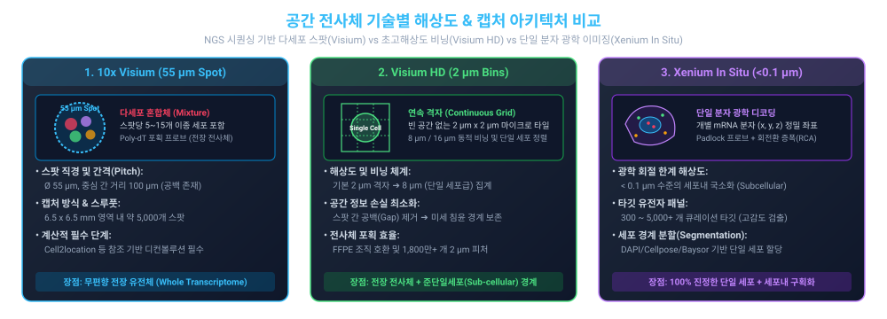

# Chapter 01. 공간전사체 기술 원리와 광학·생물물리학적 기초 (Spatial Technologies & Biophysics)

> **Cognitive Goal**: 차세대 시퀀싱(NGS) 기반 공간 어레이와 현미경 기반 인시츄(In Situ) 단일 분자 이미징 기술의 물리화학적 검출 메커니즘을 규명하고, 아베 회절 한계(Abbe Diffraction Limit), 점 확산 함수(PSF), 롤링 서클 증폭(RCA), 해밍 코드 오류 정정, 그리고 RNA 측면 확산(Lateral Diffusion) 역학이 공간 데이터 품질에 미치는 생물물리학적 법칙을 수학적으로 유도 및 설명할 수 있다.

---

## 1. 공간전사체 기술별 해상도 및 검출 스펙트럼

공간전사체 기술은 조직 내 유전자 발현을 2차원 또는 3차원 공간 좌표와 결합하는 방식에 따라 **시퀀싱 기반(Sequencing-based Arrays)**과 **이미징 기반(Imaging-based In Situ)**으로 분류됩니다.



---

## 2. 시퀀싱 기반 공간 어레이 (Sequencing-based Spatial Arrays)

시퀀싱 기반 기술은 유리 슬라이드 표면에 고정된 **공간 바코드 올리고뉴클레오타이드(Spatial Barcoded Oligonucleotides)**를 이용하여 조직 절편에서 방출된 전사체를 캡처한 뒤, 라이브러리를 제작하여 차세대 염기서열 분석기(Illumina NGS)로 전장 전사체를 일괄 해독합니다.

```
[Visium Oligonucleotide Capture Probe 구조]
5'- [Illumina TruSeq Read 1] - [Spatial Barcode (16 bp)] - [UMI (12 bp)] - [Poly(dT) (Visium v1) | 프로브 포획 서열 (FFPE/CytAssist·HD)] - 3'
```

### 2.1 10x Visium Standard (55 µm Spot Array)
- **기하학적 구조**:
  - $6.5\text{ mm} \times 6.5\text{ mm}$ 캡처 면적 내에 약 4,992개의 원형 스팟이 육방정계(Hexagonal grid) 형태로 배열.
  - 각 스팟의 직경: $d_{\text{spot}} = 55\ \mu\text{m}$.
  - 스팟 중심 간 거리(Pitch): $p = 100\ \mu\text{m}$.
  - 스팟 간 비포획 간극(Dead space): $g = 100 - 55 = 45\ \mu\text{m}$.
- **다세포 혼합(Multicellular Mixture) 한계**:
  - 전립선 조직에서 상피세포와 섬유아세포의 평균 직경은 약 $10 \sim 15\ \mu\text{m}$입니다.
  - 따라서 단일 $55\ \mu\text{m}$ 스팟에는 조직 밀도에 따라 1~수십 개(10x 안내는 대략 1~10개, 치밀한 종양 영역에서는 20~30개까지)의 서로 다른 세포가 물리적으로 겹쳐서 포획됩니다.
  - 결과적으로 관측된 카운트 벡터 $\mathbf{y}_s \in \mathbb{R}^G$는 해당 스팟 $s$에 포함된 여러 세포 아형들의 전사체 가중 선형 결합(Linear combination)으로 나타나며, 이를 분리하기 위해 **세포 디콘볼루션(Deconvolution)** 알고리즘이 필수적으로 요구됩니다.

### 2.2 10x Visium HD (2 µm Continuous Square Bins)
- **연속 격자 구조와 갭 제로(Zero-gap) 설계**:
  - Visium HD는 슬라이드 표면에 $2\ \mu\text{m} \times 2\ \mu\text{m}$ 크기의 정사각형 바코드 영역을 연속 패턴으로 배열하며(프로브 결찰 기반 포획), 비드/폴로니 어레이가 아닙니다.
  - 스팟 간 데드 스페이스가 $0\ \mu\text{m}$로, 조직 전체 면적을 빈틈없이 포획합니다.
  - $6.5\text{ mm} \times 6.5\text{ mm}$ 슬라이드 하나당 약 $1.06 \times 10^7$개($42.25\text{ mm}^2 / 4\ \mu\text{m}^2$)의 연속 $2\ \mu\text{m}$ 빈이 생성됩니다.
- **아세포 및 단일핵 분해능(Subcellular / Single-nucleus Resolution)**:
  - 인간 세포핵의 평균 직경은 약 $5 \sim 8\ \mu\text{m}$이므로, $2\ \mu\text{m}$ 빈은 단일 세포핵 하나를 4~16개의 격자로 분할하여 포획할 수 있는 해상도를 제공합니다.
- **다중 해상도 계층적 비닝(Hierarchical Binning Strategy)**:
  - $2\ \mu\text{m}$ 원시 빈은 포획되는 분자 수가 매우 적어 행렬의 희소성(Sparsity)이 극심합니다.
  - 따라서 분석 목적에 따라 인접한 빈들을 합성하여 가변 해상도를 구성합니다:
    - **$2\ \mu\text{m}$ Bin**: 아세포 수준 RNA 편재화 및 정밀 세포 경계 추적.
    - **$8\ \mu\text{m}$ Bin**: 단일 세포 규모에 근사($8 \times 8 = 64\ \mu\text{m}^2$는 직경 $10 \sim 15\ \mu\text{m}$ 세포 단면 약 $80 \sim 180\ \mu\text{m}^2$보다 작거나 비슷하므로 한 빈이 한 세포와 정확히 대응하지는 않음)하는 해상도로 단일세포 수준 분석에 사용.
    - **$16\ \mu\text{m}$ Bin**: 저빈도 전사체의 공간 도메인 분할 및 고속 클러스터링.

---

## 3. 이미징 기반 인시츄 공간전사체 (Imaging-based In Situ Technologies)

이미징 기반 기술은 조직 절편을 파쇄하지 않고 조직 내부에서 형광 신호의 광학적 검출을 통해 개별 RNA 분자의 위치를 수백 나노미터 정밀도로 직접 이미징합니다.

### 3.1 10x Xenium In Situ (Padlock Probes & Rolling Circle Amplification)
Xenium 플랫폼은 **패들록 프로브(Padlock Probe)**와 **등온 롤링 서클 증폭(Rolling Circle Amplification, RCA)**을 결합하여 고감도 단일 분자 검출을 구현합니다:

```
[Xenium 단일 분자 증폭 및 주기적 디코딩]
1. Target mRNA Hybridization:
   5'- [Target mRNA] - 3'
       ││││││││││││││││
   5'- [Left Arm] ── (Spacer / Barcode Region) ── [Right Arm] - 3' (Padlock Probe)

2. Enzymatic Ligation:
   DNA Ligase(SplintR/T4)가 Left Arm과 Right Arm의 틈(Nick)을 봉합하여 환형 DNA(Circular DNA) 형성.
   * 비특이적 결합 시 Ligation이 발생하지 않아 극도의 서열 특이성 확보.

3. Rolling Circle Amplification (RCA):
   Phi29 DNA Polymerase가 환형 주형을 따라 수천 번 회전 복제 ──► 직경 100~500 nm의 고밀도 DNA 엉킴체(Rolony) 형성.

4. Cyclic Fluorescent Decoding:
   주기별 형광 표지 올리고뉴클레오타이드 혼성화 ──► 형광 이미징 ──► 화학적/광학적 절단 ──► 반복 디코딩.
```

### 3.2 NanoString CosMx Spatial Molecular Imager (SMI)
- **광절단성(Photocleavable) 리포터 시스템**:
  - 표적 mRNA에 결합하는 1차 ISH 프로브와 복합체를 이루는 4-채널 형광 리포터를 사용합니다.
  - 리포터 올리고뉴클레오타이드는 자외선(UV, $\lambda \approx 365\text{ nm}$)에 반응하는 광분해성 화학 링커(Photocleavable Linker)를 포함합니다.
  - 형광 이미지 촬영 후 UV 광을 조사하여 이전 형광체를 세척 제거하고, 다음 사이클의 리포터를 투입하는 순환 방식을 취합니다.

### 3.3 Vizgen MERSCOPE (MERFISH) 및 해밍 코드 오류 정정 (HD4)
MERFISH(Multiplexed Error-Robust Fluorescence In Situ Hybridization)는 정보 이론의 **이진 바코드(Binary Barcode)**와 오류 검출·정정 알고리즘을 도입하여 광학 노이즈를 근본적으로 차단합니다:

- **$N$-bit 조합 바코딩**:
  - 예를 들어 16회의 순환 이미징($N=16$)을 수행할 때, 각 유전자는 16자리의 이진수(예: `1001011000101000`)로 인코딩됩니다.
  - 비트 '1'은 해당 사이클에서 형광 신호 검출, 비트 '0'은 형광 소광을 의미합니다.
- **해밍 거리 4 (Hamming Distance 4, HD4) 코드북**:
  - 유효한 모든 유전자 바코드 간의 최소 해밍 거리를 4 이상으로 유지하도록 코드북을 설계합니다:
    $$d_H(\mathbf{c}_i, \mathbf{c}_j) = \sum_{k=1}^N |c_{ik} - c_{jk}| \ge 4 \quad (\forall i \neq j)$$
  - **오류 정정 능력(Error Correction)**:
    - 1-비트 오류 정정: 만약 형광 소광 실패나 신호 손실로 인해 1개의 비트가 반전($0 \to 1$ 또는 $1 \to 0$)되더라도, 가장 가까운 올바른 유전자 코드와의 해밍 거리는 1이고 다른 모든 유효 코드와의 거리는 최소 3이므로, **단 1개의 비트 에러는 100% 원래 유전자로 완벽히 자동 복원**됩니다.
    - 2-비트 오류 검출: 2개의 비트가 동시에 오류를 일으킨 경우, 어떤 유효 코드와도 거리가 2가 되어 잘못된 유전자로 오인되지 않고 **노이즈(Invalid code)로 즉각 폐기**됩니다.

---

## 4. 광학 물리와 분자 확산 역학 (Optical Physics & Molecular Diffusion)

### 4.1 아베 회절 한계 (Abbe Diffraction Limit)와 점 확산 함수 (PSF)
광학 현미경의 렌즈를 통과하는 빛은 파동의 회절 현상으로 인해 점 광원이 이상적인 단일 점으로 맺히지 않고 에어리 디스크(Airy Disk) 패턴으로 퍼집니다.

- **아베 회절 한계 공식**:
  $$d_{\text{min}} = \frac{\lambda}{2 \text{NA}} = \frac{\lambda}{2 n \sin \alpha}$$
  - $\lambda$: 형광 방출 파장 (예: 녹색 형광 $\lambda \approx 520\text{ nm}$).
  - $\text{NA}$: 대물렌즈의 개구수 (Numerical Aperture, 유침 렌즈 기준 약 $1.4$).
  - 계산 결과:
    $$d_{\text{min}} \approx \frac{520\text{ nm}}{2 \times 1.4} \approx 186\text{ nm}$$
- **점 확산 함수(Point Spread Function, PSF)와 가우시안 근사**:
  - 현미경 상에서 관측되는 단일 분자(Rolony)의 형광 강도 분포 $I(x, y)$는 2차원 가우시안 분포로 모델링됩니다:
    $$I(x, y) = I_0 \exp\left( - \frac{(x - x_0)^2 + (y - y_0)^2}{2 \sigma_{\text{PSF}}^2} \right) + B$$
  - 여기서 $\sigma_{\text{PSF}} \approx \frac{d_{\text{min}}}{2.355} \approx 80\text{ nm}$입니다.
  - 비선형 최소제곱법(Levenberg-Marquardt) 또는 최대우도추정(MLE)으로 중심 좌표 $(x_0, y_0)$를 피팅함으로써, 회절 한계보다 훨씬 정밀한 **서브마이크론($\approx 10 \sim 20\text{ nm}$) 단일 분자 국소화(Localization)**를 달성합니다.

### 4.2 조직 투과화와 RNA 측면 확산 역학 (RNA Lateral Diffusion)
시퀀싱 기반 어레이(Visium)에서 조직 절편을 투과화(Permeabilization)하여 세포막을 녹이면, 세포 내 mRNA가 유리 표면의 포획 올리고 프로브로 이동합니다. 이때 2차원 평면 상에서 일어나는 측면 확산(Lateral Diffusion)은 공간 분해능을 저하시키는 핵심 물리적 요인입니다.

```
[조직 투과화 시 RNA 측면 확산 모델]
       세포핵 / 세포질
   ───► [mRNA 분출] ───►
          │     ╲
          │  측면 확산 (Lateral Blurring)
          ▼        ▼
════════════════════════════════ (유리 슬라이드 표면)
     [Spot A]      [Spot B] (인접 스팟으로의 누출 / 신호 교차 오염)
```

- **아인슈타인-스몰루호프스키 2차원 확산 방정식**:
  2차원 자유 확산에서 시간 $t$ 동안 이동한 전사체의 평균 제곱 변위(Mean Squared Displacement, MSD)는 다음과 같습니다:
  $$\langle r^2 \rangle = 4 D t$$
  - $D$: 점성 조직 기질 내 mRNA의 유효 확산 계수 (가정 범위 약 $10^{-11} \sim 10^{-13}\ \text{m}^2/\text{s}$; 출처 있는 실측값이 아니라 가정이며 실제 값은 조직·투과화 조건에 따라 다름).
  - $t$: 투과화 효소(Pepsin/Proteinase K) 반응 시간 ($5 \sim 30\text{ min}$).
- **공간적 블러링(Spatial Blurring) 및 스팟 간 신호 누출(Crosstalk)**:
  - 투과화 시간이 지나치게 길어지면 평균 확산 거리 $\sqrt{\langle r^2 \rangle}$가 커져(위 가정 범위로 계산하면 $D=10^{-13}$, 5분에서 약 $11\ \mu\text{m}$, $D=10^{-11}$, 30분에서 약 $270\ \mu\text{m}$로 25배 폭이며, $20 \sim 30\ \mu\text{m}$는 하나의 예시값일 뿐이므로 실제로는 Tissue Optimization 실험으로 결정), 원래 위치의 스팟 경계를 벗어나 인접 스팟으로 mRNA가 침범하는 **측면 크로스토크(Lateral Crosstalk)**가 발생합니다.
  - 반대로 투과화 시간이 너무 짧으면 세포 내부의 전사체가 표면 프로브에 도달하지 못해 UMI 포획 효율이 급락합니다. 따라서 조직 두께($5 \sim 10\ \mu\text{m}$)와 조직 밀도에 따른 **최적 투과화 시간(Optimal Permeabilization Time) 캘리브레이션**이 시퀀싱 기반 공간 분석의 핵심입니다.

### 4.3 조직 전처리 물리화학: FFPE vs Fresh Frozen
| 비교 항목 | 신선 동결 조직 (Fresh Frozen, FF) | 포르말린 고정 파라핀 포매 조직 (FFPE) |
|:---|:---|:---|
| **화학적 결합 상태** | 메틸렌 가교 없음; RNA 고유 구조 유지 | 포름알데히드에 의한 메틸렌 가교($-\text{CH}_2-$) 및 아미노산 축합 |
| **RNA 단편화 정도** | 낮음 (RIN > 7.0 권장; 온전한 긴 전사체) | 극심함 (DV200 > 30~50% 수준; $100 \sim 200\text{ nt}$ 단편화) |
| **포획 메커니즘** | Poly(A) 꼬리 직접 포획 (Oligo-dT) | 쌍 프로브 혼성화 (LHS/RHS Padlock Probe) |
| **측면 확산 위험** | 높음 (세포 구조 붕괴 시 자유 확산 활발) | 낮음 (단백질-핵산 가교로 조직 기질 내 물리적 고정 우수) |
| **임상 검체 가용성** | 수술 직후 즉각 액체질소 급랭 필요 (희귀) | 병리과 보관 아카이브 슬라이드 100% 활용 가능 |

---

## 5. 검출 감도, 특이도 및 멀티플렉싱 트레이드오프

공간전사체 기술을 선택할 때는 **포획 유전자 수(Plexity)**와 **단일 분자 검출 효율(Sensitivity)** 사이의 생물물리학적 트레이드오프를 고려해야 합니다:

> 정성적 경험칙(출처·차원·유도가 있는 정량 법칙이 아님): 패널 plexity를 높이면 한 이미징 라운드의 분자 밀도(광학 혼잡)가 커져 개별 분자 검출 효율이 떨어지는 경향이 있다.

1. **광학적 중첩(Optical Crowding)의 물리적 한계**:
   - 이미징 기반 인시츄 기술에서 동시에 검출하는 유전자 수($N$)를 무한히 늘리면, 시야각(Field of View, FOV) 당 발생하는 형광 Rolony의 밀도가 아베 회절 한계를 초과하여 스팟들이 서로 겹치는 현상(Optical Crowding)이 발생합니다.
   - 스팟 간 거리가 $d_{\text{min}}$보다 가까워지면 개별 형광 피크를 독립적으로 국소화할 수 없어 디코딩 에러가 기하급수적으로 증가합니다.
2. **자가형광(Autofluorescence)과 신호 대 잡음비**:
   - 전립선암 조직은 콜라겐 기질, 엘라스틴, 리포푸신(Lipofuscin) 과립 및 잔류 적혈구(RBC)로 인해 광범위한 파장($450 \sim 600\text{ nm}$)에서 강력한 내인성 자가형광을 방출합니다.
   - 단일 형광 분자 수준의 신호는 이 자가형광 배경에 묻히기 쉬우므로, 광학 표백(Photobleaching) 전처리와 수학적 다중 스펙트럼 디믹싱(Spectral Unmixing)이 필수적입니다.

---

## 6. Python 실습: 공간전사체 분해능 및 스팟-비드 모델링

`Scanpy`와 `SpatialData`를 활용하여 시퀀싱 기반 Visium 데이터의 공간 스팟 지오메트리를 로드하고 스팟 간 거리 및 캡처 반경을 검증하는 파이프라인입니다.

```python
import numpy as np
import pandas as pd
import scanpy as sc
import matplotlib.pyplot as plt
from scipy.spatial.distance import pdist, squareform

# 1. 10x Visium 표준 전립선암 데이터셋 로드 (공개 h5ad 예시)
# adata.obsm['spatial']에 실수형 물리 좌표(pixel 또는 µm) 수록
def analyze_spot_geometry(adata: sc.AnnData, spot_diameter_um: float = 55.0):
    coords = adata.obsm['spatial']
    # Visium 풀해상도 픽셀 → µm 변환: scalefactors의 spot_diameter_fullres(픽셀)가 55 µm에 해당
    lib = next(iter(adata.uns.get('spatial', {})), None)
    sf = adata.uns['spatial'][lib]['scalefactors'] if lib else {}
    um_per_px = spot_diameter_um / sf['spot_diameter_fullres'] if 'spot_diameter_fullres' in sf else None
    n_spots = coords.shape[0]
    
    # 유클리드 거리 행렬 계산
    dist_matrix = squareform(pdist(coords))
    np.fill_diagonal(dist_matrix, np.inf)
    
    # 각 스팟별 가장 가까운 이웃 스팟과의 중심 거리(Pitch) 계산
    nearest_dists = np.min(dist_matrix, axis=1)
    mean_pitch = np.mean(nearest_dists)
    
    print(f"총 유효 스팟 수: {n_spots:,} spots")
    print(f"평균 스팟 중심 간격 (Mean Pitch): {mean_pitch:.2f} pixels")
    if um_per_px is not None:
        print(f"평균 스팟 중심 간격 (Mean Pitch): {mean_pitch * um_per_px:.1f} µm  (Visium 설계값 100 µm와 비교)")
    
    # 스팟 직경 및 데드스페이스 비율 추정
    # scale factor를 통해 pixel -> µm 변환이 가능하다고 가정
    plt.figure(figsize=(6, 4))
    plt.hist(nearest_dists, bins=40, color='royalblue', edgecolor='black', alpha=0.7)
    plt.axvline(mean_pitch, color='red', linestyle='--', label=f'Mean Pitch: {mean_pitch:.1f}')
    plt.title("Visium Spot Nearest Neighbor Pitch Distribution")
    plt.xlabel("Center-to-Center Distance (pixels)")
    plt.ylabel("Spot Frequency")
    plt.legend()
    plt.tight_layout()
    plt.show()

# 함수 호출 인터페이스
# analyze_spot_geometry(adata)
```

---

## 7. 단원 핵심 점검 (Cognitive Checkpoint & Case Study)

### [문제 1. 핵심 개념 능동 회상 (Active Recall)]
10x Xenium In Situ에서 채택하고 있는 **Padlock Probe**와 **Rolling Circle Amplification (RCA)** 메커니즘을 상술하고, 일반적인 올리고뉴클레오타이드 혼성화 대비 이 방식이 극도로 높은 서열 특이도(Sequence Specificity)와 단일 분자 형광 검출 감도를 달성하는 생화학적/생물물리학적 이유를 설명하시오.

<details>
<summary>💡 모범 답안 및 해설 확인</summary>

1. **작동 메커니즘**:
   - **Padlock Probe 혼성화 및 효소적 결찰(Ligation)**: 표적 mRNA에 결합하는 선형 패들록 프로브의 좌우 양팔(LHS, RHS)이 표적 염기서열에 정확히 인접하여 결합할 때만, DNA 리가아제(SplintR Ligase 또는 T4 DNA Ligase)에 의해 양 말단이 공유결합으로 연결되어 완전한 환형 DNA(Closed Circular DNA)를 형성합니다.
   - **등온 롤링 서클 증폭(RCA)**: 환형화된 주형을 기반으로 Phi29 DNA 중합효소가 수천 회 회전 복제를 수행하여, 단일 환형 주형으로부터 수천 개의 반복 단위(Tandem repeats)를 갖는 긴 단일가닥 DNA 엉킴체(Rolony)를 형성합니다.
2. **높은 서열 특이도 및 검출 감도의 이유**:
   - **이중 검증에 의한 특이도 확보**: 비특이적 결합이나 1~2개의 단일염기 불일치(Mismatch)가 발생할 경우 DNA 리가아제의 활성이 차단되어 환형화가 일어나지 않습니다. 선형 상태로 남은 미반응 프로브는 세척 과정에서 쉽게 제거되므로 위양성(False-positive) 혼성화 신호가 원천 차단됩니다.
   - **형광 신호의 국소 물리적 증폭(SNR 극대화)**: 단일 전사체 1분자로부터 직경 약 $200 \sim 500\text{ nm}$ 크기의 고밀도 Rolony가 형성되며, 이 안에 수백~수천 개의 형광 디코딩 올리고뉴클레오타이드가 동시에 결합할 수 있습니다. 이는 단일 형광 분자 대비 수백 배 이상의 국소 형광 강도를 발생시켜 광학 현미경의 회절 한계 내에서 자가형광 배경 잡음을 압도하는 신호 대 잡음비(SNR)를 제공합니다.

</details>

---

### [문제 2. 핵심 개념 능동 회상 (Active Recall)]
빛의 회절 한계를 나타내는 **아베 한계(Abbe Diffraction Limit)** 수식을 유도하고, 이 한계가 $200\text{ nm}$ 수준임에도 불구하고 MERSCOPE(MERFISH) 및 Xenium 기술이 수 나노미터 크기의 개별 단일 mRNA 분자를 서로 중첩되지 않게 분리 국소화(Localization)할 수 있는 원리를 **점 확산 함수(PSF) 가우시안 피팅**과 **순환(Cyclic) 희소 바코딩** 관점에서 설명하시오.

<details>
<summary>💡 모범 답안 및 해설 확인</summary>

1. **아베 회절 한계 수식**:
   $$d = \frac{\lambda}{2 \text{NA}} = \frac{\lambda}{2 n \sin \alpha}$$
   - 가시광선 파장 $\lambda \approx 500\text{ nm}$, 고성능 유침 대물렌즈 $\text{NA} \approx 1.25 \sim 1.4$ 적용 시, 광학적으로 분리 가능한 최소 거리는 $d \approx 180 \sim 200\text{ nm}$로 제한됩니다.
2. **단일 분자 국소화 원리**:
   - **PSF 2차원 가우시안 피팅 (Sub-diffraction Localization)**:
     개별 형광 Rolony는 약 $200\text{ nm}$의 점 확산 함수(PSF) 광점 형태로 관측되지만, 검출된 광자(Photon) 수가 충분히 많을 경우 2차원 대칭 가우시안 곡선의 중심 좌표 $(x_0, y_0)$를 수학적으로 피팅할 수 있습니다. 중심점의 위치 오차는 $\sigma_{\text{loc}} \approx \frac{\sigma_{\text{PSF}}}{\sqrt{N_{\text{photons}}}}$에 비례하므로, 광자수 $N$이 커질수록 정밀도가 좋아집니다. 예: $\sigma_{\text{PSF}}\approx80\text{ nm}$이면 $N\approx16\sim64$개 광자에서 $10\sim20\text{ nm}$, $N=1{,}000$개에서 이상적으로 약 $2.5\text{ nm}$입니다(실제는 배경·픽셀화로 이보다 나쁨; Thompson 2002).
   - **순환 희소 바코딩에 의한 광학적 중첩(Optical Crowding) 방지**:
     조직 내 수백만 개의 RNA가 한 번에 모두 형광을 방출하면 에어리 디스크들이 서로 겹쳐 분리가 불가능해집니다. 따라서 MERFISH는 여러 차례의 순환 이미징(Cyclic rounds)으로 나누어 매 사이클마다 전체 유전자의 일부만이 형광 비트 '1'을 켜도록(Sparseness) 설계합니다(MERFISH MHD4: 16비트·가중치 4이므로 라운드당 유전자의 4/16 = 25%가 켜짐. Xenium은 RCA 후 색-순서 코드워드를 쓰는 별개 방식). 이를 통해 각 이미징 시점마다 형광 점들이 아베 한계 거리($> 200\text{ nm}$) 이상으로 서로 충분히 이격되도록 유지하여 중첩 없이 단일 분자를 해독합니다.

</details>

---

### [문제 3. 임상 사례 분석 (Clinical Interpretation Case Study)]
**[임상 시나리오]**
연구팀은 전립선암 환자의 10년 된 아카이브 FFPE 절편과 수술 직후 액체질소에 급랭한 신선 동결(Fresh Frozen, FF) 절편을 확보하여 공간전사체 분석을 계획하였습니다.
한 연구원이 "FF 절편은 RNA 온전성(RNA Integrity)이 우수하므로 Visium Standard Poly(A) 전장 전사체 키트로 분석하고, FFPE 절편은 Xenium In Situ로 분석하자"고 제안하였습니다.
그러나 예비 실험 결과, 신선 동결 조직의 Visium 데이터에서 Cribriform 선암종과 주변 섬유 기질 사이의 유전자 경계면이 심각하게 흐려지는(Blurring) 공간적 크로스토크가 확인되었습니다.

**[질문]**
1. 신선 동결 조직에서 관찰된 공간적 경계면 흐림 현상의 생물물리학적 원인을 아인슈타인 확산 방정식($\langle r^2 \rangle = 4Dt$) 관점에서 진단하고, 왜 FFPE 조직에서는 이러한 측면 확산이 상대적으로 억제되는지 조직 고정 화학의 차이점을 들어 설명하시오.
2. 보관 기간이 10년 경과한 전립선암 FFPE 블록에서 Poly(A) 캡처 기반의 구형 시퀀싱 방식을 적용할 수 없는 분자생물학적 이유를 기술하고, Xenium 패들록 프로브 시스템이 왜 이 FFPE 검체에서 뛰어난 검출 성능을 발휘하는지 논하시오.

<details>
<summary>💡 모범 답안 및 해설 확인</summary>

1. **생물물리학적 진단 및 고정 화학의 차이**:
   - **진단**: 신선 동결(Fresh Frozen) 조직은 효소 투과화 과정에서 세포막이 용해될 때 세포 내 mRNA가 고정되지 않은 수용액 상태로 노출됩니다. 아인슈타인 확산 공식에 따라 시간 $t$ 동안 이동하는 측면 확산 거리 $\sqrt{\langle r^2 \rangle} = \sqrt{4Dt}$가 수십 $\mu\text{m}$에 달하게 되며, 이로 인해 암세포 내부의 mRNA가 인접한 기질 스팟으로 물리적으로 번져나가(Lateral Blurring) 공간적 경계면이 붕괴된 것입니다.
   - **FFPE 조직의 확산 억제 기전**: FFPE 조직은 포름알데히드 처리를 통해 단백질과 핵산 간에 촘촘한 공유결합 메틸렌 가교($-\text{CH}_2-$)가 형성되어 거대한 분자 격자망(Cross-linked matrix)을 구성하고 있습니다. 이 가교망이 전사체를 조직 기질 내에 단단히 물리적으로 결속(Tethering)시켜 두기 때문에, 투과화 효소를 처리하더라도 mRNA의 측면 확산이 신선 동결 조직보다 크게 감소하여(0이 되지는 않음) 경계면 해상도가 상대적으로 보존됩니다.
2. **10년 된 FFPE 검체에서의 분석 적합성 비교**:
   - **Poly(A) 캡처의 불가 사유**: 10년 동안 상온 보관된 FFPE 조직 내 RNA는 자연 가수분해와 산화 반응으로 인해 심각하게 분절화(Fragmentation)되어 평균 크기가 $100 \sim 200\text{ bp}$ 이하로 쪼개져 있습니다. 또한 전사체의 3' 말단 Poly(A) 꼬리가 탈락되어 있거나 포르말린에 의해 화학적으로 수식화(Monodeoxymethylation)되어 있으므로, 3' 말단 Poly(T) 프라이머 결합에 의존하는 시퀀싱 방식은 역전사 반응이 중단되어 라이브러리 제작에 완전히 실패합니다.
   - **Xenium 패들록 프로브의 탁월한 성능 이유**: Xenium은 온전한 전장 RNA를 요구하지 않고, 불과 $50 \sim 60\text{ bp}$ 내외의 극히 짧은 표적 서열에만 특이적으로 결합하는 한 쌍의 프로브(LHS, RHS)를 사용합니다. 단편화된 짧은 RNA 조각이라도 프로브 결합 부위만 온전하면 리가아제에 의해 환형화 및 RCA 증폭이 정상적으로 이루어지므로, 오래된 아카이브 FFPE 검체에서도 높은 민감도와 특이도로 전사체를 완벽히 검출할 수 있습니다.

</details>

---

<!-- REFERENCES:BEGIN (generated by scripts/apply_references.py; do not edit by hand) -->
## 참고문헌 (References)
### 본문 인용 문헌
1. Thompson RE, Larson DR, Webb WW. Precise nanometer localization analysis for individual fluorescent probes. *Biophys J*. 2002;82(5):2775-83. PMID: 11964263. doi: 10.1016/S0006-3495(02)75618-X
### 검수 근거 문헌
1. Chen KH, Boettiger AN, Moffitt JR, et al. RNA imaging. Spatially resolved, highly multiplexed RNA profiling in single cells. *Science*. 2015;348(6233):aaa6090. PMID: 25858977. doi: 10.1126/science.aaa6090
### 소프트웨어 (표기 버전은 검수 시 API를 확인한 버전이며, 파이프라인 실행 환경은 requirements-pipelines.txt 참조)
- Matplotlib 3.11.2 (github.com/matplotlib/matplotlib). 원 논문: Hunter JD. Matplotlib: A 2D Graphics Environment. *Comput. Sci. Eng*. 2007;9(3):90-95. doi: 10.1109/mcse.2007.55
- NumPy 2.5.4 (numpy.org). 원 논문: Harris CR, Millman KJ, van der Walt SJ, et al. Array programming with NumPy. *Nature*. 2020;585(7825):357-362. PMID: 32939066. doi: 10.1038/s41586-020-2649-2
- pandas 2.3.3 (github.com/pandas-dev/pandas). 원 논문: McKinney W. Data Structures for Statistical Computing in Python. *Proceedings of the Python in Science Conference*. 2010:56-61. doi: 10.25080/majora-92bf1922-00a
- Scanpy 1.12.4 (github.com/scverse/scanpy). 원 논문: Wolf FA, Angerer P, Theis FJ. SCANPY: large-scale single-cell gene expression data analysis. *Genome Biol*. 2018;19(1):15. PMID: 29409532. doi: 10.1186/s13059-017-1382-0
- SciPy 1.16.3 (github.com/scipy/scipy). 원 논문: Virtanen P, Gommers R, Oliphant TE, et al. SciPy 1.0: fundamental algorithms for scientific computing in Python. *Nat Methods*. 2020;17(3):261-272. PMID: 32015543. doi: 10.1038/s41592-019-0686-2
<!-- REFERENCES:END -->
