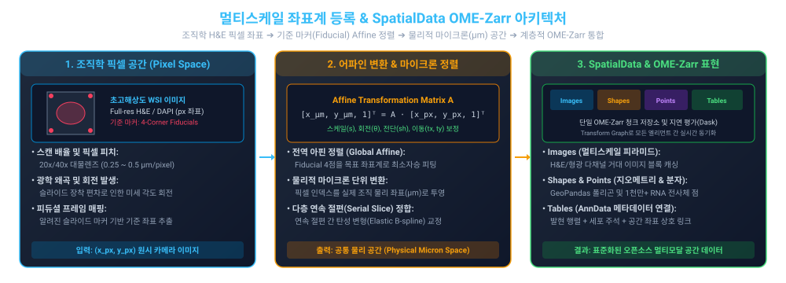

# Chapter 02. 조직병리학 영상 정합과 공간 좌표계 체계 (Histology & Coordinate Systems)

> **Cognitive Goal**: H&E 염색 및 다중 면역형광(IF) 영상의 병리학적 원리를 파악하고, 피듀셜 마커 기반 아핀 변환(Affine Transformation)을 통한 다중 좌표계 정합 수학 모델을 이해하며, `SpatialData` 프레임워크의 OME-Zarr 다중 해상도 피라미드 이미지, 분자 포인트(Points), 폴리곤 지오메트리(Shapes), 그리고 발현 테이블(Tables)의 계층적 연동 구조를 자유자재로 다룰 수 있다.

---

## 1. 조직병리학 영상과 전립선암 형태학적 구조

공간전사체 분석은 고해상도 광학 현미경 영상(H&E 및 형광 영상)과 단일 분자/스팟 단위의 전사체 발현 데이터를 하나의 통일된 공간 좌표계 위에 완벽하게 일치시키는 것에서 출발합니다.



### 1.1 H&E (Hematoxylin & Eosin) 염색의 화학적 기전
H&E 염색은 조직의 미세 형태를 가시화하는 병리학의 표준 기법으로, 두 가지 상반된 전하 특성을 갖는 염료의 화학적 결합을 이용합니다:

```
[H&E 염색의 화학적 분자 결합]
1. 헤마톡실린 (Hematoxylin - 산화형 Hematein):
   - 다가 양이온 금속 매염제(Al3+)와 복합체 형성 (염기성 염료 특성)
   - 세포핵 내부의 음전하를 띤 핵산(DNA/RNA의 인산 골격 PO4^3-)과 정전기적 결합
   ──► 세포핵(Nucleus)을 짙은 청자색(Deep Blue/Purple)으로 염색

2. 에오신 (Eosin Y):
   - 음이온성 방향족 화합물 (산성 염료 특성)
   - 세포질 및 세포외 기질 단백질의 양전하 아미노기(Lysine, Arginine의 -NH3+)와 결합
   ──► 세포질(Cytoplasm), 콜라겐 섬유, 결합조직을 분홍색~선홍색(Pink/Red)으로 염색
```

### 1.2 전립선 조직 형태학과 Gleason Grading 병리 패턴
정상 전립선 조직은 이중 세포층(관강 분비세포 Luminal cells + 기저세포 Basal cells)으로 이루어진 규칙적인 분지형 선관(Glands)과 이를 지지하는 섬유근육성 기질(Fibromuscular Stroma)로 구성됩니다. 전립선암이 발생하면 기저세포층이 소실되고 비정상적인 관강세포가 증식하며 Gleason 패턴에 따른 구조 붕괴가 일어납니다:

- **Gleason Pattern 3**: 크기가 다양하지만 독립적으로 잘 분리된 원형 관강 구조를 유지함.
- **Gleason Pattern 4**: 관강 사이의 기질이 소실되어 선관들이 서로 융합(Fused glands)되거나, 수많은 작은 구멍이 뚫린 벌집 형태의 **체상 선암종(Cribriform Adenocarcinoma)**을 형성함.
- **Gleason Pattern 5**: 선관 형성 능력을 완전히 상실하여 세포들이 불규칙한 시트(Sheet)를 이루거나 단일 세포 줄기(Cords) 형태로 침윤하며, 중심부에 괴사(Comedonecrosis)가 동반됨.

### 1.3 다중 면역형광 (Multiplexed Immunofluorescence, IF) 동시 염색
H&E 염색이 전체적인 구조를 보여준다면, 형광 항체(Antibody)를 이용한 다중 IF는 특정 세포 아형을 분자 수준에서 정밀하게 표지합니다:
- **DAPI**: 4',6-diamidino-2-phenylindole. DNA의 AT-풍부 서열 소홈(Minor groove)에 결합하여 자외선($\lambda_{\text{ex}} \approx 358\text{ nm}, \lambda_{\text{em}} \approx 461\text{ nm}$) 여기 시 청색 형광 방출 (세포핵 카운팅 및 분할의 기준).
- **Pan-Cytokeratin (Pan-CK / AE1/AE3)**: 상피세포의 중간섬유(Intermediate filaments)를 표지하여 정상 관강세포 및 전립선 악성 상피세포의 세포질 경계를 시각화.
- **$\alpha$-SMA (ACTA2)**: 평활근 액틴을 표지하여 혈관 평활근세포 및 종양을 둘러싼 근섬유아세포성 암 관련 섬유아세포(myCAF)를 분별.
- **CD3 / CD8**: T 림프구 표면 마커로, 기질 장벽 주변에 침윤한 면역 세포의 공간적 분포를 추적.

---

## 2. 공간 좌표계 및 피듀셜 프레임 정합 (Fiducial Frame & Coordinate Systems)

하나의 공간전사체 실험에서는 센서 카메라 픽셀, 고해상도 병리 스캔 영상, 그리고 전사체가 포획된 물리적 슬라이드 표면 등 여러 개의 독립된 좌표계가 공존합니다.

```
[다중 공간 좌표계 계층]
┌─────────────────────────────────┐
│ Camera Sensor Pixels (u, v)     │
└───────────────┬─────────────────┘
                ▼ (Tile stitching)
┌─────────────────────────────────┐
│ Full-Res Whole Slide Image (X, Y)│
└───────────────┬─────────────────┘
                ▼ (Affine Registration via Fiducials)
┌─────────────────────────────────┐
│ Physical Slide Coordinates (µm) │ ◄── Spatial Barcode Array / Rolony Coords
└─────────────────────────────────┘
```

### 2.1 다중 좌표계의 정의
1. **Raw Sensor/Camera Frame $(u, v)$**:
   - 현미경 카메라 센서의 픽셀 그리드 좌표 (0부터 시작하는 정수 인덱스).
2. **Whole-Slide High-Resolution Image Frame $(X, Y)$**:
   - 수백 개의 시야각(FOV) 타일을 스티칭(Stitching)하여 생성된 전체 조직의 초고해상도 픽셀 좌표 ($100,000 \times 100,000$ 픽셀 수준).
3. **Physical Slide Coordinate Frame $(x_{\mu\text{m}}, y_{\mu\text{m}})$**:
   - 슬라이드 표면의 실제 물리적 거리 단위($\mu\text{m}$).
4. **Visium Spot Array Index Frame $(r, c)$**:
   - 어레이 상의 이산적 행(Row)과 열(Column) 정수 인덱스 (`array_row`, `array_col`).

### 2.2 피듀셜 마커(Fiducial Markers) 정합과 아핀 변환(Affine Transformation)
10x Visium 슬라이드의 외곽 테두리에는 특수한 기하학적 형태를 가진 **피듀셜 프레임(Fiducial Frame)**이 식각되어 있습니다. 이미지 처리 알고리즘(예: Hough 변환 또는 템플릿 매칭)으로 4개 모서리의 피듀셜 마커 중심을 검출하여, 광학 영상과 올리고 스팟 좌표 사이의 변환 행렬을 추정합니다.

2차원 평면에서 회전(Rotation), 스케일링(Scaling), 평행이동(Translation), 전단(Shearing)을 모두 포괄하는 **동차 좌표계(Homogeneous Coordinates)** 기반의 아핀 변환 행렬 $M \in \mathbb{R}^{3 \times 3}$은 다음과 같이 정의됩니다:

$$\begin{bmatrix} x' \\ y' \\ 1 \end{bmatrix} = \mathbf{M} \begin{bmatrix} x \\ y \\ 1 \end{bmatrix} = \begin{bmatrix} a_{11} & a_{12} & t_x \\ a_{21} & a_{22} & t_y \\ 0 & 0 & 1 \end{bmatrix} \begin{bmatrix} x \\ y \\ 1 \end{bmatrix}$$

- **변환 매개변수 분해**:
  $$\mathbf{M} = \begin{bmatrix} s_x \cos\theta & -s_y \sin(\theta + \phi) & t_x \\ s_x \sin\theta & s_y \cos(\theta + \phi) & t_y \\ 0 & 0 & 1 \end{bmatrix}$$
  - $s_x, s_y$: $x, y$ 축 방향의 스케일 팩터 (마이크론 당 픽셀 비율: $\mu\text{m}/\text{pixel}$).
  - $\theta$: 회전각 (Rotation angle).
  - $\phi$: 축 기울어짐 전단각 (Shear angle).
  - $t_x, t_y$: 수평 및 수직 평행 이동량 (Translation offset).

- **최적 변환 행렬의 최소제곱법 추정**:
  영상에서 검출된 $N$개의 제어점(피듀셜 마커) 세트 $\mathbf{P} = \{ (x_i, y_i) \}_{i=1}^N$와 슬라이드 설계 규격의 기준점 세트 $\mathbf{Q} = \{ (x'_i, y'_i) \}_{i=1}^N$ 사이의 평균 제곱 오차(MSE)를 최소화하도록 행렬 $\mathbf{M}$을 계산합니다:
  $$\hat{\mathbf{M}} = \arg\min_{\mathbf{M}} \sum_{i=1}^N \left\| \mathbf{M} \begin{bmatrix} x_i \\ y_i \\ 1 \end{bmatrix} - \begin{bmatrix} x'_i \\ y'_i \\ 1 \end{bmatrix} \right\|^2$$

조직이 슬라이드 위에서 물리적으로 구겨지거나 늘어난 비선형 변형이 존재하는 경우, 단순 아핀 변환을 넘어 **박판 스플라인(Thin-Plate Spline, TPS)** 또는 B-스플라인 기반의 탄성 정합(Elastic Non-rigid Registration)을 적용합니다.

---

## 3. `SpatialData` 표준 아키텍처와 OME-Zarr 표준

단일세포 전사체학에서 `AnnData`가 단일 행렬 중심의 표준으로 군림해 왔으나, 고용량 기가픽셀 병리 영상, 수천만 개의 단일 분자 공간 포인트, 복잡한 세포 다각형 경계선 벡터 데이터를 담기에는 구조적 한계가 명확합니다.

`SpatialData`는 `scverse` 컨소시엄에서 개발한 차세대 공간 오믹스 표준 프레임워크로, 클라우드 네이티브 저장 형식인 **OME-Zarr**를 기반으로 5대 핵심 요소를 유기적으로 결합합니다.

```
                          ┌───────────────────────────┐
                          │   SpatialData Container   │
                          └─────────────┬─────────────┘
                                        │
      ┌───────────────┬─────────────────┼─────────────────┬───────────────┐
      ▼               ▼                 ▼                 ▼               ▼
┌───────────┐   ┌───────────┐     ┌───────────┐     ┌───────────┐   ┌───────────┐
│  Images   │   │  Labels   │     │  Points   │     │  Shapes   │   │  Tables   │
│ (Pyramid  │   │(Segment-  │     │(Single-   │     │ (Polygons,│   │(AnnData   │
│ OME-Zarr) │   │ ation)    │     │ Molecule) │     │  Circles) │   │ Expression│
└─────┬─────┘   └─────┬─────┘     └─────┬─────┘     └─────┬─────┘   └─────┬─────┘
      │               │                 │                 │               │
      └───────────────┴─────────────────┼─────────────────┴───────────────┘
                                        ▼
                         [Coordinate Transformations]
                         (global, microns, pixel, etc.)
```

### 3.1 SpatialData의 5대 핵심 요소 (Elements)
1. **`Images` (다중 스케일 피라미드 래스터)**:
   - Dask 및 Xarray 기반의 OME-Zarr 형식으로 다중 채널($C \times Y \times X$) 고해상도 영상을 저장.
   - 해상도별 피라미드 다운샘플링(`scale0`, `scale1`, `scale2`, ...) 구조를 갖추어, 테라바이트급 영상도 메모리 부족(OOM) 없이 청크(Chunk) 단위로 초고속 스트리밍 가능.
2. **`Labels` (픽셀 단위 분할 마스크)**:
   - 2D 또는 3D 정수형 래스터 배열. 각 픽셀값은 고유한 세포 ID(Cell Index)를 나타내며, 배경은 0으로 지정.
3. **`Points` (단일 분자 전사체 테이블)**:
   - Xenium, CosMx, MERSCOPE의 개별 전사체 좌표를 저장하는 Dask DataFrame.
   - 컬럼: $x, y, z$ 물리 좌표, 유전자 식별자(`gene`), 광학 신호 품질 점수(`qv` 또는 `q_score`).
4. **`Shapes` (벡터 지오메트리)**:
   - GeoPandas `GeoDataFrame` 및 Shapely 기반.
   - 세포 외곽선 다각형(Polygons), Visium 스팟 원형(Circles with radius), 특정 관심 영역(ROI).
5. **`Tables` (발현 특성 행렬)**:
   - 전통적인 `AnnData` 객체. `obs`에 세포 메타데이터, `X`에 유전자별 카운트 행렬 수록.
   - `adata.obs['region']`과 `adata.obs['instance_id']`를 통해 `Shapes`나 `Labels`의 지오메트리 엔티티와 1:1로 결합.

### 3.2 다중 좌표계 변환 시스템 (Transformations in SpatialData)
`SpatialData`의 모든 요소는 하나 이상의 좌표계(Coordinate System)와 그에 매핑되는 수학적 변환 함수(`Transform`)를 내장하고 있습니다:
- **`Identity`**: 변환 없음.
- **`MapAxis`**: 축 순서/매핑 변경.
- **`Translation`**: 평행이동.
- **`Scale`**: 픽셀을 물리적 거리($\mu\text{m}$)로 스케일링 ($x' = s_x x, y' = s_y y$).
- **`Affine`**: 회전, 평행이동, 스케일링, 전단이 결합된 $3 \times 3$ 아핀 행렬.
- **`Sequence`**: 여러 변환을 순차적으로 합성한 파이프라인.

---

## 4. Python 실습: `SpatialData`를 이용한 좌표계 정의 및 영상 정합

`SpatialData` 라이브러리를 사용하여 고해상도 병리 영상과 스팟 원형 지오메트리를 로드하고, 좌표계를 `global` 물리 좌표계로 정합하는 실습 파이프라인입니다.

```python
import spatialdata as sd
from spatialdata.models import Image2DModel, ShapesModel, TableModel
from spatialdata.transformations import Affine, Scale, Identity, set_transformation, get_transformation
import numpy as np
import geopandas as gpd
from shapely.geometry import Point
import anndata as ad
import pandas as pd

# 1. 2D 합성 다중채널 병리 영상 생성 (C, Y, X: 3채널 RGB)
image_array = np.random.randint(0, 255, size=(3, 1000, 1000), dtype=np.uint8)

# 픽셀당 0.5 µm 해상도를 갖는 스케일 변환 정의
pixel_to_microns = Scale(scale=[0.5, 0.5], axes=("y", "x"))

image_element = Image2DModel.parse(
    image_array,
    dims=("c", "y", "x"),
    transformations={"global": pixel_to_microns}
)

# 2. 전립선암 Visium 스팟 지오메트리 생성 (Shapes)
spot_coords = np.array([
    [100.0, 100.0],
    [200.0, 100.0],
    [150.0, 186.6],
    [250.0, 186.6]
]) # µm 단위 좌표

geometry = [Point(xy) for xy in spot_coords]
gdf = gpd.GeoDataFrame(
    {"spot_id": [f"spot_{i}" for i in range(len(spot_coords))]},
    geometry=geometry
)

shapes_element = ShapesModel.parse(
    gdf,
    geometry=geometry,
    radius=27.5, # 55 µm 직경의 스팟 반경 = 27.5 µm
    transformations={"global": Identity()}
)

# 3. 발현 카운트 테이블 생성 (Table AnnData)
X_counts = np.array([
    [120, 45, 0],   # KLK3, AR, ACTA2
    [150, 60, 2],
    [10, 5, 210],
    [5, 2, 180]
])
obs_df = pd.DataFrame({
    "spot_id": [f"spot_{i}" for i in range(4)],
    "region": "prostate_spots",
    "instance_id": [f"spot_{i}" for i in range(4)]
}, index=[f"spot_{i}" for i in range(4)])

adata = ad.AnnData(
    X=X_counts,
    obs=obs_df,
    var=pd.DataFrame(index=["KLK3", "AR", "ACTA2"])
)

table_element = TableModel.parse(
    adata,
    region="prostate_spots",
    region_key="region",
    instance_key="instance_id"
)

# 4. SpatialData 복합 객체 조립
sdata = sd.SpatialData(
    images={"he_image": image_element},
    shapes={"prostate_spots": shapes_element},
    tables={"expression_table": table_element}
)

print("SpatialData 구성 요소:")
print(sdata)

# 'global' 물리 좌표계 상에서의 요소 조회
trans = get_transformation(sdata.images["he_image"], "global")
print(f"이미지의 global 좌표계 변환 함수: {trans}")
```

---

## 5. 단원 핵심 점검 (Cognitive Checkpoint & Case Study)

### [문제 1. 핵심 개념 능동 회상 (Active Recall)]
조직병리학에서 **H&E (Hematoxylin & Eosin)** 염색의 염색 기전을 생화학적 전하 상호작용 관점에서 상술하고, 전립선암의 악성도 평가 기준인 **Gleason Pattern 3, 4, 5**의 형태학적 차이점과 이들이 단일세포 전사체학에서 흔히 간과되는 이유를 설명하시오.

<details>
<summary>💡 모범 답안 및 해설 확인</summary>

1. **H&E 염색의 생화학적 기전**:
   - **헤마톡실린(Hematoxylin)**: 양이온성 금속 매염제와 결합하여 염기성 염료로 작용합니다. 세포핵 내 음전하를 띠는 핵산(DNA/RNA 인산 골격)과 강력한 정전기적 인력을 형성하여 세포핵을 짙은 청자색으로 염색합니다.
   - **에오신(Eosin)**: 음이온성 산성 염료로, 세포질 단백질이나 세포외 기질(ECM) 콜라겐 섬유의 양전하를 띤 아미노산 잔기(Lysine, Arginine)와 결합하여 세포질과 기질 구조를 선홍색~분홍색으로 염색합니다.
2. **Gleason 패턴의 형태학적 차이점**:
   - **Gleason 3**: 개별 분리된 원형 관강 구조를 유지하며 선관 사이에 정상적인 기질이 보존됨.
   - **Gleason 4**: 선관 간 기질이 붕괴되어 관강들이 서로 융합(Fused glands)되거나, 복잡한 다공성 격자 구조를 띠는 체상 선암종(Cribriform carcinoma)을 형성함.
   - **Gleason 5**: 관강 형성 능력이 완전히 박탈되어 악성 세포들이 비정형적인 고형 시트(Solid sheets)나 침윤성 단일 세포 줄기(Cords)를 형성하며, 중심 괴사가 동반됨.
3. **단일세포 전사체학에서 간과되는 이유**:
   - sc/snRNA-seq은 조직을 단일 세포/핵으로 물리적·효소적으로 해리하므로, "관강이 분리되어 있는가(Pattern 3)", "융합되어 격자를 이루는가(Pattern 4)", "시트상으로 침윤하는가(Pattern 5)"와 같은 **세포 간의 3차원적 기하학적 배열 및 구조적 조직화 정보가 완전히 소실**됩니다. 이로 인해 유전자 발현량만으로는 병리학적 등급과 침윤 형태를 직접 판별할 수 없습니다.

</details>

---

### [문제 2. 핵심 개념 능동 회상 (Active Recall)]
공간전사체 데이터 처리에서 광학 영상 좌표계 $(u, v)$를 물리적 슬라이드 좌표계 $(x, y)$로 매핑할 때 사용되는 **아핀 변환 행렬(Affine Transformation Matrix $\mathbf{M}$)**의 4대 기하학적 구성 요소를 설명하고, 만약 슬라이드 건조 또는 동결 과정에서 조직 절편의 비대칭적 수축(Shrinkage)이나 전단(Shearing)이 발생했을 때 이를 단순 강체 변환(Rigid Body Transformation)으로 정합하면 어떤 오차가 발생하는지 기술하시오.

<details>
<summary>💡 모범 답안 및 해설 확인</summary>

1. **아핀 변환의 4대 기하학적 구성 요소**:
   - **스케일링(Scaling, $s_x, s_y$)**: 센서의 픽셀 단위를 물리적 마이크로미터($\mu\text{m}$) 단위로 변환하며, 축별 광학 배율 차이를 보정합니다.
   - **회전(Rotation, $\theta$)**: 슬라이드가 현미경 재물대(Stage)에 장착될 때 발생하는 각도 편차를 보정합니다.
   - **평행이동(Translation, $t_x, t_y$)**: 영상의 원점(좌측 상단 모서리)과 물리적 슬라이드 피듀셜 기준점 간의 위치 오프셋을 정렬합니다.
   - **전단(Shearing, $\phi$)**: 두 축 사이의 직교성(Orthogonality)이 깨졌을 때 평행사변형 형태로 기울어지는 왜곡을 보정합니다.
2. **단순 강체 변환(Rigid Body Transformation) 적용 시의 오차**:
   - 강체 변환(Rigid Transformation)은 회전과 평행이동만을 허용하며 물체의 크기와 각도를 불변으로 가정합니다 ($s_x = s_y = 1, \phi = 0$).
   - 그러나 조직 절편은 고정 및 탈수 과정에서 비등방성(Anisotropic) 수축을 겪어 $x$축과 $y$축의 수축률이 다르고, 칼날에 의해 밀리면서 전단(Shear) 왜곡이 발생합니다.
   - 이를 강체 변환으로 강제 정합하면, 슬라이드 중앙부는 맞더라도 외곽부로 갈수록 스팟과 실제 조직 형태 간의 공간적 불일치(Misalignment)가 수십~수백 $\mu\text{m}$까지 누적되어, 상피세포 영역의 발현이 엉뚱하게 결합조직 기질 스팟으로 잘못 매핑되는 **공간적 할당 오류(Spatial Misassignment)**를 초래합니다.

</details>

---

### [문제 3. 임상 사례 분석 (Clinical Interpretation Case Study)]
**[임상 시나리오]**
연구팀은 전립선암 환자의 전립선 전절제술 조직에 대해 고해상도 병리 WSI(Whole Slide Image, $80,000 \times 60,000$ 픽셀, 4채널 IF: DAPI, Pan-CK, SMA, CD8) 영상과 Xenium In Situ (380-plex, 1,200만 개 단일 분자 전사체 포인트) 데이터를 획득하였습니다.
분석 담당자가 이 대용량 데이터를 처리하기 위해 모든 분자 포인트 좌표를 원본 영상의 픽셀 그리드에 맞춰 $80,000 \times 60,000$ 크기의 거대 희소 행렬로 변환한 뒤 일반 메모리에 로드하려다가 서버 메모리 초과(Out of Memory, OOM) 에러로 작업이 중단되었습니다.

**[질문]**
1. 이 분석 담당자가 시도한 접근법의 전산학적 비효율성을 비판하고, 현대 공간 오믹스 프레임워크인 `SpatialData`가 OME-Zarr, Dask, GeoPandas를 활용하여 이 다중 모달리티 대용량 데이터를 어떻게 메모리 효율적으로 관리하는지 아키텍처 관점에서 해법을 제시하시오.
2. 병리학자가 H&E 영상에서 "종양 침윤 선단(Invasive front) 기질 영역"을 자유형 다각형(Polygon)으로 지정(Annotation)했을 때, `SpatialData` 내부에서 이 형태학적 ROI가 단일 분자 전사체(`Points`) 및 단일세포 발현 테이블(`Tables`)과 어떻게 수학적으로 연동되어 부분 발현 행렬로 추출되는지 그 데이터 연산 흐름을 서술하시오.

<details>
<summary>💡 모범 답안 및 해설 확인</summary>

1. **접근법 비판 및 SpatialData 아키텍처 해법**:
   - **비효율성 비판**: $80,000 \times 60,000$ 픽셀 크기에 380개 유전자를 갖는 3차원 행렬은 원소 수가 $1.8 \times 10^{12}$개에 달합니다. 단일 분자 전사체는 대부분의 픽셀이 0인 극도의 희소성을 띠므로, 이를 고정 래스터 그리드로 확장하는 것은 천문학적인 메모리 낭비이자 OOM을 유발하는 치명적인 오류입니다.
   - **SpatialData 해법**:
     - **래스터 영상 (`Images`)**: OME-Zarr 형식의 다중 해상도 피라미드로 저장하고, **Dask 청킹(Chunking)**을 적용하여 전체 영상을 한 번에 로드하지 않고 현재 화면이나 분석 영역에 필요한 타일만 지연 평가(Lazy loading) 방식으로 메모리에 호출합니다.
     - **단일 분자 전사체 (`Points`)**: 픽셀 그리드로 변환하지 않고, 1,200만 개의 분자 좌표($x, y, z$)와 유전자 ID를 **Dask 기반 분산 Parquet 테이블**로 보존하여 실수형 좌표를 그대로 유지합니다(저장 공간은 분자 수 $N$에 비례하는 $O(N)$이지만, Dask 청크 단위 지연 평가로 전체를 메모리에 올리지 않고 필요한 청크만 처리합니다).
     - **세포 경계 및 ROI (`Shapes`)**: 다각형 벡터 지오메트리(**GeoPandas GeoDataFrame**)로 압축 관리하여 메모리 점유율을 수 메가바이트 수준으로 최소화합니다.
2. **다각형 ROI와 발현 테이블의 연산 흐름**:
   - **공간 인덱싱 및 공간 질의(Spatial Query)**: 병리학자가 지정한 다각형 ROI 지오메트리($P_{\text{ROI}}$)를 `SpatialData`의 `Shapes` 요소로 등록합니다.
   - **포인트 필터링**: `SpatialData`의 Points 영역 질의(bounding box)는 Dask 청크 단위의 축별 비교 마스크로 수행되고(R-Tree 인덱스는 Shapes/polygons 쿼리에 사용되며, 구현은 버전에 따라 달라질 수 있음), 다각형 내부 판정은 Shapely `contains` 등 Point-in-Polygon 테스트로 수행합니다.
   - **세포-테이블 매핑(`Tables` 조인)**: 다각형 영역과 겹치는 분할 세포들의 고유 ID(`instance_id`)를 `Shapes` 또는 `Labels`로부터 식별합니다.
   - **AnnData 슬라이싱**: 해당 `instance_id`들을 인덱스로 삼아 최상위 `Tables`(`AnnData`)에서 `adata[selected_cell_ids, :]` 형태로 즉각 부분 슬라이싱(Subsetting)을 수행하여, 침윤 선단 특이적 유전자 발현 행렬과 차등 발현(DEG) 결과를 즉시 도출합니다.

</details>

---

<!-- REFERENCES:BEGIN (generated by scripts/apply_references.py; do not edit by hand) -->
## 참고문헌 (References)
### 소프트웨어 (표기 버전은 검수 시 API를 확인한 버전이며, 파이프라인 실행 환경은 requirements-pipelines.txt 참조)
- anndata 0.13.4 (github.com/scverse/anndata). 원 논문: Virshup I, Rybakov S, Theis FJ, et al. anndata: Access and store annotated data matrices. *JOSS*. 2024;9(101):4371. doi: 10.21105/joss.04371
- NumPy 2.5.4 (numpy.org). 원 논문: Harris CR, Millman KJ, van der Walt SJ, et al. Array programming with NumPy. *Nature*. 2020;585(7825):357-362. PMID: 32939066. doi: 10.1038/s41586-020-2649-2
- pandas 2.3.3 (github.com/pandas-dev/pandas). 원 논문: McKinney W. Data Structures for Statistical Computing in Python. *Proceedings of the Python in Science Conference*. 2010:56-61. doi: 10.25080/majora-92bf1922-00a
- GeoPandas 1.2.0 (github.com/geopandas/geopandas).
- Shapely 2.2.0 (github.com/shapely/shapely).
- SpatialData 0.8.0 (github.com/scverse/spatialdata). 원 논문: Marconato L, Palla G, Yamauchi KA, et al. SpatialData: an open and universal data framework for spatial omics. *Nat Methods*. 2025;22(1):58-62. PMID: 38509327. doi: 10.1038/s41592-024-02212-x
<!-- REFERENCES:END -->
