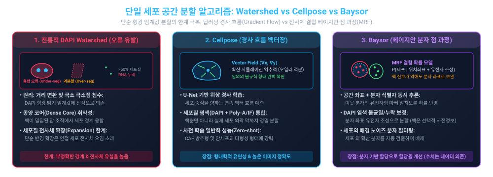

# Chapter 04. 고해상도 세포 분할 알고리즘과 전사체 할당 (Cell Segmentation: Cellpose & Baysor)

> **Cognitive Goal**: 전립선암의 침윤성 Cribriform 구조에서 발생하는 핵 밀집 및 세포질 전사체 누락 문제를 진단하고, 딥러닝 기반 2차원 그래디언트 벡터 플로우 추적 모델인 `Cellpose`와 단일 분자 전사체 조성 기반 베이지안 마르코프 랜덤 필드(MRF) 포인트 프로세스인 `Baysor`의 수학적 알고리즘을 비교·분석하여, 최적의 단일세포 전사체 할당 파이프라인을 구축할 수 있다.

---

## 1. 고밀도 조직의 세포 분할 난제 (The Prostate Segmentation Challenge)

이미징 기반 공간전사체(Xenium, CosMx, MERSCOPE)는 수백만 개의 전사체 분자 좌표($x, y$)를 서브마이크론 단위로 제공합니다. 그러나 이 분자들을 실제 개별 세포(Cellular identity)로 귀속시키는 **세포 분할(Cell Segmentation)** 과정은 분석의 성패를 가르는 가장 취약한 병목 지점입니다.



### 1.1 전립선 Cribriform 선암종의 조직학적 특수성
전립선암의 Gleason Pattern 4 체상 선암종(Cribriform Adenocarcinoma)은 다음과 같은 분할 난제를 유발합니다:
1. **극심한 핵 밀집(Nuclear Overcrowding & Overlapping)**:
   - 다공성 선관 구조 내에서 수백 개의 악성 상피세포핵이 수 $\mu\text{m}$ 간격으로 빽빽하게 맞닿아 있어 핵 간 경계가 모호합니다.
2. **세포 형태의 비정형성(Pleomorphism)**:
   - 악성 세포는 정상 관강세포와 달리 크기와 종횡비가 극도로 다양하며 다형성(Pleomorphism)을 띱니다.
3. **불명확한 세포막 경계**:
   - 상피-중간엽 전이(EMT) 과정에 있는 세포들은 세포 부착 단백질(E-cadherin)이 소실되어 광학 현미경 상에서 인접 세포와의 세포막 경계가 소실됩니다.

### 1.2 전통적인 DAPI 워터셰드(Watershed) 분할의 치명적 한계
전통적인 컴퓨터 비전 기법은 DAPI 염색 영상을 기반으로 이진화 후 유클리드 거리 변환(Distance Transform) 피크를 마커로 삼는 워터셰드(Watershed) 알고리즘을 사용했습니다. 이는 전립선암 조직에서 다음과 같은 재앙적 결과를 낳습니다:

```
[DAPI 워터셰드의 3대 실패 유형]
1. 과분할 (Over-segmentation):
   - 악성 암세포핵 내부의 불규칙한 염색질 덩어리(Heterochromatin clumping)로 인해
     단일 핵 내부에 복수의 로컬 피크가 생성되어 하나의 핵이 2~3개의 세포로 쪼개짐.

2. 저분할 (Under-segmentation):
   - Cribriform 내부에서 서로 접촉하고 있는 다수의 핵이 하나의 거대한 단일 덩어리로 병합됨.

3. 세포질 전사체 누락 (Cytoplasmic Omission):
   - DAPI는 세포핵(직경 ~5 µm)만을 염색함.
   - 핵 외곽을 단순 고정 반경(예: 2 µm)으로 팽창(Dilation)시킬 경우, 기형적인 형태의 세포질을
     포괄하지 못하여 전립선암 주요 마커(KLK3, AMACR)를 포함한 세포질 전사체의 50~80%가
     "세포 외 노이즈(Unassigned)"로 버려짐.
```

---

## 2. 딥러닝 기반 형태학적 분할: `Cellpose`

`Cellpose`는 형태가 불규칙하고 서로 맞닿아 있는 세포들을 분할하기 위해 고안된 범용 딥러닝(U-Net 변형) 모델입니다.

### 2.1 2차원 그래디언트 벡터 플로우 (Gradient Vector Flow)
기존의 마스크 예측 신경망(Mask R-CNN 등)과 달리, `Cellpose`는 각 세포 마스크 내부의 중심 픽셀을 열원(Heat source)으로 두고, 그 중심에서 시작한 **확산(diffusion)을 마스크 내부에서 고정 반복 횟수만큼 시뮬레이션**해 얻은 비정상 상태(non-steady) 포텐셜을 학습용 정답으로 사용합니다(Stringer 2021: 'simulating diffusion starting from the center'; 소스 `masks_to_flows_gpu`에서 반복 횟수 기본값 $2\times$ 마스크 extent). 즉 아래 식은 정상 상태 라플라스 해를 푸는 것이 아니라 개념적 설명입니다:

$$\frac{\partial V}{\partial t} = \nabla^2 V \ \text{(마스크 내부, 경계는 마스크 밖으로 확산 불가)}, \quad V(\text{center}, t=0) = 1$$

이 열전위 포텐셜 $V(x, y)$의 공간적 기울기(Gradient)를 취하면, 세포 경계면의 모든 픽셀에서 정확히 세포 중심(Center sink)을 가리키는 정규화된 **2차원 그래디언트 벡터 필드 $\vec{v}(x, y)$**가 유도됩니다:

$$\vec{v}(x, y) = \frac{\nabla V(x, y)}{\|\nabla V(x, y)\|}$$

```
[Cellpose의 벡터 플로우 역학]
       세포 외곽 경계
    ┌─────────────────┐
    │  ──►  ▼  ◄──    │
    │  ▲  [Center]  ▲ │   모든 픽셀이 중심 방향의 벡터장 v(x, y)를 가짐
    │  ──►  ▲  ◄──    │
    └─────────────────┘
```

### 2.2 오일러 수치 적분을 통한 세포 중심 수렴 (Euler Integration)
U-Net 신경망은 입력 이미지로부터 수평 플로우($v_x$), 수직 플로우($v_y$), 그리고 세포 확률 맵($P_{\text{cell}}$)을 동시에 출력합니다.
분할 단계에서는 각 픽셀 입자(Particle) $\mathbf{p}_0 = (x_0, y_0)$를 예측된 벡터장을 따라 오일러 적분(Euler Integration)으로 반복 이동시킵니다:

$$\mathbf{p}_{t+1} = \mathbf{p}_t + \eta \vec{v}(\mathbf{p}_t)$$

- $\eta$: 스텝 크기 (보통 $1.0$).
- 기본값 $200$회(`niter=200`, Cellpose `follow_flows`/`compute_masks`)의 스텝을 거치면, 동일한 세포 내에 속한 모든 픽셀 입자들은 하나의 고유한 국소 수렴 지점(Convergence Sink)으로 모이게 됩니다.
- 같은 싱크로 수렴한 입자들을 동일한 정수 레이블(Cell Index)로 클러스터링함으로써, 서로 단단히 맞닿아 있는 세포라도 인위적인 워터셰드 절단선 없이 완벽하게 개별 세포로 분리해 냅니다.

### 2.3 다중 채널 활용: DAPI + 막/세포질 단백질
- **채널 1 (Nucleus)**: DAPI (세포의 중심 앵커).
- **채널 2 (Cytoplasm / Membrane)**: Pan-Cytokeratin, E-cadherin, $\beta$-catenin, Phalloidin, 또는 세포막 형광 염료(Concanavalin A).
- 두 채널을 동시에 투입하면 세포질 외곽 경계선까지 정밀하게 인식하여 전사체 포획 영역을 획기적으로 넓힙니다.

---

## 3. 공간 분자 포인트 프로세스 기반 분할: `Baysor`

`Cellpose`가 광학 형광 영상에만 의존하는 반면, `Baysor`는 **단일 분자 전사체들의 2차원 공간 좌표($X$)와 유전자 정체성($G$)**을 입력으로(선택적으로 핵·사전 분할 마스크를 사전정보로 사용) 하는 **베이지안 마르코프 랜덤 필드(Markov Random Field, MRF)** 모델입니다.

`Baysor`는 픽셀을 분할하지 않고, **개별 RNA 전사체 분자 자체를 세포(또는 배경 노이즈)에 직접 할당**합니다.

### 3.1 베이지안 사후 확률 최대화 (MAP Formulation)
전체 관측 데이터(분자 좌표 $X$, 유전자 종류 $G$, 사전 DAPI 분할 $D$)가 주어졌을 때, 각 분자의 세포 소속 라벨 $Z = \{z_1, z_2, \dots, z_N\}$ ($z_i \in \{0, 1, \dots, K\}$, 0은 노이즈)의 사후 확률을 최대화합니다:

$$P(Z \mid X, G, D) \propto P(X \mid Z) \cdot P(G \mid Z) \cdot P(Z \mid D)$$

```
[Baysor 베이지안 3대 결합 확률 모델]

1. 공간적 거리 우도 P(X | Z):
   - k번째 세포에 속한 분자들의 공간 좌표는 2D 다변량 정규분포(가우시안)를 따름:
     X_i | (z_i = k) ~ N(μ_k, Σ_k)
   - μ_k: k번째 세포의 중심 좌표, Σ_k: 세포의 크기와 타원형 형태를 결정하는 공분산 행렬.

2. 유전자 조성 우도 P(G | Z):
   - 동일한 세포 유형에 속한 세포는 고유한 유전자 발현 프로파일을 공유함:
     G_i | (z_i = k) ~ Multinomial(θ_c(k))
   - θ_c(k): 세포 k가 속한 세포 클러스터 c(k)의 유전자별 발현 확률 분포.
   - 예: 암 상피세포 마커(KLK3, AR)와 섬유아세포 마커(ACTA2)가 물리적으로 인접해 있어도
     유전자 조성이 다르므로 두 개의 독립된 세포로 완벽히 분리함.

3. 선험 공간 일관성 P(Z | D) (MRF Prior):
   - 공간적으로 인접한 분자 쌍 <i, j>는 동일한 세포에 속할 확률이 높음 (Ising/Potts 모델):
     P(Z | D) ∝ exp( β Σ_<i,j> I(z_i = z_j) ) · P_prior(Z | D)
   - DAPI 기반 사전 분할 마스크(D)가 존재하는 경우 이를 초기 사전확률(Prior)로 통합.
```

### 3.2 세포 외 배경 노이즈 분자 (Ambient Noise Transcripts) 필터링
`Baysor`는 세포에 속하지 않고 세포간질 공간(Intercellular space)에 무작위로 확산된 고아 전사체(Orphan transcripts)를 모형화하기 위해 **포아송 점 과정(Poisson Point Process)** 기반의 균일 배경 노이즈 성분($z_i = 0$)을 명시적으로 포함합니다:

$$P(X_i \mid z_i = 0) = \frac{1}{\text{Area}(\Omega)}$$

이를 통해 투과화 과정에서 유출된 부유 RNA가 인접 세포의 유전자 카운트로 오염되는 현상을 원천 방지합니다.

---

## 4. 분할 품질 평가 지표 (Segmentation Quality Metrics)

세포 분할 결과의 신뢰성을 정량화하기 위해 다음 4대 핵심 지표를 평가합니다:

1. **전사체 할당율 (Transcript Assignment Rate, $\% \text{Assigned}$)**:
   $$\% \text{Assigned} = \frac{N_{\text{transcripts in cells}}}{N_{\text{total filtered transcripts}}} \times 100$$
   - 분할 방식에 따라 할당율이 달라지며(예: 핵 기반 DAPI 워터셰드는 낮고 분자 기반 `Baysor`는 높은 경향), 아래 수치(워터셰드 $30 \sim 50\%$, Baysor $75 \sim 90\%$)는 **출처 없는 예시값**입니다. 실제 할당율은 패널·조직·분할 파라미터에 따라 크게 다르며 Petukhov 외(2022)의 데이터셋별 결과를 참조해야 합니다.
2. **세포 경계 신뢰도 점수 (Boundary Confidence Score)**:
   - 예측된 세포 외곽선 내부의 분자 밀도 대비 세포 외부 외곽선 버퍼 영역의 분자 밀도 비율.
3. **세포당 검출 분자 수 및 유전자 다양성**:
   - 세포당 평균 UMI 수 및 고유 유전자 수($n\_genes$). 과분할이 일어나면 세포당 UMI가 비정상적으로 급감합니다.
4. **전사체 순도 및 이웃 불일치도 (Neighborhood Purity Score)**:
   - 하나의 세포 경계 내부에서 상호 배타적인 계통 마커(예: 관강 상피세포 마커 $KLK3$와 T 세포 마커 $CD3D$)가 동시에 고밀도로 검출되는 세포의 비율(이중체/병합 오류 지표).

---

## 5. Python 및 CLI 실습: `Cellpose` 추론 및 `Baysor` 실행 파이프라인

### 5.1 Python 환경에서 `Cellpose`를 이용한 다중채널 세포 분할
```python
import numpy as np
from cellpose import models, io
import tifffile
import matplotlib.pyplot as plt

def run_cellpose_segmentation(image_path: str, gpu: bool = False):
    """
    2채널 OME-TIFF 영상 (Ch0: DAPI, Ch1: Pan-CK)에 대한 Cellpose cyto2 모델 분할
    """
    # 1. 고해상도 형광 이미지 로드 (형태: [Y, X, C] 또는 [C, Y, X])
    img = tifffile.imread(image_path)
    if img.shape[0] == 2:
        img = np.moveaxis(img, 0, -1) # [Y, X, 2]로 변환
    
    print(f"이미지 형태: {img.shape}, 데이터 타입: {img.dtype}")
    
    # 2. 사전 학습된 Cellpose 모델 초기화 (cyto2: 다중채널 세포질/핵 모델)
    # 주의: 이 코드는 Cellpose 3.x 전용이다(`pip install "cellpose<4"`).
    # Cellpose 4.x에는 models.Cellpose·cyto2가 없고 Cellpose-SAM 기반 models.CellposeModel(gpu=gpu)을 쓰며
    # eval은 (masks, flows, styles) 3개 값을 반환한다(4.2.1.1 시그니처 확인, 본 예제는 미실행).
    model = models.Cellpose(gpu=gpu, model_type='cyto2')
    
    # 채널 정의: [세포질/막 채널, 핵 채널] (1부터 시작하는 인덱스)
    # Ch1 (Pan-CK) -> 세포질: 2, Ch0 (DAPI) -> 핵: 1
    channels = [2, 1]
    
    # 3. 그래디언트 플로우 기반 분할 실행
    # diameter: 예상 세포 직경 (픽셀 단위; None 지정 시 자동 추정)
    masks, flows, styles, diams = model.eval(
        img, 
        diameter=30.0, 
        channels=channels,
        flow_threshold=0.4,
        cellprob_threshold=0.0
    )
    
    n_cells = np.max(masks)
    print(f"분할 완료! 식별된 총 세포 수: {n_cells:,} cells")
    print(f"추정된 평균 세포 직경: {diams:.1f} pixels")
    
    return masks, flows
```

### 5.2 `Baysor` CLI 실행 및 설정 파일 (`config.toml`)
`Baysor`는 Julia 기반 고성능 병렬 엔진으로 구동되며, Xenium의 분자 좌표 CSV(`transcripts.csv`; Parquet이면 CSV로 변환)와 DAPI 사전 마스크를 입력받아 최종 단일세포 분할을 수행합니다:

```bash
# Baysor 설정 파일 생성 (baysor_prostate_config.toml)
cat << 'EOF' > baysor_prostate_config.toml
[data]
x = "x_location"            # Xenium transcripts.csv 열 이름 (Q-Score(qv) 필터링은 Baysor 실행 전에 수행)
y = "y_location"
z = "z_location"
gene = "feature_name"
min_molecules_per_gene = 10
exclude_genes = "NegControl*,BLANK_*,antisense_*"   # Xenium 음성 대조 프로브/코드워드 패턴
min_molecules_per_cell = 20

[segmentation]
scale = 12.0                # 예상 세포 반경 (µm)
estimate_scale_from_centers = true
n_clusters = 6              # 유전자 조성 클러스터 수 (사전 추정)
prior_segmentation_confidence = 0.6  # DAPI 마스크 사전 신뢰도 (0~1)
EOF

# Baysor CLI 실행 명령
# 사전 분할(PRIOR_SEGMENTATION)은 플래그가 아니라 MOLECULES_FILE 뒤의 두 번째 위치 인자
baysor run \
  -c baysor_prostate_config.toml \
  -o results/baysor_segmented/ \
  transcripts.csv dapi_cellpose_mask.tif
```

---

## 6. 단원 핵심 점검 (Cognitive Checkpoint & Case Study)

### [문제 1. 핵심 개념 능동 회상 (Active Recall)]
`Cellpose` 알고리즘이 기존의 마스크 분할 신경망(Mask R-CNN, 이진 워터셰드 등)과 차별화되는 핵심 수학적 메커니즘인 **열 확산 방정식 기반 2차원 그래디언트 벡터 플로우(Gradient Vector Flow)**와 **오일러 수치 적분(Euler Integration)** 과정을 상술하고, 이 방식이 형태가 불규칙하고 빽빽하게 맞닿은 전립선 악성 상피세포를 분리하는 데 왜 결정적으로 우수한지 설명하시오.

<details>
<summary>💡 모범 답안 및 해설 확인</summary>

1. **Cellpose의 수학적 분할 원리**:
   - **열 확산 방정식 및 벡터장 생성**: 각 세포 마스크 내부에서 중심 픽셀에서 시작한 열 확산을 고정 횟수 시뮬레이션하여 얻은 비정상 상태 포텐셜 $V$를 사용합니다(정상 상태 라플라스 해가 아님). 이 전위 함수 $V(x, y)$의 2차원 공간 기울기를 정규화하여, 세포 경계면의 모든 픽셀에서 중심부를 가리키는 정규화된 그래디언트 벡터장 $\vec{v}(x, y) = \frac{\nabla V}{\|\nabla V\|}$을 생성합니다.
   - **신경망 학습 및 오일러 적분**: U-Net 신경망은 이미지로부터 수평/수직 벡터장($v_x, v_y$)을 예측합니다. 추론 시 각 픽셀 위치 $\mathbf{p}_t$를 벡터장을 따라 $\mathbf{p}_{t+1} = \mathbf{p}_t + \eta \vec{v}(\mathbf{p}_t)$ 수식으로 오일러 적분을 수행하여 반복 이동시킵니다.
2. **불규칙한 악성 상피세포 분리에서의 우수성**:
   - 기존의 단순 거리 변환 워터셰드는 핵 내부에 이질염색질 덩어리가 존재하면 중심 피크가 여러 개로 쪼개져 심각한 **과분할(Over-segmentation)**을 일으키거나, 맞닿은 두 핵 사이의 능선(Ridge)이 낮으면 하나의 세포로 합쳐지는 **저분할(Under-segmentation)**을 초래합니다.
   - 반면 Cellpose의 벡터 플로우는 세포 전체 면적에서 중심을 향하는 대역적(Global) 기하학적 흐름을 학습하므로, 내부 노이즈에 영향을 받지 않고 단일 세포에 속한 모든 픽셀 입자들이 정확히 하나의 수렴점(Sink)으로 모이게 됩니다. 따라서 복잡하게 일그러진 전립선 Cribriform 악성 세포라도 인위적인 절단선 없이 완벽한 단일 세포 경계로 복원해 냅니다.

</details>

---

### [문제 2. 핵심 개념 능동 회상 (Active Recall)]
단일 분자 공간전사체 분할 알고리즘인 `Baysor`의 **베이지안 마르코프 랜덤 필드(Bayesian MRF)** 결합 사후확률 수식을 기술하고, 광학 영상(DAPI)만을 사용하는 형태학적 분할 기법 대비 `Baysor`가 **유전자 조성 우도 $P(G \mid Z)$**와 **공간 거리 우도 $P(X \mid Z)$**를 결합함으로써 달성하는 2가지 결정적 장점을 설명하시오.

<details>
<summary>💡 모범 답안 및 해설 확인</summary>

1. **Baysor 사후 확률 결합 수식**:
   $$P(Z \mid X, G, D) \propto P(X \mid Z) \cdot P(G \mid Z) \cdot P(Z \mid D)$$
   - $P(X \mid Z)$: 세포별 2차원 가우시안 타원체 분포 기반의 공간 좌표 우도.
   - $P(G \mid Z)$: 세포 유형별 다항 분포(Multinomial) 기반의 유전자 발현 조성 우도.
   - $P(Z \mid D)$: DAPI 사전 분할 및 이웃 분자 간 일치성을 반영하는 MRF 선험 확률.
2. **2대 결정적 장점**:
   - **광학적 세포막 염색 누락 부위의 분자적 경계 복원**:
     전립선암 FFPE 조직에서는 항체 침투 불균일로 세포막 염색이 소실되는 경우가 많습니다. 형태학적 분할기는 막이 보이지 않으면 두 세포를 하나로 병합해 버립니다. 그러나 `Baysor`는 분자들의 유전자 정체성을 동시에 평가하므로, 상피세포 마커($KLK3, AR$)를 갖는 분자 군집과 인접 기질 마커($ACTA2, COL1A1$)를 갖는 분자 군집이 물리적으로 인접해 있더라도 유전자 조성 차이를 인식하여 두 세포의 경계를 수학적으로 정확히 분리합니다.
   - **세포질 전사체의 완벽한 회수와 세포외 확산 배경 노이즈 제거**:
     DAPI 기반 확장은 핵 외곽 $2\ \mu\text{m}$만 포획하여 세포질 끝부분의 전사체를 버리는 반면, `Baysor`는 세포 중심 가우시안 공분산($\boldsymbol{\Sigma}_k$)을 세포 형태에 맞게 동적으로 신장시켜 세포질 전사체를 80% 이상 포획합니다. 동시에 어느 세포의 발현 프로파일과도 일치하지 않는 세포외 부유 전사체는 노이즈 성분($Z_i = 0$)으로 자동 분리하여 위양성 오염을 차단합니다.

</details>

---

### [문제 3. 임상 사례 분석 (Clinical Interpretation Case Study)]
**[임상 시나리오]**
연구팀은 고위험군 전립선암 환자의 FFPE 수술 검체에 대해 10x Xenium In Situ(기본 Human Multi-Tissue and Cancer 패널, 377-plex) 분석을 수행하였습니다.
1차 전처리에서 분석가는 표준 DAPI 워터셰드 알고리즘을 적용하여 세포핵을 분할한 뒤 외곽으로 $2\ \mu\text{m}$를 확장(Dilation)하여 단일세포 발현 행렬을 생성하였습니다.
그러나 결과를 검토한 종양생물학 전문가는 다음 두 가지 심각한 문제를 지적하며 데이터의 임상적 신뢰성을 기각하였습니다(이하 수치 $65\%$, $40\%$ 등은 설명용 가상 값):
1. "전립선 관강 상피세포의 대표적인 전립선 특이 항원 유전자인 $KLK3$(PSA)와 안드로겐 수용체 표적 유전자들의 총 검출 분자 중 $65\%$가 세포에 할당되지 못하고 'Unassigned background noise'로 버려졌다."
2. "종양 침윤 림프구(TIL)가 밀집한 면역 니치 영역에서, 단일 T 세포($CD3D^+ / CD8A^+$)로 라벨링된 세포의 $40\%$에서 상피세포 마커인 $KLK3$와 악성 마커인 $AMACR$ 전사체가 $10 \sim 30$ 카운트씩 동시에 검출되는 기이한 잡종(Hybrid) 발현 패턴이 나타났다."

**[질문]**
1. 위 두 가지 결함이 발생한 근본 원인을 병리 형태학 및 DAPI 워터셰드 알고리즘의 결함 관점에서 각각 규명하시오.
2. 이 문제를 해결하기 위해 `Cellpose` (DAPI + Pan-CK 다중채널)와 `Baysor` (단일 분자 포인트 프로세스)를 결합한 **하이브리드 분할 파이프라인(Hybrid Segmentation Pipeline)**을 설계하고, 그 적용 시 예상되는 데이터 품질 개선 효과를 정량적 지표 관점에서 기술하시오.

<details>
<summary>💡 모범 답안 및 해설 확인</summary>

1. **두 가지 결함의 근본 원인 규명**:
   - **결함 1 원인 (세포질 전사체 대량 누락)**:
     $KLK3$(PSA)는 관강으로 분비되는 단백질이며, 그 mRNA는 조면소포체가 있는 **세포질(Cytoplasm)** 쪽에 분포하는 것으로 가정합니다(세포질 외곽·세포막 부근 편재는 이 문서에서 출처 확인을 하지 않은 가정). 전립선 상피세포는 키가 큰 원주상피(Columnar epithelium) 형태로 장축 길이가 $15 \sim 25\ \mu\text{m}$에 달하는데, DAPI 핵 마스크에서 불과 $2\ \mu\text{m}$만 확장했기 때문에 거대한 세포질 부피의 대부분이 마스크 영역에서 제외되어 $KLK3$ 분자의 65%가 미할당 노이즈로 유실된 것입니다.
   - **결함 2 원인 (저분할 및 세포 경계 침범 오류)**:
     종양 침윤 림프구(T 세포)는 직경 $6 \sim 8\ \mu\text{m}$의 매우 작은 구형 세포로, 거대한 암세포의 세포막에 밀착해 있거나 Cribriform 선암종 틈새에 끼어 있습니다. 형태학적 DAPI 확장은 세포 유형의 크기 차이를 무시하고 일률적으로 $2\ \mu\text{m}$를 팽창시키므로, T 세포의 인위적 확장 영역이 바로 옆 암세포의 세포질을 침범하여 암세포의 고발현 mRNA($KLK3, AMACR$)를 자기 카운트로 집어삼키는 **인위적 세포 간 교차 오염(Spurious Doublet Artifact)**을 유발한 것입니다.
2. **하이브리드 분할 파이프라인 설계 및 정량적 개선 효과**:
   - **파이프라인 설계**:
     - **1단계 (광학 형태학 사전 마스크 생성)**: DAPI(핵)와 Pan-Cytokeratin(상피세포질) 2채널 형광 영상을 `Cellpose` cyto2 모델에 투입하여 상피세포의 비대칭적 원주형 세포질 경계와 T 세포의 작은 원형 경계를 물리적으로 정확히 분할한 사전 마스크(Prior Mask $D$)를 도출합니다.
     - **2단계 (Baysor MRF 분자 할당 최적화)**: `Cellpose` 마스크를 사전 확률(Prior confidence $= 0.6$)로 부여하고, 377개 패널 유전자의 분자 좌표($X$)와 유전자 조성($G$)을 `Baysor`에 투입합니다. T 세포 마커($CD3D, CD8A$)와 암세포 마커($KLK3, AMACR$)의 상호 배타적 유전자 조성을 학습하여, 형태학적 마스크가 미세하게 겹치더라도 분자들을 올바른 세포로 엄격히 분리 귀속시킵니다.
   - **정량적 개선 효과**:
     - **전사체 할당율(Assignment Rate)**: 기존 $35\%$ 수준에서 개선되어 $KLK3, AMACR$ 등 핵심 암 마커의 유실이 줄어들 것으로 기대됩니다(예시 목표 $80 \sim 85\%$; 실제 개선 폭은 데이터 의존).
     - **잡종 오염도(Cross-contamination Rate)**: T 세포 내부의 $KLK3$ 위양성 카운트가 크게 감소할 것으로 기대되며(정량 목표는 데이터 의존; 2D 절편의 z축 중첩 — 5~10 µm 두께에서 T 세포와 상피세포가 수직으로 겹침 — 은 분할 개선만으로 제거되지 않음) 면역 세포 전사체 프로파일이 개선되고, 정확한 단일세포 클러스터링 및 니치 상호작용 분석이 가능해집니다.

</details>

---

<!-- REFERENCES:BEGIN (generated by scripts/apply_references.py; do not edit by hand) -->
## 참고문헌 (References)
### 본문 인용 문헌
1. Stringer C, Wang T, Michaelos M, et al. Cellpose: a generalist algorithm for cellular segmentation. *Nat Methods*. 2021;18(1):100-106. PMID: 33318659. doi: 10.1038/s41592-020-01018-x
### 검수 근거 문헌
1. Petukhov V, Xu RJ, Soldatov RA, et al. Cell segmentation in imaging-based spatial transcriptomics. *Nat Biotechnol*. 2022;40(3):345-354. PMID: 34650268. doi: 10.1038/s41587-021-01044-w
### 소프트웨어 (표기 버전은 검수 시 API를 확인한 버전이며, 파이프라인 실행 환경은 requirements-pipelines.txt 참조)
- Cellpose 4.2.1.1 (github.com/MouseLand/cellpose). 원 논문: Stringer C, Wang T, Michaelos M, et al. Cellpose: a generalist algorithm for cellular segmentation. *Nat Methods*. 2021;18(1):100-106. PMID: 33318659. doi: 10.1038/s41592-020-01018-x
- Matplotlib 3.11.2 (github.com/matplotlib/matplotlib). 원 논문: Hunter JD. Matplotlib: A 2D Graphics Environment. *Comput. Sci. Eng*. 2007;9(3):90-95. doi: 10.1109/mcse.2007.55
- NumPy 2.5.4 (numpy.org). 원 논문: Harris CR, Millman KJ, van der Walt SJ, et al. Array programming with NumPy. *Nature*. 2020;585(7825):357-362. PMID: 32939066. doi: 10.1038/s41586-020-2649-2
- tifffile 2026.10.15 (github.com/cgohlke/tifffile).
<!-- REFERENCES:END -->
