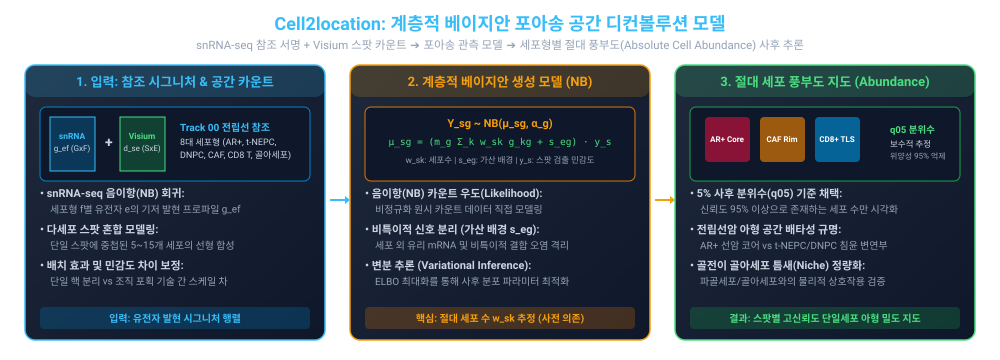

# Chapter 05. 스팟 디콘볼루션 수학과 세포 구성 복원 (Spatial Deconvolution Mathematics)

> **Cognitive Goal**: 10x Genomics Visium과 같은 스팟 기반 공간전사체(Spatial Transcriptomics)에서 발생하는 '혼합 스팟(Mixture Spot)' 문제를 수리통계학적으로 정립하고, 단순 선형 회귀(OLS) 및 NNLS가 유전체 카운트 데이터에서 파탄하는 원인을 규명한다. 이어 플랫폼 효과($\gamma_g$)를 보정하는 포아송 GLM 기반의 `RCTD`와 계층적 베이지안(Hierarchical Bayesian) 음이항 모델 기반의 `cell2location`의 수학적 구조를 도출한다. 최종적으로 전립선암(mCRPC) 4개 계통 시그니처를 활용하여 스팟당 절대 세포 수(Absolute Cell Abundance)를 복원하는 전 과정을 체계화한다.

---

## 1. 스팟 기반 공간전사체의 수학적 본질: 혼합 시퀀싱(Mixture Spot)과 불량 조건 문제

10x Genomics Visium과 같은 시퀀싱 기반 공간전사체 플랫폼은 직경 $55\ \mu\text{m}$의 원형 캡처 영역(Spot)들이 중심 간 거리(Pitch) $100\ \mu\text{m}$ 간격으로 배열된 육각 격자(Hexagonal Grid) 구조를 가집니다. 일반적인 포유류 조직에서 단일 세포의 직경이 $10 \sim 20\ \mu\text{m}$임을 고려할 때, 단 하나의 스팟에는 조직학적 밀도에 따라 **적게는 1~2개에서 많게는 30개 이상의 이질적인 세포(Heterogeneous Cells)**가 물리적으로 혼재하게 됩니다.

```
┌──────────────────────────────────────────────────────────────────────────────────┐
│                   단일 Visium 스팟 (직경 55 µm) 내부의 세포 혼합 실태             │
│                                                                                  │
│      ┌───────────────────────────────────────────────────────────────────┐       │
│      │  ● 암세포 (AR+ Luminal Adenocarcinoma) : 12개                      │       │
│      │  ▲ 암 연관 섬유아세포 (myCAF)          : 4개                       │       │
│      │  ■ 혈관 내피세포 (Endothelial Cells)   : 2개                       │       │
│      │  ◆ 세포독성 T 세포 (CD8+ T Cells)      : 1개 (기질 경계부)         │       │
│      │  ★ 골수계 세포 (TAM / Macrophage)       : 3개                       │       │
│      └───────────────────────────────────────────────────────────────────┘       │
│                                  │                                               │
│                                  ▼ 포획 프로브 (Spatial Oligo-dT Barcodes)       │
│                                                                                  │
│       관측 발현량 Y_{s, g} = 12×(암세포) + 4×(myCAF) + 2×(내피) + 1×(T) + 3×(대식)│
└──────────────────────────────────────────────────────────────────────────────────┘
```

따라서 공간전사체에서 관측되는 유전자 발현 카운트 $Y_{s, g}$ ($s \in \{1, \dots, S\}$: 스팟 인덱스, $g \in \{1, \dots, G\}$: 유전자 인덱스)는 순수한 단일 세포 프로파일이 아니라, **스팟 내에 공존하는 여러 세포 유형들의 전사체가 중첩된 선형 결합(Linear Superposition)**의 결과물입니다.

### 1.1 단순 선형 혼합 모델의 한계와 OLS/NNLS의 파탄

단일 세포/단일 핵 전사체(snRNA-seq)로부터 도출된 $K$개 세포 유형의 기준 발현 시그니처 행렬을 $G \in \mathbb{R}^{K \times G}$라 하고, 각 스팟 $s$에서의 세포 유형별 가중치를 $w_s \in \mathbb{R}^K$라 할 때, 가장 단순한 형태의 선형 모델은 다음과 같이 표현됩니다:

$$Y_{s, g} = \sum_{k=1}^K w_{s, k} G_{k, g} + \epsilon_{s, g}, \quad \epsilon_{s, g} \sim \mathcal{N}(0, \sigma^2)$$

행렬 표기법으로 나타내면 $Y = W G + E$이며, 전통적인 통계학에서는 보통최소제곱법(Ordinary Least Squares, OLS) 또는 비음수 최소제곱법(Non-negative Least Squares, NNLS)을 통해 가중치 행렬 $\hat{W}$를 추정합니다:

$$\hat{w}_s^{\text{OLS}} = \left( G G^T \right)^{-1} G y_s^T$$

$$\hat{w}_s^{\text{NNLS}} = \arg\min_{w_s \ge 0} \| y_s - w_s G \|_2^2$$

그러나 이 고전적 접근법은 유전체 데이터와 공간전사체의 물리학적 특성상 다음과 같은 치명적 결함으로 인해 완전히 파탄(Catastrophic Failure)합니다:

1. **치명적인 다중공선성(Multicollinearity)과 불량 조건(Ill-Posed) 문제**:
   - 특히 전립선암과 같은 고형암에서 종양 상피세포의 분화 아형들(예: AR+ Luminal 세포 vs Amphicrine 세포 vs Basal 세포)은 전체 유전자의 95% 이상을 공유합니다.
   - 따라서 시그니처 행렬의 행 벡터 간 상관계수가 $r > 0.95$에 달하면 행렬 $G G^T$(상관 행렬 기준)의 조건수(Condition Number)는 $\kappa=(1+r)/(1-r)$로 $r=0.95$에서 약 $39$, $r=0.99$에서 약 $199$로 커지고, 서로 가까운 유형이 여러 개 겹치면 더 커집니다($\kappa\gg10^5$는 $r\approx0.99998$이 필요하므로 이 상관만으로는 아닙니다). 역행렬의 고유값이 0에 수렴하면서 추정 가중치 $\hat{w}_{s, k}$의 분산이 극단적으로 팽창하여 생물학적으로 불가능한 거대한 양수와 음수가 진동하게 됩니다.
2. **정규분포 오차 가정의 구조적 위배**:
   - 시퀀싱 카운트는 0 이상의 정수(Discrete non-negative counts)이며, 포획 실패로 인한 수많은 결손(Dropout zeros)과 소수의 고발현 유전자에 의한 두꺼운 꼬리(Heavy tail)를 가집니다. 가우시안 잔차 $\epsilon_{s, g} \sim \mathcal{N}(0, \sigma^2)$ 가정은 낮은 카운트 영역에서 심각한 편향(Bias)을 초래합니다.
3. **플랫폼 간 기술적 포획 바이어스(Cross-Platform Technical Discrepancy)**:
   - 기준 snRNA-seq은 세포 핵을 단리하여 3' UTR을 캡처하는 반면, Visium은 동결/FFPE 조직 절편 표면에서 효소 투과화를 거쳐 표면 프로브에 결합시킵니다. mRNA 2차 구조, 투과율, 프로브 혼성화 효율에 따른 유전자별 상대적 효율 차이($\gamma_g$)가 존재하므로, $G_{k, g}$를 스팟 발현량에 절대 스케일로 직접 곱할 수 없습니다.

---

## 2. RCTD (Robust Cell Type Decomposition): 플랫폼 효과 보정 Poisson-lognormal 모형

Cable et al. (Nature Biotechnology, 2022; 온라인 2021)에 의해 제안된 **RCTD (Robust Cell Type Decomposition)**는 이 문제를 해결하기 위해 플랫폼 특이적 유전자 바이어스 파라미터 $\gamma_g$를 명시적으로 모델링합니다. 모형에는 유전자-스팟별 정규 랜덤 효과 $\epsilon_{s,g}$도 있어 순수 포아송 GLM이 아니라 **Poisson-lognormal** 구조입니다(Cable et al. 2022). 'Robust'는 플랫폼 효과에 대한 강건성을 뜻합니다.

```
                    ┌──────────────────────────────────────────────┐
                    │    snRNA-seq 레퍼런스 시그니처 행렬 (μ_k,g)  │
                    └──────────────────────┬───────────────────────┘
                                           │
                                           ▼
┌──────────────────────┐        ┌──────────────────────┐        ┌──────────────────────┐
│  스팟별 총 시퀀싱 뎁스│   ×    │  세포 유형별 비율    │   ×    │   플랫폼 효과 인자   │
│        (N_s)         │        │       (w_s,k)        │        │     exp(γ_g)         │
└──────────┬───────────┘        └──────────┬───────────┘        └──────────┬───────────┘
           │                               │                               │
           └───────────────────────┬───────┴───────────────────────────────┘
                                   │
                                   ▼
          포아송 평균율: λ_{s, g} = N_s · [ ∑_k w_{s,k} · μ_{k,g} ] · exp(γ_g)
                                   │
                                   ▼
                    공간전사체 관측 카운트: Y_{s, g} ~ Poisson(λ_{s, g})
```

### 2.1 RCTD의 수식 전개

각 스팟 $s$와 유전자 $g$에 대해, 관측된 UMI 카운트 $Y_{s, g}$는 다음과 같은 조건부 포아송 분포를 따른다고 가정합니다:

$$Y_{s, g} \sim \text{Poisson}\left(\lambda_{s, g}\right)$$

여기서 평균 발현율 $\lambda_{s, g}$는 다음과 같이 파라미터화됩니다:

$$\lambda_{s, g} = N_s \cdot \left( \sum_{k=1}^K w_{s, k} \mu_{k, g} \right) \cdot e^{\gamma_g + \epsilon_{s, g}}, \qquad \epsilon_{s,g} \sim \mathcal{N}(0, \sigma_\epsilon^2)$$

- $N_s = \sum_g Y_{s, g}$: 스팟 $s$에서 포획된 총 UMI 수(Library size normalization factor).
- $w_{s, k} \ge 0$: 스팟 $s$ 내에서 세포 유형 $k$가 차지하는 상대적 기여도 (정규화 조건: $\sum_{k=1}^K w_{s, k} = 1$).
- $\mu_{k, g}$: 단일 세포 기준 데이터셋에서 세포 유형 $k$의 유전자 $g$에 대한 평균 발현율 (단위 라이브러리당 기대 카운트).
- $\gamma_g$: snRNA-seq 플랫폼과 Visium 플랫폼 사이의 유전자 고유 발현 편차를 흡수하는 **플랫폼 효과(Platform Effect)** 계수. 사전분포로 정규분포를 부여합니다: $\gamma_g \sim \mathcal{N}(0, \sigma_\gamma^2)$.

### 2.2 최적화 및 이상치 억제(Robust Estimation)

RCTD는 두 단계 최적화를 수행합니다:
1. **플랫폼 효과 $\gamma_g$의 전역 추정**:
   조직 전체 스팟 데이터를 풀링하여 유전자별 플랫폼 차이 $\gamma_g$를 먼저 적합합니다.
2. **좌표 하강법(Coordinate Descent)을 통한 $w_s$ 추정**:
   스팟 $s$별로 음의 로그 우도(Negative Log-Likelihood)를 최소화합니다:
   $$\mathcal{L}(w_s) = \sum_{g=1}^G \left[ \lambda_{s, g}(w_s) - Y_{s, g} \log \lambda_{s, g}(w_s) \right]$$
   여기에 비음수 제약($w_{s, k} \ge 0$)과 L1/합계 제약을 부과하여 내점법(Interior Point Method) 또는 순환 좌표 하강법으로 해를 도출합니다.
3. **랜덤 효과에 의한 과산포 흡수**:
   위 $\epsilon_{s,g}$ 항이 유전자-스팟별 추가 변동(과산포)을 흡수하며, $\gamma_g$는 레퍼런스와 공간 데이터 사이의 플랫폼 차이를 보정합니다. (잔차 비례 가중치를 쓰는 M-추정 단계는 RCTD 논문에 서술되어 있지 않으므로 삭제했습니다.)

---

## 3. cell2location: 계층적 베이지안 포아송-감마 모델링

Kleshchevnikov et al. (Nature Biotechnology, 2022)이 개발한 **cell2location**은 공간전사체 디콘볼루션 분야의 골드 스탠다드로 인정받고 있습니다. RCTD가 세포 '비율(Proportion)'을 추정하는 포아송 GLM인 반면, cell2location은 **스팟당 '절대 세포 수(Absolute Cell Abundance)'**를 직접 잠재 변수로 추정하는 전면적 **계층적 베이지안 음이항(Hierarchical Bayesian Negative Binomial / Poisson) 모델**입니다.



### 3.1 cell2location의 생성적 확률 모델 (Generative Model)

공간전사체 스팟 $s$에서 유전자 $g$의 카운트 $Y_{s, g}$는 기술적 과분산(Overdispersion) $\alpha_{s, g}$를 포함하는 음이항 분포(Negative Binomial)로 모델링됩니다:

$$Y_{s, g} \sim \text{NB}\left(\mu_{s, g}, \alpha_{s, g}\right)$$

음이항 분포의 평균 파라미터 $\mu_{s, g}$는 생물학적 기여분과 기술적 노이즈의 합으로 구성됩니다:

$$\mu_{s, g} = \left( m_g \sum_{k=1}^K w_{s, k} g_{k, g} + s_{e(s), g} \right) \cdot y_s$$

- $w_{s, k} \in [0, \infty)$: **스팟 $s$에 물리적으로 존재하는 세포 유형 $k$의 절대 세포 수(Absolute Cell Abundance)**.
- $g_{k, g}$: 기준 단일 세포 데이터로부터 추정된 세포 유형 $k$ 내 단일 세포당 유전자 $g$의 평균 분자 카운트 (Reference Expression Signature).
- $m_g$: 유전자 $g$의 **유전자 수준 곱셈 보정**(단일세포 레퍼런스와 공간 기술 간 검출 민감도 차이).
- $s_{e(s), g}$: 스팟 $s$가 속한 배치/슬라이드 $e$의 유전자별 **가산 배경 신호**(비특이 결합, 주변 RNA 오염 등).
- $y_s$: 스팟 $s$의 **스팟별 검출 민감도(전체 mRNA 포획 효율·깊이)** — 소스 코드의 `detection_y_s`. ($\epsilon$ 가산 항은 없으며 분산은 NB 과분산 $\alpha$로 처리합니다.)
- $\alpha_{s, g}$: 카운트의 분산 $\operatorname{Var}(Y_{s, g}) = \mu_{s, g} + \alpha_{s, g} \mu_{s, g}^2$를 결정하는 유전자/스팟 특이적 과분산 모수.

### 3.2 계층적 사전분포(Hierarchical Priors)의 설계

모델의 식별 가능성(Identifiability)을 보장하고 노이즈에 대한 과적합을 방지하기 위해 정교한 감마(Gamma) 공액 사전분포 체계를 적용합니다:

$$w_{s, k} \sim \operatorname{Gamma}\left(a_k, \frac{a_k}{\mu_{w, k}}\right)$$

$$m_g \sim \operatorname{Gamma}\left(a_m, \frac{a_m}{\mu_m}\right), \quad y_s \sim \operatorname{Gamma}\left(a_y, \frac{a_y}{\mu_y}\right)$$

$$s_{e, g} \sim \operatorname{Gamma}\left(a_s, \frac{a_s}{\mu_s}\right)$$

- 사용자는 해당 조직의 평균적 세포 밀도에 대한 사전 지식(Hyper-prior)을 제공할 수 있습니다:
  - $N_{\text{cells\_per\_location}}$: 조직학적 H&E 염색 상 관측되는 스팟당 평균 핵 개수 (예: Visium 전립선암 조직에서 평균 15개).
  - 이 사전 정보는 $\mu_w$ 및 $a_k$의 하이퍼파라미터로 주입되어, 모델이 임의의 무한대 스케일로 발산하지 않고 물리적으로 타당한 세포 수 단위로 수렴하도록 앵커링(Anchoring) 역할을 수행합니다.

### 3.3 레퍼런스 시그니처 $g_{k, g}$의 사전 추출 (Stage 1 모델)

단일 세포 레퍼런스 데이터(snRNA-seq)에서 원시 유전자 발현량을 그대로 평균 내면 시퀀싱 뎁스 불균형과 배치 효과가 그대로 전이됩니다. 따라서 cell2location은 Stage 1에서 별도의 음이항 회귀 모델을 통해 순수한 세포당 발현 시그니처 $g_{k, g}$를 먼저 추출합니다:

$$C_{c, g} \sim \text{NB}\left(l_c \sum_{k=1}^K z_{c, k} g_{k, g}, \alpha_g^{\text{ref}}\right)$$

- $C_{c, g}$: 단일 세포 $c$의 유전자 $g$ 카운트.
- $l_c$: 세포 $c$의 총 라이브러리 크기.
- $z_{c, k} \in \{0, 1\}$: 단일 세포 $c$가 속한 기지의 세포 유형 레이블 (One-hot indicator).

### 3.4 변분 추론(Variational Inference, VI) 및 ELBO 유도

전체 잠재 변수 집합을 $\theta = \{W, M, S, \alpha\}$라 할 때, 복잡한 계층적 베이지안 네트워크로 인해 엄밀한 사후분포 $p(\theta \mid Y)$의 적분 계산은 해석적으로 불가능(Intractable)합니다. 따라서 cell2location은 **평균장 변분 근사(Mean-field Variational Inference)**를 적용합니다.

진정한 사후분포 $p(\theta \mid Y)$를 근사 사후분포 군집 $q(\theta) = \prod_i q(\theta_i)$로 근사하며, 두 분포 간의 쿨백-라이블러 발산(Kullback-Leibler Divergence)을 최소화하는 문제는 **증거 하한(ELBO, Evidence Lower Bound)**을 최대화하는 문제와 동치입니다:

$$\begin{aligned}
\operatorname{ELBO}(q) &= \mathbb{E}_{q(\theta)} \left[ \log \frac{p(Y, \theta)}{q(\theta)} \right] \\
&= \mathbb{E}_{q(\theta)} [\log p(Y \mid \theta)] - D_{\text{KL}}\left( q(\theta) \;\parallel\; p(\theta) \right)
\end{aligned}$$

- 파이토치(PyTorch)와 Pyro 확률론적 프로그래밍 언어(PPL) 기반의 자동 미분 변분 추론(Auto-differentiation Variational Inference, ADVI)을 통해 GPU 가속을 수행합니다.
- 수만 개의 스팟과 수만 개의 유전자에 대해 확률적 경사 하강법(Adam Optimizer)을 적용하여 10~20분 이내에 대규모 수렴을 달성합니다.

---

## 4. 상대적 비율(Proportions) vs 절대 세포 수(Absolute Abundance)

기존의 많은 공간 디콘볼루션 도구(예: Seurat Spatial Deconvolution, SPOTlight)는 스팟 내 세포 유형의 상대적 비율($p_{s, k} = w_{s, k} / \sum_k w_{s, k}$, 단 $\sum_k p_{s, k} = 1$)만을 출력합니다. 그러나 종양 미세환경 병리학에서 단순 비율 분석은 **"조성 데이터의 착시(Compositional Illusion)"**라는 중대한 해석적 오류를 유발합니다.

```
[시나리오 비교: 전립선암 조직 내 두 스팟의 T 세포 침윤 해석]

  (A) 섬유화 기질 경계부 스팟 (Desmoplastic Stroma, 스팟 1)
      - 조직학적 세포 밀도: 매우 낮음 (총 4개 세포)
      - 구성: myCAF 2개, 대식세포 1개, CD8+ T 세포 1개
      - 단순 비율 분석: CD8+ T 세포 비율 = 1 / 4 = 25% (매우 높음!)
      - 생물학적 실체: 물리적으로 단 1개의 T 세포만 존재

  (B) 밀집된 암 상피 코어 스팟 (Dense Cribriform Core, 스팟 2)
      - 조직학적 세포 밀도: 극도로 높음 (총 30개 세포)
      - 구성: AR+ 암세포 25개, myCAF 2개, CD8+ T 세포 3개
      - 단순 비율 분석: CD8+ T 세포 비율 = 3 / 30 = 10% (상대적으로 낮아 보임!)
      - 생물학적 실체: 기질 스팟보다 3배나 많은 3개의 T 세포가 침윤

==> 단순 비율을 사용하면 스팟 1이 스팟 2보다 "면역 세포가 2.5배 더 활발히 침윤된 핫스팟"으로 왜곡 평가됨!
==> cell2location의 절대 세포 수 추정(q05 Abundance)을 사용하면 면역 밀도를 더 직접적으로 비교할 수 있다(단, 절대 수는 사전분포 N_cells_per_location 등에 의존하는 추정치).
```

### 4.1 보수적 사후 추정치: 5% 분위수(5th Percentile, q05)의 채택
cell2location은 사후분포의 평균(Mean) 대신 **사후분포의 5% 분위수(5th Percentile, `q05_cell_abundance_w_sf`)**를 주요 분석 값으로 제공합니다.
- 계층적 베이지안 사후분포에서 $P(w_{s, k} > \text{q05}_{s, k}) = 0.95$입니다.
- 즉, "95%의 사후 확률로 해당 스팟에 적어도 $\text{q05}$개 이상의 해당 세포가 존재한다"는 보수적 하한(Conservative Lower Bound)을 제공하여 거짓 양성 세포 할당을 줄이는 데 도움이 됩니다. 다만 다중공선성(유사한 세포 유형)이 있으면 사후분포가 함께 넓어질 뿐 거짓 양성이 완전히 차단되는 것은 아니며, 절대 수 추정은 `N_cells_per_location` 사전분포에 의존합니다.

---

## 5. 전립선암 4개 계통 및 종양 미세환경(TME) 매핑 전략

Track 00에서 정리한 전이성 거세저항성 전립선암(mCRPC)의 4대 분자 계통(Labrecque 2019·Bluemn 2017 기반 표현형 분류)과 기질/면역 세포 시그니처를 Visium 스팟에 매핑하는 기준 프레임워크는 다음과 같습니다:

| 세포 계통 대분류 | 세부 세포 유형 (Subtype) | 핵심 시그니처 마커 유전자 | 미세환경 국소화 특성 |
| :--- | :--- | :--- | :--- |
| **AR-Dependent (AR+)** | 성숙 관강 상피성 암세포 (Luminal AR+) | *AR, KLK3, KLK2, NKX3-1, TMPRSS2* | 선암 코어(Cribriform Core) 중심부 고밀도 집적 |
| **Amphicrine** | 양방향 분화성 암세포 (AR+/NE+) | *AR, KLK3* + *CHGA, SYP, ENO2* | AR 억제제 치료 저항 부위, 국소 클론 군집 |
| **Double-Negative (DNPC)** | 무표지 역형성 암세포 (AR-/NE-) | *FGFR1*, MAPK 경로 유전자(*ETV4* 등; 후보·가설, 확립된 DNPC 마커 세트가 아님) | 침습 전선(Invasive Front), 기질 접촉 경계 |
| **t-NEPC** | 치료 유도 신경내분비암 (Neuroendocrine) | *CHGA, SYP, ASCL1, SOX2, DLL3* | 급속 증식성 괴사 주변부, 치료 불응성 병변 |
| **Stroma (CAF)** | 근섬유아세포성 myCAF | *ACTA2, TAGLN, COL1A1* (*MYH11*은 평활근/혈관주위세포 마커라 myCAF 대표 마커로 부적합) | 종양 둥지를 감싸는 데스모플라시아(섬유성 피막) |
| **Stroma (CAF)** | 염증성 iCAF | *IL6, CXCL12, PDGFRA, CFD* | 면역 세포 유인 및 혈관 주변부 기질 |
| **Immune** | 세포독성 T 세포 (Cytotoxic T) | *CD3D, CD3E, CD8A, GZMB, PRF1* | 섬유성 피막 외부 기질에 포획 (면역 배제 표현형) |
| **Immune** | 골수계 면역억제 세포 (TAM/MDSC) | *CD68, CD163, MRC1, ARG1* | 종양 코어 내부 침투, 면역 억제 니치 형성 |

---

## 6. 실전 파이썬 워크플로우: cell2location 엔드투엔드 파이프라인

다음은 QC를 마친 snRNA-seq 참조 객체(`adata_ref`)와 전립선암 Visium 공간전사체 객체(`adata_vis`)를 이용하여 절대 세포 수를 복원하는 전체 파이프라인입니다:

```python
import scanpy as sc
import anndata as ad
import cell2location
import matplotlib.pyplot as plt
import numpy as np

# ---------------------------------------------------------
# Step 1: snRNA-seq 기준 데이터로부터 세포 유형별 시그니처 추출
# ---------------------------------------------------------
adata_ref = sc.read_h5ad("data/mcrpc_reference_snrnaseq.h5ad")

# 1.1 시그니처 추정에 사용할 비중복 정보 유전자(HVG) 선별
cell2location.models.RegressionModel.setup_anndata(
    adata=adata_ref,
    batch_key="patient_id",       # 환자별 배치 효과 보정
    labels_key="lineage_4states", # 4-state 계통 (AR+, Amphicrine, DNPC, t-NEPC, CAFs 등)
    categorical_covariate_keys=["technology"]
)

# 1.2 음이항 회귀 모델 학습 (Stage 1)
reg_model = cell2location.models.RegressionModel(adata_ref)
reg_model.train(max_epochs=250, accelerator="gpu")

# 1.3 세포 유형별 단위 세포당 발현율 (g_{k, g}) 추출
adata_ref = reg_model.export_posterior(
    adata_ref, sample_kwargs={"num_samples": 1000, "batch_size": 2500, "accelerator": "gpu"}
)
inf_aver = adata_ref.varm["means_per_cluster_mu_fg"][[
    f"means_per_cluster_mu_fg_{k}" for k in adata_ref.obs["lineage_4states"].cat.categories
]]
inf_aver.columns = adata_ref.obs["lineage_4states"].cat.categories

# ---------------------------------------------------------
# Step 2: Visium 공간전사체 스팟 디콘볼루션 (Stage 2)
# ---------------------------------------------------------
adata_vis = sc.read_h5ad("data/visium_prostate_cancer.h5ad")

# 2.1 공통 유전자 교집합 정렬
intersect_genes = np.intersect1d(adata_vis.var_names, inf_aver.index)
adata_vis = adata_vis[:, intersect_genes].copy()
inf_aver = inf_aver.loc[intersect_genes, :]

# 2.2 조직학적 사전 정보(H&E 평균 핵 개수) 설정
# 전립선암 H&E 슬라이드 검사 결과 스팟당 평균 약 15개의 세포가 관측됨
cell2location.models.Cell2location.setup_anndata(
    adata=adata_vis,
    batch_key="sample_slide_id"
)

# 2.3 cell2location 모델 인스턴스 생성 및 사전분포 주입
c2l_model = cell2location.models.Cell2location(
    adata_vis,
    cell_state_df=inf_aver,
    N_cells_per_location=15,      # 스팟(location)당 평균 세포 수 하이퍼파라미터 (인자명이 N_cells_per_location; 기본값 8)
    detection_alpha=20            # 스팟별 검출 민감도 y_s의 감마 분포 정규화 강도
)

# 2.4 변분 추론(VI) 학습 실행
c2l_model.train(
    max_epochs=30000,
    batch_size=None,              # 전체 스팟 일괄 학습
    train_size=1.0,
    accelerator="gpu"
)

# ---------------------------------------------------------
# Step 3: 사후분포 추출 및 보수적 절대 세포 수(q05) 도출
# ---------------------------------------------------------
adata_vis = c2l_model.export_posterior(
    adata_vis, sample_kwargs={"num_samples": 1000, "batch_size": 2048, "accelerator": "gpu"}
)

# 사후분포 5% 분위수(q05)를 관측치 메타데이터(obs)에 추가
# obsm 키는 'q05_cell_abundance_w_sf', 열 이름은 'q05cell_abundance_w_sf_<세포유형>' ('q05' 뒤에 밑줄 없음)
adata_vis.obs[adata_vis.obsm["q05_cell_abundance_w_sf"].columns] = (
    adata_vis.obsm["q05_cell_abundance_w_sf"].values
)

# ---------------------------------------------------------
# Step 4: 공간적 세포 밀도 분포 시각화
# ---------------------------------------------------------
with plt.rc_context({"figure.figsize": (6, 6)}):
    sc.pl.spatial(
        adata_vis,
        color=[
            "q05cell_abundance_w_sf_Luminal_AR_plus",
            "q05cell_abundance_w_sf_t_NEPC",
            "q05cell_abundance_w_sf_myCAF",
            "q05cell_abundance_w_sf_CD8_T_cell"
        ],
        cmap="magma",
        ncols=2,
        size=1.3,
        img_key="hires"
    )
```

---

## 단원 핵심 점검 (Cognitive Checkpoint & Case Study)

### Q1. [능동 회상 (Active Recall)]
공간전사체 스팟 디콘볼루션 문제에서 단순 비음수 최소제곱법(NNLS)을 적용했을 때, 유사한 전사체 프로파일을 공유하는 두 종양 상피 클론(예: Luminal AR+ 세포와 Amphicrine 세포)의 가중치가 왜곡되는 수학적 원인(조건수 $\kappa$ 및 다중공선성)을 설명하시오.

<details>
<summary>💡 모범 답안 및 해설 확인</summary>

- **수학적 원인과 조건수 폭증**:
  - 두 세포 유형의 유전자 발현 시그니처 벡터 간 상관계수가 매우 높으면 ($r > 0.95$), 시그니처 행렬 $G$의 열(또는 행) 벡터들이 거의 선형 종속(Linearly Dependent)에 가까워집니다.
  - 정규 방정식(Normal Equations)의 핵심 행렬인 $G G^T$의 최소 고유값 $\lambda_{\min}$이 작아지므로, 최대 고유값과 최소 고유값의 비로 정의되는 조건수 $\kappa(G G^T) = \frac{\lambda_{\max}}{\lambda_{\min}}$가 커져 불량 조건(Ill-conditioned)에 가까워집니다(2×2 상관 행렬 예: 고유값 $1\pm r$이므로 $r=0.95$에서 $\kappa\approx39$). 랭크 결손은 $r=1$에서만 발생합니다.
- **추정 분산의 폭발**:
  - 가중치 추정량의 공분산 행렬은 $\operatorname{Cov}(\hat{w}) = \sigma^2 (G G^T)^{-1}$에 비례합니다. $\lambda_{\min} \approx 0$인 방향으로 역행렬 원소의 크기가 무한히 증폭되어 가중치 추정의 오차 분산이 폭발하게 됩니다.
  - 그 결과, 미세한 기술적 노이즈나 UMI 카운트 변동에도 한쪽 세포 유형의 가중치는 비정상적으로 극대화되고 다른 쪽은 0으로 절단되는 진동 현상(Oscillation artifact)이 발생하여 진정한 혼합 비율을 복원할 수 없습니다.

</details>

---

### Q2. [수학적 원리 규명 (Mathematical Insight)]
`RCTD`와 `cell2location`이 가우시안 오차 모델을 기각하고 포아송/음이항 계층 모델을 채택한 통계적 이유를 카운트 데이터의 비음수성, 평균-분산 관계, 제로 과잉(Zero inflation/Dropouts) 관점에서 논하시오.

<details>
<summary>💡 모범 답안 및 해설 확인</summary>

- **1. 비음수성과 이산형 카운트 구조**:
  - RNA 시퀀싱 분자 수는 0 이상의 정수 카운트($\mathbb{Z}_{\ge 0}$)입니다. 가우시안 모델은 음의 발현량을 허용하며 연속형 실수를 가정하므로 카운트가 0~5 이하인 대다수 저발현 유전자 구간에서 물리적 모순을 초래합니다.
- **2. 비선형 평균-분산 관계(Heteroscedasticity)와 과분산(Overdispersion)**:
  - 유전체 카운트 데이터는 발현 평균이 증가함에 따라 분산이 기하급수적으로 증가하는 이분산성을 보입니다. 포아송 분포는 $\operatorname{Var}(Y) = \mu$를 반영하며, 음이항(NB) 분포는 기술적/생물학적 과분산을 수용하여 $\operatorname{Var}(Y) = \mu + \alpha \mu^2$의 2차 분산 함수를 정확히 추종합니다. 반면 정규분포는 평균과 독립적인 고정 분산 $\sigma^2$을 가정하므로 고발현 유전자의 영향력을 과대평가하거나 저발현 유전자의 통계적 유의성을 왜곡합니다.
- **3. 제로 과잉 및 드롭아웃의 자연스러운 흡수**:
  - 포아송/음이항 모델에서 0의 발생 확률 $P(Y=0) = (1 + \alpha \mu)^{-1/\alpha}$는 낮은 평균 발현율 $\mu$의 자연스러운 결과물로 직접 유도됩니다. 인위적인 로그 변환($\log(Y+1)$)으로 인한 왜곡 없이 원시 분자 카운트의 확률론적 손실(Poisson Sampling Noise)을 있는 그대로 설명할 수 있습니다.

</details>

---

### Q3. [임상 케이스 분석 (Clinical Problem Solving)]
엔잘루타마이드 치료를 받던 mCRPC 환자의 간 전이 Visium 공간전사체 데이터를 분석하였다. H&E 병리 검사 결과 중심부 종양 결절 구역(Spot Group A)은 고밀도 암세포로 채워져 있었고(스팟당 세포 수 약 28개), 종양 주변부 섬유 기질 구역(Spot Group B)은 세포 밀도가 매우 희소하였다(스팟당 세포 수 약 4개). 
단순 비율 기반 디콘볼루션 알고리즘을 적용한 결과, CD8+ T 세포의 비율이 Group A에서는 5%, Group B에서는 20%로 산출되어 "주변부 기질이 주요 면역 활성 핫스팟"이라는 보고서가 작성되었다. 
이 보고서의 잠재적 임상 오류를 지적하고, `cell2location`의 절대 세포 수($w_{s, k}$) 모델링을 도입했을 때 실제 면역 침윤 해석이 어떻게 반전되는지 수치적 근거를 들어 설명하시오.

<details>
<summary>💡 모범 답안 및 해설 확인</summary>

- **임상 보고서의 치명적 오류 (비율의 착시, Compositional Illusion)**:
  - 단순 비율(Proportion)은 분모(스팟 내 총 세포 수)의 물리적 차이를 전혀 반영하지 못합니다. 기질 구역(Group B)의 T 세포 비율이 20%로 높게 계산된 것은 면역 세포가 절대적으로 많아서가 아니라, 분모에 해당하는 종양 세포가 존재하지 않아 상대적 비율만 부풀려진 통계적 착시입니다.
- **cell2location 절대 세포 수 기반의 수치적 반전**:
  - **Group A (종양 코어)**:
    - 스팟당 총 세포 수 = 28개.
    - 실제 T 세포 절대 수 $w_{\text{core, T}} = 28 \times 0.05 = \mathbf{1.4\text{개/스팟}}$.
  - **Group B (희소 기질부)**:
    - 스팟당 총 세포 수 = 4개.
    - 실제 T 세포 절대 수 $w_{\text{stroma, T}} = 4 \times 0.20 = \mathbf{0.8\text{개/스팟}}$.
- **병리학적 및 치료적 진단 반전**:
  - 물리적 단위 면적당 T 세포의 절대 밀도는 오히려 종양 결절 중심부(Group A, 1.4개)가 기질 구역(Group B, 0.8개)보다 1.75배 더 높습니다.
  - 따라서 "기질부로의 면역 세포 편중"이라는 잘못된 진단에 따라 면역 관문 억제제(ICI) 불응을 기질 장벽 탓으로 단정하는 오류를 방지할 수 있습니다. 실제로는 중심부에도 T 세포가 물리적으로 침투해 있으므로, T 세포의 기능적 소진(Exhaustion; *PDCD1, HAVCR2*) 여부를 표적으로 하는 병용 치료 전략을 올바르게 수립할 수 있습니다.

</details>

---

<!-- REFERENCES:BEGIN (generated by scripts/apply_references.py; do not edit by hand) -->
## 참고문헌 (References)
### 본문 인용 문헌
1. Cable DM, Murray E, Zou LS, et al. Robust decomposition of cell type mixtures in spatial transcriptomics. *Nat Biotechnol*. 2022;40(4):517-526. PMID: 33603203. doi: 10.1038/s41587-021-00830-w
2. Kleshchevnikov V, Shmatko A, Dann E, et al. Cell2location maps fine-grained cell types in spatial transcriptomics. *Nat Biotechnol*. 2022;40(5):661-671. PMID: 35027729. doi: 10.1038/s41587-021-01139-4
3. Bluemn EG, Coleman IM, Lucas JM, et al. Androgen Receptor Pathway-Independent Prostate Cancer Is Sustained through FGF Signaling. *Cancer Cell*. 2017;32(4):474-489.e6. PMID: 29017058. doi: 10.1016/j.ccell.2017.09.003
4. Labrecque MP, Coleman IM, Brown LG, et al. Molecular profiling stratifies diverse phenotypes of treatment-refractory metastatic castration-resistant prostate cancer. *J Clin Invest*. 2019;129(10):4492-4505. PMID: 31361600. doi: 10.1172/JCI128212
### 소프트웨어 (표기 버전은 검수 시 API를 확인한 버전이며, 파이프라인 실행 환경은 requirements-pipelines.txt 참조)
- anndata 0.13.4 (github.com/scverse/anndata). 원 논문: Virshup I, Rybakov S, Theis FJ, et al. anndata: Access and store annotated data matrices. *JOSS*. 2024;9(101):4371. doi: 10.21105/joss.04371
- cell2location 0.1.5 (github.com/BayraktarLab/cell2location). 원 논문: Kleshchevnikov V, Shmatko A, Dann E, et al. Cell2location maps fine-grained cell types in spatial transcriptomics. *Nat Biotechnol*. 2022;40(5):661-671. PMID: 35027729. doi: 10.1038/s41587-021-01139-4
- Matplotlib 3.11.2 (github.com/matplotlib/matplotlib). 원 논문: Hunter JD. Matplotlib: A 2D Graphics Environment. *Comput. Sci. Eng*. 2007;9(3):90-95. doi: 10.1109/mcse.2007.55
- NumPy 2.5.4 (numpy.org). 원 논문: Harris CR, Millman KJ, van der Walt SJ, et al. Array programming with NumPy. *Nature*. 2020;585(7825):357-362. PMID: 32939066. doi: 10.1038/s41586-020-2649-2
- Scanpy 1.12.4 (github.com/scverse/scanpy). 원 논문: Wolf FA, Angerer P, Theis FJ. SCANPY: large-scale single-cell gene expression data analysis. *Genome Biol*. 2018;19(1):15. PMID: 29409532. doi: 10.1186/s13059-017-1382-0
<!-- REFERENCES:END -->
