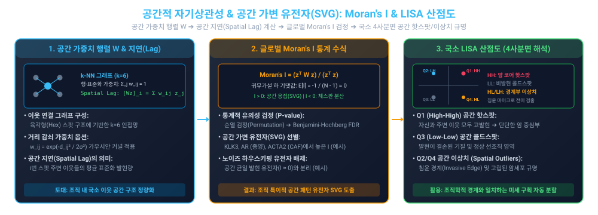

# Chapter 06. 공간 가변 유전자 규명과 통계적 검정 (Spatially Variable Genes, SVGs)

> **Cognitive Goal**: 군집 기반의 전통적 차등 발현 분석(Differential Expression, DE)이 가진 공간적 한계를 극복하고, 조직의 형태학적 연속체 상에서 유의미한 패턴을 형성하는 공간 가변 유전자(Spatially Variable Genes, SVGs)의 통계학적 검정 프레임워크를 정립한다. 공간 가중치 행렬 $W$의 기하학적 정의를 도출하고, 공간 자기상관 지표인 Moran's I와 Geary's C의 수학적 유도 및 가설 검정을 완벽히 이해한다. 나아가 $O(N^3)$ 가우시안 프로세스 회귀(`SpatialDE`)와 $O(N)$ 비모수 커널 프로젝션(`SPARK-X`)의 알고리즘 복잡도를 비교하고, 전립선암 미세환경의 산소 결핍 구배 및 침습 전선 마커 발굴에 적용한다.

---

## 1. 차등 발현(DE)을 넘어 공간 가변 유전자(SVG)로

기존 단일 세포 전사체(scRNA-seq) 분석의 핵심 패러다임은 비지도 군집화(Unsupervised Clustering)를 통해 세포를 이산적인 클러스터($C_1, C_2, \dots, C_K$)로 분할한 뒤, 윌콕슨 순위합 검정(Wilcoxon Rank-Sum Test)이나 MAST 등을 사용하여 군집 간 차등 발현 유전자(Differentially Expressed Genes, DEG)를 발굴하는 것이었습니다.

```
[전통적 DEG 패러다임: 이산적 군집 기반]
  세포군 A (클러스터 1)  vs  세포군 B (클러스터 2)  ──► t-검정 / Wilcoxon ──► DEG 도출
  (조직 내 물리적 위치 좌표 x, y는 완전히 소실됨!)

[공간 가변 유전자 (SVG) 패러다임: 물리적 연속체 기반]
  공간 좌표 (s_x, s_y) 상의 2차원 발현 함수: Y = f(s_x, s_y) + ε
  임의의 군집 레이블 없이, "발현량이 물리적 공간에 걸쳐 무작위가 아닌 자기상관 패턴을 가지는가?"를 직접 검정!
```

### 1.1 왜 공간전사체에서 단순 DEG 분석은 불충분한가?
1. **형태학적 구배(Continuous Gradients)의 누락**:
   - 종양 조직의 저산소증(Hypoxia), 젖산 축적, 성장 인자(TGF-$\beta$) 농도, 약물 침투 깊이 등은 계단식 이산 클러스터가 아니라 연속적인 물리적 농도 경사(Morphological Gradient)를 형성합니다. 이산 클러스터링을 강제하면 경계부의 유기적 전이 상태가 왜곡됩니다.
2. **세포 유형 내부의 공간적 가소성(Spatial Plasticity)**:
   - 동일한 'AR+ Luminal 암세포' 클러스터에 속할지라도, 종양 중심부(Core)에 위치한 세포와 기질 경계부 침습 전선(Invasive Front)에 위치한 세포는 완전히 다른 기질 분해 효소(*MMP2*, *MMP9*) 및 혈관신생 인자(*VEGFA*)를 발현합니다. 클러스터 평균은 이러한 세포 내 공간 반응을 완전히 희석시킵니다.
3. **클러스터링 바이어스로부터의 독립성**:
   - SVG 검정은 사전에 클러스터의 개수($k$)나 해상도(Resolution)를 지정할 필요가 없으므로, 연구자의 주관적 군집 분할에 의한 편향 없이 조직 전체의 분자 아키텍처를 지배하는 유전자를 편향 없이 선별할 수 있습니다.

---

## 2. 공간 가중치 행렬 $W$ (Spatial Weights Matrix)의 기하학

공간 통계학에서 임의의 두 관측점(스팟 또는 세포) $i$와 $j$ 사이의 공간적 인접성(Spatial Proximity)은 **공간 가중치 행렬(Spatial Weight Matrix) $W \in \mathbb{R}^{N \times N}$**로 정량화됩니다. 자기 자신과의 상호작용은 고려하지 않으므로 대각 원소는 항상 0입니다 ($w_{ii} = 0$).



### 2.1 주요 공간 가중치 함수 모델

1. **이진 인접 행렬 (Binary Contiguity / Grid Adjacency)**:
   - 격자 구조(Visium 육각 격자)에서 직접 맞닿아 있는 6개의 1차 인접 이웃에 대해 1, 그 외에는 0을 부여:
   $$w_{ij} = \begin{cases} 1 & \text{if } j \in \mathcal{N}(i) \\ 0 & \text{otherwise} \end{cases}$$
2. **거리 역수 가중치 (Inverse Distance Weighting, IDW)**:
   - 유클리드 거리 $d_{ij} = \| s_i - s_j \|_2$가 증가함에 따라 상호작용 강도가 반비례하여 감소:
   $$w_{ij} = \frac{1}{d_{ij}^\alpha} \quad (\text{단, } d_{ij} \le d_{\max}, \text{ 통상 } \alpha=1 \text{ 또는 } 2)$$
3. **가우시안 / 방사 기저 함수 커널 (Gaussian / Radial Basis Function Kernel)**:
   - 물리적 확산(Diffusion) 현상에 가장 부합하는 연속형 커널로, 특성 길이 스케일(Characteristic Length-scale) $\sigma$를 매개변수로 가짐:
   $$w_{ij} = \exp\left( - \frac{d_{ij}^2}{2\sigma^2} \right)$$
   - 여기서 $\sigma$는 탐색하고자 하는 공간 패턴의 물리적 반경(예: 미세혈관 니치는 $\sigma = 50\ \mu\text{m}$, 광범위한 저산소 영역은 $\sigma = 300\ \mu\text{m}$)에 맞춰 설정됩니다.

### 2.2 행 표준화 (Row-Standardization)
스팟의 물리적 위치(조직의 가장자리 vs 내부 중심)에 따라 이웃의 수가 달라지는 기하학적 가장자리 효과(Edge Effect)를 보정하기 위해, 각 행의 합이 1이 되도록 행 표준화를 적용합니다:

$$\tilde{w}_{ij} = \frac{w_{ij}}{\sum_{k=1}^N w_{ik}} \quad \implies \quad \sum_{j=1}^N \tilde{w}_{ij} = 1$$

---

## 3. Moran's I: 공간 자기상관 지표의 수학적 유도

**Moran's I**는 1차원 피어슨 상관계수(Pearson Correlation Coefficient)를 2차원 공간 격자로 확장한 전역적 공간 자기상관(Global Spatial Autocorrelation) 지표입니다.

### 3.1 수학적 정의
총 $N$개의 스팟에서 특정 유전자 $x$의 발현량을 $x = [x_1, x_2, \dots, x_N]^T$라 하고, 전체 스팟의 표본 평균을 $\bar{x} = \frac{1}{N} \sum_{i=1}^N x_i$라 할 때, Moran's I는 다음과 같이 정의됩니다:

$$I = \frac{N}{S_0} \cdot \frac{\sum_{i=1}^N \sum_{j=1}^N w_{ij} (x_i - \bar{x})(x_j - \bar{x})}{\sum_{i=1}^N (x_i - \bar{x})^2}$$

여기서 $S_0$는 전체 공간 가중치의 총합입니다:

$$S_0 = \sum_{i=1}^N \sum_{j=1}^N w_{ij}$$

만약 가중치 행렬 $W$가 행 표준화되어 있다면 $\sum_j \tilde{w}_{ij} = 1$이므로 $S_0 = N$이 되어 수식이 다음과 같이 간결화됩니다:

$$I = \frac{\sum_{i=1}^N \sum_{j=1}^N \tilde{w}_{ij} (x_i - \bar{x})(x_j - \bar{x})}{\sum_{i=1}^N (x_i - \bar{x})^2} = \frac{z^T \tilde{W} z}{z^T z}$$

- 여기서 $z = x - \bar{x} \mathbf{1}$은 평균 중심화(Mean-centered)된 발현 벡터입니다. 즉, Moran's I는 수학적으로 **중심화 벡터 $z$의 레일리 몫(Rayleigh Quotient)** 형태를 가집니다.

### 3.2 수치의 해석 및 귀무가설 하의 기댓값

- **$I > E[I]$ (양의 공간 자기상관)**:
  - 유사한 발현 값을 가진 스팟들이 공간적으로 서로 밀집하여 클러스터를 형성함 (High-High 군집 또는 Low-Low 결손 구역).
  - $I \to +1$: 완벽한 공간적 분리 및 군집화.
- **$I \approx E[I]$ (공간적 무작위성)**:
  - 발현 패턴이 공간 좌표와 완전히 독립적인 백색 잡음(Poisson / Gaussian Random Noise).
- **$I < E[I]$ (음의 공간 자기상관)**:
  - 높은 발현 스팟 주변에 반드시 낮은 발현 스팟이 인접하는 체스판(Checkerboard) 형태의 분산 패턴.

#### [수학적 정리] 귀무가설(Null Hypothesis) 하의 기댓값
공간적 패턴이 전혀 존재하지 않는다는 무작위 순열 귀무가설 하에서 Moran's I의 기댓값은 0이 아니라 미세한 음수 값을 가집니다:

$$\mathbb{E}[I] = -\frac{1}{N - 1}$$

- 표본 크기 $N$이 매우 크면 ($N > 1000$) $\mathbb{E}[I] \approx 0$으로 수렴합니다.
- 귀무가설 하의 분산 $\operatorname{Var}(I) = \mathbb{E}[I^2] - (\mathbb{E}[I])^2$은 가중치 행렬의 고유 대칭성과 첨도(Kurtosis)로부터 유도되며, 이를 통해 통계적 유의성을 검정하는 표준 정규분포 통계량(Z-score)을 계산합니다:
  $$Z_I = \frac{I - \mathbb{E}[I]}{\sqrt{\operatorname{Var}(I)}} \sim \mathcal{N}(0, 1)$$

---

## 4. Moran's 산점도(Scatterplot)와 전역 보완 지표(Geary's C)

### 4.1 Moran's 산점도와 공간 연관 사분면
스팟 $i$의 표준화된 발현량 $z_i = (x_i - \bar{x}) / s_x$를 가로축, 이웃 스팟들의 가중 평균 발현량인 공간 시차 변수(Spatial Lag) $\tilde{z}_i = \sum_j \tilde{w}_{ij} z_j$를 세로축에 매핑하면 4개의 사분면이 형성됩니다:

```
                    공간 시차 (Spatial Lag: W · z)
                                  ▲
                Low-High (LH)     │     High-High (HH)
             공간적 이상치 (Outlier)│     핫스팟 (Hot-Spot)
             [종양에 둘러싸인 기질 결절] │     [종양 코어 고발현 군집]
                                  │
          ────────────────────────┼────────────────────────► 국소 발현 (z)
                                  │
                Low-Low (LL)      │     High-Low (HL)
             콜드스팟 (Cold-Spot)   │     공간적 이상치 (Outlier)
             [기질/괴사 저발현 결손] │     [낮은 발현 둘러싼 고발현]
                                  │
```

- **Q1 (High-High)**: 해당 스팟도 높고 이웃도 높은 전형적인 **공간적 핫스팟(Spatial Hotspot)** (예: 종양 코어의 *KLK3* 발현).
- **Q3 (Low-Low)**: 해당 스팟도 낮고 이웃도 낮은 **콜드스팟(Coldspot)**.
- **Q2 (Low-High) & Q4 (High-Low)**: 주변과 동떨어진 발현을 보이는 **공간적 특이치(Spatial Anomaly/Outlier)** (예: 종양 한가운데 단독 침윤한 단일 T 세포).

### 4.2 Geary's C (기어리 지수)
Moran's I가 전체 평균과의 편차 곱($z_i z_j$)을 기반으로 전역적 공분산을 측정하는 반면, **Geary's C**는 (Moran's I와 마찬가지로 전체를 하나의 값으로 요약하는 **전역** 통계이며, 국소 지표는 Local Moran/LISA·Local Geary임) 인접 스팟 간의 발현 차이의 제곱($(x_i - x_j)^2$)을 기반으로 이웃 간 차이(Local Differences)에 더 민감하게 반응합니다:

$$C = \frac{N - 1}{2 S_0} \cdot \frac{\sum_{i=1}^N \sum_{j=1}^N w_{ij} (x_i - x_j)^2}{\sum_{i=1}^N (x_i - \bar{x})^2}$$

- **$0 \le C < 1$**: 강한 양의 공간 자기상관 (인접 스팟 간 차이가 적음).
- **$C \approx 1$**: 공간적 무작위성.
- **$C > 1$**: 음의 공간 자기상관 (인접 스팟 간 발현 차이가 극대화됨).

---

## 5. 알고리즘 벤치마킹: SpatialDE vs SPARK-X

공간 가변 유전자를 선별하는 현대적 계산 생물학 알고리즘은 모델의 표현력과 계산 복잡도 사이에서 중대한 트레이드오프를 가집니다.

```
┌──────────────────────────────────────────────────────────────────────────────────┐
│              공간전사체 SVG 알고리즘의 계산 복잡도 및 아키텍처 비교              │
│                                                                                  │
│   [SpatialDE] (Svensson et al., Nat Methods 2018)                                │
│   - 가우시안 프로세스 회귀 (GPR) 기반 모수적 모델                                │
│   - 공분산 행렬 K = σ_s^2 · K_SE(X, Y) + σ_e^2 · I                              │
│   - 길이 척도별 N × N 커널 고유분해 1회(FaST-LMM식) ──► O(N³) 시간, O(N²) 메모리 │
│   - 이후 유전자별 우도 최적화는 O(N) (5,000 스팟 고유분해 1회 ≈ 수십 초 수준)  │
│                                                                                  │
│   [SPARK-X] (Zhu et al., Genome Biology 2021)                                    │
│   - 비모수적(Non-parametric) 공분산 투영 및 스코어 검정                          │
│   - 공간 좌표의 투영 공분산(가우시안·코사인 변환)과 유전자 공분산 사용              │
│   - 역행렬 연산 완전 배제 ──► 계산 복잡도: O(N) 선형 스케일!                    │
│   - 50,000 스팟(Xenium / Visium HD) 분석 시: 수 분 이내 완료                     │
└──────────────────────────────────────────────────────────────────────────────────┘
```

### 5.1 SpatialDE의 수학적 정식화
SpatialDE는 유전자 발현 벡터 $y$를 공간적 공분산 성분과 무작위 노이즈 성분의 가우시안 프로세스(Gaussian Process, GP) 합으로 분해합니다:

$$y \sim \mathcal{N}\left(\mu \mathbf{1}, \; \sigma_s^2 K_{\text{SE}} + \sigma_e^2 I\right)$$

- $K_{\text{SE}}(i, j) = \exp\left( -\frac{\|s_i - s_j\|^2}{2 l^2} \right)$: 제곱 지수 커널(Squared Exponential Kernel), $l$은 공간 길이 스케일.
- $\sigma_s^2$: 공간 구조에 의해 설명되는 분산.
- $\sigma_e^2$: 독립적 기술 노이즈 분산.
- 귀무가설 $H_0: \sigma_s^2 = 0$ (공간 패턴 없음) vs 대립가설 $H_1: \sigma_s^2 > 0$에 대해 로그 우도비 검정(Log-Likelihood Ratio Test, LRT)을 수행합니다. SpatialDE는 FaST-LMM식 효율 추론을 사용해 길이 척도마다 커널 $K$의 고유분해를 **한 번** 수행하고(로그 간격 10개 길이 척도) 모든 유전자를 $U^T Y$로 투영한 뒤 유전자별로 $O(N)$ 가능도 최적화를 수행합니다(Svensson 2018). 따라서 유전자·반복마다 역행렬을 구하는 것은 아니지만, 고유분해 자체는 $O(N^3)$ 시간과 $O(N^2)$ 메모리를 요구해 $N$이 매우 큰 데이터에서 병목이 됩니다.

### 5.2 SPARK-X의 비모수적 스코어 검정
SPARK-X(Zhu et al., Genome Biology 2021)는 정규화·중심화된 발현 벡터와, 공간 좌표를 직접 가우시안·코사인 변환하여 만든 **투영(projection) 공분산** 행렬 사이의 스코어 통계량을 계산합니다. 대규모 커널 행렬의 분해나 역행렬 없이 통계량

$$T = \frac{1}{n}\operatorname{tr}\left( E_C \, \Sigma_C \right)$$

($E_C$: 좌표 변환으로 만든 투영 공분산, $\Sigma_C$: 유전자 발현 공분산)을 $O(N)$ 선형 시간(cubic→linear)에 계산하고, 혼합 카이제곱 분포(Mixture of Chi-squares)를 통해 정확한 분석적 $p$-값을 도출합니다.

---

## 6. 전립선암 미세환경에서의 핵심 SVG 생물학적 패턴

mCRPC 임상 검체에서 SVG 분석을 수행하면 단순 클러스터링으로는 포착할 수 없는 4대 핵심 공간 발현 구배가 드러납니다:

1. **안드로겐 수용체(AR) 시그널링 중심 구배**:
   - *KLK3, KLK2, NKX3-1, TMPRSS2*는 선암종의 분화된 선강(Lumen) 중심부에서 극단적인 High-High 공간 핫스팟을 형성합니다 (높은 양의 Moran's $I$; 값은 가중치 정의와 데이터에 의존하며 이 트랙의 합성 파이프라인 결과는 KLK3 $I = 0.565$).
2. **저산소 및 대사 스트레스 구배 (Hypoxic Gradient)**:
   - 혈관으로부터 $150\ \mu\text{m}$ 이상 떨어진 종양 코어 중심부에서 저산소 반응 유전자(HIF 표적인 *VEGFA, LDHA, CA9* 등; *HIF1A* mRNA는 단백질 안정화로 조절되므로 저산소 지표로 부적합)가 중심-외곽 동심원 구배를 형성한다는 가설적 사례입니다(Visium 100 µm 피치 해상도에서 확인 가능한 규모에 한정).
3. **침습 전선(Invasive Front) 기질 분해 프로그램**:
   - 종양 세포와 근섬유아세포(myCAF)가 물리적으로 접촉하는 외곽 경계선에서 *MMP2, MMP9, MMP11, POSTN, COL1A1*이 날카로운 띠(Stripe) 형태의 공간 가변 패턴을 보입니다.
4. **치료 유도 신경내분비암(t-NEPC) 국소 저항 클론**:
   - 광범위한 AR+ 선암 시트 내부에서 국소 군집화된 *CHGA, SYP, ASCL1* 발현 클러스터(Islands)가 포착될 수 있습니다. 수십 µm 규모의 섬은 Visium(55 µm 스팟, 100 µm 피치)으로는 해상할 수 없으므로 Xenium/Visium HD 같은 세포 해상도 플랫폼 사례로 한정합니다.

---

## 7. 실전 파이썬 워크플로우: Squidpy 공간 자기상관 파이프라인

다음은 `squidpy`와 `scanpy`를 활용하여 전립선암 공간전사체 데이터에서 Moran's I를 고속 계산하고 핵심 SVG를 도출하는 실전 코드입니다:

```python
import scanpy as sc
import squidpy as sq
import numpy as np
import pandas as pd
import matplotlib.pyplot as plt

# ---------------------------------------------------------
# Step 1: 공간전사체 AnnData 로드 및 전처리
# ---------------------------------------------------------
adata = sc.read_h5ad("data/visium_prostate_cancer_preprocessed.h5ad")

# 대수 정규화 및 고변동 유전자(HVG) 선별
sc.pp.normalize_total(adata, target_sum=1e4)
sc.pp.log1p(adata)
sc.pp.highly_variable_genes(adata, n_top_genes=3000, flavor="seurat")
# 주의: HVG(분산 기반)로 먼저 제한하면 분산은 작아도 공간 구조가 강한 유전자를 놓칠 수 있다.
# 전체 유전자(또는 발현 비율 기반 필터 통과 유전자)에 Moran's I를 계산하는 것이 안전하다.

# ---------------------------------------------------------
# Step 2: 공간 이웃 그래프 및 공간 가중치 행렬 W 구축
# ---------------------------------------------------------
# Visium 육각 격자 구조에는 coord_type="grid"(n_neighs=6)를 사용 ("generic"은 불규칙 좌표용 kNN)
sq.gr.spatial_neighbors(
    adata,
    coord_type="grid",            # Visium 육각 격자 (squidpy 권장 설정)
    n_neighs=6,                   # 인접 6개 스팟 정의
    spatial_key="spatial"
)

# ---------------------------------------------------------
# Step 3: Moran's I 전역 공간 자기상관 지표 계산
# ---------------------------------------------------------
# 고변동 유전자 3,000개에 대해 병렬 연산으로 Moran's I 산출 (전체 유전자 사용을 권장)
sq.gr.spatial_autocorr(
    adata,
    mode="moran",
    genes=adata.var_names[adata.var["highly_variable"]],
    n_perms=1000,                 # 순열 검정 횟수 (p-값 계산)
    n_jobs=8                      # 멀티프로세싱 CPU 코어 수
)

# 결과 데이터프레임 확인
moran_results = adata.uns["moranI"].sort_values(by="I", ascending=False)
print("Top 10 Spatially Variable Genes (Moran's I):")
# n_perms를 지정했으므로 순열 p-값 열(pval_sim, pval_sim_fdr_bh)을 확인한다 (pval_norm은 해석적 정규 근사)
print(moran_results[["I", "pval_sim", "pval_sim_fdr_bh"]].head(10))

# ---------------------------------------------------------
# Step 4: Geary's C 계산 및 국소 이질성 비교
# ---------------------------------------------------------
sq.gr.spatial_autocorr(
    adata,
    mode="geary",
    genes=moran_results.index[:500], # 상위 Moran 유전자 대상 (Geary's C도 전역 통계)
    n_perms=1000,
    n_jobs=8
)
geary_results = adata.uns["gearyC"].sort_values(by="C", ascending=True)

# ---------------------------------------------------------
# Step 5: 핵심 SVG 발현 및 공간 구배 시각화
# ---------------------------------------------------------
top_svgs = [
    "KLK3",    # AR-pathway 중심 코어 핫스팟
    "VEGFA",   # 저산소 구배 마커
    "MMP9",    # 침습 전선 기질 분해 마커
    "CHGA"     # 국소 t-NEPC 저항성 클론 마커
]

with plt.rc_context({"figure.figsize": (8, 8)}):
    sc.pl.spatial(
        adata,
        color=top_svgs,
        cmap="viridis",
        ncols=2,
        size=1.3,
        img_key="hires"
    )
```

---

## 단원 핵심 점검 (Cognitive Checkpoint & Case Study)

### Q1. [능동 회상 (Active Recall)]
공간 자기상관 분석에서 Moran's I의 귀무가설 하 기댓값이 왜 0이 아니라 $\mathbb{E}[I] = -\frac{1}{N-1}$인지 평균 중심화 제약($\sum_i (x_i - \bar{x}) = 0$)의 관점에서 수학적으로 설명하시오.

<details>
<summary>💡 모범 답안 및 해설 확인</summary>

- **평균 중심화에 따른 선형 종속성**:
  - 중심화된 발현 변수 $z_i = x_i - \bar{x}$는 정의상 $\sum_{i=1}^N z_i = 0$이라는 항등식을 만족합니다.
  - 이 식의 양변을 제곱하면:
    $$\left( \sum_{i=1}^N z_i \right)^2 = \sum_{i=1}^N z_i^2 + \sum_{i=1}^N \sum_{j \ne i} z_i z_j = 0$$
    따라서 서로 다른 스팟 쌍의 교차곱 합은 다음과 같이 음의 자기제곱합으로 귀결됩니다:
    $$\sum_{i=1}^N \sum_{j \ne i} z_i z_j = - \sum_{i=1}^N z_i^2$$
- **무작위 순열 하에서의 기댓값 유도**:
  - 임의의 공간 패턴이 없는 무작위 분포 하에서, 모든 서로 다른 쌍 $(i, j)$ ($i \ne j$)의 결합 확률은 대칭적이므로 교차곱의 평균 기댓값은 균등합니다:
    $$\mathbb{E}[z_i z_j] = \frac{1}{N(N-1)} \sum_{k=1}^N \sum_{l \ne k} z_k z_l = - \frac{1}{N(N-1)} \sum_{k=1}^N z_k^2$$
  - Moran's I 수식의 분자에 대각 원소가 0인 가중치 행렬($w_{ii}=0$)을 적용하여 기대치를 취하면:
    $$\mathbb{E}\left[ \sum_{i \ne j} w_{ij} z_i z_j \right] = S_0 \cdot \mathbb{E}[z_i z_j] = - \frac{S_0}{N(N-1)} \sum_{k=1}^N z_k^2$$
  - 분모의 $\sum_k z_k^2$과 약분되고 $\frac{N}{S_0}$ 스케일 팩터와 곱해지면 최종적으로:
    $$\mathbb{E}[I] = \frac{N}{S_0} \left( - \frac{S_0}{N(N-1)} \right) = - \frac{1}{N - 1}$$
    이 유도됩니다. 즉, $N$개의 관측치 중 하나가 정해지면 마지막 관측치는 자유도를 상실하므로 유한 표본에서 미세한 음의 바이어스가 발생합니다.

</details>

---

### Q2. [알고리즘 비교 분석 (Algorithmic Rigor)]
100만 개 이상의 스팟을 생성하는 최신 고해상도 공간전사체(예: 10x Visium HD의 $2\ \mu\text{m}$ 빈 또는 Stereo-seq) 분석 시, `SpatialDE`와 같은 가우시안 프로세스 회귀 기반 알고리즘이 적용 불가능한 계산 복잡도 상의 근본적 병목을 규명하고, `SPARK-X`가 이를 어떻게 $O(N)$으로 혁신했는지 논하시오.

<details>
<summary>💡 모범 답안 및 해설 확인</summary>

- **SpatialDE의 $O(N^3)$ 역행렬 병목**:
  - SpatialDE는 공분산 행렬 $K = \sigma_s^2 K_{\text{SE}} + \sigma_e^2 I$에 대해(길이 척도별 고유분해로 $K^{-1}$·$\log|K|$를 고유값에서 얻음) 로그 우도 $\log p(y) \propto -\frac{1}{2} y^T K^{-1} y - \frac{1}{2} \log |K|$를 최적화합니다.
  - $N \times N$ 밀집 공분산 행렬의 고유분해(또는 숄레스키 분해)는 $\mathcal{O}(N^3)$의 연산량과 $\mathcal{O}(N^2)$의 메모리를 요구합니다. $N = 10^6$일 경우 $N^3 = 10^{18}$ 플롭스에 달하고 행렬 원소 $10^{12}$개(float64 약 $8\text{ TB}$)를 저장해야 하므로 사실상 불가능합니다. (참고: $N=5{,}000$의 고유분해 1회는 단일 머신에서 수십 초 수준으로 측정되어 '수 시간~수일'은 과장입니다.)
- **SPARK-X의 $O(N)$ 선형 연산 혁신**:
  - SPARK-X는 모수적 최대우도추정(MLE) 대신 비모수적 스코어 통계량 기반의 가설 검정을 수행합니다. 논문(Zhu et al. 2021)의 통계량은 $T = \operatorname{tr}(E_C \Sigma_C)/n$ 형태로, 좌표에서 직접 만든 **투영(projection) 공분산** $E_C$(가우시안·코사인 변환 좌표)와 유전자 공분산 $\Sigma_C$의 곱의 트레이스이며, 큰 커널 행렬의 분해(SVD)나 역행렬이 필요 없습니다.
  - 이에 따라 계산이 $O(N)$ 선형 규모로 줄어들고(cubic→linear), 혼합 카이제곱 분포(mixture of chi-squares)로 정확한 분석적 $p$-값을 구합니다.
    로 변환함으로써 거대한 $N \times N$ 행렬을 메모리에 생성조차 하지 않고, $N \times r$ 기저 벡터와의 단순 내적만으로 연산을 완료합니다. 따라서 계산 복잡도가 스팟 수 $N$에 완전히 비례하는 $\mathcal{O}(N \cdot r \cdot G)$로 축소되어 100만 스팟 데이터도 수 분 이내에 완벽히 처리할 수 있습니다.

</details>

---

### Q3. [임상 케이스 분석 (Clinical Problem Solving)]
호르몬 요법(엔잘루타마이드)에 불응성을 보이는 mCRPC 환자의 원발 부위 공간전사체 조직 슬라이드에서 Moran's I 분석을 수행하였다. UMAP 상에서는 하나의 단일한 'AR+ 선암 상피 클러스터'로 분류된 영역 내에서 두 유전자 *KLK3*와 *MMP9*의 공간 자기상관 지표를 비교한 결과, *KLK3*는 $I = 0.72$ ($p < 10^{-15}$), *MMP9*는 $I = 0.58$ ($p < 10^{-10}$) (가상 환자 예시 값; 실제 Moran's I는 가중치 정의에 의존하며 이 트랙의 합성 파이프라인에서는 KLK3 0.565)로 둘 다 매우 높은 공간 가변성을 나타냈다. 
그러나 Moran's 산점도 사분면을 분석한 결과, *KLK3*의 High-High 스팟들은 종양 섬유소 내부 중심선강 구역에 집중된 반면, *MMP9*의 High-High 스팟들은 CAF 피막과 접촉하는 최외곽 기질 경계선에 띠(Band) 형태로 국소화되어 있었다(스팟 1줄 폭 띠는 Visium 해상도에서는 인접 스팟과 섞이므로 단일세포 해상도 데이터를 가정한 가상 사례). 
이 두 유전자의 공간적 분포 차이가 시사하는 병리학적/종양학적 기전을 설명하고, 차등 발현(DEG) 분석만으로는 왜 이 치명적인 임상 신호를 놓칠 수밖에 없는지 서술하시오.

<details>
<summary>💡 모범 답안 및 해설 확인</summary>

- **병리학적/종양학적 기전 해석**:
  - **KLK3 (PSA)**: 종양 결절 중심부에서 분화된 관강 세포(Luminal AR+ lineage)의 고유 안드로겐 수용체 전사 활성이 최고조로 유지되고 있음을 의미합니다 (안정된 선암 코어 니치).
  - **MMP9 (Matrix Metallopeptidase 9)**: 종양–기질 경계(침습 전선 후보)에서 ECM 리모델링 활성이 높음을 시사합니다. 다만 *MMP9*는 종양세포뿐 아니라 호중구·대식세포·기질 세포도 발현하므로, 이 신호가 종양 세포의 침습 프로그램인지는 디콘볼루션 또는 세포 해상도 데이터로 공급 세포 유형을 확인해야 하는 가설입니다.
- **단순 클러스터링 기반 DEG 분석의 실패 원인**:
  - 비지도 클러스터링 알고리즘(Leiden/Louvain)은 전사체 유사도가 높은 상피 세포들을 하나의 'AR+ 종양 클러스터'로 통합합니다.
  - 침습 전선에 위치한 *MMP9* 고발현 세포는 전체 종양 세포 수의 5% 미만에 불과하므로, 클러스터 전체 평균 발현량을 계산하면 중심부 95%의 비침습 종양 세포에 의해 *MMP9* 신호가 완전히 희석(Averaging Out)되어 통계적 유의성을 잃어 DEG 목록에서 탈락할 수 있습니다(클러스터 내부의 공간 하위집단 간 비교 DEG로는 검출 가능).
  - 오직 공간 좌표를 보존하는 SVG 분석과 Moran's 산점도 국소화 분석을 통해서만 기질 경계부 띠(Band) 형태의 국소 침습 활성을 포착할 수 있습니다.

</details>

---

<!-- REFERENCES:BEGIN (generated by scripts/apply_references.py; do not edit by hand) -->
## 참고문헌 (References)
### 본문 인용 문헌
1. Svensson V, Teichmann SA, Stegle O. SpatialDE: identification of spatially variable genes. *Nat Methods*. 2018;15(5):343-346. PMID: 29553579. doi: 10.1038/nmeth.4636
2. Zhu J, Sun S, Zhou X. SPARK-X: non-parametric modeling enables scalable and robust detection of spatial expression patterns for large spatial transcriptomic studies. *Genome Biol*. 2021;22(1):184. PMID: 34154649. doi: 10.1186/s13059-021-02404-0
### 검수 근거 문헌
1. Lippert C, Listgarten J, Liu Y, et al. FaST linear mixed models for genome-wide association studies. *Nat Methods*. 2011;8(10):833-5. PMID: 21892150. doi: 10.1038/nmeth.1681
### 소프트웨어 (표기 버전은 검수 시 API를 확인한 버전이며, 파이프라인 실행 환경은 requirements-pipelines.txt 참조)
- Matplotlib 3.11.2 (github.com/matplotlib/matplotlib). 원 논문: Hunter JD. Matplotlib: A 2D Graphics Environment. *Comput. Sci. Eng*. 2007;9(3):90-95. doi: 10.1109/mcse.2007.55
- NumPy 2.5.4 (numpy.org). 원 논문: Harris CR, Millman KJ, van der Walt SJ, et al. Array programming with NumPy. *Nature*. 2020;585(7825):357-362. PMID: 32939066. doi: 10.1038/s41586-020-2649-2
- pandas 2.3.3 (github.com/pandas-dev/pandas). 원 논문: McKinney W. Data Structures for Statistical Computing in Python. *Proceedings of the Python in Science Conference*. 2010:56-61. doi: 10.25080/majora-92bf1922-00a
- Scanpy 1.12.4 (github.com/scverse/scanpy). 원 논문: Wolf FA, Angerer P, Theis FJ. SCANPY: large-scale single-cell gene expression data analysis. *Genome Biol*. 2018;19(1):15. PMID: 29409532. doi: 10.1186/s13059-017-1382-0
- Squidpy 1.8.3 (github.com/scverse/squidpy). 원 논문: Palla G, Spitzer H, Klein M, et al. Squidpy: a scalable framework for spatial omics analysis. *Nat Methods*. 2022;19(2):171-178. PMID: 35102346. doi: 10.1038/s41592-021-01358-2
<!-- REFERENCES:END -->
