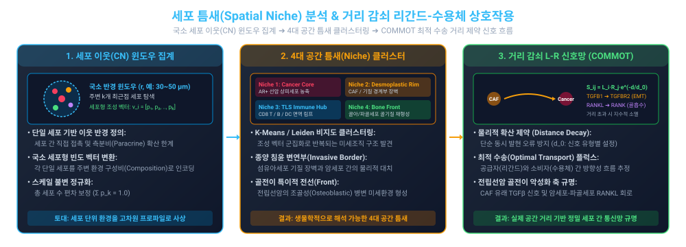

# Chapter 08. 공간 리간드-수용체 상호작용 및 신호 플럭스 모델링 (Spatial Ligand-Receptor Signaling & COMMOT)

> **Cognitive Goal**: 세포 현탁액(Suspension) 가정 하에서 무수한 물리적 허위 양성(False Positives)을 양산하는 기존 scRNA-seq 세포 간 통신(CCC) 분석의 치명적 결함을 파악하고, 유효 생물리학적 확산 한계를 반영하는 거리 감쇄 함수(Distance Decay Function)의 수학적 원리를 도출한다. 이어 질량 보존 및 공간 최적 수송(Optimal Transport) 이론에 기반하여 연속적인 방향성 신호 플럭스 벡터장(Signaling Flux Vector Field)을 복원하는 `COMMOT`의 엔트로피 정규화 칸토로비치(Kantorovich) 문제를 수리적으로 유도한다. 최종적으로 전립선암 골전이 미세환경의 3대 핵심 신호 축인 RANKL-RANK, WNT5A, TGF-β/CXCL12의 공간 상호작용을 정량화한다.

---

## 1. 전통적 scRNA-seq 세포 간 통신의 한계: '완전 혼합 수프' 가설의 파탄

단일 세포 전사체(scRNA-seq) 기반의 세포 간 통신 분석 도구(CellPhoneDB, SingleCellSignalR, CellChat v1 등; CellChat v2는 공간 정보를 반영함)는 종양 미세환경의 신호 전달 네트워크를 규명하는 데 기여해 왔습니다. 그러나 이들 방법론은 **"모든 세포가 단일 시험관 내에서 완벽하게 균일하게 혼합되어 서로 자유롭게 접촉할 수 있다(Well-mixed Soup Assumption)"**는 물리적으로 불가능한 가정에 의존합니다.

```
┌──────────────────────────────────────────────────────────────────────────────────┐
│                   세포 간 통신 분석의 패러다임 전환: 공간성의 중요성             │
│                                                                                  │
│   [전통적 scRNA-seq 분석: CellPhoneDB]                                           │
│   - 세포군 A (리간드 발현)  ───────?───────►  세포군 B (수용체 발현)              │
│   - 가정: 두 세포군이 유의하게 발현하면 무조건 통신이 일어남!                     │
│   - 물리적 실체: 세포군 A는 생검 조직의 좌측 끝, 세포군 B는 우측 5 mm 외곽에 존재  │
│     ==> 확산 불가능한 거대 거리! 실제로는 100% 거짓 양성(False Positive)!       │
│                                                                                  │
│   [공간전사체 기반 분석: 공간 순열 개념 & COMMOT]                                        │
│   - 물리적 거리 d_{ij} 및 확산 한계 d_0를 명시적 제약 조건으로 부여             │
│   - 인접 이웃(d < 15 µm: 접촉 신호) 및 국소 확산(d < 200 µm: 분비 신호)만 인정    │
│   - 신호의 이동 방향과 플럭스 세기(Flux Vectors: ──►)를 벡터장으로 복원         │
└──────────────────────────────────────────────────────────────────────────────────┘
```

### 1.1 공간성 부재로 인한 3대 병리학적 왜곡
1. **장거리 거짓 양성의 범람**:
   - 가용성 분비 단백질(사이토카인, 케모카인)조차 조직 내 세포외 기질(ECM)의 물리적 장애물과 효소 분해로 인해 수백 마이크로미터 이상 확산되기 어렵습니다. $1\ \text{mm}$ 이상 떨어진 세포 간의 통신 점수를 유의미하게 출력하는 것은 심각한 생물학적 왜곡입니다.
2. **세포 접촉형(Juxtacrine) 신호의 물리적 모순**:
   - 노치(Notch-Delta), 에프린(Ephrin-Eph), 인테그린-콜라겐 상호작용은 세포막 간의 직접 접촉(물리적 간극 $< 100\ \text{nm}$, 유효 세포 간 거리 $< 15\ \mu\text{m}$)이 필수적입니다. 공간 좌표 없이 두 세포 유형의 발현만으로 접촉 통신을 판정할 수 없습니다.
3. **신호 전달의 방향성(Directionality) 및 플럭스 소실**:
   - 기존 분석은 통신 점수를 단순 스칼라(Scalar) 값으로 출력하므로, 신호가 "어느 특정 종양 클론에서 어느 기질 세포 방향으로 흘러가는가"에 대한 물리적 벡터 정보(Vector Field)를 제공하지 못합니다.

---

## 2. 생물리학적 거리 감쇄 함수(Distance Decay Function)

가용성 분비 리간드의 조직 내 확산은 픽의 확산 제2법칙(Fick's Second Law of Diffusion)과 분해 반응 속도론(First-order Degradation Kinetics)의 결합으로 모델링됩니다:

$$\frac{\partial C}{\partial t} = D \nabla^2 C - k_{\text{deg}} C$$

- $D$: 세포외 기질 내 유효 확산 계수 (Effective Diffusion Coefficient).
- $k_{\text{deg}}$: 조직 프로테아제 등에 의한 리간드 자발 분해율.

정상 상태(Steady State, $\frac{\partial C}{\partial t} = 0$)의 해는 차원에 따라 다릅니다. 감쇄 길이는 $\lambda=\sqrt{D/k_{\text{deg}}}$이며, 1차원 평면 소스는 $\exp(-x/\lambda)$, 3차원 점원은 $\exp(-r/\lambda)/(4\pi D r)$(Yukawa형), 2차원은 $K_0(r/\lambda)$(Bessel 함수)입니다. 가우시안 $\exp(-d^2/2d_0^2)$는 정상 반응-확산 해가 아니라 시간 의존(과도, transient) 확산핵의 형태입니다. 따라서 아래 지수/가우시안 함수는 실무에서 쓰는 **경험적 거리 감쇄 커널**로 이해하며, $d_0$는 $\lambda$에 대응하는 매개변수입니다:

$$f(d_{ij}) = \exp\left( - \frac{d_{ij}}{d_0} \right) \quad \text{또는} \quad f(d_{ij}) = \exp\left( - \frac{d_{ij}^2}{2 d_0^2} \right)$$

- $d_{ij} = \| s_i - s_j \|_2$: 리간드 분비 세포 $i$와 수용체 세포 $j$ 사이의 유클리드 거리.
- $d_0$: **유효 신호 전달 특성 거리(Characteristic Signaling Range)**. (아래 $200\sim250\ \mu\text{m}$는 지수 감쇄 길이가 아니라 Francis & Palsson 1997이 제시한 단일 세포 효과 통신 영역(약 $250\ \mu\text{m}$ 규모)의 상한으로, 최대 도달 거리이지 $d_0$가 아닙니다.)

```
┌──────────────────────────────────────────────────────────────────────────────────┐
│              신호 전달 양식별 생물리학적 특성 거리 (d_0) 임계 기준               │
│                                                                                  │
│   1. 세포 접촉형 (Juxtacrine / Contact-dependent):                              │
│      - 작용 축: Notch-DLL, Claudin, Integrins                                    │
│      - 특성 거리: d_0 ≈ 10 ~ 15 µm (직접 인접 세포)                              │
│                                                                                  │
│   2. 국소 단거리 파라크라인 (Short-range Paracrine):                             │
│      - 작용 축: WNT, Hedgehog, 단거리 케모카인                                   │
│      - 특성 거리: d_0 ≈ 50 ~ 100 µm (세포 2~5개 직경 거리)                       │
│                                                                                  │
│   3. 원거리 파라크라인 (Long-range Paracrine / Cytokines):                       │
│      - 작용 축: TGF-β, VEGF, IL-6, RANKL                                         │
│      - 특성 거리: d_0 ≈ 200 ~ 250 µm (분비형 가정 최대 거리, 맥락 의존)         │
└──────────────────────────────────────────────────────────────────────────────────┘
```

> **참고**: 이 트랙의 합성 파이프라인(`pipelines/02_xenium_subcellular_niche_and_signaling_pipeline.py`)은 계산 편의상 $d_0 = 30\ \mu\text{m}$, 반경 $r = 30\ \mu\text{m}$를 사용합니다. 따라서 그 산출 수치는 위 $d_0 \approx 200 \sim 250\ \mu\text{m}$ 맥락과 직접 비교할 수 없는 예시입니다.

따라서 세포 $i$의 리간드 발현량 $L_i$와 세포 $j$의 수용체 발현량 $R_j$ 사이의 진정한 국소 상호작용 포텐셜 $S_{ij}$는 반드시 공간 감쇄 가중치를 곱하여 산출되어야 합니다:

$$S_{ij} = L_i \cdot R_j \cdot f(d_{ij})$$

---

## 3. 그래프 기반 공간 순열 검정 (개념 설명; Squidpy `gr.ligrec`와 구분)

> **도구 귀속 주의**: Squidpy의 리간드-수용체 검정 `squidpy.gr.ligrec`는 CellPhoneDB 방식의 **클러스터 레이블 순열 검정**이며 공간 이웃 그래프나 거리를 사용하지 않습니다. 아래 3.1–3.2는 공간 그래프 간선에 제한한 점수와 순열이라는 *일반적 공간 순열 아이디어*를 설명하는 것이며 Squidpy에 구현된 방법이 아닙니다. 공간 정보를 반영하는 실제 도구는 stLearn, CellChat v2, COMMOT 등입니다.

기하학적 공간 이웃 그래프 $G = (V, E)$의 간선(Edges) 구조를 활용하는 공간 순열 검정은 다음과 같이 정식화할 수 있습니다.

### 3.1 간선 가중 상호작용 점수 (Edge-Weighted Interaction Score)
세포 유형 $A$에 속하는 세포 $i$와 세포 유형 $B$에 속하는 세포 $j$가 공간 그래프 상에서 간선으로 직접 연결되어 있는($e_{ij} \in E$) 쌍들에 대해서만 점수를 합산합니다:

$$I_{A \to B}(L, R) = \frac{1}{|E_{A, B}|} \sum_{(i, j) \in E_{A, B}} L_i \cdot R_j$$

- $E_{A, B} = \{ (i, j) \in E \mid v_i \in V_A, v_j \in V_B \}$: 세포 유형 $A$와 $B$를 잇는 물리적 공간 간선의 집합.
- 만약 두 세포 유형이 조직 내에서 서로 완전히 격리되어 물리적 간선이 존재하지 않는다면 ($|E_{A, B}| = 0$), 해당 리간드-수용체 쌍의 상호작용 점수는 계산조차 되지 않고 즉시 배제됩니다.

### 3.2 공간 레이블 셔플링 검정
- 공간 그래프의 간선 연결 $E$를 엄격히 보존한 상태에서, 세포 유형 레이블만을 $B = 1000$회 순열(Permutation)하여 무작위 귀무분포를 생성합니다.
- 관측된 평균 상호작용 점수가 귀무분포의 상위 95% 분위수 이상일 때에만 통계적으로 유의미한 국소 신호 상호작용($p < 0.05$)으로 판정합니다.

---

## 4. COMMOT: 집단 최적 수송(Collective Optimal Transport)을 통한 신호 플럭스 유도

Cang et al. (Nature Methods, 2023)에 의해 개발된 **COMMOT (Collective Optimal Transport)**은 공간 리간드-수용체 통신을 단순한 정적 점수가 아니라, 질량 보존 법칙을 만족하는 **공간적 최적 수송(Optimal Transport, OT) 문제**로 정식화함으로써 전 세계 공간생물학계에 큰 반향을 일으켰습니다.



### 4.1 수리적 정식화: 엔트로피 정규화 칸토로비치 최적 수송 문제 (단순화한 설명)
> **참고**: 아래는 단일 리간드–수용체 쌍을 가정해 단순화한 설명이다. 실제 COMMOT은 하드 부등식 제약 대신 **미수송 질량에 대한 KL 패널티**를 쓰는 비균형 OT(`cot_rho`)이며 엔트로피 강도는 `cot_eps_p/mu/nu`로 설정한다. "collective"는 여러 리간드–수용체 종이 경쟁·공유하는 설정(`cot_weights`의 4가지 가중치)을 뜻하고, 비용은 기본 `cost_type='euc'`(거리)이며 `'euc_square'`는 선택 사항이다. 또한 계산량은 `dis_thr` 이상의 거리 쌍을 제외해 희소화한다(COMMOT 소스 `spatial_communication` docstring 기준).
각 공간 위치 $i$에서 생산되는 리간드의 총량을 공급원(Source) 분포 $S \in \mathbb{R}_+^N$, 위치 $j$에서 수용 가능한 수용체의 총량을 수요원(Target) 분포 $T \in \mathbb{R}_+^N$이라 합니다:

$$S_i = L_i, \quad T_j = R_j$$

수송 계획 행렬(Transport Plan Matrix) $\pi \in \mathbb{R}_+^{N \times N}$의 각 원소 $\pi_{ij}$는 **"세포 $i$에서 생산되어 세포 $j$로 물리적으로 이동하여 소비되는 리간드의 분자 유량(Flux)"**을 의미합니다.

리간드를 위치 $i$에서 위치 $j$로 이동시키는 데 소요되는 물리적 비용(Cost) 행렬 $C \in \mathbb{R}_+^{N \times N}$을 유클리드 거리 또는 공간 감쇄의 역수로 정의합니다:

$$C_{ij} = \begin{cases} d_{ij}^2 & \text{if } d_{ij} \le d_{\max} \\ +\infty & \text{if } d_{ij} > d_{\max} \end{cases}$$

COMMOT은 다음과 같은 **엔트로피 정규화 불균형 칸토로비치 최적 수송(Entropy-Regularized Unbalanced Optimal Transport)** 문제를 해결합니다:

$$\min_{\pi \ge 0} \sum_{i=1}^N \sum_{j=1}^N \pi_{ij} C_{ij} - \epsilon H(\pi)$$

- 제약 조건 (단순화한 표기; 실제로는 위 참고처럼 비균형 OT의 소프트 패널티):
  $$\sum_{j=1}^N \pi_{ij} \le S_i \quad (\forall i: \text{공급량 한도 초과 불가})$$
  $$\sum_{i=1}^N \pi_{ij} \le T_j \quad (\forall j: \text{수용체 결합 한도 초과 불가})$$
- $H(\pi) = - \sum_{i, j} \pi_{ij} (\log \pi_{ij} - 1)$: 수송 계획의 무작위 확산을 제어하는 섀넌 엔트로피 정규화 항.
- $\epsilon > 0$: 엔트로피 강도 하이퍼파라미터. 이 항이 추가됨으로써 Sinkhorn형 알고리즘 적용이 가능해지며, 밀집 구현은 $O(N^2)$이지만 COMMOT은 거리 임계(`dis_thr`)로 희소화합니다.

### 4.2 방향성 신호 플럭스 벡터(Directional Signaling Vector)의 도출
최적 수송 계획 $\pi^*$가 수렴하면, 각 세포 $i$의 위치에서 출발하거나 통과하는 **순방향 신호 전달 벡터(Net Signaling Velocity Vector) $\vec{v}_i \in \mathbb{R}^2$**를 해석적으로 도출할 수 있습니다:

$$\vec{v}_i = \sum_{j=1}^N \pi_{ij}^* \cdot \frac{s_j - s_i}{\| s_j - s_i \|_2}$$

- $s_i, s_j$: 세포 $i$와 $j$의 2차원 물리적 공간 좌표 벡터.
- $\frac{s_j - s_i}{\| s_j - s_i \|_2}$: 세포 $i$에서 세포 $j$를 향하는 단위 방향 벡터.
- $\pi_{ij}^*$: 두 세포 간의 실제 리간드 수송 유량(가중치).

이 벡터들을 조직 전체 공간 격자에 보간(Interpolation)하면, 마치 유체역학(Fluid Dynamics)의 유선(Streamlines)이나 RNA Velocity 벡터장과 동일한 형태의 **"공간적 리간드 확산 및 신호 흐름 벡터장(Spatial Signaling Streamlines)"**이 완성됩니다.

---

## 5. 전립선암 골전이 미세환경의 3대 핵심 신호 축

mCRPC 환자의 80% 이상에서 발생하는 치명적인 골전이 병변에서 COMMOT 벡터장 분석을 적용했을 때 규명되는 핵심 축은 다음과 같습니다:

```
┌──────────────────────────────────────────────────────────────────────────────────┐
│             전립선암 골전이 니치를 지배하는 3대 공간 리간드-수용체 신호 축       │
│                                                                                  │
│   [1. RANKL - RANK 축 (골 흡수 요소: 파골세포 활성화 가설)]                      │
│   - 분비원 (Source) : t-NEPC / DNPC 암세포 (TNFSF11 고발현)                      │
│   - 수용체 (Target) : 골 흡수 전선의 다핵 파골세포 (TNFRSF11A 고발현)            │
│   - 플럭스 벡터장   : 종양 결절 외곽 ──► 골 기질 파골세포 접촉면으로 집중 수렴  │
│                                                                                  │
│   [2. WNT5A - FZD5 / ROR2 축 (골아세포 골형성 자극 가설)]                       │
│   - 분비원 (Source) : AR+ 관강 선암세포 (WNT5A 고발현)                           │
│   - 수용체 (Target) : 골 형성 골아세포 (Osteoblasts, FZD5 / RUNX2 고발현)        │
│   - 플럭스 벡터장   : 종양 선암 코어 ──► 인접 골소주(Trabecular Bone)로 방사 확산│
│                                                                                  │
│   [3. TGFB1 / CXCL12 - TGFBR2 / CXCR4 축 (CAF 매개 T세포 배제)]                 │
│   - 분비원 (Source) : myCAF 섬유성 피막 림 (TGFB1, CXCL12 고분비)                │
│   - 수용체 (Target) : 가설: 침투 시도 CD8+ T 세포 (종양·기질 세포도 TGFBR2/CXCR4 발현) │
│   - 플럭스 벡터장   : 신호의 송신→수신 방향 요약(T 세포 이동 경로가 아님)          │
└──────────────────────────────────────────────────────────────────────────────────┘
```

### 5.1 3대 신호 경로의 분자 상호작용 메커니즘
1. **RANKL-RANK (골 흡수 요소가 있는 병변 개시, 가설)**:
   - RANKL(주로 골아세포계 유래이며 종양 세포 발현은 맥락 의존적)은 파골세포 전구체의 증식과 다핵 융합을 유도합니다. COMMOT 분석을 통해 종양 세포와 파골세포가 물리적으로 $100\ \mu\text{m}$ 이내로 근접한 침습 전선에서만 신호 플럭스가 급격히 치솟는 것을 확인할 수 있습니다.
2. **WNT5A-FZD (골형성성 병변 유도 가설)**:
   - 전립선암 골전이는 주로 골형성성(Osteoblastic)·혼합형이며(Yin 2003), 종양 유래 Wnt 리간드(*WNT5A* 등)가 골아세포를 자극한다는 것은 하나의 *가설*입니다.
3. **TGFB1/CXCL12 (면역 배제 장벽)**:
   - myCAF 림에서 생성된 고농도 CXCL12 플럭스는 CXCR4를 발현하는 T 세포를 기질 내에 강력히 결속(Tethering)시켜 종양 코어로의 이동을 기계적으로 방해합니다.

---

## 6. 실전 파이썬 워크플로우: COMMOT 및 Squidpy 신호 플럭스 분석

다음은 공간전사체 AnnData 객체에서 `commot`를 활용하여 리간드-수용체 최적 수송을 계산하고 신호 벡터장을 시각화하는 파이프라인입니다:

```python
import scanpy as sc
import squidpy as sq
import commot as ct
import matplotlib.pyplot as plt

# ---------------------------------------------------------
# Step 1: 데이터 로드 및 리간드-수용체 데이터베이스 준비
# ---------------------------------------------------------
adata = sc.read_h5ad("data/visium_prostate_bone_metastasis.h5ad")

# CellChat LR 데이터베이스 로드 (호모사피엔스; 전립선암 특이 DB는 아님)
# signaling_type은 'Secreted Signaling' | 'Cell-Cell Contact' | 'ECM-Receptor' 중 하나
df_cellchat = ct.pp.ligand_receptor_database(
    species="human",
    signaling_type="Secreted Signaling",
    database="CellChat"
)

# 분석 대상 핵심 리간드-수용체 쌍 필터링
# (열 이름은 0=리간드, 1=수용체, 2=경로, 3=신호 유형이므로 위치로 접근;
#  TGFB1의 수용체는 'TGFBR1_TGFBR2' 같은 이종복합체로만 등록되어 있음)
target_pairs = df_cellchat[
    df_cellchat.iloc[:, 0].isin(["TNFSF11", "WNT5A", "TGFB1", "CXCL12"])
]

# ---------------------------------------------------------
# Step 2: 공간 거리 제약 및 필터링
# ---------------------------------------------------------
# 최적 수송 계산을 위한 공간 정보 사전 처리 (유효 확산 한계 d_0 = 200 µm)
ct.tl.spatial_communication(
    adata,
    database_name="custom_mcrpc",
    df_ligrec=target_pairs,
    dis_thr=200.0,                # 최대 물리적 확산 허용 거리 (µm)
    pathway_sum=True,             # 경로 단위 통합 플럭스 산출
    heteromeric=True,             # 이종 복합체 수용체 모델링
    cost_type="euc_square"        # C_ij = d_ij^2 비용 함수 (기본값 "euc"는 C_ij = d_ij)
)

# ---------------------------------------------------------
# Step 3: 최적 수송 계획(Transport Plan)으로부터 신호 플럭스 방향 벡터 계산
# ---------------------------------------------------------
# RANKL-RANK 신호 축의 방향성 벡터장 산출
ct.tl.communication_direction(
    adata,
    database_name="custom_mcrpc",
    lr_pair=("TNFSF11", "TNFRSF11A"),
    k=15                          # 방향 결정에 쓰는 상위 k개 송신/수신 스팟 수
)

# TGFB1-TGFBR2 신호 축의 방향성 벡터장 산출
ct.tl.communication_direction(
    adata,
    database_name="custom_mcrpc",
    lr_pair=("TGFB1", "TGFBR1_TGFBR2"),
    k=15
)

# ---------------------------------------------------------
# Step 4: 신호 플럭스 유선(Streamlines) 및 벡터장 시각화
# ---------------------------------------------------------
fig, axes = plt.subplots(1, 2, figsize=(14, 6))

# 4.1 RANKL-RANK 신호 흐름 벡터장
ct.pl.plot_cell_communication(
    adata,
    database_name="custom_mcrpc",
    lr_pair=("TNFSF11", "TNFRSF11A"),
    plot_method="stream",         # 유선(Streamline) 모드
    background="cluster",         # 'summary' | 'image' | 'cluster'
    clustering="cell_type",       # adata.obs['cell_type']을 배경 색으로 사용
    ax=axes[0]
)
axes[0].set_title("RANKL -> RANK Signaling Flux (Osteoclast Activation)")

# 4.2 TGFB1-TGFBR2 신호 흐름 벡터장
ct.pl.plot_cell_communication(
    adata,
    database_name="custom_mcrpc",
    lr_pair=("TGFB1", "TGFBR1_TGFBR2"),
    plot_method="stream",
    background="cluster",
    clustering="cell_type",
    ax=axes[1]
)
axes[1].set_title("TGFB1 -> TGFBR1_TGFBR2 Flux (CAF Immune Exclusion Rim)")

plt.tight_layout()
plt.show()
```

---

## 단원 핵심 점검 (Cognitive Checkpoint & Case Study)

### Q1. [능동 회상 (Active Recall)]
세포 간 통신(Cell-Cell Communication) 분석에서 물리적 공간 제약($d_{ij}$)을 배제한 단순 scRNA-seq 기반 분석(CellPhoneDB 등)이 고형암 조직 분석 시 대량의 '거짓 양성(False Positives)'을 양산하는 생물리학적 이유 2가지를 설명하시오.

<details>
<summary>💡 모범 답안 및 해설 확인</summary>

- **1. 세포외 기질(ECM) 내 분비 분자의 유효 확산 한계 초과**:
  - 생체 조직 내부에서 단백질 리간드(사이토카인, 케모카인)는 무한히 퍼져나갈 수 없습니다. 조밀한 콜라겐/프로테오글리칸 기질 그물망의 물리적 장애와 조직 내 단백질 분해 효소(Proteases)의 작용으로 인해 유효 확산 거리는 통상 $100 \sim 250\ \mu\text{m}$ 이내로 제한됩니다.
  - scRNA-seq은 수 밀리미터($\text{mm}$) 이상 물리적으로 격리되어 실제로는 리간드 농도가 0에 수렴하는 세포 쌍에 대해서도, 단순 발현량이 높다는 이유만으로 유의미한 상호작용으로 오판합니다.
- **2. 접촉 의존형(Juxtacrine) 신호의 물리적 접촉 조건 결손**:
  - Notch-Delta, Ephrin-Eph, Cadherin 등은 양 세포의 세포막이 직접 물리적으로 맞닿는 근접 간극($< 15\ \mu\text{m}$)에서만 수용체 구조 변화가 유발되어 하류 신호가 전달됩니다.
  - 세포 해리액 상태를 가정한 분석은 서로 완전히 다른 조직 구획에 격리된 상피 세포와 내피 세포 사이에서도 가상의 접촉 신호가 활발한 것처럼 판정하는 물리적 모순을 초래합니다.

</details>

---

### Q2. [수학적 원리 규명 (Mathematical Rigor)]
COMMOT 알고리즘이 리간드-수용체 상호작용을 모델링할 때 '엔트로피 정규화 최적 수송(Optimal Transport)'을 사용하는 수학적 이유와, 이로부터 유도되는 신호 플럭스 벡터 $\vec{v}_i = \sum_j \pi_{ij} \frac{s_j - s_i}{\|s_j - s_i\|}$가 기존의 정적(Scalar) 상호작용 점수와 차별화되는 결정적 분석적 이점을 서술하시오.

<details>
<summary>💡 모범 답안 및 해설 확인</summary>

- **최적 수송(OT) 및 질량 보존 모델링의 수학적 우위**:
  - 기존 방법은 리간드와 수용체 발현의 단순 곱($L_i \cdot R_j$)을 사용하므로, 단 하나의 리간드 분자가 무한히 많은 수용체와 동시에 결합할 수 있다는 비물리적 비보존 가정을 내포합니다.
  - 최적 수송(OT)은 한정된 분비 리간드 총량과 포화 가능한 수용체 총량을 고려하는 **'질량 보존(Mass Conservation)'** 관점의 정식화입니다(실제 COMMOT은 미수송 질량에 소프트 패널티를 두는 비균형 OT).
  - 거리 비용 $C_{ij} = d_{ij}^2$을 최소화하므로, 분자는 최소한의 이동 에너지를 소모하여 가장 인접한 유효 수용체로 확산되는 실제 물리 확산 경로를 정확히 모사합니다. 엔트로피 정규화($-\epsilon H(\pi)$)는 수송 계획을 평활화해 확산과 유사한 분산을 주지만, 실제 브라운 운동을 재현한다고 보장하지는 않습니다.
- **방향성 플럭스 벡터장($\vec{v}_i$)의 결정적 이점**:
  - 단순 스칼라 점수는 "통신 세기"만을 0~1 사이로 나타낼 뿐 신호가 어디서 시작되어 어디로 도달하는지 알 수 없습니다.
  - 반면 $\vec{v}_i$는 신호의 **'출발지(Source) $\to$ 이동 경로(Trajectory) $\to$ 종착지(Sink)'**를 나타내는 2차원 공간 벡터장(Vector Field)을 제공합니다. 이를 통해 종양 코어에서 방출된 신호가 기질 장벽에 가로막혀 우회하거나 특정 면역 세포로 집결하는 등의 거시적 동역학 흐름을 유체역학 유선(Streamlines) 형태로 추적할 수 있습니다.

</details>

---

### Q3. [임상 케이스 분석 (Clinical Problem Solving)]
면역관문억제제(Anti-PD-1) 단독 요법에 완전 불응성을 나타낸 전립선암 환자의 림프절 전이 공간전사체 데이터를 COMMOT으로 분석하였다. 분석 결과 종양 결절 외곽을 둘러싼 myCAF 피막 층에서 *CXCL12*와 *TGFB1*의 초고농도 리간드 발현이 관찰되었으며, 기질 외부에서 종양 코어 쪽으로 이동하려던 CD8+ T 세포의 수용체(*CXCR4*, *TGFBR2*)와의 통신 벡터장 $\vec{v}_i$가 종양 내부로 침투하지 못하고 CAF 피막 띠를 따라 평행하게 회전하는 '와류(Vortex / Tangential Trapping)' 패턴을 형성하고 있었다. 
이 신호 벡터장의 형상이 설명하는 면역학적 병태생리를 '기질 결속 및 면역 배제(Stromal Trapping & Immune Exclusion)' 관점에서 진단하고, 이를 타파하여 T 세포를 종양 코어로 유도하기 위한 구체적인 복합 약물 병용 치료법을 제시하시오.

<details>
<summary>💡 모범 답안 및 해설 확인</summary>

- **면역학적 병태생리 진단 (기질 결속 및 면역 배제 표현형, Immune-Excluded Phenotype)**:
  - (아래는 가설적 해석이다. COMMOT 벡터장은 분자 신호의 송신–수신 방향 요약이지 T 세포의 이동 궤적이 아니며, *CXCR4*·*TGFBR2*는 종양·기질·내피 세포에서도 발현되므로 L-R 발현만으로 수신 세포가 CD8+ T 세포임을 특정할 수 없다. 세포 유형 특이성은 디콘볼루션 또는 단일세포 해상도 데이터로 검증해야 한다. 이 트랙 파이프라인 02에서는 TGFB1 수신 상위가 Tumor/CAF이다.)
  - **CXCL12-CXCR4 기질 결속(Stromal Trapping)**:
    - myCAF가 분비하는 고농도 CXCL12 케모카인이 종양 피막 부위에 강력한 국소 농도 구배를 형성합니다. CXCR4를 발현하는 종양 침윤 T 세포는 종양 상피로 들어가지 못하고 CAF 피막의 고농도 CXCL12 영역에 화학주성적으로 포획(Tethering)되어 피막 주위를 헛돌며 갇히게 됩니다.
  - **TGF-β 매개 기능적 마비 및 진입 차단**:
    - 동일 부위에서 myCAF가 방출한 활성 TGF-$\beta$가 T 세포의 TGFBR2에 결합하여 T 세포의 운동성을 억제하고 세포독성 인자 분비를 마비시킵니다.
  - 그 결과 T 세포가 종양 상피 코어 내부의 신생항원(Neoantigen)에 물리적으로 접근할 수 없으므로 항-PD-1 단클론 항체를 투여해도 T 세포-종양세포 간의 시냅스가 형성되지 않아 치료에 완전 불응하게 됩니다.
- **복합 약물 병용 치료 전략**:
  - **1. CXCR4 저해제 (예: 플레릭사포르, Plerixafor / 모티틱사이드, Motixafortide) 병용**:
    - T 세포의 CXCR4 수용체를 차단하여 myCAF의 CXCL12 장벽에 붙잡혀 있던 T 세포의 결속을 해제(Release)시킴으로써 종양 코어로의 이동을 허용합니다.
  - **2. TGF-β 수용체 차단제 또는 이중 기능 면역항암제 (예: Bintrafusp alfa - TGF-β trap / Anti-PD-L1 fusion protein; 개발 상태는 확인이 필요하며 현재 표준 요법이 아님)**:
    - myCAF의 면역 억제 및 섬유화 신호를 중화하여 데스모플라시아 장벽을 연화시키고 침투한 T 세포의 항종양 세포독성 활성을 복원합니다.
  - 이를 면역관문억제제와 병용하면 면역 배제형 종양을 '면역 침윤성(Inflamed)' 종양으로 전환할 가능성을 탐색할 수 있습니다(가설).

</details>

---

<!-- REFERENCES:BEGIN (generated by scripts/apply_references.py; do not edit by hand) -->
## 참고문헌 (References)
### 본문 인용 문헌
1. Cang Z, Zhao Y, Almet AA, et al. Screening cell-cell communication in spatial transcriptomics via collective optimal transport. *Nat Methods*. 2023;20(2):218-228. PMID: 36690742. doi: 10.1038/s41592-022-01728-4
2. Francis K, Palsson BO. Effective intercellular communication distances are determined by the relative time constants for cyto/chemokine secretion and diffusion. *Proc Natl Acad Sci U S A*. 1997;94(23):12258-62. PMID: 9356436. doi: 10.1073/pnas.94.23.12258
3. Yin JJ, Mohammad KS, Käkönen SM, et al. A causal role for endothelin-1 in the pathogenesis of osteoblastic bone metastases. *Proc Natl Acad Sci U S A*. 2003;100(19):10954-9. PMID: 12941866. doi: 10.1073/pnas.1830978100
### 검수 근거 문헌
1. Palla G, Spitzer H, Klein M, et al. Squidpy: a scalable framework for spatial omics analysis. *Nat Methods*. 2022;19(2):171-178. PMID: 35102346. doi: 10.1038/s41592-021-01358-2
### 소프트웨어 (표기 버전은 검수 시 API를 확인한 버전이며, 파이프라인 실행 환경은 requirements-pipelines.txt 참조)
- COMMOT 0.0.3 (github.com/zcang/COMMOT). 원 논문: Cang Z, Zhao Y, Almet AA, et al. Screening cell-cell communication in spatial transcriptomics via collective optimal transport. *Nat Methods*. 2023;20(2):218-228. PMID: 36690742. doi: 10.1038/s41592-022-01728-4
- Matplotlib 3.11.2 (github.com/matplotlib/matplotlib). 원 논문: Hunter JD. Matplotlib: A 2D Graphics Environment. *Comput. Sci. Eng*. 2007;9(3):90-95. doi: 10.1109/mcse.2007.55
- Scanpy 1.12.4 (github.com/scverse/scanpy). 원 논문: Wolf FA, Angerer P, Theis FJ. SCANPY: large-scale single-cell gene expression data analysis. *Genome Biol*. 2018;19(1):15. PMID: 29409532. doi: 10.1186/s13059-017-1382-0
- Squidpy 1.8.3 (github.com/scverse/squidpy). 원 논문: Palla G, Spitzer H, Klein M, et al. Squidpy: a scalable framework for spatial omics analysis. *Nat Methods*. 2022;19(2):171-178. PMID: 35102346. doi: 10.1038/s41592-021-01358-2
<!-- REFERENCES:END -->
