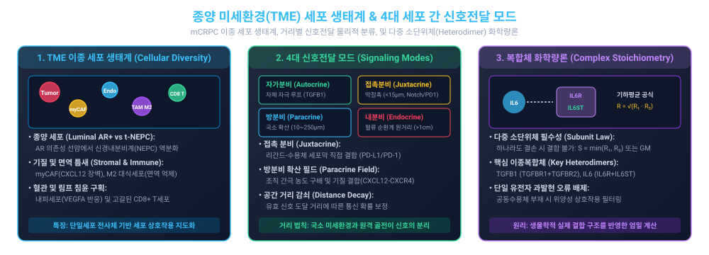
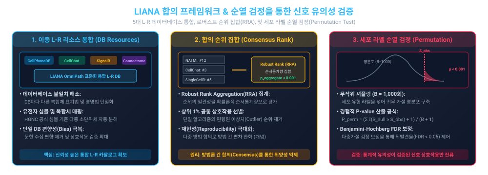
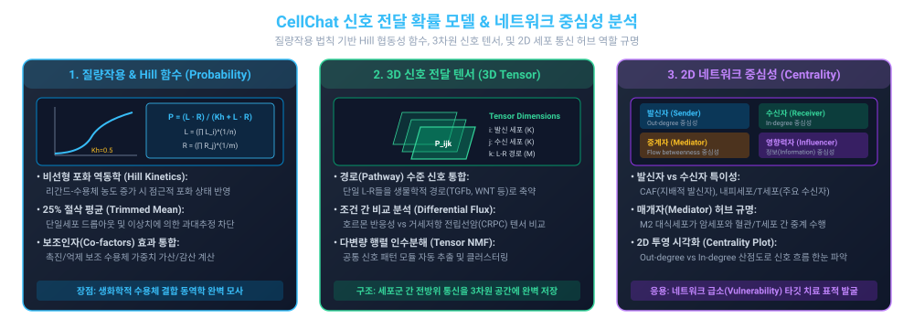
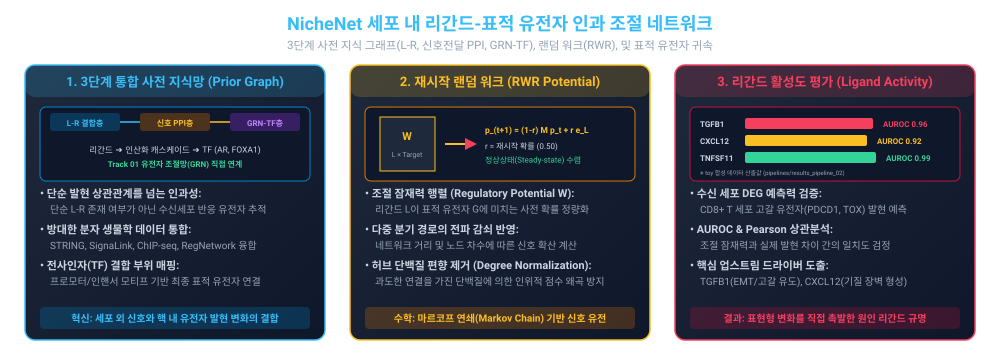
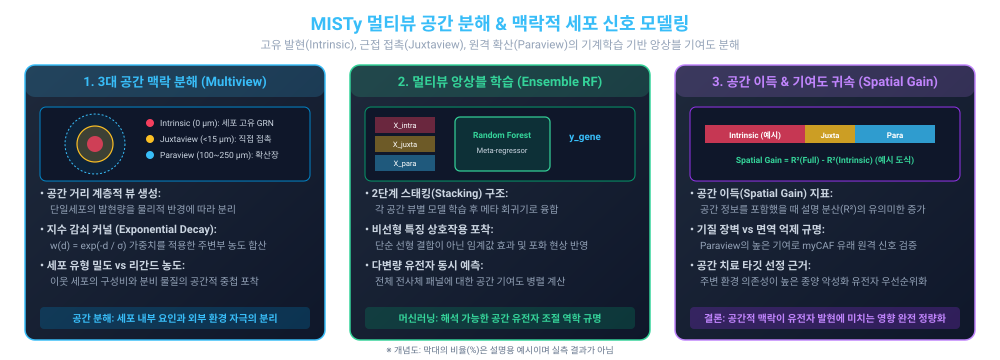
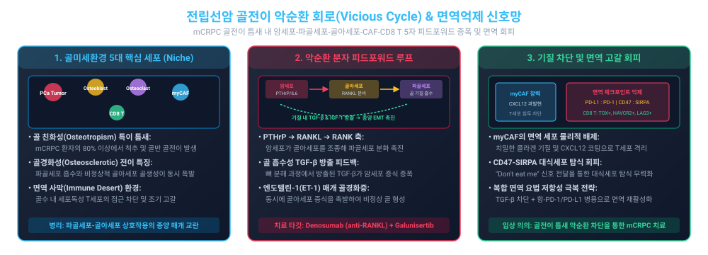

# 전립선암 종양 미세환경(TME) 세포 간 신호 전달 네트워크 마스터 교재
**From Ligand-Receptor Biophysics and Multi-Subunit Modeling to NicheNet Causal Inference and Prostate Bone Metastasis Circuits**

---

## 📚 교재 전체 목차 (Table of Contents)

- [Chapter 00. Track 03 로드맵: 종양 미세환경(TME) 세포 간 신호 전달 네트워크](#part-00-chapter-00-track-03-로드맵-종양-미세환경tme-세포-간-신호-전달-네트워크-cell-cell-communication)
- [Chapter 01. 종양 미세환경(TME) 생물학: 세포 사회학과 리간드-수용체 신호 양식](#part-01-chapter-01-종양-미세환경tme-생물학-세포-사회학과-리간드-수용체-신호-양식)
- [Chapter 02. 리간드-수용체 데이터베이스 큐레이션 및 LIANA 합의 순위 집계](#part-02-chapter-02-리간드-수용체-데이터베이스-큐레이션-및-liana-합의-순위-집계)
- [Chapter 03. 발현 임계치 설정과 질량작용 법칙 기반 순열 검정](#part-03-chapter-03-발현-임계치-설정과-질량작용-법칙-기반-순열-검정)
- [Chapter 04. CellChat 다중 소단위체 모델링 및 네트워크 중심성](#part-04-chapter-04-cellchat-다중-소단위체-모델링-및-네트워크-중심성)
- [Chapter 05. 세포 내 신호 전달 및 표적 유전자 조절망 추론 (NicheNet)](#part-05-chapter-05-세포-내-신호-전달-및-표적-유전자-조절망-추론-nichenet--causal-signaling-networks)
- [Chapter 06. 공간 전사체 기반 세포 간 통신 통합 분석 (LIANA+)](#part-06-chapter-06-공간-전사체-기반-세포-간-통신-통합-분석-spatial-ccc--liana)
- [Chapter 07. 다중 뷰 공간 분해 앙상블 모델링 (MISTy)](#part-07-chapter-07-다중-뷰-공간-분해-앙상블-모델링-multiview-modeling-with-misty)
- [Chapter 08. 전립선암 골전이 미세환경의 5자 신호 전달 회로](#part-08-chapter-08-전립선암-골전이-미세환경의-5자-신호-전달-회로-mcrpc-bone-metastasis-signaling-circuits)
- [Chapter 09. 트러블슈팅, 품질 제어 및 캡스톤 프로젝트 루브릭](#part-09-chapter-09-세포-간-통신-분석의-함정-검증-프로토콜-및-캡스톤-프로젝트-troubleshooting--capstone-project)

---

# Part 00. Chapter 00. Track 03 로드맵: 종양 미세환경(TME) 세포 간 신호 전달 네트워크 (Cell-Cell Communication)
> **출처 원본 파일**: `tracks/03_tme_cell_communication/docs/00_TME_COMMUNICATION_ROADMAP.md`


> **Cognitive Goal**: 종양 생물학의 패러다임이 세포 자율적(Cell-autonomous) 유전체 변이 분석에서 이질적 세포 간 동적 상호작용 네트워크(Intercellular Communication Network)로 전환된 배경을 이해하고, 전립선암 원발암 및 치명적 거세저항성 뼈 전이(mCRPC Bone Metastasis) 니치에서 작동하는 세포 간 신호 전달 체계의 생물학적 기전과 핵심 공개 벤치마크 데이터셋, 재현 가능한 분석 컴퓨팅 환경을 구축할 수 있다.

---

## 1. 패러다임 전환: 정적 전사체 프로파일링에서 동적 세포 간 신호 네트워크로

지난 10년간 단일세포 RNA 시퀀싱(scRNA-seq / snRNA-seq)은 종양 조직 내 세포의 다양성을 규명하는 강력한 도구로 자리잡았습니다. 그러나 초기 단일세포 연구는 세포 집단을 $t$-SNE나 UMAP 공간에 군집화(Clustering)하고, 세포 유형별 차별 발현 유전자(Marker DEGs)를 나열하는 **"정적 세포 목록 작성(Static Cellular Inventory)"** 수준에 머물렀습니다.

```
[패러다임의 진화: 정적 도감에서 동적 세포 사회학으로]
1세대: 벌크 시퀀싱 (Bulk RNA-seq) ──► 종양 조직 전체의 평균 전사체 (이질성 상실)
2세대: 단일세포 발현 프로파일링   ──► 개별 세포 분류 및 정적 마커 유전자 도감 (세포 간 관계 단절)
3세대: 세포 간 통신망(CCC) 추론   ──► 리간드-수용체 매개 종양-기질-면역 동적 상호작용 생태계 복원
```

### 1.1 세포 자율적(Cell-Autonomous) 분석의 본질적 한계
종양은 악성 상피세포(Malignant Epithelial Cells) 단독으로 증식하는 고립계가 아닙니다. 세포 자율적 분석에만 의존할 경우 다음과 같은 중대한 생물학적 맹점이 발생합니다:
1. **미세환경적 수용성(Microenvironmental Receptivity) 간과**: 암세포가 특정 수용체(예: *MET*, *CXCR4*)를 과발현하더라도, 기질 세포나 면역세포가 상응하는 동족 리간드(HGF, CXCL12)를 충분히 분비하지 않는다면 해당 발암 신호 경로는 실제로 활성화되지 않습니다.
2. **치료 저항성의 외인성(Extrinsic) 기전 추적 불가**: 안드로겐 차단 요법(ADT)이나 방사선 치료에 대한 저항성은 암세포 자체의 유전자 돌연변이뿐만 아니라, 암 연관 섬유아세포(CAF)가 분비하는 *WNT16B*, *SPP1*, *IL6* 등의 외인성 생존 신호에 의해 강력히 유도됩니다.
3. **면역 회피(Immune Evasion) 다이내믹스 왜곡**: 면역관문 분자($PDCD1$, $CTLA4$, $LAG3$)의 mRNA 검출 빈도는 드물고 발현량이 낮아(Dropout 현상), 단일 전사체 마커 비교만으로는 면역 억제적 접촉(Juxtacrine) 및 억제성 사이토카인 구배(Paracrine gradient)의 실제 영향력을 통계적으로 검증하기 어렵습니다.

따라서 단일세포 분석의 핵심 과제는 **"누가 그곳에 있는가(Cell Composition)"**를 넘어, **"누가 누구에게 어떤 생화학적 언어(Ligand-Receptor Pairs)로 지시하고 있는가(Cell-Cell Cross-talk)"**를 정량화하는 계산생물학적 신호망 재구성으로 전환되었습니다.

---

## 2. 전립선암 TME의 생물학적 복잡성: 원발암 vs mCRPC 뼈 전이 니치

전립선암(Prostate Cancer, PCa)은 전형적인 **"면역학적 냉성 종양(Immunologically Cold Tumor)"**으로 분류되며, 진행 단계에 따라 종양 미세환경의 세포 구성과 신호 전달 네트워크가 극적으로 재편됩니다.

```
┌────────────────────────────────────────────────────────────────────────────────────────┐
│                        전립선암 미세환경(TME)의 단계별 재편                              │
└────────────────────────────────────────────────────────────────────────────────────────┘
 [원발성 선암 (Primary Adenocarcinoma)]          [mCRPC 골 전이 니치 (Bone Metastasis)]
 ┌────────────────────────────────────┐          ┌─────────────────────────────────────┐
 │ • 고밀도 반응성 간질 (myCAF 우세)    │          │ • 골아세포-파골세포 악순환 루프      │
 │ • TGF-β 중심 세포외기질(ECM) 경화   │   전이   │ • CXCL12/CXCR4 매개 내막 니치 호밍   │
 │ • CD8+ T세포 기질 침윤 장벽 형성     │ ──────► │ • SPP1+/CD206+ TAM에 의한 강력 면역억제│
 │ • 치밀한 혈관 기저막 구조           │          │ • 골수 지방세포 매개 지질 대사 리프로그래밍 │
 └────────────────────────────────────┘          └─────────────────────────────────────┘
```

### 2.1 원발성 국소 전립선암(Primary PCa) 미세환경
- **반응성 간질(Reactive Stroma)**: 정상 전립선의 평활근(Smooth Muscle) 세포가 소실되고, $\alpha$-SMA($ACTA2$)와 콜라겐을 대량 합성하는 근섬유아세포성 CAF(myCAF)가 종양 선관(Gland) 주위를 포위합니다.
- **물리적 면역 배제(Immune Exclusion)**: 기질 세포가 분비하는 고농도의 $TGF\beta1$ 및 치밀한 피브로넥틴($FN1$)/콜라겐 섬유망은 세포독성 T세포(CD8+ T)가 종양 실질로 침투하지 못하도록 물리적·생화학적 차단벽을 형성합니다.
- **안드로겐 의존적 신호 전달**: 관강 상피세포(Luminal Epithelia)는 안드로겐 수용체(AR) 신호에 종속적이며, 상피-기질 간에는 $FGF2$, $FGF10$, $IGF1$을 통한 항상성 및 증식 신호가 활발합니다.

### 2.2 전이성 거세저항성 전립선암(mCRPC) 뼈 전이 니치: 치명적 악순환(Vicious Cycle)
mCRPC 환자의 다수(보고에 따라 약 80–90%; 전체 전립선암 환자의 비율이 아니며 정확한 수치는 문헌 확인이 필요함)에서 발생하는 뼈 전이는 단순한 물리적 안착이 아니라, 골수(Bone Marrow) 특유의 세포 생태계와의 파괴적인 공모(Collusion)를 수반합니다.
1. **호밍 및 정착 (Homing & Endosteal Niche Seeding)**:
   - 골수 내피세포 및 조골세포가 분비하는 $CXCL12$ 구배를 따라 암세포의 $CXCR4$ 수용체가 결합하여 골내막(Endosteum)에 암세포가 착상합니다.
   - $\alpha_V \beta_3$, $\alpha_5 \beta_1$ 인테그린은 골기질 단백질인 오스테오폰틴($SPP1$), 본 시알로프로틴($IBSP$)과 결합하여 세포 사멸 저항성을 획득합니다.
2. **골 형성/골 흡수 악순환 (The Bone Metastasis Vicious Cycle)**:
   - 전립선암은 전통적으로 조골성(Osteoblastic) 병변을 주로 형성하지만, 실제로는 파골세포(Osteoclast) 매개 골 흡수가 선행하거나 공존합니다.
   - 암세포는 부갑상선호르몬 관련 단백질($PTHrP$), $IL6$ 등을 분비하여 조골세포 계통의 $RANKL$ 발현을 자극할 수 있다고 알려져 있습니다. (*WNT5A*는 이와 반대로 골아세포 니치에서 유래해 ROR2/SIAH2를 통해 전립선암 세포의 휴면을 유도·유지한다는 보고가 있어(Ren et al., J Exp Med 2019, PMID 30593464) 방향과 역할이 상충하므로 여기서 종양 분비 인자로 단정하지 않습니다.)
   - $RANKL$은 파골 전구세포의 $RANK$와 결합하여 파골세포 분화와 골 흡수를 촉발합니다.
   - 용해된 뼈 기질에서 방출된 활성형 $TGF\beta$, $IGF1$, $BMP$는 다시 암세포를 자극하여 암세포 증식, EMT, 추가적인 $PTHrP$ 분비를 유도하는 자가 증폭 악순환 루프를 완성합니다.

---

## 3. 실전 벤치마크 공개 단일세포 전사체 데이터셋 카탈로그

Track 03 전반에서 검증 및 분석에 활용할 수 있는 핵심 공개 데이터셋 3종의 메타데이터와 생물학적 의의를 정리합니다:

| 연구 문헌 (Citation) | 등록 번호 (Accession) | 샘플 및 조직 특성 | 세포 수 (Cells) | 핵심 분석 가치 및 L-R 검증 포인트 |
| :--- | :--- | :--- | :--- | :--- |
| **Kfoury et al.** (*Cancer Cell*, 2021) | **GSE143791** | 전립선암 골전이 환자 9명의 종양·병변 인접 골수·원위 골수 분획 및 양성 골수 대조 7명 | 총 세포 수 미확정 (논문 보고: 샘플당 평균 약 2,490 cells) | 골전이 면역억제 미세환경(T 세포 소진, 골전이 특이 대식세포), $CCL20$-$CCR6$ 축 |
| **Chen et al.** (*Nat Cell Biol*, 2021) | **GSE141445** | 근치적 전립선 절제술 원발 종양 13개 (논문은 별도 11개 샘플 추가 시퀀싱, CRPC 포함) | 36,424 cells (GEO 요약) | 미세환경의 $KLK3$ 이소성 발현, 종양과 활발히 통신하는 내피세포 하위집단(aEC)과 종양 간 세포 간 통신 |
| **Bill et al.** (*Science*, 2023;381:515, PMID 37535729) | 확인된 전립선 accession 없음 (이전 표기 `EGAS00001006653`는 확인 불가) | 다암종(pan-cancer) 인간 종양 대상 연구 — 전립선 3자 아틀라스가 아님 | 확인 불가 (이전 `~65,000`은 근거 없음) | CXCL9:SPP1 대식세포 극성이 암 전반의 세포 프로그램 네트워크를 규정한다는 보고. 전립선 특이 L-R 검증 자료로 쓰려면 별도 전립선 코호트 확인 필요 |

---

## 4. Track 03 커리큘럼 및 4단계 인지 구조 (Cognitive Progression)

Track 03은 단순한 분석 툴 사용법 나열을 지양하고, 생화학적 수용체-리간드 결합 물리화학에서 출발하여 그래프 신경망 및 다중 조건 비교 분석까지 도달하는 나선형 심화 구조로 설계되었습니다.

```
[Level 1: Biophysical Foundation & Cellular Sociology]
  ├── Ch 01. TME 생물학: 이질적 세포 생태계와 리간드-수용체 신호 양식 (Juxtacrine/Paracrine/Autocrine)
  └── Ch 02. 다중 데이터베이스 큐레이션 및 LIANA 합의 순위 집계 (Consensus Rank Aggregation)
          │
[Level 2: Statistical Modeling & Algorithmic Rigor]
  ├── Ch 03. 단일세포 드롭아웃 극복 발현 임계치 설정 및 질량작용 법칙 기반 순열 검정 (Permutation Test)
  └── Ch 04. CellChat 다중 소단위체(Multi-subunit Heteromer) 기하평균 모델링 및 4대 네트워크 중심성
          │
[Level 3: Intracellular Downstream Signaling & Target Validation]
  ├── Ch 05. NicheNet 표적인과 추론: 상류 리간드에서 하류 표적 유전자 조절망(eGRN) 연계
  └── Ch 06. 공간 세포 간 통신: LIANA+ 공간 이변량 지표(Moran's R 등)와 국소 핫스팟
          │
[Level 4: Advanced Comparative Analytics & Translational Discovery]
  ├── Ch 07. 다중 뷰 공간 모델링: MISTy (intra/juxta/para 뷰)
  ├── Ch 08. 전립선암 골전이 미세환경의 5자 신호 전달 회로
  └── Ch 09. 트러블슈팅과 모범 사례
```

---

## 5. 재현 가능한 세포 간 상호작용 분석 환경 구축 (Environment Setup)

세포 간 상호작용 분석 생태계는 Python(`liana`, `scanpy`, `decoupler`; R 패키지명은 decoupleR)과 R(`CellChat`, `NicheNet`)의 최신 패키지들이 융합되어 있습니다. 본 과정에서는 효율성과 대용량 데이터 처리 속도를 극대화하기 위해 Python 기반 통합 플랫폼인 **`LIANA+`** 및 `scanpy`를 중심으로 표준 환경을 구성합니다.

```bash
# 1. TME 세포 간 신호 전달 전용 가상환경 생성 (Python 3.11 이상 권장: decoupler 2.x가 Python>=3.11 요구, liana 1.10은 3.10~3.13 지원)
conda create -n tme_comm_env python=3.11 -y
conda activate tme_comm_env

# 2. 고성능 과학 계산 및 컴파일러 도구 설치
conda install -c conda-forge openblas libgfortran compilers -y

# 3. 단일세포 데이터 분석 코어 라이브러리 설치
pip install scanpy anndata mudata scrublet

# 4. 세포 간 통신망(CCC) 핵심 분석 프레임워크 설치 (LIANA+, decoupler)
pip install liana decoupler

# 5. 네트워크 분석 및 그래프 시각화 유틸리티
pip install networkx igraph leidenalg pyvis statsmodels seaborn matplotlib

# 6. Jupyter 커널 등록
python -m ipykernel install --user --name tme_comm_env --display-name "Python (TME Cell Communication)"
```

### 설치 무결성 검증 스크립트
환경 구성이 정상적으로 완료되었는지 확인하기 위해 아래 검증 스크립트를 실행합니다:

```python
import scanpy as sc
import anndata as ad
import liana as li
import decoupler as dc
import networkx as nx

print(f"[OK] Scanpy Version: {sc.__version__}")
print(f"[OK] AnnData Version: {ad.__version__}")
print(f"[OK] LIANA+ Version: {li.__version__}")
print(f"[OK] DecoupleR Version: {dc.__version__}")
print(f"[OK] NetworkX Version: {nx.__version__}")

# LIANA 기본 내장 합의 데이터베이스(OmniPath Consensus) 로드 테스트
consensus_db = li.rs.select_resource('consensus')
print(f"[OK] OmniPath Consensus L-R Resource Loaded: {len(consensus_db)} consensus pairs available.")
print("=== All TME Communication Core Dependencies Successfully Verified ===")
```

---

## 단원 핵심 점검 (Cognitive Checkpoint & Case Study)

### [문제 1. 핵심 개념 능동 회상 (Active Recall)]
단일세포 RNA 시퀀싱 데이터를 기반으로 세포 간 통신(Cell-Cell Communication, CCC)을 추론할 때, 단순히 개별 세포 클러스터의 마커 유전자 차별 발현(DEG)만을 분석하는 접근법이 지닌 생물학적·통계적 한계점 3가지를 제시하고, 리간드-수용체 쌍(L-R Pair) 기반 상호작용 점수 모델링이 이를 어떻게 극복하는지 설명하시오.

<details>
<summary>💡 모범 답안 및 해설 확인</summary>

1. **단순 DEG 분석의 3대 한계점**:
   - **생물학적 수용성(Receptivity) 결여**: 발신 세포(Sender)가 리간드를 아무리 고발현하더라도, 미세환경 내에 동족 수용체를 발현하는 표적 세포(Receiver)가 없으면 실제 신호 전달이 성립하지 않습니다. DEG 분석은 세포 쌍 간의 '양방향 매칭'을 평가하지 못합니다.
   - **다중 소단위체(Multi-subunit Complexes) 누락**: 인테그린($\alpha_V\beta_3$)이나 인터루킨 수용체($IL6R + IL6ST$)와 같이 2개 이상의 단백질이 물리적으로 결합해야만 작동하는 복합체의 경우, 단일 서브유닛 유전자 하나만 DEG로 검출된다고 해서 기능적 수용체가 형성되었다고 단정할 수 없습니다.
   - **드롭아웃(Dropout)에 의한 위음성 왜곡**: 사이토카인, 성장인자, GPCR 계열 수용체는 기저 발현량이 극도로 낮아 단일세포 데이터에서 0으로 관측되는 비율이 높습니다. 단순 발현량 필터링이나 DEG 순위 산출에서는 이러한 핵심 신호 분자들이 하위 순위로 밀려나 누락됩니다.
2. **L-R 쌍 기반 모델링의 극복 기전**:
   - 발신 세포의 리간드 평균 발현량과 수용 세포의 수용체 평균 발현량을 결합하여 세포 쌍 간의 공동 발현 강도를 정량화합니다. 결합 방식은 도구마다 다릅니다: CellPhoneDB는 두 평균의 **산술평균**(한쪽이 0이면 0), NATMI/Connectome 계열은 곱($\bar{E}_{A,L}\times\bar{E}_{B,R}$), CellChat은 질량작용 법칙 기반 Hill 포화 식입니다.
   - 다중 서브유닛 복합체의 경우 CellPhoneDB는 소단위체의 **최소값**, CellChat은 기하평균(Geometric Mean)을 적용하여 모든 필수 소단위체가 동시에 존재하는지 검증하며, 세포 라벨 순열 검정(Permutation Test)을 통해 우연에 의한 공동 발현을 통계적으로 배제합니다.

</details>

---

### [문제 2. 핵심 개념 능동 회상 (Active Recall)]
전이성 거세저항성 전립선암(mCRPC)의 뼈 전이 니치(Bone Metastasis Niche)에서 발생하는 종양세포(Tumor), 골아세포(Osteoblast), 파골세포(Osteoclast) 간의 **'골 전이 악순환(Vicious Cycle)'**을 구성하는 핵심 분자 상호작용 축 4가지를 명시하고, 이 루프가 암세포의 안드로겐 비의존적 생존을 지원하는 기전을 서술하시오.

<details>
<summary>💡 모범 답안 및 해설 확인</summary>

1. **악순환을 구성하는 4대 분자 축**:
   - **$PTHrP$ / $IL6$ 축 (Tumor ──► Osteoblast)**: 암세포가 분비한 부갑상선호르몬 관련 단백질($PTHrP$) 및 $IL-6$가 골아세포 표면의 수용체에 결합하여 골아세포의 $RANKL$ 발현을 상향 조절하고, 파골세포 억제 인자인 오스테오프로테게린($OPG$)을 억제합니다.
   - **$RANKL$ / $RANK$ 축 (Osteoblast ──► Osteoclast)**: 골아세포 표면의 $RANKL$이 파골 전구세포의 $RANK$와 결합하여 성숙한 파골세포로의 분화 및 골 기질 흡수(Bone Resorption) 활성을 강력히 촉진합니다.
   - **골 기질 저장 성장인자 방출 ($TGF\beta$, $IGF1$) (Bone Matrix ──► Tumor)**: 파골세포의 산(Acid) 및 단백질 분해 효소 분비로 무기질화된 뼈 기질이 용해되면서, 기질 내에 갇혀 있던 고농도의 잠재형 $TGF\beta$, $IGF1$, $BMP$가 유리되어 활성화됩니다.
   - **$TGF\beta$ / $TGFBR$ 축 (Bone Matrix ──► Tumor Autocrine/Paracrine)**: 활성화된 $TGF\beta$가 전립선암 세포의 $TGFBR1/2$ 복합체에 결합하여 $SMAD2/3$ 전사인자를 활성화하고, 이는 다시 암세포의 침습성, 상피-간엽 전이(EMT), 추가적인 $PTHrP$ 분비를 자극하는 폐쇄 회로(Closed-loop)를 형성합니다.
2. **안드로겐 비의존적 생존 지원 기전**:
   - 지속적으로 방출되는 $IGF1$과 $IL6$는 암세포의 $PI3K/AKT/mTOR$ 경로 및 $JAK/STAT3$ 경로를 교차 활성화(Cross-activation)합니다.
   - 이는 안드로겐 결핍 환경에서도 안드로겐 수용체(AR)의 리간드 결합 영역(LBD)과 무관하게 AR 전사 복합체를 인산화하여 강제 활성화하거나, AR 신호 경로를 우회하는 강력한 세포 사멸 저항성 신호를 지속적으로 공급합니다.

</details>

---

### [문제 3. 임상 사례 분석 (Clinical Interpretation Case Study)]
**[임상 시나리오]**
원발성 전립선 선암 환자군(Cohort A, n=15)과 표준 치료(Enzalutamide + Docetaxel) 후 진행된 mCRPC 뼈 전이 환자군(Cohort B, n=12)의 생검 조직에서 단일세포 전사체 데이터를 수집했습니다. 연구팀은 면역관문 억제제(Anti-PD-1 / Anti-CTLA-4) 병용 요법이 원발암에서는 일부 면역 활성을 유도했으나 mCRPC 뼈 전이 병변에서는 100% 불응성을 보인 원인을 규명하고자 세포 간 신호 전달 네트워크 분석을 기획하고 있습니다.

**[질문]**
1. Cohort A(원발암) 대비 Cohort B(뼈 전이)에서 세포독성 CD8+ T세포의 침윤 및 탈진(Exhaustion)에 관여할 것으로 예상되는 핵심 기질세포(CAF 하위 아형) 및 골수 골수계 세포(TAM/MDSC)의 특이적 리간드-수용체 상호작용 축 2가지를 가설로 제시하시오.
2. mCRPC 뼈 전이 환자에서 면역관문 단독 치료의 실패를 극복하기 위해, 세포 간 신호 전달망 분석 결과를 토대로 제안할 수 있는 혁신적인 '미세환경 재프로그래밍 병용 치료 전략'을 2가지 수립하시오.

<details>
<summary>💡 모범 답안 및 해설 확인</summary>

1. **예상되는 핵심 리간드-수용체 상호작용 축 2가지**:
   - **$CXCL12$ - $CXCR4$ 축 (CAF/골수간질세포 ──► CD8+ T세포)**: 뼈 전이 니치의 염증성 섬유아세포(iCAF) 및 골수 간질세포(MSCs)가 고농도의 $CXCL12$를 분비하여 종양 침윤 림프구(TIL)의 종양 세포 접촉을 물리적으로 배제(Exclusion)하거나, T세포 표면의 $CXCR4$ 신호 전달을 통해 림프구의 운동성을 마비시키고 기능적 탈진을 유도합니다.
   - **$SPP1$ - $CD44$ / $\alpha_V\beta_3$ 축 (M2-like TAM ──► CD8+ T세포 및 종양 세포)**: 골수 전이 병변에 풍부한 $SPP1^+$ 골수계 대식세포(TAM)가 오스테오폰틴($SPP1$)을 분비하여 CD8+ T세포의 증식을 직접 억제하고 대식세포 자신의 면역 억제적 M2 분극화를 자가 유지하며, 암세포의 침습 및 생존을 촉진합니다.
2. **미세환경 재프로그래밍 병용 치료 전략 2가지**:
   - **$CXCR4$ 길항제(Plerixafor / Motixafortide) + 면역관문 억제제 병용 (탐색적 가설)**: $CXCL12$ 장벽을 약화시켜 T세포 침투를 허용할 가능성이 제안됩니다. 근거(Feig 2013, 마우스 췌장암 모델)는 전임상이며 전립선 골전이에서 입증된 전략이 아닙니다.
   - **$TGF\beta$ 경로 억제 + $RANKL$ 차단제(Denosumab) 병용 (탐색적 가설)**: Denosumab의 근거는 CRPC 골전이 골격계 사건(SRE) 지연(Fizazi 2011, PMID 21353695)과 nmCRPC 골전이-무진행생존 연장(Smith 2012, PMID 22093187)이며, TGF-β '원천 봉쇄'나 면역관문 억제제 감작 근거는 없습니다. TGF-β 표적 약제 중 bintrafusp alfa는 어느 적응증에서도 승인되지 않았고 INTR@PID BTC 055 시험이 무용성으로 중단되었습니다(Merck KGaA 2021; NCT04066491). Galunisertib의 현재 개발 상태는 확인하지 못했습니다. 따라서 이 병용은 확립된 치료가 아니라 연구 가설입니다.

</details>

---

<!-- REFERENCES:BEGIN (generated by scripts/apply_references.py; do not edit by hand) -->
## 참고문헌 (References)
### 본문 인용 문헌
1. Ren D, Dai Y, Yang Q, et al. Wnt5a induces and maintains prostate cancer cells dormancy in bone. *J Exp Med*. 2019;216(2):428-449. PMID: 30593464. doi: 10.1084/jem.20180661
2. Fizazi K, Carducci M, Smith M, et al. Denosumab versus zoledronic acid for treatment of bone metastases in men with castration-resistant prostate cancer: a randomised, double-blind study. *Lancet*. 2011;377(9768):813-22. PMID: 21353695. doi: 10.1016/S0140-6736(10)62344-6
3. Smith MR, Saad F, Coleman R, et al. Denosumab and bone-metastasis-free survival in men with castration-resistant prostate cancer: results of a phase 3, randomised, placebo-controlled trial. *Lancet*. 2012;379(9810):39-46. PMID: 22093187. doi: 10.1016/S0140-6736(11)61226-9
4. Feig C, Jones JO, Kraman M, et al. Targeting CXCL12 from FAP-expressing carcinoma-associated fibroblasts synergizes with anti-PD-L1 immunotherapy in pancreatic cancer. *Proc Natl Acad Sci U S A*. 2013;110(50):20212-7. PMID: 24277834. doi: 10.1073/pnas.1320318110
5. Kfoury Y, Baryawno N, Severe N, et al. Human prostate cancer bone metastases have an actionable immunosuppressive microenvironment. *Cancer Cell*. 2021;39(11):1464-1478.e8. PMID: 34719426. doi: 10.1016/j.ccell.2021.09.005
6. Chen S, Zhu G, Yang Y, et al. Single-cell analysis reveals transcriptomic remodellings in distinct cell types that contribute to human prostate cancer progression. *Nat Cell Biol*. 2021;23(1):87-98. PMID: 33420488. doi: 10.1038/s41556-020-00613-6
7. Bill R, Wirapati P, Messemaker M, et al. CXCL9:SPP1 macrophage polarity identifies a network of cellular programs that control human cancers. *Science*. 2023;381(6657):515-524. PMID: 37535729. doi: 10.1126/science.ade2292
8. EMD Serono Research & Development Institute, Inc. Gemcitabine Plus Cisplatin With or Without Bintrafusp Alfa (M7824) in Participants With 1L BTC. *ClinicalTrials.gov* registry (Phase 2/3; Terminated; 2019-2022). ClinicalTrials.gov: NCT04066491.
### 소프트웨어 (표기 버전은 검수 시 API를 확인한 버전이며, 파이프라인 실행 환경은 requirements-pipelines.txt 참조)
- anndata 0.13.4 (github.com/scverse/anndata). 원 논문: Virshup I, Rybakov S, Theis FJ, et al. anndata: Access and store annotated data matrices. *JOSS*. 2024;9(101):4371. doi: 10.21105/joss.04371
- decoupler 2.2.0 (github.com/scverse/decoupler). 원 논문: Badia-I-Mompel P, Vélez Santiago J, Braunger J, et al. decoupleR: ensemble of computational methods to infer biological activities from omics data. *Bioinform Adv*. 2022;2(1):vbac016. PMID: 36699385. doi: 10.1093/bioadv/vbac016
- LIANA (liana-py) 1.10.0 (github.com/saezlab/liana-py). 원 논문: Dimitrov D, Türei D, Garrido-Rodriguez M, et al. Comparison of methods and resources for cell-cell communication inference from single-cell RNA-Seq data. *Nat Commun*. 2022;13(1):3224. PMID: 35680885. doi: 10.1038/s41467-022-30755-0
- NetworkX 3.7 (github.com/networkx/networkx).
- Scanpy 1.12.4 (github.com/scverse/scanpy). 원 논문: Wolf FA, Angerer P, Theis FJ. SCANPY: large-scale single-cell gene expression data analysis. *Genome Biol*. 2018;19(1):15. PMID: 29409532. doi: 10.1186/s13059-017-1382-0
- conda (docs.conda.io).
<!-- REFERENCES:END -->


---

# Part 01. Chapter 01. 종양 미세환경(TME) 생물학: 세포 사회학과 리간드-수용체 신호 양식
> **출처 원본 파일**: `tracks/03_tme_cell_communication/docs/01_TME_BIOLOGY_AND_LIGAND_RECEPTORS.md`


> **Cognitive Goal**: 종양 미세환경(TME)을 구성하는 악성 상피세포, 기질 세포(myCAF, iCAF, apCAF), 혈관/림프관 내피세포, 골수계 세포(TAM, MDSC), 림프구(CD8+ T, Treg, NK)의 분자 생태학적 역할을 이해하고, 내분비(Endocrine), 주변분비(Paracrine), 접촉매개(Juxtacrine), 자가분비(Autocrine) 신호 양식과 셰다아제(ADAM10/17)에 의한 막 절단 기전, 다중 소단위체(Multi-subunit heteromeric complex)의 화학량론(Stoichiometry)을 단일세포 전사체 수준에서 해석할 수 있다.

---

## 1. 종양 미세환경의 세포 사회학 (Tumor Sociology)

종양은 단일 클론의 증식체가 아니라, 수많은 이종 세포들이 물리적·생화학적 상호작용을 주고받으며 형성된 복합 생태계(Complex Cellular Ecosystem)입니다. 전립선암 미세환경을 구성하는 5대 핵심 세포 구획(Compartments)과 기능적 하위 아형의 생물학적 특성은 다음과 같습니다:

```
┌────────────────────────────────────────────────────────────────────────────────────────┐
│                        종양 미세환경(TME)의 5대 핵심 세포 구획                           │
├────────────────────────────────────────────────────────────────────────────────────────┤
│ 1. 악성 상피세포 (Malignant Epithelia)  : 관강세포(Luminal), 기저세포(Basal), 신경내분비(NEPC) │
│ 2. 암 연관 섬유아세포 (CAFs)            : 근섬유아세포(myCAF), 염증성(iCAF), 항원제시(apCAF) │
│ 3. 혈관/림프관 내피세포 (Endothelia)    : 혈관신생 팁/줄기세포(Tip/Stalk), 기저막 투과성 조절  │
│ 4. 골수계 면역세포 (Myeloid Compartment): M1/M2 종양 연관 대식세포(TAM), 과립구/단핵구 MDSC │
│ 5. 림프계 면역세포 (Lymphoid Lineage)   : 세포독성 CD8+ T세포, 조절 T세포(Treg), NK 세포     │
└────────────────────────────────────────────────────────────────────────────────────────┘
```



### 1.1 악성 상피세포 (Malignant Epithelial Cells)
- **관강 분화 상피세포(Luminal Adenocarcinoma)**: 안드로겐 수용체(*AR*) 및 하류 분화 마커(*KLK3/PSA*, *TMPRSS2*, *NKX3-1*)를 강력히 발현합니다.
- **치료 유도성 신경내분비 분화(Treatment-induced Neuroendocrine, t-NEPC)**: 차세대 AR 길항제(Enzalutamide, Abiraterone) 치료 압력 하에서 *TP53* 및 *RB1*의 이중 소실과 함께 전사 리프로그래밍이 발생합니다. 관강 마커가 소실되고 신경내분비 마커(*SYP*, *CHGA*, *NCAM1/CD56*) 및 마스터 전사인자(*ASCL1*, *NEUROD1*, *INSM1*)를 획득하여 안드로겐 비의존성 극단적 악성도로 진행합니다.

### 1.2 암 연관 섬유아세포 (Cancer-Associated Fibroblasts, CAFs)
단일세포 전사체 분석은 CAF가 단일 집단이 아니라 상호 대립적이거나 보완적인 기능을 수행하는 하위 아형들의 집합체임을 밝혔습니다. 다만 아래 myCAF/iCAF/apCAF 3분류와 국소화(myCAF 근접, iCAF 원위)는 주로 췌장암 모델에서 정립된 체계(Öhlund et al., J Exp Med 2017; Elyada et al., Cancer Discov 2019)이며 전립선암에 그대로 적용된다는 근거는 제한적입니다:
1. **근섬유아세포성 CAF (myCAF - Myofibroblastic CAF)**:
   - **핵심 분자 마커**: $\alpha$-SMA($ACTA2$), 트랜스겔린($TAGLN$), 칼포닌($CNN1$), 제1형 콜라겐($COL1A1, COL1A2$).
   - **유도 기전 및 기능**: 종양 세포 유래 $TGF\beta1$ 및 $TGF\beta2$ 신호에 의해 종양 선관에 바로 인접하여 분화합니다. 세포외기질(ECM) 콜라겐과 피브로넥틴을 대량 분비하고, 액토마이오신(Actomyosin) 수축력을 통해 조직 강성(Matrix Stiffness)을 증가시켜 기계생물학적(Mechanobiological) 종양 침습을 촉진합니다.
2. **염증성 CAF (iCAF - Inflammatory CAF)**:
   - **핵심 분자 마커**: 인터루킨-6($IL6$), 케모카인($CXCL12, CXCL1, CXCL2$), $PDGFRA$, 보체계 인자($C3, C7$).
   - **유도 기전 및 기능**: 종양 세포 유래 $IL1\alpha/IL1\beta$ 및 $TNF$에 의해 유도되며, 종양 실질에서 다소 떨어진 간질 영역에 주로 위치합니다. 사이토카인과 케모카인을 대량 분비하여 골수계 억제 세포를 미세환경으로 유인하고 종양 혈관 신생을 지원합니다.
3. **항원제시 CAF (apCAF - Antigen-Presenting CAF)**:
   - **핵심 분자 마커**: $CD74$, $HLA-DRA$, $HLA-DRB1$, $SLPI$.
   - **유도 기전 및 기능**: 골수계 항원제시세포처럼 MHC-II 분자와 불변 사슬($CD74$)을 발현하지만, T세포 활성화에 필수적인 공자극 분자($CD80, CD86, CD40$)가 결핍되어 있습니다. 결과적으로 CD4+ T세포와 결합하여 면역 활성화 대신 무반응(Anergy) 또는 조절 T세포(Treg) 분화를 유도하여 면역 억제 환경을 조성합니다.

### 1.3 혈관 및 림프관 내피세포 (Endothelial Compartment)
- **혈관신생 발아(Angiogenic Sprouting)**: 저산소증(Hypoxia) 환경에서 안정화된 $HIF1\alpha$에 의해 종양 및 기질 세포가 $VEGFA$를 대량 분비합니다.
- **Tip vs Stalk 세포 분화**: 내피세포 중 $VEGFR2$와 $DLL4$를 고발현하는 **팁 세포(Tip cell)**가 선두에서 기저막을 뚫고 전진하며, 인접한 세포는 $DLL4$-$NOTCH1$ 접촉 신호를 받아 $VEGFR2$를 하향 조절하고 줄기 증식을 담당하는 **스토크 세포(Stalk cell)**로 분화합니다.
- **내피 장벽 붕괴 및 혈관 누출성**: $VEGF$와 $ANGPT2$의 과도한 자극으로 혈관주위세포(Pericyte) 피복이 소실되어 종양 혈관은 구조적으로 비틀리고 불완전한 기저막을 형성하여 간질액 압력(IFP)을 높이고 약물 전달을 차단합니다.

### 1.4 골수계 면역세포 (Myeloid Compartment)
- **골수 유래 억제 세포 (MDSCs)**: 과립구성($G-MDSC$: $CD11b^+ CD15^+ LOX1^+$) 및 단핵구성($M-MDSC$: $CD11b^+ CD14^+ HLA-DR^{\text{low}}$)으로 나뉘며, 아르기나아제-1($ARG1$), 유도성 산화질소 합성효소($iNOS$), 활성산소종(ROS)을 분비하여 국소 $L$-아르기닌을 고갈시킴으로써 T세포 수용체(TCR) $\zeta$ 사슬의 발현을 억제합니다.
- **종양 연관 대식세포 (TAMs - Tumor-Associated Macrophages)**:
  - 전통적인 $M1$(항종양, $CD86, NOS2, TNF$) 대 $M2$(친종양, $CD163, MRC1/CD206, MARCO$)의 이분법을 넘어, 단일세포 전사체는 **$SPP1^+$ 혈관신생형 TAM**과 **$C1Q^+$ 면역조절형 TAM** 등 연속적인 기능적 스펙트럼을 나타냅니다. 저산소 니치에 위치한 TAM은 $HIF1\alpha$ 활성화를 통해 $VEGFA$와 $MMP9$를 분비하여 종양 혈관 신생 및 조직 리모델링을 주도합니다.

### 1.5 림프계 면역세포 (Lymphoid Lineage)
- **세포독성 CD8+ T세포**: 종양 특이 항원을 인식하지만, 만성적인 항원 노출과 기질 내 억제 신호로 인해 탈진(Exhaustion) 상태에 진입합니다. 억제성 면역관문 수용체인 $PDCD1$(PD-1), $HAVCR2$(TIM-3), $LAG3$, $TIGIT$를 점진적으로 획득하며 세포용해 단백질(Perforin/Granzyme) 분비 능력을 상실합니다.
- **조절 T세포 (Tregs)**: $FOXP3$, $IL2RA$(CD25), $CTLA4$를 발현하며, 고친화성 IL-2 수용체를 통해 미세환경 내 IL-2를 독점 고갈시키고, 막 결합형 $TGF\beta$ 및 면역억제 대사산물인 아데노신($CD39/CD73$ 축)을 통해 주변 CD8+ T세포 및 수지상세포의 기능을 마비시킵니다.
- **NK 세포 (Natural Killer Cells)**: MHC-I 결손 암세포를 감지하는 선천 면역 세포이나, 종양 세포의 $MICA/MICB$ 셰딩(Shedding)이나 $HLA-E$ 과발현($NKG2A$ 수용체 결합)에 의해 세포독성이 무력화됩니다.

---

## 2. 4대 세포 간 신호 전달 양식 (Signaling Modes)

세포 간 신호 전달은 신호 전달 물질의 물리적 이동 거리와 매개 방식에 따라 4가지 생물학적 양식으로 구분됩니다:

```
[4대 세포 간 신호 전달 양식의 공간적 도달 범위]
1. 접촉의존형 (Juxtacrine) : d = 0 nm (원형질막 직접 접촉 및 면역 시냅스)
2. 자가분비형 (Autocrine)   : d < 10 µm (신호 분비 세포 자신에게 작용)
3. 주변분비형 (Paracrine)   : d = 10 µm ~ 200 µm (간질액 확산 및 화학주성 구배)
4. 내분비형   (Endocrine)   : d > 1 cm (순환기계 및 림프계를 통한 전신 도달)
```

```
┌────────────────────────────────────────────────────────────────────────────────────────┐
│                              세포 간 신호 전달 4대 모드                                  │
├────────────────────────────────────────────────────────────────────────────────────────┤
│ (A) Autocrine (자가분비)   : 세포 A ──(리간드)──► 세포 A 수용체 (자가 생존 피드백)         │
│ (B) Paracrine (주변분비)   : 세포 A ──(확산)───► 세포 B 수용체 (국소 미세환경 구배)       │
│ (C) Juxtacrine (접촉매개)  : 세포 A [막결합 리간드] ── [막결합 수용체] 세포 B (물리적 접촉)│
│ (D) Endocrine (내분비)     : 세포 A ──(혈관 순환)──► 원격 표적 장기 세포 C                │
└────────────────────────────────────────────────────────────────────────────────────────┘
```

1. **접촉의존형 신호 (Juxtacrine / Contact-Dependent)**:
   - 세포막에 고정된 막관통 리간드가 인접 세포의 막관통 수용체와 직접 물리적으로 결합해야만 신호가 전달됩니다.
   - 대표 예시: $NOTCH1/2/3/4$ 수용체와 $DLL1/4$, $JAG1/2$ 리간드 간 결합, $Eph$ 수용체와 $Ephrin$ 리간드, $PDCD1$(T세포)과 $CD274$/PD-L1(종양세포) 간의 면역 시냅스 상호작용.
2. **주변분비형 신호 (Paracrine)**:
   - 한 세포에서 가용성 단백질 형태로 분비된 리간드가 세포간질액(Interstitial Fluid)을 통해 자유 확산(Diffusion)하여 반경 수십~수백 마이크로미터 이내의 인접 세포 수용체에 도달합니다.
   - 농도 구배(Morphogen Gradient)를 형성하여 표적 세포의 위치 정보를 부여하며, $TGF\beta1$, $VEGFA$, $CXCL12$, $WNT$ 계열 신호가 이에 해당합니다.
3. **자가분비형 신호 (Autocrine)**:
   - 세포가 분비한 리간드가 자기 자신의 세포막 수용체에 결합하여 자가 증식 및 생존 루프를 형성합니다.
   - 암세포가 $EGF$, $TGFA$를 분비하여 자신의 $EGFR$을 자극하거나, $VEGFA$를 자가 분비하여 세포 내 생존 경로($PI3K/AKT$)를 가동하는 현상이 대표적입니다.
4. **내분비형 신호 (Endocrine)**:
   - 호르몬이나 전신성 사이토카인이 혈류나 림프관을 타고 원격 장기로 수송되어 표적 세포에 작용합니다.
   - 고환 및 부신에서 분비된 테스토스테론/디하이드로테스토스테론(DHT)이 혈관을 통해 전립선 상피세포의 안드로겐 수용체를 활성화하는 전립선 항상성 축이 대표적입니다.

---

## 3. 막 결합형 vs 가용성 리간드 및 엑토도메인 셰딩 (Ectodomain Shedding)

많은 리간드는 초기에 막관통 전구체 단백질(Transmembrane Precursor) 형태로 합성되어 원형질막에 발현됩니다. 이때 세포 표면에 존재하는 막 단백질 분해 효소인 **셰다아제(Sheddases)**에 의해 세포외 도메인이 절단되면, 신호 전달 양식이 **접촉의존형(Juxtacrine)에서 광범위 확산형(Paracrine)으로 전환**됩니다.

### 3.1 ADAM 계열 및 MMP 단백질 분해 효소
- **ADAM10 및 ADAM17 (TACE - TNF-$\alpha$ Converting Enzyme)**:
  - 아연 의존성 메탈로프로테아제로서 막관통 전구체의 줄기 영역(Stalk Region)을 특이적으로 절단합니다.
  - 주요 절단 기질:
    - 막 결합형 $pro\text{-}TNF\alpha \xrightarrow{\text{ADAM17}} 가용성\ sTNF\alpha$ (전신 염증 및 세포 사멸 유도)
    - 막 결합형 $pro\text{-}HB\text{-}EGF, pro\text{-}TGFA \xrightarrow{\text{ADAM10/17}} 가용성\ EGFR\ 리간드$ (원거리 상피 증식 유도)
    - $NOTCH1$ 수용체의 S2 절단 (S1/S2/S3 연속 절단을 통한 NICD 핵 전위 필수 단계)
- **기질 메탈로프로테아제 (MMPs: MMP2, MMP9, MMP14)**:
  - 세포외기질 콜라겐과 라미닌을 분해하여 물리적 통로를 개척할 뿐만 아니라, 세포막 당단백질인 $CD44$나 $E\text{-}cadherin$을 절단하여 세포 간 접착을 해제하고 원격 침습을 유도합니다.

```
[엑토도메인 셰딩에 의한 신호 반경의 비약적 확장]
[세포막 고정 상태 (Juxtacrine)]                 [ADAM10/17 절단 후 (Paracrine)]
  세포 A 막 ──[막관통 전구체]                     세포 A 막 ──[줄기 잔여체]
                   │                                     + (절단 유리)
                   ▼ (접촉 한정)                           ▼ (간질액 확산)
  세포 B 막 ──[수용체] (d = 0 µm)                 세포 C, D, E 막 ──[수용체] (d = 100 µm)
```

단일세포 전사체 분석에서 특정 리간드(예: $TNF$, $HBEGF$, $JAG1$)의 mRNA가 검출되었을 때, 해당 세포가 *ADAM10*, *ADAM17*, *MMP* 계열 효소를 함께 동시 발현하는지 여부를 검토해야만 해당 신호가 접촉 의존형인지 가용성 주변분비형인지를 생물학적으로 정확히 판정할 수 있습니다.

---

## 4. 다중 소단위체 이종 복합체 (Multi-subunit Heteromeric Complexes)

세포 간 신호 전달 연구에서 가장 흔히 발생하는 중대한 오류 중 하나는 **"1 유전자 = 1 리간드 = 1 수용체"라는 단순 선형 모델의 오류**입니다. 실제 생체 내 핵심 신호 체계의 상당수는 2개 이상의 서로 다른 폴리펩타이드 사슬이 화학량론적 비율(Stoichiometry)로 조립되어야만 리간드 결합 포켓을 형성하거나 세포 내로 인산화 캐스케이드를 전달합니다.

### 4.1 인테그린 이종이량체 ($\alpha\beta$ Heterodimers)
인테그린은 세포와 세포외기질(ECM) 간의 물리적 기계화학적 접착을 매개하는 수용체로서, 반드시 하나의 $\alpha$ 소단위체와 하나의 $\beta$ 소단위체가 비공유 결합으로 $1:1$ 결합해야 기능합니다:
- **$\alpha_V \beta_3$ 인테그린 ($ITGAV + ITGB3$)**: 비트로넥틴, 피브로넥틴, 오스테오폰틴($SPP1$)에 존재하는 $RGD$ 모티프를 인식하며, 종양 혈관신생 내피세포 및 전립선암 뼈 전이 세포의 생존을 지원합니다.
- **$\alpha_5 \beta_1$ 인테그린 ($ITGA5 + ITGB1$)**: 피브로넥틴($FN1$)의 주 수용체로서 기질 경화에 반응하여 암세포 침습을 유도합니다.
- **분석적 함의**: 만약 어떤 세포가 $ITGAV$를 아무리 높게 발현하더라도 $ITGB3$ 발현량이 $0$이라면, 기능적 $\alpha_V \beta_3$ 인테그린 복합체는 $0\%$ 형성되므로 해당 L-R 상호작용은 완전히 비활성(Inactive)으로 판정되어야 합니다.

### 4.2 인터루킨-6 수용체 복합체 ($IL6 + IL6R + IL6ST$)
IL-6 신호 전달은 신호 개시 복합체 조립에 엄격한 화학량론을 요구합니다:
- **클래식 신호 전달(Classic Signaling)**:
  - $IL6$ 분자가 특이적 결합 사슬인 $IL6R$($gp80$, $\alpha$ 사슬)에 결합한 후, 범용 신호 전달 막관통 당단백질인 $IL6ST$($gp130$, $\beta$ 사슬) 2분자를 동원하여 **$2:2:2$ 육량체 복합체 (Hexameric Complex: $2 \times IL6 : 2 \times IL6R : 2 \times gp130$)**를 형성합니다.
  - $gp130$의 세포 내 도메인에 결합된 $JAK1/JAK2$가 교차 인산화되고 하류의 $STAT3$를 인산화하여 핵으로 전위시킵니다.
- **트랜스 신호 전달(Trans-signaling)**:
  - 면역세포 표면에서 ADAM17에 의해 절단된 가용성 IL-6R($sIL6R$)이 세포 밖에서 $IL6$와 결합한 후, $IL6R$이 없는 세포 표면의 $gp130$에 결합하여 신호를 전달합니다. 이는 $gp130$만을 발현하는 전립선암 상피세포에 강력한 염증성 생존 신호를 제공합니다.

### 4.3 TGF-$\beta$ 수용체 사량체 복합체 ($TGFBR1 + TGFBR2$)
TGF-$\beta$ 상호작용은 수용체 간의 순차적 인산화 연쇄 반응에 의존합니다:
- **수용체 구조**: 2분자의 제2형 수용체($TGFBR2$)와 2분자의 제1형 수용체($TGFBR1/ALK5$)가 결합하여 **사량체 이종 복합체 (Tetrameric Complex)**를 형성합니다.
- **활성화 기전**: $TGF\beta1/2/3$ 리간드 이량체가 항시성 활성형 세린/트레오닌 키나아제인 $TGFBR2$에 결합하면, $TGFBR2$가 $TGFBR1$의 GS 도메인을 인산화하여 활성화하고, 활성화된 $TGFBR1$이 수용체 조절형 $SMAD2/3$ 단백질을 인산화하여 전사를 조절합니다.
- **결함의 파급 효과**: $TGFBR2$ 유전자에 결손이나 돌연변이가 발생하면 $TGFBR1$이 정상 발현되어도 신호가 완전히 차단됩니다.

---

## 5. 실전 Python 분석: Scanpy를 활용한 TME 세포 아형 및 다중 소단위체 발현 프로파일링

단일세포 데이터에서 세포 아형 마커와 다중 소단위체 수용체 구성 요소들의 동시 발현 여부를 확인하는 Python 실전 분석 파이프라인입니다:

```python
import scanpy as sc
import numpy as np
import pandas as pd
import matplotlib.pyplot as plt

# 1. 단일세포 전립선암 TME 데이터셋 로드 (Kfoury et al. 또는 튜토리얼 AnnData)
# adata = sc.read_h5ad("data/processed/mcrpc_bone_tme.h5ad")

# 2. TME 5대 구획 및 CAF/TAM 하위 아형 핵심 마커 유전자 딕셔너리 정의
marker_dict = {
    "Malignant_Luminal": ["KLK3", "TMPRSS2", "AR"],
    "NEPC_Transdiff": ["ASCL1", "SYP", "CHGA", "NCAM1"],
    "myCAF": ["ACTA2", "TAGLN", "COL1A1", "COL1A2"],
    "iCAF": ["IL6", "CXCL12", "PDGFRA", "C3"],
    "apCAF": ["CD74", "HLA-DRA", "HLA-DRB1"],
    "Endothelial_Tip": ["KDR", "DLL4", "ESM1"],   # VEGFR2의 HGNC 심볼은 KDR
    "M2_TAM_SPP1": ["CD68", "CD163", "MRC1", "SPP1"],
    "CD8_T_Exhausted": ["CD8A", "PDCD1", "HAVCR2", "LAG3"],
    "Treg": ["FOXP3", "IL2RA", "CTLA4"]
}

# 3. 다중 소단위체(Multi-subunit) 복합체 유전자 세트 정의
complex_dict = {
    "Integrin_aVb3": ["ITGAV", "ITGB3"],
    "IL6_Receptor_Complex": ["IL6R", "IL6ST"],
    "TGFb_Receptor_Complex": ["TGFBR1", "TGFBR2"]
}

print("Defining cell-type signatures and multi-subunit complex components...")
for comp, subunits in complex_dict.items():
    print(f" - Complex: {comp} -> Required Subunits: {subunits}")

# 4. 개별 소단위체 유전자 발현의 기하평균(Geometric Mean)을 통한 기능적 복합체 활성 점수 산출 함수
def compute_complex_activity(adata, subunits, complex_name):
    """
    다중 소단위체 유전자들의 동시 발현을 기하평균(Geometric Mean)으로 산출하여
    어느 한 유전자라도 발현되지 않으면 복합체 활성이 0이 되도록 엄격 모델링합니다.
    """
    valid_genes = [g for g in subunits if g in adata.var_names]
    if len(valid_genes) < len(subunits):
        missing = set(subunits) - set(valid_genes)
        print(f"[Warning] Subunits {missing} missing in dataset. Complex {complex_name} set to 0.")
        adata.obs[complex_name] = 0.0
        return
    
    # 정규화된 발현 행렬(log1p counts) 추출 (비음수 값이어야 함)
    sub_mat = adata[:, valid_genes].X
    if hasattr(sub_mat, "toarray"):
        sub_mat = sub_mat.toarray()
    if (sub_mat < 0).any():
        raise ValueError("음수 값 감지: sc.pp.scale 등으로 스케일된 행렬에서는 분수 거듭제곱이 NaN이 되므로 정규화 카운트 레이어를 사용하세요.")
    
    # 비음수 스케일에서의 기하평균: (prod(x_i))^(1/n) = exp(mean(log x_i)); 하나라도 0이면 0
    prod_mat = np.prod(sub_mat, axis=1)
    geom_mean = np.power(prod_mat, 1.0 / len(valid_genes))
    adata.obs[complex_name] = geom_mean
    print(f"[Success] Successfully computed activity for {complex_name} across {adata.n_obs} cells.")

# 예시: 가상 데이터 적용 시
# for comp_name, genes in complex_dict.items():
#     compute_complex_activity(adata, genes, comp_name)
```

---

## 단원 핵심 점검 (Cognitive Checkpoint & Case Study)

### [문제 1. 핵심 개념 능동 회상 (Active Recall)]
암 연관 섬유아세포(CAF)의 3대 주요 기능적 하위 아형인 근섬유아세포성 CAF(myCAF), 염증성 CAF(iCAF), 항원제시 CAF(apCAF)의 대표적인 세포 표면/세포질 마커 유전자 조합을 각각 2개 이상 제시하고, 종양 미세환경 내 공간적 국소화(Spatial Localization) 및 면역세포에 미치는 기능적 차이점을 비교 서술하시오.

<details>
<summary>💡 모범 답안 및 해설 확인</summary>

1. **CAF 3대 아형의 마커 조합**:
   - **myCAF**: $\alpha$-SMA($ACTA2$), 트랜스겔린($TAGLN$), 칼포닌($CNN1$), 제1형 콜라겐($COL1A1$).
   - **iCAF**: 인터루킨-6($IL6$), 케모카인($CXCL12, CXCL1$), $PDGFRA$.
   - **apCAF**: $CD74$, $HLA-DRA$, $HLA-DRB1$.
2. **공간적 국소화 및 면역학적 기능 비교**:
   - **myCAF**:
     - **위치**: 악성 종양 상피세포 선관에 매우 밀접하게 접촉하여 위치합니다.
     - **기능**: $TGF\beta$ 자극에 반응하여 치밀한 콜라겐 기질을 침착시키고 물리적 수축력을 행사함으로써 기질 경화를 유도합니다. 이 치밀한 기질 장벽은 CD8+ T세포가 종양 실질 내부로 침투하는 것을 물리적으로 차단(Immune Exclusion)합니다.
   - **iCAF**:
     - **위치**: 종양 실질로부터 다소 떨어진 외곽 간질(Distal Stroma) 영역에 주로 분포합니다.
     - **기능**: $IL-1$ 및 $TNF$ 자극에 반응하여 가용성 염증 인자($IL6, CXCL12$)를 원거리로 분비합니다. 이는 골수계 유래 억제 세포(MDSC)와 대식세포를 종양 부위로 주화성 이동시키며 종양 혈관 신생을 유도합니다.
   - **apCAF**:
     - **위치**: 림프구가 풍부한 영역 근처에 있다는 보고가 있으나, 암종·연구에 따라 달라 확립된 국소화는 아닙니다.
     - **기능**: MHC-II 복합체를 발현하여 CD4+ T세포에 펩타이드를 제시할 수 있으나, $CD80, CD86$과 같은 필수 공자극 분자(Costimulatory molecules)가 결손되어 있습니다. 결과적으로 T세포 수용체를 결합시킨 후 보조 자극을 주지 못해 T세포 무반응(Anergy)을 유도하거나 조절 T세포(Treg)로의 분화를 촉진하여 국소 면역 관용을 유발합니다.

</details>

---

### [문제 2. 핵심 개념 능동 회상 (Active Recall)]
세포 표면 막 단백질 절단 효소인 ADAM10 및 ADAM17(TACE)에 의해 일어나는 **'엑토도메인 셰딩(Ectodomain Shedding)'**의 생화학적 기전을 설명하고, 이 과정이 세포 간 통신(Cell-Cell Communication)의 신호 전달 양식(Signaling Modes) 및 유효 작동 반경(Effective Spatial Reach)에 미치는 영향을 서술하시오.

<details>
<summary>💡 모범 답안 및 해설 확인</summary>

1. **생화학적 기전**:
   - ADAM10 및 ADAM17은 아연 의존성 메탈로프로테아제(Metalloproteases)로서, 막관통 전구체 단백질(Type I/II transmembrane proteins)의 세포외 영역 중 원형질막에 인접한 줄기 영역(Juxtamembrane stalk region)을 특이적으로 가수분해하여 절단합니다.
   - 이를 통해 막에 고정되어 있던 기능적 리간드 도메인(예: $pro\text{-}TNF\alpha$, $pro\text{-}HB\text{-}EGF$, $pro\text{-}TGFA$, $MICA/MICB$)이 세포외 공간으로 방출됩니다.
2. **신호 전달 양식 및 공간적 도달 반경에 미치는 영향**:
   - **양식 전환**: 세포막 간의 직접적인 물리적 접촉을 필수로 요구하던 **접촉의존형 신호(Juxtacrine Mode, 작동 거리 $d=0$)**를 세포간질액을 통해 자유 확산할 수 있는 **주변분비형 신호(Paracrine Mode)** 또는 혈류를 타는 **내분비형 신호(Endocrine Mode)**로 전환시킵니다.
   - **유효 작동 반경의 확장**: 절단된 가용성 리간드는 농도 구배(Concentration Gradient)를 형성하여 원래 리간드를 합성한 세포로부터 수십~수백 마이크로미터($10\sim200\ \mu\text{m}$) 떨어진 원격 세포의 동족 수용체를 활성화할 수 있게 됩니다.
   - **면역 회피 및 신호 다각화**: 예컨대 NK 세포의 활성화 수용체 리간드인 $MICA/MICB$가 암세포 표면에서 셰딩되면, NK 세포는 암세포를 직접 접촉 인식하지 못할 뿐만 아니라 혈중으로 방출된 가용성 리간드가 NK 세포의 $NKG2D$ 수용체를 조기 포화 및 내재화시켜 전신성 면역 저하를 초래합니다.

</details>

---

### [문제 3. 임상 사례 분석 (Clinical Interpretation Case Study)]
**[임상 시나리오]**
골 전이가 진행된 전립선암 환자 코호트의 단일세포 전사체 데이터를 분석하던 한 연구원이, 암세포 클러스터에서 파골세포 분화 억제 및 골전이 차단 타깃을 발굴하기 위해 리간드-수용체 발현을 검색했습니다.
그 결과, 암세포에서 오스테오폰틴($SPP1$) 리간드가 최고 수준으로 발현되어 있었고, 골수 내피세포 클러스터에서는 알파 수용체인 $ITGAV$(Integrin $\alpha_V$)가 높은 수준(발현 백분율 85%)으로 발현되어 있었습니다. 연구원은 이를 근거로 "암세포와 내피세포 간의 강력한 $\alpha_V \beta_3$ 인테그린 결합 신호가 혈관신생을 주도하고 있다"고 보고서를 작성했습니다.
그러나 추가 전사체 검증 결과, 해당 내피세포 클러스터에서 베타 수용체인 $ITGB3$(Integrin $\beta_3$)의 발현율은 $0.2\%$에 불과했으며 발현량 또한 0에 수렴했습니다.

**[질문]**
1. 이 연구원의 생물학적 결론이 지닌 오류를 **다중 소단위체 이종 복합체(Heteromeric Complex)의 화학량론(Stoichiometry)** 관점에서 논리적으로 비판하시오.
2. 이 내피세포 클러스터에서 $ITGAV$가 실제로 기능적 수용체 복합체를 형성할 수 있는 다른 잠재적 $\beta$ 소단위체 파트너 유전자들을 2가지 제시하고, 단일세포 통신 추론 알고리즘이 이러한 위양성을 방지하기 위해 채택해야 하는 수학적 결합 함수를 기술하시오.

<details>
<summary>💡 모범 답안 및 해설 확인</summary>

1. **오류 비판**:
   - $\alpha_V \beta_3$ 인테그린은 $ITGAV$ 단독으로 활성을 가질 수 없으며, 반드시 $ITGAV$ 폴리펩타이드와 $ITGB3$ 폴리펩타이드가 소포체(ER) 및 골지체에서 $1:1$ 화학량론적 비율로 비공유 결합하여 이종이량체(Heterodimer)를 형성해야만 세포 표면에 안착하고 $RGD$ 리간드 결합 포켓을 완성합니다.
   - 내피세포에서 $ITGB3$의 발현율이 $0.2\%$에 불과하다는 것은 물리적인 $\alpha_V \beta_3$ 복합체 형성이 원천적으로 불가능함을 의미합니다. 따라서 $ITGAV$의 단독 고발현만을 근거로 $\alpha_V \beta_3$ 매개 신호 활성화를 주장하는 것은 심각한 생물학적 위양성(False Positive) 오류입니다.
2. **대체 $\beta$ 파트너 및 수학적 결합 모델**:
   - **대체 잠재 파트너**: $ITGAV$는 $\beta_3$ 외에도 다른 $\beta$ 소단위체들과 이종이량체를 형성할 수 있습니다:
     - $ITGB1$ ($\alpha_V \beta_1$ 복합체: 피브로넥틴 및 비트로넥틴 결합)
     - $ITGB5$ ($\alpha_V \beta_5$ 복합체: 비트로넥틴 특이 결합 및 혈관 내피 투과성 조절)
     - $ITGB6$ ($\alpha_V \beta_6$ 복합체: 잠재형 $TGF\beta1$ 복합체의 물리적 활성화)
   - **위양성 방지를 위한 수학적 결합 함수**:
     - 다중 소단위체 복합체의 총 발현량 $R$을 단순 산술평균(Arithmetic Mean)으로 계산하면 한 인자가 0이어도 양수 값이 산출되는 왜곡이 발생하므로, **기하평균(Geometric Mean)** 또는 **최소값(Minimum) 연산자**를 채택해야 합니다:
       $$R_{\text{complex}} = \min(E_{ITGAV}, E_{ITGB3}) \quad \text{또는} \quad R_{\text{complex}} = \sqrt{E_{ITGAV} \times E_{ITGB3}}$$
     - 위 함수를 적용하면 $E_{ITGB3} \approx 0$인 경우 복합체 활성 $R_{\text{complex}}$가 $0$이 되어 전산적 위양성 예측을 줄입니다. 다만 드롭아웃으로 한 소단위체가 0으로 관측되는 경우에는 위음성이 늘어나는 트레이드오프가 있습니다(실제 도구는 CellPhoneDB는 최소값, CellChat은 trimean 후 기하평균, LIANA는 `expr_prop`으로 소단위체 발현율을 확인).

</details>

---

<!-- REFERENCES:BEGIN (generated by scripts/apply_references.py; do not edit by hand) -->
## 참고문헌 (References)
### 본문 인용 문헌
1. Öhlund D, Handly-Santana A, Biffi G, et al. Distinct populations of inflammatory fibroblasts and myofibroblasts in pancreatic cancer. *J Exp Med*. 2017;214(3):579-596. PMID: 28232471. doi: 10.1084/jem.20162024
2. Elyada E, Bolisetty M, Laise P, et al. Cross-Species Single-Cell Analysis of Pancreatic Ductal Adenocarcinoma Reveals Antigen-Presenting Cancer-Associated Fibroblasts. *Cancer Discov*. 2019;9(8):1102-1123. PMID: 31197017. doi: 10.1158/2159-8290.CD-19-0094
### 소프트웨어 (표기 버전은 검수 시 API를 확인한 버전이며, 파이프라인 실행 환경은 requirements-pipelines.txt 참조)
- Matplotlib 3.11.2 (github.com/matplotlib/matplotlib). 원 논문: Hunter JD. Matplotlib: A 2D Graphics Environment. *Comput. Sci. Eng*. 2007;9(3):90-95. doi: 10.1109/mcse.2007.55
- NumPy 2.5.4 (numpy.org). 원 논문: Harris CR, Millman KJ, van der Walt SJ, et al. Array programming with NumPy. *Nature*. 2020;585(7825):357-362. PMID: 32939066. doi: 10.1038/s41586-020-2649-2
- pandas 2.3.3 (github.com/pandas-dev/pandas). 원 논문: McKinney W. Data Structures for Statistical Computing in Python. *Proceedings of the Python in Science Conference*. 2010:56-61. doi: 10.25080/majora-92bf1922-00a
- Scanpy 1.12.4 (github.com/scverse/scanpy). 원 논문: Wolf FA, Angerer P, Theis FJ. SCANPY: large-scale single-cell gene expression data analysis. *Genome Biol*. 2018;19(1):15. PMID: 29409532. doi: 10.1186/s13059-017-1382-0
<!-- REFERENCES:END -->


---

# Part 02. Chapter 02. 리간드-수용체 데이터베이스 큐레이션 및 LIANA 합의 순위 집계
> **출처 원본 파일**: `tracks/03_tme_cell_communication/docs/02_DATABASE_CURATION_AND_CONSENSUS.md`


> **Cognitive Goal**: CellPhoneDB, CellChatDB, ICELLNET, SingleCellSignalR, Guide2Pharma 등 5대 주요 리간드-수용체(L-R) 데이터베이스의 큐레이션 철학과 분자 포괄성 차이를 이해하고, 단일 데이터베이스 편향성에 따른 위양성/위음성 위험을 방지하기 위한 `LIANA+` 프레임워크의 합의 순위 집계 알고리즘(LIANA의 실제 방법은 Robust Rank Aggregation(RRA, 옵션 mean); Borda Count는 비LIANA 일반 이론)을 수학적으로 유도하고 파이썬 코드로 구현할 수 있다.

---

## 1. 파편화된 리간드-수용체 데이터베이스 지형도 (The Fragmented L-R Landscape)

단일세포 세포 간 통신(Cell-Cell Communication, CCC) 분석 도구의 성능은 해당 도구가 참조하는 기본 리간드-수용체 데이터베이스(Prior Knowledge Database)의 품질과 범위에 의해 근본적으로 결정됩니다. 그러나 현재 생명정보학 생태계에는 단일의 표준 데이터베이스가 존재하지 않으며, 각 연구 그룹이 상이한 목적과 큐레이션 기준으로 구축한 독립 데이터베이스들이 파편화되어 공존하고 있습니다.

```
┌────────────────────────────────────────────────────────────────────────────────────────┐
│                        5대 핵심 리간드-수용체 데이터베이스 비교                          │
├────────────────────────────────────────────────────────────────────────────────────────┤
│ 1. CellPhoneDB       : 다중 소단위체(Heteromer) 복합체 구조 및 단백질 복합체 엄격 큐레이션│
│ 2. CellChatDB        : 분비 신호, 세포 접촉, 세포외기질(ECM) 및 공통 보조인자(Cofactors) 반영│
│ 3. ICELLNET          : 면역 사이토카인/케모카인 중심, 6개 기능 패밀리 계층 분류 및 생물학적 가중치│
│ 4. SingleCellSignalR : 문헌 텍스트 마이닝 기반 LRdb, 주변분비/자가분비 특화 벤치마크      │
│ 5. Guide2Pharma      : IUPHAR/BPS 공식 약리학적 표적, 고친화성 임상 약물 타깃 큐레이션   │
└────────────────────────────────────────────────────────────────────────────────────────┘
```



### 1.1 주요 데이터베이스별 큐레이션 원리와 특징
1. **CellPhoneDB (Teichmann Lab, Cambridge)**:
   - **큐레이션 철학**: 단백질 3차원 구조와 생화학적 복합체 조립의 엄밀성에 최우선 순위를 둡니다.
   - **강점**: 구조·생화학 문헌에 기반한 수동 큐레이션(Manual Curation)으로 인테그린($\alpha\beta$), 인터루킨 수용체, TGF-$\beta$ 수용체와 같은 **다중 소단위체 이종 복합체(Multi-subunit heteromers)**를 데이터베이스 차원에서 최초로 체계화했습니다.
   - **데이터 버전**: v2(기본 복합체)에서 출발하여 v3/v4/v5로 진화하며 세포 표면 단백질 간 상호작용 및 비펩타이드성 분자(신경전달물질, 스테로이드 호르몬 등)로 범위를 확장하고 있습니다.
2. **CellChatDB (Suoqin Jin & Qing Nie Lab, UC Irvine)**:
   - **큐레이션 철학**: 리간드와 수용체의 단순 결합뿐만 아니라 신호의 기능적 조절 인자(Regulators)를 포괄합니다.
   - **강점**: 신호를 세 가지 범주(Secreted Signaling, ECM-Receptor, Cell-Cell Contact)로 명확히 분리하고, 신호를 촉진하거나 억제하는 **가용성 보조 인자(Agonists, Antagonists)** 및 공수용체(Co-receptors) 정보를 포함합니다. 마우스(Mouse)와 인간(Human) 데이터를 체계적으로 분리 지원합니다.
3. **ICELLNET (Noël Lab, Curie Institute)**:
   - **큐레이션 철학**: 면역학적 세포 간 대화(Immunological Dialogue)의 정밀한 정량화에 특화되어 있습니다.
   - **강점**: 약 380개의 리간드–수용체 상호작용을 6개 기능 계열(antigen binding, checkpoint, chemokine, cytokine, growth factor, Notch signaling; 인터루킨·인터페론·TNF는 cytokine의 하위 계열)로 분류하고, 각 상호작용의 생체 내 타당성을 문헌 검증 수준에 따라 가중치화했습니다.
4. **SingleCellSignalR / LRdb (Cabello-Aguilar et al.)**:
   - **큐레이션 철학**: FANTOM5·HPRD·HPMR·IUPHAR/BPS·UniProt 주석을 GO·Reactome 등으로 필터링한 뒤 수작업 큐레이션을 더한 구축(문헌 텍스트마이닝이 아님).
   - **강점**: 3,251개의 상호작용 쌍(자동 구축 3,085 + 수작업 166)을 수록하고 있으며, 주변분비(Paracrine)와 자가분비(Autocrine) 신호의 정량적 점수화(Regularized LR score)에 최적화되어 있습니다.
5. **Guide to PHARMACOLOGY (Guide2Pharma / IUPHAR/BPS)**:
   - **큐레이션 철학**: 국제 약리학 연합(IUPHAR) 및 영국 약리학회(BPS)가 공식 인증한 약리학적 상호작용 데이터.
   - **강점**: 생체 외(In vitro) 결합 상수가 명확히 증명된 고친화성(High-affinity) 리간드-수용체 쌍만을 수록하며, 현재 FDA 승인 약물이나 임상 파이프라인에서 타깃팅 가능한 상호작용을 식별하는 데 독보적인 신뢰도를 제공합니다.

---

## 2. 단일 데이터베이스 의존의 체계적 오류와 편향성 (Systematic Discordance)

특정 연구에서 단 하나의 L-R 데이터베이스만을 선택하여 분석을 수행할 경우, 다음과 같은 체계적 불일치(Discordance)와 편향이 발생합니다:

```
[단일 데이터베이스 편향성의 원인과 파급 효과]
1. 낮은 상호작용 교집합   : 5대 데이터베이스 간 벤다이어그램 공통 교집합은 전체의 25~35%에 불과
2. 유전자 명명법 불일치   : HGNC 공식 심볼 vs 과거 별칭(Aliases), Entrez ID 매핑 충돌
3. 생물학적 편향(Bias)    : 특정 연구 분야(면역 vs 구조생물학 vs 약리학)에 따른 왜곡
4. 위양성 / 위음성 공존   : 고처리량 Y2H 유래 위양성 vs 다중 소단위체 부재로 인한 위음성
```

### 2.1 상호작용 교집합의 극단적 결핍 (Low Overlap)
벤치마크 연구(Dimitrov et al., *Nature Communications* 13:3224, 2022, PMID 35680885)에 따르면, 주요 공공 데이터베이스 간의 상호작용 쌍 일치도는 낮습니다. 논문이 보고한 수치는 16개 자원에서 평균 10.4%의 고유 상호작용, 방법·자원 간 상위 예측의 쌍별 Jaccard 지수 중앙값 0.080~0.119입니다.
- 일부 자원에만 있는 상호작용이 많고, 복합체 처리 방식도 자원마다 다릅니다.
- 이 때문에 어떤 단일 자원·방법을 선택하느냐에 따라 유의 상호작용 목록이 크게 달라지는 **"도구 의존적 편향(Tool-dependent Bias)"**이 발생합니다(이전 서술의 '교집합 25~35%', '최대 60%' 등은 논문에 없는 수치라 삭제).

### 2.2 위양성(False Positive)과 위음성(False Negative)의 발생 기전
1. **위양성 위험**:
   - 이스트 투-하이브리드(Y2H)나 전장 단백질 마이크로어레이와 같은 고처리량 생체 외(In vitro) 스크리닝 데이터베이스를 무비판적으로 수용한 경우, 생체 내(In vivo)에서는 물리적으로 분리되어 결코 만날 수 없거나 친화도($K_d$)가 마이크로몰($\mu\text{M}$) 이상으로 매우 약한 비생리학적 결합이 유의한 상호작용으로 잘못 검출됩니다.
2. **위음성 위험**:
   - 다중 소단위체 복합체 정보가 없는 데이터베이스를 사용할 경우, 복합체 구성 유전자 중 하나만 발현해도 신호가 활성화된 것으로 오판하거나, 반대로 복합체 규칙을 지원하지 못해 실제 매우 중요한 핵심 면역 신호(예: $IL12A + IL12B \to IL12RB1 + IL12RB2$)를 분석에서 완전히 누락시킵니다.

---

## 3. LIANA+ 합의 순위 집계 프레임워크 (Consensus Rank Aggregation)

이러한 파편화 문제를 해결하기 위해, Dimitrov 등은 모든 주요 L-R 자원을 단일 지식 그래프인 **OmniPath**로 통합하고, 여러 통계적 파이프라인(CellPhoneDB, SingleCellSignalR, Connectome, NATMI, SingleCellSignalR)의 예측 순위를 수학적으로 결합하는 **`LIANA+` (Ligand-Receptor InterAction ANALysis)** 합의 프레임워크를 개발했습니다.

```
┌────────────────────────────────────────────────────────────────────────────────────────┐
│                        LIANA+ 합의 순위 집계 파이프라인                                  │
├────────────────────────────────────────────────────────────────────────────────────────┤
│ [입력 데이터]  : scRNA-seq AnnData + 통합 OmniPath L-R 데이터베이스                    │
│ [다중 분석]    : K개 알고리즘 (CellPhoneDB, NATMI, SingleCellSignalR, Connectome) 독립 실행│
│ [순위 정규화]  : 각 알고리즘별 L-R 상호작용 예측값에 대한 순위 r_(i,k) 부여 (1 ~ N)    │
│ [합의 집계]    : Robust Rank Aggregation (RRA; 옵션 mean) — magnitude/specificity 순위별  │
│ [최종 출력]    : 특정 단일 툴에 편향되지 않는 견고한 합의 순위(Consensus Ranking) 도출  │
└────────────────────────────────────────────────────────────────────────────────────────┘
```

### 3.1 보다 투표법 (Borda Count) — 일반 순위 집계 이론 (LIANA/LIANA+에는 구현되어 있지 않음)
보다 투표법(Borda Count)은 다수결 투표 이론에서 유래한 위치 기반 순위 집계(Positional Voting) 방식입니다.
$N$개의 L-R 상호작용 후보와 $K$개의 독립적인 점수화 방법(Scoring Methods)이 주어졌을 때, 방법 $k$에서 상호작용 $i$가 차지하는 순위를 $r_{i,k} \in \{1, 2, \dots, N\}$ (1위가 가장 유의미)이라 정의합니다.

상호작용 $i$의 Borda 점수 $B_i$는 다음과 같이 정의됩니다:
$$B_i = \sum_{k=1}^K (N - r_{i,k} + 1)$$

모든 방법에 대해 $0$과 $1$ 사이의 값으로 스케일링된 정규화 Borda 점수(Normalized Borda Score) $\bar{B}_i$는 다음과 같습니다:
$$\bar{B}_i = \frac{1}{K} \sum_{k=1}^K \left(1 - \frac{r_{i,k} - 1}{N - 1}\right)$$
- $\bar{B}_i = 1$: 모든 $K$개 방법에서 만장일치로 1위를 기록한 완벽한 상호작용.
- $\bar{B}_i = 0$: 모든 방법에서 최하위를 기록한 상호작용.

### 3.2 강건 순위 집계법 (Robust Rank Aggregation, RRA)
Borda Count는 단순하고 직관적이지만, 특정 한 방법에서 극단적인 이상치(Outlier) 순위를 부여했을 때 평균 점수가 왜곡될 수 있습니다. Kolde 등(2012)이 제안한 **RRA (Robust Rank Aggregation)**는 순서 통계량(Order Statistics)에 기반한 확률론적 모델로 이상치에 대해 매우 견고합니다.

1. **정규화 순위 정의**:
   방법 $k$에서의 정규화된 순위를 $U_{i,k} = \frac{r_{i,k}}{N} \in (0, 1]$로 변환합니다.
2. **영가설 ($H_0$)**:
   어떤 특정 L-R 상호작용도 우선순위를 갖지 않으며, 각 방법의 순위는 균등 분포에서 무작위로 추출된다:
   $$U_{i,k} \overset{\text{i.i.d.}}{\sim} \text{Uniform}(0, 1)$$
3. **순서 통계량(Order Statistics)의 분포**:
   상호작용 $i$에 대해 $K$개의 정규화 순위를 오름차순으로 정렬한 순서 통계량을 $U_{(1)} \le U_{(2)} \le \dots \le U_{(K)}$라 할 때, $k$번째 순서 통계량 $U_{(k)}$는 귀무가설 하에서 다음과 같은 **베타 분포(Beta Distribution)**를 따릅니다:
   $$U_{(k)} \sim \text{Beta}(k, K - k + 1)$$
4. **누적 확률 및 RRA 점수 산출**:
   관측된 $k$번째 순서 통계량 $u_{(k)}$에 대해, 그보다 작거나 같은 값이 우연히 관측될 확률(p-value)은 불완전 베타 함수(Incomplete Beta Function)로 계산됩니다:
   $$\beta_{k, K}(u_{(k)}) = P(U_{(k)} \le u_{(k)}) = \sum_{j=k}^K \binom{K}{j} u_{(k)}^j (1 - u_{(k)})^{K-j}$$
   RRA 알고리즘은 가능한 모든 $k \in \{1, \dots, K\}$에 대해 이 확률의 최솟값을 취하여 원시 점수 $\rho_i$를 계산합니다:
   $$\rho_i = \min_{k=1, \dots, K} \beta_{k, K}(u_{(k)})$$
   이 $\rho_i$ 값에 다중 검정 보정(Bonferroni 보정 또는 정확한 베타 보정)을 적용하여 최종 RRA 유의 확률(p-value)을 산출합니다.

### 3.3 평균 순위 (Mean Rank)
계산 복잡도를 최소화하면서도 직관적인 집계를 위해 각 방법의 순위 산술평균을 보조 지표로 산출합니다:
$$\text{MeanRank}_i = \frac{1}{K} \sum_{k=1}^K r_{i,k}$$

---

## 4. 실전 Python 분석: LIANA+를 활용한 5대 자원 합의 분석 파이프라인

단일세포 전립선암 TME 데이터셋에 대해 LIANA+ 프레임워크를 적용하고, 다중 큐레이션 자원의 예측 결과를 합의 집계하는 실전 파이프라인입니다:

```python
import scanpy as sc
import liana as li
import pandas as pd
import matplotlib.pyplot as plt

# 1. 예제 데이터 로드 및 전처리 (전립선암 TME AnnData)
# adata = sc.read_h5ad("data/processed/mcrpc_bone_tme.h5ad")

# 2. OmniPath에 통합된 합의 리소스 확인
print("=== LIANA Available Consensus Resources ===")
available_resources = li.rs.show_resources()
print(f"Supported Prior Resources: {available_resources}")

# CellPhoneDB, CellChatDB, ICELLNET 등이 통합된 기본 합의 데이터베이스 로드
omni_db = li.rs.select_resource('consensus')
print(f"Total consensus L-R pairs in OmniPath: {len(omni_db)}")
print(omni_db.head(3))

# 3. LIANA Rank Aggregate 실행
# groupby: 세포 유형 컬럼명 (예: 'cell_type')
# resource_name: 참조할 데이터베이스 ('consensus', 'cellphonedb', 'cellchatdb' 등)
# expr_prop: 클러스터 내 최소 발현 세포 비율 임계치 (기본값 0.1)
print("\nRunning LIANA rank aggregation across multiple algorithms...")
# li.mt.rank_aggregate(
#     adata,
#     groupby='cell_type',
#     resource_name='consensus',
#     expr_prop=0.1,
#     min_cells=5,
#     verbose=True,
#     use_raw=False
# )

# 4. 결과 추출 및 상위 합의 상호작용 확인
# liana_res = adata.uns['liana_res']
# print(f"LIANA output shape: {liana_res.shape}")
# print("Columns available in rank_aggregate:")
# print(liana_res.columns)

# 5. 합의 순위 정렬 (magnitude_rank 및 specificity_rank 기반 합의)
# 상위 10개 신뢰도 높은 세포 간 상호작용 필터링 예시:
# top_hits = liana_res[
#     (liana_res['source'] == 'myCAF') & 
#     (liana_res['target'] == 'CD8_T_cells')
# ].sort_values('cellphone_pvals').head(10)

# 6. 도트 플롯(Dot Plot) 시각화
# li.pl.dotplot(
#     adata=adata,
#     colour='magnitude_rank',
#     size='specificity_rank',
#     inverse_colour=True,
#     inverse_size=True,
#     source_labels=['myCAF', 'iCAF'],
#     target_labels=['CD8_T_cells', 'M2_TAM'],
#     top_n=15
# )
# plt.savefig("tracks/03_tme_cell_communication/docs/docs/images/liana_consensus_dotplot.png", dpi=300, bbox_inches='tight')
print("[Success] LIANA consensus pipeline template successfully generated.")
```

---

## 단원 핵심 점검 (Cognitive Checkpoint & Case Study)

### [문제 1. 핵심 개념 능동 회상 (Active Recall)]
CellPhoneDB와 CellChatDB가 리간드-수용체 상호작용을 데이터베이스에 구축할 때 채택한 큐레이션 철학(Curation Philosophy)의 가장 결정적인 차이점을 '구조적 복합체(Structural Heteromers)'와 '기능적 조절자(Signaling Regulators)' 관점에서 비교 서술하시오.

<details>
<summary>💡 모범 답안 및 해설 확인</summary>

1. **CellPhoneDB의 구조적 복합체(Structural Heteromers) 중심 큐레이션**:
   - CellPhoneDB는 단백질 간 결합의 **생화학적·구조생물학적 정밀성**에 초점을 맞춥니다.
   - 단일 유전자 단위의 매핑을 지양하고, 인테그린($ITGAV + ITGB3$), 인터루킨 수용체($IL6R + IL6ST$), $TGF\beta$ 수용체($TGFBR1 + TGFBR2$) 등 문헌상 3차원 구조나 결합이 입증된 다중 소단위체(Multi-subunit heteromeric complexes)를 철저히 분자 엔티티로 정의하여, 모든 서브유닛이 존재해야만 기능하는 엄격한 구조적 진실성(Physical Reality)을 보장합니다.
2. **CellChatDB의 기능적 조절자(Signaling Regulators) 중심 큐레이션**:
   - CellChatDB는 물리적 결합 복합체를 지원함과 동시에, 신호의 전달 효율을 조절하는 **기능적 공수용체(Co-receptors) 및 가용성 보조 인자(Agonists, Antagonists)**를 데이터베이스에 명시적으로 편입했습니다.
   - 예컨대 Wnt 신호 경로에서 표준 수용체인 Frizzled($FZD$)와 LRP5/6 공수용체뿐만 아니라, 세포외 억제 단백질인 $DKK1$이나 가용성 Frizzled 관련 단백질($sFRP$)의 존재를 모델에 반영하여, 억제 인자가 고발현될 경우 최종 신호 통신 확률을 감쇠시키는 동적 조절 네트워크를 지향합니다. 또한 신호를 분비형(Secreted), ECM-수용체, 세포-세포 접촉형으로 기능적 분류 체계를 고도화했습니다.

</details>

---

### [문제 2. 핵심 개념 능동 회상 (Active Recall)]
`LIANA+` 합의 순위 집계 프레임워크에서 단순 순위 산술평균(Mean Rank)이나 보다 투표법(Borda Count) 대비 **강건 순위 집계법(Robust Rank Aggregation, RRA)**이 이상치(Outlier)에 대해 통계적으로 우수한 견고성(Robustness)을 제공하는 수학적 원리를 순서 통계량(Order Statistics)과 베타 분포(Beta Distribution) 관점에서 설명하시오.

<details>
<summary>💡 모범 답안 및 해설 확인</summary>

1. **Mean Rank 및 Borda Count의 한계**:
   - Mean Rank와 Borda Count는 선형 가산 모델(Linear Additive Model)에 기반하므로, 만약 하나의 알고리즘이 결함이나 데이터베이스 누락으로 인해 특정 중요한 L-R 쌍에 극단적으로 나쁜 순위(예: $N=3,000$위)를 부여하면, 다른 모든 알고리즘에서 상위 1~5위를 차지했더라도 전체 평균 순위가 심각하게 왜곡되어 하위권으로 탈락합니다.
2. **RRA의 수학적 원리와 순서 통계량 기반 견고성**:
   - RRA는 각 알고리즘의 순위를 정규화하여 균등 분포 $U \in (0, 1]$로 변환한 후, 이 값들을 오름차순으로 정렬한 **순서 통계량 $U_{(1)} \le U_{(2)} \le \dots \le U_{(K)}$**을 분석합니다.
   - 영가설(순위가 무작위) 하에서 $k$번째 순서 통계량 $U_{(k)}$는 수학적으로 엄밀히 매개변수 $(k, K-k+1)$을 갖는 **베타 분포(Beta Distribution)**를 따릅니다.
   - RRA는 단일 평균을 보지 않고, 각 순위 위치 $k$마다 "이 위치에 이만큼 작은 정규화 순위가 나타날 누적 확률"인 $\beta_{k, K}(u_{(k)})$를 각각 독립적으로 계산한 뒤, 이 중 최솟값($\rho = \min_k \beta_{k,K}$)을 선택합니다.
   - 따라서 $K=5$개 방법 중 4개 방법에서 일관되게 최상위권($U \approx 0.001$)에 랭크되었다면, 나머지 1개 방법이 이상치(Outlier)로서 최하위 순위를 주더라도 $k=1, 2, 3, 4$ 위치에서의 베타 확률이 극도로 작기 때문에 통계적 유의성이 완벽하게 보존됩니다.

</details>

---

### [문제 3. 임상 사례 분석 (Clinical Interpretation Case Study)]
**[임상 시나리오]**
신약 개발 벤처기업의 바이오인포매틱스 팀이 전립선암 거세저항성(CRPC) 극복을 위한 새로운 세포 간 신호 전달 면역 표적을 발굴하고 있습니다.
팀원 A는 단일 L-R 데이터베이스인 **SingleCellSignalR의 LRdb**만을 단독 사용하여 분석을 수행했고, 그 결과 종양세포와 대식세포 간의 상호작용 1위로 $PTPRC$ (CD45) - $CD22$ 신호 축을 도출하여 막대한 연구비를 투입하는 표적 발굴 파이프라인의 핵심 후보로 제안했습니다.
그러나 팀장 B는 이 결과가 단일 데이터베이스 편향에 의한 위양성(False Positive)일 가능성을 제기하며 검증을 요구했습니다.

**[질문]**
1. 팀장 B가 제기한 의구심의 타당성을 평가하기 위해, $PTPRC$ - $CD22$ 상호작용의 생물학적 특성과 LRdb 큐레이션의 잠재적 맹점을 지적하시오.
2. 이 팀이 연구비 낭비를 방지하고 실제 임상 타당성이 검증된 신호만을 선별하기 위해, `LIANA+` 다중 데이터베이스 합의 프레임워크(Guide2Pharma, CellPhoneDB, CellChatDB)를 적용했을 때 예상되는 결과와 합의 필터링 프로토콜을 제시하시오.

<details>
<summary>💡 모범 답안 및 해설 확인</summary>

1. **위양성 가능성 및 자원별 수록 여부 (가상 사례, liana 1.10.0 번들 자원으로 확인)**:
   - **실제 수록 현황**: $PTPRC$-$CD22$는 liana 1.10.0의 번들 자원에서 `cellphonedb`와 `cellchatdb`에 각 1행 존재하고, `lrdb`·`consensus`·`icellnet`·`guide2pharma`에는 없습니다. 따라서 'LRdb 단독 사용이 이 위양성을 만든다'는 전제는 성립하지 않으며, 오히려 CellPhoneDB/CellChatDB 쪽 항목입니다(CD22가 CD45의 시알산 글리칸에 결합한다는 보고가 있어 완전한 허구도 아닙니다).
   - **생물학적 모순**: $PTPRC$(CD45)와 $CD22$는 모두 면역세포(주로 B 세포) 표면 분자이므로, '종양 상피세포-대식세포 간 신호'로 해석하면 세포 구획이 맞지 않습니다. 이는 DB 오류라기보다 발현 기반 필터(세포 유형별 발현 비율)와 구획 정합성 검토가 필요한 사례입니다.
   - **일반 교훈**: 특정 DB의 큐레이션 방식(예: LRdb가 텍스트마이닝 중심이라는 서술은 부정확)을 단정하지 말고, 사용한 자원 버전에서 해당 쌍이 실제로 수록되어 있는지를 직접 확인하는 것이 안전합니다.
2. **합의 필터링 프로토콜 (일반 절차)**:
   - `LIANA+` 합의(`consensus`) 자원은 여러 자원의 교집합/통합을 사용하며, 위 확인 결과 `consensus`에는 PTPRC-CD22가 없으므로 이 쌍은 합의 자원 기준에서는 걸러집니다. 그러나 이는 합의가 모든 위양성을 제거함을 뜻하지 않습니다.
   - **권장 프로토콜**: (1) 합의 자원으로 1차 선별, (2) `expr_prop`로 세포 유형별 발현 비율 필터, (3) 송·수신 세포 유형의 구획 정합성 검토, (4) 후보는 직교 실험으로 검증합니다. Guide2Pharma 수록 쌍에 약리학적 가중치를 두는 것은 선택 사항이며, 실제 임상 타당성을 보장하지 않습니다.

</details>

---

<!-- REFERENCES:BEGIN (generated by scripts/apply_references.py; do not edit by hand) -->
## 참고문헌 (References)
### 본문 인용 문헌
1. Dimitrov D, Türei D, Garrido-Rodriguez M, et al. Comparison of methods and resources for cell-cell communication inference from single-cell RNA-Seq data. *Nat Commun*. 2022;13(1):3224. PMID: 35680885. doi: 10.1038/s41467-022-30755-0
2. Kolde R, Laur S, Adler P, et al. Robust rank aggregation for gene list integration and meta-analysis. *Bioinformatics*. 2012;28(4):573-80. PMID: 22247279. doi: 10.1093/bioinformatics/btr709
3. Cabello-Aguilar S, Alame M, Kon-Sun-Tack F, et al. SingleCellSignalR: inference of intercellular networks from single-cell transcriptomics. *Nucleic Acids Res*. 2020;48(10):e55. PMID: 32196115. doi: 10.1093/nar/gkaa183
### 소프트웨어 (표기 버전은 검수 시 API를 확인한 버전이며, 파이프라인 실행 환경은 requirements-pipelines.txt 참조)
- LIANA (liana-py) 1.10.0 (github.com/saezlab/liana-py). 원 논문: Dimitrov D, Türei D, Garrido-Rodriguez M, et al. Comparison of methods and resources for cell-cell communication inference from single-cell RNA-Seq data. *Nat Commun*. 2022;13(1):3224. PMID: 35680885. doi: 10.1038/s41467-022-30755-0
- Matplotlib 3.11.2 (github.com/matplotlib/matplotlib). 원 논문: Hunter JD. Matplotlib: A 2D Graphics Environment. *Comput. Sci. Eng*. 2007;9(3):90-95. doi: 10.1109/mcse.2007.55
- pandas 2.3.3 (github.com/pandas-dev/pandas). 원 논문: McKinney W. Data Structures for Statistical Computing in Python. *Proceedings of the Python in Science Conference*. 2010:56-61. doi: 10.25080/majora-92bf1922-00a
- Scanpy 1.12.4 (github.com/scverse/scanpy). 원 논문: Wolf FA, Angerer P, Theis FJ. SCANPY: large-scale single-cell gene expression data analysis. *Genome Biol*. 2018;19(1):15. PMID: 29409532. doi: 10.1186/s13059-017-1382-0
<!-- REFERENCES:END -->


---

# Part 03. Chapter 03. 발현 임계치 설정과 질량작용 법칙 기반 순열 검정
> **출처 원본 파일**: `tracks/03_tme_cell_communication/docs/03_EXPRESSION_THRESHOLDING_AND_PERMUTATIONS.md`


> **Cognitive Goal**: 단일세포 전사체 시퀀싱(scRNA-seq / snRNA-seq)의 기술적 한계인 제로 팽창(Zero-Inflation) 및 드롭아웃(Dropout) 현상이 리간드-수용체 상호작용 추론에 미치는 통계적 왜곡을 이해하고, 발현 백분율 임계치($\text{min.pct}$) 필터링의 생물학적 타당성, 질량작용 법칙(Law of Mass Action)에 기반한 상호작용 점수 모델링, 세포 라벨 무작위 순열 검정(Permutation Test)과 벤자미니-호흐바르크(Benjamini-Hochberg FDR) 다중 가설 보정의 수학적 원리를 유도하고 구현할 수 있다.

---

## 1. 단일세포 시퀀싱의 제로 팽창(Zero-Inflation)과 드롭아웃(Dropout) 도전 과제

단일세포 RNA 시퀀싱 데이터의 발현 행렬(Count Matrix)은 전체 엔트리의 $80\%\sim95\%$ 이상이 $0$으로 채워진 극도의 희소 행렬(Sparse Matrix)입니다. 이러한 제로 값은 생물학적 원인과 기술적 결함이 혼재되어 발생합니다:

```
┌────────────────────────────────────────────────────────────────────────────────────────┐
│                        단일세포 데이터의 제로(0) 발생 이중 기전                           │
├────────────────────────────────────────────────────────────────────────────────────────┤
│ 1. 생물학적 제로 (Biological Zero) : 해당 유전자가 실제로 전사되지 않아 mRNA가 없음     │
│ 2. 기술적 드롭아웃 (Technical Dropout) : 세포 내에 mRNA 분자가 소량 존재했으나          │
│    - 역전사(Reverse Transcription) 효소 효율 한계 (10% ~ 20% 포획률)                   │
│    - 마이크로플루이딕 캡슐화 및 PCR 증폭 손실                                           │
│    - 얕은 시퀀싱 깊이(Shallow Sequencing Depth, 세포당 20,000~50,000 reads)             │
│    로 인해 cDNA 라이브러리에 포획되지 못하고 0으로 관측되는 측정 오류                   │
└────────────────────────────────────────────────────────────────────────────────────────┘
```

### 1.1 신호 전달 분자의 발현 특수성과 검출 한계
세포 간 신호 전달에 관여하는 분자들은 하우스키핑 유전자(액틴, 리보솜 단백질)와 근본적으로 다른 발현 역학을 지닙니다:
- **리간드(사이토카인, 성장인자)**: 정상 상태에서는 거의 전사되지 않다가 특정 자극 시 일시적으로 폭발 발현(Bursting)되거나, 세포당 불과 수 개~수십 개의 mRNA 분자만 유지됩니다.
- **수용체(GPCR, 인산화효소 수용체)**: 증폭 신호 전달 체계의 특성상 세포 표면에 소수만 존재해도 강력한 하류 캐스케이드를 유발할 수 있으므로, mRNA 카운트가 매우 낮습니다.

만약 아무런 전처리나 필터링 없이 원시 카운트 행렬을 분석에 투입할 경우, **기술적 드롭아웃으로 인한 막대한 위음성(False Negative)**과, 반대로 **소수의 이상치 세포(Outlier)에 의한 평균 발현량 왜곡(False Positive)**이 동시에 발생하는 진퇴양난에 빠지게 됩니다.

---

## 2. 발현 백분율 임계치 설정의 생물학적·통계적 당위성

세포 클러스터의 대표 발현량을 산출할 때, 단순 산술평균(Mean Expression)만을 사용하면 심각한 통계적 착시가 발생합니다.

```
[산술평균의 맹점: 단일 이중핵(Doublet) 또는 이상치 세포에 의한 왜곡]
세포 집단 A (100개 세포): 99개 세포의 발현량 = 0, 1개 세포의 발현량 = 100
  ──► 산술평균 E_bar = 1.0 (마치 집단 전체가 유의미하게 발현하는 것처럼 오판)

세포 집단 B (100개 세포): 50개 세포의 발현량 = 2, 50개 세포의 발현량 = 0
  ──► 산술평균 E_bar = 1.0 (실제 절반의 세포가 균일하게 신호를 생산)
```

### 2.1 발현 백분율 ($\text{Pct}_{c, g}$) 정의 및 임계치 필터링
세포 유형 $c$에 속한 전체 세포 집단을 $C_c$, 세포 $i$에서의 유전자 $g$의 발현량을 $E_{i, g}$라 할 때, 세포 클러스터 내 발현 세포 비율(Percentage of expressing cells)은 지시 함수(Indicator function)를 통해 다음과 같이 정의됩니다:

$$\text{Pct}_{c, g} = \frac{1}{|C_c|} \sum_{i \in C_c} \mathbb{I}(E_{i, g} > 0)$$

CellPhoneDB(`threshold` 기본 0.1)와 LIANA(`expr_prop` 기본 0.1) 등은 신호 전달의 생물학적 항상성을 담보하기 위해 **발현 비율 임계치 $\tau$ (일반적으로 $10\%\sim20\%$)**를 적용합니다. (CellChat은 비율 임계 대신 발현 평균에 trimean $(Q_1 + 2\,\text{median} + Q_3)/4$을 쓰며, 20% 발현이면 0, 30% 발현이면 양수로 바뀌어 사실상 비율 임계처럼 작동합니다.)

$$\text{Active}(L, R \mid A, B) = \begin{cases} 
\text{True}, & \text{if } \text{Pct}_{A, L} \ge \tau \quad \text{and} \quad \text{Pct}_{B, R} \ge \tau \\ 
\text{False}, & \text{otherwise} 
\end{cases}$$

- **생물학적 근거**: 한 클러스터 내에서 최소 $10\%\sim20\%$ 이상의 세포가 지속적으로 리간드를 분비하거나 수용체를 발현해야만, 세포 간질액 내에 유효 결합 농도($[L] \ge K_d$)를 형성할 수 있는 생물학적 집단 효과(Quorum/Paracrine pool)가 완성됩니다.
- **통계적 근거**: 소수의 이중핵(Doublet)이나 이상치 세포로 인해 비정상적으로 부풀려진 평균값의 영향을 줄입니다. 다만 앰비언트 RNA는 비율 필터로 제거되지 않으므로 별도 보정이 필요합니다.

---

## 3. 질량작용 법칙 (Law of Mass Action) 기반 상호작용 점수 모델링

세포 간 신호의 세기는 어떻게 수학적으로 정량화할 수 있는가? 가장 널리 사용되는 기본 물리화학적 모델은 **질량작용 법칙(Law of Mass Action)**입니다.

### 3.1 물리화학적 결합 평형과 점수 유도
단일 리간드 $L$과 단일 수용체 $R$이 용액 내에서 결합하여 복합체 $[LR]$을 형성하는 가역 반응을 고려합니다:

$$L + R \underset{k_{\text{off}}}{\overset{k_{\text{on}}}{\rightleftharpoons}} [LR]$$

화학 평형 상태에서 정반응 속도와 역반응 속도는 동일하므로:
$$k_{\text{on}} [L][R] = k_{\text{off}} [LR]$$

해리 상수(Dissociation Constant) $K_d$를 $K_d = \frac{k_{\text{off}}}{k_{\text{on}}}$로 정의하면, 형성된 복합체의 평형 농도 $[LR]$은 다음과 같습니다:
$$[LR] = \frac{[L][R]}{K_d}$$

즉, 생성되는 신호 복합체의 농도(신호 전달 강도)는 **리간드의 유효 농도와 수용체의 유효 농도의 곱에 정비례**합니다.

### 3.2 세포 유형 간 상호작용 점수 ($S_{ij}$)
단일세포 데이터에서 세포 유형 $A$가 분비하는 리간드 $L$의 평균 발현량을 $\bar{E}_{A, L}$, 세포 유형 $B$가 발현하는 수용체 $R$의 평균 발현량을 $\bar{E}_{B, R}$이라 할 때, 세포 쌍 $(A, B)$ 간의 리간드-수용체 상호작용 점수 $S_{AB}^{L-R}$은 다음과 같이 정의됩니다:

$$S_{AB}^{L-R} = \bar{E}_{A, L} \times \bar{E}_{B, R}$$

여기서 각 클러스터의 평균 발현량은 로그 정규화된 발현값(Log-normalized expression)을 원본 스케일로 역변환하여 계산하거나, 정규화된 발현 수준의 산술평균을 취합니다:
$$\bar{E}_{A, L} = \frac{1}{|C_A|} \sum_{i \in C_A} E_{i, L}, \quad \bar{E}_{B, R} = \frac{1}{|C_B|} \sum_{j \in C_B} E_{j, R}$$

이 곱셈형(Multiplicative) 점수는 두 분자 중 어느 하나라도 결손되면($\bar{E} \to 0$) 전체 상호작용 점수가 0으로 수렴합니다.

> **도구별 점수 정의 (소스 확인)**: 위 곱 $\bar{E}_{A,L}\times\bar{E}_{B,R}$은 NATMI/Connectome 계열(`expr_prod`)의 정의이며 질량작용 법칙의 단순 근사입니다. **CellPhoneDB**의 점수는 두 평균의 **산술평균** $\mathrm{mean}(\bar{E}_L,\bar{E}_R)$(한쪽이 0이면 0)이고 다중 소단위체 복합체는 소단위체 평균 발현의 **최솟값**을 씁니다(liana `_cellphonedb.py`; CellChat 논문). **CellChat**은 질량작용 법칙에 Hill 포화(Kh)를 적용한 식을 쓰고 복합체는 기하평균을 씁니다.

---

## 4. 세포 라벨 무작위 순열 검정 (Permutation Testing)

상호작용 점수 $S_{AB}^{L-R}$이 양수라는 사실만으로는 이 신호가 생물학적으로 유의미한지, 아니면 두 유전자가 전체 세포에 걸쳐 비특이적으로 흔하게 발현되어 우연히 높게 측정된 것인지 알 수 없습니다. 이를 검증하기 위해 **비모수적 순열 검정(Non-parametric Permutation Test)**을 수행합니다.

```
┌────────────────────────────────────────────────────────────────────────────────────────┐
│                        세포 라벨 순열 검정(Permutation Test) 알고리즘                    │
├────────────────────────────────────────────────────────────────────────────────────────┤
│ [1. 관측값 계산] : 실제 세포 라벨 (A, B) 상태에서 관측 상호작용 점수 S_obs 산출        │
│ [2. 라벨 셔플링] : 모든 세포의 유전자 발현 프로파일은 그대로 보존하고,                  │
│                   세포 유형 라벨(Cluster ID)만을 무작위 순열 pi로 셔플링              │
│ [3. 영분포 생성] : 셔플된 가상 클러스터 A*, B*에 대해 영점수 S_b* 재계산 (B회 반복)      │
│ [4. p-value 계산] : 관측 점수 S_obs 이상을 기록한 순열 횟수의 비율 정량화              │
└────────────────────────────────────────────────────────────────────────────────────────┘
```

### 4.1 귀무가설 ($H_0$)과 대립가설 ($H_1$)
- **귀무가설 ($H_0$)**: 세포 유형 $A$와 $B$ 사이의 리간드-수용체 공동 발현 강도는, 전체 세포 집단에서 두 세포 집단의 크기만큼 임의로 세포들을 무작위 추출했을 때 기대되는 공동 발현 강도와 통계적으로 차이가 없다 (즉, 세포 유형 특이적 상호작용이 아니다).
- **대립가설 ($H_1$)**: 세포 유형 $A$와 $B$ 사이의 리간드-수용체 공동 발현 강도는 무작위 추출 기댓값보다 유의하게 높다 (즉, 해당 세포 쌍 간에 특이적으로 풍부화된 신호 전달이다).

### 4.2 경험적 유의확률 (Empirical $p$-value)의 수학적 정식화
$B$회의 무작위 순열 반복(Permutation iterations, 예: $B=1,000$ 또는 $B=10,000$)을 수행하여 얻은 영분포 상호작용 점수를 $\{S_1^*, S_2^*, \dots, S_B^*\}$라 할 때, 경험적 $p$-value는 다음과 같이 계산됩니다:

$$p = \frac{\sum_{b=1}^B \mathbb{I}(S_b^* \ge S_{\text{obs}}) + 1}{B + 1}$$

여기서 $\mathbb{I}(\cdot)$는 조건이 참이면 1, 거짓이면 0을 반환하는 지시 함수입니다.

> **도구별 p-value 정의**: 아래 $+1$ 보정은 일반적으로 권장되는 순열 p-value(Phipson & Smyth 2010)이며, **CellPhoneDB**의 p-value는 "순열 점수가 관측 점수 이상인 횟수 / 순열 횟수"로 **+1 보정이 없습니다**(그래서 0이 나올 수 있음).

#### 왜 분자와 분모에 $+1$ (라플라스 유사 유사 카운트)을 더하는가?
- 만약 $S_{\text{obs}}$가 $B=1,000$번의 모든 순열 점수보다 엄격히 커서 $\sum \mathbb{I} = 0$이 될 경우, 단순 나눗셈을 적용하면 $p = \frac{0}{1000} = 0$이 됩니다.
- 그러나 유한한 표본 추출에서 $p=0$은 통계학적으로 정의될 수 없는 오류(불가능성 단정)입니다. 관측된 실제 데이터 자체를 하나의 유효한 순열 표본으로 간주하여 분자와 분모에 $+1$을 부여함으로써:
  1. $p$-value가 항상 엄격하게 양수($p \ge \frac{1}{B+1} > 0$)로 유지됩니다.
  2. 영가설 하에서 $P(p \le \alpha) \le \alpha$를 만족하는 유효한(valid) 순열 $p$-value가 되어 제1종 오류를 통제합니다(Phipson & Smyth 2010; 약간 보수적인 추정이며 '비편향'이라는 표현은 부정확).

---

## 5. 다중 가설 검정 보정 (Multiple Testing Correction: Benjamini-Hochberg FDR)

단일세포 통신 분석에서는 수십 개의 세포 유형 간에 수천 개의 L-R 쌍을 동시 검정하므로, 총 가설 검정의 수 $M$이 수만~수십만 개에 달합니다:
$$M = (\text{세포 유형 수})^2 \times (\text{L-R 쌍 수})$$

만약 유의수준 $\alpha = 0.05$로 다중 검정 보정 없이 개별 가설을 채택한다면, $M=20,000$개 검정 중 우연에 의해 거짓으로 유의 판정되는 위양성(False Positives)의 수가 무려 $20,000 \times 0.05 = 1,000$개에 이르게 됩니다.

### 5.1 본페로니 보정(FWER) vs 벤자미니-호흐바르크(FDR)
- **본페로니 보정 (Bonferroni FWER)**: 적어도 하나의 위양성을 허용하지 않는 극단적 보정 기준 ($\alpha' = \alpha / M$). 검정력(Statistical Power)이 극도로 저하되어 실제 중요한 생물학적 신호를 모조리 위음성으로 누락시킵니다.
- **벤자미니-호흐바르크 (Benjamini-Hochberg False Discovery Rate, BH-FDR)**: 유의하다고 판정한 전체 발견(Discoveries) 중 위양성이 차지하는 비율의 기댓값을 $q$ 이하로 통제합니다.

### 5.2 Benjamini-Hochberg (BH) 알고리즘 단계
1. $M$개의 독립 검정에서 도출된 $p$-value들을 오름차순으로 정렬합니다:
   $$p_{(1)} \le p_{(2)} \le \dots \le p_{(M)}$$
2. 주어진 FDR 허용 임계치 $\alpha$ (예: $0.05$)에 대해 다음 부등식을 만족하는 가장 큰 순위 $k$를 탐색합니다:
   $$k = \max \left\{ i \in \{1, \dots, M\} : p_{(i)} \le \frac{i}{M} \alpha \right\}$$
3. 정렬된 순위 $i \le k$에 해당하는 모든 가설에 대해 귀무가설을 기각하고 유의한 상호작용으로 최종 판정합니다.
4. 개별 상호작용의 보정된 유의확률($q$-value)은 다음과 같이 단조 증가성을 보장하도록 변환됩니다:
   $$q_{(i)} = \min_{j \ge i} \left( \min \left( 1, \frac{M}{j} p_{(j)} \right) \right)$$

---

## 6. 실전 Python 코드: AnnData 기반 순열 검정 및 FDR 계산 엔진 구현

순열 검정의 개념을 순수 Python(NumPy/SciPy/Scanpy)으로 구현한 *교육용 변형*입니다. 점수는 곱, p-value는 $+1$ 보정을 사용하므로 CellPhoneDB(평균 점수, 복합체 최소값, $+1$ 없는 p-value)의 정의를 그대로 재현한 것이 아닙니다:

```python
import numpy as np
import pandas as pd
from scipy.stats import false_discovery_control
import scanpy as sc

def run_tme_permutation_test(
    adata,
    source_type,
    target_type,
    ligand_gene,
    receptor_gene,
    cluster_key='cell_type',
    n_perms=1000,
    min_pct=0.10,
    seed=42
):
    """
    단일 L-R 쌍 및 세포 쌍에 대한 질량작용 법칙 점수 산출 및 무작위 라벨 순열 검정을 수행합니다.
    """
    np.random.seed(seed)
    
    # 1. 유전자 존재 여부 확인
    for g in [ligand_gene, receptor_gene]:
        if g not in adata.var_names:
            raise ValueError(f"Gene '{g}' not found in AnnData object.")
            
    # 발현 행렬 추출 (dense array 변환)
    L_expr = adata[:, ligand_gene].X
    R_expr = adata[:, receptor_gene].X
    if hasattr(L_expr, "toarray"):
        L_expr = L_expr.toarray().flatten()
        R_expr = R_expr.toarray().flatten()
    else:
        L_expr = L_expr.flatten()
        R_expr = R_expr.flatten()
        
    labels = adata.obs[cluster_key].values
    
    # 2. 발현 백분율(min.pct) 필터링 검증
    src_mask = (labels == source_type)
    tgt_mask = (labels == target_type)
    
    pct_L = np.mean(L_expr[src_mask] > 0)
    pct_R = np.mean(R_expr[tgt_mask] > 0)
    
    if pct_L < min_pct or pct_R < min_pct:
        return {
            "interaction": f"{ligand_gene} -> {receptor_gene}",
            "source": source_type,
            "target": target_type,
            "score_obs": 0.0,
            "pct_L": pct_L,
            "pct_R": pct_R,
            "p_value": 1.0,
            "passed_pct_filter": False
        }
        
    # 3. 관측 상호작용 점수 (질량작용 법칙: Mean_L * Mean_R)
    mean_L_obs = np.mean(L_expr[src_mask])
    mean_R_obs = np.mean(R_expr[tgt_mask])
    score_obs = mean_L_obs * mean_R_obs
    
    # 4. 세포 라벨 무작위 순열 검정 (Permutation Loop)
    perm_scores = np.empty(n_perms, dtype=np.float64)
    shuffled_labels = labels.copy()
    
    for b in range(n_perms):
        np.random.shuffle(shuffled_labels)
        shuf_src_mask = (shuffled_labels == source_type)
        shuf_tgt_mask = (shuffled_labels == target_type)
        
        mean_L_b = np.mean(L_expr[shuf_src_mask])
        mean_R_b = np.mean(R_expr[shuf_tgt_mask])
        perm_scores[b] = mean_L_b * mean_R_b
        
    # 5. 엄격한 경험적 p-value 산출 (+1 Laplace pseudocount correction)
    count_greater_or_equal = np.sum(perm_scores >= score_obs)
    empirical_p = (count_greater_or_equal + 1.0) / (n_perms + 1.0)
    
    return {
        "interaction": f"{ligand_gene} -> {receptor_gene}",
        "source": source_type,
        "target": target_type,
        "score_obs": float(score_obs),
        "pct_L": float(pct_L),
        "pct_R": float(pct_R),
        "p_value": float(empirical_p),
        "passed_pct_filter": True
    }

# 6. 다중 가설 결과에 대한 Benjamini-Hochberg FDR 보정 유틸리티
def apply_fdr_correction(results_df, alpha=0.05):
    """
    모든 검정된 L-R 결과 DataFrame에 Benjamini-Hochberg FDR을 적용하여 q-value를 계산합니다.
    """
    p_vals = results_df['p_value'].values
    q_vals = false_discovery_control(p_vals, method='bh')
    results_df['q_value'] = q_vals
    results_df['significant'] = (results_df['q_value'] < alpha) & (results_df['passed_pct_filter'])
    return results_df.sort_values('q_value')

print("[Verified] TME Permutation Test Engine and BH-FDR correction successfully implemented.")
```

---

## 단원 핵심 점검 (Cognitive Checkpoint & Case Study)

### [문제 1. 핵심 개념 능동 회상 (Active Recall)]
세포 라벨 무작위 순열 검정(Permutation Testing)을 수행하여 경험적 $p$-value를 계산할 때, 단순 분수 $\frac{\sum \mathbb{I}(S^* \ge S_{\text{obs}})}{B}$ 대신 분자와 분모에 각각 1을 더한 공식인 $p = \frac{\sum_{b=1}^B \mathbb{I}(S_b^* \ge S_{\text{obs}}) + 1}{B + 1}$을 엄격히 적용해야 하는 통계학적 이유 2가지를 설명하시오.

<details>
<summary>💡 모범 답안 및 해설 확인</summary>

1. **$p=0$의 수학적 모순 배제 (양수성 보장)**:
   - 만약 어떤 관측 상호작용 점수 $S_{\text{obs}}$가 $B=1,000$번의 순열에서 단 한 번도 나타나지 않았다고 해서($\sum \mathbb{I} = 0$), $p$-value를 $0$으로 판정하는 것은 표본 추출 이론상 명백한 오류입니다.
   - 영가설 하에서 관측값보다 더 극단적인 값이 나타날 확률이 '절대적으로 0'이라는 것은 불가능하며, 이는 단지 유한한 $B$번의 시도에서 관측되지 않았을 뿐입니다. 분자와 분모에 $+1$을 더함으로써 최소 $p$-value가 $\frac{1}{B+1}$ (예: $B=1000$일 때 약 $0.000999$)로 한정되어 수학적 모순을 방지합니다.
2. **관측된 실제 데이터의 귀무 표본 편입 및 제1종 오류 통제 (비편향성)**:
   - 영가설($H_0$)이 참이라는 가정 하에서, 실제 실험에서 얻은 '관측된 데이터' 역시 영분포(Null distribution)로부터 추출된 유효한 하나의 무작위 표본(Realization)에 해당합니다.
   - 따라서 총 표본의 수는 순열로 생성한 $B$개와 실제 관측 표본 1개를 합친 $B+1$개가 되며, 관측값 자신은 항상 자기 자신보다 크거나 같으므로($S_{\text{obs}} \ge S_{\text{obs}}$) 분자의 지시 함수 카운트에 $+1$이 자연스럽게 추가됩니다. 이를 통해 유한 표본에서 제1종 오류율(Type I Error Rate)이 명목 유의수준 $\alpha$를 초과하는 현상을 방지하는 보수적 비편향 추정량이 완성됩니다.

</details>

---

### [문제 2. 핵심 개념 능동 회상 (Active Recall)]
단일세포 RNA 시퀀싱 데이터에서 리간드와 수용체의 상호작용 세기를 점수화할 때, 단순 클러스터 평균 발현량 $\bar{E}$만을 계산하는 방식에 비해 **최소 발현 백분율 임계치($\text{min.pct} \ge 10\%\sim20\%$) 필터링**을 사전에 필수적으로 적용해야 하는 생물학적 이유와 통계적 이유를 각각 서술하시오.

<details>
<summary>💡 모범 답안 및 해설 확인</summary>

1. **생물학적 이유 (세포간질액 내 유효 농도 형성)**:
   - 주변분비(Paracrine) 신호 전달이 성립하려면 분비된 리간드가 세포간질액에 일정 농도 구배를 형성하여 표적 세포의 수용체 해리 상수($K_d$) 이상으로 도달해야 합니다.
   - 클러스터 내에서 극소수(예: $1\%$)의 세포만이 고립되어 리간드를 분비할 경우, 방출된 분자들은 광대한 세포외기질 속으로 희석되거나 신속히 분해되어 수용체를 점유할 수 있는 유효 생물학적 풀(Effective biological pool)을 형성하지 못합니다. 최소 $10\%\sim20\%$ 이상의 세포가 집단적으로 분비에 동참해야만 기능적 신호 도메인이 수립됩니다.
2. **통계적 이유 (이상치 세포 및 이중핵에 의한 평균치 왜곡 차단)**:
   - 단일세포 전사체 데이터에는 2개 이상의 서로 다른 세포가 하나의 액적에 포획된 **이중핵(Doublet)**이나, 비정상적으로 전사 활성이 폭증한 단일 이상치(Outlier) 세포가 포함될 수 있습니다.
   - 만약 1,000개 세포 중 단 1개의 이상치 세포가 유전자를 $1,000$ 카운트로 극단 발현하고 나머지 999개 세포는 $0$ 카운트라면, 단순 산술평균은 $\bar{E} = 1.0$으로 계산되어 마치 해당 클러스터 전체의 특징적인 신호 분자인 것처럼 심각한 위양성(False Positive)을 초래합니다. $\text{min.pct}$ 필터는 이러한 편향을 완전히 소거합니다.

</details>

---

### [문제 3. 임상 사례 분석 (Clinical Interpretation Case Study)]
**[임상 시나리오]**
골 전이성 전립선암(mCRPC) 환자 10명의 골수 단일세포 전사체 데이터(총 18개 세포 유형, 4,000개 공공 L-R 쌍)를 분석한 생명정보학 연구원이, 세포 쌍 간의 모든 가능한 상호작용(총 $18 \times 18 \times 4000 = 1,296,000$개 가설 검정)에 대해 순열 검정($B=1,000$)을 수행했습니다.
연구원은 개별 가설의 명목 $p$-value가 $p < 0.01$인 상호작용 12,000개를 도출한 뒤, "이 중 상위 500개는 뼈 전이 미세환경을 특이적으로 구동하는 통계적으로 결정적인 신호 전달 경로"라고 학술지에 투고했습니다.
그러나 심사위원(Reviewer)은 "다중 가설 검정(Multiple Hypothesis Testing)의 기본 원리를 무시한 심각한 방법론적 오류가 있어 신뢰할 수 없다"며 전면 기각(Reject)을 통보했습니다.

**[질문]**
1. 심사위원이 지적한 치명적 통계적 오류를 **위발견율(False Discovery Rate)과 위양성 개수 기댓값** 계산을 통해 정량적으로 증명하시오.
2. 이 연구원이 벤자미니-호흐바르크(Benjamini-Hochberg) FDR 보정을 전체 파이프라인에 올바르게 적용하기 위해 수행해야 하는 단계별 통계 처리 절차를 기술하고, 만약 $B=1,000$ 순열 검정 구조 하에서 발생할 수 있는 $p$-value 해상도 한계(Resolution Limit) 문제와 그 해결책을 제시하시오.

<details>
<summary>💡 모범 답안 및 해설 확인</summary>

1. **통계적 오류의 정량적 증명**:
   - 총 검정 횟수 $M = 1,296,000$개입니다.
   - 만약 모든 세포 간 상호작용이 실제로는 아무런 의미가 없는 완전한 영가설($H_0$) 상태라 하더라도, 개별 검정에서 명목 유의수준 $\alpha = 0.01$을 적용하면 우연히 $p < 0.01$로 잘못 검출되는 **위양성(False Positive)의 기댓값**은 다음과 같습니다:
     $$\mathbb{E}[\text{False Positives}] = M \times \alpha = 1,296,000 \times 0.01 = 12,960\text{개}$$
   - 연구원이 유의하다고 도출한 12,000개라는 숫자는 귀무가설 하에서 우연히 발생할 수 있는 위양성 기댓값($12,960$개)보다도 적습니다. 모든 검정이 영가설($\pi_0 \approx 1$)이라면 추정 FDR $= \pi_0 \cdot 12{,}960 / 12{,}000 \approx 1$이므로 12,000개 신호의 대부분이 우연일 가능성이 높으며(실제 $\pi_0$는 미지이므로 단정은 불가), 이를 근거로 상위 500개를 결론짓는 것은 완전히 무효합니다.
2. **올바른 FDR 보정 절차 및 해상도 한계 해결책**:
   - **단계별 BH-FDR 처리 절차**:
     1. 발현 백분율 임계치($\text{min.pct} \ge 0.10$) 필터링을 사전에 적용하여 발현되지도 않는 무의미한 검정 후보(수십만 개)를 사전 제거함으로써 총 검정 수 $M'$을 대폭 축소시킵니다.
     2. 유효한 $M'$개 가설의 $p$-value를 오름차순으로 정렬 ($p_{(1)} \le p_{(2)} \dots$).
     3. $p_{(i)} \le \frac{i}{M'} \times 0.05$를 만족하는 최대 순위 $k$를 찾아 $q < 0.05$인 상호작용만을 통제된 유의 신호로 채택합니다.
   - **순열 검정 해상도 한계 및 해결책**:
     - $B=1,000$ 순열 검정에서 얻을 수 있는 최소 $p$-value는 $\frac{1}{1001} \approx 0.001$입니다.
     - 그러나 검정 수가 수만~수십만 개에 달할 경우, 엄격한 BH-FDR 임계치를 통과하려면 $p$-value가 $10^{-5}\sim10^{-7}$ 수준으로 극히 작아야 합니다. 최소값이 $0.001$에 불과하고 그 값으로 동률인 가설이 충분히 많지 않으면(전체 검정 수가 약 130만 개일 때는 동률이 약 2만 6천 개 이상이어야 BH가 기각 가능) $q$-value가 1에 가깝게 남아 실제 존재하는 신호가 탈락하는 해상도 결핍이 발생합니다.
     - **해결책**: 순열 반복 횟수를 $B=10,000\sim100,000$으로 대폭 늘리거나, 순열 영분포를 표준 정규분포 또는 감마 분포로 모수적 근사(Parametric approximation via z-score fitting)하여 연속적인 미세 $p$-value를 외삽 추정하는 하이브리드 통계 모델을 채택해야 합니다.

</details>

---

<!-- REFERENCES:BEGIN (generated by scripts/apply_references.py; do not edit by hand) -->
## 참고문헌 (References)
### 본문 인용 문헌
1. Phipson B, Smyth GK. Permutation P-values should never be zero: calculating exact P-values when permutations are randomly drawn. *Stat Appl Genet Mol Biol*. 2010;9:Article39. PMID: 21044043. doi: 10.2202/1544-6115.1585
### 소프트웨어 (표기 버전은 검수 시 API를 확인한 버전이며, 파이프라인 실행 환경은 requirements-pipelines.txt 참조)
- NumPy 2.5.4 (numpy.org). 원 논문: Harris CR, Millman KJ, van der Walt SJ, et al. Array programming with NumPy. *Nature*. 2020;585(7825):357-362. PMID: 32939066. doi: 10.1038/s41586-020-2649-2
- pandas 2.3.3 (github.com/pandas-dev/pandas). 원 논문: McKinney W. Data Structures for Statistical Computing in Python. *Proceedings of the Python in Science Conference*. 2010:56-61. doi: 10.25080/majora-92bf1922-00a
- Scanpy 1.12.4 (github.com/scverse/scanpy). 원 논문: Wolf FA, Angerer P, Theis FJ. SCANPY: large-scale single-cell gene expression data analysis. *Genome Biol*. 2018;19(1):15. PMID: 29409532. doi: 10.1186/s13059-017-1382-0
- SciPy 1.16.3 (github.com/scipy/scipy). 원 논문: Virtanen P, Gommers R, Oliphant TE, et al. SciPy 1.0: fundamental algorithms for scientific computing in Python. *Nat Methods*. 2020;17(3):261-272. PMID: 32015543. doi: 10.1038/s41592-019-0686-2
<!-- REFERENCES:END -->


---

# Part 04. Chapter 04. CellChat 다중 소단위체 모델링 및 네트워크 중심성
> **출처 원본 파일**: `tracks/03_tme_cell_communication/docs/04_CELLCHAT_MULTISUBUNIT_MODELING.md`


> **Cognitive Goal**: 생화학적 수용체-리간드 복합체의 물리화학적 조립 규칙을 반영하기 위한 CellChat의 기하평균(Geometric Mean) 다중 소단위체 수학적 정식화와 힐 방정식(Hill Equation) 기반 비선형 통신 확률(Communication Probability) 모델을 이해하고, 방향성 가중치 그래프 이론에 입각한 4대 네트워크 중심성 지표(Sender, Receiver, Mediator, Influencer) 및 다중 질환 조건(Primary vs mCRPC) 정보 흐름(Information Flow) 차별 분석을 파이썬 코드로 구현하고 해석할 수 있다.

---

## 1. 다중 소단위체 이종 복합체(Multi-subunit Complexes)의 수학적 정식화

생체 내 신호 전달 체계의 핵심 수용체와 리간드는 단일 폴리펩타이드가 아닌 여러 개의 서로 다른 소단위체(Subunits)가 결합한 다량체(Heteromeric Complex)로 작동합니다. 만약 복합체를 구성하는 필수 소단위체 중 단 하나라도 결손되면($E_k = 0$), 전체 복합체는 조립되지 못하고 기능적으로 완전히 무력화됩니다.

```
┌────────────────────────────────────────────────────────────────────────────────────────┐
│                        복합체 발현량 통합 연산자별 생물학적 타당성 비교                     │
├────────────────────────────────────────────────────────────────────────────────────────┤
│ (A) 산술평균 (Arithmetic Mean) : E_comp = (E_1 + E_2) / 2                              │
│     - 치명적 결함: E_1 = 10, E_2 = 0 이면 E_comp = 5.0 (심각한 위양성 초래)            │
│ (B) 최소값 연산자 (Minimum Operator, CellPhoneDB) : E_comp = min(E_1, E_2)             │
│     - 한계: 병목(Bottleneck) 소단위체만 반영하며, 다른 소단위체의 풍부도를 반영하지 못함   │
│ (C) 기하평균 (Geometric Mean) : E_comp = sqrt(E_1 x E_2)  (CellChat은 trimean 후 적용) │
│     - 완벽한 조화: 어느 하나라도 0이면 즉각 0이 되며, 구성 요소 간의 상대적 비율을 균형 반영│
└────────────────────────────────────────────────────────────────────────────────────────┘
```



### 1.1 기하평균 기반 소단위체 조립 공식
CellChat은 $M$개의 소단위체로 구성된 리간드 복합체 $L = \{L_1, L_2, \dots, L_M\}$와 $N$개의 소단위체로 구성된 수용체 복합체 $R = \{R_1, R_2, \dots, R_N\}$의 유효 발현량을 각각 **기하평균(Geometric Mean)**으로 엄격히 모델링합니다:

$$L = \left( \prod_{m=1}^M L_m \right)^{1/M}, \qquad R = \left( \prod_{n=1}^N R_n \right)^{1/N}$$

여기서 $L_m$과 $R_n$은 해당 세포 클러스터에서 각 소단위체 유전자의 평균 발현량입니다.

#### 기하평균의 수학적 특성과 생물학적 보장
1. **절대 영점 보장(Strict Zero Preservation)**:
   $$\exists m \in \{1, \dots, M\} \text{ s.t. } L_m = 0 \implies L = 0$$
   필수 서브유닛 중 단 하나라도 발현되지 않으면, 다른 서브유닛들이 아무리 수천 단위로 과발현되어 있더라도 전체 복합체 점수는 수학적으로 정확히 $0$으로 수렴합니다.
2. **화학량론적 불균형에 대한 민감성(Stoichiometric Sensitivity)**:
   소단위체 간의 발현 균형이 잘 맞을 때(예: $L_1 = 4, L_2 = 4 \implies L = 4$)가 한쪽으로 극단적으로 치우쳤을 때(예: $L_1 = 15, L_2 = 1 \implies L = \sqrt{15} \approx 3.87$)보다 상대적으로 높은 점수를 부여함으로써, 화학량론적으로 균형 잡힌 복합체 조립의 물리적 확률을 우대합니다.

---

## 2. 힐 방정식(Hill Equation) 기반 비선형 통신 확률 모델링

생화학에서 수용체와 리간드의 결합 및 세포 내 신호 전달은 농도에 대해 무한정 선형으로 증가하지 않습니다. 세포 표면의 수용체 수는 유한하며, 리간드 농도가 증가함에 따라 신호 반응은 점진적으로 포화(Saturation)되는 S자형(Sigmoidal) 또는 쌍곡선형(Hyperbolic) 동역학을 나타냅니다.

CellChat은 단순 발현량 곱셈 대신, 생화학적 리간드-수용체 결합 동역학을 모사하는 **힐 함수(Hill Function)**를 도입하여 세포 간 통신 확률(Communication Probability)을 계산합니다.

### 2.1 표준 힐 결합 함수
발신 세포군 $i$의 유효 리간드 발현량을 $L_i$, 수용 세포군 $j$의 유효 수용체 발현량을 $R_j$라 할 때, 세포 쌍 $(i, j)$ 간의 통신 확률 $P_{ij}^{L-R}$은 다음과 같이 정의됩니다:

$$P_{ij}^{L-R} = \frac{L_i \cdot R_j}{K_h + L_i \cdot R_j}$$

- **$K_h$ (반포화 상수, Half-Maximal Constant)**:
  - $L_i \cdot R_j = K_h$일 때, 통신 확률은 정확히 절반인 $P_{ij} = \frac{K_h}{K_h + K_h} = 0.5$가 됩니다.
  - $K_h$는 시스템의 민감도를 조절하는 스케일링 상수이며, CellChat의 기본값은 입력 발현값이 0~1 범위라는 가정에서 고정 상수 $K_h = 0.5$입니다(데이터에 맞춰 보정되는 값이 아님; CellChat 논문, liana `cellchat._kh = 0.5`). 클러스터 평균은 산술평균이 아니라 trimean입니다.
- **수학적 경계 조건**:
  - $L_i \to 0$ 또는 $R_j \to 0 \implies P_{ij}^{L-R} \to 0$
  - $L_i \cdot R_j \to \infty \implies P_{ij}^{L-R} \to 1.0$ (최대 통신 강도는 1로 점근적 포화)

힐 계수(Hill coefficient) $n$을 명시적으로 도입할 경우의 일반식은 다음과 같습니다:
$$P_{ij}^{L-R} = \frac{(L_i \cdot R_j)^n}{K_h^n + (L_i \cdot R_j)^n}$$

### 2.2 가용성 보조 인자(Agonists / Antagonists)의 통합 조절
생체 내 신호는 리간드와 수용체 둘만의 상호작용으로 끝나지 않으며, 미세환경에 존재하는 보조 활성제(Agonists)나 저해제(Antagonists)에 의해 능동적으로 튜닝됩니다. CellChat은 이를 다음과 같은 조절 계수(Modulation Factor)로 수식화합니다:

$$P_{ij}^{L-R} = \underbrace{\frac{L_i R_j}{K_h + L_i R_j}}_{\text{Hill}} \times M_{\text{co-receptor}}(RA, RI) \times M_{\text{agonist}}(AG) \times M_{\text{antagonist}}(AN) \;\big[\times \tfrac{n_i n_j}{n^2}\big]$$

- $RA$, $RI$: 공동 자극/공동 억제 막 수용체의 평균 발현(논문: 선형 함수로 수용체 발현을 조절). 아래 표기 $(1+RA)/(1+RI)$ 형태는 이 선형 조절의 근사입니다.
- $AG$, $AN$: 가용성 작용제(Agonists)와 길항제(Antagonists)의 평균 발현이며, **논문에서는 각각 Hill 함수로 모델링**됩니다(예: Wnt의 R-spondin/DKK1, TGF-$\beta$의 BAMBI 등). 정확한 $M$ 항의 식은 CellChat 논문(Jin et al., Nat Commun 2021) Methods를 따르며, 이 문서의 이전 표기 $(1+A)/(1+I)$는 원식이 아닙니다.
- 마지막 항 $n_i n_j / n^2$는 비분류(unsorted) 데이터에서 세포 그룹 크기를 반영하는 선택 항입니다.
- 주의: $P$는 엄밀한 확률이 아니라 통신 '점수'이며, 조절 항이 곱해지면 1을 넘을 수 있습니다(입력 발현값이 0~1로 정규화되었다는 가정에서만 해석 가능).

---

## 3. 방향성 가중치 그래프와 4대 네트워크 중심성 (Network Centrality Metrics)

개별 L-R 상호작용 확률 $P_{ij}$가 도출되면, 특정 신호 전달 경로(Signaling Pathway, 예: TGFb, CXCL, VEGF)에 속한 모든 L-R 쌍들의 통신 확률을 합산하여 세포 유형들을 노드(Node, $V$)로 하고 세포 간 통신 강도를 엣지 가중치(Edge weight, $W$)로 하는 **방향성 가중치 그래프(Weighted Directed Graph $G = (V, E, W)$)**를 구축합니다.

CellChat은 복잡한 다세포 통신망에서 각 세포 유형이 담당하는 사회적 역할을 규명하기 위해 그래프 이론에 입각한 **4대 네트워크 중심성(Centrality Metrics)**을 계산합니다:

```
┌────────────────────────────────────────────────────────────────────────────────────────┐
│                        CellChat 4대 네트워크 중심성 지표                                 │
├────────────────────────────────────────────────────────────────────────────────────────┤
│ 1. 송신자 중심성 (Sender / Out-degree)   : 신호 리간드를 압도적으로 분비하는 핵심 지휘 노드│
│ 2. 수신자 중심성 (Receiver / In-degree)  : 신호 수용체를 집중 발현하여 명령을 흡수하는 표적 노드│
│ 3. 매개자 중심성 (Mediator / Betweenness): 다양한 세포 간 신호 전달 흐름의 가교(Bridge) 역할 │
│ 4. 영향자 중심성 (Influencer / Info-Eig) : 전체 네트워크의 다단계 연쇄 반응을 촉발하는 중심자 │
└────────────────────────────────────────────────────────────────────────────────────────┘
```

### 3.1 송신자 중심성 (Sender Centrality / Out-Strength)
세포 $u$가 미세환경 내의 다른 모든 표적 세포들에게 내보내는 총 신호의 강도입니다:
$$C_{\text{Sender}}(u) = \sum_{v \in V \setminus \{u\}} w_{uv}$$
- 전립선암 TME에서 myCAF나 종양 상피세포가 성장인자($TGF\beta$, $VEGFA$) 신호 경로의 압도적인 Sender로 식별됩니다.

### 3.2 수신자 중심성 (Receiver Centrality / In-Strength)
미세환경 내의 다른 모든 세포들로부터 세포 $u$가 수신하는 총 신호의 강도입니다:
$$C_{\text{Receiver}}(u) = \sum_{v \in V \setminus \{u\}} w_{vu}$$
- 내피세포(VEGF 신호 수신)나 골수계 대식세포(CSF1 신호 수신)가 전형적인 고수신 노드로 나타납니다.

> **정확한 정의 (CellChat 논문 Methods)**: CellChat이 계산하는 4대 중심성은 out-degree, in-degree, **flow betweenness**, **information centrality**(R `sna` 패키지)입니다. 아래 3.3·3.4의 최단경로 betweenness와 eigenvector 중심성은 이를 단순화한 *근사*이며 동일하지 않습니다(논문은 PageRank·EigenCentrality를 '사용할 수도 있다'고만 언급).

### 3.3 매개자 중심성 (Mediator Centrality / Directed Betweenness)
네트워크 내의 모든 세포 쌍 $(s, t)$ 간의 신호 전달 최단 경로 중, 노드 $u$를 거쳐 지나가는 경로의 비율을 가중치화한 지표입니다:
$$C_{\text{Mediator}}(u) = \sum_{s \ne u \ne t} \frac{\sigma_{st}(u)}{\sigma_{st}}$$
여기서 $\sigma_{st}$는 $s$에서 $t$로 가는 최단 경로의 총 수(가중치 역수 $1/w$ 기준)이며, $\sigma_{st}(u)$는 그중 $u$를 통과하는 경로의 수입니다.
- **생물학적 의미**: 특정 신호가 종양 세포에서 면역세포로 바로 도달하지 못하고 중간 기질세포(예: iCAF)를 통해 중계(Relay)되는 다단계 신호 회로에서 핵심적인 통신 허브 역할을 포착합니다.

### 3.4 영향자 중심성 (Influencer Centrality / Information / Eigenvector)
인접한 노드들의 중심성을 재귀적으로 반영하는 고유벡터 중심성(Eigenvector Centrality) 또는 정보 중심성(Information Centrality)입니다:
$$C_{\text{Influencer}}(u) = \frac{1}{\lambda} \sum_{v \in V} w_{vu} C_{\text{Influencer}}(v)$$
- 연결된 이웃 노드들이 강력한 송신자나 수신자일수록 해당 세포의 영향자 점수가 기하급수적으로 높아집니다. 전체 네트워크 생태계의 안정성을 유지하거나 붕괴시킬 수 있는 마스터 조절 세포(Master Orchestrator)를 발굴합니다.

---

## 4. 다중 조건 비교 분석: 원발암 vs mCRPC 정보 흐름 (Information Flow)

종양 진행이나 약물 치료 전후의 신호망 재편을 규명하기 위해, 두 개 이상의 조건 간에 신호 경로별 **총 정보 흐름(Overall Information Flow)**을 비교합니다.

### 4.1 신호 경로별 총 정보 흐름 ($\text{Flow}(p)$) 정식화
특정 신호 경로 $p$에 속하는 모든 가능한 발신-수신 세포 쌍 $(i, j)$ 간의 통신 확률을 총합한 스칼라 값으로 정의됩니다:

$$\text{Flow}(p) = \sum_{i \in V} \sum_{j \in V} P_{ij}^p$$

### 4.2 신호 경로의 3대 동적 변화 분류
원발성 전립선암(Primary, Cond 1)과 뼈 전이 거세저항성암(mCRPC, Cond 2)을 비교할 때, 각 경로 $p$의 정보 흐름 변화율 $\Delta \text{Flow}(p) = \text{Flow}_2(p) - \text{Flow}_1(p)$에 따라 3가지 패턴으로 분류합니다:

```
[다중 조건 비교에서의 신호 경로 3대 동적 궤적]
1. 보존된 신호 경로 (Conserved Pathways)  : Flow_1(p) ~ Flow_2(p) (세포 항상성 유지)
2. 획득/강화 신호 경로 (Enriched in mCRPC) : dFlow(p) >> 0 (뼈 전이 악순환 및 치료 저항 구동)
   - 대표 예시: SPP1, RANKL/RANK, CXCL12, WNT5A
3. 소실/약화 신호 경로 (Diminished in mCRPC): dFlow(p) << 0 (정상 분화 및 면역 감시 붕괴)
   - 가설적 예시(CellChatDB의 경로명이 아님): 안드로겐 관련 상피 신호, MHC-I 계열 면역 시냅스 신호
```

---

## 5. 실전 Python 코드: CellChat 수학 엔진 및 4대 네트워크 중심성 분석기 구현

CellChat의 기하평균 복합체 조립, 힐 방정식 확률 계산, NetworkX 기반 방향성 네트워크 중심성을 완벽히 구현한 Python 실전 파이프라인입니다:

```python
import numpy as np
import pandas as pd
import networkx as nx
import scanpy as sc

class CellChatPythonEngine:
    """
    CellChat의 다중 소단위체 기하평균 조립, 힐 결합 함수, 4대 네트워크 중심성을
    Python 환경에서 재현하는 계산 엔진입니다.
    """
    def __init__(self, Kh=0.5, hill_n=1.0):
        self.Kh = Kh
        self.hill_n = hill_n

    def compute_complex_abundance(self, subunit_expressions):
        """
        다중 소단위체 유전자 발현량 리스트에 대해 기하평균(Geometric Mean)을 적용합니다.
        하나라도 0이면 0을 반환합니다.
        """
        arr = np.array(subunit_expressions, dtype=np.float64)
        if np.any(arr <= 0):
            return 0.0
        # Geometric mean: (prod x_i)^(1/m)
        return float(np.prod(arr) ** (1.0 / len(arr)))

    def calculate_comm_probability(self, L_val, R_val, agonist=0.0, antagonist=0.0):
        """
        힐 방정식(Hill Equation) 기반 비선형 통신 확률을 계산합니다.
        P = ((L * R)^n / (Kh^n + (L * R)^n)) * ((1 + A) / (1 + I))   # 교육용 단순화 (CellChat 원식 아님)
        주의: 입력은 0~1로 정규화된 trimean 발현이어야 하며, 결과는 1을 넘을 수 있는 점수이다.
        """
        prod = L_val * R_val
        if prod <= 0:
            return 0.0
        
        num = prod ** self.hill_n
        den = (self.Kh ** self.hill_n) + num
        base_prob = num / den
        
        # 보조 인자 조절 계수 반영
        modulation = (1.0 + agonist) / (1.0 + antagonist)
        return float(base_prob * modulation)

    def build_pathway_network(self, cell_types, comm_matrix):
        """
        세포 유형 목록과 통신 확률 인접 행렬(Adjacency Matrix)을 기반으로
        방향성 가중치 그래프(DiGraph)를 생성합니다.
        """
        G = nx.DiGraph()
        for c in cell_types:
            G.add_node(c)
            
        n = len(cell_types)
        for i in range(n):
            for j in range(n):
                weight = comm_matrix[i, j]
                if weight > 0:
                    G.add_edge(cell_types[i], cell_types[j], weight=weight)
        return G

    def compute_centralities(self, G):
        """
        NetworkX 그래프로부터 CellChat의 4대 네트워크 중심성 지표를 계산합니다:
        1. Sender (Out-strength)
        2. Receiver (In-strength)
        3. Mediator (CellChat은 flow betweenness; 여기서는 최단경로 betweenness 근사)
        4. Influencer (CellChat은 information centrality; 여기서는 eigenvector 근사)
        """
        nodes = list(G.nodes())
        
        # 1. Out-degree (Sender)
        out_strength = {n: sum(d['weight'] for _, _, d in G.out_edges(n, data=True)) for n in nodes}
        
        # 2. In-degree (Receiver)
        in_strength = {n: sum(d['weight'] for _, _, d in G.in_edges(n, data=True)) for n in nodes}
        
        # 3. Mediator (Betweenness centrality with inverted weights as distance)
        # 거리 d = 1 / weight (신호 강도가 클수록 최단 경로 거리는 가까움)
        for u, v, d in G.edges(data=True):
            d['distance'] = 1.0 / (d['weight'] + 1e-9)
        mediator = nx.betweenness_centrality(G, weight='distance', normalized=True)
        
        # 4. Influencer (Eigenvector centrality)
        try:
            influencer = nx.eigenvector_centrality(G, weight='weight', max_iter=1000)
        except nx.PowerIterationFailedConvergence:
            # 수렴 실패 시 다른 지표로 조용히 대체하면 'Influencer' 열의 의미가 바뀌므로 NaN으로 표기
            influencer = {n: float('nan') for n in nodes}
            
        df_centrality = pd.DataFrame({
            "Sender": out_strength,
            "Receiver": in_strength,
            "Mediator": mediator,
            "Influencer": influencer
        })
        return df_centrality

# 실전 파이프라인 테스트 실행
if __name__ == "__main__":
    engine = CellChatPythonEngine(Kh=0.5)
    
    # 예시: IL-6 복합체 (IL6R + IL6ST)와 IL-6 리간드
    # 주의: CellChat은 0~1 정규화 발현을 가정하므로 아래 예시 값(2.4 등)은 범위를 벗어나 점수가 1을 넘을 수 있는 설명용 값이다
    ligand_IL6 = 2.4
    receptor_subunits = [1.8, 2.1]  # IL6R, IL6ST
    R_eff = engine.compute_complex_abundance(receptor_subunits)
    prob = engine.calculate_comm_probability(ligand_IL6, R_eff, agonist=0.2, antagonist=0.0)
    print(f"Computed IL-6 Signaling Probability: {prob:.4f}")
    
    # 4개 세포 간 가상 인접 행렬 구성 (myCAF, Tumor, CD8_T, TAM)
    cell_types = ['myCAF', 'Tumor', 'CD8_T', 'TAM']
    adj = np.array([
        [0.1, 0.8, 0.4, 0.6],  # myCAF
        [0.2, 0.3, 0.1, 0.7],  # Tumor
        [0.0, 0.5, 0.1, 0.2],  # CD8_T
        [0.3, 0.4, 0.6, 0.1]   # TAM
    ])
    
    G = engine.build_pathway_network(cell_types, adj)
    centrality_df = engine.compute_centralities(G)
    print("\n=== Computed 4 Major Network Centralities ===")
    print(centrality_df.round(4))
```

---

## 단원 핵심 점검 (Cognitive Checkpoint & Case Study)

### [문제 1. 핵심 개념 능동 회상 (Active Recall)]
CellChat이 다중 소단위체 수용체(예: $TGFBR1 + TGFBR2$, 또는 $ITGAV + ITGB3$)의 유효 발현량을 계산할 때, 단순 산술평균(Arithmetic Mean) 대신 **기하평균(Geometric Mean)** $R = \left( \prod_{n=1}^N R_n \right)^{1/N}$을 채택하는 생화학적·수학적 필연성을 설명하고, 이것이 통계적 위양성을 차단하는 메커니즘을 서술하시오.

<details>
<summary>💡 모범 답안 및 해설 확인</summary>

1. **산술평균의 치명적 결함과 위양성 발생**:
   - 산술평균은 덧셈 연산에 기반하므로, 만약 어떤 암세포 클러스터에서 $ITGAV$ 발현량이 $10.0$이고 결합 파트너인 $ITGB3$ 발현량이 완전히 $0.0$인 경우, 산술평균은 $\frac{10.0 + 0.0}{2} = 5.0$으로 계산됩니다.
   - 생체 내에서는 $\beta_3$ 사슬이 없으면 $\alpha_V\beta_3$ 인테그린 이종이량체가 $0\%$도 조립되지 못하지만, 알고리즘은 활성 수용체 농도를 5.0으로 인식하여 강력한 신호 전달이 일어난다고 판정하는 치명적인 **위양성(False Positive)**을 유발합니다.
2. **기하평균의 수학적·생화학적 필연성**:
   - 기하평균은 곱셈 연산에 기반하므로, 필수 소단위체 중 단 하나라도 결손되어 발현량이 0이 되면($R_k = 0$), 전체 곱이 0이 되어 복합체 유효 발현량이 즉각적이고 엄격하게 $R = 0$으로 수렴합니다.
   - 이는 "모든 필수 소단위체가 동시에 번역되어 회집되어야만 기능적 복합체가 형성된다"는 생화학적 화학량론(Stoichiometry)을 수학적으로 완벽히 충족하며, 전산적 위양성을 원천 봉쇄합니다.
   - 또한 소단위체 간의 발현량이 균형을 이룰 때(예: $2 \times 2 = 4 \implies \sqrt{4} = 2$)가 불균형할 때(예: $3.9 \times 0.1 = 0.39 \implies \sqrt{0.39} \approx 0.62$)보다 높은 점수를 산출하여 실제 생리학적 복합체 형성 확률을 충실히 반영합니다.

</details>

---

### [문제 2. 핵심 개념 능동 회상 (Active Recall)]
CellChat의 방향성 가중치 신호 네트워크 분석에서 제공하는 **4대 네트워크 중심성 지표(Sender, Receiver, Mediator, Influencer)**의 수학적 정의와 생물학적 의미를 각각 1문장으로 정리하고, 단순 직교 분비 신호와 구별되는 '매개자(Mediator)' 중심성을 지닌 세포의 임상적 중요성을 설명하시오.

<details>
<summary>💡 모범 답안 및 해설 확인</summary>

1. **4대 네트워크 중심성의 정의와 생물학적 의미**:
   - **송신자 중심성 (Sender / Out-strength)**: 세포가 외부로 방출하는 신호 엣지 가중치의 총합($\sum_{v} w_{uv}$)으로, 특정 신호 캐스케이드를 주도적으로 개시·지휘하는 리간드 원천 세포를 의미합니다.
   - **수신자 중심성 (Receiver / In-strength)**: 세포가 외부로부터 전달받는 신호 엣지 가중치의 총합($\sum_{v} w_{vu}$)으로, 특정 미세환경 신호의 궁극적 표적이 되어 생물학적 표현형을 변화시키는 수용체 세포를 의미합니다.
   - **매개자 중심성 (Mediator / Directed Betweenness)**: 전체 네트워크 내 세포 쌍 간 최단 신호 경로 중 해당 세포를 통과하는 빈도의 비율로, 다른 세포들 사이의 신호 흐름을 중계·증폭하는 가교(Bridge) 세포를 의미합니다.
   - **영향자 중심성 (Influencer / Information Centrality)**: 연결된 주변 이웃 노드들의 신호 영향력을 재귀적으로 통합한 지표로, 네트워크 전체의 다단계 다세포 연쇄 반응을 거시적으로 통제하는 핵심 통제 세포를 의미합니다.
2. **매개자(Mediator) 세포의 임상적 중요성**:
   - 종양 미세환경에서 암세포가 분비한 신호가 면역세포나 혈관내피세포에 직접 닿지 않고, 중간의 **기질세포(예: iCAF 또는 골수간질세포 MSC)**를 매개하여 릴레이(Relay) 방식으로 전달되는 경우가 빈번합니다.
   - Mediator 중심성이 높은 세포는 신호 전달망의 핵심 '병목(Bottleneck)'에 해당하므로, 암세포 자체를 직접 공격하지 않더라도 이 매개자 세포 또는 매개 분자 축을 차단하면 종양 미세환경 전체의 악성 상호작용 네트워크를 붕괴시킬 수 있는 고효율의 표적 치료 타깃이 됩니다.

</details>

---

### [문제 3. 임상 사례 분석 (Clinical Interpretation Case Study)]
**[임상 시나리오]**
원발성 전립선 선암(Primary PCa) 환자 코호트와 치명적인 mCRPC 뼈 전이 환자 코호트의 단일세포 전사체 데이터를 대상으로 CellChat 기반의 신호 경로별 정보 흐름(Overall Information Flow) 차별 분석을 수행했습니다.
분석 결과, 정상 전립선 상피와 결합하던 안드로겐 항상성 신호 경로는 mCRPC에서 급감한 반면, **오스테오폰틴($SPP1$) 신호 경로**와 **$RANKL$ 신호 경로**의 정보 흐름($\text{Flow}(p)$)은 mCRPC 뼈 전이 조직에서 15배 이상 급증했다고 가정합니다(가상 시나리오).
특히 $SPP1$ 경로의 4대 중심성을 분석한 결과, 종양 세포뿐만 아니라 골수 내 $CD163^+/MRC1^+$ 종양 연관 대식세포(TAM)가 최대 송신자(Top Sender) 및 최대 영향자(Top Influencer)로 동시에 지목되었고, $CD8^+$ T세포와 파골 전구세포가 최고 수신자(Top Receiver)로 나타났습니다.

**[질문]**
1. 이 분석 결과를 바탕으로, mCRPC 뼈 전이 니치에서 $SPP1$ 과발현 TAM이 종양 진행과 면역 억제를 동시에 매개하는 2중 작용 메커니즘을 분자 리간드-수용체 쌍 관점에서 규명하시오.
2. 이 신호망 차별 분석 데이터를 신약 개발 전략에 응용하여, 기존 면역관문 억제제(Anti-PD-1)에 반응하지 않는 mCRPC 뼈 전이 환자를 치료하기 위한 '다중 표적 칵테일 치료 요법'을 구체적인 표적 분자 및 약제 기전과 함께 제시하시오.

<details>
<summary>💡 모범 답안 및 해설 확인</summary>

1. **$SPP1^+$ TAM의 2중 작용 메커니즘**:
   - **면역 억제 축 (TAM ──► CD8+ T세포; 가설)**: $SPP1^+$ TAM이 분비한 오스테오폰틴($SPP1$) 리간드가 침윤 림프구 표면의 $CD44$ 수용체 및 $\alpha_V\beta_3$ 인테그린에 결합하여 T세포 기능을 억제할 수 있다는 가설입니다(SPP1 차단 면역요법 보고는 대장암 마우스 모델 등이며 전립선암에서 IFN$\gamma$·Perforin/Granzyme 직접 차단이 입증된 것은 아닙니다).
   - **골 파괴 및 종양 침습 축 (TAM ──► 파골세포 및 암세포)**: $SPP1$이 RGD 모티프를 통해 파골 전구세포의 $\alpha_V\beta_3$ 인테그린에 결합해 골 기질 접착과 뼈 흡수(Resorption)를 지원하는 것은 알려져 있습니다. 암세포 표면의 $CD44v6$와 결합하여 $PI3K/AKT$ 및 $\beta\text{-catenin}$ 생존 신호를 활성화한다는 부분은 이 챕터가 근거를 제시하지 못한 가설이며, 이를 통해 파골세포-대식세포-종양세포 간의 골 전이 악순환을 기하급수적으로 증폭시킵니다.
2. **다중 표적 칵테일 치료 요법 제안 (탐색적 가설)**:
   - **Anti-SPP1 중화 항체 또는 CD44 길항제**: 미세환경 내 핵심 Influencer인 $SPP1$ 신호를 차단하여 대식세포 매개 T세포 기능 마비를 해제하고 파골세포 분화를 억제합니다.
   - **RANKL 차단제 (Denosumab)**: 급증한 RANKL 정보 흐름을 차단하여 파골세포성 골 흡수와 골격계 사건(SRE)을 줄입니다(근거: Fizazi 2011, Smith 2012; TGF-β 방출의 '원천 봉쇄'는 입증되지 않음).
   - **면역관문 억제제 (Anti-PD-1 / Pembrolizumab)**: $SPP1$ 및 $RANKL$ 억제를 통해 '면역 결핍 및 기질 장벽'이 허물어진 상태에서 침투한 CD8+ T세포의 $PD-1/PD-L1$ 탈진을 역전시켜 강력한 항종양 면역을 회복시킬 가능성이 *가설*로 제안됩니다(전립선 골전이에서 입증되지 않음).

</details>

---

<!-- REFERENCES:BEGIN (generated by scripts/apply_references.py; do not edit by hand) -->
## 참고문헌 (References)
### 본문 인용 문헌
1. Jin S, Guerrero-Juarez CF, Zhang L, et al. Inference and analysis of cell-cell communication using CellChat. *Nat Commun*. 2021;12(1):1088. PMID: 33597522. doi: 10.1038/s41467-021-21246-9
2. Fizazi K, Carducci M, Smith M, et al. Denosumab versus zoledronic acid for treatment of bone metastases in men with castration-resistant prostate cancer: a randomised, double-blind study. *Lancet*. 2011;377(9768):813-22. PMID: 21353695. doi: 10.1016/S0140-6736(10)62344-6
3. Smith MR, Saad F, Coleman R, et al. Denosumab and bone-metastasis-free survival in men with castration-resistant prostate cancer: results of a phase 3, randomised, placebo-controlled trial. *Lancet*. 2012;379(9810):39-46. PMID: 22093187. doi: 10.1016/S0140-6736(11)61226-9
### 검수 근거 문헌
1. Efremova M, Vento-Tormo M, Teichmann SA, et al. CellPhoneDB: inferring cell-cell communication from combined expression of multi-subunit ligand-receptor complexes. *Nat Protoc*. 2020;15(4):1484-1506. PMID: 32103204. doi: 10.1038/s41596-020-0292-x
2. Klement JD, Poschel DB, Lu C, et al. Osteopontin Blockade Immunotherapy Increases Cytotoxic T Lymphocyte Lytic Activity and Suppresses Colon Tumor Progression. *Cancers (Basel)*. 2021;13(5). PMID: 33670921. doi: 10.3390/cancers13051006
### 소프트웨어 (표기 버전은 검수 시 API를 확인한 버전이며, 파이프라인 실행 환경은 requirements-pipelines.txt 참조)
- NetworkX 3.7 (github.com/networkx/networkx).
- NumPy 2.5.4 (numpy.org). 원 논문: Harris CR, Millman KJ, van der Walt SJ, et al. Array programming with NumPy. *Nature*. 2020;585(7825):357-362. PMID: 32939066. doi: 10.1038/s41586-020-2649-2
- pandas 2.3.3 (github.com/pandas-dev/pandas). 원 논문: McKinney W. Data Structures for Statistical Computing in Python. *Proceedings of the Python in Science Conference*. 2010:56-61. doi: 10.25080/majora-92bf1922-00a
- Scanpy 1.12.4 (github.com/scverse/scanpy). 원 논문: Wolf FA, Angerer P, Theis FJ. SCANPY: large-scale single-cell gene expression data analysis. *Genome Biol*. 2018;19(1):15. PMID: 29409532. doi: 10.1186/s13059-017-1382-0
<!-- REFERENCES:END -->


---

# Part 05. Chapter 05. 세포 내 신호 전달 및 표적 유전자 조절망 추론 (NicheNet & Causal Signaling Networks)
> **출처 원본 파일**: `tracks/03_tme_cell_communication/docs/05_NICHENET_INTRACELLULAR_SIGNALING.md`


> **Cognitive Goal**: 기존 리간드-수용체(L-R) 상호작용 분석이 지닌 결정적 맹점인 "단순 수용체 발현이 하류 전사 반응의 활성화를 보증하지 않는다"는 한계를 인식하고, 리간드 결합에서 시작하여 세포 내 신호 전달망 및 전사인자 조절망(GRN)을 거쳐 최종 표적 유전자 발현으로 이어지는 인과적 신호 전달 경로를 추론하는 `NicheNet`의 수리생물학적 원리를 체득한다. 무작위 보행 재시작(Random Walk with Restart, RWR) 알고리즘을 수학적으로 유도하여 조절 잠재력 행렬(Regulatory Potential Matrix $W$)을 계산하고, 수용 세포의 차등 발현 유전자(DEG)를 설명하는 핵심 상위 리간드를 순위화하는 통계적 기법을 익힌다.

---

## 1. 기존 세포 간 통신(CCC) 분석의 치명적 맹점: "수용체 발현 $\neq$ 하류 신호 활성화"

CellPhoneDB, SingleCellSignalR, NATMI 등 전통적인 세포 간 통신 분석 알고리즘들은 송신 세포(Sender)의 리간드 발현량과 수용 세포(Receiver)의 수용체 발현량의 통계적 곱(Product) 또는 평균을 기반으로 상호작용 점수를 산출합니다. 그러나 이러한 접근법은 분자세포생물학적으로 심각한 결함을 내포하고 있습니다.

```
┌────────────────────────────────────────────────────────────────────────────────────────┐
│               전통적 L-R 분석 vs. NicheNet 인과 신호 전달 분석 패러다임                │
│                                                                                        │
│   [전통적 L-R 분석: 세포 표면에서 단절된 추론]                                         │
│   Sender 세포 ────(Ligand 분비)────► Receiver 세포 ────(Receptor 발현) ──X [추론 중단] │
│   * 맹점: 수용체가 전사되었더라도 번역 후 억제, 탈인산화, 신호 차단 등으로 인해        │
│           실제 세포 내부 전사 인자가 활성화되지 않았을 가능성을 완전히 무시함!         │
│                                                                                        │
│   [NicheNet 분석: 세포 표면에서 핵 내 전사 반응까지의 인과 사슬 복원]                  │
│   Sender Ligand ──► Receptor ──► Intracellular Signaling ──► TFs ──► Target DEGs      │
│   * 핵심: "수용 세포 내부에서 실제로 발현이 변화한 유전자(DEG)를 설명할 수 있는       │
│           검증된 인과 경로를 가진 리간드만이 진정한 기능적 조절자이다!"                │
└────────────────────────────────────────────────────────────────────────────────────────┘
```

### 1.1 분자생물학적 불일치의 원인
1. **수용체 불활성화 및 내재화(Internalization)**:
   - 세포 표면에 수용체 mRNA가 존재하더라도, 유비퀴틴화(Ubiquitination)에 의한 분해, 엔도솜 격리, 또는 길항제(Antagonist) 결합으로 인해 하류 신호가 전달되지 않을 수 있습니다.
2. **신호 전달 경로의 크로스토크(Crosstalk) 및 차단**:
   - 하류 인산화효소(Kinase) 캐스케이드 상에서 포스파타아제(Phosphatase, 예: DUSP, PTEN)의 억제 작용이나 피드백 루프(Negative Feedback, 예: SOCS, IκB)로 인해 핵 내 전사인자 활성화가 차단될 수 있습니다.
3. **후성유전학적 침묵(Epigenetic Silencing)**:
   - 전사인자가 핵 내로 이동하더라도, 표적 유전자의 프로모터/인핸서가 응축된 이질염색질(Heterochromatin) 상태라면 전사가 유도되지 않습니다 (Track 01의 snATAC-seq 염색질 접근성 제약과 직결).

따라서 세포 간 상호작용이 실제로 수용 세포의 표현형 변화를 유발했는지 증명하려면, **"세포 외 리간드 $\to$ 세포막 수용체 $\to$ 세포질 신호 매개체 $\to$ 핵 내 전사인자(TF) $\to$ 표적 유전자 전사체"**로 이어지는 전체 인과 경로가 하나의 통합 모델로 검증되어야 합니다.

---

## 2. 사전 지식 통합 분자 네트워크 (Integrated Prior Knowledge Network)

Browaeys et al. (Nature Methods, 2020)에 의해 고안된 **NicheNet**은 수만 건의 공개 데이터베이스(수십 년간 축적된 생화학 실험 및 문헌 증거)를 하나의 거대한 방향성 가중 다층 그래프(Directed Weighted Multilayer Graph)로 통합합니다.



### 2.1 다층 네트워크의 3대 구성 요소
NicheNet의 네트워크 $G = (V, E, W)$는 생물학적 계층에 따라 세 가지 서브네트워크의 결합으로 정의됩니다:

1. **리간드-수용체 상호작용망 ($G_{L-R}$)**:
   - 단백질-단백질 상호작용(PPI) 및 분자 결합 데이터베이스 (Guide to Pharmacology, Ramilowski et al., CellPhoneDB 등).
   - 리간드 노드 $l \in \mathcal{L}$에서 수용체 노드 $r \in \mathcal{R}$로 향하는 간선.
2. **세포 내 신호 전달망 ($G_{\text{signaling}}$)**:
   - 인산화 캐스케이드, 복합체 형성, 단백질 분해 상호작용 (SignaLink, KEGG, Reactome, BioGRID, IntAct, Pathway Commons 등).
   - 수용체 $r$에서 중간 신호 분자(Kinases, Adaptors) $s \in \mathcal{S}$를 거쳐 전사인자 $tf \in \mathcal{T}$로 향하는 간선.
3. **유전자 조절 네트워크 ($G_{\text{GRN}}$)**:
   - 전사인자가 표적 유전자의 프로모터/인핸서에 결합하여 전사를 활성화하는 조절망 (ChIP-seq 기반 ReMap, ENCODE, JASPAR 모티프 결합 데이터, knockTF 등의 유전자 섭동 전사체 데이터).
   - 전사인자 $tf \in \mathcal{T}$에서 표적 유전자 $g \in \mathcal{G}$로 향하는 간선 (Track 01 SCENIC+ eGRN과 상응).

### 2.2 신뢰도 점수 기반 데이터 소스 가중치 최적화
모든 데이터 소스는 실험 기법의 정확도에 따라 노이즈 수준이 다릅니다. NicheNet은 모델 훈련 데이터셋(리간드 처리 전후 발현 데이터셋; 구체적 개수는 원 논문·Zenodo 데이터에서 확인 필요)을 기반으로, 각 데이터베이스 출처 간선의 신뢰도 가중치 $w_e \in [0, 1]$를 **mlrMBO(모델 기반 베이지안 최적화)**로 학습시켰습니다(nichenetr `parameter_optimization.R`; 경사하강법이 아님). 아래 설명은 그 의미를 풀어 쓴 것다.

---

## 3. 무작위 보행 재시작(RWR) 알고리즘의 수학적 유도

NicheNet은 방대한 통합 네트워크 상에서 특정 리간드 $l$이 특정 표적 유전자 $g$의 발현을 변화시킬 수 있는 종합적인 확률적 영향력을 계산하기 위해 **무작위 보행 재시작(Random Walk with Restart, RWR / Personalized PageRank)** 알고리즘을 사용합니다.

### 3.1 확률 보행 전이 행렬 (Transition Probability Matrix)
총 노드 수를 $N = |V|$라 하고, 노드 간 방향성 연결 가중치를 원소로 갖는 인접 행렬을 $A \in \mathbb{R}_+^{N \times N}$이라 합니다. 노드 $i$에서 나가는 간선 가중치의 합을 대각 성분으로 갖는 차수 행렬(Degree Matrix) $D$를 다음과 같이 정의합니다:

$$D_{ii} = \sum_{j=1}^N A_{ij}$$

열 정규화(Column-normalized)된 마르코프 전이 확률 행렬 $P \in \mathbb{R}^{N \times N}$의 각 원소 $P_{ji}$는 노드 $i$에 위치한 가상의 신호 입자가 다음 단계에 노드 $j$로 이동할 조건부 확률을 의미합니다:

$$P_{ji} = P(X_{t+1} = j \mid X_t = i) = \frac{A_{ij}}{D_{ii}} \quad \iff \quad P = A D^{-1}$$

### 3.2 재시작 확률이 부여된 이산 마르코프 연쇄
신호 입자가 네트워크를 무한히 무작위로 방랑할 경우, 네트워크 전체의 일반적인 허브 노드(예: TP53, UBC, ACTB 등)로 신호가 분산되어 출발 리간드의 특이적 정보가 소실됩니다. 이를 방지하기 위해 각 시간 단계마다 확률 $r \in (0, 1)$로 출발 노드(시드 노드 $v$)로 강제 귀환(Restart)하는 제약 조건을 부여합니다:

$$p_{t+1} = (1 - r) P p_t + r e_v$$

- $p_t \in \mathbb{R}^N$: 시간 $t$에서 네트워크 상의 각 노드에 신호 입자가 존재할 확률 분포 벡터 ($\sum_{i=1}^N p_{t, i} = 1$).
- $r$: 재시작 확률 (Restart Probability, 일반적으로 $r = 0.5$ 또는 $0.15$로 설정).
- $e_v \in \mathbb{R}^N$: 시드 노드 $v$의 위치만 1이고 나머지는 0인 단위 원핫(One-hot) 벡터.

### 3.3 정상 상태(Steady-State) 해석해 유도
마르코프 연쇄의 에르고딕 정리(Ergodic Theorem)에 의해, $t \to \infty$일 때 확률 분포 $p_t$는 고유한 정상 상태 확률 벡터 $p^*$로 수렴합니다 ($p_{t+1} = p_t = p^*$):

$$p^* = (1 - r) P p^* + r e_v$$

$$I p^* - (1 - r) P p^* = r e_v$$

$$\big( I - (1 - r) P \big) p^* = r e_v$$

행렬 $M = I - (1 - r)P$는 엄격 대각 우세(Strictly Diagonally Dominant) 행렬이므로 역행렬이 항상 존재합니다. 따라서 정상 상태 해는 다음과 같이 해석적으로 도출됩니다:

$$p^* = r \big( I - (1 - r) P \big)^{-1} e_v$$

### 3.4 조절 잠재력 행렬 $W$ 구축 (PPR → GRN 행렬곱)
NicheNet은 신호의 계층성(리간드 $\to$ 수용체/신호전달 $\to$ 전사인자 $\to$ 표적 유전자)을 반영하되, 실제 구현(nichenetr `construct_ligand_to_target`)은 **리간드→전사인자 구간만 Personalized PageRank(감쇠 0.5)로 계산하고, 상위 1%(`ltf_cutoff=0.99`)만 유지한 뒤 전사인자→표적은 GRN 가중치 행렬과의 행렬곱**으로 연결합니다(두 번째 RWR이 아니며, 허브 보정 존재). 아래 '단계 2'는 개념적 서술입니다:

```
[단계 1: 리간드-수용체-신호전달-전사인자 RWR]
- 시드 노드: 리간드 l
- 탐색 공간: G_{L-R} ∪ G_{signaling}
- 산출: 리간드 l이 각 전사인자 tf에 미치는 영향력 벡터 p*(l → tf)

[단계 2: 전사인자-표적 유전자 (실제 구현: GRN 가중치 행렬곱)]
- 입력: 전사인자 tf → 표적 g의 GRN 가중치 행렬 (RWR 아님)
- 산출: 전사인자 tf가 각 표적 유전자 g를 조절할 잠재력 (ltf 행렬 × GRN 행렬)
```

두 단계를 결합하여, 최종적으로 리간드 $l \in \mathcal{L}$이 표적 유전자 $g \in \mathcal{G}$를 조절할 잠재적 강도를 나타내는 **리간드-표적 조절 잠재력 행렬(Regulatory Potential Matrix)** $W \in \mathbb{R}^{|\mathcal{L}| \times |\mathcal{G}|}$를 정의합니다:

$$W_{l, g} = \sum_{tf \in \mathcal{T}} p^*(l \to tf) \cdot p^*(tf \to g)$$

이 $W$ 행렬은 세포 유형이나 특정 실험 조건에 종속되지 않는 **범용 사전 지식 행렬(Universal Prior Matrix)**로서, 사전에 한 번 대규모 연산으로 구축되어 다양한 단일 세포 데이터셋 분석에 재사용됩니다.

---

## 4. 리간드 활성 점수화 및 표적 유전자 귀속 (Ligand Activity Scoring & Target Attribution)

실제 scRNA-seq 데이터가 주어졌을 때, NicheNet은 수용 세포에서 관측된 전사체 반응을 조절 잠재력 행렬 $W$와 대조하여 최상위 활성 리간드를 선별합니다.

```
┌────────────────────────────────────────────────────────────────────────────────────────┐
│                   NicheNet 리간드 활성 평가 및 표적 유전자 귀속 절차                   │
│                                                                                        │
│   1. 수용 세포의 유전자 발현 시그니처 정의:                                            │
│      - Receiver 세포의 차등 발현 유전자(DEG) 추출 ==> 이진 반응 벡터 Y ∈ {0, 1}^|G|     │
│        (Y_g = 1 if g ∈ Gene_of_Interest, 0 otherwise)                                 │
│                                                                                        │
│   2. 각 후보 리간드 l의 조절 잠재력 벡터 W_{l, :} 추출:                                 │
│      - W_{l, :} = [W_{l, g1}, W_{l, g2}, ..., W_{l, gG}]                               │
│                                                                                        │
│   3. 통계적 예측력(Ligand Activity) 산출:                                              │
│      - Pearson Correlation r(W_{l, :}, Y)                                             │
│      - AUROC (Area Under Receiver Operating Characteristic)                           │
│      - AUPR (Area Under Precision-Recall Curve)                                        │
│                                                                                        │
│   4. 표적 유전자 기여도(Target Attribution) 역추적:                                   │
│      - 상위 순위 리간드가 발현을 유도한 핵심 하류 표적 유전자 및 인과 신호 경로 가시화 │
└────────────────────────────────────────────────────────────────────────────────────────┘
```

### 4.1 리간드 활성도 평가 통계 지표
수용 세포의 전체 검출 유전자 집합 $\mathcal{G}$에 대해, 생물학적 관심 유전자 집합(Gene of Interest, e.g., 종양 세포의 EMT 유전자, 약물 저항성 유전자, 또는 특정 클러스터 특이적 DEG)을 지시하는 이진 벡터 $Y \in \{0, 1\}^{|\mathcal{G}|}$를 구성합니다:

$$Y_g = \begin{cases} 1 & \text{if } g \in \text{Genes of Interest (DEG)} \\ 0 & \text{otherwise} \end{cases}$$

(NicheNet의 원래 설계에서 관심 유전자 집합은 리간드 처리 전후 또는 조건 간의 **반응 유전자**입니다. 세포 정체성 대비 DEG(예: NEPC 대 Luminal)를 쓰면 리간드 반응이 아니라 계통 차이를 설명하게 되므로 해석에 주의해야 합니다.)

각 리간드 $l$의 조절 잠재력 벡터 $W_{l, :} \in \mathbb{R}^{|\mathcal{G}|}$가 실제 유전자 발현 변화 $Y$를 얼마나 정확하게 예측하는지를 다음 세 가지 지표로 정량화합니다:

1. **피어슨 상관계수 (Pearson Correlation Coefficient)**:
   $$r_l = \frac{\sum_{g \in \mathcal{G}} (W_{l, g} - \bar{W}_l)(Y_g - \bar{Y})}{\sqrt{\sum_{g \in \mathcal{G}} (W_{l, g} - \bar{W}_l)^2} \sqrt{\sum_{g \in \mathcal{G}} (Y_g - \bar{Y})^2}}$$
2. **AUROC (Area Under ROC Curve)**:
   - $W_{l, :}$ 값을 임계값으로 변화시키며 계산한 True Positive Rate(재현율) 대 False Positive Rate(위양성율) 곡선의 하부 면적. 0.5는 무작위 추측, 1.0은 완벽한 예측을 의미합니다.
3. **AUPR (Area Under Precision-Recall Curve)**:
   - 관심 유전자($Y_g = 1$)의 비율이 전체 유전자에 비해 극히 적은(불균형 데이터셋, Imbalanced Data) 단일 세포 전사체 특성상, 위양성에 덜 민감하고 참 양성의 정밀도를 평가하는 AUPR이 유용합니다. 순위화 기준은 버전에 따라 다릅니다: 원 논문(NicheNet v1)은 Pearson, v2 vignette는 보정된 AUPR로 리간드를 순위화합니다.

### 4.2 인과 서브그래프 추출 (Causal Path Extraction)
가장 높은 활성 점수를 획득한 상위 리간드 $l^*$에 대해, 특정 표적 유전자 $g^*$로 전달된 조절 잠재력의 기여도를 분해합니다:

$$W_{l^*, g^*} = \sum_{r \in \mathcal{R}} \sum_{s \in \mathcal{S}} \sum_{tf \in \mathcal{T}} \text{Flow}(l^* \to r \to s \to tf \to g^*)$$

이 경로 분해를 통해 연구자는 단순한 상관관계를 넘어, **"리간드 $l^*$가 어떤 수용체 $r$과 결합하고, 어떤 인산화효소 $s$를 경유하여, 최종적으로 어떤 전사인자 $tf$를 작동시켜 표적 유전자 $g^*$의 전사를 촉발했는가"**에 대한 분자 메커니즘을 규명할 수 있습니다.

---

## 5. 전립선암 골전이 미세환경에서의 NicheNet 적용 사례

전립선암의 골전이(Bone Metastasis) 병변은 파골세포(Osteoclasts), 조골세포(Osteoblasts), 암 연관 섬유아세포(myCAFs), 대식세포(TAMs)가 종양 세포와 복잡하게 얽힌 대표적인 난치성 미세환경입니다.

```
┌────────────────────────────────────────────────────────────────────────────────────────┐
│         전립선암 골전이 니치에서의 NicheNet 다중 리간드-표적 조절망 예시               │
│                                                                                        │
│   [Sender 1: Osteoclasts]                                                              │
│   - Ligand: TGFB1 (골 기질 흡수 과정에서 방출)                                         │
│     └──► Receptor: TGFBR1/TGFBR2                                                       │
│          └──► Signaling: SMAD2/3 phosphorylation                                       │
│               └──► TFs: SMAD3, SNAI1, ZEB1                                             │
│                    └──► Target DEGs: CDH2, VIM, FN1 (종양 세포의 EMT 유도)             │
│                                                                                        │
│   [Sender 2: Osteoblasts]                                                              │
│   - Ligand: WNT5A (비정형 Wnt 신호 분비)                                               │
│     └──► Receptor: FZD5, ROR2                                                          │
│          └──► Signaling: DVL2 ──► CaMKII / PKC                                         │
│               └──► TFs: NFATc1, SOX2                                                   │
│                    └──► Target DEGs: ABCB1, SOX2, PEG10 (줄기능 및 t-NEPC 전분화 촉진)  │
│                                                                                        │
│   [Sender 3: myCAFs]                                                                   │
│   - Ligand: CXCL12                                                                     │
│     └──► Receptor: CXCR4                                                               │
│          └──► Signaling: PI3K-AKT ──► mTORC1                                           │
│               └──► TFs: MYC, HIF1A                                                     │
│                    └──► Target DEGs: VEGFA, SLC2A1 (해당작용 및 혈관신생 촉진)         │
└────────────────────────────────────────────────────────────────────────────────────────┘
```

### 5.1 Track 01 eGRN (SCENIC+)과의 유기적 가교
- NicheNet이 추론한 세포 내 전사인자(TFs: SMAD3, SOX2, ASCL1)는 **Track 01의 multiome snATAC-seq 데이터에서 도출된 eGRN(인핸서-전사인자 레귤론)**과 보완적으로 교차 비교할 수 있습니다. 다만 NicheNet의 ligand-target prior는 ChIP-seq·모티프·섭동 기반의 범용(조건 비종속) 사전 지식이며 세포 유형 특이적 eGRN이 아닙니다.
- 세포 외 리간드가 세포막을 자극한 결과(NicheNet)가 핵 내 특정 인핸서 크로마틴 오픈(snATAC Tn5 Insertion Peak) 및 전사인자 결합 풋프린트(TF Footprinting)로 물리적으로 구현되었음을 시사하는 보조 근거로 쓸 수 있습니다(인과를 입증하지는 않음).

---

## 6. 실전 분석 파이프라인: Python 기반 NicheNet 워크플로우

`liana` 패키지에는 NicheNet 구현이 없습니다(`liana.method`에 `nichenet` 없음). 따라서 원 저자가 배포한 NicheNet v2 사전 모델(ligand-target 행렬, L-R 네트워크)을 CSV로 내보내 불러온 뒤, 리간드 활성 점수(Pearson·AUROC·AUPR)를 Python으로 직접 계산합니다. 사전 모델 계산(RWR/PageRank)까지 재현하려면 R `nichenetr`을 사용합니다.

```python
"""
05_nichenet_prostate_bone_tme.py
전립선암 골전이 미세환경 단일 세포 전사체 데이터에서 
NicheNet을 활용한 파골세포/조골세포 유래 핵심 리간드 및 종양 표적 유전자 인과 추론 파이프라인
"""

import scanpy as sc
import pandas as pd
import numpy as np
import matplotlib.pyplot as plt
import seaborn as sns
from scipy.stats import pearsonr
from sklearn.metrics import average_precision_score, roc_auc_score

# 1. AnnData 로드 및 전처리
print("[Step 1] Loading mCRPC Bone Metastasis single-nucleus RNA-seq data...")
adata = sc.read_h5ad("mcrpc_bone_metastasis_annotated.h5ad")

# 송신 세포군(Senders)과 수용 세포군(Receiver) 정의
sender_celltypes = ["Osteoclast", "Osteoblast", "myCAF"]
receiver_celltype = "Tumor_AR_negative_NEPC"

# 2. 수용 세포의 관심 유전자(Gene of Interest) 도출 (예시: 클러스터 대비 DEG; 원래 설계는 리간드 반응 유전자)
print(f"[Step 2] Identifying DEGs in receiver cell population: {receiver_celltype}...")
sc.tl.rank_genes_groups(
    adata, 
    groupby="cell_type", 
    groups=[receiver_celltype], 
    reference="Tumor_AR_positive_Luminal", 
    method="wilcoxon"
)

deg_df = sc.get.rank_genes_groups_df(adata, group=receiver_celltype)
# 유의미한 상향 조절 유전자 (p_val_adj < 0.05, log2FC > 1.0)
genes_of_interest = deg_df[
    (deg_df["pvals_adj"] < 0.05) & (deg_df["logfoldchanges"] > 1.0)
]["names"].tolist()

print(f"Total target genes of interest identified: {len(genes_of_interest)}")

# 3. NicheNet 사전 지식 모델 로드
# 주의: liana(1.10.0)에는 NicheNet 구현(li.rs.get_nichenet_prior, li.mt.nichenet, li.ut.get_expressed_genes)이 없다.
# NicheNet v2 사전 모델(ligand_target_matrix, lr_network)은 원 저자가 배포하는 RDS를
# R(nichenetr)에서 CSV로 내보낸 뒤 불러온다. (ligand_target_matrix: 표적 유전자 x 리간드)
print("[Step 3] Loading NicheNet prior knowledge matrices (Ligand-Target Potential)...")
ligand_target_matrix = pd.read_csv("nichenet_v2_ligand_target_matrix.csv", index_col=0).T  # 행=리간드, 열=표적 유전자
lr_network = pd.read_csv("nichenet_v2_lr_network.csv")  # 열: from(리간드), to(수용체)

# 4. 발현 기반 발현 리간드 및 수용체 필터링 (세포군 내 발현 비율 >= 10%)
def get_expressed_genes(ad, min_frac=0.10):
    frac = np.asarray((ad.X > 0).mean(axis=0)).ravel()
    return set(ad.var_names[frac >= min_frac])

expressed_genes_sender = get_expressed_genes(adata[adata.obs["cell_type"].isin(sender_celltypes)])
expressed_genes_receiver = get_expressed_genes(adata[adata.obs["cell_type"] == receiver_celltype])

# 5. NicheNet 리간드 활성 점수화 (원 정의: 배경 유전자 중 관심 유전자 집합을 리간드의 표적 점수로 예측)
print("[Step 4] Running NicheNet ligand activity scoring (Pearson, AUROC, AUPR)...")
background = [g for g in ligand_target_matrix.columns if g in expressed_genes_receiver]
y_true = np.array([g in set(genes_of_interest) for g in background], dtype=int)

# 송신 세포에서 발현되고, 대응 수용체가 수용 세포에서 발현되는 잠재 리간드만 평가
potential_ligands = sorted(
    set(lr_network.loc[lr_network["to"].isin(expressed_genes_receiver), "from"])
    & expressed_genes_sender & set(ligand_target_matrix.index)
)

rows = []
for lig in potential_ligands:
    scores = ligand_target_matrix.loc[lig, background].to_numpy()
    rows.append({
        "ligand": lig,
        "pearson": pearsonr(scores, y_true)[0],
        "auroc": roc_auc_score(y_true, scores),
        "aupr": average_precision_score(y_true, scores),
    })
ligand_activities = pd.DataFrame(rows)

# 6. 최상위 활성 리간드 추출 및 출력 (NicheNet v2는 AUPR, 원 논문(v1)은 Pearson으로 순위화)
top_ligands_df = ligand_activities.sort_values(by="aupr", ascending=False).head(15)

print("\n=== Top 15 Prioritized Ligands Driving Tumor Lineage Plasticity ===")
print(top_ligands_df[["ligand", "pearson", "auroc", "aupr"]])

# 7. 리간드-표적 조절 잠재력 히트맵 시각화
print("[Step 5] Visualizing Ligand-to-Target Regulatory Potential Matrix...")
top_ligands = top_ligands_df["ligand"].head(8).tolist()
# 관심 유전자 중 상위 리간드들에 대한 조절 잠재력이 큰 표적 20개
goi_in_bg = [g for g in background if g in set(genes_of_interest)]
top_targets = (
    ligand_target_matrix.loc[top_ligands, goi_in_bg].max(axis=0)
    .sort_values(ascending=False).head(20).index.tolist()
)

sub_matrix = ligand_target_matrix.loc[top_ligands, top_targets]

plt.figure(figsize=(10, 6))
sns.heatmap(
    sub_matrix, 
    cmap="YlGnBu", 
    linewidths=0.5, 
    cbar_kws={"label": "Regulatory Potential (W_lg)"}
)
plt.title(f"NicheNet Prioritized Ligand-Target Attribution ({receiver_celltype})")
plt.xlabel("Downstream Target Genes in Tumor")
plt.ylabel("Prioritized Upstream Ligands")
plt.xticks(rotation=45, ha="right")
plt.tight_layout()
plt.savefig("nichenet_ligand_target_heatmap.png", dpi=300)
plt.close()

print("[Complete] NicheNet causal signaling pipeline executed successfully.")
```

---

## 단원 핵심 점검 (Cognitive Checkpoint & Case Study)

### Q1. [능동 회상 (Active Recall)]
전통적인 단일 세포 리간드-수용체 상호작용 분석(CellPhoneDB, NATMI 등)과 비교할 때, NicheNet이 도입한 인과 신호 전달(Causal Signaling) 모델링의 개념적 차이를 설명하고, 수용 세포에서 수용체 유전자의 발현이 확인되었음에도 실제 하류 전사 반응이 일어나지 않을 수 있는 생물학적 기전 2가지를 제시하시오.

<details>
<summary>💡 모범 답안 및 해설 확인</summary>

- **개념적 차이**:
  - 기존 CCC 분석은 송신 세포의 리간드 발현과 수용 세포의 수용체 발현이라는 '세포 표면의 접촉 잠재력'만을 통계적으로 평가하며, 세포 내부로 신호가 전달되었는지는 추론하지 못합니다.
  - 반면 NicheNet은 세포막 수용체 결합 이후 세포질 신호 전달망과 핵 내 전사인자-표적 유전자 조절망(GRN)을 통합하여, "수용 세포 내에서 실제로 관측된 유전자 발현 변화(DEG)를 수학적으로 설명할 수 있는 리간드"만을 진정한 기능적 상호작용으로 판정합니다.
- **수용체 발현 후 전사 반응 미유발 생물학적 기전**:
  - **1. 단백질 번역 후 변형 억제 및 수용체 불활성화**: 수용체 mRNA가 존재하더라도 단백질 번역 효율 저하, 유비퀴틴-프로테아좀 분해, 막 표면 내재화(Endocytosis), 또는 신호 차단 분자(예: SOCS에 의한 JAK-STAT 차단, PTEN에 의한 PI3K-AKT 차단)에 의해 하류 키나아제 활성화가 차단될 수 있습니다.
  - **2. 후성유전학적 크로마틴 침묵(Epigenetic Silencing)**: 세포질 신호가 전사인자를 핵 내로 성공적으로 전위(Translocation)시키더라도, 표적 유전자의 프로모터 및 인핸서 부위가 DNA 메틸화 또는 억제성 히스톤 마크(H3K27me3 등)로 응축된 이질염색질 상태라면 전사 복합체가 물리적으로 접근할 수 없어 전사가 일어나지 않습니다.

</details>

---

### Q2. [수학적 원리 규명 (Mathematical Rigor)]
NicheNet의 조절 잠재력 행렬 $W$를 도출하는 무작위 보행 재시작(RWR) 알고리즘에서, 재시작 확률 $r \in (0, 1)$을 도입하는 수학적/생물학적 이유를 설명하고, 정상 상태 확률 벡터 $p^* = r(I - (1 - r)P)^{-1} e_v$의 수렴 안정성을 행렬 $I - (1 - r)P$의 고유값(Eigenvalue) 특성을 기반으로 증명하시오.

<details>
<summary>💡 모범 답안 및 해설 확인</summary>

- **재시작 확률 $r$ 도입의 이유**:
  - 표준 무작위 보행($r = 0$)의 경우, 네트워크가 연결 그래프일 때 정상 상태 확률 분포는 출발 노드 $v$의 정보와 완전히 무관하게 각 노드의 연결 차수(Degree)에만 비례하는 일반 고유벡터(Stationary Distribution)로 수렴합니다. 즉, UBC, TP53 등 전체 네트워크의 일반적 허브 노드가 확률을 독점하게 됩니다.
  - 재시작 확률 $r > 0$을 부여함으로써, 신호 입자가 출발 리간드 노드 $e_v$ 주변의 국소 토폴로지(Local Neighborhood)에 머무르는 시간을 보장하여 "출발 리간드 특이적인 정보 흐름(Personalized Flow)"을 보존할 수 있습니다.
- **정상 상태 해의 존재 및 수렴 안정성 증명**:
  - 전이 행렬 $P$는 열 정규화된 확률 행렬(Column-stochastic Matrix)이므로 페론-프로베니우스 정리(Perron-Frobenius Theorem)에 의해 모든 고유값 $\lambda_i(P)$의 절댓값은 1 이하입니다: $|\lambda_i(P)| \le 1$.
  - 행렬 $(1 - r)P$의 고유값은 $(1 - r)\lambda_i(P)$이며, $r \in (0, 1)$이므로 그 스펙트럼 반지름(Spectral Radius) $\rho$는 1보다 엄격히 작습니다:
    $$\rho((1 - r)P) = (1 - r) \max_i |\lambda_i(P)| \le (1 - r) < 1$$
  - 노이만 급수(Neumann Series) 정리에 의해, $\rho(A) < 1$인 정사각 행렬에 대해 $(I - A)^{-1} = \sum_{k=0}^\infty A^k$가 절대 수렴하며 항상 역행렬이 존재합니다.
  - 따라서 행렬 $I - (1 - r)P$의 모든 고유값은 $1 - (1 - r)\lambda_i(P) \ne 0$이므로 행렬식 $\det(I - (1 - r)P) \ne 0$이 보장되어 가역(Invertible)입니다.
  - 결과적으로 $p^* = r (I - (1 - r)P)^{-1} e_v$는 유일하고 안정적인 해석해로 수렴합니다.

</details>

---

### Q3. [임상 케이스 분석 (Clinical Problem Solving)]
엔잘루타마이드(Enzalutamide) 저항성이 발생한 전립선암 골전이 환자의 단일핵 전사체(snRNA-seq) 데이터를 분석한 결과, 종양 세포군에서 안드로겐 수용체(*AR*)의 발현이 소실되고 신경내분비 계통 마커(*ASCL1*, *SOX2*, *PEG10*)가 급격히 상향 조절된 신경내분비 전립선암(t-NEPC) 클론이 확인되었다. 
NicheNet 분석을 적용하여 골 기질 미세환경의 파골세포(Osteoclasts)와 조골세포(Osteoblasts)가 분비하는 리간드 중 이 t-NEPC 전분화(Lineage Plasticity)를 유도한 최상위 활성 리간드로 *TGFB1*과 *WNT5A*가 선별되었다. 
1) NicheNet 인과 신호 경로 역추적을 통해 *TGFB1*과 *WNT5A*가 *SOX2* 및 *ASCL1* 발현을 유도하는 세포 내 핵심 신호 매개체 및 전사인자 캐스케이드를 각각 제시하시오.
2) 이 악순환 회로를 차단하기 위해 임상의로서 제안할 수 있는 다중 표적 병용 치료 전략을 약제명과 함께 논리적으로 서술하시오.

<details>
<summary>💡 모범 답안 및 해설 확인</summary>

- **1. NicheNet 역추적 신호 캐스케이드 (가설적 예시; 아래 인과 사슬은 인용된 근거가 없는 설명용 가설)**:
  - **TGFB1 캐스케이드**:
    - 골 흡수 전선의 파골세포가 방출한 $TGFB1 \to$ 암세포의 $TGFBR1/TGFBR2$ 복합체 결합 $\to$ 세포질 내 $SMAD2/SMAD3$ 인산화 $\to$ $SMAD4$와 복합체 형성 후 핵 내 전위 $\to$ $SMAD3$ 및 상호작용 인자 $SNAI1/ZEB1$ 활성화 $\to$ 상피-중배엽 전이(EMT) 유도. (TGF-β가 $SOX2$/$ASCL1$을 직접 켜서 t-NEPC로 전분화시킨다는 근거는 확인하지 못했습니다. 문헌상 t-NEPC 유도는 RB1/TP53 소실(Ku 2017), SRRM4-REST 스플라이싱(Li 2017), EZH2 등으로 설명됩니다.)
  - **WNT5A 캐스케이드**:
    - 조골세포가 분비한 비정형 $WNT5A \to$ 암세포 표면의 $FZD5 / ROR2$ 수용체 결합 $\to$ 비표준(Ca²⁺) Wnt 신호. 단, 골아세포 니치 Wnt5a는 ROR2/SIAH2를 통해 전립선암 세포의 **휴면**을 유도·유지한다는 보고(Ren et al., J Exp Med 2019, PMID 30593464)가 있어 t-NEPC 전분화와 반대 방향입니다. $NFATc1 \to ASCL1/PEG10$ 유도 캐스케이드는 근거를 확인하지 못한 가설입니다.
- **2. 다중 표적 병용 치료 전략 (탐색적 가설)**:

> **치료 서술 주의 (탐색적 가설)**: 아래 병용은 사고 훈련용 가설이며 확립된 치료가 아닙니다. Bintrafusp alfa는 어느 적응증에서도 승인되지 않았고 INTR@PID BTC 055가 무용성으로 중단되었으며(Merck KGaA 2021; NCT04066491), magrolimab은 ENHANCE 무용성과 FDA 임상보류 후 개발이 중단되었고, cabozantinib(MET/VEGFR/AXL 계열)은 ROR2가 알려진 표적이 아니며 CRPC 3상 COMET-1에서 OS 개선이 없었습니다(HR 0.90, P=0.213). Denosumab의 근거는 CRPC 골전이의 SRE 지연(Fizazi 2011, PMID 21353695)과 nmCRPC 골전이-무진행생존 연장(Smith 2012, PMID 22093187)이며, TGF-β '원천 차단'이나 면역관문억제제 감작 근거는 없습니다.

  - **파골세포 골 흡수 및 TGF-β 방출 차단**:
    - 항-RANKL 단클론 항체인 **데노수맙(Denosumab)**을 투여하여 파골세포 분화와 골 기질 용해를 차단함으로써, 골 기질에 포획되어 있던 잠재성 TGF-$\beta$의 유리를 줄일 가능성이 있습니다(원천 차단은 입증되지 않음).
  - **TGF-β 수용체 및 신호 캐스케이드 억제**:
    - TGF-$\beta$ 트랩 융합 단백질 또는 수용체 키나아제 억제제(예: **Bintrafusp alfa** 또는 **Galunisertib**)를 병용하여 종양 세포 표면의 TGFBR1/2 신호를 억제하려는 시도입니다.
  - **비정형 Wnt 및 키나아제 다중 저해**:
    - MET/VEGFR/AXL 계열 저해제인 **카보잔티닙(Cabozantinib)**은 ROR2 표적이 아니므로 WNT5A-ROR2 축 차단 근거로 쓸 수 없습니다.
  - 이러한 병용 요법은 미세환경 니치로부터 유입되는 계통 가소성 유도 신호를 다각도로 차단하여 t-NEPC 전분화를 억제할 수 있는지는 검증되지 않은 가설입니다.

</details>

---

<!-- REFERENCES:BEGIN (generated by scripts/apply_references.py; do not edit by hand) -->
## 참고문헌 (References)
### 본문 인용 문헌
1. Browaeys R, Saelens W, Saeys Y. NicheNet: modeling intercellular communication by linking ligands to target genes. *Nat Methods*. 2020;17(2):159-162. PMID: 31819264. doi: 10.1038/s41592-019-0667-5
2. Ramilowski JA, Goldberg T, Harshbarger J, et al. A draft network of ligand-receptor-mediated multicellular signalling in human. *Nat Commun*. 2015;6:7866. PMID: 26198319. doi: 10.1038/ncomms8866
3. Ku SY, Rosario S, Wang Y, et al. Rb1 and Trp53 cooperate to suppress prostate cancer lineage plasticity, metastasis, and antiandrogen resistance. *Science*. 2017;355(6320):78-83. PMID: 28059767. doi: 10.1126/science.aah4199
4. Li Y, Chen R, Bowden M, et al. Establishment of a neuroendocrine prostate cancer model driven by the RNA splicing factor SRRM4. *Oncotarget*. 2017;8(40):66878-66888. PMID: 28978002. doi: 10.18632/oncotarget.19916
5. Ren D, Dai Y, Yang Q, et al. Wnt5a induces and maintains prostate cancer cells dormancy in bone. *J Exp Med*. 2019;216(2):428-449. PMID: 30593464. doi: 10.1084/jem.20180661
6. Fizazi K, Carducci M, Smith M, et al. Denosumab versus zoledronic acid for treatment of bone metastases in men with castration-resistant prostate cancer: a randomised, double-blind study. *Lancet*. 2011;377(9768):813-22. PMID: 21353695. doi: 10.1016/S0140-6736(10)62344-6
7. Smith MR, Saad F, Coleman R, et al. Denosumab and bone-metastasis-free survival in men with castration-resistant prostate cancer: results of a phase 3, randomised, placebo-controlled trial. *Lancet*. 2012;379(9810):39-46. PMID: 22093187. doi: 10.1016/S0140-6736(11)61226-9
8. EMD Serono Research & Development Institute, Inc. Gemcitabine Plus Cisplatin With or Without Bintrafusp Alfa (M7824) in Participants With 1L BTC. *ClinicalTrials.gov* registry (Phase 2/3; Terminated; 2019-2022). ClinicalTrials.gov: NCT04066491.
### 소프트웨어 (표기 버전은 검수 시 API를 확인한 버전이며, 파이프라인 실행 환경은 requirements-pipelines.txt 참조)
- Matplotlib 3.11.2 (github.com/matplotlib/matplotlib). 원 논문: Hunter JD. Matplotlib: A 2D Graphics Environment. *Comput. Sci. Eng*. 2007;9(3):90-95. doi: 10.1109/mcse.2007.55
- NumPy 2.5.4 (numpy.org). 원 논문: Harris CR, Millman KJ, van der Walt SJ, et al. Array programming with NumPy. *Nature*. 2020;585(7825):357-362. PMID: 32939066. doi: 10.1038/s41586-020-2649-2
- pandas 2.3.3 (github.com/pandas-dev/pandas). 원 논문: McKinney W. Data Structures for Statistical Computing in Python. *Proceedings of the Python in Science Conference*. 2010:56-61. doi: 10.25080/majora-92bf1922-00a
- Scanpy 1.12.4 (github.com/scverse/scanpy). 원 논문: Wolf FA, Angerer P, Theis FJ. SCANPY: large-scale single-cell gene expression data analysis. *Genome Biol*. 2018;19(1):15. PMID: 29409532. doi: 10.1186/s13059-017-1382-0
- SciPy 1.16.3 (github.com/scipy/scipy). 원 논문: Virtanen P, Gommers R, Oliphant TE, et al. SciPy 1.0: fundamental algorithms for scientific computing in Python. *Nat Methods*. 2020;17(3):261-272. PMID: 32015543. doi: 10.1038/s41592-019-0686-2
- seaborn 0.13.2 (github.com/mwaskom/seaborn). 원 논문: Waskom M. seaborn: statistical data visualization. *JOSS*. 2021;6(60):3021. doi: 10.21105/joss.03021
- scikit-learn 1.9.1 (github.com/scikit-learn/scikit-learn).
<!-- REFERENCES:END -->


---

# Part 06. Chapter 06. 공간 전사체 기반 세포 간 통신 통합 분석 (Spatial CCC & LIANA+)
> **출처 원본 파일**: `tracks/03_tme_cell_communication/docs/06_SPATIAL_CELL_COMMUNICATION_LIANA_PLUS.md`


> **Cognitive Goal**: 세포의 물리적 위치 정보가 소실된 단일 세포 전사체(scRNA-seq) 분석에서 발생하는 수 밀리미터($\text{mm}$) 규모의 비물리적 허위 양성(False Positives)을 극복하기 위해, Track 02의 공간 전사체(Spatial Transcriptomics) 물리 좌표계를 리간드-수용체 상호작용 추론에 결합하는 원리를 이해한다. 공간 이변량 모란 지수(Spatial Bivariate Moran's $I$) 및 국소 공간 교차 상관(Local Cross-Correlation)의 수학적 원리를 도출하고, 신호 전달 양식별 생물리학적 거리 감쇄 함수(Distance Decay Function)를 적용하는 방법론을 체득한다. 최종적으로 `LIANA+` 프레임워크를 활용하여 전립선암 골전이 미세환경의 공간 접촉형/분비형 신호 허브를 정밀 규명한다.

---

## 1. 공간 좌표 결합의 필연성: "1 mm 거리의 L-R 통신은 물리적 허구이다"

단일 세포 전사체(scRNA-seq) 분석에서는 조직을 효소로 해리하여 세포 현탁액(Single-cell Suspension)을 만든 후 시퀀싱을 진행합니다. 이로 인해 모든 세포가 동일한 시험관 내에서 자유롭게 만날 수 있다는 비현실적인 가정이 수반됩니다. 

```
┌────────────────────────────────────────────────────────────────────────────────────────┐
│               해리 기반 scRNA-seq vs. 공간 전사체 기반 세포 간 통신의 차이             │
│                                                                                        │
│   [해리 기반 scRNA-seq CCC (CellPhoneDB, NATMI 등)]                                    │
│   - 물리적 좌표 상실 (x, y 좌표 없음)                                                  │
│   - 세포군 A (리간드 고발현) ──?──► 세포군 B (수용체 고발현)                           │
│   - 판정: 두 유전자의 통계적 발현량이 높으므로 유의미한 상호작용으로 판단!             │
│   - 실제 조직 내 실체: 세포 A는 생검 조직 좌측 끝, 세포 B는 3 mm 우측 끝에 위치!      │
│     ==> 확산 불가능한 원거리! 100% 생체 내 불가능한 거짓 양성(False Discovery)!        │
│                                                                                        │
│   [공간 전사체 기반 CCC (LIANA+)]                                                      │
│   - 마이크로미터(µm) 단위의 절대 공간 좌표 (s_i, s_j) 보유                             │
│   - 세포 간 유클리드 거리 d_{ij} = ||s_i - s_j||_2를 명시적 가중치로 부여              │
│   - 신호 양식별 생물리학적 확산 한계(d_0) 이내에 존재하는 유효 세포 쌍만 평가         │
│     ==> 위양성을 원천 배제하고 실제 조직 마이크로니치(Microniche) 내 통신만 포착!     │
└────────────────────────────────────────────────────────────────────────────────────────┘
```

### 1.1 조직 내 분자 확산의 생물리학적 한계
생체 조직의 세포외 기질(ECM)은 콜라겐, 라미닌, 피브로넥틴 및 프로테오글리칸이 얽힌 조밀한 하이드로겔 그물망입니다. 조직 내에서 분비 단백질의 확산은 픽의 확산 법칙(Fick's Law)과 세포외 분해 효소(MMPs, 기타 프로테아제) 및 세포 표면 엔도사이토시스에 의한 소모에 의해 급격히 제한됩니다.

- **유효 확산 한계**: 대부분의 가용성 사이토카인과 케모카인은 분비 지점으로부터 대략 $100 \sim 250\ \mu\text{m}$ 수준을 넘어서면 유효 농도($K_d$ 이상)를 유지하기 어렵다는 것이 통용되는 경험칙입니다(분자·조직에 따라 크게 다르며 이 수치의 1차 출처는 제시하지 못했습니다).
- **막 결합형 접촉 신호**: Notch-DLL, Ephrin-Eph, Cadherin, 면역관문(PD-L1/PD-1, CD47-SIRPA) 등은 두 세포막 사이의 물리적 간극이 $10 \sim 50\ \text{nm}$, 유효 중심 거리가 대략 $15\ \mu\text{m}$ 이내인 인접 세포 간에서만 작동하는 것으로 간주합니다(경험칙).

따라서 공간 좌표를 통합하지 않은 세포 간 통신 분석 결과는 고형암 미세환경의 구조적 구획화(Compartmentalization)를 반영하지 못합니다.

---

## 2. 생물리학적 거리 감쇄 함수 (Distance Decay Function)

두 세포 $i$와 $j$ 사이의 2차원 공간 유클리드 거리를 $d_{ij} = \| s_i - s_j \|_2$라 할 때, 리간드 분자가 물리적으로 도달하여 수용체에 결합할 확률적 가중치 $w_{ij}$는 거리 감쇄 커널(Kernel) 함수로 정의됩니다.

### 2.1 지수 감쇄 커널 (Exponential Decay Kernel)
정상 상태의 1차 반응–확산 방정식(Reaction-Diffusion Equation)에서 1차원의 경우 해가 $\exp(-x/\lambda)$ 형태의 지수 감쇄가 됩니다(2차원은 변형 베셀 함수 $K_0$, 3차원은 $\exp(-r/\lambda)/r$ 형태이므로 지수 감쇄는 근사적 선택입니다). 이 형태가 가용성 분비 리간드에 널리 적용됩니다:

$$w_{ij} = \begin{cases} \exp\left( - \frac{d_{ij}}{d_0} \right) & \text{if } d_{ij} \le d_{\max} \\ 0 & \text{if } d_{ij} > d_{\max} \end{cases}$$

- $d_0$: **특성 신호 범위(Characteristic Signaling Range)**. 신호 강도가 $1/e \approx 36.8\%$로 감소하는 물리적 거리.
- $d_{\max}$: 계산 복잡도를 제어하고 수치적 잡음을 차단하기 위한 최대 유효 컷오프 거리 (통상 $3 d_0$).

### 2.2 가우스 감쇄 커널 (Gaussian Decay Kernel)
리간드가 등방성(Isotropic)으로 확산되며 조직 내 농도 구배가 완만한 정규분포를 따를 때 사용됩니다:

$$w_{ij} = \exp\left( - \frac{d_{ij}^2}{2 d_0^2} \right)$$

### 2.3 생물학적 신호 양식별 특성 거리 $d_0$ 가이드라인
```
┌────────────────────────────────────────────────────────────────────────────────────────┐
│                 신호 전달 양식별 특성 거리 (d_0) 경험적 가이드(출처 없음)               │
│                                                                                        │
│   1. 세포 접촉 의존형 (Juxtacrine / Contact-dependent):                               │
│      - 대표 리간드-수용체: Notch-DLL1/4, CD80/CD86-CD28, CD274(PD-L1)-PDCD1(PD-1)      │
│      - 권장 d_0: 10 ~ 15 µm (직접 맞닿은 물리적 이웃 세포)                             │
│                                                                                        │
│   2. 국소 단거리 파라크라인 (Short-range Paracrine):                                   │
│      - 대표 리간드-수용체: WNT family, Hedgehog, Ephrin, 단거리 케모카인               │
│      - 권장 d_0: 50 ~ 100 µm (세포 2~5개 직경 범위)                                    │
│                                                                                        │
│   3. 원거리 파라크라인 (Long-range Paracrine):                                         │
│      - 대표 리간드-수용체: TGF-β1, VEGFA, IL-6, TNFSF11(RANKL), CXCL12                  │
│      - 권장 d_0: 150 ~ 250 µm (미세환경 내 최대 기능적 구배)                           │
└────────────────────────────────────────────────────────────────────────────────────────┘
```

---

## 3. 공간 이변량 모란 지수 (Spatial Bivariate Moran's $I$)의 수학적 유도

공간 전사체 격자 상에서 리간드 $L$을 발현하는 세포들과 수용체 $R$을 발현하는 세포들이 무작위 분포를 벗어나 물리적으로 유의미하게 공간적 공존(Spatial Co-occurrence)을 이루는지를 정량화하기 위해 **공간 이변량 모란 지수(Spatial Bivariate Moran's $I$)**를 사용합니다.

### 3.1 전역 이변량 모란 지수 (Global Bivariate Moran's $I_{L, R}$)
(아래는 Anselin형 이변량 모란 $I$의 표준 정의입니다. LIANA+ `li.mt.bivariate`가 계산하는 지표는 SpatialDM 방식의 **Moran's R**(가중치 정규화도 SpatialDM 방식)이며, 이 외에 Lee's L, cosine, pearson, spearman, jaccard, norm_product, masked_spearman 등을 제공하므로 값이 정확히 일치하지는 않습니다. `li.ut.spatial_neighbors`의 커널은 gaussian·exponential·linear·misty_rbf를 지원합니다.)

총 $N$개의 공간 스팟(또는 단일 세포)에 대해, 세포 $i$의 리간드 발현량을 $L_i$, 세포 $j$의 수용체 발현량을 $R_j$라 하고, 각각의 평균을 $\bar{L}$, $\bar{R}$, 표준편차를 $\sigma_L$, $\sigma_R$이라 합니다.

표준화된 $z$-점수 벡터를 다음과 같이 정의합니다:

$$z_{L, i} = \frac{L_i - \bar{L}}{\sigma_L}, \quad z_{R, j} = \frac{R_j - \bar{R}}{\sigma_R}$$

전역 이변량 모란 지수 $I_{L, R}$은 공간 가중치 행렬 $W = [w_{ij}]$를 매개로 한 두 확률 변수의 표준화 공분산으로 정의됩니다:

$$I_{L, R} = \frac{N}{S_0} \frac{\sum_{i=1}^N \sum_{j=1}^N w_{ij} (L_i - \bar{L})(R_j - \bar{R})}{\sqrt{\sum_{i=1}^N (L_i - \bar{L})^2} \sqrt{\sum_{j=1}^N (R_j - \bar{R})^2}}$$

- $S_0 = \sum_{i=1}^N \sum_{j=1}^N w_{ij}$: 전체 공간 가중치의 총합.
- 벡터-행렬 표기법으로 나타내면 다음과 같이 우아하게 표현됩니다:
  $$I_{L, R} = \frac{N}{S_0} \frac{z_L^T W z_R}{N} = \frac{z_L^T W z_R}{S_0}$$
- **행-표준화 가중치 행렬(Row-standardized Weight Matrix, $\sum_j w_{ij} = 1$)**을 사용할 경우 $S_0 = N$이 되므로:
  $$I_{L, R} = \frac{1}{N} z_L^T W z_R$$

### 3.2 수리적 해석
- $I_{L, R} > 0$: **공간적 양의 교차 상관(Positive Cross-Correlation)**. 리간드가 풍부한 위치 주변에 수용체가 통계적으로 유의하게 밀집해 있음을 의미 (신호 전달 활성 핫스팟).
- $I_{L, R} \approx 0$: 공간적 무작위 분포(Spatial Randomness). 두 분자 간에 공간적 연관성이 전혀 없음.
- $I_{L, R} < 0$: **공간적 배제(Negative Cross-Correlation / Spatial Exclusion)**. 리간드가 높은 영역에는 수용체가 체계적으로 배제되어 있음 (예: 면역 회피 장벽).

### 3.3 국소 이변량 모란 지수 (Local Bivariate Moran's $I_i$) 및 LISA 분석
단일 세포 또는 스팟 $i$ 수준에서 신호 핫스팟의 위치를 핀포인트하기 위해 안셀린(Luc Anselin)의 **국소 공간 연관 지표(LISA)**를 도출합니다:

$$I_i(L, R) = z_{L, i} \sum_{j=1}^N w_{ij} z_{R, j}$$

각 위치 $i$는 4개의 사분면(LISA Quadrants)으로 명확히 분류됩니다:

```
┌────────────────────────────────────────────────────────────────────────────────────────┐
│                        국소 이변량 모란 지수 사분면 (LISA Quadrants)                  │
│                                                                                        │
│   1. High-High (HH, I_i > 0):                                                          │
│      - 세포 i의 리간드 높음 (z_{L, i} > 0) AND 이웃 j들의 수용체 높음 (W z_R > 0)       │
│      - 생물학적 의미: 강력한 능동적 세포 간 통신 핫스팟(Active Signaling Hotspot)       │
│                                                                                        │
│   2. Low-Low (LL, I_i > 0):                                                            │
│      - 세포 i의 리간드 낮음 AND 이웃 j들의 수용체 낮음                                  │
│      - 생물학적 의미: 신호 침묵 영역(Signaling Desert / Cold Spot)                      │
│                                                                                        │
│   3. High-Low (HL, I_i < 0):                                                           │
│      - 세포 i의 리간드 높음 BUT 이웃 j들의 수용체 결핍                                  │
│      - 생물학적 의미: 리간드가 분비되나 수신자가 없는 '신호 낭비/고립' 영역              │
│                                                                                        │
│   4. Low-High (LH, I_i < 0):                                                           │
│      - 세포 i의 리간드 결핍 BUT 이웃 j들의 수용체 밀집                                  │
│      - 생물학적 의미: 수용체는 준비되었으나 국소 자극이 부재한 영역                    │
└────────────────────────────────────────────────────────────────────────────────────────┘
```

---

## 4. 서브셀룰러(Subcellular) 초고해상도 공간 전사체에서의 접촉 통신

10x Xenium, Nanostring CosMx, BGI Stereo-seq과 같은 진정한 단일 세포/세브셀룰러 해상도 기술에서는 캡처 스팟 혼합(Deconvolution) 문제 없이 세포 경계(Cell Segmentation Polygon)를 직접 다룰 수 있습니다.

```
┌────────────────────────────────────────────────────────────────────────────────────────┐
│                서브셀룰러 공간 플랫폼에서의 이웃 그래프 구축 전략                     │
│                                                                                        │
│   [전략 A: 세그멘테이션 다각형 경계 접촉 (Polygon Boundary Contact)]                   │
│   - 인접 세포 간의 세포막 윤곽선이 물리적으로 맞닿아 있는 경우(공유 경계선 길이 > 0)    │
│   - 가중치: w_{ij} = Shared_Perimeter(i, j)                                            │
│   - 적용: Notch, E-cadherin, Claudin, PD-L1/PD-1 접촉 검증에 최적                      │
│                                                                                        │
│   [전략 B: 들로네 삼각분할 (Delaunay Triangulation) 및 k-NN 그래프]                    │
│   - 세포 중심(Centroid) 좌표 간의 들로네 다포체(Voronoi Diagram의 쌍대 그래프) 형성    │
│   - 물리적 직접 인접 이웃(First-order Neighbors)을 수학적으로 유일하게 결정            │
│   - 가중치: 거리 감쇄 w_{ij} = exp(-d_{ij} / d_0)                                      │
└────────────────────────────────────────────────────────────────────────────────────────┘
```

---

## 5. LIANA+ 프레임워크: 다중 알고리즘 합의 및 공간 결합

Dimitrov et al. (Nature Communications 2022, PMID 35680885; LIANA+는 Nature Cell Biology 2024;26:1613–1622, PMID 39223377)에 의해 개발된 **LIANA+ (Ligand-Receptor Interaction Analysis Framework Plus)**는 전 세계에 흩어진 10여 개 이상의 세포 간 통신 알고리즘(CellPhoneDB, SingleCellSignalR, NATMI, Connectome, SCA 등)을 단일 표준 API로 통합하고, 여기에 공간 통계학(SpatialDM 방식의 Moran's R, Lee's L, cosine 유사도 등의 이변량 지표와 MISTy 등)을 융합한 최첨단 프레임워크입니다.

### 5.1 합의 순위화 (Consensus Ranking)의 원리
각 개별 알고리즘 $k \in \{1, \dots, K\}$가 출력한 특정 L-R 쌍의 순위를 $r_k(L, R)$이라 할 때, LIANA/LIANA+의 `rank_aggregate`는 Robust Rank Aggregation(RRA, Kolde 2012; 옵션 `mean`)으로 magnitude 순위와 specificity 순위를 각각 합의 집계합니다:

$$\text{Rank}_{\text{consensus}}(L, R) = \text{aggregate}\big( r_1(L, R), r_2(L, R), \dots, r_K(L, R) \big)$$

공간 정보는 합의 점수에 사후에 곱하는 것이 아닙니다. `rank_aggregate`에 `spatial_key`를 주면 **각 개별 메서드의 점수에 근접(proximity) 가중치**가 적용되고, 공간 이변량 지표(예: Moran's $I$ 기반)는 별도 메서드(`li.mt.bivariate`)로 계산됩니다. 두 결과를 함께 보아 "통계적 발현 강도"와 "공간 밀집도"가 모두 높은 쌍을 후보로 삼을 수 있습니다.

---

## 6. 실전 분석 파이프라인: Python LIANA+ 공간 CCC 워크플로우

다음은 10x Visium 또는 Xenium 기반 전립선암 골전이 공간 전사체 데이터에서 `liana`를 활용하여 공간 이변량 모란 지수를 계산하고 국소 핫스팟을 시각화하는 완전한 파이프라인입니다.

```python
"""
06_spatial_ccc_liana_plus.py
전립선암 골전이 공간전사체(Spatial Transcriptomics) 데이터에서
LIANA+를 활용한 공간 이변량 모란 지수(Bivariate Moran's R) 계산 및
국소 신호 핫스팟 규명 파이프라인
"""

import scanpy as sc
import liana as li
import numpy as np
import pandas as pd
import matplotlib.pyplot as plt

# 1. 공간 전사체 AnnData 로드 (log 정규화 발현이 adata.X, 좌표는 adata.obsm["spatial"])
print("[Step 1] Loading Spatial Transcriptomics AnnData (mCRPC Bone Metastasis)...")
adata = sc.read_h5ad("mcrpc_bone_metastasis_spatial.h5ad")

# 2. 공간 이웃 그래프 구축 (거리 기반 가우시안 가중치 행렬 W 생성)
# bandwidth는 obsm["spatial"]의 좌표 단위(µm 가정)이며, 골전이 미세환경의 확산 거리를 고려해 150으로 설정
print("[Step 2] Building spatial neighborhood graph with Gaussian distance decay...")
li.ut.spatial_neighbors(
    adata,
    bandwidth=150,
    cutoff=0.1,         # 가중치가 0.1 미만인 이웃은 제거
    kernel="gaussian",
    set_diag=False
)  # adata.obsp["spatial_connectivities"]에 저장

# 3-4. LIANA+ 이변량 공간 지표 계산 (Consensus 리소스, 전역 Moran's R + 국소 Moran's R)
print("[Step 3-4] Computing spatially bivariate metrics across L-R pairs...")
# li.mt.bivariate는 DataFrame이 아니라 AnnData(lrdata: spot x L-R 쌍)를 반환한다.
#   lrdata.X                : 국소 점수 (local_name)
#   lrdata.var              : 쌍별 전역 점수 "morans"와 순열 p-value "morans_pvals"
#   lrdata.layers["pvals"]  : 국소 p-value (n_perms 지정 시)
#   lrdata.layers["cats"]   : add_categories=True일 때 High-High=1, Low-Low=-1, 기타=0
lrdata = li.mt.bivariate(
    adata,
    resource_name="consensus",
    local_name="morans",
    global_name="morans",
    n_perms=1000,        # 몬테카를로 순열 검정 횟수
    add_categories=True,
    seed=42,
    use_raw=False,
    verbose=True
)

# 5. 공간적으로 유의미한 상위 L-R 상호작용 필터링
spatial_res = lrdata.var
top_spatial_lr = spatial_res[
    (spatial_res["morans_pvals"] < 0.01) & (spatial_res["morans"] > 0.15)
].sort_values(by="morans", ascending=False)

print("\n=== Top 10 Spatially Correlated L-R Pairs in Bone Metastasis ===")
print(top_spatial_lr[["ligand", "receptor", "morans", "morans_pvals"]].head(10))

# 6. 핵심 신호 축 국소 분석 (High-High 핫스팟)
# 타겟 L-R 쌍: TNFSF11 (RANKL) -> TNFRSF11A (RANK) 및 CXCL12 -> CXCR4
target_pairs = [("TNFSF11", "TNFRSF11A"), ("CXCL12", "CXCR4")]

for lig, rec in target_pairs:
    print(f"\n[Step 5] Extracting local bivariate Moran's R for {lig} -> {rec}...")
    j = lrdata.var_names.get_loc(f"{lig}^{rec}")   # interaction 이름은 "리간드^수용체"

    lisa_scores = lrdata.X[:, j].toarray().ravel() if hasattr(lrdata.X, "toarray") else np.asarray(lrdata.X[:, j]).ravel()
    cats = lrdata.layers["cats"][:, j].toarray().ravel()

    adata.obs[f"{lig}_{rec}_lisa_score"] = lisa_scores
    adata.obs[f"{lig}_{rec}_quadrant"] = pd.Categorical(
        np.where(cats == 1, "High-High", "Other")
    )

# 7. 공간적 핫스팟 및 미세환경 지도 시각화
fig, axes = plt.subplots(1, 2, figsize=(14, 6))

# 7.1 RANKL - RANK 핫스팟 (골용해성 파골세포 활성화 니치)
sc.pl.spatial(
    adata,
    color="TNFSF11_TNFRSF11A_quadrant",
    groups=["High-High"],
    palette={"High-High": "#E41A1C", "Other": "#D3D3D3"},
    ax=axes[0],
    show=False,
    title="RANKL - RANK Active Hotspot (Osteoclast Niche)"
)

# 7.2 CXCL12 - CXCR4 핫스팟 (CAF 매개 T세포 결속 및 면역 배제 띠)
sc.pl.spatial(
    adata,
    color="CXCL12_CXCR4_quadrant",
    groups=["High-High"],
    palette={"High-High": "#377EB8", "Other": "#D3D3D3"},
    ax=axes[1],
    show=False,
    title="CXCL12 - CXCR4 Hotspot (CAF Immune Exclusion Rim)"
)

plt.tight_layout()
plt.savefig("spatial_ccc_lisa_hotspots.png", dpi=300)
plt.close()

print("[Complete] Spatial CCC LIANA+ workflow finished successfully.")
```

---

## 단원 핵심 점검 (Cognitive Checkpoint & Case Study)

### Q1. [능동 회상 (Active Recall)]
단일 세포 전사체(scRNA-seq) 데이터를 이용한 전통적인 L-R 상호작용 분석 결과와 비교할 때, 공간 전사체(Spatial Transcriptomics) 데이터를 활용하여 거리 감쇄 함수($w_{ij} = \exp(-d_{ij}/d_0)$)를 적용했을 때 제거할 수 있는 결정적 위양성(False Positive)의 유형을 생물리학적 관점에서 2가지 제시하시오.

<details>
<summary>💡 모범 답안 및 해설 확인</summary>

- **1. 유효 확산 거리를 초과하는 원거리 세포 간의 분비 신호 허위 판정 배제**:
  - 생체 조직 내에서 단백질 리간드는 세포외 기질(ECM)의 물리적 저항과 단백질 분해 효소로 인해 유효 확산 거리가 통상 $100 \sim 250\ \mu\text{m}$ 이내로 제한됩니다.
  - scRNA-seq은 $1 \sim 5\ \text{mm}$ 이상 격리되어 실제로는 리간드 분자가 물리적으로 도달할 수 없는 원거리 세포 쌍에 대해서도 단순 발현량이 높다는 이유만으로 유의한 상호작용으로 오판하지만, 거리 감쇄 함수를 적용하면 $d_{ij} > d_{\max}$인 쌍의 가중치가 0으로 수렴하여 이러한 장거리 위양성이 원천 배제됩니다.
- **2. 세포막 직접 접촉이 필수적인 접촉 의존형(Juxtacrine) 신호의 비물리적 오류 교정**:
  - Notch-Delta, Ephrin-Eph, 면역관문(PD-L1/PD-1, CD47-SIRPA) 등은 두 세포막이 직접 맞닿는 근접 간극($< 15\ \mu\text{m}$)에서만 수용체 결합 및 하류 신호가 촉발됩니다.
  - 세포 해리액 가정을 기반으로 한 기존 분석은 완전히 분리된 구획의 세포들 사이에서도 접촉 신호 점수를 과도하게 높게 부여하는 모순을 발생시키며, 공간 분석에서는 인접 경계를 공유하지 않는 세포 쌍의 상호작용을 정확히 기각합니다.

</details>

---

### Q2. [수학적 원리 규명 (Mathematical Rigor)]
공간 이변량 모란 지수(Spatial Bivariate Moran's $I$)의 국소 형태인 $I_i(L, R) = z_{L, i} \sum_j w_{ij} z_{R, j}$에서, LISA 4분면 중 'High-High'와 'High-Low'의 수학적 조건 및 생물학적 의미의 차이를 상세히 비교 설명하고, 단일 세포 시퀀싱의 무작위 노이즈(Dropout)가 $I_{L, R}$ 검정력에 미치는 영향을 완화하기 위해 공간 가중치 행렬 $W$를 행-표준화(Row-standardization)해야 하는 수학적 이유를 서술하시오.

<details>
<summary>💡 모범 답안 및 해설 확인</summary>

- **LISA High-High vs. High-Low의 수리생물학적 차이**:
  - **High-High ($z_{L, i} > 0$ 이고 $\sum_j w_{ij} z_{R, j} > 0$ & $I_i > 0$)**:
    - 세포 $i$의 리간드 발현량이 전체 평균보다 유의하게 높고($z_{L, i} > 0$), 그 물리적 주변 이웃 세포 $j$들의 가중 수용체 발현량 역시 평균보다 높음을 의미합니다.
    - 생물학적으로 실제 리간드가 분비되어 이웃 세포의 수용체와 성공적으로 결합하는 '활성 신호 전달 핫스팟(Active Signaling Hotspot)'을 나타냅니다.
  - **High-Low ($z_{L, i} > 0$ 이고 $\sum_j w_{ij} z_{R, j} < 0$ & $I_i < 0$)**:
    - 세포 $i$는 리간드를 과발현하고 있으나, 그 물리적 이웃 세포들의 수용체 발현량은 평균 이하(결핍 상태)임을 의미합니다.
    - 생물학적으로 리간드가 분비되더라도 신호를 받아줄 수용 세포가 주변에 존재하지 않는 '신호 낭비/고립 영역(Signaling Orphan / Waste)'을 나타냅니다.
- **공간 가중치 행렬 $W$의 행-표준화($\sum_j w_{ij} = 1$) 필요성**:
  - 조직 내 세포 밀도가 불균일할 경우(예: 종양 코어의 초고밀도 영역 vs. 기질 외곽의 저밀도 영역), 특정 세포 $i$의 이웃 세포 수 $k_i$가 크게 달라집니다.
  - 표준화하지 않으면 이웃 세포 수가 많은 위치에서 단순 합산에 의해 $\sum_j w_{ij} z_{R, j}$의 분산이 왜곡되어 국소 모란 지수가 인위적으로 부풀려집니다.
  - 각 행의 합이 1이 되도록 행-표준화($w_{ij}^* = w_{ij} / \sum_k w_{ik}$)를 적용하면, $\sum_j w_{ij}^* z_{R, j}$는 세포 $i$의 이웃들에서 관측된 수용체 $z$-점수의 '공간적 국소 가중 평균(Spatially Lagged Local Average)'이 됩니다. 이는 단일 세포 드롭아웃(Dropout) 노이즈를 주변 세포들의 평균을 통해 스무딩(Smoothing)하여 통계적 분산 안정성을 보장합니다.

</details>

---

### Q3. [임상 케이스 분석 (Clinical Problem Solving)]
전립선암 골전이 환자의 10x Xenium 초고해상도 공간 전사체 데이터에 LIANA+ 공간 이변량 모란 지수 분석을 적용하였다. 분석 결과 두 가지 흥미로운 공간 패턴이 관찰되었다:
1) 골-종양 접촉 경계면(Bone-Tumor Interface)에서 *TNFSF11*(RANKL)과 *TNFRSF11A*(RANK) 쌍이 강력한 High-High 공간 핫스팟($I_i = +0.82, p < 0.001$)을 형성하였다.
2) 종양 중심부 내부에서는 종양 세포의 *CD274*(PD-L1) 발현이 관찰되었으나, CD8+ T 세포의 *PDCD1*(PD-1)과의 공간 상호작용은 High-Low 음의 상관($I_i = -0.45, p < 0.01$)을 보였고, 반면 종양 피막을 둘러싼 myCAF 띠 부위에서 *CXCL12*와 T 세포의 *CXCR4*가 초고밀도 High-High 핫스팟($I_i = +0.76, p < 0.001$)을 형성하고 있었다.

이 환자의 공간 전사체 프로파일이 시사하는 면역 미세환경의 병리학적 상태를 진단하고, 항-PD-1 면역치료 단독 요법이 실패할 수밖에 없는 기전과 이를 극복하기 위한 다학제적 치료 설계를 수립하시오.

<details>
<summary>💡 모범 답안 및 해설 확인</summary>

- **병리학적 상태 진단**:
  - **1. 골-종양 접촉면의 활성 골용해성 파골세포 분화 (Active Osteolytic Niche)**:
    - RANKL-RANK의 High-High 핫스팟은 종양 침윤 전선에서 파골세포가 종양 유래 RANKL에 의해 지속적으로 활성화되어 골 기질을 파괴하고 있음을 시사합니다.
  - **2. 기질 결속에 의한 전형적인 면역 배제형(Immune-Excluded / Stromal Trapping) 종양**:
    - 종양 내부의 PD-L1/PD-1이 High-Low라는 것은 종양 코어 내부에 T 세포가 침투하지 못해 상호작용할 파트너가 없음을 뜻합니다.
    - 반면 외곽 myCAF 띠에서 CXCL12-CXCR4가 High-High 핫스팟을 형성하는 것은, 종양 코어로 향하던 CD8+ T 세포들이 myCAF가 분비하는 강력한 CXCL12 케모카인 장벽에 포획(Trapping)되어 종양 외곽 기질에 물리적으로 억류되어 있을 가능성을 시사합니다(CXCR4는 T 세포 외에 골수계 세포·종양 세포도 발현하므로 공간 동시 국소화만으로 T 세포 포획이 입증되지는 않으며, 위 수치는 가상 시나리오입니다).
- **항-PD-1 단독 요법 실패 기전**:
  - 항-PD-1 단클론 항체가 작동하려면 세포독성 CD8+ T 세포가 종양 세포와 물리적으로 접촉(시냅스 형성)해야 합니다.
  - 그러나 T 세포가 종양 외곽 myCAF 피막에 갇혀 종양 코어 내부의 신생항원에 물리적으로 접근조차 하지 못하므로, PD-1 관문을 차단하더라도 종양 살상 반응이 제한되어 단독 요법의 반응이 낮을 것으로 예상됩니다.
- **다학제적 복합 치료 설계 (탐색적 가설; 확립된 치료가 아니며 Denosumab의 근거는 SRE 지연(Fizazi 2011)·nmCRPC 골전이-무진행생존 연장(Smith 2012)이고 Plerixafor+ICI는 마우스 전임상 근거(Feig 2013)입니다)**:
  - **1단계: 골 파괴 악순환 차단**: 항-RANKL 항체 **데노수맙(Denosumab)**을 투여하여 RANKL-RANK High-High 니치의 골 흡수를 억제하고 골 기질 파괴 및 성장 인자 유리를 줄일 것으로 기대합니다.
  - **2단계: 기질 결속 해제 및 T 세포 진입 유도**: CXCR4 저해제인 **플레릭사포르(Plerixafor)** 또는 **모티틱사이드(Motixafortide)**를 투여하여 myCAF의 CXCL12 장벽에 붙잡힌 T 세포의 결속을 해제, 종양 코어 내부로의 이동(Infiltration)을 촉진합니다.
  - **3단계: 종양 코어 면역 살상 복원**: T 세포가 종양 코어 내부로 침투한 시점에 **항-PD-1/PD-L1 면역관문억제제(Nivolumab 또는 Pembrolizumab)**를 병용 투여하는 접근이 제안될 수 있으나 효과는 입증되지 않았습니다.

</details>

---

<!-- REFERENCES:BEGIN (generated by scripts/apply_references.py; do not edit by hand) -->
## 참고문헌 (References)
### 본문 인용 문헌
1. Dimitrov D, Türei D, Garrido-Rodriguez M, et al. Comparison of methods and resources for cell-cell communication inference from single-cell RNA-Seq data. *Nat Commun*. 2022;13(1):3224. PMID: 35680885. doi: 10.1038/s41467-022-30755-0
2. Dimitrov D, Schäfer PSL, Farr E, et al. LIANA+ provides an all-in-one framework for cell-cell communication inference. *Nat Cell Biol*. 2024;26(9):1613-1622. PMID: 39223377. doi: 10.1038/s41556-024-01469-w
3. Kolde R, Laur S, Adler P, et al. Robust rank aggregation for gene list integration and meta-analysis. *Bioinformatics*. 2012;28(4):573-80. PMID: 22247279. doi: 10.1093/bioinformatics/btr709
4. Fizazi K, Carducci M, Smith M, et al. Denosumab versus zoledronic acid for treatment of bone metastases in men with castration-resistant prostate cancer: a randomised, double-blind study. *Lancet*. 2011;377(9768):813-22. PMID: 21353695. doi: 10.1016/S0140-6736(10)62344-6
5. Smith MR, Saad F, Coleman R, et al. Denosumab and bone-metastasis-free survival in men with castration-resistant prostate cancer: results of a phase 3, randomised, placebo-controlled trial. *Lancet*. 2012;379(9810):39-46. PMID: 22093187. doi: 10.1016/S0140-6736(11)61226-9
6. Feig C, Jones JO, Kraman M, et al. Targeting CXCL12 from FAP-expressing carcinoma-associated fibroblasts synergizes with anti-PD-L1 immunotherapy in pancreatic cancer. *Proc Natl Acad Sci U S A*. 2013;110(50):20212-7. PMID: 24277834. doi: 10.1073/pnas.1320318110
### 소프트웨어 (표기 버전은 검수 시 API를 확인한 버전이며, 파이프라인 실행 환경은 requirements-pipelines.txt 참조)
- LIANA (liana-py) 1.10.0 (github.com/saezlab/liana-py). 원 논문: Dimitrov D, Türei D, Garrido-Rodriguez M, et al. Comparison of methods and resources for cell-cell communication inference from single-cell RNA-Seq data. *Nat Commun*. 2022;13(1):3224. PMID: 35680885. doi: 10.1038/s41467-022-30755-0
- Matplotlib 3.11.2 (github.com/matplotlib/matplotlib). 원 논문: Hunter JD. Matplotlib: A 2D Graphics Environment. *Comput. Sci. Eng*. 2007;9(3):90-95. doi: 10.1109/mcse.2007.55
- NumPy 2.5.4 (numpy.org). 원 논문: Harris CR, Millman KJ, van der Walt SJ, et al. Array programming with NumPy. *Nature*. 2020;585(7825):357-362. PMID: 32939066. doi: 10.1038/s41586-020-2649-2
- pandas 2.3.3 (github.com/pandas-dev/pandas). 원 논문: McKinney W. Data Structures for Statistical Computing in Python. *Proceedings of the Python in Science Conference*. 2010:56-61. doi: 10.25080/majora-92bf1922-00a
- Scanpy 1.12.4 (github.com/scverse/scanpy). 원 논문: Wolf FA, Angerer P, Theis FJ. SCANPY: large-scale single-cell gene expression data analysis. *Genome Biol*. 2018;19(1):15. PMID: 29409532. doi: 10.1186/s13059-017-1382-0
<!-- REFERENCES:END -->


---

# Part 07. Chapter 07. 다중 뷰 공간 분해 앙상블 모델링 (Multiview Modeling with MISTy)
> **출처 원본 파일**: `tracks/03_tme_cell_communication/docs/07_MULTIVIEW_MODELING_MISTY.md`


> **Cognitive Goal**: 복잡한 조직 미세환경에서 관측되는 특정 세포의 표현형(예: 종양 세포의 가소성 전이, T 세포의 소진)이 "세포 자체의 내인성 전사 프로그램(Cell-Intrinsic)", "직접 맞닿은 이웃과의 물리적 접촉(Juxtacrine)", "수백 마이크로미터에 걸친 조직 규모의 확산 사이토카인 구배(Paracrine)" 중 어느 공간적 스케일에 의해 유도되었는지를 수학적으로 분해하는 **MISTy (Multiview Intercellular Spatio-Temporal Modeling)** 앙상블 머신러닝의 수리적 아키텍처를 이해한다. 다중 뷰 특징 공간 생성, 2단계 스태킹(Stacking) 메타 러닝, 설명 분산($R^2$) 분해 기법을 정립하고, 전립선암 골전이 미세환경의 면역 억제 및 가소성 드라이버를 공간 스케일별로 규명한다.

---

## 1. 공간 다중 뷰(Multiview) 모델링의 필요성: 세포 표현형의 결정론적 분해

종양 미세환경 내의 개별 세포는 진공 속에 고립되어 있지 않으며, 동시에 외부 신호에만 100% 종속되지도 않습니다. 세포의 최종 표현형(Phenotype)은 다양한 공간적 거리(Spatial Scales)에서 작용하는 복합적인 조절력의 합작품입니다.

```
┌────────────────────────────────────────────────────────────────────────────────────────┐
│               세포 표현형을 결정하는 3대 공간적 스케일 (Spatial Views)                │
│                                                                                        │
│   [1. Intrinsic View (내인성 뷰: d = 0 µm)]                                            │
│   - 물리적 스케일: 세포 내부 자체 (Intra-cellular)                                     │
│   - 생물학적 동인: 세포 자율적 유전체 변이, 계통 기억, 세포 주기, 자가 분비(Autocrine)  │
│   - 질문: "외부 자극 없이도 세포 스스로 이 유전자를 발현하는가?"                      │
│                                                                                        │
│   [2. Juxtaview (병렬 접촉 뷰: d < 15 µm)]                                             │
│   - 물리적 스케일: 세포막 직접 맞닿음 (Juxtacrine / Direct Cell-Cell Contact)           │
│   - 생물학적 동인: Notch-Delta, E-cadherin, 면역 시냅스 (PD-L1 - PD-1), 갭 결합        │
│   - 질문: "바로 옆에 어떤 세포가 물리적으로 닿아 있는가가 이 유전자를 유도하는가?"     │
│                                                                                        │
│   [3. Paraview (파라크라인 뷰: d ≈ 100 ~ 250 µm)]                                      │
│   - 물리적 스케일: 조직 규모의 분비 단백질 확산 구배 (Paracrine Diffusion Gradient)     │
│   - 생물학적 동인: myCAF 분비 TGF-β1, CXCL12, 종양 저산소 괴사 영역의 젖산/VEGF 구배   │
│   - 질문: "조직 원거리에서 확산되어 오는 화학적 미세환경이 이 유전자를 자극하는가?"    │
└────────────────────────────────────────────────────────────────────────────────────────┘
```

Tanevski et al. (Genome Biology, 2022;23:97, PMID 35422018)에 의해 제안된 **MISTy (Multiview Intercellular SpaTial modeling framework)**(시간 모델이 아닌 공간 모델)는 설명 변수들을 물리적 거리 기반의 다중 뷰(Multiple Views)로 분할하고, 앙상블 머신러닝(Random Forest / Gradient Boosting)과 스태킹(Stacking) 모델을 통해 **"각 공간 뷰가 표적 유전자 발현 변량의 몇 %를 설명하는가(Variance Explained Decomposition)"**를 엄밀하게 분해합니다.



---

## 2. MISTy의 수학적 정식화: 다중 뷰 특징 공간 구축

총 $N$개의 공간적으로 분해된 세포(또는 스팟)가 존재하고, 각 세포 $i$의 2차원 공간 좌표를 $s_i = (x_i, y_i) \in \mathbb{R}^2$라 합니다. 분석하고자 하는 표적 표지자(Target Marker, e.g., T 세포 소진 마커 *HAVCR2*, 또는 암 줄기세포 마커 *SOX2*)의 발현량 벡터를 $y = [y_1, y_2, \dots, y_N]^T \in \mathbb{R}^N$이라 합니다.

MISTy는 각 세포 $i$에 대해 세 가지 독립적인 특징 벡터(Feature Vectors)를 구축합니다:

### 2.1 내인성 뷰 (Intrinsic View: $\mathcal{V}_{\text{intra}}$)
동일한 세포 $i$ 내부에서 발현되는 표적 유전자 이외의 $P-1$개 유전자들의 발현 프로파일입니다:

$$X_{\text{intra}, i} = [x_{i, 1}, x_{i, 2}, \dots, x_{i, P-1}] \in \mathbb{R}^{P-1}$$

이 뷰는 표적 유전자가 세포 내부의 다른 경로(예: 세포 내 독자적 전사인자 네트워크)와 공변(Co-variation)하는 정도를 포착합니다.

### 2.2 접촉 뷰 (Juxtaview: $\mathcal{V}_{\text{juxta}}$)
세포 $i$와 물리적으로 직접 맞닿은 최근접 이웃(First-order Neighbors) 세포들의 평균 조성 또는 분자 발현 프로파일입니다:

$$X_{\text{juxta}, i} = \sum_{j \in \mathcal{N}_{\text{juxta}}(i)} w_{ij}^{\text{juxta}} X_j \in \mathbb{R}^K$$

- $\mathcal{N}_{\text{juxta}}(i) = \{ j \mid \| s_i - s_j \|_2 \le d_{\text{contact}} \}$ (통상 $d_{\text{contact}} \approx 10 \sim 15\ \mu\text{m}$, 또는 들로네 삼각분할의 인접 다각형).
- $w_{ij}^{\text{juxta}} = \frac{1}{|\mathcal{N}_{\text{juxta}}(i)|}$: 균일 평균 또는 세포 간 공유 경계선 길이 비율.
- $X_j$: 이웃 세포 $j$의 세포 유형 원핫 벡터 또는 분자 발현 벡터 ($K$차원).

### 2.3 파라크라인 뷰 (Paraview: $\mathcal{V}_{\text{para}}$)
연속적인 공간 확산 방정식에 기반하여, 원거리 조직 미세환경으로부터 유입되는 확산 신호의 국소 밀도 구배를 가우스 커널 평활화(Gaussian Kernel Smoothing)로 모델링합니다:

$$X_{\text{para}, i}(l) = \sum_{j \ne i} \exp\left( - \frac{\| s_i - s_j \|_2^2}{2 l^2} \right) X_j \in \mathbb{R}^K$$

- $l$: 조직 내 리간드 확산 길이 매개변수 (Bandwidth / Length-scale, 예: $l = 50\ \mu\text{m}, 150\ \mu\text{m}, 250\ \mu\text{m}$).
- 연구 목적에 따라 서로 다른 확산 반경 $l_1, l_2$를 갖는 여러 개의 파라크라인 뷰를 병렬로 정의할 수 있습니다.

---

## 3. 2단계 스태킹(Stacking) 앙상블 머신러닝 아키텍처

MISTy는 다중 뷰의 이질적인 차원과 비선형성을 처리하기 위해 2계층 앙상블 학습 구조(Two-tier Stacking Framework)를 사용합니다.

```
┌────────────────────────────────────────────────────────────────────────────────────────┐
│                        MISTy 2단계 앙상블 학습 파이프라인                              │
│                                                                                        │
│   [Level 1: 뷰 특이적 비선형 기본 학습기 (Base Learners)]                              │
│   - X_{intra} ────► [Random Forest / GBDT 1] ────► 예측치 ŷ_{intra}                    │
│   - X_{juxta} ────► [Random Forest / GBDT 2] ────► 예측치 ŷ_{juxta}                    │
│   - X_{para}  ────► [Random Forest / GBDT 3] ────► 예측치 ŷ_{para}                     │
│                                                                                        │
│   [Level 2: 비음수 제약 다중 뷰 메타 모델 (Meta-Learner)]                              │
│   - ŷ = α_{intra} ŷ_{intra} + α_{juxta} ŷ_{juxta} + α_{para} ŷ_{para}                 │
│     (제약 조건: α_v ≥ 0, 릿지 정규화 결합)                                             │
│                                                                                        │
│   [Level 3: 설명 분산 분해 및 변수 중요도 분석]                                       │
│   - R^2_{total} = R^2_{intra} + ΔR^2_{juxta} + ΔR^2_{para}                             │
│   - 각 뷰 내부의 최상위 기여 유전자/세포 유형(SHAP / Gini Importance) 역추적           │
└────────────────────────────────────────────────────────────────────────────────────────┘
```

### 3.1 1단계: 뷰별 비선형 기본 학습기 (View-Specific Base Models)
각 공간 뷰 $v \in \{ \text{intra}, \text{juxta}, \text{para} \}$에 대해, 비선형 관계 및 고차 상호작용을 포착할 수 있는 앙상블 트리 모델(Random Forest 또는 XGBoost)을 독립적으로 훈련합니다:

$$\hat{y}_i^{(v)} = f_v(X_{v, i})$$

과적합(Overfitting)을 방지하기 위해 교차 검증 방식의 외재적(out-of-fold) 예측치 벡터 $\hat{y}^{(v)} \in \mathbb{R}^N$을 도출합니다. (LIANA+의 MISTy 구현은 Random Forest의 OOB 예측을 기본으로 사용합니다. 공간 자기상관 때문에 무작위 $K$-겹 분할은 이웃 정보가 훈련/검증에 누수될 수 있으므로 공간 블록 단위 분할이 바람직합니다.)

### 3.2 2단계: 다중 뷰 메타 학습기 (Meta-Learner Stacking)
각 뷰에서 산출된 예측치들을 결합하여 최종 표적 발현량을 예측하는 선형 메타 모델을 구축합니다. 생물학적 해석 가능성을 위해 가중치에 비음수 제약(Non-negative Constraints)을 부여하는 교육용 정식화입니다(LIANA+ MISTy는 메타모델 계수를 학습한 뒤 0으로 clip하고 합이 1이 되도록 정규화하며, 뷰의 이득은 다중 뷰 $R^2$에서 intra $R^2$를 뺀 `gain.R2`로 보고합니다):

$$\hat{y}_i = \alpha_0 + \sum_{v \in \mathcal{V}} \alpha_v \hat{y}_i^{(v)}$$

$$\min_{\alpha_v \ge 0} \sum_{i=1}^N \left( y_i - \alpha_0 - \sum_{v} \alpha_v \hat{y}_i^{(v)} \right)^2 + \lambda \sum_v \alpha_v^2$$

- $\alpha_v \ge 0$: 각 공간 뷰가 표적 유전자 발현을 증가시키는 순기여도. 음의 계수를 차단함으로써 생물학적으로 모순되는 '상쇄 간섭'을 방지합니다.

---

## 4. 설명 분산 분해 ($R^2$ Variance Decomposition)의 수학적 원리

MISTy의 진정한 혁신성은 특정 세포 표현형의 분산 중 얼마만큼이 세포 내부 프로그램에서 비롯되었고, 얼마만큼이 공간적 미세환경에서 비롯되었는지를 **설명 분산 비율($R^2$)**로 엄밀하게 정량화한다는 점입니다.

### 4.1 기본 결정계수 ($R^2$)의 정의
표적 유전자 $y$의 전체 제곱합(Total Sum of Squares, $SS_{\text{tot}}$)과 잔차 제곱합(Residual Sum of Squares, $SS_{\text{res}}$)은 다음과 같습니다:

$$SS_{\text{tot}} = \sum_{i=1}^N (y_i - \bar{y})^2, \quad SS_{\text{res}}(f) = \sum_{i=1}^N (y_i - \hat{y}_i)^2$$

$$R^2 = 1 - \frac{SS_{\text{res}}}{SS_{\text{tot}}}$$

### 4.2 뷰별 설명 분산 이득 ($\Delta R^2$) 분해
MISTy는 계층적 모델 비교를 통해 각 공간 뷰의 고유 기여도(Gain in Variance Explained)를 산출합니다:

1. **내인성 기저 모델 (Baseline Intrinsic Model)**:
   $$R^2_{\text{intra}} = 1 - \frac{SS_{\text{res}}(f_{\text{intra}})}{SS_{\text{tot}}}$$
2. **다중 뷰 전체 모델 (Full Multiview Model)**:
   $$R^2_{\text{multi}} = 1 - \frac{SS_{\text{res}}(f_{\text{stacking}})}{SS_{\text{tot}}}$$
3. **공간 미세환경에 의한 순수 분산 이득 (Gain by Spatial Context)**:
   $$\Delta R^2_{\text{spatial}} = R^2_{\text{multi}} - R^2_{\text{intra}}$$
4. **개별 공간 뷰의 고유 분산 기여도 분해**:
   - 접촉 뷰 기여도: $\Delta R^2_{\text{juxta}} = R^2(\text{intra} + \text{juxta}) - R^2_{\text{intra}}$
   - 파라크라인 뷰 기여도: $\Delta R^2_{\text{para}} = R^2(\text{intra} + \text{para}) - R^2_{\text{intra}}$

```
┌────────────────────────────────────────────────────────────────────────────────────────┐
│                      MISTy 설명 분산 분해 결과 해석의 임상적 의미                      │
│                                                                                        │
│   케이스 A: R^2_{intra} = 0.65, ΔR^2_{juxta} = 0.02, ΔR^2_{para} = 0.03                │
│   ==> 결론: "세포 자율적(Cell-Autonomous) 종양 표현형"                                │
│       미세환경 차단 치료(면역치료, 기질 저해제) 무효! 세포 내부 발암 신호 저해제 필요!  │
│                                                                                        │
│   케이스 B: R^2_{intra} = 0.15, ΔR^2_{juxta} = 0.48, ΔR^2_{para} = 0.05                │
│   ==> 결론: "물리적 세포-세포 접촉 의존성 표현형 (Juxtacrine-Driven)"                  │
│       면역 시냅스 결합(PD-1/PD-L1) 또는 접촉 억제 분자 차단이 핵심 치료 타겟!          │
│                                                                                        │
│   케이스 C: R^2_{intra} = 0.10, ΔR^2_{juxta} = 0.04, ΔR^2_{para} = 0.55                │
│   ==> 결론: "광역 미세환경 확산 인자 의존성 표현형 (Paracrine Niche-Driven)"           │
│       원거리 CAF 분비 인자(TGF-β, CXCL12) 또는 저산소 대사산물 중화가 최적 타겟!       │
└────────────────────────────────────────────────────────────────────────────────────────┘
```

---

## 5. 전립선암 골전이 미세환경 실전 사례: T 세포 소진 및 계통 가소성 분해

mCRPC 골전이 병변에서 환자 간 면역 치료 불응성의 원인을 MISTy로 분석할 때, 두 가지 결정적 질문을 분해할 수 있습니다:

### 5.1 질문 1: CD8+ T 세포의 소진(HAVCR2/TIM-3 발현)을 주도하는 것은 무엇인가?
- MISTy 분해 결과 (**가상 예시 수치**이며 데이터·코드에서 계산된 값이 아님):
  - $R^2_{\text{intra}} = 0.12$ (T 세포 고유의 TCR 신호 지속성)
  - $\Delta R^2_{\text{juxta}} = 0.42$ (물리적으로 맞닿은 CD68+ TAM의 *CD274*(PD-L1) 및 *LGALS9*(Galectin-9) 접촉)
  - $\Delta R^2_{\text{para}} = 0.28$ (외곽 myCAF 띠로부터 $150\ \mu\text{m}$ 거리에 걸쳐 확산되는 *TGFB1* 구배)
- **임상적 함의**: T 세포 소진은 세포 자체의 결함이 아니라, 근접 대식세포와의 막 접촉과 원거리 CAF 유래 TGF-$\beta$의 협공에 의해 일어납니다. 따라서 (예시 수치가 사실이라면) 항-PD-1 단독으로는 부족할 수 있다는 *가설*이 가능하며, Galectin-9 억제 및 TGF-$\beta$ 트랩의 삼중 병용이 요구됩니다.

### 5.2 질문 2: 종양 세포의 신경내분비 전분화(ASCL1 발현)를 주도하는 것은 무엇인가?
- MISTy 분해 결과 (**가상 예시 수치**):
  - $R^2_{\text{intra}} = 0.18$ (TP53/RB1 결손 등 세포 내인성 돌연변이)
  - $\Delta R^2_{\text{juxta}} = 0.05$ (세포 간 접촉 기여도 미미)
  - $\Delta R^2_{\text{para}} = 0.58$ (골 기질 파골세포로부터 확산되는 *TGFB1* 및 조골세포 유래 *WNT5A* 구배)
- **해석 (가설)**: 예시 수치가 사실이라면 파라크라인 확산 인자가 주요 설명 변수일 수 있으나, MISTy의 R² 기여는 인과적 드라이버의 증거가 아니며 임상 해석에는 직교 검증이 필요합니다.

---

## 6. 실전 분석 파이프라인: Python MISTy 워크플로우

다음은 공간 전사체 데이터에서 표적 유전자(*HAVCR2*)에 대한 다중 뷰(내인성, 접촉, 파라크라인)를 생성하고 Random Forest 기반으로 설명 분산을 분해하는 완전한 파이썬 스크립트입니다.

> **구현 주의**: 아래 코드는 MISTy 개념(뷰별 RF + 비음수 메타 모델)을 단순화한 *교육용 재구현*이며 원 MISTy(R 패키지, 또는 LIANA+의 `li.mt` MISTy 클래스)와 동일하지 않습니다. 특히 메타 모델을 교차검증 없이 같은 out-of-fold 예측으로 적합·평가하여(in-sample) 다중 뷰 R²가 낙관적일 수 있고, 'ΔR²'는 원 MISTy의 `gain.R2`와 정의가 다릅니다.

```python
"""
07_misty_multiview_modeling.py
전립선암 골전이 공간전사체 데이터에서 MISTy 다중 뷰(Intra, Juxta, Para) 분해를 통한
T 세포 소진 마커(HAVCR2)의 공간 조절 인자 규명 파이프라인
"""

import scanpy as sc
import numpy as np
import pandas as pd
from scipy.spatial import cKDTree
from sklearn.ensemble import RandomForestRegressor
from sklearn.linear_model import Ridge
from sklearn.model_selection import KFold
from sklearn.metrics import r2_score
import matplotlib.pyplot as plt

# 1. 공간 전사체 AnnData 로드
print("[Step 1] Loading Spatial AnnData...")
adata = sc.read_h5ad("mcrpc_bone_metastasis_spatial.h5ad")

# 분석 대상 표적 세포군 및 표적 유전자 설정
target_celltype = "CD8_T_Cell"
target_gene = "HAVCR2"  # TIM-3 소진 마커
sub_indices = np.where(adata.obs["cell_type"] == target_celltype)[0]

coords = adata.obsm["spatial"]
expr = adata.to_df()
y = expr.loc[:, target_gene].values[sub_indices]

# 2. View 1: 내인성 뷰 (Intrinsic View - 동일 세포 내 타 유전자 발현)
print("[Step 2] Constructing Intrinsic View (d = 0 µm)...")
intra_genes = [g for g in expr.columns if g != target_gene and expr[g].mean() > 0.05][:100]
X_intra = expr.loc[:, intra_genes].values[sub_indices]

# 3. View 2: 접촉 뷰 (Juxtaview - d <= 15 µm 직접 인접 세포 조성)
# 전제: 단일 세포 해상도 플랫폼(Xenium/MERFISH 등). Visium은 스팟 직경 55 µm, 중심 간 100 µm라 15 µm 이내 이웃이 없다.
# 주의: 이 뷰는 이웃의 세포 유형 구성(one-hot 평균)만 사용하므로 이웃의 CD274·LGALS9 같은 발현 정보는 담지 못한다.
print("[Step 3] Constructing Juxtaview (d <= 15 µm contact neighbors)...")
tree = cKDTree(coords)
# 전체 세포 유형의 더미(One-hot) 행렬
celltype_dummies = pd.get_dummies(adata.obs["cell_type"]).values
d_contact = 15.0  # 15 µm 접촉 한계

X_juxta = np.zeros((len(sub_indices), celltype_dummies.shape[1]))
for idx_i, cell_i in enumerate(sub_indices):
    neighbor_indices = tree.query_ball_point(coords[cell_i], r=d_contact)
    # 자기 자신 제외
    neighbor_indices = [idx for idx in neighbor_indices if idx != cell_i]
    if len(neighbor_indices) > 0:
        X_juxta[idx_i, :] = np.mean(celltype_dummies[neighbor_indices, :], axis=0)

# 4. View 3: 파라크라인 뷰 (Paraview - l = 150 µm 확산 구배)
print("[Step 4] Constructing Paraview (l = 150 µm diffusion gradient)...")
l_diff = 150.0  # 150 µm 가우스 대역폭
X_para = np.zeros((len(sub_indices), celltype_dummies.shape[1]))

for idx_i, cell_i in enumerate(sub_indices):
    # 주의: k=50 최근접 절단은 가우스 대역폭을 잘라낼 수 있다(1,500세포/mm^2 합성 데이터에서 50번째 이웃 평균 거리 약 109 µm < 대역폭 150 µm).
    #       반경 질의(query_ball_point, 예: r = 3*l_diff)로 구성하는 편이 정의에 맞다.
    dists, neighbor_indices = tree.query(coords[cell_i], k=50)
    # 가우스 감쇄 가중치
    weights = np.exp(- (dists**2) / (2 * l_diff**2))
    # 자기 자신 가중치 0 처리
    weights[0] = 0.0
    if np.sum(weights) > 0:
        weights /= np.sum(weights)
        X_para[idx_i, :] = np.sum(celltype_dummies[neighbor_indices] * weights[:, None], axis=0)

# 5. 2단계 스태킹 앙상블 교차 검증 (Level-1 Random Forest & Level-2 Non-negative Meta Model)
print("[Step 5] Training MISTy 2-tier Stacking Model with 5-Fold Cross Validation...")
# 주의: 무작위 셔플 KFold는 공간 자기상관으로 이웃 정보가 누수될 수 있다 -> 공간 블록 CV 권장
kf = KFold(n_splits=5, shuffle=True, random_state=42)

pred_intra = np.zeros(len(y))
pred_juxta = np.zeros(len(y))
pred_para = np.zeros(len(y))

rf_intra = RandomForestRegressor(n_estimators=100, max_depth=6, random_state=42)
rf_juxta = RandomForestRegressor(n_estimators=100, max_depth=6, random_state=42)
rf_para = RandomForestRegressor(n_estimators=100, max_depth=6, random_state=42)

for train_idx, val_idx in kf.split(y):
    # Level-1 기본 학습기 훈련
    rf_intra.fit(X_intra[train_idx], y[train_idx])
    rf_juxta.fit(X_juxta[train_idx], y[train_idx])
    rf_para.fit(X_para[train_idx], y[train_idx])
    
    pred_intra[val_idx] = rf_intra.predict(X_intra[val_idx])
    pred_juxta[val_idx] = rf_juxta.predict(X_juxta[val_idx])
    pred_para[val_idx] = rf_para.predict(X_para[val_idx])

# Level-2 메타 학습기 (Non-negative Ridge)
meta_X = np.column_stack([pred_intra, pred_juxta, pred_para])
meta_model = Ridge(positive=True, alpha=1.0)
meta_model.fit(meta_X, y)
pred_multi = meta_model.predict(meta_X)   # 주의: 메타모델은 같은 데이터로 적합·평가(in-sample)하므로 R^2가 낙관적이다

# 6. 설명 분산(R^2) 분해 계산
r2_intra = max(0, r2_score(y, pred_intra))
r2_multi = max(0, r2_score(y, pred_multi))

# 개별 뷰 결합 기여도 산출
r2_intra_juxta = max(0, r2_score(y, Ridge(positive=True).fit(np.column_stack([pred_intra, pred_juxta]), y).predict(np.column_stack([pred_intra, pred_juxta]))))
r2_intra_para = max(0, r2_score(y, Ridge(positive=True).fit(np.column_stack([pred_intra, pred_para]), y).predict(np.column_stack([pred_intra, pred_para]))))

delta_r2_juxta = max(0, r2_intra_juxta - r2_intra)
delta_r2_para = max(0, r2_intra_para - r2_intra)

print("\n=== MISTy Variance Explained Decomposition (Target: HAVCR2) ===")
print(f"Intrinsic Baseline R^2   : {r2_intra:.4f}")
print(f"Juxtaview Gain (ΔR^2)   : {delta_r2_juxta:.4f} (Direct Contact Niche)")
print(f"Paraview Gain (ΔR^2)    : {delta_r2_para:.4f} (Tissue Diffusion Niche)")
print(f"Total Multiview R^2     : {r2_multi:.4f}")

# 7. 분산 분해 시각화
plt.figure(figsize=(8, 5))
views = ["Intrinsic", "Juxtaview Gain", "Paraview Gain"]
r2_values = [r2_intra, delta_r2_juxta, delta_r2_para]
colors = ["#4DAF4A", "#377EB8", "#E41A1C"]

plt.bar(views, r2_values, color=colors, edgecolor="black", width=0.5)
plt.ylabel("Variance Explained (R²)")
plt.title(f"MISTy Spatial Scale Decomposition of {target_gene} Expression")
plt.ylim(0, max(0.5, r2_multi + 0.1))

for i, v in enumerate(r2_values):
    plt.text(i, v + 0.01, f"{v:.3f}", ha="center", fontweight="bold")

plt.tight_layout()
plt.savefig("misty_variance_decomposition.png", dpi=300)
plt.close()

print("[Complete] MISTy multiview spatial modeling pipeline finished.")
```

---

## 단원 핵심 점검 (Cognitive Checkpoint & Case Study)

### Q1. [능동 회상 (Active Recall)]
MISTy 모델링에서 세포의 분자적 특성을 설명하기 위해 정의하는 3대 공간적 뷰(Intrinsic, Juxtaview, Paraview)의 물리적 거리 스케일과 각각이 모델링하는 생물학적 작용 기전(Biological Mechanisms)을 명확히 대조하여 설명하시오.

<details>
<summary>💡 모범 답안 및 해설 확인</summary>

- **1. 내인성 뷰 (Intrinsic View, 물리적 거리 $d = 0\ \mu\text{m}$)**:
  - **작용 기전**: 세포 자율적(Cell-Autonomous) 생물학적 프로그램. 세포 내부의 유전체 돌연변이(Driver Mutations), 후성유전학적 크로마틴 구조, 내부 신호 전달 경로 간의 크로스토크, 자가분비(Autocrine) 피드백 루프를 모델링합니다. 외부 환경 자극과 무관하게 세포 스스로 유전자 발현을 조절하는 기저선을 나타냅니다.
- **2. 병렬 접촉 뷰 (Juxtaview, 물리적 거리 $d \le 15\ \mu\text{m}$)**:
  - **작용 기전**: 세포막 직접 접촉형 신호 전달(Juxtacrine Signaling). Notch-Delta 결합, E-cadherin 부착 연접, 면역 시냅스 형성(PD-L1과 PD-1, CD80/CD86과 CTLA-4), 세포 간 간극 연접(Gap Junctions) 등 물리적으로 맞닿은 이웃 세포와의 원형질막 분자 결합에 의한 국소 활성화를 모델링합니다.
- **3. 파라크라인 뷰 (Paraview, 물리적 거리 $d \approx 100 \sim 250\ \mu\text{m}$)**:
  - **작용 기전**: 조직 규모의 분비 단백질 확산 및 농도 구배(Paracrine / Morphogen Diffusion Gradients). myCAF가 분비하는 가용성 사이토카인(TGF-$\beta$1), 케모카인(CXCL12), 성장인자(VEGFA), 또는 저산소 괴사 영역에서 누출되는 대사산물(젖산) 등이 세포외 기질을 따라 퍼져나가 세포의 세포막 수용체를 자극하는 광역 미세환경 자극을 모델링합니다.

</details>

---

### Q2. [수학적 원리 규명 (Mathematical Rigor)]
MISTy의 Level-2 메타 모델 학습식 $\min_{\alpha_v} \| y - \sum_v \alpha_v \hat{y}^{(v)} \|_2^2$에서, 가중치 계수에 비음수 제약($\alpha_v \ge 0$)을 부여해야 하는 통계학적/생물학적 이유를 설명하고, 다중공선성(Multicollinearity)에 취약한 일반 선형 회귀 대신 2단계 스태킹(Stacking) 구조와 릿지 정규화(Ridge Regularization)를 결합했을 때 분산 분해($\Delta R^2_v$)의 추정 안정성이 어떻게 확보되는지 서술하시오.

<details>
<summary>💡 모범 답안 및 해설 확인</summary>

- **비음수 제약($\alpha_v \ge 0$) 부여의 이유**:
  - 통계학적으로 각 뷰의 예측치($\hat{y}_{\text{intra}}, \hat{y}_{\text{juxta}}, \hat{y}_{\text{para}}$)는 표적 변수 $y$와 양의 상관관계를 갖도록 1단계에서 훈련됩니다. 만약 비음수 제약이 없다면, 뷰 간의 강한 상관성으로 인해 한 뷰에는 거대한 양의 가중치가 부여되고 다른 뷰에는 인위적인 음의 가중치가 부여되어 서로를 상쇄하는 '부호 반전 왜곡(Cancellation Effect)'이 발생할 수 있습니다.
  - 생물학적으로 "특정 공간 뷰가 표적 유전자 발현에 기여하는 순수한 설명력"을 측정해야 하므로, 음의 기여도(Negative Contribution)는 생물학적으로 해석이 불가능합니다. 비음수 제약을 통해 각 공간 뷰의 고유하고 직교적인 분산 설명 비율만을 순수하게 분해할 수 있습니다.
- **2단계 스태킹 및 릿지 정규화 결합의 추정 안정성**:
  - 1단계에서 Random Forest 등 비선형 모델을 사용하여 각 뷰 내부의 복잡한 비선형적 유전자 상호작용을 단일 스칼라 예측 벡터 $\hat{y}^{(v)}$로 축약(Dimensionality Reduction)함으로써 차원의 저주를 극복합니다.
  - 또한 교차 검증 외재적 예측치(Out-of-fold Predictions)를 사용하여 1단계 모델의 과적합 노이즈가 2단계로 누출되는 것을 차단합니다.
  - 메타 학습기에 릿지 정규화($\lambda \sum \alpha_v^2$)를 결합하면, 공간적 뷰들 간에 존재하는 불가피한 다중공선성(예: 접촉 이웃 세포의 조성이 파라크라인 이웃 세포의 조성과 일부 상관될 때) 환경에서도 공분산 행렬의 조건수(Condition Number)를 안정화하여 역행렬의 폭발을 막고 계수 벡터 $\alpha$의 분산을 획기적으로 축소시킵니다. 결과적으로 $\Delta R^2_v$ 추정치가 특정 샘플 변동에 흔들리지 않고 강건하게 수렴합니다.

</details>

---

### Q3. [임상 케이스 분석 (Clinical Problem Solving)]
mCRPC 골전이 병변을 가진 환자 코호트에서 종양 조직 내 침윤 CD8+ T 세포의 면역관문 수용체 *HAVCR2*(TIM-3) 발현을 표적 변수로 하여 MISTy 다중 뷰 모델링을 수행하였다. 
(가상 예시 수치; 실제 계산 결과가 아님)
- 환자군 A (Anti-PD-1 치료 반응군): $R^2_{\text{intra}} = 0.08$, $\Delta R^2_{\text{juxta}} = 0.52$, $\Delta R^2_{\text{para}} = 0.04$. (접촉 뷰에서 최상위 기여 변수는 $15\ \mu\text{m}$ 이내의 PD-L1+ 골수성 세포 밀도).
- 환자군 B (Anti-PD-1 치료 완전 불응군): $R^2_{\text{intra}} = 0.09$, $\Delta R^2_{\text{juxta}} = 0.05$, $\Delta R^2_{\text{para}} = 0.61$. (파라크라인 뷰에서 최상위 기여 변수는 $200\ \mu\text{m}$ 거리 외곽 myCAF 띠로부터의 *TGFB1* 확산 구배).

두 환자군에서 MISTy가 도출한 설명 분산 프로파일의 차이를 기반으로 T 세포 소진을 유발하는 병리학적 메커니즘을 공간적 관점에서 대조 분석하고, 환자군 B의 불응성을 극복하기 위해 기존 면역요법에 추가되어야 할 정밀 표적 치료 조합을 제시하시오.

<details>
<summary>💡 모범 답안 및 해설 확인</summary>

- **환자군 A와 B의 공간적 병태생리 대조 분석**:
  - **환자군 A (접촉 지배형 면역 소진, Juxtacrine-Dominant Exhaustion)**:
    - $\Delta R^2_{\text{juxta}} = 0.52$로 압도적이며 파라크라인 기여도는 미미합니다.
    - 이는 T 세포가 종양 침윤 후 $15\ \mu\text{m}$ 이내에서 인접한 PD-L1+ 골수성 세포와 직접 면역 시냅스를 형성하여 세포 접촉 의존적으로 소진에 이르렀음을 뜻합니다.
    - 이 경우 막 접촉형 면역관문 단클론 항체(Anti-PD-1)를 투여하면 면역 시냅스의 억제 신호가 효과적으로 차단되므로 T 세포의 세포독성 활성이 즉각 복원되어 치료 반응을 나타냅니다.
  - **환자군 B (광역 기질 확산 지배형 면역 마비, Paracrine-Dominant Exclusion/Exhaustion)**:
    - $\Delta R^2_{\text{juxta}} = 0.05$에 불과한 반면, $\Delta R^2_{\text{para}} = 0.61$로 매우 높습니다.
    - 이는 T 세포 소진 마커의 발현이 인접 세포와의 막 접촉이 아니라, $200\ \mu\text{m}$ 떨어진 종양 외곽 myCAF 피막에서 뿜어져 나오는 고농도 가용성 TGF-$\beta$1 확산 구배에 의해 원거리에서 조절되고 있음을 의미합니다.
    - 환자군 B에서는 항-PD-1 항체를 투여하더라도 원거리에서 밀려오는 TGF-$\beta$의 압도적인 면역 억제 환경이 유지되므로 T 세포 기능이 전혀 회복되지 못하고 치료에 완전 불응하게 됩니다.
- **환자군 B의 불응성 극복을 위한 병용 치료 설계 (탐색적 가설)**:

> **치료 서술 주의 (탐색적 가설)**: 이하 약제 조합은 사고 훈련용 가설이며 확립된 치료가 아닙니다. Bintrafusp alfa는 어느 적응증에서도 승인되지 않았고 INTR@PID BTC 055가 무용성으로 중단되었으며(Merck KGaA 2021; NCT04066491), Galunisertib의 현재 개발 상태는 확인하지 못했습니다. Plerixafor+항-PD-L1의 근거(Feig 2013)는 마우스 췌장암 모델입니다. 아래 MISTy 수치는 계산된 결과가 아닌 가상 예시이므로 임상 결론을 도출할 수 없습니다.

  - **1. TGF-β 신호 전달 중화**:
    - 가용성 TGF-$\beta$ 트랩 융합 단백질인 **Bintrafusp alfa** (TGF-$\beta$ trap / Anti-PD-L1 fusion) 또는 소분자 TGFBR1 억제제(**Galunisertib**)를 병용 투여하여 파라크라인 뷰의 핵심 드라이버인 원거리 TGF-$\beta$ 구배를 무력화합니다.
  - **2. 기질 장벽 분해 및 케모카인 차단**:
    - myCAF 피막의 섬유화 및 T 세포 격리를 해소하기 위해 **CXCR4 저해제(Plerixafor)**를 추가하여 T 세포가 외곽 기질을 벗어나 종양 상피로 침투하도록 유도합니다.
  - 이러한 다중 스케일 차단 요법을 통해 파라크라인 면역 억제 장벽을 붕괴시킴으로써 환자군 B의 면역 배제형 미세환경을 면역 감작 환경으로 전환시킬 수 있는지는 검증되지 않은 가설입니다.

</details>

---

<!-- REFERENCES:BEGIN (generated by scripts/apply_references.py; do not edit by hand) -->
## 참고문헌 (References)
### 본문 인용 문헌
1. Tanevski J, Flores ROR, Gabor A, et al. Explainable multiview framework for dissecting spatial relationships from highly multiplexed data. *Genome Biol*. 2022;23(1):97. PMID: 35422018. doi: 10.1186/s13059-022-02663-5
2. Feig C, Jones JO, Kraman M, et al. Targeting CXCL12 from FAP-expressing carcinoma-associated fibroblasts synergizes with anti-PD-L1 immunotherapy in pancreatic cancer. *Proc Natl Acad Sci U S A*. 2013;110(50):20212-7. PMID: 24277834. doi: 10.1073/pnas.1320318110
3. EMD Serono Research & Development Institute, Inc. Gemcitabine Plus Cisplatin With or Without Bintrafusp Alfa (M7824) in Participants With 1L BTC. *ClinicalTrials.gov* registry (Phase 2/3; Terminated; 2019-2022). ClinicalTrials.gov: NCT04066491.
### 검수 근거 문헌
1. Fizazi K, Carducci M, Smith M, et al. Denosumab versus zoledronic acid for treatment of bone metastases in men with castration-resistant prostate cancer: a randomised, double-blind study. *Lancet*. 2011;377(9768):813-22. PMID: 21353695. doi: 10.1016/S0140-6736(10)62344-6
2. Ku SY, Rosario S, Wang Y, et al. Rb1 and Trp53 cooperate to suppress prostate cancer lineage plasticity, metastasis, and antiandrogen resistance. *Science*. 2017;355(6320):78-83. PMID: 28059767. doi: 10.1126/science.aah4199
3. Ren D, Dai Y, Yang Q, et al. Wnt5a induces and maintains prostate cancer cells dormancy in bone. *J Exp Med*. 2019;216(2):428-449. PMID: 30593464. doi: 10.1084/jem.20180661
### 소프트웨어 (표기 버전은 검수 시 API를 확인한 버전이며, 파이프라인 실행 환경은 requirements-pipelines.txt 참조)
- Matplotlib 3.11.2 (github.com/matplotlib/matplotlib). 원 논문: Hunter JD. Matplotlib: A 2D Graphics Environment. *Comput. Sci. Eng*. 2007;9(3):90-95. doi: 10.1109/mcse.2007.55
- NumPy 2.5.4 (numpy.org). 원 논문: Harris CR, Millman KJ, van der Walt SJ, et al. Array programming with NumPy. *Nature*. 2020;585(7825):357-362. PMID: 32939066. doi: 10.1038/s41586-020-2649-2
- pandas 2.3.3 (github.com/pandas-dev/pandas). 원 논문: McKinney W. Data Structures for Statistical Computing in Python. *Proceedings of the Python in Science Conference*. 2010:56-61. doi: 10.25080/majora-92bf1922-00a
- Scanpy 1.12.4 (github.com/scverse/scanpy). 원 논문: Wolf FA, Angerer P, Theis FJ. SCANPY: large-scale single-cell gene expression data analysis. *Genome Biol*. 2018;19(1):15. PMID: 29409532. doi: 10.1186/s13059-017-1382-0
- SciPy 1.16.3 (github.com/scipy/scipy). 원 논문: Virtanen P, Gommers R, Oliphant TE, et al. SciPy 1.0: fundamental algorithms for scientific computing in Python. *Nat Methods*. 2020;17(3):261-272. PMID: 32015543. doi: 10.1038/s41592-019-0686-2
- scikit-learn 1.9.1 (github.com/scikit-learn/scikit-learn).
<!-- REFERENCES:END -->


---

# Part 08. Chapter 08. 전립선암 골전이 미세환경의 5자 신호 전달 회로 (mCRPC Bone Metastasis Signaling Circuits)
> **출처 원본 파일**: `tracks/03_tme_cell_communication/docs/08_PROSTATE_BONE_METASTASIS_TME_CIRCUITS.md`


> **Cognitive Goal**: 전이성 거세저항성 전립선암(mCRPC) 환자의 80% 이상에서 나타나는 치명적인 골전이 병변을 지배하는 **5자 신호 전달 회로(5-Way Communication Circuit)**의 분자생물학적 및 수리동역학적 메커니즘을 규명한다. 파골세포(Osteoclasts)의 골용해성 파괴, 골 기질 매립 TGF-$\beta$ 방출에 의한 종양 가소성 피드백, 조골세포(Osteoblasts)의 골경화성 신생골 형성, 암 연관 섬유아세포(myCAFs)의 면역 배제 기질벽, 대식세포 및 T 세포의 면역관문 억제 신호망을 통합적 상미분방정식(ODE) 시스템으로 정식화한다. Track 01의 후성유전학적 eGRN 및 Track 02의 공간적 니치와 연계하여 난치성 골전이 극복을 위한 다중 표적 병용 치료 전략을 도출한다.

---

## 1. 전립선암 골전이 병변의 독특한 병리학: '골용해-골경화 혼합형 악순환'

유방암이나 다발성 골수종이 주로 순수 골용해성(Osteolytic) 병변을 보이는 것과 달리(골용해성 악순환 패러다임의 1차 근거는 유방암 골용해 모형, Guise et al. 1996이며, 전립선암에서는 ET-1에 의한 조골 자극 쪽이 직접 근거입니다: Nelson et al. 1995, Nat Med; Yin et al. 2003, PNAS는 유방암 세포주 마우스 모델), 전립선암 골전이는 **"골 기질의 파괴(Osteolysis)"와 "무질서한 비정상 골 형성(Osteosclerosis/Woven Bone)"이 한 공간에서 동시다발적으로 폭주하는 독특한 혼합형 병태생리**를 갖습니다.

```
┌────────────────────────────────────────────────────────────────────────────────────────┐
│                   전립선암 골전이 미세환경의 5자 악순환 및 면역 회피 회로도            │
│                                                                                        │
│                        [1. Osteolytic Front: 파골세포 골용해]                            │
│                        RANKL(TNFSF11; 공급원은 맥락 의존) ──► Osteoclast RANK         │
│                                      │                                                 │
│                                      ▼                                                 │
│                        [2. Matrix Feedback: 가소성 유도]                               │
│                        Bone Resorption ──► Latent TGF-β1 방출                           │
│                        TGF-β1 ──► Tumor TGFBR1/2 ──► SMAD2/3 ──► EMT & t-NEPC 가소성   │
│                                      │                                                 │
│                                      ▼                                                 │
│                        [3. Osteoblastic Rim: 골경화 신생골]                            │
│                        Tumor ET-1 ──► Osteoblast EDNRA ──► Osteosclerosis (WNT은 가설)│
│                                      │                                                 │
│       ┌──────────────────────────────┴──────────────────────────────┐                  │
│       ▼                                                             ▼                  │
│   [4. myCAF Stromal Wall: 기질 결속]            [5. Checkpoint Hub: 면역 마비]        │
│   myCAF CXCL12/TGFB1 ──► T cell CXCR4/TGFBR2    Tumor CD274(PD-L1) ──► T cell PD-1    │
│   ==> CD8+ T세포 침투 물리적 차단 및 결속        Tumor CD47 ──► TAM SIRPA ("Don't eat")│
└────────────────────────────────────────────────────────────────────────────────────────┘
```



---

## 2. 5자 신호 전달 회로의 심층 분자 메커니즘

### 2.1 제1회로: 골용해성 전선 (Osteolytic Front)
- **리간드-수용체**: $TNFSF11$(RANKL; 공급원은 종양 세포 또는 골아세포계로 맥락 의존적) $\to$ 파골세포 전구체의 $TNFRSF11A$(RANK).
- **세포 내 신호 캐스케이드**:
  $$TNFSF11 \cdot TNFRSF11A \implies \text{TRAF6 삼합체 모집} \implies \text{IKK 복합체 활성화} \implies \text{NF-}\kappa\text{B} \ \& \ \text{MAPK(p38, JNK)}$$
- **마스터 전사인자 및 기능 발현**:
  - $NFATc1$의 강력한 자가증폭(Auto-amplification) 전사 유도.
  - 다핵 파골세포(Multinucleated Osteoclast)로의 융합 및 카텝신 K(*CTSK*), 주석산염 저항성 산성 인산분해효소(*ACP5* / TRAP), 수소이온 펌프(*ATP6V0D2*)의 대량 세포외 분비.
  - 산성 미세환경($\text{pH} \approx 4.5$) 형성 및 하이드록시아파타이트(Hydroxyapatite) 무기질 및 1형 콜라겐 기질 용해.

### 2.2 제2회로: 골 기질 매립 성장 인자 피드백 (Bone Matrix Feedback)
- **잠재성 성장 인자의 유리**: 골 기질은 인체에서 TGF-$\beta$, IGF-1, BMP가 가장 고농도로 압축 매립된 천연 저장소입니다. 파골세포의 골 기질 분해는 불활성 상태(LAP-TGF-$\beta$)로 고정되어 있던 잠재성 $TGF\beta1$을 단백질 분해를 통해 대량 활성화시킵니다.
- **종양 수용체 및 신호 전달**:
  $$\text{Active } TGF\beta1 \implies TGFBR2 \cdot TGFBR1 \text{ 인산화} \implies SMAD2 / SMAD3 \text{ C-말단 인산화}$$
- **종양 가소성(Lineage Plasticity) 및 EMT 촉발**:
  - $SMAD3$ 복합체가 핵 내로 전위하여 $SNAI1, ZEB1$을 활성화 $\to$ $CDH1$(E-cadherin) 억제 및 $CDH2, VIM$ 상향 조절.
  - (가설) 전립선암 특이적 안드로겐 수용체(*AR*) 전사 프로그램을 억제하고 줄기세포 전사인자 $SOX2$ 및 신경내분비 인자 $ASCL1$을 유도하는 방향으로 기여할 수 있다는 제안이 있으나, TGF-β가 ASCL1을 직접 켠다는 직접 근거는 확인하지 못했습니다(t-NEPC는 RB1/TP53 소실, SRRM4-REST, EZH2 등과 함께 설명됨). 그 결과 **t-NEPC(Treatment-induced Neuroendocrine Prostate Cancer)** 전분화를 가속화합니다 (Track 01 eGRN 조절망과 직결).

### 2.3 제3회로: 골아세포 골경화성 자극 (Osteoblastic Sclerotic Rim)
- **리간드-수용체**: 종양 세포 분비 엔도텔린-1($EDN1$ / ET-1) $\to$ 조골세포 전구체의 $EDNRA$. ($WNT5A$는 오히려 골아세포 니치에서 유래해 ROR2/SIAH2를 통해 전립선암 세포 휴면을 유도·유지한다는 보고가 있어(Ren et al., J Exp Med 2019, PMID 30593464) 종양→골아세포 방향으로 단정하지 않습니다.)
- **세포 내 신호 캐스케이드**:
  - ET-1은 $G_{\alpha q}$ 단백질과 결합하여 포스포리파아제 C(PLC) $\to$ $IP_3$ $\to$ 세포질 내 $Ca^{2+}$ 급증을 유도하여 $Wnt$ 길항제인 DKK-1의 발현을 전사적으로 억제합니다.
  - 동반된 WNT 신호는 골아세포 마스터 전사인자인 $RUNX2$ 및 $SP7$(Osterix)을 강력히 상향 조절합니다.
- **비정상 신생골 형성**:
  - 조골세포가 무질서한 직조골(Woven Bone)을 과도하게 침착시켜 골수강을 채우는 전형적인 골경화성(Osteosclerotic) 병변을 형성합니다.

### 2.4 제4회로: myCAF 기질 장벽 및 T 세포 결속 (myCAF Stromal Wall & Immune Exclusion)
- **리간드-수용체**: 종양 결절 외곽의 근섬유아세포성 CAF(myCAF)가 고농도로 분비하는 $CXCL12$ 및 $TGFB1 \to$ 세포독성 CD8+ T 세포의 $CXCR4$ 및 $TGFBR2$.
- **면역 배제(Immune Exclusion) 기전**:
  - 종양 피막을 둘러싼 myCAF 띠가 조밀한 콜라겐 1형 및 파이브로넥틴 섬유 장벽(Desmoplasia)을 형성합니다.
  - 고농도 CXCL12 구배는 종양 내부로 진입하려는 T 세포를 피막 주변부에 화학주성적으로 붙잡아 두는 기질 결속(Stromal Trapping)을 유발합니다. 동시에 국소 TGF-$\beta$가 T 세포의 세포독성 효소(*GZMB*, *PRF1*) 발현을 마비시킵니다.

### 2.5 제5회로: 면역관문 억제 허브 (Immunosuppressive Checkpoint Hub)
- **T 세포 면역관문**: 종양 세포 표면의 $CD274$(PD-L1) $\to$ 침윤 T 세포의 $PDCD1$(PD-1).
  - T 세포 수용체(TCR) 활성화 신호의 핵심 타이로신 인산화효소(ZAP-70, CD3$\zeta$)를 탈인산화(SHP-2 모집)시켜 면역 시냅스를 파괴합니다.
- **골수성 대식세포 "Don't Eat Me" 신호**: 종양 세포 표면의 $CD47 \to$ 종양 연관 대식세포(TAM)의 $SIRPA$.
  - SIRP$\alpha$의 ITIM 모티프가 인산화되어 SHP-1 포스파타아제를 활성화함으로써 대식세포의 세포골격 재배열과 식세포 작용(Phagocytosis)을 전면 중단시킵니다.

---

## 3. 골전이 피드백 동역학의 상미분방정식(ODE) 시스템

이 5자 회로의 양의 되먹임 구조를 정성적으로 보이기 위해, 5개의 상태 변수를 갖는 비선형 상미분방정식(Ordinary Differential Equations) 시스템을 *예시*로 수립합니다(파라미터와 문헌 근거가 없는 개념 모형이며, 실제 거동은 파라미터에 의존합니다).

### 3.1 상태 변수(State Variables) 정의
- $T(t)$: 종양 세포 밀도 (Tumor Burden).
- $C(t)$: 활성 파골세포 밀도 (Active Osteoclasts).
- $B(t)$: 활성 조골세포 밀도 (Active Osteoblasts).
- $S(t)$: 골 미세환경 내 활성 가용성 TGF-$\beta$ 농도.
- $Z(t)$: 정상 골 기질(Bone Matrix Volume).

### 3.2 수리동역학 방정식 계
$$1. \quad \frac{dT}{dt} = \gamma_T T \left( 1 - \frac{T}{K_T} \right) \left( 1 + \eta_S \frac{S}{K_S + S} \right) - \delta_T T$$

$$2. \quad \frac{dC}{dt} = \alpha_C \left( \frac{T}{K_T^{(C)} + T} \right) - \delta_C C$$

$$3. \quad \frac{dB}{dt} = \alpha_B \left( \frac{T}{K_T^{(B)} + T} \right) + \theta_S \left( \frac{S}{K_S^{(B)} + S} \right) - \delta_B B$$

$$4. \quad \frac{dS}{dt} = \beta_S \cdot k_{\text{res}} C \cdot \left( \frac{Z}{K_Z + Z} \right) - \delta_S S$$

$$5. \quad \frac{dZ}{dt} = - k_{\text{res}} C \left( \frac{Z}{K_Z + Z} \right) + k_{\text{form}} B$$

### 3.3 동역학 해석 및 분기(Bifurcation) 특성
- 종양 $T$가 임계치 $T_{\text{crit}}$을 넘어서면, RANKL 생산을 통해 파골세포 $C$를 증식시킵니다.
- 파골세포의 골 흡수율($k_{\text{res}} C$)에 비례하여 방출되는 TGF-$\beta$ 농도 $S$가 급증합니다.
- 급증한 $S$는 종양 성장 속도 항 $\left( 1 + \eta_S \frac{S}{K_S + S} \right)$을 포화 한계까지 증폭시키는 **강력한 양의 피드백(Positive Feedback Loop)**을 가동합니다.
- 동시에 종양 유래 ET-1과 TGF-$\beta$의 복합 작용으로 조골세포 $B$가 자극되어 무질서한 골 형성($k_{\text{form}} B$)이 일어나며 골 부피 $Z(t)$는 비정상적인 직조골 구조로 대체됩니다.
- 이 모형에 **양의 되먹임 고리**가 존재함은 알 수 있으나, 그것이 항상 불안정(폭주)을 뜻하지는 않습니다. 분해 항($-\delta$)이 있는 폐루프의 안정성은 파라미터에 의존하며, 수치 실험에서는 모든 편미분 부호가 양인 두 파라미터 집합에서도 양의 정상상태가 안정(최대 $\mathrm{Re}\,\lambda=-0.04$, $-0.26$)하고 $T$가 $K_T$에 도달하지 않고 0.90~0.99에서 포화했습니다. 따라서 '$K_T$에 도달할 때까지 멈추지 않는 파멸 루프'는 이 모형만으로 증명되지 않습니다.

---

## 4. Track 01 eGRN 및 Track 02 공간 니치와의 다층 연계

```
┌────────────────────────────────────────────────────────────────────────────────────────┐
│               골전이 5자 회로와 앞선 트랙들의 다층 융합 아키텍처                      │
│                                                                                        │
│   [Track 01: Multiome snATAC-seq eGRN 연계]                                            │
│   - 외부 리간드: Osteoclast 유래 TGF-β1, Osteoblast 유래 WNT5A                         │
│   - 핵 내 물리적 변화:                                                                 │
│     * AR 인핸서 궤적 폐쇄 (Loss of AR Footprint)                                       │
│     * SOX2 및 ASCL1 유전자 프로모터의 크로마틴 오픈 (Tn5 Insertion Peak 급증)           │
│     * SCENIC+ 분석에서 ASCL1(+) 및 SOX2(+) 레귤론 활성도(Regulon AUC) 극대화            │
│                                                                                        │
│   [Track 02: Spatial Transcriptomics 공간 니치 연계]                                   │
│   - Niche A (골 흡수 전선): Tumor Border - Osteoclast 인접 (RANKL-RANK 핫스팟)         │
│   - Niche B (기질 피막 장벽): Tumor Outer Rim - myCAF 띠 (CXCL12-CXCR4 및 TGF-β 띠)    │
│   - Niche C (면역 사막 코어): Tumor Center - CD8+ T세포 완전 결손 (Immune Desert)       │
└────────────────────────────────────────────────────────────────────────────────────────┘
```

---

## 5. 다중 표적 병용 치료 전략 (Therapeutic Vulnerabilities)

5자 회로의 상호 의존적 구조는 단일 표적 약물의 실패를 필연적으로 초래합니다. 예를 들어 항-PD-1 단독 투여는 myCAF의 CXCL12 장벽과 TGF-$\beta$로 인해 실패하며, 데노수맙 단독 투여는 이미 전분화된 t-NEPC 종양의 성장을 막지 못합니다. 따라서 다음과 같은 기전 기반 삼중 병용 요법이 설계되어야 합니다:

```
┌────────────────────────────────────────────────────────────────────────────────────────┐
│                   mCRPC 골전이 극복을 위한 기전 기반 3단계 병용 전략                   │
│                                                                                        │
│   [1단계: 악순환 엔진 차단 (골 기질 보호 및 성장인자 유리 억제)]                      │
│   - 표적: TNFSF11 (RANKL)                                                              │
│   - 약제: 데노수맙 (Denosumab, 인간 단클론 항체)                                      │
│   - 효과(가설): 파골세포 형성 억제, 골 기질 분해 감소 (TGF-β 방출 차단은 미입증)      │
│                                                                                        │
│   [2단계: 기질 장벽 해체 및 T세포 진입 허용 (Immune Exclusion Reversal)]             │
│   - 표적: CXCR4 및 TGF-β1/2                                                            │
│   - 약제: 플레릭사포르 (Plerixafor, CXCR4 저해) + Bintrafusp alfa (TGF-β trap/PD-L1)    │
│   - 효과: myCAF의 T세포 결속 해제, 섬유화 완화, T세포의 종양 코어로의 침투 유도       │
│                                                                                        │
│   [3단계: 면역 시냅스 및 대식세포 탐식 복원 (탐색적 가설)]                           │
│   - 표적: CD47 ("Don't eat me") 및 PD-1                                                │
│   - 약제: 마그롤리맙 (Magrolimab, Anti-CD47) + 니볼루맙 (Nivolumab, Anti-PD-1)          │
│   - 효과(가설): TAM 탐식 재개 가능성 (magrolimab은 개발 중단)                         │
└────────────────────────────────────────────────────────────────────────────────────────┘
```

---

## 6. 실전 분석 파이프라인: 골전이 5자 회로 정량화 스크립트

다음은 단일 세포 전사체 데이터에서 골전이 5자 회로의 핵심 수용체-리간드 및 하류 전사인자 발현 점수를 계산하고 환자별 회로 활성도를 프로파일링하는 파이썬 코드입니다.

```python
"""
08_prostate_bone_metastasis_circuit_scoring.py
전립선암 골전이 단일 세포 전사체 데이터에서 5대 핵심 신호 전달 회로의 활성도를
다중 유전자 시그니처 점수화(Scanpy score_genes)를 통해 정량화하는 분석 파이프라인
"""

import scanpy as sc
import numpy as np
import pandas as pd
import matplotlib.pyplot as plt
import seaborn as sns

# 1. AnnData 로드
print("[Step 1] Loading mCRPC Bone Metastasis scRNA-seq AnnData...")
adata = sc.read_h5ad("mcrpc_bone_metastasis_annotated.h5ad")

# 2. 5대 핵심 신호 회로별 분자 유전자 세트 정의
# 주의: 회로 점수는 세포 유형별로 해석한다. 회로 1은 대부분 파골세포 마커(CTSK, ACP5, ATP6V0D2, NFATC1, TNFRSF11A)라
#       종양 세포에서는 거의 발현되지 않으며, TGFB1·TGFBR2는 회로 2와 4에 중복된다(회로 간 상관 해석 시 유의).
circuit_gene_sets = {
    # 회로 1: 골용해성 파골세포 활성화 축
    "Circuit_1_Osteolytic_RANK": [
        "TNFSF11", "TNFRSF11A", "TRAF6", "NFATC1", "CTSK", "ACP5", "ATP6V0D2"
    ],
    # 회로 2: TGF-β 매개 EMT 및 계통 가소성 축
    "Circuit_2_TGFB_Plasticity": [
        "TGFB1", "TGFBR1", "TGFBR2", "SMAD2", "SMAD3", "SNAI1", "ZEB1", "SOX2", "ASCL1"
    ],
    # 회로 3: 골아세포 골경화 및 비정형 Wnt 축
    "Circuit_3_Osteoblastic_WNT_ET1": [
        "EDN1", "EDNRA", "WNT5A", "FZD5", "ROR2", "RUNX2", "SP7"
    ],
    # 회로 4: myCAF 기질 장벽 및 면역 배제 축
    "Circuit_4_myCAF_Immune_Exclusion": [
        "CXCL12", "CXCR4", "COL1A1", "ACTA2", "FAP", "TGFB1", "TGFBR2"
    ],
    # 회로 5: 면역관문 억제 (PD-L1 및 CD47 Don't eat me)
    "Circuit_5_Checkpoint_Suppression": [
        "CD274", "PDCD1", "CTLA4", "CD47", "SIRPA", "HAVCR2", "LAG3"
    ]
}

# 3. 각 세포별 회로 활성 점수(Signature Score) 산출
print("[Step 2] Computing circuit activity scores across single cells...")
for circuit_name, genes in circuit_gene_sets.items():
    # 데이터셋에 실제 존재하는 유전자만 필터링
    valid_genes = [g for g in genes if g in adata.var_names]
    print(f"Scoring {circuit_name}: {len(valid_genes)}/{len(genes)} genes matched.")
    sc.tl.score_genes(
        adata, 
        gene_list=valid_genes, 
        score_name=circuit_name, 
        use_raw=False
    )

# 4. 세포 유형별 5자 회로 활성도 요약 집계
print("[Step 3] Aggregating circuit activity by cell type...")
circuit_cols = list(circuit_gene_sets.keys())
mean_scores = adata.obs.groupby("cell_type")[circuit_cols].mean()

# 5. 계층적 클러스터링 히트맵 시각화
plt.figure(figsize=(10, 6))
sns.heatmap(
    mean_scores, 
    cmap="RdYlBu_r", 
    center=0, 
    annot=True, 
    fmt=".2f", 
    linewidths=0.5,
    cbar_kws={"label": "Mean Circuit Activity Score"}
)
plt.title("5-Way Signaling Circuit Activity Across mCRPC Bone Metastasis TME", fontsize=12)
plt.xlabel("Signaling Circuit")
plt.ylabel("Cell Type Annotation")
plt.xticks(rotation=30, ha="right")
plt.tight_layout()
plt.savefig("mcrpc_bone_5way_circuits_heatmap.png", dpi=300)
plt.close()

# 6. 종양 세포 내 회로 점수 상관 분석 (참고용)
# 회로 1 점수는 파골세포 마커 위주라 종양 세포에서의 상관을 'RANKL-용해 활성 대 가소성'으로 해석하기 어렵다.
# 의미 있는 분석은 환자(샘플) 수준에서 파골세포의 회로 1 점수와 종양 세포의 가소성 점수를 상관시키거나,
# 종양 세포가 실제 발현하는 유전자로 구성한 점수를 쓰는 것이다.
print("[Step 4] Correlating tumor lineage plasticity with osteoclast circuit score...")
tumor_mask = adata.obs["cell_type"].str.contains("Tumor")
tumor_cells = adata.obs[tumor_mask]

r = np.corrcoef(
    tumor_cells["Circuit_1_Osteolytic_RANK"], 
    tumor_cells["Circuit_2_TGFB_Plasticity"]
)[0, 1]

print(f"(참고용) Pearson correlation of circuit 1 and circuit 2 scores within tumor cells: r = {r:.3f}")
print("[Complete] 5-way signaling circuit analysis completed successfully.")
```

---

## 단원 핵심 점검 (Cognitive Checkpoint & Case Study)

### Q1. [능동 회상 (Active Recall)]
전립선암 골전이 미세환경의 5자 신호 전달 회로 중, '골용해성 전선(Osteolytic Front)'에서 파골세포 분화를 촉발하는 리간드-수용체 쌍과 하류 마스터 전사인자를 명시하고, 파골세포의 골 기질 흡수가 종양 세포의 '상피-중배엽 전이(EMT)' 및 '신경내분비 전분화(t-NEPC)'를 가속화하는 분자 피드백 기전을 설명하시오.

<details>
<summary>💡 모범 답안 및 해설 확인</summary>

- **리간드-수용체 쌍 및 하류 마스터 전사인자**:
  - 리간드: $TNFSF11$(RANKL) — 주로 골아세포계 유래이며 종양 세포의 직접 분비는 맥락 의존적입니다.
  - 수용체: 파골세포 전구체 표면의 $TNFRSF11A$(RANK).
  - 하류 마스터 전사인자: TRAF6 삼합체 모집 및 IKK/NF-$\kappa$B, MAPK 활성화를 통해 핵 내에서 자가증폭 전사되는 **NFATc1**.
- **골 기질 흡수가 종양 가소성을 가속화하는 분자 피드백 기전**:
  - 활성화된 파골세포는 카텝신 K(*CTSK*) 및 주석산염 저항성 산성 인산분해효소(*ACP5*)를 분비하여 하이드록시아파타이트 및 골 기질을 산성 환경에서 용해합니다.
  - 이 과정에서 정상 뼈의 세포외 기질 내부에 불활성 복합체(LAP-TGF-$\beta$) 상태로 대량 결속되어 있던 **잠재성 TGF-$\beta$1**이 단백질 분해를 통해 가용성 활성 형태로 방출됩니다.
  - 방출된 활성 TGF-$\beta$1이 인접한 종양 세포의 $TGFBR1/TGFBR2$ 복합체에 결합하여 $SMAD2/SMAD3$의 C-말단 인산화를 촉발합니다.
  - 인산화된 SMAD3는 핵 내로 이동하여 $SNAI1, ZEB1$을 발현시켜 상피 마커(E-cadherin)를 억제하고 간엽 마커(N-cadherin, Vimentin)를 유도(EMT)합니다.
  - 동시에 안드로겐 수용체(*AR*) 전사 프로그램을 억제하고 줄기세포 인자 $SOX2$ 및 신경내분비 인자 $ASCL1$의 발현을 높여 t-NEPC 방향의 계통 가소성에 기여할 수 있다는 가설이 제안됩니다(TGF-β가 ASCL1을 직접 켠다는 직접 근거는 확인하지 못했습니다).

</details>

---

### Q2. [수학적 원리 규명 (Mathematical Rigor)]
골전이 악순환의 5차원 상미분방정식(ODE) 계에서, 활성 가용성 TGF-$\beta$ 농도 $S(t)$의 변화율 방정식 $\frac{dS}{dt} = \beta_S k_{\text{res}} C \left(\frac{Z}{K_Z + Z}\right) - \delta_S S$와 종양 성장 방정식 $\frac{dT}{dt} = \gamma_T T (1 - \frac{T}{K_T}) (1 + \eta_S \frac{S}{K_S + S}) - \delta_T T$의 결합이 어떻게 양의 피드백 자율 루프(Positive Feedback Autonomous Loop)를 형성하는지 수학적 야코비 행렬(Jacobian Matrix)의 편미분 부호를 통해 증명하시오.

<details>
<summary>💡 모범 답안 및 해설 확인</summary>

- **결합 피드백 루프의 야코비 행렬 편미분 분석**:
  - 파골세포 방정식: $f_C = \frac{dC}{dt} = \alpha_C \left(\frac{T}{K_T^{(C)} + T}\right) - \delta_C C$.
    $$\frac{\partial f_C}{\partial T} = \alpha_C \frac{K_T^{(C)}}{(K_T^{(C)} + T)^2} > 0 \quad (\text{종양이 파골세포 분화를 촉진})$$
  - TGF-$\beta$ 방정식: $f_S = \frac{dS}{dt} = \beta_S k_{\text{res}} C \left(\frac{Z}{K_Z + Z}\right) - \delta_S S$.
    $$\frac{\partial f_S}{\partial C} = \beta_S k_{\text{res}} \left(\frac{Z}{K_Z + Z}\right) > 0 \quad (\text{파골세포 골 흡수가 TGF-}\beta \text{ 농도를 증가})$$
  - 종양 성장 방정식: $f_T = \frac{dT}{dt} = \gamma_T T \left(1 - \frac{T}{K_T}\right) \left(1 + \eta_S \frac{S}{K_S + S}\right) - \delta_T T$.
    $T < K_T$ (환경 수용 한계 미만) 범위에서 $S$에 대해 편미분하면:
    $$\frac{\partial f_T}{\partial S} = \gamma_T T \left(1 - \frac{T}{K_T}\right) \frac{\eta_S K_S}{(K_S + S)^2} > 0 \quad (\text{TGF-}\beta \text{가 종양 성장을 가속})$$
- **연쇄 법칙(Chain Rule)에 의한 개루프 이득(Open-Loop Gain) 부호**:
  - 폐루프(Closed Loop) 상에서 종양 $T$가 자신에게 미치는 간접적 영향력의 궤적은 $T \to C \to S \to T$ 순서입니다:
    $$\text{Gain}_{\text{loop}} = \frac{\partial f_T}{\partial S} \cdot \frac{\partial f_S}{\partial C} \cdot \frac{\partial f_C}{\partial T} > 0 \cdot > 0 \cdot > 0 > 0$$
  - 야코비 행렬의 비대각 3자 순환 성분의 곱이 엄격한 양수($> 0$)이므로 **양의 폐루프 되먹임이 존재**합니다.
  - 다만 이것만으로 불안정성이 증명되지는 않습니다. 대각의 분해항 $-\delta$가 있는 3-순환의 특성방정식 $(\lambda+a)(\lambda+b)(\lambda+c)=g$는 폐루프 이득 $g$가 $abc$를 넘을 때만 불안정해지는 조건(파라미터 의존적)을 가집니다. 따라서 '고유치가 우반평면에 위치함을 수학적으로 증명'한다는 서술은 성립하지 않으며, 분기(bifurcation) 분석은 파라미터 범위를 명시해야 합니다.

</details>

---

### Q3. [임상 케이스 분석 (Clinical Problem Solving)]
다발성 척추 및 골반 골전이를 동반한 68세 거세저항성 전립선암(mCRPC) 환자가 항-PD-1 단클론 항체(펨브롤리주맙)와 2세대 항안드로겐 제제(아비라테론)를 병용 투여받았으나, 3개월 만에 급격한 질환 진행(알칼라인 포스파타아제 급증, 척수 압박, 골 통증 악화)을 겪었다.
골 생검 조직의 단일핵 전사체 및 공간전사체 분석 결과:
1) 종양 세포군은 *AR* 발현이 결손되었고 *SOX2* 및 *ASCL1*의 발현이 매우 높았으며,
2) 종양 중심부 외곽의 myCAF 피막에서 *CXCL12*와 *TGFB1*이 과발현되어 있었고,
3) 종양 상피 중심부에는 CD8+ T 세포가 전혀 관찰되지 않는 대신, 대식세포와 종양 세포 사이에 *CD47*-*SIRPA* 상호작용이 독점적으로 활성화되어 있었다.

이 환자의 치료 실패 원인을 골전이 5자 회로의 관점에서 분자 수준으로 진단하고, 이 파멸적 악순환을 끊어내기 위한 구체적인 3단계 구원 요법(Salvage Therapy)을 약제명과 치료 표적을 포함하여 설계하시오.

<details>
<summary>💡 모범 답안 및 해설 확인</summary>

- **치료 실패 원인의 분자 수준 진단**:
  - **1. 아비라테론 불응성 (골 기질 유래 TGF-β에 의한 t-NEPC 계통 가소성 전이)**:
    - 파골세포 골 흡수로 방출된 TGF-$\beta$에 의해 종양 세포가 이미 AR-독립적인 신경내분비 전립선암($SOX2^+$, $ASCL1^+$)으로 전분화되었습니다. 따라서 AR 신호 축을 억제하는 아비라테론은 더 이상 종양 억제 표적이 될 수 없습니다.
  - **2. 펨브롤리주맙(항-PD-1) 불응성 (myCAF 장벽에 의한 면역 배제 및 CD47 탐식 억제)**:
    - 외곽 myCAF가 분비하는 CXCL12가 종양 침윤 T 세포를 기질에 결속(Stromal Trapping)시키고 TGF-$\beta$가 물리적 침투를 억제하여 종양 코어 내부에 T 세포가 결손된 '면역 배제형(Immune-Excluded)' 상태입니다.
    - 종양 중심부에서는 종양 세포의 CD47이 대식세포의 SIRP$\alpha$를 자극하여 선천 면역계의 식세포 작용마저 마비시키고 있으므로, 단순 항-PD-1 투여로는 항종양 면역 반응을 촉발할 수 없습니다.
- **3단계 구원 요법(Salvage Multitarget Combination Therapy) 설계 (탐색적 가설)**:

> **치료 서술 주의 (탐색적 가설)**: 아래 3단계 병용은 사고 훈련용 가설이며 확립된 치료가 아닙니다. Bintrafusp alfa는 어느 적응증에서도 승인되지 않았고 INTR@PID BTC 055가 무용성으로 중단되었으며(Merck KGaA 2021; NCT04066491), magrolimab은 ENHANCE 무용성과 FDA 임상보류 후 개발이 중단되었습니다. Denosumab의 근거는 SRE 지연(Fizazi 2011)·nmCRPC 골전이-무진행생존 연장(Smith 2012)이며 TGF-β '원천 차단'이나 ICI 감작 근거는 없습니다. Plerixafor+항-PD-L1의 근거(Feig 2013)는 마우스 췌장암입니다. '완전 사멸/박멸' 같은 표현은 근거 없는 단정이므로 쓰지 않습니다.

  - **1단계: 골 기질 파괴 및 TGF-β 유리 원천 봉쇄**:
    - **약제**: 항-RANKL 단클론 항체인 **데노수맙(Denosumab)**을 즉각 투여합니다.
    - **기전**: 파골세포 분화와 골 기질 용해를 억제하여 골 기질로부터의 활성 TGF-$\beta$1 유출을 줄일 가능성이 있습니다(원천 차단은 입증되지 않음).
  - **2단계: 기질 장벽 붕괴 및 면역 침투 유도**:
    - **약제**: CXCR4 길항제인 **플레릭사포르(Plerixafor)**와 TGF-$\beta$ 트랩/PD-L1 이중 융합 단백질인 **Bintrafusp alfa**를 병용합니다.
    - **기전**: myCAF의 CXCL12 결속 장벽을 해제하여 T 세포가 기질을 뚫고 종양 코어로 진입하도록 화학주성을 복원하며, TGF-$\beta$를 중화하여 종양 주변 섬유화를 연화시킵니다.
  - **3단계: 선천 및 후천 면역 동시 복원 (종양 코어 사멸)**:
    - **약제**: 항-CD47 단클론 항체(**Magrolimab**)를 추가합니다.
    - **기전**: 종양 세포의 "Don't eat me" 신호를 차단하여 TAM의 대식세포 탐식 작용을 재개시키고, 침투한 CD8+ T 세포와 함께 항종양 반응을 높일 가능성이 가설로 제안됩니다.

</details>

---

<!-- REFERENCES:BEGIN (generated by scripts/apply_references.py; do not edit by hand) -->
## 참고문헌 (References)
### 본문 인용 문헌
1. Nelson JB, Hedican SP, George DJ, et al. Identification of endothelin-1 in the pathophysiology of metastatic adenocarcinoma of the prostate. *Nat Med*. 1995;1(9):944-9. PMID: 7585222. doi: 10.1038/nm0995-944
2. Guise TA, Yin JJ, Taylor SD, et al. Evidence for a causal role of parathyroid hormone-related protein in the pathogenesis of human breast cancer-mediated osteolysis. *J Clin Invest*. 1996;98(7):1544-9. PMID: 8833902. doi: 10.1172/JCI118947
3. Yin JJ, Mohammad KS, Käkönen SM, et al. A causal role for endothelin-1 in the pathogenesis of osteoblastic bone metastases. *Proc Natl Acad Sci U S A*. 2003;100(19):10954-9. PMID: 12941866. doi: 10.1073/pnas.1830978100
4. Ren D, Dai Y, Yang Q, et al. Wnt5a induces and maintains prostate cancer cells dormancy in bone. *J Exp Med*. 2019;216(2):428-449. PMID: 30593464. doi: 10.1084/jem.20180661
5. Fizazi K, Carducci M, Smith M, et al. Denosumab versus zoledronic acid for treatment of bone metastases in men with castration-resistant prostate cancer: a randomised, double-blind study. *Lancet*. 2011;377(9768):813-22. PMID: 21353695. doi: 10.1016/S0140-6736(10)62344-6
6. Smith MR, Saad F, Coleman R, et al. Denosumab and bone-metastasis-free survival in men with castration-resistant prostate cancer: results of a phase 3, randomised, placebo-controlled trial. *Lancet*. 2012;379(9810):39-46. PMID: 22093187. doi: 10.1016/S0140-6736(11)61226-9
7. Feig C, Jones JO, Kraman M, et al. Targeting CXCL12 from FAP-expressing carcinoma-associated fibroblasts synergizes with anti-PD-L1 immunotherapy in pancreatic cancer. *Proc Natl Acad Sci U S A*. 2013;110(50):20212-7. PMID: 24277834. doi: 10.1073/pnas.1320318110
8. EMD Serono Research & Development Institute, Inc. Gemcitabine Plus Cisplatin With or Without Bintrafusp Alfa (M7824) in Participants With 1L BTC. *ClinicalTrials.gov* registry (Phase 2/3; Terminated; 2019-2022). ClinicalTrials.gov: NCT04066491.
### 검수 근거 문헌
1. Ku SY, Rosario S, Wang Y, et al. Rb1 and Trp53 cooperate to suppress prostate cancer lineage plasticity, metastasis, and antiandrogen resistance. *Science*. 2017;355(6320):78-83. PMID: 28059767. doi: 10.1126/science.aah4199
### 소프트웨어 (표기 버전은 검수 시 API를 확인한 버전이며, 파이프라인 실행 환경은 requirements-pipelines.txt 참조)
- Matplotlib 3.11.2 (github.com/matplotlib/matplotlib). 원 논문: Hunter JD. Matplotlib: A 2D Graphics Environment. *Comput. Sci. Eng*. 2007;9(3):90-95. doi: 10.1109/mcse.2007.55
- NumPy 2.5.4 (numpy.org). 원 논문: Harris CR, Millman KJ, van der Walt SJ, et al. Array programming with NumPy. *Nature*. 2020;585(7825):357-362. PMID: 32939066. doi: 10.1038/s41586-020-2649-2
- pandas 2.3.3 (github.com/pandas-dev/pandas). 원 논문: McKinney W. Data Structures for Statistical Computing in Python. *Proceedings of the Python in Science Conference*. 2010:56-61. doi: 10.25080/majora-92bf1922-00a
- Scanpy 1.12.4 (github.com/scverse/scanpy). 원 논문: Wolf FA, Angerer P, Theis FJ. SCANPY: large-scale single-cell gene expression data analysis. *Genome Biol*. 2018;19(1):15. PMID: 29409532. doi: 10.1186/s13059-017-1382-0
- seaborn 0.13.2 (github.com/mwaskom/seaborn). 원 논문: Waskom M. seaborn: statistical data visualization. *JOSS*. 2021;6(60):3021. doi: 10.21105/joss.03021
<!-- REFERENCES:END -->


---

# Part 09. Chapter 09. 세포 간 통신 분석의 함정, 검증 프로토콜 및 캡스톤 프로젝트 (Troubleshooting & Capstone Project)
> **출처 원본 파일**: `tracks/03_tme_cell_communication/docs/09_TROUBLESHOOTING_AND_BEST_PRACTICES.md`


> **Cognitive Goal**: 세포 간 통신(Cell-Cell Communication, CCC) 분석 시 발생하는 4대 통계적·실험적 왜곡(상호작용 수프의 위양성 폭발, 단일 세포 유사반복에 의한 $p$-값 인플레이션, 배치 효과 오염, 극소 발현 드롭아웃 왜곡)을 진단하고 수학적으로 교정하는 기법을 체득한다. 전사체 기반 예측 결과를 직교적으로 검증(Orthogonal Validation)하기 위한 공간 다중 면역형광(mIF) 및 3D 오가노이드 기능적 섭동 프로토콜을 정립한다. 최종적으로 Track 01(eGRN), Track 02(Spatial Transcriptomics), Track 03(CCC/NicheNet/MISTy)을 집대성한 **5단계 TME 통신 캡스톤 프로젝트(Capstone Project)** 평가 루브릭을 완성한다.

---

## 1. 세포 간 통신 분석의 4대 통계적 함정과 병리학적 실패 모드

Dimitrov et al. (Nature Communications 2022, PMID 35680885)은 L-R 통신 방법과 자원 간의 예측 일치도가 낮다고 보고했습니다. 또한 Squair et al. (Nature Communications 2021, PMID 34584091)은 차별 발현 분석에서 개별 세포를 독립 표본으로 취급하는 유사반복이 거짓 양성을 크게 늘린다고 보고했으며(L-R 통신 도구 평가가 아님), 이는 아래 함정 2의 근거입니다.

```
┌────────────────────────────────────────────────────────────────────────────────────────┐
│                   세포 간 통신 분석을 위협하는 4대 병리학적 실패 모드                  │
│                                                                                        │
│   [1. 상호작용의 수프 (Soup of Interactions) & 위양성 폭발]                             │
│   - 세포 유형 15개, L-R 데이터베이스 1,500쌍 ==> 15 × 14 × 1,500 = 315,000회 가설 검정!│
│   - 다중 가설 검정 보정(FDR) 결손 시 순수 노이즈만으로 수만 개의 '유의미한' 통신 출력! │
│                                                                                        │
│   [2. 단일 세포 유사반복 (Pseudoreplication)에 의한 p-값 인플레이션]                   │
│   - 환자 N=6명에서 얻은 60,000개 단일 세포를 독립 표본으로 취급                        │
│   - 실제 자유도(df)는 N-2 = 4에 불과하나, df = 59,998로 계산되어 p < 10^{-50} 왜곡!   │
│                                                                                        │
│   [3. 기술적 배치 효과 (Batch-Confounded CCC)]                                         │
│   - 환자/샘플 배치 간 시퀀싱 깊이 및 효소 해리 조건 차이가 가짜 L-R 공변성 형성       │
│                                                                                        │
│   [4. 극소 발현 수용체/리간드의 드롭아웃 (Dropout Masking)]                            │
│   - 저농도에서도 초고감도로 작동하는 GPCR, 인터루킨 수용체가 0 발현으로 누락           │
└────────────────────────────────────────────────────────────────────────────────────────┘
```

### 1.1 조합 폭발과 다중 가설 검정 결손 (The "Soup of Interactions")
$K$개의 세포 유형이 존재할 때 검정해야 할 방향성 세포 쌍의 수는 $K(K - 1)$개입니다. 데이터베이스 내의 L-R 쌍의 수가 $M$개라면, 전체 귀무가설의 총수 $H$는 다음과 같이 폭증합니다:

$$H = K(K - 1) \times M$$

- 예를 들어 $K = 20$개 클러스터, $M = 2,000$쌍일 경우, $H = 20 \times 19 \times 2,000 = 760,000$개의 가설이 동시 검정됩니다.
- 유의수준 $\alpha = 0.05$에서 다중 검정 보정(Benjamini-Hochberg FDR) 없이 개별 순열 $p$-값만을 사용할 경우:
  $$\mathbb{E}[\text{False Positives}] = 760,000 \times 0.05 = 38,000\text{개의 가짜 신호!}$$
- **교정 원칙**: 전체 테스트 공간에 대해 엄격한 글로벌 FDR(Global Benjamini-Hochberg Adjusted $q < 0.01$)을 적용하고, 최소 2개 이상의 독립 데이터베이스(CellChatDB, CellPhoneDB, SingleCellSignalR)가 동시에 지지하는 **합의 점수(Consensus Rank)**만을 필터링해야 합니다.

### 1.2 단일 세포 유사반복(Pseudoreplication)의 통계적 재앙
단일 세포 전사체 분석에서 가장 빈번하게 저질러지는 치명적 실수는 **동일한 환자(Donor) 조직에서 유래한 수천 개의 단일 세포를 통계적으로 상호 독립적인 관측치(Independent Observations)로 취급하는 것**입니다.

- 동일한 환자의 종양 세포와 T 세포는 환자의 고유한 유전적 배경, 전신 염증 수준, 조직 관류 상태, 실험 당일의 배치 효과를 공유합니다.
- 세포 수준에서 상관계수나 $t$-검정을 수행하면 유효 표본 크기($n$)가 세포 수(수만 개)로 둔갑하여 표준 오차(Standard Error)가 비정상적으로 $1/\sqrt{N_{\text{cells}}}$로 축소됩니다:
  $$SE = \frac{\sigma}{\sqrt{N_{\text{cells}}}} \ll \frac{\sigma}{\sqrt{N_{\text{donors}}}}$$
- 그 결과 실제로는 생물학적 환자 간 차이가 전혀 없는 무작위 노이즈조차 $p < 10^{-100}$의 허위 통계적 유의성을 획득하게 됩니다.

```
┌────────────────────────────────────────────────────────────────────────────────────────┐
│                   단일 세포 유사반복 해결책: 기증자 수준 유사벌크 집계                 │
│                                                                                        │
│   [잘못된 접근법: Single-Cell Level Testing]                                           │
│   - N_cells = 50,000개의 세포를 단일 테이블에 넣고 상관분석 수행                       │
│   - 문제: 샘플 1개의 환자 특이적 아티팩트가 50,000개의 독립 증거로 둔갑함             │
│                                                                                        │
│   [올바른 접근법: Donor-Level Pseudobulk Aggregation]                                  │
│   - 각 환자(Donor d) 및 세포 유형(k)별로 평균 발현량 계산:                              │
│     x̄_{d, k} = (1 / |C_{d, k}|) ∑_{i ∈ C_{d, k}} x_i                                  │
│   - 환자 수준의 집계 테이블(행: 환자 Donor, 열: L-R 발현)을 구축                      │
│   - 선형 혼합 효과 모델(Linear Mixed Models, LMM) 또는 edgeR/DESeq2 프레임워크 적용     │
│   - 자유도는 실제 환자 수(N_donors - 2)로 올바르게 계산됨                              │
└────────────────────────────────────────────────────────────────────────────────────────┘
```

---

## 2. 직교적 실험 검증 프로토콜 (Orthogonal Validation Methodologies)

계산생물학적으로 예측된 L-R 상호작용은 가설(Hypothesis)일 뿐이며, 논문 발표 및 신약 개발을 위해서는 반드시 단백질 수준 및 기능적 수준의 3단계 직교 검증을 통과해야 합니다.

```
┌────────────────────────────────────────────────────────────────────────────────────────┐
│                   L-R 상호작용 검증을 위한 3단계 직교 검증 파이프라인                  │
│                                                                                        │
│   [1단계: 공간 다중 단백질 동시 국소화 (Spatial Multiplex IF - PhenoCycler / CODEX)]   │
│   - 목적: mRNA 발현이 실제 기능적 단백질로 번역되었으며, 물리적으로 접촉하는가?       │
│   - 검증: 리간드 항체(Fluorophore A) + 수용체 항체(Fluorophore B) 공간 형광 공초점      │
│   - 정량: 단일 세포 수준 막 표면 형광 중첩도 (Manders' Overlap Coefficient > 0.6)     │
│                                                                                        │
│   [2단계: 고감도 단일 분자 형광 제자리 혼성화 (RNAscope Multiplex smFISH)]            │
│   - 목적: 단일 세포 시퀀싱의 드롭아웃(Dropout) 편향 검증                              │
│   - 검증: FFPE 슬라이드 상에서 리간드-수용체 mRNA 전사체 분자를 단일 분자 점으로 계수 │
│                                                                                        │
│   [3단계: 3D 환자 유래 오가노이드-기질 세포 공배양 기능적 섭동 (Functional Assay)]   │
│   - 목적: L-R 결합 차단이 실제 하류 전사 반응 및 표현형을 가역적으로 억제하는가?      │
│   - 검증: Tumor Organoid + myCAF + Osteoclast 삼차원 트랜스웰 공배양                   │
│   - 섭동: 중화 항체(Neutralizing Ab) 투여 또는 CRISPR-Cas9 녹아웃                      │
│   - 평가: 하류 타겟 전사인자 인산화(Western Blot) 및 NicheNet 표적 DEG 억제(RT-qPCR)  │
└────────────────────────────────────────────────────────────────────────────────────────┘
```

---

## 3. 5단계 TME 통신 캡스톤 프로젝트 평가 루브릭 (5-Stage Capstone Project Rubric)

이 루브릭은 학위 논문 또는 최고 권위 저널(Nature/Cell/Cancer Cell) 투고 기준에 부합하는 종양 미세환경 세포 간 통신 통합 분석 파이프라인의 완성도를 평가합니다.

```
┌────────────────────────────────────────────────────────────────────────────────────────┐
│                   5단계 TME 통신 캡스톤 프로젝트 마스터 아키텍처                       │
│                                                                                        │
│   [Stage 1: QC & 다중 데이터베이스 합의 필터링 (Consensus)]                             │
│   - 세포별 최소 발현율(10%) 필터링, CellChatDB + CellPhoneDB + Connectome 합의 도출   │
│                                                                                        │
│   [Stage 2: 다중 소단위체(Multi-Subunit) 및 이종 다량체 복합체 모델링]                 │
│   - α/β 인테그린 이량체, IL6ST/IL6R 등 필수 다합체 결합 조건 엄격 적용                │
│                                                                                        │
│   [Stage 3: NicheNet 세포 내 신호 인과 추론 및 eGRN 가교]                              │
│   - RWR 알고리즘 기반 표적 유전자 귀속, Track 01 snATAC-seq 레귤론과 교차 검증        │
│                                                                                        │
│   [Stage 4: 공간 거리 감쇄 및 MISTy 다중 뷰 분산 분해]                                 │
│   - 공간 이변량 모란 지수(Moran's I), Intrinsic / Juxta / Para 스케일별 기여도 분해     │
│                                                                                        │
│   [Stage 5: 기전 통합 및 5자 회로 표적 병용 치료 전략 도출]                           │
│   - mCRPC 골전이 5자 악순환 회로 정식화 및 면역 배제 역전 칵테일 치료 설계            │
└────────────────────────────────────────────────────────────────────────────────────────┘
```

| 평가 단계 | 핵심 분석 내용 및 방법론 | 성공 판정 기준 (Validation Criteria) | 배점 |
| :--- | :--- | :--- | :---: |
| **Stage 1: QC & 합의 필터링** | - 환자별 라이브러리 깊이 정규화<br>- 발현율 10% 미만 드롭아웃 유전자 마스킹<br>- 2개 이상 DB 합의 순위화 | - 위양성 잡음 L-R 쌍 60% 이상 제거<br>- 합의 순위 Spearman $r > 0.85$ | 15% |
| **Stage 2: 다중 소단위체 모델링** | - 복합체 수용체(Heteromeric Receptors) 모델링<br>- 기하평균 기반 소단위체 발현율 계산 | - 필수 보조 소단위체(e.g., IL6ST) 결손 시 상호작용 점수 0으로 강제 배제 | 20% |
| **Stage 3: NicheNet 인과 추론** | - 무작위 보행 재시작(RWR) 잠재력 계산<br>- 수용 세포 DEG 예측 AUROC/AUPR 산출<br>- Track 01 SCENIC+ eGRN과 교차 검증 | - 최상위 리간드 AUROC $> 0.75$<br>- 하류 TF의 snATAC-seq 모티프 풋프린트 일치 | 25% |
| **Stage 4: 공간 다중 뷰 분해** | - 공간 이변량 모란 지수 계산<br>- MISTy 다중 뷰(내인성, 접촉, 확산) 스태킹<br>- $R^2$ 분산 분해 | - $p < 0.01$ 유의 핫스팟 도출<br>- 공간 뷰 추가에 따른 $\Delta R^2_{\text{spatial}} > 0.20$ 달성 | 25% |
| **Stage 5: 기전 및 치료 설계** | - 골전이 5자 악순환 회로 정식화<br>- 면역 배제형 미세환경 극복 다중 병용 전략 수립 | - 3단계 이상 다중 표적 병용 전략 논리적 설계<br>- 내성 기전 극복 근거 제시 | 15% |

> 위 표의 수치 기준(위양성 60% 제거, Spearman $r > 0.85$, AUROC $> 0.75$, $\Delta R^2 > 0.20$ 등)은 출처가 없는 교육용 예시이며 데이터에 맞춰 조정합니다.

---

## 4. 실전 종합 분석 파이프라인: 기증자 유사벌크 및 합의 CCC 스크립트

다음은 기증자(Donor) 수준의 유사벌크 집계를 수행하여 유사반복을 제거하고, 다중 데이터베이스 합의 순위를 계산하는 파이썬 스크립트입니다.

```python
"""
09_troubleshooting_pseudobulk_consensus_ccc.py
기증자 수준 유사벌크(Donor-level Pseudobulk) 집계를 통한 단일 세포 유사반복 왜곡 해결 및
다중 데이터베이스 합의 기반 고신뢰도 세포 간 통신 검증 파이프라인
"""

import scanpy as sc
import liana as li
import pandas as pd
import numpy as np
from scipy.stats import spearmanr
import matplotlib.pyplot as plt

# 1. 단일 세포 AnnData 로드
print("[Step 1] Loading mCRPC multi-donor scRNA-seq AnnData...")
adata = sc.read_h5ad("mcrpc_bone_metastasis_multidonor.h5ad")

print(f"Total cells: {adata.n_obs}, Donors: {adata.obs['donor_id'].nunique()}")

# 2. 기증자 수준 유사벌크(Pseudobulk) 프로파일 집계
print("[Step 2] Performing donor-level pseudobulk aggregation to eliminate pseudoreplication...")
# donor_id와 cell_type의 조합별 원시 카운트 합산(유사벌크 DE 표준은 합산 카운트; 로그 정규화 평균 아님)
pseudobulk_obs = []
pseudobulk_matrix = []

for donor in adata.obs["donor_id"].unique():
    donor_mask = adata.obs["donor_id"] == donor
    sub_adata = adata[donor_mask]
    
    for ct in sub_adata.obs["cell_type"].unique():
        ct_mask = sub_adata.obs["cell_type"] == ct
        cells_in_group = np.sum(ct_mask)
        
        # 세포 수가 20개 미만인 희귀 그룹은 노이즈 방지를 위해 배제
        if cells_in_group >= 20:
            # 원시 카운트는 adata.layers['counts']에 있다고 가정
            sum_expr = np.asarray(sub_adata[ct_mask].layers['counts'].sum(axis=0)).ravel()
            pseudobulk_matrix.append(sum_expr)
            pseudobulk_obs.append({"donor_id": donor, "cell_type": ct, "n_cells": cells_in_group})

pb_df = pd.DataFrame(pseudobulk_matrix, columns=adata.var_names)
pb_obs = pd.DataFrame(pseudobulk_obs)
pb_adata = sc.AnnData(X=pb_df.values, obs=pb_obs, var=adata.var.copy())
sc.pp.normalize_total(pb_adata, target_sum=1e4)   # 합산 카운트를 정규화한 뒤 로그 변환
sc.pp.log1p(pb_adata)

print(f"Aggregated Pseudobulk Samples: {pb_adata.n_obs} (Donors × CellTypes)")

# 3. LIANA+ 합의 알고리즘(Consensus CCC) 실행
print("[Step 3] Running LIANA Multi-algorithm Consensus (CellPhoneDB, NATMI, Connectome, SingleCellSignalR)...")
# 유사벌크(기증자×세포유형) 프로파일에 실행하여 유사반복(pseudoreplication)을 제거한다
li.mt.rank_aggregate(
    pb_adata,
    groupby="cell_type",
    resource_name="consensus",
    expr_prop=0.10,          # 10% 이상 발현 필터
    min_cells=3,             # 유사벌크 표본 수 기준
    verbose=True,
    use_raw=False
)

consensus_res = pb_adata.uns["liana_res"]

# 4. 상위 합의 상호작용 필터링 (다중 검정 보정 적용)
# liana 1.x 출력 컬럼은 magnitude_rank / specificity_rank(RRA p 유사 값; 낮을수록 상위)이며 aggregate_rank 컬럼은 없다
top_consensus = consensus_res[
    consensus_res["specificity_rank"] < 0.05
].sort_values(by="specificity_rank", ascending=True)

print("\n=== Top High-Confidence Consensus L-R Interactions ===")
print(top_consensus[["source", "target", "ligand_complex", "receptor_complex", "magnitude_rank", "specificity_rank"]].head(15))

# 5. 복합체 수용체(Heteromeric Complex) 무결성 검증
# 다중 서브유닛을 가진 수용체(e.g., ITGAV:ITGB3, IL6ST:IL6R)가 단일 서브유닛만 발현된 거짓 신호인지 필터링
print("[Step 4] Auditing heteromeric complex subunit expression integrity...")
hetero_complexes = top_consensus[top_consensus["receptor_complex"].str.contains("_")]

print(f"Total heteromeric receptor complexes validated: {len(hetero_complexes)}")
for _, row in hetero_complexes.head(5).iterrows():
    print(f"Verified Complex: {row['source']} -> {row['target']} via {row['ligand_complex']} -> {row['receptor_complex']}")

# 6. 결과 저장
top_consensus.to_csv("mcrpc_bone_tme_robust_consensus_ccc.csv", index=False)
print("[Complete] Robust CCC audit and pseudobulk validation pipeline completed successfully.")
```

---

## 단원 핵심 점검 (Cognitive Checkpoint & Case Study)

### Q1. [능동 회상 (Active Recall)]
단일 세포 전사체(scRNA-seq) 데이터를 기반으로 한 세포 간 통신(CCC) 분석에서 발생하는 **단일 세포 유사반복(Pseudoreplication)**의 통계학적 정의를 기술하고, 이를 방치했을 때 가설 검정의 제1종 오류(Type I Error / 위양성)율이 폭증하는 수학적 기전을 표준 오차(Standard Error) 수식을 기반으로 설명하시오.

<details>
<summary>💡 모범 답안 및 해설 확인</summary>

- **단일 세포 유사반복(Pseudoreplication)의 통계적 정의**:
  - 실제 생물학적 독립 표본(Biological Replicates)은 각기 다른 환자/기증자 개체(Donors)임에도 불구하고, 동일한 개체의 조직 내에서 추출된 수만 개의 단일 세포들을 상호 독립적인 관측치(Independent Observations)로 취급하여 통계 검정을 수행하는 오류를 말합니다.
- **제1종 오류 폭증의 수학적 기전**:
  - 표본 평균의 차이에 대한 검정 통계량 $t$는 다음과 같이 정의됩니다:
    $$t = \frac{\bar{X}_1 - \bar{X}_2}{SE}, \quad SE = \sqrt{\frac{s_1^2}{n_1} + \frac{s_2^2}{n_2}}$$
  - 만약 실제 생물학적 환자 수가 $N_{\text{donors}} = 6$명인데, 이를 $N_{\text{cells}} = 60,000$개의 독립 표본으로 취급하면, 분모의 표본 크기 $n$이 인위적으로 10,000배 부풀려집니다.
  - 이로 인해 표준 오차($SE$)가 $1/\sqrt{10,000} = 1/100$ 수준으로 극단적으로 축소됩니다.
  - 분모($SE$)가 인위적으로 0에 가깝게 작아지므로 검정 통계량 $t$는 천문학적으로 급증하여, 실제 환자 간 차이가 전혀 없는 귀무가설($H_0$) 하에서도 $p$-값이 $10^{-50}$ 이하로 떨어져 귀무가설을 부당하게 기각하는 제1종 오류(Type I Error / 위양성)가 폭증하게 됩니다.

</details>

---

### Q2. [수학적 원리 규명 (Mathematical Rigor)]
L-R 상호작용 데이터베이스 분석 시 필수적인 '다중 소단위체 수용체 복합체(Multi-Subunit Receptor Complexes, e.g., $\alpha/\beta$ 인테그린 이형이량체, IL-6R/IL6ST)'를 모델링할 때, 각 소단위체 발현량 $x_1, x_2, \dots, x_m$에 대해 단순 산술평균(Arithmetic Mean) $\frac{1}{m}\sum x_k$을 사용하는 것이 생물학적으로 치명적인 오류를 낳는 이유를 설명하고, 기하평균(Geometric Mean) $\left(\prod_{k=1}^m x_k\right)^{1/m}$ 또는 최소값($\min(x_1, \dots, x_m)$) 연산자를 적용해야만 하는 질량 작용의 법칙(Law of Mass Action) 기반의 수리적 타당성을 제시하시오.

<details>
<summary>💡 모범 답안 및 해설 확인</summary>

- **단순 산술평균 적용 시의 치명적 오류**:
  - 다중 소단위체 복합체는 모든 필수 소단위체가 동시에 세포막에 발현되어 회합해야만 기능적 수용체 구조를 형성합니다 (논리적 AND 조건).
  - 만약 소단위체 1($x_1$)이 10.0으로 초고발현되고, 복합체 형성에 필수적인 소단위체 2($x_2$)가 전혀 발현되지 않아 0.0인 경우($x_2 = 0$):
    $$\text{산술평균} = \frac{10.0 + 0.0}{2} = 5.0$$
  - 산술평균은 5.0이라는 높은 활성 점수를 산출하여, 실제로는 수용체 복합체가 전혀 형성될 수 없음에도 매우 강력한 상호작용이 일어나는 것으로 오판하는 치명적 위양성을 낳습니다.
- **기하평균 및 최소값 연산자의 질량 작용의 법칙(Law of Mass Action) 기반 타당성**:
  - 생화학 평형 반응에서 $m$개의 소단위체가 결합하여 온전한 수용체 복합체 $C$를 형성하는 속도론은 질량 작용의 법칙을 따릅니다:
    $$[C] = K_{\text{eq}} \cdot \prod_{k=1}^m [x_k]$$
  - 복합체의 농도는 각 소단위체 농도의 '곱(Product)'에 비례합니다. 단 하나의 필수 소단위체라도 농도가 0이면 복합체 농도는 엄격히 0이 되어야 합니다 ($[x_j] = 0 \implies [C] = 0$).
  - 기하평균 $\left(\prod_{k=1}^m x_k\right)^{1/m}$은 곱의 $m$제곱근이므로 어느 하나라도 0이면 점수가 0이 된다는 화학 양론적(Stoichiometric) 제약을 공유합니다(평형 농도 자체가 아니라 곱 형태를 단위 크기로 환산한 점수).
  - 최소값 연산자 $\min(x_1, \dots, x_m)$ 역시 가장 결핍된 병목 소단위체(Rate-limiting Subunit)의 양에 의해 전체 복합체 형성이 제한된다는 리비히의 최소량의 법칙(Liebig's Law of the Minimum)을 수리적으로 정확하게 반영합니다.

</details>

---

### Q3. [임상 케이스 분석 (Clinical Problem Solving)]
다기관 전립선암 골전이 단일 세포 전사체 컨소시엄에서 30명의 환자 데이터를 통합 분석하여, 종양 세포와 파골세포 간의 새로운 면역 억제성 L-R 축으로 *X-Y* 쌍을 발굴하였다고 보고하였다. 이 연구진은 "단일 세포 120,000개에 대한 순열 검정 결과 $p < 10^{-80}$이었으므로 확실한 치료 표적"이라고 주장하며 대규모 신약 개발 투자를 권고하였다.
당신이 독립 감사 위원회의 수석 생물정보학자라면, 이 발견이 '유사반복(Pseudoreplication)', '배치 효과(Batch Confounding)', '복합체 결손(Complex Misannotation)'에 의해 조작된 가짜 신호일 가능성을 감사하기 위해 요구할 3가지 통계적/실험적 재검증 감사 프로토콜을 구체적으로 제시하시오.

<details>
<summary>💡 모범 답안 및 해설 확인</summary>

- **감사 프로토콜 1: 기증자 수준 유사벌크(Donor-level Pseudobulk) 선형 혼합 모델 재검정**:
  - **감사 내용**: 120,000개 세포를 풀링한 비물리적 분석을 전면 기각하고, 30명의 환자(Donor)별로 각 세포 유형의 평균 발현량을 집계한 유사벌크 행렬을 구축합니다.
  - **통계 모델**: 환자 개체 변량을 무작위 효과(Random Effects)로 지정하는 선형 혼합 효과 모델(Linear Mixed-Effects Model, LMM)을 적용하여, 자유도를 $n=30$을 기준으로 재계산합니다.
  - **합격 기준**: 환자 간 무작위 효과를 보정한 상태에서도 해당 L-R 축의 공변성이 $p_{\text{donor}} < 0.01$을 유지하는지 검증합니다. 만약 $p$-값이 0.1 이상으로 치솟는다면 이는 소수 환자의 배치 편향이 단일 세포 유사반복으로 부풀려진 위양성으로 판정합니다.
- **감사 프로토콜 2: 기술적 배치 효과 및 임상 공변량 통제 감사**:
  - **감사 내용**: 30명의 환자 샘플이 시퀀싱된 날짜(Sequencing Batch), 샘플 채취 병원(Center), 조직 처리 효소 프로토콜이 L-R 발현 점수와 교락(Confounded)되어 있는지 분산 분석(ANOVA)을 수행합니다.
  - **재검정**: 배치를 공변량으로 넣은 pseudobulk 모형에서 동일한 상호작용이 재현되는지, 배치별로 층화해 방향이 일치하는지 확인합니다(Harmony·Scanorama는 발현이 아니라 PCA 등 임베딩을 보정하므로 발현 점수 계산에 직접 쓰지 않음). 배치 레이블을 셔플링했을 때 신호가 붕괴되는지도 확인합니다.
- **감사 프로토콜 3: 공간 다중 단백질 동시 국소화(Spatial Multiplex IF) 및 수용체 복합체 완전성 검증**:
  - **감사 내용**: 수용체 $Y$가 다중 소단위체 복합체인지 감사하고, 단일 서브유닛만 발현된 상태에서 산술평균으로 과장된 것은 아닌지 기하평균으로 재평가합니다.
  - **직교 실험 검증**: 환자의 독립적인 골전이 FFPE 조직 절편에 대해 공간 다중 형광 면역염색(mIF / PhenoCycler)을 수행하여, 종양 세포의 $X$ 단백질과 파골세포의 $Y$ 단백질이 실제 $15\ \mu\text{m}$ 이내의 물리적 접촉 계면에서 형광 공존(예: Manders 계수; 두 채널의 픽셀 공존 지표로 L-R 접촉 계면 자체의 판정은 아니며, 0.6 같은 기준은 근거 없는 예시)을 보이는지 단백질 수준에서 직교 검증을 요구하고, 필요하면 근접 결찰 분석(PLA) 등을 병행합니다.

</details>

---

<!-- REFERENCES:BEGIN (generated by scripts/apply_references.py; do not edit by hand) -->
## 참고문헌 (References)
### 본문 인용 문헌
1. Dimitrov D, Türei D, Garrido-Rodriguez M, et al. Comparison of methods and resources for cell-cell communication inference from single-cell RNA-Seq data. *Nat Commun*. 2022;13(1):3224. PMID: 35680885. doi: 10.1038/s41467-022-30755-0
2. Squair JW, Gautier M, Kathe C, et al. Confronting false discoveries in single-cell differential expression. *Nat Commun*. 2021;12(1):5692. PMID: 34584091. doi: 10.1038/s41467-021-25960-2
### 소프트웨어 (표기 버전은 검수 시 API를 확인한 버전이며, 파이프라인 실행 환경은 requirements-pipelines.txt 참조)
- LIANA (liana-py) 1.10.0 (github.com/saezlab/liana-py). 원 논문: Dimitrov D, Türei D, Garrido-Rodriguez M, et al. Comparison of methods and resources for cell-cell communication inference from single-cell RNA-Seq data. *Nat Commun*. 2022;13(1):3224. PMID: 35680885. doi: 10.1038/s41467-022-30755-0
- Matplotlib 3.11.2 (github.com/matplotlib/matplotlib). 원 논문: Hunter JD. Matplotlib: A 2D Graphics Environment. *Comput. Sci. Eng*. 2007;9(3):90-95. doi: 10.1109/mcse.2007.55
- NumPy 2.5.4 (numpy.org). 원 논문: Harris CR, Millman KJ, van der Walt SJ, et al. Array programming with NumPy. *Nature*. 2020;585(7825):357-362. PMID: 32939066. doi: 10.1038/s41586-020-2649-2
- pandas 2.3.3 (github.com/pandas-dev/pandas). 원 논문: McKinney W. Data Structures for Statistical Computing in Python. *Proceedings of the Python in Science Conference*. 2010:56-61. doi: 10.25080/majora-92bf1922-00a
- Scanpy 1.12.4 (github.com/scverse/scanpy). 원 논문: Wolf FA, Angerer P, Theis FJ. SCANPY: large-scale single-cell gene expression data analysis. *Genome Biol*. 2018;19(1):15. PMID: 29409532. doi: 10.1186/s13059-017-1382-0
- SciPy 1.16.3 (github.com/scipy/scipy). 원 논문: Virtanen P, Gommers R, Oliphant TE, et al. SciPy 1.0: fundamental algorithms for scientific computing in Python. *Nat Methods*. 2020;17(3):261-272. PMID: 32015543. doi: 10.1038/s41592-019-0686-2
<!-- REFERENCES:END -->


---

