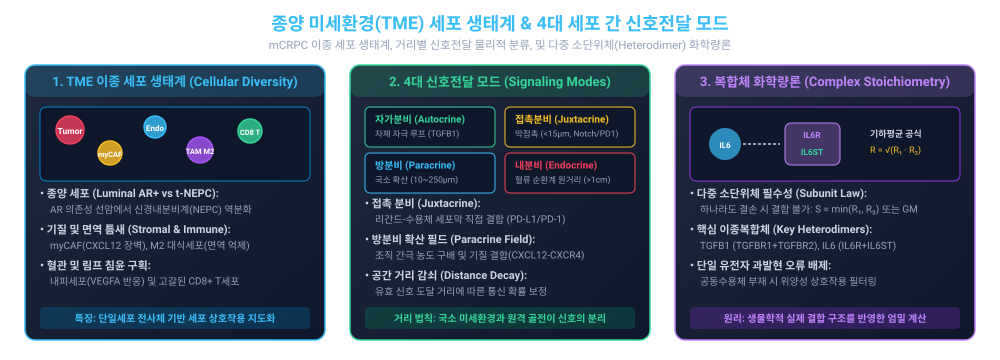

# Chapter 01. 종양 미세환경(TME) 생물학: 세포 사회학과 리간드-수용체 신호 양식

> **Cognitive Goal**: 종양 미세환경(TME)을 구성하는 악성 상피세포, 기질 세포(myCAF, iCAF, apCAF), 혈관/림프관 내피세포, 골수계 세포(TAM, MDSC), 림프구(CD8+ T, Treg, NK)의 분자 생태학적 역할을 이해하고, 내분비(Endocrine), 주변분비(Paracrine), 접촉매개(Juxtacrine), 자가분비(Autocrine) 신호 양식과 셰다아제(ADAM10/17)에 의한 막 절단 기전, 다중 소단위체(Multi-subunit heteromeric complex)의 화학량론(Stoichiometry)을 단일세포 전사체 수준에서 해석할 수 있다.

---

## 1. 종양 미세환경의 세포 사회학 (Tumor Sociology)

종양은 단일 클론의 증식체가 아니라, 수많은 이종 세포들이 물리적·생화학적 상호작용을 주고받으며 형성된 복합 생태계(Complex Cellular Ecosystem)입니다. 전립선암 미세환경을 구성하는 5대 핵심 세포 구획(Compartments)과 기능적 하위 아형의 생물학적 특성은 다음과 같습니다:

```
┌────────────────────────────────────────────────────────────────────────────────────────┐
│                        종양 미세환경(TME)의 5대 핵심 세포 구획                           │
├────────────────────────────────────────────────────────────────────────────────────────┤
│ 1. 악성 상피세포 (Malignant Epithelia)  : 관강세포(Luminal), 기저세포(Basal), 신경내분비(NEPC) │
│ 2. 암 연관 섬유아세포 (CAFs)            : 근섬유아세포(myCAF), 염증성(iCAF), 항원제시(apCAF) │
│ 3. 혈관/림프관 내피세포 (Endothelia)    : 혈관신생 팁/줄기세포(Tip/Stalk), 기저막 투과성 조절  │
│ 4. 골수계 면역세포 (Myeloid Compartment): M1/M2 종양 연관 대식세포(TAM), 과립구/단핵구 MDSC │
│ 5. 림프계 면역세포 (Lymphoid Lineage)   : 세포독성 CD8+ T세포, 조절 T세포(Treg), NK 세포     │
└────────────────────────────────────────────────────────────────────────────────────────┘
```



### 1.1 악성 상피세포 (Malignant Epithelial Cells)
- **관강 분화 상피세포(Luminal Adenocarcinoma)**: 안드로겐 수용체(*AR*) 및 하류 분화 마커(*KLK3/PSA*, *TMPRSS2*, *NKX3-1*)를 강력히 발현합니다.
- **치료 유도성 신경내분비 분화(Treatment-induced Neuroendocrine, t-NEPC)**: 차세대 AR 길항제(Enzalutamide, Abiraterone) 치료 압력 하에서 *TP53* 및 *RB1*의 이중 소실과 함께 전사 리프로그래밍이 발생합니다. 관강 마커가 소실되고 신경내분비 마커(*SYP*, *CHGA*, *NCAM1/CD56*) 및 마스터 전사인자(*ASCL1*, *NEUROD1*, *INSM1*)를 획득하여 안드로겐 비의존성 극단적 악성도로 진행합니다.

### 1.2 암 연관 섬유아세포 (Cancer-Associated Fibroblasts, CAFs)
단일세포 전사체 분석은 CAF가 단일 집단이 아니라 상호 대립적이거나 보완적인 기능을 수행하는 하위 아형들의 집합체임을 밝혔습니다. 다만 아래 myCAF/iCAF/apCAF 3분류와 국소화(myCAF 근접, iCAF 원위)는 주로 췌장암 모델에서 정립된 체계(Öhlund et al., J Exp Med 2017; Elyada et al., Cancer Discov 2019)이며 전립선암에 그대로 적용된다는 근거는 제한적입니다:
1. **근섬유아세포성 CAF (myCAF - Myofibroblastic CAF)**:
   - **핵심 분자 마커**: $\alpha$-SMA($ACTA2$), 트랜스겔린($TAGLN$), 칼포닌($CNN1$), 제1형 콜라겐($COL1A1, COL1A2$).
   - **유도 기전 및 기능**: 종양 세포 유래 $TGF\beta1$ 및 $TGF\beta2$ 신호에 의해 종양 선관에 바로 인접하여 분화합니다. 세포외기질(ECM) 콜라겐과 피브로넥틴을 대량 분비하고, 액토마이오신(Actomyosin) 수축력을 통해 조직 강성(Matrix Stiffness)을 증가시켜 기계생물학적(Mechanobiological) 종양 침습을 촉진합니다.
2. **염증성 CAF (iCAF - Inflammatory CAF)**:
   - **핵심 분자 마커**: 인터루킨-6($IL6$), 케모카인($CXCL12, CXCL1, CXCL2$), $PDGFRA$, 보체계 인자($C3, C7$).
   - **유도 기전 및 기능**: 종양 세포 유래 $IL1\alpha/IL1\beta$ 및 $TNF$에 의해 유도되며, 종양 실질에서 다소 떨어진 간질 영역에 주로 위치합니다. 사이토카인과 케모카인을 대량 분비하여 골수계 억제 세포를 미세환경으로 유인하고 종양 혈관 신생을 지원합니다.
3. **항원제시 CAF (apCAF - Antigen-Presenting CAF)**:
   - **핵심 분자 마커**: $CD74$, $HLA-DRA$, $HLA-DRB1$, $SLPI$.
   - **유도 기전 및 기능**: 골수계 항원제시세포처럼 MHC-II 분자와 불변 사슬($CD74$)을 발현하지만, T세포 활성화에 필수적인 공자극 분자($CD80, CD86, CD40$)가 결핍되어 있습니다. 결과적으로 CD4+ T세포와 결합하여 면역 활성화 대신 무반응(Anergy) 또는 조절 T세포(Treg) 분화를 유도하여 면역 억제 환경을 조성합니다.

### 1.3 혈관 및 림프관 내피세포 (Endothelial Compartment)
- **혈관신생 발아(Angiogenic Sprouting)**: 저산소증(Hypoxia) 환경에서 안정화된 $HIF1\alpha$에 의해 종양 및 기질 세포가 $VEGFA$를 대량 분비합니다.
- **Tip vs Stalk 세포 분화**: 내피세포 중 $VEGFR2$와 $DLL4$를 고발현하는 **팁 세포(Tip cell)**가 선두에서 기저막을 뚫고 전진하며, 인접한 세포는 $DLL4$-$NOTCH1$ 접촉 신호를 받아 $VEGFR2$를 하향 조절하고 줄기 증식을 담당하는 **스토크 세포(Stalk cell)**로 분화합니다.
- **내피 장벽 붕괴 및 혈관 누출성**: $VEGF$와 $ANGPT2$의 과도한 자극으로 혈관주위세포(Pericyte) 피복이 소실되어 종양 혈관은 구조적으로 비틀리고 불완전한 기저막을 형성하여 간질액 압력(IFP)을 높이고 약물 전달을 차단합니다.

### 1.4 골수계 면역세포 (Myeloid Compartment)
- **골수 유래 억제 세포 (MDSCs)**: 과립구성($G-MDSC$: $CD11b^+ CD15^+ LOX1^+$) 및 단핵구성($M-MDSC$: $CD11b^+ CD14^+ HLA-DR^{\text{low}}$)으로 나뉘며, 아르기나아제-1($ARG1$), 유도성 산화질소 합성효소($iNOS$), 활성산소종(ROS)을 분비하여 국소 $L$-아르기닌을 고갈시킴으로써 T세포 수용체(TCR) $\zeta$ 사슬의 발현을 억제합니다.
- **종양 연관 대식세포 (TAMs - Tumor-Associated Macrophages)**:
  - 전통적인 $M1$(항종양, $CD86, NOS2, TNF$) 대 $M2$(친종양, $CD163, MRC1/CD206, MARCO$)의 이분법을 넘어, 단일세포 전사체는 **$SPP1^+$ 혈관신생형 TAM**과 **$C1Q^+$ 면역조절형 TAM** 등 연속적인 기능적 스펙트럼을 나타냅니다. 저산소 니치에 위치한 TAM은 $HIF1\alpha$ 활성화를 통해 $VEGFA$와 $MMP9$를 분비하여 종양 혈관 신생 및 조직 리모델링을 주도합니다.

### 1.5 림프계 면역세포 (Lymphoid Lineage)
- **세포독성 CD8+ T세포**: 종양 특이 항원을 인식하지만, 만성적인 항원 노출과 기질 내 억제 신호로 인해 탈진(Exhaustion) 상태에 진입합니다. 억제성 면역관문 수용체인 $PDCD1$(PD-1), $HAVCR2$(TIM-3), $LAG3$, $TIGIT$를 점진적으로 획득하며 세포용해 단백질(Perforin/Granzyme) 분비 능력을 상실합니다.
- **조절 T세포 (Tregs)**: $FOXP3$, $IL2RA$(CD25), $CTLA4$를 발현하며, 고친화성 IL-2 수용체를 통해 미세환경 내 IL-2를 독점 고갈시키고, 막 결합형 $TGF\beta$ 및 면역억제 대사산물인 아데노신($CD39/CD73$ 축)을 통해 주변 CD8+ T세포 및 수지상세포의 기능을 마비시킵니다.
- **NK 세포 (Natural Killer Cells)**: MHC-I 결손 암세포를 감지하는 선천 면역 세포이나, 종양 세포의 $MICA/MICB$ 셰딩(Shedding)이나 $HLA-E$ 과발현($NKG2A$ 수용체 결합)에 의해 세포독성이 무력화됩니다.

---

## 2. 4대 세포 간 신호 전달 양식 (Signaling Modes)

세포 간 신호 전달은 신호 전달 물질의 물리적 이동 거리와 매개 방식에 따라 4가지 생물학적 양식으로 구분됩니다:

```
[4대 세포 간 신호 전달 양식의 공간적 도달 범위]
1. 접촉의존형 (Juxtacrine) : d = 0 nm (원형질막 직접 접촉 및 면역 시냅스)
2. 자가분비형 (Autocrine)   : d < 10 µm (신호 분비 세포 자신에게 작용)
3. 주변분비형 (Paracrine)   : d = 10 µm ~ 200 µm (간질액 확산 및 화학주성 구배)
4. 내분비형   (Endocrine)   : d > 1 cm (순환기계 및 림프계를 통한 전신 도달)
```

```
┌────────────────────────────────────────────────────────────────────────────────────────┐
│                              세포 간 신호 전달 4대 모드                                  │
├────────────────────────────────────────────────────────────────────────────────────────┤
│ (A) Autocrine (자가분비)   : 세포 A ──(리간드)──► 세포 A 수용체 (자가 생존 피드백)         │
│ (B) Paracrine (주변분비)   : 세포 A ──(확산)───► 세포 B 수용체 (국소 미세환경 구배)       │
│ (C) Juxtacrine (접촉매개)  : 세포 A [막결합 리간드] ── [막결합 수용체] 세포 B (물리적 접촉)│
│ (D) Endocrine (내분비)     : 세포 A ──(혈관 순환)──► 원격 표적 장기 세포 C                │
└────────────────────────────────────────────────────────────────────────────────────────┘
```

1. **접촉의존형 신호 (Juxtacrine / Contact-Dependent)**:
   - 세포막에 고정된 막관통 리간드가 인접 세포의 막관통 수용체와 직접 물리적으로 결합해야만 신호가 전달됩니다.
   - 대표 예시: $NOTCH1/2/3/4$ 수용체와 $DLL1/4$, $JAG1/2$ 리간드 간 결합, $Eph$ 수용체와 $Ephrin$ 리간드, $PDCD1$(T세포)과 $CD274$/PD-L1(종양세포) 간의 면역 시냅스 상호작용.
2. **주변분비형 신호 (Paracrine)**:
   - 한 세포에서 가용성 단백질 형태로 분비된 리간드가 세포간질액(Interstitial Fluid)을 통해 자유 확산(Diffusion)하여 반경 수십~수백 마이크로미터 이내의 인접 세포 수용체에 도달합니다.
   - 농도 구배(Morphogen Gradient)를 형성하여 표적 세포의 위치 정보를 부여하며, $TGF\beta1$, $VEGFA$, $CXCL12$, $WNT$ 계열 신호가 이에 해당합니다.
3. **자가분비형 신호 (Autocrine)**:
   - 세포가 분비한 리간드가 자기 자신의 세포막 수용체에 결합하여 자가 증식 및 생존 루프를 형성합니다.
   - 암세포가 $EGF$, $TGFA$를 분비하여 자신의 $EGFR$을 자극하거나, $VEGFA$를 자가 분비하여 세포 내 생존 경로($PI3K/AKT$)를 가동하는 현상이 대표적입니다.
4. **내분비형 신호 (Endocrine)**:
   - 호르몬이나 전신성 사이토카인이 혈류나 림프관을 타고 원격 장기로 수송되어 표적 세포에 작용합니다.
   - 고환 및 부신에서 분비된 테스토스테론/디하이드로테스토스테론(DHT)이 혈관을 통해 전립선 상피세포의 안드로겐 수용체를 활성화하는 전립선 항상성 축이 대표적입니다.

---

## 3. 막 결합형 vs 가용성 리간드 및 엑토도메인 셰딩 (Ectodomain Shedding)

많은 리간드는 초기에 막관통 전구체 단백질(Transmembrane Precursor) 형태로 합성되어 원형질막에 발현됩니다. 이때 세포 표면에 존재하는 막 단백질 분해 효소인 **셰다아제(Sheddases)**에 의해 세포외 도메인이 절단되면, 신호 전달 양식이 **접촉의존형(Juxtacrine)에서 광범위 확산형(Paracrine)으로 전환**됩니다.

### 3.1 ADAM 계열 및 MMP 단백질 분해 효소
- **ADAM10 및 ADAM17 (TACE - TNF-$\alpha$ Converting Enzyme)**:
  - 아연 의존성 메탈로프로테아제로서 막관통 전구체의 줄기 영역(Stalk Region)을 특이적으로 절단합니다.
  - 주요 절단 기질:
    - 막 결합형 $pro\text{-}TNF\alpha \xrightarrow{\text{ADAM17}} 가용성\ sTNF\alpha$ (전신 염증 및 세포 사멸 유도)
    - 막 결합형 $pro\text{-}HB\text{-}EGF, pro\text{-}TGFA \xrightarrow{\text{ADAM10/17}} 가용성\ EGFR\ 리간드$ (원거리 상피 증식 유도)
    - $NOTCH1$ 수용체의 S2 절단 (S1/S2/S3 연속 절단을 통한 NICD 핵 전위 필수 단계)
- **기질 메탈로프로테아제 (MMPs: MMP2, MMP9, MMP14)**:
  - 세포외기질 콜라겐과 라미닌을 분해하여 물리적 통로를 개척할 뿐만 아니라, 세포막 당단백질인 $CD44$나 $E\text{-}cadherin$을 절단하여 세포 간 접착을 해제하고 원격 침습을 유도합니다.

```
[엑토도메인 셰딩에 의한 신호 반경의 비약적 확장]
[세포막 고정 상태 (Juxtacrine)]                 [ADAM10/17 절단 후 (Paracrine)]
  세포 A 막 ──[막관통 전구체]                     세포 A 막 ──[줄기 잔여체]
                   │                                     + (절단 유리)
                   ▼ (접촉 한정)                           ▼ (간질액 확산)
  세포 B 막 ──[수용체] (d = 0 µm)                 세포 C, D, E 막 ──[수용체] (d = 100 µm)
```

단일세포 전사체 분석에서 특정 리간드(예: $TNF$, $HBEGF$, $JAG1$)의 mRNA가 검출되었을 때, 해당 세포가 *ADAM10*, *ADAM17*, *MMP* 계열 효소를 함께 동시 발현하는지 여부를 검토해야만 해당 신호가 접촉 의존형인지 가용성 주변분비형인지를 생물학적으로 정확히 판정할 수 있습니다.

---

## 4. 다중 소단위체 이종 복합체 (Multi-subunit Heteromeric Complexes)

세포 간 신호 전달 연구에서 가장 흔히 발생하는 중대한 오류 중 하나는 **"1 유전자 = 1 리간드 = 1 수용체"라는 단순 선형 모델의 오류**입니다. 실제 생체 내 핵심 신호 체계의 상당수는 2개 이상의 서로 다른 폴리펩타이드 사슬이 화학량론적 비율(Stoichiometry)로 조립되어야만 리간드 결합 포켓을 형성하거나 세포 내로 인산화 캐스케이드를 전달합니다.

### 4.1 인테그린 이종이량체 ($\alpha\beta$ Heterodimers)
인테그린은 세포와 세포외기질(ECM) 간의 물리적 기계화학적 접착을 매개하는 수용체로서, 반드시 하나의 $\alpha$ 소단위체와 하나의 $\beta$ 소단위체가 비공유 결합으로 $1:1$ 결합해야 기능합니다:
- **$\alpha_V \beta_3$ 인테그린 ($ITGAV + ITGB3$)**: 비트로넥틴, 피브로넥틴, 오스테오폰틴($SPP1$)에 존재하는 $RGD$ 모티프를 인식하며, 종양 혈관신생 내피세포 및 전립선암 뼈 전이 세포의 생존을 지원합니다.
- **$\alpha_5 \beta_1$ 인테그린 ($ITGA5 + ITGB1$)**: 피브로넥틴($FN1$)의 주 수용체로서 기질 경화에 반응하여 암세포 침습을 유도합니다.
- **분석적 함의**: 만약 어떤 세포가 $ITGAV$를 아무리 높게 발현하더라도 $ITGB3$ 발현량이 $0$이라면, 기능적 $\alpha_V \beta_3$ 인테그린 복합체는 $0\%$ 형성되므로 해당 L-R 상호작용은 완전히 비활성(Inactive)으로 판정되어야 합니다.

### 4.2 인터루킨-6 수용체 복합체 ($IL6 + IL6R + IL6ST$)
IL-6 신호 전달은 신호 개시 복합체 조립에 엄격한 화학량론을 요구합니다:
- **클래식 신호 전달(Classic Signaling)**:
  - $IL6$ 분자가 특이적 결합 사슬인 $IL6R$($gp80$, $\alpha$ 사슬)에 결합한 후, 범용 신호 전달 막관통 당단백질인 $IL6ST$($gp130$, $\beta$ 사슬) 2분자를 동원하여 **$2:2:2$ 육량체 복합체 (Hexameric Complex: $2 \times IL6 : 2 \times IL6R : 2 \times gp130$)**를 형성합니다.
  - $gp130$의 세포 내 도메인에 결합된 $JAK1/JAK2$가 교차 인산화되고 하류의 $STAT3$를 인산화하여 핵으로 전위시킵니다.
- **트랜스 신호 전달(Trans-signaling)**:
  - 면역세포 표면에서 ADAM17에 의해 절단된 가용성 IL-6R($sIL6R$)이 세포 밖에서 $IL6$와 결합한 후, $IL6R$이 없는 세포 표면의 $gp130$에 결합하여 신호를 전달합니다. 이는 $gp130$만을 발현하는 전립선암 상피세포에 강력한 염증성 생존 신호를 제공합니다.

### 4.3 TGF-$\beta$ 수용체 사량체 복합체 ($TGFBR1 + TGFBR2$)
TGF-$\beta$ 상호작용은 수용체 간의 순차적 인산화 연쇄 반응에 의존합니다:
- **수용체 구조**: 2분자의 제2형 수용체($TGFBR2$)와 2분자의 제1형 수용체($TGFBR1/ALK5$)가 결합하여 **사량체 이종 복합체 (Tetrameric Complex)**를 형성합니다.
- **활성화 기전**: $TGF\beta1/2/3$ 리간드 이량체가 항시성 활성형 세린/트레오닌 키나아제인 $TGFBR2$에 결합하면, $TGFBR2$가 $TGFBR1$의 GS 도메인을 인산화하여 활성화하고, 활성화된 $TGFBR1$이 수용체 조절형 $SMAD2/3$ 단백질을 인산화하여 전사를 조절합니다.
- **결함의 파급 효과**: $TGFBR2$ 유전자에 결손이나 돌연변이가 발생하면 $TGFBR1$이 정상 발현되어도 신호가 완전히 차단됩니다.

---

## 5. 실전 Python 분석: Scanpy를 활용한 TME 세포 아형 및 다중 소단위체 발현 프로파일링

단일세포 데이터에서 세포 아형 마커와 다중 소단위체 수용체 구성 요소들의 동시 발현 여부를 확인하는 Python 실전 분석 파이프라인입니다:

```python
import scanpy as sc
import numpy as np
import pandas as pd
import matplotlib.pyplot as plt

# 1. 단일세포 전립선암 TME 데이터셋 로드 (Kfoury et al. 또는 튜토리얼 AnnData)
# adata = sc.read_h5ad("data/processed/mcrpc_bone_tme.h5ad")

# 2. TME 5대 구획 및 CAF/TAM 하위 아형 핵심 마커 유전자 딕셔너리 정의
marker_dict = {
    "Malignant_Luminal": ["KLK3", "TMPRSS2", "AR"],
    "NEPC_Transdiff": ["ASCL1", "SYP", "CHGA", "NCAM1"],
    "myCAF": ["ACTA2", "TAGLN", "COL1A1", "COL1A2"],
    "iCAF": ["IL6", "CXCL12", "PDGFRA", "C3"],
    "apCAF": ["CD74", "HLA-DRA", "HLA-DRB1"],
    "Endothelial_Tip": ["KDR", "DLL4", "ESM1"],   # VEGFR2의 HGNC 심볼은 KDR
    "M2_TAM_SPP1": ["CD68", "CD163", "MRC1", "SPP1"],
    "CD8_T_Exhausted": ["CD8A", "PDCD1", "HAVCR2", "LAG3"],
    "Treg": ["FOXP3", "IL2RA", "CTLA4"]
}

# 3. 다중 소단위체(Multi-subunit) 복합체 유전자 세트 정의
complex_dict = {
    "Integrin_aVb3": ["ITGAV", "ITGB3"],
    "IL6_Receptor_Complex": ["IL6R", "IL6ST"],
    "TGFb_Receptor_Complex": ["TGFBR1", "TGFBR2"]
}

print("Defining cell-type signatures and multi-subunit complex components...")
for comp, subunits in complex_dict.items():
    print(f" - Complex: {comp} -> Required Subunits: {subunits}")

# 4. 개별 소단위체 유전자 발현의 기하평균(Geometric Mean)을 통한 기능적 복합체 활성 점수 산출 함수
def compute_complex_activity(adata, subunits, complex_name):
    """
    다중 소단위체 유전자들의 동시 발현을 기하평균(Geometric Mean)으로 산출하여
    어느 한 유전자라도 발현되지 않으면 복합체 활성이 0이 되도록 엄격 모델링합니다.
    """
    valid_genes = [g for g in subunits if g in adata.var_names]
    if len(valid_genes) < len(subunits):
        missing = set(subunits) - set(valid_genes)
        print(f"[Warning] Subunits {missing} missing in dataset. Complex {complex_name} set to 0.")
        adata.obs[complex_name] = 0.0
        return
    
    # 정규화된 발현 행렬(log1p counts) 추출 (비음수 값이어야 함)
    sub_mat = adata[:, valid_genes].X
    if hasattr(sub_mat, "toarray"):
        sub_mat = sub_mat.toarray()
    if (sub_mat < 0).any():
        raise ValueError("음수 값 감지: sc.pp.scale 등으로 스케일된 행렬에서는 분수 거듭제곱이 NaN이 되므로 정규화 카운트 레이어를 사용하세요.")
    
    # 비음수 스케일에서의 기하평균: (prod(x_i))^(1/n) = exp(mean(log x_i)); 하나라도 0이면 0
    prod_mat = np.prod(sub_mat, axis=1)
    geom_mean = np.power(prod_mat, 1.0 / len(valid_genes))
    adata.obs[complex_name] = geom_mean
    print(f"[Success] Successfully computed activity for {complex_name} across {adata.n_obs} cells.")

# 예시: 가상 데이터 적용 시
# for comp_name, genes in complex_dict.items():
#     compute_complex_activity(adata, genes, comp_name)
```

---

## 단원 핵심 점검 (Cognitive Checkpoint & Case Study)

### [문제 1. 핵심 개념 능동 회상 (Active Recall)]
암 연관 섬유아세포(CAF)의 3대 주요 기능적 하위 아형인 근섬유아세포성 CAF(myCAF), 염증성 CAF(iCAF), 항원제시 CAF(apCAF)의 대표적인 세포 표면/세포질 마커 유전자 조합을 각각 2개 이상 제시하고, 종양 미세환경 내 공간적 국소화(Spatial Localization) 및 면역세포에 미치는 기능적 차이점을 비교 서술하시오.

<details>
<summary>💡 모범 답안 및 해설 확인</summary>

1. **CAF 3대 아형의 마커 조합**:
   - **myCAF**: $\alpha$-SMA($ACTA2$), 트랜스겔린($TAGLN$), 칼포닌($CNN1$), 제1형 콜라겐($COL1A1$).
   - **iCAF**: 인터루킨-6($IL6$), 케모카인($CXCL12, CXCL1$), $PDGFRA$.
   - **apCAF**: $CD74$, $HLA-DRA$, $HLA-DRB1$.
2. **공간적 국소화 및 면역학적 기능 비교**:
   - **myCAF**:
     - **위치**: 악성 종양 상피세포 선관에 매우 밀접하게 접촉하여 위치합니다.
     - **기능**: $TGF\beta$ 자극에 반응하여 치밀한 콜라겐 기질을 침착시키고 물리적 수축력을 행사함으로써 기질 경화를 유도합니다. 이 치밀한 기질 장벽은 CD8+ T세포가 종양 실질 내부로 침투하는 것을 물리적으로 차단(Immune Exclusion)합니다.
   - **iCAF**:
     - **위치**: 종양 실질로부터 다소 떨어진 외곽 간질(Distal Stroma) 영역에 주로 분포합니다.
     - **기능**: $IL-1$ 및 $TNF$ 자극에 반응하여 가용성 염증 인자($IL6, CXCL12$)를 원거리로 분비합니다. 이는 골수계 유래 억제 세포(MDSC)와 대식세포를 종양 부위로 주화성 이동시키며 종양 혈관 신생을 유도합니다.
   - **apCAF**:
     - **위치**: 림프구가 풍부한 영역 근처에 있다는 보고가 있으나, 암종·연구에 따라 달라 확립된 국소화는 아닙니다.
     - **기능**: MHC-II 복합체를 발현하여 CD4+ T세포에 펩타이드를 제시할 수 있으나, $CD80, CD86$과 같은 필수 공자극 분자(Costimulatory molecules)가 결손되어 있습니다. 결과적으로 T세포 수용체를 결합시킨 후 보조 자극을 주지 못해 T세포 무반응(Anergy)을 유도하거나 조절 T세포(Treg)로의 분화를 촉진하여 국소 면역 관용을 유발합니다.

</details>

---

### [문제 2. 핵심 개념 능동 회상 (Active Recall)]
세포 표면 막 단백질 절단 효소인 ADAM10 및 ADAM17(TACE)에 의해 일어나는 **'엑토도메인 셰딩(Ectodomain Shedding)'**의 생화학적 기전을 설명하고, 이 과정이 세포 간 통신(Cell-Cell Communication)의 신호 전달 양식(Signaling Modes) 및 유효 작동 반경(Effective Spatial Reach)에 미치는 영향을 서술하시오.

<details>
<summary>💡 모범 답안 및 해설 확인</summary>

1. **생화학적 기전**:
   - ADAM10 및 ADAM17은 아연 의존성 메탈로프로테아제(Metalloproteases)로서, 막관통 전구체 단백질(Type I/II transmembrane proteins)의 세포외 영역 중 원형질막에 인접한 줄기 영역(Juxtamembrane stalk region)을 특이적으로 가수분해하여 절단합니다.
   - 이를 통해 막에 고정되어 있던 기능적 리간드 도메인(예: $pro\text{-}TNF\alpha$, $pro\text{-}HB\text{-}EGF$, $pro\text{-}TGFA$, $MICA/MICB$)이 세포외 공간으로 방출됩니다.
2. **신호 전달 양식 및 공간적 도달 반경에 미치는 영향**:
   - **양식 전환**: 세포막 간의 직접적인 물리적 접촉을 필수로 요구하던 **접촉의존형 신호(Juxtacrine Mode, 작동 거리 $d=0$)**를 세포간질액을 통해 자유 확산할 수 있는 **주변분비형 신호(Paracrine Mode)** 또는 혈류를 타는 **내분비형 신호(Endocrine Mode)**로 전환시킵니다.
   - **유효 작동 반경의 확장**: 절단된 가용성 리간드는 농도 구배(Concentration Gradient)를 형성하여 원래 리간드를 합성한 세포로부터 수십~수백 마이크로미터($10\sim200\ \mu\text{m}$) 떨어진 원격 세포의 동족 수용체를 활성화할 수 있게 됩니다.
   - **면역 회피 및 신호 다각화**: 예컨대 NK 세포의 활성화 수용체 리간드인 $MICA/MICB$가 암세포 표면에서 셰딩되면, NK 세포는 암세포를 직접 접촉 인식하지 못할 뿐만 아니라 혈중으로 방출된 가용성 리간드가 NK 세포의 $NKG2D$ 수용체를 조기 포화 및 내재화시켜 전신성 면역 저하를 초래합니다.

</details>

---

### [문제 3. 임상 사례 분석 (Clinical Interpretation Case Study)]
**[임상 시나리오]**
골 전이가 진행된 전립선암 환자 코호트의 단일세포 전사체 데이터를 분석하던 한 연구원이, 암세포 클러스터에서 파골세포 분화 억제 및 골전이 차단 타깃을 발굴하기 위해 리간드-수용체 발현을 검색했습니다.
그 결과, 암세포에서 오스테오폰틴($SPP1$) 리간드가 최고 수준으로 발현되어 있었고, 골수 내피세포 클러스터에서는 알파 수용체인 $ITGAV$(Integrin $\alpha_V$)가 높은 수준(발현 백분율 85%)으로 발현되어 있었습니다. 연구원은 이를 근거로 "암세포와 내피세포 간의 강력한 $\alpha_V \beta_3$ 인테그린 결합 신호가 혈관신생을 주도하고 있다"고 보고서를 작성했습니다.
그러나 추가 전사체 검증 결과, 해당 내피세포 클러스터에서 베타 수용체인 $ITGB3$(Integrin $\beta_3$)의 발현율은 $0.2\%$에 불과했으며 발현량 또한 0에 수렴했습니다.

**[질문]**
1. 이 연구원의 생물학적 결론이 지닌 오류를 **다중 소단위체 이종 복합체(Heteromeric Complex)의 화학량론(Stoichiometry)** 관점에서 논리적으로 비판하시오.
2. 이 내피세포 클러스터에서 $ITGAV$가 실제로 기능적 수용체 복합체를 형성할 수 있는 다른 잠재적 $\beta$ 소단위체 파트너 유전자들을 2가지 제시하고, 단일세포 통신 추론 알고리즘이 이러한 위양성을 방지하기 위해 채택해야 하는 수학적 결합 함수를 기술하시오.

<details>
<summary>💡 모범 답안 및 해설 확인</summary>

1. **오류 비판**:
   - $\alpha_V \beta_3$ 인테그린은 $ITGAV$ 단독으로 활성을 가질 수 없으며, 반드시 $ITGAV$ 폴리펩타이드와 $ITGB3$ 폴리펩타이드가 소포체(ER) 및 골지체에서 $1:1$ 화학량론적 비율로 비공유 결합하여 이종이량체(Heterodimer)를 형성해야만 세포 표면에 안착하고 $RGD$ 리간드 결합 포켓을 완성합니다.
   - 내피세포에서 $ITGB3$의 발현율이 $0.2\%$에 불과하다는 것은 물리적인 $\alpha_V \beta_3$ 복합체 형성이 원천적으로 불가능함을 의미합니다. 따라서 $ITGAV$의 단독 고발현만을 근거로 $\alpha_V \beta_3$ 매개 신호 활성화를 주장하는 것은 심각한 생물학적 위양성(False Positive) 오류입니다.
2. **대체 $\beta$ 파트너 및 수학적 결합 모델**:
   - **대체 잠재 파트너**: $ITGAV$는 $\beta_3$ 외에도 다른 $\beta$ 소단위체들과 이종이량체를 형성할 수 있습니다:
     - $ITGB1$ ($\alpha_V \beta_1$ 복합체: 피브로넥틴 및 비트로넥틴 결합)
     - $ITGB5$ ($\alpha_V \beta_5$ 복합체: 비트로넥틴 특이 결합 및 혈관 내피 투과성 조절)
     - $ITGB6$ ($\alpha_V \beta_6$ 복합체: 잠재형 $TGF\beta1$ 복합체의 물리적 활성화)
   - **위양성 방지를 위한 수학적 결합 함수**:
     - 다중 소단위체 복합체의 총 발현량 $R$을 단순 산술평균(Arithmetic Mean)으로 계산하면 한 인자가 0이어도 양수 값이 산출되는 왜곡이 발생하므로, **기하평균(Geometric Mean)** 또는 **최소값(Minimum) 연산자**를 채택해야 합니다:
       $$R_{\text{complex}} = \min(E_{ITGAV}, E_{ITGB3}) \quad \text{또는} \quad R_{\text{complex}} = \sqrt{E_{ITGAV} \times E_{ITGB3}}$$
     - 위 함수를 적용하면 $E_{ITGB3} \approx 0$인 경우 복합체 활성 $R_{\text{complex}}$가 $0$이 되어 전산적 위양성 예측을 줄입니다. 다만 드롭아웃으로 한 소단위체가 0으로 관측되는 경우에는 위음성이 늘어나는 트레이드오프가 있습니다(실제 도구는 CellPhoneDB는 최소값, CellChat은 trimean 후 기하평균, LIANA는 `expr_prop`으로 소단위체 발현율을 확인).

</details>

---

<!-- REFERENCES:BEGIN (generated by scripts/apply_references.py; do not edit by hand) -->
## 참고문헌 (References)
### 본문 인용 문헌
1. Öhlund D, Handly-Santana A, Biffi G, et al. Distinct populations of inflammatory fibroblasts and myofibroblasts in pancreatic cancer. *J Exp Med*. 2017;214(3):579-596. PMID: 28232471. doi: 10.1084/jem.20162024
2. Elyada E, Bolisetty M, Laise P, et al. Cross-Species Single-Cell Analysis of Pancreatic Ductal Adenocarcinoma Reveals Antigen-Presenting Cancer-Associated Fibroblasts. *Cancer Discov*. 2019;9(8):1102-1123. PMID: 31197017. doi: 10.1158/2159-8290.CD-19-0094
### 소프트웨어 (표기 버전은 검수 시 API를 확인한 버전이며, 파이프라인 실행 환경은 requirements-pipelines.txt 참조)
- Matplotlib 3.11.2 (github.com/matplotlib/matplotlib). 원 논문: Hunter JD. Matplotlib: A 2D Graphics Environment. *Comput. Sci. Eng*. 2007;9(3):90-95. doi: 10.1109/mcse.2007.55
- NumPy 2.5.4 (numpy.org). 원 논문: Harris CR, Millman KJ, van der Walt SJ, et al. Array programming with NumPy. *Nature*. 2020;585(7825):357-362. PMID: 32939066. doi: 10.1038/s41586-020-2649-2
- pandas 2.3.3 (github.com/pandas-dev/pandas). 원 논문: McKinney W. Data Structures for Statistical Computing in Python. *Proceedings of the Python in Science Conference*. 2010:56-61. doi: 10.25080/majora-92bf1922-00a
- Scanpy 1.12.4 (github.com/scverse/scanpy). 원 논문: Wolf FA, Angerer P, Theis FJ. SCANPY: large-scale single-cell gene expression data analysis. *Genome Biol*. 2018;19(1):15. PMID: 29409532. doi: 10.1186/s13059-017-1382-0
<!-- REFERENCES:END -->
