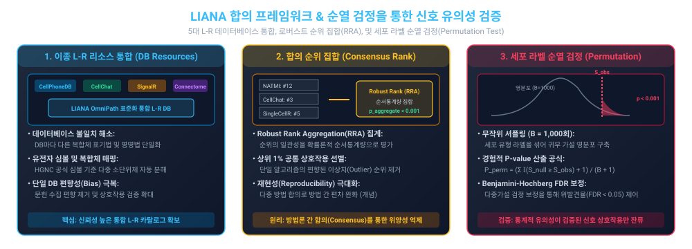

# Chapter 02. 리간드-수용체 데이터베이스 큐레이션 및 LIANA 합의 순위 집계

> **Cognitive Goal**: CellPhoneDB, CellChatDB, ICELLNET, SingleCellSignalR, Guide2Pharma 등 5대 주요 리간드-수용체(L-R) 데이터베이스의 큐레이션 철학과 분자 포괄성 차이를 이해하고, 단일 데이터베이스 편향성에 따른 위양성/위음성 위험을 방지하기 위한 `LIANA+` 프레임워크의 합의 순위 집계 알고리즘(LIANA의 실제 방법은 Robust Rank Aggregation(RRA, 옵션 mean); Borda Count는 비LIANA 일반 이론)을 수학적으로 유도하고 파이썬 코드로 구현할 수 있다.

---

## 1. 파편화된 리간드-수용체 데이터베이스 지형도 (The Fragmented L-R Landscape)

단일세포 세포 간 통신(Cell-Cell Communication, CCC) 분석 도구의 성능은 해당 도구가 참조하는 기본 리간드-수용체 데이터베이스(Prior Knowledge Database)의 품질과 범위에 의해 근본적으로 결정됩니다. 그러나 현재 생명정보학 생태계에는 단일의 표준 데이터베이스가 존재하지 않으며, 각 연구 그룹이 상이한 목적과 큐레이션 기준으로 구축한 독립 데이터베이스들이 파편화되어 공존하고 있습니다.

```
┌────────────────────────────────────────────────────────────────────────────────────────┐
│                        5대 핵심 리간드-수용체 데이터베이스 비교                          │
├────────────────────────────────────────────────────────────────────────────────────────┤
│ 1. CellPhoneDB       : 다중 소단위체(Heteromer) 복합체 구조 및 단백질 복합체 엄격 큐레이션│
│ 2. CellChatDB        : 분비 신호, 세포 접촉, 세포외기질(ECM) 및 공통 보조인자(Cofactors) 반영│
│ 3. ICELLNET          : 면역 사이토카인/케모카인 중심, 6개 기능 패밀리 계층 분류 및 생물학적 가중치│
│ 4. SingleCellSignalR : 문헌 텍스트 마이닝 기반 LRdb, 주변분비/자가분비 특화 벤치마크      │
│ 5. Guide2Pharma      : IUPHAR/BPS 공식 약리학적 표적, 고친화성 임상 약물 타깃 큐레이션   │
└────────────────────────────────────────────────────────────────────────────────────────┘
```



### 1.1 주요 데이터베이스별 큐레이션 원리와 특징
1. **CellPhoneDB (Teichmann Lab, Cambridge)**:
   - **큐레이션 철학**: 단백질 3차원 구조와 생화학적 복합체 조립의 엄밀성에 최우선 순위를 둡니다.
   - **강점**: 구조·생화학 문헌에 기반한 수동 큐레이션(Manual Curation)으로 인테그린($\alpha\beta$), 인터루킨 수용체, TGF-$\beta$ 수용체와 같은 **다중 소단위체 이종 복합체(Multi-subunit heteromers)**를 데이터베이스 차원에서 최초로 체계화했습니다.
   - **데이터 버전**: v2(기본 복합체)에서 출발하여 v3/v4/v5로 진화하며 세포 표면 단백질 간 상호작용 및 비펩타이드성 분자(신경전달물질, 스테로이드 호르몬 등)로 범위를 확장하고 있습니다.
2. **CellChatDB (Suoqin Jin & Qing Nie Lab, UC Irvine)**:
   - **큐레이션 철학**: 리간드와 수용체의 단순 결합뿐만 아니라 신호의 기능적 조절 인자(Regulators)를 포괄합니다.
   - **강점**: 신호를 세 가지 범주(Secreted Signaling, ECM-Receptor, Cell-Cell Contact)로 명확히 분리하고, 신호를 촉진하거나 억제하는 **가용성 보조 인자(Agonists, Antagonists)** 및 공수용체(Co-receptors) 정보를 포함합니다. 마우스(Mouse)와 인간(Human) 데이터를 체계적으로 분리 지원합니다.
3. **ICELLNET (Noël Lab, Curie Institute)**:
   - **큐레이션 철학**: 면역학적 세포 간 대화(Immunological Dialogue)의 정밀한 정량화에 특화되어 있습니다.
   - **강점**: 약 380개의 리간드–수용체 상호작용을 6개 기능 계열(antigen binding, checkpoint, chemokine, cytokine, growth factor, Notch signaling; 인터루킨·인터페론·TNF는 cytokine의 하위 계열)로 분류하고, 각 상호작용의 생체 내 타당성을 문헌 검증 수준에 따라 가중치화했습니다.
4. **SingleCellSignalR / LRdb (Cabello-Aguilar et al.)**:
   - **큐레이션 철학**: FANTOM5·HPRD·HPMR·IUPHAR/BPS·UniProt 주석을 GO·Reactome 등으로 필터링한 뒤 수작업 큐레이션을 더한 구축(문헌 텍스트마이닝이 아님).
   - **강점**: 3,251개의 상호작용 쌍(자동 구축 3,085 + 수작업 166)을 수록하고 있으며, 주변분비(Paracrine)와 자가분비(Autocrine) 신호의 정량적 점수화(Regularized LR score)에 최적화되어 있습니다.
5. **Guide to PHARMACOLOGY (Guide2Pharma / IUPHAR/BPS)**:
   - **큐레이션 철학**: 국제 약리학 연합(IUPHAR) 및 영국 약리학회(BPS)가 공식 인증한 약리학적 상호작용 데이터.
   - **강점**: 생체 외(In vitro) 결합 상수가 명확히 증명된 고친화성(High-affinity) 리간드-수용체 쌍만을 수록하며, 현재 FDA 승인 약물이나 임상 파이프라인에서 타깃팅 가능한 상호작용을 식별하는 데 독보적인 신뢰도를 제공합니다.

---

## 2. 단일 데이터베이스 의존의 체계적 오류와 편향성 (Systematic Discordance)

특정 연구에서 단 하나의 L-R 데이터베이스만을 선택하여 분석을 수행할 경우, 다음과 같은 체계적 불일치(Discordance)와 편향이 발생합니다:

```
[단일 데이터베이스 편향성의 원인과 파급 효과]
1. 낮은 상호작용 교집합   : 5대 데이터베이스 간 벤다이어그램 공통 교집합은 전체의 25~35%에 불과
2. 유전자 명명법 불일치   : HGNC 공식 심볼 vs 과거 별칭(Aliases), Entrez ID 매핑 충돌
3. 생물학적 편향(Bias)    : 특정 연구 분야(면역 vs 구조생물학 vs 약리학)에 따른 왜곡
4. 위양성 / 위음성 공존   : 고처리량 Y2H 유래 위양성 vs 다중 소단위체 부재로 인한 위음성
```

### 2.1 상호작용 교집합의 극단적 결핍 (Low Overlap)
벤치마크 연구(Dimitrov et al., *Nature Communications* 13:3224, 2022, PMID 35680885)에 따르면, 주요 공공 데이터베이스 간의 상호작용 쌍 일치도는 낮습니다. 논문이 보고한 수치는 16개 자원에서 평균 10.4%의 고유 상호작용, 방법·자원 간 상위 예측의 쌍별 Jaccard 지수 중앙값 0.080~0.119입니다.
- 일부 자원에만 있는 상호작용이 많고, 복합체 처리 방식도 자원마다 다릅니다.
- 이 때문에 어떤 단일 자원·방법을 선택하느냐에 따라 유의 상호작용 목록이 크게 달라지는 **"도구 의존적 편향(Tool-dependent Bias)"**이 발생합니다(이전 서술의 '교집합 25~35%', '최대 60%' 등은 논문에 없는 수치라 삭제).

### 2.2 위양성(False Positive)과 위음성(False Negative)의 발생 기전
1. **위양성 위험**:
   - 이스트 투-하이브리드(Y2H)나 전장 단백질 마이크로어레이와 같은 고처리량 생체 외(In vitro) 스크리닝 데이터베이스를 무비판적으로 수용한 경우, 생체 내(In vivo)에서는 물리적으로 분리되어 결코 만날 수 없거나 친화도($K_d$)가 마이크로몰($\mu\text{M}$) 이상으로 매우 약한 비생리학적 결합이 유의한 상호작용으로 잘못 검출됩니다.
2. **위음성 위험**:
   - 다중 소단위체 복합체 정보가 없는 데이터베이스를 사용할 경우, 복합체 구성 유전자 중 하나만 발현해도 신호가 활성화된 것으로 오판하거나, 반대로 복합체 규칙을 지원하지 못해 실제 매우 중요한 핵심 면역 신호(예: $IL12A + IL12B \to IL12RB1 + IL12RB2$)를 분석에서 완전히 누락시킵니다.

---

## 3. LIANA+ 합의 순위 집계 프레임워크 (Consensus Rank Aggregation)

이러한 파편화 문제를 해결하기 위해, Dimitrov 등은 모든 주요 L-R 자원을 단일 지식 그래프인 **OmniPath**로 통합하고, 여러 통계적 파이프라인(CellPhoneDB, SingleCellSignalR, Connectome, NATMI, SingleCellSignalR)의 예측 순위를 수학적으로 결합하는 **`LIANA+` (Ligand-Receptor InterAction ANALysis)** 합의 프레임워크를 개발했습니다.

```
┌────────────────────────────────────────────────────────────────────────────────────────┐
│                        LIANA+ 합의 순위 집계 파이프라인                                  │
├────────────────────────────────────────────────────────────────────────────────────────┤
│ [입력 데이터]  : scRNA-seq AnnData + 통합 OmniPath L-R 데이터베이스                    │
│ [다중 분석]    : K개 알고리즘 (CellPhoneDB, NATMI, SingleCellSignalR, Connectome) 독립 실행│
│ [순위 정규화]  : 각 알고리즘별 L-R 상호작용 예측값에 대한 순위 r_(i,k) 부여 (1 ~ N)    │
│ [합의 집계]    : Robust Rank Aggregation (RRA; 옵션 mean) — magnitude/specificity 순위별  │
│ [최종 출력]    : 특정 단일 툴에 편향되지 않는 견고한 합의 순위(Consensus Ranking) 도출  │
└────────────────────────────────────────────────────────────────────────────────────────┘
```

### 3.1 보다 투표법 (Borda Count) — 일반 순위 집계 이론 (LIANA/LIANA+에는 구현되어 있지 않음)
보다 투표법(Borda Count)은 다수결 투표 이론에서 유래한 위치 기반 순위 집계(Positional Voting) 방식입니다.
$N$개의 L-R 상호작용 후보와 $K$개의 독립적인 점수화 방법(Scoring Methods)이 주어졌을 때, 방법 $k$에서 상호작용 $i$가 차지하는 순위를 $r_{i,k} \in \{1, 2, \dots, N\}$ (1위가 가장 유의미)이라 정의합니다.

상호작용 $i$의 Borda 점수 $B_i$는 다음과 같이 정의됩니다:
$$B_i = \sum_{k=1}^K (N - r_{i,k} + 1)$$

모든 방법에 대해 $0$과 $1$ 사이의 값으로 스케일링된 정규화 Borda 점수(Normalized Borda Score) $\bar{B}_i$는 다음과 같습니다:
$$\bar{B}_i = \frac{1}{K} \sum_{k=1}^K \left(1 - \frac{r_{i,k} - 1}{N - 1}\right)$$
- $\bar{B}_i = 1$: 모든 $K$개 방법에서 만장일치로 1위를 기록한 완벽한 상호작용.
- $\bar{B}_i = 0$: 모든 방법에서 최하위를 기록한 상호작용.

### 3.2 강건 순위 집계법 (Robust Rank Aggregation, RRA)
Borda Count는 단순하고 직관적이지만, 특정 한 방법에서 극단적인 이상치(Outlier) 순위를 부여했을 때 평균 점수가 왜곡될 수 있습니다. Kolde 등(2012)이 제안한 **RRA (Robust Rank Aggregation)**는 순서 통계량(Order Statistics)에 기반한 확률론적 모델로 이상치에 대해 매우 견고합니다.

1. **정규화 순위 정의**:
   방법 $k$에서의 정규화된 순위를 $U_{i,k} = \frac{r_{i,k}}{N} \in (0, 1]$로 변환합니다.
2. **영가설 ($H_0$)**:
   어떤 특정 L-R 상호작용도 우선순위를 갖지 않으며, 각 방법의 순위는 균등 분포에서 무작위로 추출된다:
   $$U_{i,k} \overset{\text{i.i.d.}}{\sim} \text{Uniform}(0, 1)$$
3. **순서 통계량(Order Statistics)의 분포**:
   상호작용 $i$에 대해 $K$개의 정규화 순위를 오름차순으로 정렬한 순서 통계량을 $U_{(1)} \le U_{(2)} \le \dots \le U_{(K)}$라 할 때, $k$번째 순서 통계량 $U_{(k)}$는 귀무가설 하에서 다음과 같은 **베타 분포(Beta Distribution)**를 따릅니다:
   $$U_{(k)} \sim \text{Beta}(k, K - k + 1)$$
4. **누적 확률 및 RRA 점수 산출**:
   관측된 $k$번째 순서 통계량 $u_{(k)}$에 대해, 그보다 작거나 같은 값이 우연히 관측될 확률(p-value)은 불완전 베타 함수(Incomplete Beta Function)로 계산됩니다:
   $$\beta_{k, K}(u_{(k)}) = P(U_{(k)} \le u_{(k)}) = \sum_{j=k}^K \binom{K}{j} u_{(k)}^j (1 - u_{(k)})^{K-j}$$
   RRA 알고리즘은 가능한 모든 $k \in \{1, \dots, K\}$에 대해 이 확률의 최솟값을 취하여 원시 점수 $\rho_i$를 계산합니다:
   $$\rho_i = \min_{k=1, \dots, K} \beta_{k, K}(u_{(k)})$$
   이 $\rho_i$ 값에 다중 검정 보정(Bonferroni 보정 또는 정확한 베타 보정)을 적용하여 최종 RRA 유의 확률(p-value)을 산출합니다.

### 3.3 평균 순위 (Mean Rank)
계산 복잡도를 최소화하면서도 직관적인 집계를 위해 각 방법의 순위 산술평균을 보조 지표로 산출합니다:
$$\text{MeanRank}_i = \frac{1}{K} \sum_{k=1}^K r_{i,k}$$

---

## 4. 실전 Python 분석: LIANA+를 활용한 5대 자원 합의 분석 파이프라인

단일세포 전립선암 TME 데이터셋에 대해 LIANA+ 프레임워크를 적용하고, 다중 큐레이션 자원의 예측 결과를 합의 집계하는 실전 파이프라인입니다:

```python
import scanpy as sc
import liana as li
import pandas as pd
import matplotlib.pyplot as plt

# 1. 예제 데이터 로드 및 전처리 (전립선암 TME AnnData)
# adata = sc.read_h5ad("data/processed/mcrpc_bone_tme.h5ad")

# 2. OmniPath에 통합된 합의 리소스 확인
print("=== LIANA Available Consensus Resources ===")
available_resources = li.rs.show_resources()
print(f"Supported Prior Resources: {available_resources}")

# CellPhoneDB, CellChatDB, ICELLNET 등이 통합된 기본 합의 데이터베이스 로드
omni_db = li.rs.select_resource('consensus')
print(f"Total consensus L-R pairs in OmniPath: {len(omni_db)}")
print(omni_db.head(3))

# 3. LIANA Rank Aggregate 실행
# groupby: 세포 유형 컬럼명 (예: 'cell_type')
# resource_name: 참조할 데이터베이스 ('consensus', 'cellphonedb', 'cellchatdb' 등)
# expr_prop: 클러스터 내 최소 발현 세포 비율 임계치 (기본값 0.1)
print("\nRunning LIANA rank aggregation across multiple algorithms...")
# li.mt.rank_aggregate(
#     adata,
#     groupby='cell_type',
#     resource_name='consensus',
#     expr_prop=0.1,
#     min_cells=5,
#     verbose=True,
#     use_raw=False
# )

# 4. 결과 추출 및 상위 합의 상호작용 확인
# liana_res = adata.uns['liana_res']
# print(f"LIANA output shape: {liana_res.shape}")
# print("Columns available in rank_aggregate:")
# print(liana_res.columns)

# 5. 합의 순위 정렬 (magnitude_rank 및 specificity_rank 기반 합의)
# 상위 10개 신뢰도 높은 세포 간 상호작용 필터링 예시:
# top_hits = liana_res[
#     (liana_res['source'] == 'myCAF') & 
#     (liana_res['target'] == 'CD8_T_cells')
# ].sort_values('cellphone_pvals').head(10)

# 6. 도트 플롯(Dot Plot) 시각화
# li.pl.dotplot(
#     adata=adata,
#     colour='magnitude_rank',
#     size='specificity_rank',
#     inverse_colour=True,
#     inverse_size=True,
#     source_labels=['myCAF', 'iCAF'],
#     target_labels=['CD8_T_cells', 'M2_TAM'],
#     top_n=15
# )
# plt.savefig("tracks/03_tme_cell_communication/docs/images/liana_consensus_dotplot.png", dpi=300, bbox_inches='tight')
print("[Success] LIANA consensus pipeline template successfully generated.")
```

---

## 단원 핵심 점검 (Cognitive Checkpoint & Case Study)

### [문제 1. 핵심 개념 능동 회상 (Active Recall)]
CellPhoneDB와 CellChatDB가 리간드-수용체 상호작용을 데이터베이스에 구축할 때 채택한 큐레이션 철학(Curation Philosophy)의 가장 결정적인 차이점을 '구조적 복합체(Structural Heteromers)'와 '기능적 조절자(Signaling Regulators)' 관점에서 비교 서술하시오.

<details>
<summary>💡 모범 답안 및 해설 확인</summary>

1. **CellPhoneDB의 구조적 복합체(Structural Heteromers) 중심 큐레이션**:
   - CellPhoneDB는 단백질 간 결합의 **생화학적·구조생물학적 정밀성**에 초점을 맞춥니다.
   - 단일 유전자 단위의 매핑을 지양하고, 인테그린($ITGAV + ITGB3$), 인터루킨 수용체($IL6R + IL6ST$), $TGF\beta$ 수용체($TGFBR1 + TGFBR2$) 등 문헌상 3차원 구조나 결합이 입증된 다중 소단위체(Multi-subunit heteromeric complexes)를 철저히 분자 엔티티로 정의하여, 모든 서브유닛이 존재해야만 기능하는 엄격한 구조적 진실성(Physical Reality)을 보장합니다.
2. **CellChatDB의 기능적 조절자(Signaling Regulators) 중심 큐레이션**:
   - CellChatDB는 물리적 결합 복합체를 지원함과 동시에, 신호의 전달 효율을 조절하는 **기능적 공수용체(Co-receptors) 및 가용성 보조 인자(Agonists, Antagonists)**를 데이터베이스에 명시적으로 편입했습니다.
   - 예컨대 Wnt 신호 경로에서 표준 수용체인 Frizzled($FZD$)와 LRP5/6 공수용체뿐만 아니라, 세포외 억제 단백질인 $DKK1$이나 가용성 Frizzled 관련 단백질($sFRP$)의 존재를 모델에 반영하여, 억제 인자가 고발현될 경우 최종 신호 통신 확률을 감쇠시키는 동적 조절 네트워크를 지향합니다. 또한 신호를 분비형(Secreted), ECM-수용체, 세포-세포 접촉형으로 기능적 분류 체계를 고도화했습니다.

</details>

---

### [문제 2. 핵심 개념 능동 회상 (Active Recall)]
`LIANA+` 합의 순위 집계 프레임워크에서 단순 순위 산술평균(Mean Rank)이나 보다 투표법(Borda Count) 대비 **강건 순위 집계법(Robust Rank Aggregation, RRA)**이 이상치(Outlier)에 대해 통계적으로 우수한 견고성(Robustness)을 제공하는 수학적 원리를 순서 통계량(Order Statistics)과 베타 분포(Beta Distribution) 관점에서 설명하시오.

<details>
<summary>💡 모범 답안 및 해설 확인</summary>

1. **Mean Rank 및 Borda Count의 한계**:
   - Mean Rank와 Borda Count는 선형 가산 모델(Linear Additive Model)에 기반하므로, 만약 하나의 알고리즘이 결함이나 데이터베이스 누락으로 인해 특정 중요한 L-R 쌍에 극단적으로 나쁜 순위(예: $N=3,000$위)를 부여하면, 다른 모든 알고리즘에서 상위 1~5위를 차지했더라도 전체 평균 순위가 심각하게 왜곡되어 하위권으로 탈락합니다.
2. **RRA의 수학적 원리와 순서 통계량 기반 견고성**:
   - RRA는 각 알고리즘의 순위를 정규화하여 균등 분포 $U \in (0, 1]$로 변환한 후, 이 값들을 오름차순으로 정렬한 **순서 통계량 $U_{(1)} \le U_{(2)} \le \dots \le U_{(K)}$**을 분석합니다.
   - 영가설(순위가 무작위) 하에서 $k$번째 순서 통계량 $U_{(k)}$는 수학적으로 엄밀히 매개변수 $(k, K-k+1)$을 갖는 **베타 분포(Beta Distribution)**를 따릅니다.
   - RRA는 단일 평균을 보지 않고, 각 순위 위치 $k$마다 "이 위치에 이만큼 작은 정규화 순위가 나타날 누적 확률"인 $\beta_{k, K}(u_{(k)})$를 각각 독립적으로 계산한 뒤, 이 중 최솟값($\rho = \min_k \beta_{k,K}$)을 선택합니다.
   - 따라서 $K=5$개 방법 중 4개 방법에서 일관되게 최상위권($U \approx 0.001$)에 랭크되었다면, 나머지 1개 방법이 이상치(Outlier)로서 최하위 순위를 주더라도 $k=1, 2, 3, 4$ 위치에서의 베타 확률이 극도로 작기 때문에 통계적 유의성이 완벽하게 보존됩니다.

</details>

---

### [문제 3. 임상 사례 분석 (Clinical Interpretation Case Study)]
**[임상 시나리오]**
신약 개발 벤처기업의 바이오인포매틱스 팀이 전립선암 거세저항성(CRPC) 극복을 위한 새로운 세포 간 신호 전달 면역 표적을 발굴하고 있습니다.
팀원 A는 단일 L-R 데이터베이스인 **SingleCellSignalR의 LRdb**만을 단독 사용하여 분석을 수행했고, 그 결과 종양세포와 대식세포 간의 상호작용 1위로 $PTPRC$ (CD45) - $CD22$ 신호 축을 도출하여 막대한 연구비를 투입하는 표적 발굴 파이프라인의 핵심 후보로 제안했습니다.
그러나 팀장 B는 이 결과가 단일 데이터베이스 편향에 의한 위양성(False Positive)일 가능성을 제기하며 검증을 요구했습니다.

**[질문]**
1. 팀장 B가 제기한 의구심의 타당성을 평가하기 위해, $PTPRC$ - $CD22$ 상호작용의 생물학적 특성과 LRdb 큐레이션의 잠재적 맹점을 지적하시오.
2. 이 팀이 연구비 낭비를 방지하고 실제 임상 타당성이 검증된 신호만을 선별하기 위해, `LIANA+` 다중 데이터베이스 합의 프레임워크(Guide2Pharma, CellPhoneDB, CellChatDB)를 적용했을 때 예상되는 결과와 합의 필터링 프로토콜을 제시하시오.

<details>
<summary>💡 모범 답안 및 해설 확인</summary>

1. **위양성 가능성 및 자원별 수록 여부 (가상 사례, liana 1.10.0 번들 자원으로 확인)**:
   - **실제 수록 현황**: $PTPRC$-$CD22$는 liana 1.10.0의 번들 자원에서 `cellphonedb`와 `cellchatdb`에 각 1행 존재하고, `lrdb`·`consensus`·`icellnet`·`guide2pharma`에는 없습니다. 따라서 'LRdb 단독 사용이 이 위양성을 만든다'는 전제는 성립하지 않으며, 오히려 CellPhoneDB/CellChatDB 쪽 항목입니다(CD22가 CD45의 시알산 글리칸에 결합한다는 보고가 있어 완전한 허구도 아닙니다).
   - **생물학적 모순**: $PTPRC$(CD45)와 $CD22$는 모두 면역세포(주로 B 세포) 표면 분자이므로, '종양 상피세포-대식세포 간 신호'로 해석하면 세포 구획이 맞지 않습니다. 이는 DB 오류라기보다 발현 기반 필터(세포 유형별 발현 비율)와 구획 정합성 검토가 필요한 사례입니다.
   - **일반 교훈**: 특정 DB의 큐레이션 방식(예: LRdb가 텍스트마이닝 중심이라는 서술은 부정확)을 단정하지 말고, 사용한 자원 버전에서 해당 쌍이 실제로 수록되어 있는지를 직접 확인하는 것이 안전합니다.
2. **합의 필터링 프로토콜 (일반 절차)**:
   - `LIANA+` 합의(`consensus`) 자원은 여러 자원의 교집합/통합을 사용하며, 위 확인 결과 `consensus`에는 PTPRC-CD22가 없으므로 이 쌍은 합의 자원 기준에서는 걸러집니다. 그러나 이는 합의가 모든 위양성을 제거함을 뜻하지 않습니다.
   - **권장 프로토콜**: (1) 합의 자원으로 1차 선별, (2) `expr_prop`로 세포 유형별 발현 비율 필터, (3) 송·수신 세포 유형의 구획 정합성 검토, (4) 후보는 직교 실험으로 검증합니다. Guide2Pharma 수록 쌍에 약리학적 가중치를 두는 것은 선택 사항이며, 실제 임상 타당성을 보장하지 않습니다.

</details>

---

<!-- REFERENCES:BEGIN (generated by scripts/apply_references.py; do not edit by hand) -->
## 참고문헌 (References)
### 본문 인용 문헌
1. Dimitrov D, Türei D, Garrido-Rodriguez M, et al. Comparison of methods and resources for cell-cell communication inference from single-cell RNA-Seq data. *Nat Commun*. 2022;13(1):3224. PMID: 35680885. doi: 10.1038/s41467-022-30755-0
2. Kolde R, Laur S, Adler P, et al. Robust rank aggregation for gene list integration and meta-analysis. *Bioinformatics*. 2012;28(4):573-80. PMID: 22247279. doi: 10.1093/bioinformatics/btr709
3. Cabello-Aguilar S, Alame M, Kon-Sun-Tack F, et al. SingleCellSignalR: inference of intercellular networks from single-cell transcriptomics. *Nucleic Acids Res*. 2020;48(10):e55. PMID: 32196115. doi: 10.1093/nar/gkaa183
### 소프트웨어 (표기 버전은 검수 시 API를 확인한 버전이며, 파이프라인 실행 환경은 requirements-pipelines.txt 참조)
- LIANA (liana-py) 1.10.0 (github.com/saezlab/liana-py). 원 논문: Dimitrov D, Türei D, Garrido-Rodriguez M, et al. Comparison of methods and resources for cell-cell communication inference from single-cell RNA-Seq data. *Nat Commun*. 2022;13(1):3224. PMID: 35680885. doi: 10.1038/s41467-022-30755-0
- Matplotlib 3.11.2 (github.com/matplotlib/matplotlib). 원 논문: Hunter JD. Matplotlib: A 2D Graphics Environment. *Comput. Sci. Eng*. 2007;9(3):90-95. doi: 10.1109/mcse.2007.55
- pandas 2.3.3 (github.com/pandas-dev/pandas). 원 논문: McKinney W. Data Structures for Statistical Computing in Python. *Proceedings of the Python in Science Conference*. 2010:56-61. doi: 10.25080/majora-92bf1922-00a
- Scanpy 1.12.4 (github.com/scverse/scanpy). 원 논문: Wolf FA, Angerer P, Theis FJ. SCANPY: large-scale single-cell gene expression data analysis. *Genome Biol*. 2018;19(1):15. PMID: 29409532. doi: 10.1186/s13059-017-1382-0
<!-- REFERENCES:END -->
