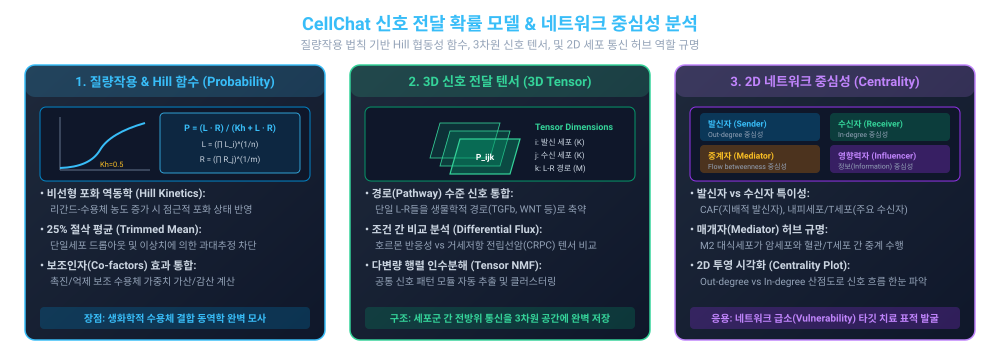

# Chapter 04. CellChat 다중 소단위체 모델링 및 네트워크 중심성

> **Cognitive Goal**: 생화학적 수용체-리간드 복합체의 물리화학적 조립 규칙을 반영하기 위한 CellChat의 기하평균(Geometric Mean) 다중 소단위체 수학적 정식화와 힐 방정식(Hill Equation) 기반 비선형 통신 확률(Communication Probability) 모델을 이해하고, 방향성 가중치 그래프 이론에 입각한 4대 네트워크 중심성 지표(Sender, Receiver, Mediator, Influencer) 및 다중 질환 조건(Primary vs mCRPC) 정보 흐름(Information Flow) 차별 분석을 파이썬 코드로 구현하고 해석할 수 있다.

---

## 1. 다중 소단위체 이종 복합체(Multi-subunit Complexes)의 수학적 정식화

생체 내 신호 전달 체계의 핵심 수용체와 리간드는 단일 폴리펩타이드가 아닌 여러 개의 서로 다른 소단위체(Subunits)가 결합한 다량체(Heteromeric Complex)로 작동합니다. 만약 복합체를 구성하는 필수 소단위체 중 단 하나라도 결손되면($E_k = 0$), 전체 복합체는 조립되지 못하고 기능적으로 완전히 무력화됩니다.

```
┌────────────────────────────────────────────────────────────────────────────────────────┐
│                        복합체 발현량 통합 연산자별 생물학적 타당성 비교                     │
├────────────────────────────────────────────────────────────────────────────────────────┤
│ (A) 산술평균 (Arithmetic Mean) : E_comp = (E_1 + E_2) / 2                              │
│     - 치명적 결함: E_1 = 10, E_2 = 0 이면 E_comp = 5.0 (심각한 위양성 초래)            │
│ (B) 최소값 연산자 (Minimum Operator, CellPhoneDB) : E_comp = min(E_1, E_2)             │
│     - 한계: 병목(Bottleneck) 소단위체만 반영하며, 다른 소단위체의 풍부도를 반영하지 못함   │
│ (C) 기하평균 (Geometric Mean) : E_comp = sqrt(E_1 x E_2)  (CellChat은 trimean 후 적용) │
│     - 완벽한 조화: 어느 하나라도 0이면 즉각 0이 되며, 구성 요소 간의 상대적 비율을 균형 반영│
└────────────────────────────────────────────────────────────────────────────────────────┘
```



### 1.1 기하평균 기반 소단위체 조립 공식
CellChat은 $M$개의 소단위체로 구성된 리간드 복합체 $L = \{L_1, L_2, \dots, L_M\}$와 $N$개의 소단위체로 구성된 수용체 복합체 $R = \{R_1, R_2, \dots, R_N\}$의 유효 발현량을 각각 **기하평균(Geometric Mean)**으로 엄격히 모델링합니다:

$$L = \left( \prod_{m=1}^M L_m \right)^{1/M}, \qquad R = \left( \prod_{n=1}^N R_n \right)^{1/N}$$

여기서 $L_m$과 $R_n$은 해당 세포 클러스터에서 각 소단위체 유전자의 평균 발현량입니다.

#### 기하평균의 수학적 특성과 생물학적 보장
1. **절대 영점 보장(Strict Zero Preservation)**:
   $$\exists m \in \{1, \dots, M\} \text{ s.t. } L_m = 0 \implies L = 0$$
   필수 서브유닛 중 단 하나라도 발현되지 않으면, 다른 서브유닛들이 아무리 수천 단위로 과발현되어 있더라도 전체 복합체 점수는 수학적으로 정확히 $0$으로 수렴합니다.
2. **화학량론적 불균형에 대한 민감성(Stoichiometric Sensitivity)**:
   소단위체 간의 발현 균형이 잘 맞을 때(예: $L_1 = 4, L_2 = 4 \implies L = 4$)가 한쪽으로 극단적으로 치우쳤을 때(예: $L_1 = 15, L_2 = 1 \implies L = \sqrt{15} \approx 3.87$)보다 상대적으로 높은 점수를 부여함으로써, 화학량론적으로 균형 잡힌 복합체 조립의 물리적 확률을 우대합니다.

---

## 2. 힐 방정식(Hill Equation) 기반 비선형 통신 확률 모델링

생화학에서 수용체와 리간드의 결합 및 세포 내 신호 전달은 농도에 대해 무한정 선형으로 증가하지 않습니다. 세포 표면의 수용체 수는 유한하며, 리간드 농도가 증가함에 따라 신호 반응은 점진적으로 포화(Saturation)되는 S자형(Sigmoidal) 또는 쌍곡선형(Hyperbolic) 동역학을 나타냅니다.

CellChat은 단순 발현량 곱셈 대신, 생화학적 리간드-수용체 결합 동역학을 모사하는 **힐 함수(Hill Function)**를 도입하여 세포 간 통신 확률(Communication Probability)을 계산합니다.

### 2.1 표준 힐 결합 함수
발신 세포군 $i$의 유효 리간드 발현량을 $L_i$, 수용 세포군 $j$의 유효 수용체 발현량을 $R_j$라 할 때, 세포 쌍 $(i, j)$ 간의 통신 확률 $P_{ij}^{L-R}$은 다음과 같이 정의됩니다:

$$P_{ij}^{L-R} = \frac{L_i \cdot R_j}{K_h + L_i \cdot R_j}$$

- **$K_h$ (반포화 상수, Half-Maximal Constant)**:
  - $L_i \cdot R_j = K_h$일 때, 통신 확률은 정확히 절반인 $P_{ij} = \frac{K_h}{K_h + K_h} = 0.5$가 됩니다.
  - $K_h$는 시스템의 민감도를 조절하는 스케일링 상수이며, CellChat의 기본값은 입력 발현값이 0~1 범위라는 가정에서 고정 상수 $K_h = 0.5$입니다(데이터에 맞춰 보정되는 값이 아님; CellChat 논문, liana `cellchat._kh = 0.5`). 클러스터 평균은 산술평균이 아니라 trimean입니다.
- **수학적 경계 조건**:
  - $L_i \to 0$ 또는 $R_j \to 0 \implies P_{ij}^{L-R} \to 0$
  - $L_i \cdot R_j \to \infty \implies P_{ij}^{L-R} \to 1.0$ (최대 통신 강도는 1로 점근적 포화)

힐 계수(Hill coefficient) $n$을 명시적으로 도입할 경우의 일반식은 다음과 같습니다:
$$P_{ij}^{L-R} = \frac{(L_i \cdot R_j)^n}{K_h^n + (L_i \cdot R_j)^n}$$

### 2.2 가용성 보조 인자(Agonists / Antagonists)의 통합 조절
생체 내 신호는 리간드와 수용체 둘만의 상호작용으로 끝나지 않으며, 미세환경에 존재하는 보조 활성제(Agonists)나 저해제(Antagonists)에 의해 능동적으로 튜닝됩니다. CellChat은 이를 다음과 같은 조절 계수(Modulation Factor)로 수식화합니다:

$$P_{ij}^{L-R} = \underbrace{\frac{L_i R_j}{K_h + L_i R_j}}_{\text{Hill}} \times M_{\text{co-receptor}}(RA, RI) \times M_{\text{agonist}}(AG) \times M_{\text{antagonist}}(AN) \;\big[\times \tfrac{n_i n_j}{n^2}\big]$$

- $RA$, $RI$: 공동 자극/공동 억제 막 수용체의 평균 발현(논문: 선형 함수로 수용체 발현을 조절). 아래 표기 $(1+RA)/(1+RI)$ 형태는 이 선형 조절의 근사입니다.
- $AG$, $AN$: 가용성 작용제(Agonists)와 길항제(Antagonists)의 평균 발현이며, **논문에서는 각각 Hill 함수로 모델링**됩니다(예: Wnt의 R-spondin/DKK1, TGF-$\beta$의 BAMBI 등). 정확한 $M$ 항의 식은 CellChat 논문(Jin et al., Nat Commun 2021) Methods를 따르며, 이 문서의 이전 표기 $(1+A)/(1+I)$는 원식이 아닙니다.
- 마지막 항 $n_i n_j / n^2$는 비분류(unsorted) 데이터에서 세포 그룹 크기를 반영하는 선택 항입니다.
- 주의: $P$는 엄밀한 확률이 아니라 통신 '점수'이며, 조절 항이 곱해지면 1을 넘을 수 있습니다(입력 발현값이 0~1로 정규화되었다는 가정에서만 해석 가능).

---

## 3. 방향성 가중치 그래프와 4대 네트워크 중심성 (Network Centrality Metrics)

개별 L-R 상호작용 확률 $P_{ij}$가 도출되면, 특정 신호 전달 경로(Signaling Pathway, 예: TGFb, CXCL, VEGF)에 속한 모든 L-R 쌍들의 통신 확률을 합산하여 세포 유형들을 노드(Node, $V$)로 하고 세포 간 통신 강도를 엣지 가중치(Edge weight, $W$)로 하는 **방향성 가중치 그래프(Weighted Directed Graph $G = (V, E, W)$)**를 구축합니다.

CellChat은 복잡한 다세포 통신망에서 각 세포 유형이 담당하는 사회적 역할을 규명하기 위해 그래프 이론에 입각한 **4대 네트워크 중심성(Centrality Metrics)**을 계산합니다:

```
┌────────────────────────────────────────────────────────────────────────────────────────┐
│                        CellChat 4대 네트워크 중심성 지표                                 │
├────────────────────────────────────────────────────────────────────────────────────────┤
│ 1. 송신자 중심성 (Sender / Out-degree)   : 신호 리간드를 압도적으로 분비하는 핵심 지휘 노드│
│ 2. 수신자 중심성 (Receiver / In-degree)  : 신호 수용체를 집중 발현하여 명령을 흡수하는 표적 노드│
│ 3. 매개자 중심성 (Mediator / Betweenness): 다양한 세포 간 신호 전달 흐름의 가교(Bridge) 역할 │
│ 4. 영향자 중심성 (Influencer / Info-Eig) : 전체 네트워크의 다단계 연쇄 반응을 촉발하는 중심자 │
└────────────────────────────────────────────────────────────────────────────────────────┘
```

### 3.1 송신자 중심성 (Sender Centrality / Out-Strength)
세포 $u$가 미세환경 내의 다른 모든 표적 세포들에게 내보내는 총 신호의 강도입니다:
$$C_{\text{Sender}}(u) = \sum_{v \in V \setminus \{u\}} w_{uv}$$
- 전립선암 TME에서 myCAF나 종양 상피세포가 성장인자($TGF\beta$, $VEGFA$) 신호 경로의 압도적인 Sender로 식별됩니다.

### 3.2 수신자 중심성 (Receiver Centrality / In-Strength)
미세환경 내의 다른 모든 세포들로부터 세포 $u$가 수신하는 총 신호의 강도입니다:
$$C_{\text{Receiver}}(u) = \sum_{v \in V \setminus \{u\}} w_{vu}$$
- 내피세포(VEGF 신호 수신)나 골수계 대식세포(CSF1 신호 수신)가 전형적인 고수신 노드로 나타납니다.

> **정확한 정의 (CellChat 논문 Methods)**: CellChat이 계산하는 4대 중심성은 out-degree, in-degree, **flow betweenness**, **information centrality**(R `sna` 패키지)입니다. 아래 3.3·3.4의 최단경로 betweenness와 eigenvector 중심성은 이를 단순화한 *근사*이며 동일하지 않습니다(논문은 PageRank·EigenCentrality를 '사용할 수도 있다'고만 언급).

### 3.3 매개자 중심성 (Mediator Centrality / Directed Betweenness)
네트워크 내의 모든 세포 쌍 $(s, t)$ 간의 신호 전달 최단 경로 중, 노드 $u$를 거쳐 지나가는 경로의 비율을 가중치화한 지표입니다:
$$C_{\text{Mediator}}(u) = \sum_{s \ne u \ne t} \frac{\sigma_{st}(u)}{\sigma_{st}}$$
여기서 $\sigma_{st}$는 $s$에서 $t$로 가는 최단 경로의 총 수(가중치 역수 $1/w$ 기준)이며, $\sigma_{st}(u)$는 그중 $u$를 통과하는 경로의 수입니다.
- **생물학적 의미**: 특정 신호가 종양 세포에서 면역세포로 바로 도달하지 못하고 중간 기질세포(예: iCAF)를 통해 중계(Relay)되는 다단계 신호 회로에서 핵심적인 통신 허브 역할을 포착합니다.

### 3.4 영향자 중심성 (Influencer Centrality / Information / Eigenvector)
인접한 노드들의 중심성을 재귀적으로 반영하는 고유벡터 중심성(Eigenvector Centrality) 또는 정보 중심성(Information Centrality)입니다:
$$C_{\text{Influencer}}(u) = \frac{1}{\lambda} \sum_{v \in V} w_{vu} C_{\text{Influencer}}(v)$$
- 연결된 이웃 노드들이 강력한 송신자나 수신자일수록 해당 세포의 영향자 점수가 기하급수적으로 높아집니다. 전체 네트워크 생태계의 안정성을 유지하거나 붕괴시킬 수 있는 마스터 조절 세포(Master Orchestrator)를 발굴합니다.

---

## 4. 다중 조건 비교 분석: 원발암 vs mCRPC 정보 흐름 (Information Flow)

종양 진행이나 약물 치료 전후의 신호망 재편을 규명하기 위해, 두 개 이상의 조건 간에 신호 경로별 **총 정보 흐름(Overall Information Flow)**을 비교합니다.

### 4.1 신호 경로별 총 정보 흐름 ($\text{Flow}(p)$) 정식화
특정 신호 경로 $p$에 속하는 모든 가능한 발신-수신 세포 쌍 $(i, j)$ 간의 통신 확률을 총합한 스칼라 값으로 정의됩니다:

$$\text{Flow}(p) = \sum_{i \in V} \sum_{j \in V} P_{ij}^p$$

### 4.2 신호 경로의 3대 동적 변화 분류
원발성 전립선암(Primary, Cond 1)과 뼈 전이 거세저항성암(mCRPC, Cond 2)을 비교할 때, 각 경로 $p$의 정보 흐름 변화율 $\Delta \text{Flow}(p) = \text{Flow}_2(p) - \text{Flow}_1(p)$에 따라 3가지 패턴으로 분류합니다:

```
[다중 조건 비교에서의 신호 경로 3대 동적 궤적]
1. 보존된 신호 경로 (Conserved Pathways)  : Flow_1(p) ~ Flow_2(p) (세포 항상성 유지)
2. 획득/강화 신호 경로 (Enriched in mCRPC) : dFlow(p) >> 0 (뼈 전이 악순환 및 치료 저항 구동)
   - 대표 예시: SPP1, RANKL/RANK, CXCL12, WNT5A
3. 소실/약화 신호 경로 (Diminished in mCRPC): dFlow(p) << 0 (정상 분화 및 면역 감시 붕괴)
   - 가설적 예시(CellChatDB의 경로명이 아님): 안드로겐 관련 상피 신호, MHC-I 계열 면역 시냅스 신호
```

---

## 5. 실전 Python 코드: CellChat 수학 엔진 및 4대 네트워크 중심성 분석기 구현

CellChat의 기하평균 복합체 조립, 힐 방정식 확률 계산, NetworkX 기반 방향성 네트워크 중심성을 완벽히 구현한 Python 실전 파이프라인입니다:

```python
import numpy as np
import pandas as pd
import networkx as nx
import scanpy as sc

class CellChatPythonEngine:
    """
    CellChat의 다중 소단위체 기하평균 조립, 힐 결합 함수, 4대 네트워크 중심성을
    Python 환경에서 재현하는 계산 엔진입니다.
    """
    def __init__(self, Kh=0.5, hill_n=1.0):
        self.Kh = Kh
        self.hill_n = hill_n

    def compute_complex_abundance(self, subunit_expressions):
        """
        다중 소단위체 유전자 발현량 리스트에 대해 기하평균(Geometric Mean)을 적용합니다.
        하나라도 0이면 0을 반환합니다.
        """
        arr = np.array(subunit_expressions, dtype=np.float64)
        if np.any(arr <= 0):
            return 0.0
        # Geometric mean: (prod x_i)^(1/m)
        return float(np.prod(arr) ** (1.0 / len(arr)))

    def calculate_comm_probability(self, L_val, R_val, agonist=0.0, antagonist=0.0):
        """
        힐 방정식(Hill Equation) 기반 비선형 통신 확률을 계산합니다.
        P = ((L * R)^n / (Kh^n + (L * R)^n)) * ((1 + A) / (1 + I))   # 교육용 단순화 (CellChat 원식 아님)
        주의: 입력은 0~1로 정규화된 trimean 발현이어야 하며, 결과는 1을 넘을 수 있는 점수이다.
        """
        prod = L_val * R_val
        if prod <= 0:
            return 0.0
        
        num = prod ** self.hill_n
        den = (self.Kh ** self.hill_n) + num
        base_prob = num / den
        
        # 보조 인자 조절 계수 반영
        modulation = (1.0 + agonist) / (1.0 + antagonist)
        return float(base_prob * modulation)

    def build_pathway_network(self, cell_types, comm_matrix):
        """
        세포 유형 목록과 통신 확률 인접 행렬(Adjacency Matrix)을 기반으로
        방향성 가중치 그래프(DiGraph)를 생성합니다.
        """
        G = nx.DiGraph()
        for c in cell_types:
            G.add_node(c)
            
        n = len(cell_types)
        for i in range(n):
            for j in range(n):
                weight = comm_matrix[i, j]
                if weight > 0:
                    G.add_edge(cell_types[i], cell_types[j], weight=weight)
        return G

    def compute_centralities(self, G):
        """
        NetworkX 그래프로부터 CellChat의 4대 네트워크 중심성 지표를 계산합니다:
        1. Sender (Out-strength)
        2. Receiver (In-strength)
        3. Mediator (CellChat은 flow betweenness; 여기서는 최단경로 betweenness 근사)
        4. Influencer (CellChat은 information centrality; 여기서는 eigenvector 근사)
        """
        nodes = list(G.nodes())
        
        # 1. Out-degree (Sender)
        out_strength = {n: sum(d['weight'] for _, _, d in G.out_edges(n, data=True)) for n in nodes}
        
        # 2. In-degree (Receiver)
        in_strength = {n: sum(d['weight'] for _, _, d in G.in_edges(n, data=True)) for n in nodes}
        
        # 3. Mediator (Betweenness centrality with inverted weights as distance)
        # 거리 d = 1 / weight (신호 강도가 클수록 최단 경로 거리는 가까움)
        for u, v, d in G.edges(data=True):
            d['distance'] = 1.0 / (d['weight'] + 1e-9)
        mediator = nx.betweenness_centrality(G, weight='distance', normalized=True)
        
        # 4. Influencer (Eigenvector centrality)
        try:
            influencer = nx.eigenvector_centrality(G, weight='weight', max_iter=1000)
        except nx.PowerIterationFailedConvergence:
            # 수렴 실패 시 다른 지표로 조용히 대체하면 'Influencer' 열의 의미가 바뀌므로 NaN으로 표기
            influencer = {n: float('nan') for n in nodes}
            
        df_centrality = pd.DataFrame({
            "Sender": out_strength,
            "Receiver": in_strength,
            "Mediator": mediator,
            "Influencer": influencer
        })
        return df_centrality

# 실전 파이프라인 테스트 실행
if __name__ == "__main__":
    engine = CellChatPythonEngine(Kh=0.5)
    
    # 예시: IL-6 복합체 (IL6R + IL6ST)와 IL-6 리간드
    # 주의: CellChat은 0~1 정규화 발현을 가정하므로 아래 예시 값(2.4 등)은 범위를 벗어나 점수가 1을 넘을 수 있는 설명용 값이다
    ligand_IL6 = 2.4
    receptor_subunits = [1.8, 2.1]  # IL6R, IL6ST
    R_eff = engine.compute_complex_abundance(receptor_subunits)
    prob = engine.calculate_comm_probability(ligand_IL6, R_eff, agonist=0.2, antagonist=0.0)
    print(f"Computed IL-6 Signaling Probability: {prob:.4f}")
    
    # 4개 세포 간 가상 인접 행렬 구성 (myCAF, Tumor, CD8_T, TAM)
    cell_types = ['myCAF', 'Tumor', 'CD8_T', 'TAM']
    adj = np.array([
        [0.1, 0.8, 0.4, 0.6],  # myCAF
        [0.2, 0.3, 0.1, 0.7],  # Tumor
        [0.0, 0.5, 0.1, 0.2],  # CD8_T
        [0.3, 0.4, 0.6, 0.1]   # TAM
    ])
    
    G = engine.build_pathway_network(cell_types, adj)
    centrality_df = engine.compute_centralities(G)
    print("\n=== Computed 4 Major Network Centralities ===")
    print(centrality_df.round(4))
```

---

## 단원 핵심 점검 (Cognitive Checkpoint & Case Study)

### [문제 1. 핵심 개념 능동 회상 (Active Recall)]
CellChat이 다중 소단위체 수용체(예: $TGFBR1 + TGFBR2$, 또는 $ITGAV + ITGB3$)의 유효 발현량을 계산할 때, 단순 산술평균(Arithmetic Mean) 대신 **기하평균(Geometric Mean)** $R = \left( \prod_{n=1}^N R_n \right)^{1/N}$을 채택하는 생화학적·수학적 필연성을 설명하고, 이것이 통계적 위양성을 차단하는 메커니즘을 서술하시오.

<details>
<summary>💡 모범 답안 및 해설 확인</summary>

1. **산술평균의 치명적 결함과 위양성 발생**:
   - 산술평균은 덧셈 연산에 기반하므로, 만약 어떤 암세포 클러스터에서 $ITGAV$ 발현량이 $10.0$이고 결합 파트너인 $ITGB3$ 발현량이 완전히 $0.0$인 경우, 산술평균은 $\frac{10.0 + 0.0}{2} = 5.0$으로 계산됩니다.
   - 생체 내에서는 $\beta_3$ 사슬이 없으면 $\alpha_V\beta_3$ 인테그린 이종이량체가 $0\%$도 조립되지 못하지만, 알고리즘은 활성 수용체 농도를 5.0으로 인식하여 강력한 신호 전달이 일어난다고 판정하는 치명적인 **위양성(False Positive)**을 유발합니다.
2. **기하평균의 수학적·생화학적 필연성**:
   - 기하평균은 곱셈 연산에 기반하므로, 필수 소단위체 중 단 하나라도 결손되어 발현량이 0이 되면($R_k = 0$), 전체 곱이 0이 되어 복합체 유효 발현량이 즉각적이고 엄격하게 $R = 0$으로 수렴합니다.
   - 이는 "모든 필수 소단위체가 동시에 번역되어 회집되어야만 기능적 복합체가 형성된다"는 생화학적 화학량론(Stoichiometry)을 수학적으로 완벽히 충족하며, 전산적 위양성을 원천 봉쇄합니다.
   - 또한 소단위체 간의 발현량이 균형을 이룰 때(예: $2 \times 2 = 4 \implies \sqrt{4} = 2$)가 불균형할 때(예: $3.9 \times 0.1 = 0.39 \implies \sqrt{0.39} \approx 0.62$)보다 높은 점수를 산출하여 실제 생리학적 복합체 형성 확률을 충실히 반영합니다.

</details>

---

### [문제 2. 핵심 개념 능동 회상 (Active Recall)]
CellChat의 방향성 가중치 신호 네트워크 분석에서 제공하는 **4대 네트워크 중심성 지표(Sender, Receiver, Mediator, Influencer)**의 수학적 정의와 생물학적 의미를 각각 1문장으로 정리하고, 단순 직교 분비 신호와 구별되는 '매개자(Mediator)' 중심성을 지닌 세포의 임상적 중요성을 설명하시오.

<details>
<summary>💡 모범 답안 및 해설 확인</summary>

1. **4대 네트워크 중심성의 정의와 생물학적 의미**:
   - **송신자 중심성 (Sender / Out-strength)**: 세포가 외부로 방출하는 신호 엣지 가중치의 총합($\sum_{v} w_{uv}$)으로, 특정 신호 캐스케이드를 주도적으로 개시·지휘하는 리간드 원천 세포를 의미합니다.
   - **수신자 중심성 (Receiver / In-strength)**: 세포가 외부로부터 전달받는 신호 엣지 가중치의 총합($\sum_{v} w_{vu}$)으로, 특정 미세환경 신호의 궁극적 표적이 되어 생물학적 표현형을 변화시키는 수용체 세포를 의미합니다.
   - **매개자 중심성 (Mediator / Directed Betweenness)**: 전체 네트워크 내 세포 쌍 간 최단 신호 경로 중 해당 세포를 통과하는 빈도의 비율로, 다른 세포들 사이의 신호 흐름을 중계·증폭하는 가교(Bridge) 세포를 의미합니다.
   - **영향자 중심성 (Influencer / Information Centrality)**: 연결된 주변 이웃 노드들의 신호 영향력을 재귀적으로 통합한 지표로, 네트워크 전체의 다단계 다세포 연쇄 반응을 거시적으로 통제하는 핵심 통제 세포를 의미합니다.
2. **매개자(Mediator) 세포의 임상적 중요성**:
   - 종양 미세환경에서 암세포가 분비한 신호가 면역세포나 혈관내피세포에 직접 닿지 않고, 중간의 **기질세포(예: iCAF 또는 골수간질세포 MSC)**를 매개하여 릴레이(Relay) 방식으로 전달되는 경우가 빈번합니다.
   - Mediator 중심성이 높은 세포는 신호 전달망의 핵심 '병목(Bottleneck)'에 해당하므로, 암세포 자체를 직접 공격하지 않더라도 이 매개자 세포 또는 매개 분자 축을 차단하면 종양 미세환경 전체의 악성 상호작용 네트워크를 붕괴시킬 수 있는 고효율의 표적 치료 타깃이 됩니다.

</details>

---

### [문제 3. 임상 사례 분석 (Clinical Interpretation Case Study)]
**[임상 시나리오]**
원발성 전립선 선암(Primary PCa) 환자 코호트와 치명적인 mCRPC 뼈 전이 환자 코호트의 단일세포 전사체 데이터를 대상으로 CellChat 기반의 신호 경로별 정보 흐름(Overall Information Flow) 차별 분석을 수행했습니다.
분석 결과, 정상 전립선 상피와 결합하던 안드로겐 항상성 신호 경로는 mCRPC에서 급감한 반면, **오스테오폰틴($SPP1$) 신호 경로**와 **$RANKL$ 신호 경로**의 정보 흐름($\text{Flow}(p)$)은 mCRPC 뼈 전이 조직에서 15배 이상 급증했다고 가정합니다(가상 시나리오).
특히 $SPP1$ 경로의 4대 중심성을 분석한 결과, 종양 세포뿐만 아니라 골수 내 $CD163^+/MRC1^+$ 종양 연관 대식세포(TAM)가 최대 송신자(Top Sender) 및 최대 영향자(Top Influencer)로 동시에 지목되었고, $CD8^+$ T세포와 파골 전구세포가 최고 수신자(Top Receiver)로 나타났습니다.

**[질문]**
1. 이 분석 결과를 바탕으로, mCRPC 뼈 전이 니치에서 $SPP1$ 과발현 TAM이 종양 진행과 면역 억제를 동시에 매개하는 2중 작용 메커니즘을 분자 리간드-수용체 쌍 관점에서 규명하시오.
2. 이 신호망 차별 분석 데이터를 신약 개발 전략에 응용하여, 기존 면역관문 억제제(Anti-PD-1)에 반응하지 않는 mCRPC 뼈 전이 환자를 치료하기 위한 '다중 표적 칵테일 치료 요법'을 구체적인 표적 분자 및 약제 기전과 함께 제시하시오.

<details>
<summary>💡 모범 답안 및 해설 확인</summary>

1. **$SPP1^+$ TAM의 2중 작용 메커니즘**:
   - **면역 억제 축 (TAM ──► CD8+ T세포; 가설)**: $SPP1^+$ TAM이 분비한 오스테오폰틴($SPP1$) 리간드가 침윤 림프구 표면의 $CD44$ 수용체 및 $\alpha_V\beta_3$ 인테그린에 결합하여 T세포 기능을 억제할 수 있다는 가설입니다(SPP1 차단 면역요법 보고는 대장암 마우스 모델 등이며 전립선암에서 IFN$\gamma$·Perforin/Granzyme 직접 차단이 입증된 것은 아닙니다).
   - **골 파괴 및 종양 침습 축 (TAM ──► 파골세포 및 암세포)**: $SPP1$이 RGD 모티프를 통해 파골 전구세포의 $\alpha_V\beta_3$ 인테그린에 결합해 골 기질 접착과 뼈 흡수(Resorption)를 지원하는 것은 알려져 있습니다. 암세포 표면의 $CD44v6$와 결합하여 $PI3K/AKT$ 및 $\beta\text{-catenin}$ 생존 신호를 활성화한다는 부분은 이 챕터가 근거를 제시하지 못한 가설이며, 이를 통해 파골세포-대식세포-종양세포 간의 골 전이 악순환을 기하급수적으로 증폭시킵니다.
2. **다중 표적 칵테일 치료 요법 제안 (탐색적 가설)**:
   - **Anti-SPP1 중화 항체 또는 CD44 길항제**: 미세환경 내 핵심 Influencer인 $SPP1$ 신호를 차단하여 대식세포 매개 T세포 기능 마비를 해제하고 파골세포 분화를 억제합니다.
   - **RANKL 차단제 (Denosumab)**: 급증한 RANKL 정보 흐름을 차단하여 파골세포성 골 흡수와 골격계 사건(SRE)을 줄입니다(근거: Fizazi 2011, Smith 2012; TGF-β 방출의 '원천 봉쇄'는 입증되지 않음).
   - **면역관문 억제제 (Anti-PD-1 / Pembrolizumab)**: $SPP1$ 및 $RANKL$ 억제를 통해 '면역 결핍 및 기질 장벽'이 허물어진 상태에서 침투한 CD8+ T세포의 $PD-1/PD-L1$ 탈진을 역전시켜 강력한 항종양 면역을 회복시킬 가능성이 *가설*로 제안됩니다(전립선 골전이에서 입증되지 않음).

</details>

---

<!-- REFERENCES:BEGIN (generated by scripts/apply_references.py; do not edit by hand) -->
## 참고문헌 (References)
### 본문 인용 문헌
1. Jin S, Guerrero-Juarez CF, Zhang L, et al. Inference and analysis of cell-cell communication using CellChat. *Nat Commun*. 2021;12(1):1088. PMID: 33597522. doi: 10.1038/s41467-021-21246-9
2. Fizazi K, Carducci M, Smith M, et al. Denosumab versus zoledronic acid for treatment of bone metastases in men with castration-resistant prostate cancer: a randomised, double-blind study. *Lancet*. 2011;377(9768):813-22. PMID: 21353695. doi: 10.1016/S0140-6736(10)62344-6
3. Smith MR, Saad F, Coleman R, et al. Denosumab and bone-metastasis-free survival in men with castration-resistant prostate cancer: results of a phase 3, randomised, placebo-controlled trial. *Lancet*. 2012;379(9810):39-46. PMID: 22093187. doi: 10.1016/S0140-6736(11)61226-9
### 검수 근거 문헌
1. Efremova M, Vento-Tormo M, Teichmann SA, et al. CellPhoneDB: inferring cell-cell communication from combined expression of multi-subunit ligand-receptor complexes. *Nat Protoc*. 2020;15(4):1484-1506. PMID: 32103204. doi: 10.1038/s41596-020-0292-x
2. Klement JD, Poschel DB, Lu C, et al. Osteopontin Blockade Immunotherapy Increases Cytotoxic T Lymphocyte Lytic Activity and Suppresses Colon Tumor Progression. *Cancers (Basel)*. 2021;13(5). PMID: 33670921. doi: 10.3390/cancers13051006
### 소프트웨어 (표기 버전은 검수 시 API를 확인한 버전이며, 파이프라인 실행 환경은 requirements-pipelines.txt 참조)
- NetworkX 3.7 (github.com/networkx/networkx).
- NumPy 2.5.4 (numpy.org). 원 논문: Harris CR, Millman KJ, van der Walt SJ, et al. Array programming with NumPy. *Nature*. 2020;585(7825):357-362. PMID: 32939066. doi: 10.1038/s41586-020-2649-2
- pandas 2.3.3 (github.com/pandas-dev/pandas). 원 논문: McKinney W. Data Structures for Statistical Computing in Python. *Proceedings of the Python in Science Conference*. 2010:56-61. doi: 10.25080/majora-92bf1922-00a
- Scanpy 1.12.4 (github.com/scverse/scanpy). 원 논문: Wolf FA, Angerer P, Theis FJ. SCANPY: large-scale single-cell gene expression data analysis. *Genome Biol*. 2018;19(1):15. PMID: 29409532. doi: 10.1186/s13059-017-1382-0
<!-- REFERENCES:END -->
