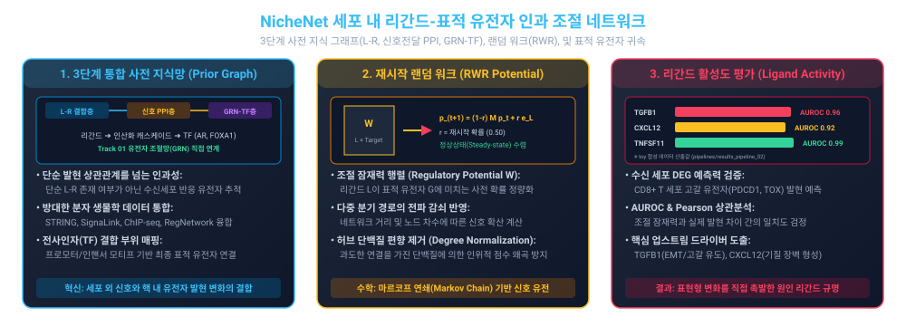

# Chapter 05. 세포 내 신호 전달 및 표적 유전자 조절망 추론 (NicheNet & Causal Signaling Networks)

> **Cognitive Goal**: 기존 리간드-수용체(L-R) 상호작용 분석이 지닌 결정적 맹점인 "단순 수용체 발현이 하류 전사 반응의 활성화를 보증하지 않는다"는 한계를 인식하고, 리간드 결합에서 시작하여 세포 내 신호 전달망 및 전사인자 조절망(GRN)을 거쳐 최종 표적 유전자 발현으로 이어지는 인과적 신호 전달 경로를 추론하는 `NicheNet`의 수리생물학적 원리를 체득한다. 무작위 보행 재시작(Random Walk with Restart, RWR) 알고리즘을 수학적으로 유도하여 조절 잠재력 행렬(Regulatory Potential Matrix $W$)을 계산하고, 수용 세포의 차등 발현 유전자(DEG)를 설명하는 핵심 상위 리간드를 순위화하는 통계적 기법을 익힌다.

---

## 1. 기존 세포 간 통신(CCC) 분석의 치명적 맹점: "수용체 발현 $\neq$ 하류 신호 활성화"

CellPhoneDB, SingleCellSignalR, NATMI 등 전통적인 세포 간 통신 분석 알고리즘들은 송신 세포(Sender)의 리간드 발현량과 수용 세포(Receiver)의 수용체 발현량의 통계적 곱(Product) 또는 평균을 기반으로 상호작용 점수를 산출합니다. 그러나 이러한 접근법은 분자세포생물학적으로 심각한 결함을 내포하고 있습니다.

```
┌────────────────────────────────────────────────────────────────────────────────────────┐
│               전통적 L-R 분석 vs. NicheNet 인과 신호 전달 분석 패러다임                │
│                                                                                        │
│   [전통적 L-R 분석: 세포 표면에서 단절된 추론]                                         │
│   Sender 세포 ────(Ligand 분비)────► Receiver 세포 ────(Receptor 발현) ──X [추론 중단] │
│   * 맹점: 수용체가 전사되었더라도 번역 후 억제, 탈인산화, 신호 차단 등으로 인해        │
│           실제 세포 내부 전사 인자가 활성화되지 않았을 가능성을 완전히 무시함!         │
│                                                                                        │
│   [NicheNet 분석: 세포 표면에서 핵 내 전사 반응까지의 인과 사슬 복원]                  │
│   Sender Ligand ──► Receptor ──► Intracellular Signaling ──► TFs ──► Target DEGs      │
│   * 핵심: "수용 세포 내부에서 실제로 발현이 변화한 유전자(DEG)를 설명할 수 있는       │
│           검증된 인과 경로를 가진 리간드만이 진정한 기능적 조절자이다!"                │
└────────────────────────────────────────────────────────────────────────────────────────┘
```

### 1.1 분자생물학적 불일치의 원인
1. **수용체 불활성화 및 내재화(Internalization)**:
   - 세포 표면에 수용체 mRNA가 존재하더라도, 유비퀴틴화(Ubiquitination)에 의한 분해, 엔도솜 격리, 또는 길항제(Antagonist) 결합으로 인해 하류 신호가 전달되지 않을 수 있습니다.
2. **신호 전달 경로의 크로스토크(Crosstalk) 및 차단**:
   - 하류 인산화효소(Kinase) 캐스케이드 상에서 포스파타아제(Phosphatase, 예: DUSP, PTEN)의 억제 작용이나 피드백 루프(Negative Feedback, 예: SOCS, IκB)로 인해 핵 내 전사인자 활성화가 차단될 수 있습니다.
3. **후성유전학적 침묵(Epigenetic Silencing)**:
   - 전사인자가 핵 내로 이동하더라도, 표적 유전자의 프로모터/인핸서가 응축된 이질염색질(Heterochromatin) 상태라면 전사가 유도되지 않습니다 (Track 01의 snATAC-seq 염색질 접근성 제약과 직결).

따라서 세포 간 상호작용이 실제로 수용 세포의 표현형 변화를 유발했는지 증명하려면, **"세포 외 리간드 $\to$ 세포막 수용체 $\to$ 세포질 신호 매개체 $\to$ 핵 내 전사인자(TF) $\to$ 표적 유전자 전사체"**로 이어지는 전체 인과 경로가 하나의 통합 모델로 검증되어야 합니다.

---

## 2. 사전 지식 통합 분자 네트워크 (Integrated Prior Knowledge Network)

Browaeys et al. (Nature Methods, 2020)에 의해 고안된 **NicheNet**은 수만 건의 공개 데이터베이스(수십 년간 축적된 생화학 실험 및 문헌 증거)를 하나의 거대한 방향성 가중 다층 그래프(Directed Weighted Multilayer Graph)로 통합합니다.



### 2.1 다층 네트워크의 3대 구성 요소
NicheNet의 네트워크 $G = (V, E, W)$는 생물학적 계층에 따라 세 가지 서브네트워크의 결합으로 정의됩니다:

1. **리간드-수용체 상호작용망 ($G_{L-R}$)**:
   - 단백질-단백질 상호작용(PPI) 및 분자 결합 데이터베이스 (Guide to Pharmacology, Ramilowski et al., CellPhoneDB 등).
   - 리간드 노드 $l \in \mathcal{L}$에서 수용체 노드 $r \in \mathcal{R}$로 향하는 간선.
2. **세포 내 신호 전달망 ($G_{\text{signaling}}$)**:
   - 인산화 캐스케이드, 복합체 형성, 단백질 분해 상호작용 (SignaLink, KEGG, Reactome, BioGRID, IntAct, Pathway Commons 등).
   - 수용체 $r$에서 중간 신호 분자(Kinases, Adaptors) $s \in \mathcal{S}$를 거쳐 전사인자 $tf \in \mathcal{T}$로 향하는 간선.
3. **유전자 조절 네트워크 ($G_{\text{GRN}}$)**:
   - 전사인자가 표적 유전자의 프로모터/인핸서에 결합하여 전사를 활성화하는 조절망 (ChIP-seq 기반 ReMap, ENCODE, JASPAR 모티프 결합 데이터, knockTF 등의 유전자 섭동 전사체 데이터).
   - 전사인자 $tf \in \mathcal{T}$에서 표적 유전자 $g \in \mathcal{G}$로 향하는 간선 (Track 01 SCENIC+ eGRN과 상응).

### 2.2 신뢰도 점수 기반 데이터 소스 가중치 최적화
모든 데이터 소스는 실험 기법의 정확도에 따라 노이즈 수준이 다릅니다. NicheNet은 모델 훈련 데이터셋(리간드 처리 전후 발현 데이터셋; 구체적 개수는 원 논문·Zenodo 데이터에서 확인 필요)을 기반으로, 각 데이터베이스 출처 간선의 신뢰도 가중치 $w_e \in [0, 1]$를 **mlrMBO(모델 기반 베이지안 최적화)**로 학습시켰습니다(nichenetr `parameter_optimization.R`; 경사하강법이 아님). 아래 설명은 그 의미를 풀어 쓴 것다.

---

## 3. 무작위 보행 재시작(RWR) 알고리즘의 수학적 유도

NicheNet은 방대한 통합 네트워크 상에서 특정 리간드 $l$이 특정 표적 유전자 $g$의 발현을 변화시킬 수 있는 종합적인 확률적 영향력을 계산하기 위해 **무작위 보행 재시작(Random Walk with Restart, RWR / Personalized PageRank)** 알고리즘을 사용합니다.

### 3.1 확률 보행 전이 행렬 (Transition Probability Matrix)
총 노드 수를 $N = |V|$라 하고, 노드 간 방향성 연결 가중치를 원소로 갖는 인접 행렬을 $A \in \mathbb{R}_+^{N \times N}$이라 합니다. 노드 $i$에서 나가는 간선 가중치의 합을 대각 성분으로 갖는 차수 행렬(Degree Matrix) $D$를 다음과 같이 정의합니다:

$$D_{ii} = \sum_{j=1}^N A_{ij}$$

열 정규화(Column-normalized)된 마르코프 전이 확률 행렬 $P \in \mathbb{R}^{N \times N}$의 각 원소 $P_{ji}$는 노드 $i$에 위치한 가상의 신호 입자가 다음 단계에 노드 $j$로 이동할 조건부 확률을 의미합니다:

$$P_{ji} = P(X_{t+1} = j \mid X_t = i) = \frac{A_{ij}}{D_{ii}} \quad \iff \quad P = A D^{-1}$$

### 3.2 재시작 확률이 부여된 이산 마르코프 연쇄
신호 입자가 네트워크를 무한히 무작위로 방랑할 경우, 네트워크 전체의 일반적인 허브 노드(예: TP53, UBC, ACTB 등)로 신호가 분산되어 출발 리간드의 특이적 정보가 소실됩니다. 이를 방지하기 위해 각 시간 단계마다 확률 $r \in (0, 1)$로 출발 노드(시드 노드 $v$)로 강제 귀환(Restart)하는 제약 조건을 부여합니다:

$$p_{t+1} = (1 - r) P p_t + r e_v$$

- $p_t \in \mathbb{R}^N$: 시간 $t$에서 네트워크 상의 각 노드에 신호 입자가 존재할 확률 분포 벡터 ($\sum_{i=1}^N p_{t, i} = 1$).
- $r$: 재시작 확률 (Restart Probability, 일반적으로 $r = 0.5$ 또는 $0.15$로 설정).
- $e_v \in \mathbb{R}^N$: 시드 노드 $v$의 위치만 1이고 나머지는 0인 단위 원핫(One-hot) 벡터.

### 3.3 정상 상태(Steady-State) 해석해 유도
마르코프 연쇄의 에르고딕 정리(Ergodic Theorem)에 의해, $t \to \infty$일 때 확률 분포 $p_t$는 고유한 정상 상태 확률 벡터 $p^*$로 수렴합니다 ($p_{t+1} = p_t = p^*$):

$$p^* = (1 - r) P p^* + r e_v$$

$$I p^* - (1 - r) P p^* = r e_v$$

$$\big( I - (1 - r) P \big) p^* = r e_v$$

행렬 $M = I - (1 - r)P$는 엄격 대각 우세(Strictly Diagonally Dominant) 행렬이므로 역행렬이 항상 존재합니다. 따라서 정상 상태 해는 다음과 같이 해석적으로 도출됩니다:

$$p^* = r \big( I - (1 - r) P \big)^{-1} e_v$$

### 3.4 조절 잠재력 행렬 $W$ 구축 (PPR → GRN 행렬곱)
NicheNet은 신호의 계층성(리간드 $\to$ 수용체/신호전달 $\to$ 전사인자 $\to$ 표적 유전자)을 반영하되, 실제 구현(nichenetr `construct_ligand_to_target`)은 **리간드→전사인자 구간만 Personalized PageRank(감쇠 0.5)로 계산하고, 상위 1%(`ltf_cutoff=0.99`)만 유지한 뒤 전사인자→표적은 GRN 가중치 행렬과의 행렬곱**으로 연결합니다(두 번째 RWR이 아니며, 허브 보정 존재). 아래 '단계 2'는 개념적 서술입니다:

```
[단계 1: 리간드-수용체-신호전달-전사인자 RWR]
- 시드 노드: 리간드 l
- 탐색 공간: G_{L-R} ∪ G_{signaling}
- 산출: 리간드 l이 각 전사인자 tf에 미치는 영향력 벡터 p*(l → tf)

[단계 2: 전사인자-표적 유전자 (실제 구현: GRN 가중치 행렬곱)]
- 입력: 전사인자 tf → 표적 g의 GRN 가중치 행렬 (RWR 아님)
- 산출: 전사인자 tf가 각 표적 유전자 g를 조절할 잠재력 (ltf 행렬 × GRN 행렬)
```

두 단계를 결합하여, 최종적으로 리간드 $l \in \mathcal{L}$이 표적 유전자 $g \in \mathcal{G}$를 조절할 잠재적 강도를 나타내는 **리간드-표적 조절 잠재력 행렬(Regulatory Potential Matrix)** $W \in \mathbb{R}^{|\mathcal{L}| \times |\mathcal{G}|}$를 정의합니다:

$$W_{l, g} = \sum_{tf \in \mathcal{T}} p^*(l \to tf) \cdot p^*(tf \to g)$$

이 $W$ 행렬은 세포 유형이나 특정 실험 조건에 종속되지 않는 **범용 사전 지식 행렬(Universal Prior Matrix)**로서, 사전에 한 번 대규모 연산으로 구축되어 다양한 단일 세포 데이터셋 분석에 재사용됩니다.

---

## 4. 리간드 활성 점수화 및 표적 유전자 귀속 (Ligand Activity Scoring & Target Attribution)

실제 scRNA-seq 데이터가 주어졌을 때, NicheNet은 수용 세포에서 관측된 전사체 반응을 조절 잠재력 행렬 $W$와 대조하여 최상위 활성 리간드를 선별합니다.

```
┌────────────────────────────────────────────────────────────────────────────────────────┐
│                   NicheNet 리간드 활성 평가 및 표적 유전자 귀속 절차                   │
│                                                                                        │
│   1. 수용 세포의 유전자 발현 시그니처 정의:                                            │
│      - Receiver 세포의 차등 발현 유전자(DEG) 추출 ==> 이진 반응 벡터 Y ∈ {0, 1}^|G|     │
│        (Y_g = 1 if g ∈ Gene_of_Interest, 0 otherwise)                                 │
│                                                                                        │
│   2. 각 후보 리간드 l의 조절 잠재력 벡터 W_{l, :} 추출:                                 │
│      - W_{l, :} = [W_{l, g1}, W_{l, g2}, ..., W_{l, gG}]                               │
│                                                                                        │
│   3. 통계적 예측력(Ligand Activity) 산출:                                              │
│      - Pearson Correlation r(W_{l, :}, Y)                                             │
│      - AUROC (Area Under Receiver Operating Characteristic)                           │
│      - AUPR (Area Under Precision-Recall Curve)                                        │
│                                                                                        │
│   4. 표적 유전자 기여도(Target Attribution) 역추적:                                   │
│      - 상위 순위 리간드가 발현을 유도한 핵심 하류 표적 유전자 및 인과 신호 경로 가시화 │
└────────────────────────────────────────────────────────────────────────────────────────┘
```

### 4.1 리간드 활성도 평가 통계 지표
수용 세포의 전체 검출 유전자 집합 $\mathcal{G}$에 대해, 생물학적 관심 유전자 집합(Gene of Interest, e.g., 종양 세포의 EMT 유전자, 약물 저항성 유전자, 또는 특정 클러스터 특이적 DEG)을 지시하는 이진 벡터 $Y \in \{0, 1\}^{|\mathcal{G}|}$를 구성합니다:

$$Y_g = \begin{cases} 1 & \text{if } g \in \text{Genes of Interest (DEG)} \\ 0 & \text{otherwise} \end{cases}$$

(NicheNet의 원래 설계에서 관심 유전자 집합은 리간드 처리 전후 또는 조건 간의 **반응 유전자**입니다. 세포 정체성 대비 DEG(예: NEPC 대 Luminal)를 쓰면 리간드 반응이 아니라 계통 차이를 설명하게 되므로 해석에 주의해야 합니다.)

각 리간드 $l$의 조절 잠재력 벡터 $W_{l, :} \in \mathbb{R}^{|\mathcal{G}|}$가 실제 유전자 발현 변화 $Y$를 얼마나 정확하게 예측하는지를 다음 세 가지 지표로 정량화합니다:

1. **피어슨 상관계수 (Pearson Correlation Coefficient)**:
   $$r_l = \frac{\sum_{g \in \mathcal{G}} (W_{l, g} - \bar{W}_l)(Y_g - \bar{Y})}{\sqrt{\sum_{g \in \mathcal{G}} (W_{l, g} - \bar{W}_l)^2} \sqrt{\sum_{g \in \mathcal{G}} (Y_g - \bar{Y})^2}}$$
2. **AUROC (Area Under ROC Curve)**:
   - $W_{l, :}$ 값을 임계값으로 변화시키며 계산한 True Positive Rate(재현율) 대 False Positive Rate(위양성율) 곡선의 하부 면적. 0.5는 무작위 추측, 1.0은 완벽한 예측을 의미합니다.
3. **AUPR (Area Under Precision-Recall Curve)**:
   - 관심 유전자($Y_g = 1$)의 비율이 전체 유전자에 비해 극히 적은(불균형 데이터셋, Imbalanced Data) 단일 세포 전사체 특성상, 위양성에 덜 민감하고 참 양성의 정밀도를 평가하는 AUPR이 유용합니다. 순위화 기준은 버전에 따라 다릅니다: 원 논문(NicheNet v1)은 Pearson, v2 vignette는 보정된 AUPR로 리간드를 순위화합니다.

### 4.2 인과 서브그래프 추출 (Causal Path Extraction)
가장 높은 활성 점수를 획득한 상위 리간드 $l^*$에 대해, 특정 표적 유전자 $g^*$로 전달된 조절 잠재력의 기여도를 분해합니다:

$$W_{l^*, g^*} = \sum_{r \in \mathcal{R}} \sum_{s \in \mathcal{S}} \sum_{tf \in \mathcal{T}} \text{Flow}(l^* \to r \to s \to tf \to g^*)$$

이 경로 분해를 통해 연구자는 단순한 상관관계를 넘어, **"리간드 $l^*$가 어떤 수용체 $r$과 결합하고, 어떤 인산화효소 $s$를 경유하여, 최종적으로 어떤 전사인자 $tf$를 작동시켜 표적 유전자 $g^*$의 전사를 촉발했는가"**에 대한 분자 메커니즘을 규명할 수 있습니다.

---

## 5. 전립선암 골전이 미세환경에서의 NicheNet 적용 사례

전립선암의 골전이(Bone Metastasis) 병변은 파골세포(Osteoclasts), 조골세포(Osteoblasts), 암 연관 섬유아세포(myCAFs), 대식세포(TAMs)가 종양 세포와 복잡하게 얽힌 대표적인 난치성 미세환경입니다.

```
┌────────────────────────────────────────────────────────────────────────────────────────┐
│         전립선암 골전이 니치에서의 NicheNet 다중 리간드-표적 조절망 예시               │
│                                                                                        │
│   [Sender 1: Osteoclasts]                                                              │
│   - Ligand: TGFB1 (골 기질 흡수 과정에서 방출)                                         │
│     └──► Receptor: TGFBR1/TGFBR2                                                       │
│          └──► Signaling: SMAD2/3 phosphorylation                                       │
│               └──► TFs: SMAD3, SNAI1, ZEB1                                             │
│                    └──► Target DEGs: CDH2, VIM, FN1 (종양 세포의 EMT 유도)             │
│                                                                                        │
│   [Sender 2: Osteoblasts]                                                              │
│   - Ligand: WNT5A (비정형 Wnt 신호 분비)                                               │
│     └──► Receptor: FZD5, ROR2                                                          │
│          └──► Signaling: DVL2 ──► CaMKII / PKC                                         │
│               └──► TFs: NFATc1, SOX2                                                   │
│                    └──► Target DEGs: ABCB1, SOX2, PEG10 (줄기능 및 t-NEPC 전분화 촉진)  │
│                                                                                        │
│   [Sender 3: myCAFs]                                                                   │
│   - Ligand: CXCL12                                                                     │
│     └──► Receptor: CXCR4                                                               │
│          └──► Signaling: PI3K-AKT ──► mTORC1                                           │
│               └──► TFs: MYC, HIF1A                                                     │
│                    └──► Target DEGs: VEGFA, SLC2A1 (해당작용 및 혈관신생 촉진)         │
└────────────────────────────────────────────────────────────────────────────────────────┘
```

### 5.1 Track 01 eGRN (SCENIC+)과의 유기적 가교
- NicheNet이 추론한 세포 내 전사인자(TFs: SMAD3, SOX2, ASCL1)는 **Track 01의 multiome snATAC-seq 데이터에서 도출된 eGRN(인핸서-전사인자 레귤론)**과 보완적으로 교차 비교할 수 있습니다. 다만 NicheNet의 ligand-target prior는 ChIP-seq·모티프·섭동 기반의 범용(조건 비종속) 사전 지식이며 세포 유형 특이적 eGRN이 아닙니다.
- 세포 외 리간드가 세포막을 자극한 결과(NicheNet)가 핵 내 특정 인핸서 크로마틴 오픈(snATAC Tn5 Insertion Peak) 및 전사인자 결합 풋프린트(TF Footprinting)로 물리적으로 구현되었음을 시사하는 보조 근거로 쓸 수 있습니다(인과를 입증하지는 않음).

---

## 6. 실전 분석 파이프라인: Python 기반 NicheNet 워크플로우

`liana` 패키지에는 NicheNet 구현이 없습니다(`liana.method`에 `nichenet` 없음). 따라서 원 저자가 배포한 NicheNet v2 사전 모델(ligand-target 행렬, L-R 네트워크)을 CSV로 내보내 불러온 뒤, 리간드 활성 점수(Pearson·AUROC·AUPR)를 Python으로 직접 계산합니다. 사전 모델 계산(RWR/PageRank)까지 재현하려면 R `nichenetr`을 사용합니다.

```python
"""
05_nichenet_prostate_bone_tme.py
전립선암 골전이 미세환경 단일 세포 전사체 데이터에서 
NicheNet을 활용한 파골세포/조골세포 유래 핵심 리간드 및 종양 표적 유전자 인과 추론 파이프라인
"""

import scanpy as sc
import pandas as pd
import numpy as np
import matplotlib.pyplot as plt
import seaborn as sns
from scipy.stats import pearsonr
from sklearn.metrics import average_precision_score, roc_auc_score

# 1. AnnData 로드 및 전처리
print("[Step 1] Loading mCRPC Bone Metastasis single-nucleus RNA-seq data...")
adata = sc.read_h5ad("mcrpc_bone_metastasis_annotated.h5ad")

# 송신 세포군(Senders)과 수용 세포군(Receiver) 정의
sender_celltypes = ["Osteoclast", "Osteoblast", "myCAF"]
receiver_celltype = "Tumor_AR_negative_NEPC"

# 2. 수용 세포의 관심 유전자(Gene of Interest) 도출 (예시: 클러스터 대비 DEG; 원래 설계는 리간드 반응 유전자)
print(f"[Step 2] Identifying DEGs in receiver cell population: {receiver_celltype}...")
sc.tl.rank_genes_groups(
    adata, 
    groupby="cell_type", 
    groups=[receiver_celltype], 
    reference="Tumor_AR_positive_Luminal", 
    method="wilcoxon"
)

deg_df = sc.get.rank_genes_groups_df(adata, group=receiver_celltype)
# 유의미한 상향 조절 유전자 (p_val_adj < 0.05, log2FC > 1.0)
genes_of_interest = deg_df[
    (deg_df["pvals_adj"] < 0.05) & (deg_df["logfoldchanges"] > 1.0)
]["names"].tolist()

print(f"Total target genes of interest identified: {len(genes_of_interest)}")

# 3. NicheNet 사전 지식 모델 로드
# 주의: liana(1.10.0)에는 NicheNet 구현(li.rs.get_nichenet_prior, li.mt.nichenet, li.ut.get_expressed_genes)이 없다.
# NicheNet v2 사전 모델(ligand_target_matrix, lr_network)은 원 저자가 배포하는 RDS를
# R(nichenetr)에서 CSV로 내보낸 뒤 불러온다. (ligand_target_matrix: 표적 유전자 x 리간드)
print("[Step 3] Loading NicheNet prior knowledge matrices (Ligand-Target Potential)...")
ligand_target_matrix = pd.read_csv("nichenet_v2_ligand_target_matrix.csv", index_col=0).T  # 행=리간드, 열=표적 유전자
lr_network = pd.read_csv("nichenet_v2_lr_network.csv")  # 열: from(리간드), to(수용체)

# 4. 발현 기반 발현 리간드 및 수용체 필터링 (세포군 내 발현 비율 >= 10%)
def get_expressed_genes(ad, min_frac=0.10):
    frac = np.asarray((ad.X > 0).mean(axis=0)).ravel()
    return set(ad.var_names[frac >= min_frac])

expressed_genes_sender = get_expressed_genes(adata[adata.obs["cell_type"].isin(sender_celltypes)])
expressed_genes_receiver = get_expressed_genes(adata[adata.obs["cell_type"] == receiver_celltype])

# 5. NicheNet 리간드 활성 점수화 (원 정의: 배경 유전자 중 관심 유전자 집합을 리간드의 표적 점수로 예측)
print("[Step 4] Running NicheNet ligand activity scoring (Pearson, AUROC, AUPR)...")
background = [g for g in ligand_target_matrix.columns if g in expressed_genes_receiver]
y_true = np.array([g in set(genes_of_interest) for g in background], dtype=int)

# 송신 세포에서 발현되고, 대응 수용체가 수용 세포에서 발현되는 잠재 리간드만 평가
potential_ligands = sorted(
    set(lr_network.loc[lr_network["to"].isin(expressed_genes_receiver), "from"])
    & expressed_genes_sender & set(ligand_target_matrix.index)
)

rows = []
for lig in potential_ligands:
    scores = ligand_target_matrix.loc[lig, background].to_numpy()
    rows.append({
        "ligand": lig,
        "pearson": pearsonr(scores, y_true)[0],
        "auroc": roc_auc_score(y_true, scores),
        "aupr": average_precision_score(y_true, scores),
    })
ligand_activities = pd.DataFrame(rows)

# 6. 최상위 활성 리간드 추출 및 출력 (NicheNet v2는 AUPR, 원 논문(v1)은 Pearson으로 순위화)
top_ligands_df = ligand_activities.sort_values(by="aupr", ascending=False).head(15)

print("\n=== Top 15 Prioritized Ligands Driving Tumor Lineage Plasticity ===")
print(top_ligands_df[["ligand", "pearson", "auroc", "aupr"]])

# 7. 리간드-표적 조절 잠재력 히트맵 시각화
print("[Step 5] Visualizing Ligand-to-Target Regulatory Potential Matrix...")
top_ligands = top_ligands_df["ligand"].head(8).tolist()
# 관심 유전자 중 상위 리간드들에 대한 조절 잠재력이 큰 표적 20개
goi_in_bg = [g for g in background if g in set(genes_of_interest)]
top_targets = (
    ligand_target_matrix.loc[top_ligands, goi_in_bg].max(axis=0)
    .sort_values(ascending=False).head(20).index.tolist()
)

sub_matrix = ligand_target_matrix.loc[top_ligands, top_targets]

plt.figure(figsize=(10, 6))
sns.heatmap(
    sub_matrix, 
    cmap="YlGnBu", 
    linewidths=0.5, 
    cbar_kws={"label": "Regulatory Potential (W_lg)"}
)
plt.title(f"NicheNet Prioritized Ligand-Target Attribution ({receiver_celltype})")
plt.xlabel("Downstream Target Genes in Tumor")
plt.ylabel("Prioritized Upstream Ligands")
plt.xticks(rotation=45, ha="right")
plt.tight_layout()
plt.savefig("nichenet_ligand_target_heatmap.png", dpi=300)
plt.close()

print("[Complete] NicheNet causal signaling pipeline executed successfully.")
```

---

## 단원 핵심 점검 (Cognitive Checkpoint & Case Study)

### Q1. [능동 회상 (Active Recall)]
전통적인 단일 세포 리간드-수용체 상호작용 분석(CellPhoneDB, NATMI 등)과 비교할 때, NicheNet이 도입한 인과 신호 전달(Causal Signaling) 모델링의 개념적 차이를 설명하고, 수용 세포에서 수용체 유전자의 발현이 확인되었음에도 실제 하류 전사 반응이 일어나지 않을 수 있는 생물학적 기전 2가지를 제시하시오.

<details>
<summary>💡 모범 답안 및 해설 확인</summary>

- **개념적 차이**:
  - 기존 CCC 분석은 송신 세포의 리간드 발현과 수용 세포의 수용체 발현이라는 '세포 표면의 접촉 잠재력'만을 통계적으로 평가하며, 세포 내부로 신호가 전달되었는지는 추론하지 못합니다.
  - 반면 NicheNet은 세포막 수용체 결합 이후 세포질 신호 전달망과 핵 내 전사인자-표적 유전자 조절망(GRN)을 통합하여, "수용 세포 내에서 실제로 관측된 유전자 발현 변화(DEG)를 수학적으로 설명할 수 있는 리간드"만을 진정한 기능적 상호작용으로 판정합니다.
- **수용체 발현 후 전사 반응 미유발 생물학적 기전**:
  - **1. 단백질 번역 후 변형 억제 및 수용체 불활성화**: 수용체 mRNA가 존재하더라도 단백질 번역 효율 저하, 유비퀴틴-프로테아좀 분해, 막 표면 내재화(Endocytosis), 또는 신호 차단 분자(예: SOCS에 의한 JAK-STAT 차단, PTEN에 의한 PI3K-AKT 차단)에 의해 하류 키나아제 활성화가 차단될 수 있습니다.
  - **2. 후성유전학적 크로마틴 침묵(Epigenetic Silencing)**: 세포질 신호가 전사인자를 핵 내로 성공적으로 전위(Translocation)시키더라도, 표적 유전자의 프로모터 및 인핸서 부위가 DNA 메틸화 또는 억제성 히스톤 마크(H3K27me3 등)로 응축된 이질염색질 상태라면 전사 복합체가 물리적으로 접근할 수 없어 전사가 일어나지 않습니다.

</details>

---

### Q2. [수학적 원리 규명 (Mathematical Rigor)]
NicheNet의 조절 잠재력 행렬 $W$를 도출하는 무작위 보행 재시작(RWR) 알고리즘에서, 재시작 확률 $r \in (0, 1)$을 도입하는 수학적/생물학적 이유를 설명하고, 정상 상태 확률 벡터 $p^* = r(I - (1 - r)P)^{-1} e_v$의 수렴 안정성을 행렬 $I - (1 - r)P$의 고유값(Eigenvalue) 특성을 기반으로 증명하시오.

<details>
<summary>💡 모범 답안 및 해설 확인</summary>

- **재시작 확률 $r$ 도입의 이유**:
  - 표준 무작위 보행($r = 0$)의 경우, 네트워크가 연결 그래프일 때 정상 상태 확률 분포는 출발 노드 $v$의 정보와 완전히 무관하게 각 노드의 연결 차수(Degree)에만 비례하는 일반 고유벡터(Stationary Distribution)로 수렴합니다. 즉, UBC, TP53 등 전체 네트워크의 일반적 허브 노드가 확률을 독점하게 됩니다.
  - 재시작 확률 $r > 0$을 부여함으로써, 신호 입자가 출발 리간드 노드 $e_v$ 주변의 국소 토폴로지(Local Neighborhood)에 머무르는 시간을 보장하여 "출발 리간드 특이적인 정보 흐름(Personalized Flow)"을 보존할 수 있습니다.
- **정상 상태 해의 존재 및 수렴 안정성 증명**:
  - 전이 행렬 $P$는 열 정규화된 확률 행렬(Column-stochastic Matrix)이므로 페론-프로베니우스 정리(Perron-Frobenius Theorem)에 의해 모든 고유값 $\lambda_i(P)$의 절댓값은 1 이하입니다: $|\lambda_i(P)| \le 1$.
  - 행렬 $(1 - r)P$의 고유값은 $(1 - r)\lambda_i(P)$이며, $r \in (0, 1)$이므로 그 스펙트럼 반지름(Spectral Radius) $\rho$는 1보다 엄격히 작습니다:
    $$\rho((1 - r)P) = (1 - r) \max_i |\lambda_i(P)| \le (1 - r) < 1$$
  - 노이만 급수(Neumann Series) 정리에 의해, $\rho(A) < 1$인 정사각 행렬에 대해 $(I - A)^{-1} = \sum_{k=0}^\infty A^k$가 절대 수렴하며 항상 역행렬이 존재합니다.
  - 따라서 행렬 $I - (1 - r)P$의 모든 고유값은 $1 - (1 - r)\lambda_i(P) \ne 0$이므로 행렬식 $\det(I - (1 - r)P) \ne 0$이 보장되어 가역(Invertible)입니다.
  - 결과적으로 $p^* = r (I - (1 - r)P)^{-1} e_v$는 유일하고 안정적인 해석해로 수렴합니다.

</details>

---

### Q3. [임상 케이스 분석 (Clinical Problem Solving)]
엔잘루타마이드(Enzalutamide) 저항성이 발생한 전립선암 골전이 환자의 단일핵 전사체(snRNA-seq) 데이터를 분석한 결과, 종양 세포군에서 안드로겐 수용체(*AR*)의 발현이 소실되고 신경내분비 계통 마커(*ASCL1*, *SOX2*, *PEG10*)가 급격히 상향 조절된 신경내분비 전립선암(t-NEPC) 클론이 확인되었다. 
NicheNet 분석을 적용하여 골 기질 미세환경의 파골세포(Osteoclasts)와 조골세포(Osteoblasts)가 분비하는 리간드 중 이 t-NEPC 전분화(Lineage Plasticity)를 유도한 최상위 활성 리간드로 *TGFB1*과 *WNT5A*가 선별되었다. 
1) NicheNet 인과 신호 경로 역추적을 통해 *TGFB1*과 *WNT5A*가 *SOX2* 및 *ASCL1* 발현을 유도하는 세포 내 핵심 신호 매개체 및 전사인자 캐스케이드를 각각 제시하시오.
2) 이 악순환 회로를 차단하기 위해 임상의로서 제안할 수 있는 다중 표적 병용 치료 전략을 약제명과 함께 논리적으로 서술하시오.

<details>
<summary>💡 모범 답안 및 해설 확인</summary>

- **1. NicheNet 역추적 신호 캐스케이드 (가설적 예시; 아래 인과 사슬은 인용된 근거가 없는 설명용 가설)**:
  - **TGFB1 캐스케이드**:
    - 골 흡수 전선의 파골세포가 방출한 $TGFB1 \to$ 암세포의 $TGFBR1/TGFBR2$ 복합체 결합 $\to$ 세포질 내 $SMAD2/SMAD3$ 인산화 $\to$ $SMAD4$와 복합체 형성 후 핵 내 전위 $\to$ $SMAD3$ 및 상호작용 인자 $SNAI1/ZEB1$ 활성화 $\to$ 상피-중배엽 전이(EMT) 유도. (TGF-β가 $SOX2$/$ASCL1$을 직접 켜서 t-NEPC로 전분화시킨다는 근거는 확인하지 못했습니다. 문헌상 t-NEPC 유도는 RB1/TP53 소실(Ku 2017), SRRM4-REST 스플라이싱(Li 2017), EZH2 등으로 설명됩니다.)
  - **WNT5A 캐스케이드**:
    - 조골세포가 분비한 비정형 $WNT5A \to$ 암세포 표면의 $FZD5 / ROR2$ 수용체 결합 $\to$ 비표준(Ca²⁺) Wnt 신호. 단, 골아세포 니치 Wnt5a는 ROR2/SIAH2를 통해 전립선암 세포의 **휴면**을 유도·유지한다는 보고(Ren et al., J Exp Med 2019, PMID 30593464)가 있어 t-NEPC 전분화와 반대 방향입니다. $NFATc1 \to ASCL1/PEG10$ 유도 캐스케이드는 근거를 확인하지 못한 가설입니다.
- **2. 다중 표적 병용 치료 전략 (탐색적 가설)**:

> **치료 서술 주의 (탐색적 가설)**: 아래 병용은 사고 훈련용 가설이며 확립된 치료가 아닙니다. Bintrafusp alfa는 어느 적응증에서도 승인되지 않았고 INTR@PID BTC 055가 무용성으로 중단되었으며(Merck KGaA 2021; NCT04066491), magrolimab은 ENHANCE 무용성과 FDA 임상보류 후 개발이 중단되었고, cabozantinib(MET/VEGFR/AXL 계열)은 ROR2가 알려진 표적이 아니며 CRPC 3상 COMET-1에서 OS 개선이 없었습니다(HR 0.90, P=0.213). Denosumab의 근거는 CRPC 골전이의 SRE 지연(Fizazi 2011, PMID 21353695)과 nmCRPC 골전이-무진행생존 연장(Smith 2012, PMID 22093187)이며, TGF-β '원천 차단'이나 면역관문억제제 감작 근거는 없습니다.

  - **파골세포 골 흡수 및 TGF-β 방출 차단**:
    - 항-RANKL 단클론 항체인 **데노수맙(Denosumab)**을 투여하여 파골세포 분화와 골 기질 용해를 차단함으로써, 골 기질에 포획되어 있던 잠재성 TGF-$\beta$의 유리를 줄일 가능성이 있습니다(원천 차단은 입증되지 않음).
  - **TGF-β 수용체 및 신호 캐스케이드 억제**:
    - TGF-$\beta$ 트랩 융합 단백질 또는 수용체 키나아제 억제제(예: **Bintrafusp alfa** 또는 **Galunisertib**)를 병용하여 종양 세포 표면의 TGFBR1/2 신호를 억제하려는 시도입니다.
  - **비정형 Wnt 및 키나아제 다중 저해**:
    - MET/VEGFR/AXL 계열 저해제인 **카보잔티닙(Cabozantinib)**은 ROR2 표적이 아니므로 WNT5A-ROR2 축 차단 근거로 쓸 수 없습니다.
  - 이러한 병용 요법은 미세환경 니치로부터 유입되는 계통 가소성 유도 신호를 다각도로 차단하여 t-NEPC 전분화를 억제할 수 있는지는 검증되지 않은 가설입니다.

</details>

---

<!-- REFERENCES:BEGIN (generated by scripts/apply_references.py; do not edit by hand) -->
## 참고문헌 (References)
### 본문 인용 문헌
1. Browaeys R, Saelens W, Saeys Y. NicheNet: modeling intercellular communication by linking ligands to target genes. *Nat Methods*. 2020;17(2):159-162. PMID: 31819264. doi: 10.1038/s41592-019-0667-5
2. Ramilowski JA, Goldberg T, Harshbarger J, et al. A draft network of ligand-receptor-mediated multicellular signalling in human. *Nat Commun*. 2015;6:7866. PMID: 26198319. doi: 10.1038/ncomms8866
3. Ku SY, Rosario S, Wang Y, et al. Rb1 and Trp53 cooperate to suppress prostate cancer lineage plasticity, metastasis, and antiandrogen resistance. *Science*. 2017;355(6320):78-83. PMID: 28059767. doi: 10.1126/science.aah4199
4. Li Y, Chen R, Bowden M, et al. Establishment of a neuroendocrine prostate cancer model driven by the RNA splicing factor SRRM4. *Oncotarget*. 2017;8(40):66878-66888. PMID: 28978002. doi: 10.18632/oncotarget.19916
5. Ren D, Dai Y, Yang Q, et al. Wnt5a induces and maintains prostate cancer cells dormancy in bone. *J Exp Med*. 2019;216(2):428-449. PMID: 30593464. doi: 10.1084/jem.20180661
6. Fizazi K, Carducci M, Smith M, et al. Denosumab versus zoledronic acid for treatment of bone metastases in men with castration-resistant prostate cancer: a randomised, double-blind study. *Lancet*. 2011;377(9768):813-22. PMID: 21353695. doi: 10.1016/S0140-6736(10)62344-6
7. Smith MR, Saad F, Coleman R, et al. Denosumab and bone-metastasis-free survival in men with castration-resistant prostate cancer: results of a phase 3, randomised, placebo-controlled trial. *Lancet*. 2012;379(9810):39-46. PMID: 22093187. doi: 10.1016/S0140-6736(11)61226-9
8. EMD Serono Research & Development Institute, Inc. Gemcitabine Plus Cisplatin With or Without Bintrafusp Alfa (M7824) in Participants With 1L BTC. *ClinicalTrials.gov* registry (Phase 2/3; Terminated; 2019-2022). ClinicalTrials.gov: NCT04066491.
### 소프트웨어 (표기 버전은 검수 시 API를 확인한 버전이며, 파이프라인 실행 환경은 requirements-pipelines.txt 참조)
- Matplotlib 3.11.2 (github.com/matplotlib/matplotlib). 원 논문: Hunter JD. Matplotlib: A 2D Graphics Environment. *Comput. Sci. Eng*. 2007;9(3):90-95. doi: 10.1109/mcse.2007.55
- NumPy 2.5.4 (numpy.org). 원 논문: Harris CR, Millman KJ, van der Walt SJ, et al. Array programming with NumPy. *Nature*. 2020;585(7825):357-362. PMID: 32939066. doi: 10.1038/s41586-020-2649-2
- pandas 2.3.3 (github.com/pandas-dev/pandas). 원 논문: McKinney W. Data Structures for Statistical Computing in Python. *Proceedings of the Python in Science Conference*. 2010:56-61. doi: 10.25080/majora-92bf1922-00a
- Scanpy 1.12.4 (github.com/scverse/scanpy). 원 논문: Wolf FA, Angerer P, Theis FJ. SCANPY: large-scale single-cell gene expression data analysis. *Genome Biol*. 2018;19(1):15. PMID: 29409532. doi: 10.1186/s13059-017-1382-0
- SciPy 1.16.3 (github.com/scipy/scipy). 원 논문: Virtanen P, Gommers R, Oliphant TE, et al. SciPy 1.0: fundamental algorithms for scientific computing in Python. *Nat Methods*. 2020;17(3):261-272. PMID: 32015543. doi: 10.1038/s41592-019-0686-2
- seaborn 0.13.2 (github.com/mwaskom/seaborn). 원 논문: Waskom M. seaborn: statistical data visualization. *JOSS*. 2021;6(60):3021. doi: 10.21105/joss.03021
- scikit-learn 1.9.1 (github.com/scikit-learn/scikit-learn).
<!-- REFERENCES:END -->
