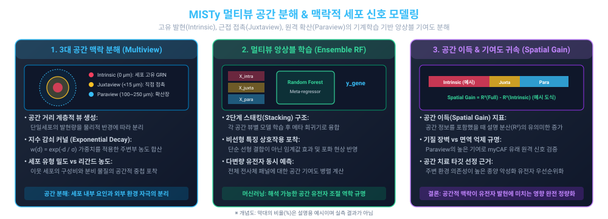

# Chapter 07. 다중 뷰 공간 분해 앙상블 모델링 (Multiview Modeling with MISTy)

> **Cognitive Goal**: 복잡한 조직 미세환경에서 관측되는 특정 세포의 표현형(예: 종양 세포의 가소성 전이, T 세포의 소진)이 "세포 자체의 내인성 전사 프로그램(Cell-Intrinsic)", "직접 맞닿은 이웃과의 물리적 접촉(Juxtacrine)", "수백 마이크로미터에 걸친 조직 규모의 확산 사이토카인 구배(Paracrine)" 중 어느 공간적 스케일에 의해 유도되었는지를 수학적으로 분해하는 **MISTy (Multiview Intercellular Spatio-Temporal Modeling)** 앙상블 머신러닝의 수리적 아키텍처를 이해한다. 다중 뷰 특징 공간 생성, 2단계 스태킹(Stacking) 메타 러닝, 설명 분산($R^2$) 분해 기법을 정립하고, 전립선암 골전이 미세환경의 면역 억제 및 가소성 드라이버를 공간 스케일별로 규명한다.

---

## 1. 공간 다중 뷰(Multiview) 모델링의 필요성: 세포 표현형의 결정론적 분해

종양 미세환경 내의 개별 세포는 진공 속에 고립되어 있지 않으며, 동시에 외부 신호에만 100% 종속되지도 않습니다. 세포의 최종 표현형(Phenotype)은 다양한 공간적 거리(Spatial Scales)에서 작용하는 복합적인 조절력의 합작품입니다.

```
┌────────────────────────────────────────────────────────────────────────────────────────┐
│               세포 표현형을 결정하는 3대 공간적 스케일 (Spatial Views)                │
│                                                                                        │
│   [1. Intrinsic View (내인성 뷰: d = 0 µm)]                                            │
│   - 물리적 스케일: 세포 내부 자체 (Intra-cellular)                                     │
│   - 생물학적 동인: 세포 자율적 유전체 변이, 계통 기억, 세포 주기, 자가 분비(Autocrine)  │
│   - 질문: "외부 자극 없이도 세포 스스로 이 유전자를 발현하는가?"                      │
│                                                                                        │
│   [2. Juxtaview (병렬 접촉 뷰: d < 15 µm)]                                             │
│   - 물리적 스케일: 세포막 직접 맞닿음 (Juxtacrine / Direct Cell-Cell Contact)           │
│   - 생물학적 동인: Notch-Delta, E-cadherin, 면역 시냅스 (PD-L1 - PD-1), 갭 결합        │
│   - 질문: "바로 옆에 어떤 세포가 물리적으로 닿아 있는가가 이 유전자를 유도하는가?"     │
│                                                                                        │
│   [3. Paraview (파라크라인 뷰: d ≈ 100 ~ 250 µm)]                                      │
│   - 물리적 스케일: 조직 규모의 분비 단백질 확산 구배 (Paracrine Diffusion Gradient)     │
│   - 생물학적 동인: myCAF 분비 TGF-β1, CXCL12, 종양 저산소 괴사 영역의 젖산/VEGF 구배   │
│   - 질문: "조직 원거리에서 확산되어 오는 화학적 미세환경이 이 유전자를 자극하는가?"    │
└────────────────────────────────────────────────────────────────────────────────────────┘
```

Tanevski et al. (Genome Biology, 2022;23:97, PMID 35422018)에 의해 제안된 **MISTy (Multiview Intercellular SpaTial modeling framework)**(시간 모델이 아닌 공간 모델)는 설명 변수들을 물리적 거리 기반의 다중 뷰(Multiple Views)로 분할하고, 앙상블 머신러닝(Random Forest / Gradient Boosting)과 스태킹(Stacking) 모델을 통해 **"각 공간 뷰가 표적 유전자 발현 변량의 몇 %를 설명하는가(Variance Explained Decomposition)"**를 엄밀하게 분해합니다.



---

## 2. MISTy의 수학적 정식화: 다중 뷰 특징 공간 구축

총 $N$개의 공간적으로 분해된 세포(또는 스팟)가 존재하고, 각 세포 $i$의 2차원 공간 좌표를 $s_i = (x_i, y_i) \in \mathbb{R}^2$라 합니다. 분석하고자 하는 표적 표지자(Target Marker, e.g., T 세포 소진 마커 *HAVCR2*, 또는 암 줄기세포 마커 *SOX2*)의 발현량 벡터를 $y = [y_1, y_2, \dots, y_N]^T \in \mathbb{R}^N$이라 합니다.

MISTy는 각 세포 $i$에 대해 세 가지 독립적인 특징 벡터(Feature Vectors)를 구축합니다:

### 2.1 내인성 뷰 (Intrinsic View: $\mathcal{V}_{\text{intra}}$)
동일한 세포 $i$ 내부에서 발현되는 표적 유전자 이외의 $P-1$개 유전자들의 발현 프로파일입니다:

$$X_{\text{intra}, i} = [x_{i, 1}, x_{i, 2}, \dots, x_{i, P-1}] \in \mathbb{R}^{P-1}$$

이 뷰는 표적 유전자가 세포 내부의 다른 경로(예: 세포 내 독자적 전사인자 네트워크)와 공변(Co-variation)하는 정도를 포착합니다.

### 2.2 접촉 뷰 (Juxtaview: $\mathcal{V}_{\text{juxta}}$)
세포 $i$와 물리적으로 직접 맞닿은 최근접 이웃(First-order Neighbors) 세포들의 평균 조성 또는 분자 발현 프로파일입니다:

$$X_{\text{juxta}, i} = \sum_{j \in \mathcal{N}_{\text{juxta}}(i)} w_{ij}^{\text{juxta}} X_j \in \mathbb{R}^K$$

- $\mathcal{N}_{\text{juxta}}(i) = \{ j \mid \| s_i - s_j \|_2 \le d_{\text{contact}} \}$ (통상 $d_{\text{contact}} \approx 10 \sim 15\ \mu\text{m}$, 또는 들로네 삼각분할의 인접 다각형).
- $w_{ij}^{\text{juxta}} = \frac{1}{|\mathcal{N}_{\text{juxta}}(i)|}$: 균일 평균 또는 세포 간 공유 경계선 길이 비율.
- $X_j$: 이웃 세포 $j$의 세포 유형 원핫 벡터 또는 분자 발현 벡터 ($K$차원).

### 2.3 파라크라인 뷰 (Paraview: $\mathcal{V}_{\text{para}}$)
연속적인 공간 확산 방정식에 기반하여, 원거리 조직 미세환경으로부터 유입되는 확산 신호의 국소 밀도 구배를 가우스 커널 평활화(Gaussian Kernel Smoothing)로 모델링합니다:

$$X_{\text{para}, i}(l) = \sum_{j \ne i} \exp\left( - \frac{\| s_i - s_j \|_2^2}{2 l^2} \right) X_j \in \mathbb{R}^K$$

- $l$: 조직 내 리간드 확산 길이 매개변수 (Bandwidth / Length-scale, 예: $l = 50\ \mu\text{m}, 150\ \mu\text{m}, 250\ \mu\text{m}$).
- 연구 목적에 따라 서로 다른 확산 반경 $l_1, l_2$를 갖는 여러 개의 파라크라인 뷰를 병렬로 정의할 수 있습니다.

---

## 3. 2단계 스태킹(Stacking) 앙상블 머신러닝 아키텍처

MISTy는 다중 뷰의 이질적인 차원과 비선형성을 처리하기 위해 2계층 앙상블 학습 구조(Two-tier Stacking Framework)를 사용합니다.

```
┌────────────────────────────────────────────────────────────────────────────────────────┐
│                        MISTy 2단계 앙상블 학습 파이프라인                              │
│                                                                                        │
│   [Level 1: 뷰 특이적 비선형 기본 학습기 (Base Learners)]                              │
│   - X_{intra} ────► [Random Forest / GBDT 1] ────► 예측치 ŷ_{intra}                    │
│   - X_{juxta} ────► [Random Forest / GBDT 2] ────► 예측치 ŷ_{juxta}                    │
│   - X_{para}  ────► [Random Forest / GBDT 3] ────► 예측치 ŷ_{para}                     │
│                                                                                        │
│   [Level 2: 비음수 제약 다중 뷰 메타 모델 (Meta-Learner)]                              │
│   - ŷ = α_{intra} ŷ_{intra} + α_{juxta} ŷ_{juxta} + α_{para} ŷ_{para}                 │
│     (제약 조건: α_v ≥ 0, 릿지 정규화 결합)                                             │
│                                                                                        │
│   [Level 3: 설명 분산 분해 및 변수 중요도 분석]                                       │
│   - R^2_{total} = R^2_{intra} + ΔR^2_{juxta} + ΔR^2_{para}                             │
│   - 각 뷰 내부의 최상위 기여 유전자/세포 유형(SHAP / Gini Importance) 역추적           │
└────────────────────────────────────────────────────────────────────────────────────────┘
```

### 3.1 1단계: 뷰별 비선형 기본 학습기 (View-Specific Base Models)
각 공간 뷰 $v \in \{ \text{intra}, \text{juxta}, \text{para} \}$에 대해, 비선형 관계 및 고차 상호작용을 포착할 수 있는 앙상블 트리 모델(Random Forest 또는 XGBoost)을 독립적으로 훈련합니다:

$$\hat{y}_i^{(v)} = f_v(X_{v, i})$$

과적합(Overfitting)을 방지하기 위해 교차 검증 방식의 외재적(out-of-fold) 예측치 벡터 $\hat{y}^{(v)} \in \mathbb{R}^N$을 도출합니다. (LIANA+의 MISTy 구현은 Random Forest의 OOB 예측을 기본으로 사용합니다. 공간 자기상관 때문에 무작위 $K$-겹 분할은 이웃 정보가 훈련/검증에 누수될 수 있으므로 공간 블록 단위 분할이 바람직합니다.)

### 3.2 2단계: 다중 뷰 메타 학습기 (Meta-Learner Stacking)
각 뷰에서 산출된 예측치들을 결합하여 최종 표적 발현량을 예측하는 선형 메타 모델을 구축합니다. 생물학적 해석 가능성을 위해 가중치에 비음수 제약(Non-negative Constraints)을 부여하는 교육용 정식화입니다(LIANA+ MISTy는 메타모델 계수를 학습한 뒤 0으로 clip하고 합이 1이 되도록 정규화하며, 뷰의 이득은 다중 뷰 $R^2$에서 intra $R^2$를 뺀 `gain.R2`로 보고합니다):

$$\hat{y}_i = \alpha_0 + \sum_{v \in \mathcal{V}} \alpha_v \hat{y}_i^{(v)}$$

$$\min_{\alpha_v \ge 0} \sum_{i=1}^N \left( y_i - \alpha_0 - \sum_{v} \alpha_v \hat{y}_i^{(v)} \right)^2 + \lambda \sum_v \alpha_v^2$$

- $\alpha_v \ge 0$: 각 공간 뷰가 표적 유전자 발현을 증가시키는 순기여도. 음의 계수를 차단함으로써 생물학적으로 모순되는 '상쇄 간섭'을 방지합니다.

---

## 4. 설명 분산 분해 ($R^2$ Variance Decomposition)의 수학적 원리

MISTy의 진정한 혁신성은 특정 세포 표현형의 분산 중 얼마만큼이 세포 내부 프로그램에서 비롯되었고, 얼마만큼이 공간적 미세환경에서 비롯되었는지를 **설명 분산 비율($R^2$)**로 엄밀하게 정량화한다는 점입니다.

### 4.1 기본 결정계수 ($R^2$)의 정의
표적 유전자 $y$의 전체 제곱합(Total Sum of Squares, $SS_{\text{tot}}$)과 잔차 제곱합(Residual Sum of Squares, $SS_{\text{res}}$)은 다음과 같습니다:

$$SS_{\text{tot}} = \sum_{i=1}^N (y_i - \bar{y})^2, \quad SS_{\text{res}}(f) = \sum_{i=1}^N (y_i - \hat{y}_i)^2$$

$$R^2 = 1 - \frac{SS_{\text{res}}}{SS_{\text{tot}}}$$

### 4.2 뷰별 설명 분산 이득 ($\Delta R^2$) 분해
MISTy는 계층적 모델 비교를 통해 각 공간 뷰의 고유 기여도(Gain in Variance Explained)를 산출합니다:

1. **내인성 기저 모델 (Baseline Intrinsic Model)**:
   $$R^2_{\text{intra}} = 1 - \frac{SS_{\text{res}}(f_{\text{intra}})}{SS_{\text{tot}}}$$
2. **다중 뷰 전체 모델 (Full Multiview Model)**:
   $$R^2_{\text{multi}} = 1 - \frac{SS_{\text{res}}(f_{\text{stacking}})}{SS_{\text{tot}}}$$
3. **공간 미세환경에 의한 순수 분산 이득 (Gain by Spatial Context)**:
   $$\Delta R^2_{\text{spatial}} = R^2_{\text{multi}} - R^2_{\text{intra}}$$
4. **개별 공간 뷰의 고유 분산 기여도 분해**:
   - 접촉 뷰 기여도: $\Delta R^2_{\text{juxta}} = R^2(\text{intra} + \text{juxta}) - R^2_{\text{intra}}$
   - 파라크라인 뷰 기여도: $\Delta R^2_{\text{para}} = R^2(\text{intra} + \text{para}) - R^2_{\text{intra}}$

```
┌────────────────────────────────────────────────────────────────────────────────────────┐
│                      MISTy 설명 분산 분해 결과 해석의 임상적 의미                      │
│                                                                                        │
│   케이스 A: R^2_{intra} = 0.65, ΔR^2_{juxta} = 0.02, ΔR^2_{para} = 0.03                │
│   ==> 결론: "세포 자율적(Cell-Autonomous) 종양 표현형"                                │
│       미세환경 차단 치료(면역치료, 기질 저해제) 무효! 세포 내부 발암 신호 저해제 필요!  │
│                                                                                        │
│   케이스 B: R^2_{intra} = 0.15, ΔR^2_{juxta} = 0.48, ΔR^2_{para} = 0.05                │
│   ==> 결론: "물리적 세포-세포 접촉 의존성 표현형 (Juxtacrine-Driven)"                  │
│       면역 시냅스 결합(PD-1/PD-L1) 또는 접촉 억제 분자 차단이 핵심 치료 타겟!          │
│                                                                                        │
│   케이스 C: R^2_{intra} = 0.10, ΔR^2_{juxta} = 0.04, ΔR^2_{para} = 0.55                │
│   ==> 결론: "광역 미세환경 확산 인자 의존성 표현형 (Paracrine Niche-Driven)"           │
│       원거리 CAF 분비 인자(TGF-β, CXCL12) 또는 저산소 대사산물 중화가 최적 타겟!       │
└────────────────────────────────────────────────────────────────────────────────────────┘
```

---

## 5. 전립선암 골전이 미세환경 실전 사례: T 세포 소진 및 계통 가소성 분해

mCRPC 골전이 병변에서 환자 간 면역 치료 불응성의 원인을 MISTy로 분석할 때, 두 가지 결정적 질문을 분해할 수 있습니다:

### 5.1 질문 1: CD8+ T 세포의 소진(HAVCR2/TIM-3 발현)을 주도하는 것은 무엇인가?
- MISTy 분해 결과 (**가상 예시 수치**이며 데이터·코드에서 계산된 값이 아님):
  - $R^2_{\text{intra}} = 0.12$ (T 세포 고유의 TCR 신호 지속성)
  - $\Delta R^2_{\text{juxta}} = 0.42$ (물리적으로 맞닿은 CD68+ TAM의 *CD274*(PD-L1) 및 *LGALS9*(Galectin-9) 접촉)
  - $\Delta R^2_{\text{para}} = 0.28$ (외곽 myCAF 띠로부터 $150\ \mu\text{m}$ 거리에 걸쳐 확산되는 *TGFB1* 구배)
- **임상적 함의**: T 세포 소진은 세포 자체의 결함이 아니라, 근접 대식세포와의 막 접촉과 원거리 CAF 유래 TGF-$\beta$의 협공에 의해 일어납니다. 따라서 (예시 수치가 사실이라면) 항-PD-1 단독으로는 부족할 수 있다는 *가설*이 가능하며, Galectin-9 억제 및 TGF-$\beta$ 트랩의 삼중 병용이 요구됩니다.

### 5.2 질문 2: 종양 세포의 신경내분비 전분화(ASCL1 발현)를 주도하는 것은 무엇인가?
- MISTy 분해 결과 (**가상 예시 수치**):
  - $R^2_{\text{intra}} = 0.18$ (TP53/RB1 결손 등 세포 내인성 돌연변이)
  - $\Delta R^2_{\text{juxta}} = 0.05$ (세포 간 접촉 기여도 미미)
  - $\Delta R^2_{\text{para}} = 0.58$ (골 기질 파골세포로부터 확산되는 *TGFB1* 및 조골세포 유래 *WNT5A* 구배)
- **해석 (가설)**: 예시 수치가 사실이라면 파라크라인 확산 인자가 주요 설명 변수일 수 있으나, MISTy의 R² 기여는 인과적 드라이버의 증거가 아니며 임상 해석에는 직교 검증이 필요합니다.

---

## 6. 실전 분석 파이프라인: Python MISTy 워크플로우

다음은 공간 전사체 데이터에서 표적 유전자(*HAVCR2*)에 대한 다중 뷰(내인성, 접촉, 파라크라인)를 생성하고 Random Forest 기반으로 설명 분산을 분해하는 완전한 파이썬 스크립트입니다.

> **구현 주의**: 아래 코드는 MISTy 개념(뷰별 RF + 비음수 메타 모델)을 단순화한 *교육용 재구현*이며 원 MISTy(R 패키지, 또는 LIANA+의 `li.mt` MISTy 클래스)와 동일하지 않습니다. 특히 메타 모델을 교차검증 없이 같은 out-of-fold 예측으로 적합·평가하여(in-sample) 다중 뷰 R²가 낙관적일 수 있고, 'ΔR²'는 원 MISTy의 `gain.R2`와 정의가 다릅니다.

```python
"""
07_misty_multiview_modeling.py
전립선암 골전이 공간전사체 데이터에서 MISTy 다중 뷰(Intra, Juxta, Para) 분해를 통한
T 세포 소진 마커(HAVCR2)의 공간 조절 인자 규명 파이프라인
"""

import scanpy as sc
import numpy as np
import pandas as pd
from scipy.spatial import cKDTree
from sklearn.ensemble import RandomForestRegressor
from sklearn.linear_model import Ridge
from sklearn.model_selection import KFold
from sklearn.metrics import r2_score
import matplotlib.pyplot as plt

# 1. 공간 전사체 AnnData 로드
print("[Step 1] Loading Spatial AnnData...")
adata = sc.read_h5ad("mcrpc_bone_metastasis_spatial.h5ad")

# 분석 대상 표적 세포군 및 표적 유전자 설정
target_celltype = "CD8_T_Cell"
target_gene = "HAVCR2"  # TIM-3 소진 마커
sub_indices = np.where(adata.obs["cell_type"] == target_celltype)[0]

coords = adata.obsm["spatial"]
expr = adata.to_df()
y = expr.loc[:, target_gene].values[sub_indices]

# 2. View 1: 내인성 뷰 (Intrinsic View - 동일 세포 내 타 유전자 발현)
print("[Step 2] Constructing Intrinsic View (d = 0 µm)...")
intra_genes = [g for g in expr.columns if g != target_gene and expr[g].mean() > 0.05][:100]
X_intra = expr.loc[:, intra_genes].values[sub_indices]

# 3. View 2: 접촉 뷰 (Juxtaview - d <= 15 µm 직접 인접 세포 조성)
# 전제: 단일 세포 해상도 플랫폼(Xenium/MERFISH 등). Visium은 스팟 직경 55 µm, 중심 간 100 µm라 15 µm 이내 이웃이 없다.
# 주의: 이 뷰는 이웃의 세포 유형 구성(one-hot 평균)만 사용하므로 이웃의 CD274·LGALS9 같은 발현 정보는 담지 못한다.
print("[Step 3] Constructing Juxtaview (d <= 15 µm contact neighbors)...")
tree = cKDTree(coords)
# 전체 세포 유형의 더미(One-hot) 행렬
celltype_dummies = pd.get_dummies(adata.obs["cell_type"]).values
d_contact = 15.0  # 15 µm 접촉 한계

X_juxta = np.zeros((len(sub_indices), celltype_dummies.shape[1]))
for idx_i, cell_i in enumerate(sub_indices):
    neighbor_indices = tree.query_ball_point(coords[cell_i], r=d_contact)
    # 자기 자신 제외
    neighbor_indices = [idx for idx in neighbor_indices if idx != cell_i]
    if len(neighbor_indices) > 0:
        X_juxta[idx_i, :] = np.mean(celltype_dummies[neighbor_indices, :], axis=0)

# 4. View 3: 파라크라인 뷰 (Paraview - l = 150 µm 확산 구배)
print("[Step 4] Constructing Paraview (l = 150 µm diffusion gradient)...")
l_diff = 150.0  # 150 µm 가우스 대역폭
X_para = np.zeros((len(sub_indices), celltype_dummies.shape[1]))

for idx_i, cell_i in enumerate(sub_indices):
    # 주의: k=50 최근접 절단은 가우스 대역폭을 잘라낼 수 있다(1,500세포/mm^2 합성 데이터에서 50번째 이웃 평균 거리 약 109 µm < 대역폭 150 µm).
    #       반경 질의(query_ball_point, 예: r = 3*l_diff)로 구성하는 편이 정의에 맞다.
    dists, neighbor_indices = tree.query(coords[cell_i], k=50)
    # 가우스 감쇄 가중치
    weights = np.exp(- (dists**2) / (2 * l_diff**2))
    # 자기 자신 가중치 0 처리
    weights[0] = 0.0
    if np.sum(weights) > 0:
        weights /= np.sum(weights)
        X_para[idx_i, :] = np.sum(celltype_dummies[neighbor_indices] * weights[:, None], axis=0)

# 5. 2단계 스태킹 앙상블 교차 검증 (Level-1 Random Forest & Level-2 Non-negative Meta Model)
print("[Step 5] Training MISTy 2-tier Stacking Model with 5-Fold Cross Validation...")
# 주의: 무작위 셔플 KFold는 공간 자기상관으로 이웃 정보가 누수될 수 있다 -> 공간 블록 CV 권장
kf = KFold(n_splits=5, shuffle=True, random_state=42)

pred_intra = np.zeros(len(y))
pred_juxta = np.zeros(len(y))
pred_para = np.zeros(len(y))

rf_intra = RandomForestRegressor(n_estimators=100, max_depth=6, random_state=42)
rf_juxta = RandomForestRegressor(n_estimators=100, max_depth=6, random_state=42)
rf_para = RandomForestRegressor(n_estimators=100, max_depth=6, random_state=42)

for train_idx, val_idx in kf.split(y):
    # Level-1 기본 학습기 훈련
    rf_intra.fit(X_intra[train_idx], y[train_idx])
    rf_juxta.fit(X_juxta[train_idx], y[train_idx])
    rf_para.fit(X_para[train_idx], y[train_idx])
    
    pred_intra[val_idx] = rf_intra.predict(X_intra[val_idx])
    pred_juxta[val_idx] = rf_juxta.predict(X_juxta[val_idx])
    pred_para[val_idx] = rf_para.predict(X_para[val_idx])

# Level-2 메타 학습기 (Non-negative Ridge)
meta_X = np.column_stack([pred_intra, pred_juxta, pred_para])
meta_model = Ridge(positive=True, alpha=1.0)
meta_model.fit(meta_X, y)
pred_multi = meta_model.predict(meta_X)   # 주의: 메타모델은 같은 데이터로 적합·평가(in-sample)하므로 R^2가 낙관적이다

# 6. 설명 분산(R^2) 분해 계산
r2_intra = max(0, r2_score(y, pred_intra))
r2_multi = max(0, r2_score(y, pred_multi))

# 개별 뷰 결합 기여도 산출
r2_intra_juxta = max(0, r2_score(y, Ridge(positive=True).fit(np.column_stack([pred_intra, pred_juxta]), y).predict(np.column_stack([pred_intra, pred_juxta]))))
r2_intra_para = max(0, r2_score(y, Ridge(positive=True).fit(np.column_stack([pred_intra, pred_para]), y).predict(np.column_stack([pred_intra, pred_para]))))

delta_r2_juxta = max(0, r2_intra_juxta - r2_intra)
delta_r2_para = max(0, r2_intra_para - r2_intra)

print("\n=== MISTy Variance Explained Decomposition (Target: HAVCR2) ===")
print(f"Intrinsic Baseline R^2   : {r2_intra:.4f}")
print(f"Juxtaview Gain (ΔR^2)   : {delta_r2_juxta:.4f} (Direct Contact Niche)")
print(f"Paraview Gain (ΔR^2)    : {delta_r2_para:.4f} (Tissue Diffusion Niche)")
print(f"Total Multiview R^2     : {r2_multi:.4f}")

# 7. 분산 분해 시각화
plt.figure(figsize=(8, 5))
views = ["Intrinsic", "Juxtaview Gain", "Paraview Gain"]
r2_values = [r2_intra, delta_r2_juxta, delta_r2_para]
colors = ["#4DAF4A", "#377EB8", "#E41A1C"]

plt.bar(views, r2_values, color=colors, edgecolor="black", width=0.5)
plt.ylabel("Variance Explained (R²)")
plt.title(f"MISTy Spatial Scale Decomposition of {target_gene} Expression")
plt.ylim(0, max(0.5, r2_multi + 0.1))

for i, v in enumerate(r2_values):
    plt.text(i, v + 0.01, f"{v:.3f}", ha="center", fontweight="bold")

plt.tight_layout()
plt.savefig("misty_variance_decomposition.png", dpi=300)
plt.close()

print("[Complete] MISTy multiview spatial modeling pipeline finished.")
```

---

## 단원 핵심 점검 (Cognitive Checkpoint & Case Study)

### Q1. [능동 회상 (Active Recall)]
MISTy 모델링에서 세포의 분자적 특성을 설명하기 위해 정의하는 3대 공간적 뷰(Intrinsic, Juxtaview, Paraview)의 물리적 거리 스케일과 각각이 모델링하는 생물학적 작용 기전(Biological Mechanisms)을 명확히 대조하여 설명하시오.

<details>
<summary>💡 모범 답안 및 해설 확인</summary>

- **1. 내인성 뷰 (Intrinsic View, 물리적 거리 $d = 0\ \mu\text{m}$)**:
  - **작용 기전**: 세포 자율적(Cell-Autonomous) 생물학적 프로그램. 세포 내부의 유전체 돌연변이(Driver Mutations), 후성유전학적 크로마틴 구조, 내부 신호 전달 경로 간의 크로스토크, 자가분비(Autocrine) 피드백 루프를 모델링합니다. 외부 환경 자극과 무관하게 세포 스스로 유전자 발현을 조절하는 기저선을 나타냅니다.
- **2. 병렬 접촉 뷰 (Juxtaview, 물리적 거리 $d \le 15\ \mu\text{m}$)**:
  - **작용 기전**: 세포막 직접 접촉형 신호 전달(Juxtacrine Signaling). Notch-Delta 결합, E-cadherin 부착 연접, 면역 시냅스 형성(PD-L1과 PD-1, CD80/CD86과 CTLA-4), 세포 간 간극 연접(Gap Junctions) 등 물리적으로 맞닿은 이웃 세포와의 원형질막 분자 결합에 의한 국소 활성화를 모델링합니다.
- **3. 파라크라인 뷰 (Paraview, 물리적 거리 $d \approx 100 \sim 250\ \mu\text{m}$)**:
  - **작용 기전**: 조직 규모의 분비 단백질 확산 및 농도 구배(Paracrine / Morphogen Diffusion Gradients). myCAF가 분비하는 가용성 사이토카인(TGF-$\beta$1), 케모카인(CXCL12), 성장인자(VEGFA), 또는 저산소 괴사 영역에서 누출되는 대사산물(젖산) 등이 세포외 기질을 따라 퍼져나가 세포의 세포막 수용체를 자극하는 광역 미세환경 자극을 모델링합니다.

</details>

---

### Q2. [수학적 원리 규명 (Mathematical Rigor)]
MISTy의 Level-2 메타 모델 학습식 $\min_{\alpha_v} \| y - \sum_v \alpha_v \hat{y}^{(v)} \|_2^2$에서, 가중치 계수에 비음수 제약($\alpha_v \ge 0$)을 부여해야 하는 통계학적/생물학적 이유를 설명하고, 다중공선성(Multicollinearity)에 취약한 일반 선형 회귀 대신 2단계 스태킹(Stacking) 구조와 릿지 정규화(Ridge Regularization)를 결합했을 때 분산 분해($\Delta R^2_v$)의 추정 안정성이 어떻게 확보되는지 서술하시오.

<details>
<summary>💡 모범 답안 및 해설 확인</summary>

- **비음수 제약($\alpha_v \ge 0$) 부여의 이유**:
  - 통계학적으로 각 뷰의 예측치($\hat{y}_{\text{intra}}, \hat{y}_{\text{juxta}}, \hat{y}_{\text{para}}$)는 표적 변수 $y$와 양의 상관관계를 갖도록 1단계에서 훈련됩니다. 만약 비음수 제약이 없다면, 뷰 간의 강한 상관성으로 인해 한 뷰에는 거대한 양의 가중치가 부여되고 다른 뷰에는 인위적인 음의 가중치가 부여되어 서로를 상쇄하는 '부호 반전 왜곡(Cancellation Effect)'이 발생할 수 있습니다.
  - 생물학적으로 "특정 공간 뷰가 표적 유전자 발현에 기여하는 순수한 설명력"을 측정해야 하므로, 음의 기여도(Negative Contribution)는 생물학적으로 해석이 불가능합니다. 비음수 제약을 통해 각 공간 뷰의 고유하고 직교적인 분산 설명 비율만을 순수하게 분해할 수 있습니다.
- **2단계 스태킹 및 릿지 정규화 결합의 추정 안정성**:
  - 1단계에서 Random Forest 등 비선형 모델을 사용하여 각 뷰 내부의 복잡한 비선형적 유전자 상호작용을 단일 스칼라 예측 벡터 $\hat{y}^{(v)}$로 축약(Dimensionality Reduction)함으로써 차원의 저주를 극복합니다.
  - 또한 교차 검증 외재적 예측치(Out-of-fold Predictions)를 사용하여 1단계 모델의 과적합 노이즈가 2단계로 누출되는 것을 차단합니다.
  - 메타 학습기에 릿지 정규화($\lambda \sum \alpha_v^2$)를 결합하면, 공간적 뷰들 간에 존재하는 불가피한 다중공선성(예: 접촉 이웃 세포의 조성이 파라크라인 이웃 세포의 조성과 일부 상관될 때) 환경에서도 공분산 행렬의 조건수(Condition Number)를 안정화하여 역행렬의 폭발을 막고 계수 벡터 $\alpha$의 분산을 획기적으로 축소시킵니다. 결과적으로 $\Delta R^2_v$ 추정치가 특정 샘플 변동에 흔들리지 않고 강건하게 수렴합니다.

</details>

---

### Q3. [임상 케이스 분석 (Clinical Problem Solving)]
mCRPC 골전이 병변을 가진 환자 코호트에서 종양 조직 내 침윤 CD8+ T 세포의 면역관문 수용체 *HAVCR2*(TIM-3) 발현을 표적 변수로 하여 MISTy 다중 뷰 모델링을 수행하였다. 
(가상 예시 수치; 실제 계산 결과가 아님)
- 환자군 A (Anti-PD-1 치료 반응군): $R^2_{\text{intra}} = 0.08$, $\Delta R^2_{\text{juxta}} = 0.52$, $\Delta R^2_{\text{para}} = 0.04$. (접촉 뷰에서 최상위 기여 변수는 $15\ \mu\text{m}$ 이내의 PD-L1+ 골수성 세포 밀도).
- 환자군 B (Anti-PD-1 치료 완전 불응군): $R^2_{\text{intra}} = 0.09$, $\Delta R^2_{\text{juxta}} = 0.05$, $\Delta R^2_{\text{para}} = 0.61$. (파라크라인 뷰에서 최상위 기여 변수는 $200\ \mu\text{m}$ 거리 외곽 myCAF 띠로부터의 *TGFB1* 확산 구배).

두 환자군에서 MISTy가 도출한 설명 분산 프로파일의 차이를 기반으로 T 세포 소진을 유발하는 병리학적 메커니즘을 공간적 관점에서 대조 분석하고, 환자군 B의 불응성을 극복하기 위해 기존 면역요법에 추가되어야 할 정밀 표적 치료 조합을 제시하시오.

<details>
<summary>💡 모범 답안 및 해설 확인</summary>

- **환자군 A와 B의 공간적 병태생리 대조 분석**:
  - **환자군 A (접촉 지배형 면역 소진, Juxtacrine-Dominant Exhaustion)**:
    - $\Delta R^2_{\text{juxta}} = 0.52$로 압도적이며 파라크라인 기여도는 미미합니다.
    - 이는 T 세포가 종양 침윤 후 $15\ \mu\text{m}$ 이내에서 인접한 PD-L1+ 골수성 세포와 직접 면역 시냅스를 형성하여 세포 접촉 의존적으로 소진에 이르렀음을 뜻합니다.
    - 이 경우 막 접촉형 면역관문 단클론 항체(Anti-PD-1)를 투여하면 면역 시냅스의 억제 신호가 효과적으로 차단되므로 T 세포의 세포독성 활성이 즉각 복원되어 치료 반응을 나타냅니다.
  - **환자군 B (광역 기질 확산 지배형 면역 마비, Paracrine-Dominant Exclusion/Exhaustion)**:
    - $\Delta R^2_{\text{juxta}} = 0.05$에 불과한 반면, $\Delta R^2_{\text{para}} = 0.61$로 매우 높습니다.
    - 이는 T 세포 소진 마커의 발현이 인접 세포와의 막 접촉이 아니라, $200\ \mu\text{m}$ 떨어진 종양 외곽 myCAF 피막에서 뿜어져 나오는 고농도 가용성 TGF-$\beta$1 확산 구배에 의해 원거리에서 조절되고 있음을 의미합니다.
    - 환자군 B에서는 항-PD-1 항체를 투여하더라도 원거리에서 밀려오는 TGF-$\beta$의 압도적인 면역 억제 환경이 유지되므로 T 세포 기능이 전혀 회복되지 못하고 치료에 완전 불응하게 됩니다.
- **환자군 B의 불응성 극복을 위한 병용 치료 설계 (탐색적 가설)**:

> **치료 서술 주의 (탐색적 가설)**: 이하 약제 조합은 사고 훈련용 가설이며 확립된 치료가 아닙니다. Bintrafusp alfa는 어느 적응증에서도 승인되지 않았고 INTR@PID BTC 055가 무용성으로 중단되었으며(Merck KGaA 2021; NCT04066491), Galunisertib의 현재 개발 상태는 확인하지 못했습니다. Plerixafor+항-PD-L1의 근거(Feig 2013)는 마우스 췌장암 모델입니다. 아래 MISTy 수치는 계산된 결과가 아닌 가상 예시이므로 임상 결론을 도출할 수 없습니다.

  - **1. TGF-β 신호 전달 중화**:
    - 가용성 TGF-$\beta$ 트랩 융합 단백질인 **Bintrafusp alfa** (TGF-$\beta$ trap / Anti-PD-L1 fusion) 또는 소분자 TGFBR1 억제제(**Galunisertib**)를 병용 투여하여 파라크라인 뷰의 핵심 드라이버인 원거리 TGF-$\beta$ 구배를 무력화합니다.
  - **2. 기질 장벽 분해 및 케모카인 차단**:
    - myCAF 피막의 섬유화 및 T 세포 격리를 해소하기 위해 **CXCR4 저해제(Plerixafor)**를 추가하여 T 세포가 외곽 기질을 벗어나 종양 상피로 침투하도록 유도합니다.
  - 이러한 다중 스케일 차단 요법을 통해 파라크라인 면역 억제 장벽을 붕괴시킴으로써 환자군 B의 면역 배제형 미세환경을 면역 감작 환경으로 전환시킬 수 있는지는 검증되지 않은 가설입니다.

</details>

---

<!-- REFERENCES:BEGIN (generated by scripts/apply_references.py; do not edit by hand) -->
## 참고문헌 (References)
### 본문 인용 문헌
1. Tanevski J, Flores ROR, Gabor A, et al. Explainable multiview framework for dissecting spatial relationships from highly multiplexed data. *Genome Biol*. 2022;23(1):97. PMID: 35422018. doi: 10.1186/s13059-022-02663-5
2. Feig C, Jones JO, Kraman M, et al. Targeting CXCL12 from FAP-expressing carcinoma-associated fibroblasts synergizes with anti-PD-L1 immunotherapy in pancreatic cancer. *Proc Natl Acad Sci U S A*. 2013;110(50):20212-7. PMID: 24277834. doi: 10.1073/pnas.1320318110
3. EMD Serono Research & Development Institute, Inc. Gemcitabine Plus Cisplatin With or Without Bintrafusp Alfa (M7824) in Participants With 1L BTC. *ClinicalTrials.gov* registry (Phase 2/3; Terminated; 2019-2022). ClinicalTrials.gov: NCT04066491.
### 검수 근거 문헌
1. Fizazi K, Carducci M, Smith M, et al. Denosumab versus zoledronic acid for treatment of bone metastases in men with castration-resistant prostate cancer: a randomised, double-blind study. *Lancet*. 2011;377(9768):813-22. PMID: 21353695. doi: 10.1016/S0140-6736(10)62344-6
2. Ku SY, Rosario S, Wang Y, et al. Rb1 and Trp53 cooperate to suppress prostate cancer lineage plasticity, metastasis, and antiandrogen resistance. *Science*. 2017;355(6320):78-83. PMID: 28059767. doi: 10.1126/science.aah4199
3. Ren D, Dai Y, Yang Q, et al. Wnt5a induces and maintains prostate cancer cells dormancy in bone. *J Exp Med*. 2019;216(2):428-449. PMID: 30593464. doi: 10.1084/jem.20180661
### 소프트웨어 (표기 버전은 검수 시 API를 확인한 버전이며, 파이프라인 실행 환경은 requirements-pipelines.txt 참조)
- Matplotlib 3.11.2 (github.com/matplotlib/matplotlib). 원 논문: Hunter JD. Matplotlib: A 2D Graphics Environment. *Comput. Sci. Eng*. 2007;9(3):90-95. doi: 10.1109/mcse.2007.55
- NumPy 2.5.4 (numpy.org). 원 논문: Harris CR, Millman KJ, van der Walt SJ, et al. Array programming with NumPy. *Nature*. 2020;585(7825):357-362. PMID: 32939066. doi: 10.1038/s41586-020-2649-2
- pandas 2.3.3 (github.com/pandas-dev/pandas). 원 논문: McKinney W. Data Structures for Statistical Computing in Python. *Proceedings of the Python in Science Conference*. 2010:56-61. doi: 10.25080/majora-92bf1922-00a
- Scanpy 1.12.4 (github.com/scverse/scanpy). 원 논문: Wolf FA, Angerer P, Theis FJ. SCANPY: large-scale single-cell gene expression data analysis. *Genome Biol*. 2018;19(1):15. PMID: 29409532. doi: 10.1186/s13059-017-1382-0
- SciPy 1.16.3 (github.com/scipy/scipy). 원 논문: Virtanen P, Gommers R, Oliphant TE, et al. SciPy 1.0: fundamental algorithms for scientific computing in Python. *Nat Methods*. 2020;17(3):261-272. PMID: 32015543. doi: 10.1038/s41592-019-0686-2
- scikit-learn 1.9.1 (github.com/scikit-learn/scikit-learn).
<!-- REFERENCES:END -->
