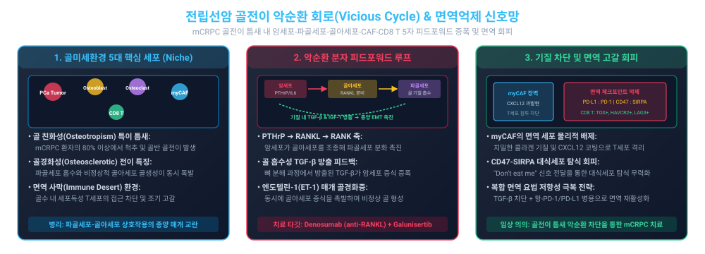

# Chapter 08. 전립선암 골전이 미세환경의 5자 신호 전달 회로 (mCRPC Bone Metastasis Signaling Circuits)

> **Cognitive Goal**: 전이성 거세저항성 전립선암(mCRPC) 환자의 80% 이상에서 나타나는 치명적인 골전이 병변을 지배하는 **5자 신호 전달 회로(5-Way Communication Circuit)**의 분자생물학적 및 수리동역학적 메커니즘을 규명한다. 파골세포(Osteoclasts)의 골용해성 파괴, 골 기질 매립 TGF-$\beta$ 방출에 의한 종양 가소성 피드백, 조골세포(Osteoblasts)의 골경화성 신생골 형성, 암 연관 섬유아세포(myCAFs)의 면역 배제 기질벽, 대식세포 및 T 세포의 면역관문 억제 신호망을 통합적 상미분방정식(ODE) 시스템으로 정식화한다. Track 01의 후성유전학적 eGRN 및 Track 02의 공간적 니치와 연계하여 난치성 골전이 극복을 위한 다중 표적 병용 치료 전략을 도출한다.

---

## 1. 전립선암 골전이 병변의 독특한 병리학: '골용해-골경화 혼합형 악순환'

유방암이나 다발성 골수종이 주로 순수 골용해성(Osteolytic) 병변을 보이는 것과 달리(골용해성 악순환 패러다임의 1차 근거는 유방암 골용해 모형, Guise et al. 1996이며, 전립선암에서는 ET-1에 의한 조골 자극 쪽이 직접 근거입니다: Nelson et al. 1995, Nat Med; Yin et al. 2003, PNAS는 유방암 세포주 마우스 모델), 전립선암 골전이는 **"골 기질의 파괴(Osteolysis)"와 "무질서한 비정상 골 형성(Osteosclerosis/Woven Bone)"이 한 공간에서 동시다발적으로 폭주하는 독특한 혼합형 병태생리**를 갖습니다.

```
┌────────────────────────────────────────────────────────────────────────────────────────┐
│                   전립선암 골전이 미세환경의 5자 악순환 및 면역 회피 회로도            │
│                                                                                        │
│                        [1. Osteolytic Front: 파골세포 골용해]                            │
│                        RANKL(TNFSF11; 공급원은 맥락 의존) ──► Osteoclast RANK         │
│                                      │                                                 │
│                                      ▼                                                 │
│                        [2. Matrix Feedback: 가소성 유도]                               │
│                        Bone Resorption ──► Latent TGF-β1 방출                           │
│                        TGF-β1 ──► Tumor TGFBR1/2 ──► SMAD2/3 ──► EMT & t-NEPC 가소성   │
│                                      │                                                 │
│                                      ▼                                                 │
│                        [3. Osteoblastic Rim: 골경화 신생골]                            │
│                        Tumor ET-1 ──► Osteoblast EDNRA ──► Osteosclerosis (WNT은 가설)│
│                                      │                                                 │
│       ┌──────────────────────────────┴──────────────────────────────┐                  │
│       ▼                                                             ▼                  │
│   [4. myCAF Stromal Wall: 기질 결속]            [5. Checkpoint Hub: 면역 마비]        │
│   myCAF CXCL12/TGFB1 ──► T cell CXCR4/TGFBR2    Tumor CD274(PD-L1) ──► T cell PD-1    │
│   ==> CD8+ T세포 침투 물리적 차단 및 결속        Tumor CD47 ──► TAM SIRPA ("Don't eat")│
└────────────────────────────────────────────────────────────────────────────────────────┘
```



---

## 2. 5자 신호 전달 회로의 심층 분자 메커니즘

### 2.1 제1회로: 골용해성 전선 (Osteolytic Front)
- **리간드-수용체**: $TNFSF11$(RANKL; 공급원은 종양 세포 또는 골아세포계로 맥락 의존적) $\to$ 파골세포 전구체의 $TNFRSF11A$(RANK).
- **세포 내 신호 캐스케이드**:
  $$TNFSF11 \cdot TNFRSF11A \implies \text{TRAF6 삼합체 모집} \implies \text{IKK 복합체 활성화} \implies \text{NF-}\kappa\text{B} \ \& \ \text{MAPK(p38, JNK)}$$
- **마스터 전사인자 및 기능 발현**:
  - $NFATc1$의 강력한 자가증폭(Auto-amplification) 전사 유도.
  - 다핵 파골세포(Multinucleated Osteoclast)로의 융합 및 카텝신 K(*CTSK*), 주석산염 저항성 산성 인산분해효소(*ACP5* / TRAP), 수소이온 펌프(*ATP6V0D2*)의 대량 세포외 분비.
  - 산성 미세환경($\text{pH} \approx 4.5$) 형성 및 하이드록시아파타이트(Hydroxyapatite) 무기질 및 1형 콜라겐 기질 용해.

### 2.2 제2회로: 골 기질 매립 성장 인자 피드백 (Bone Matrix Feedback)
- **잠재성 성장 인자의 유리**: 골 기질은 인체에서 TGF-$\beta$, IGF-1, BMP가 가장 고농도로 압축 매립된 천연 저장소입니다. 파골세포의 골 기질 분해는 불활성 상태(LAP-TGF-$\beta$)로 고정되어 있던 잠재성 $TGF\beta1$을 단백질 분해를 통해 대량 활성화시킵니다.
- **종양 수용체 및 신호 전달**:
  $$\text{Active } TGF\beta1 \implies TGFBR2 \cdot TGFBR1 \text{ 인산화} \implies SMAD2 / SMAD3 \text{ C-말단 인산화}$$
- **종양 가소성(Lineage Plasticity) 및 EMT 촉발**:
  - $SMAD3$ 복합체가 핵 내로 전위하여 $SNAI1, ZEB1$을 활성화 $\to$ $CDH1$(E-cadherin) 억제 및 $CDH2, VIM$ 상향 조절.
  - (가설) 전립선암 특이적 안드로겐 수용체(*AR*) 전사 프로그램을 억제하고 줄기세포 전사인자 $SOX2$ 및 신경내분비 인자 $ASCL1$을 유도하는 방향으로 기여할 수 있다는 제안이 있으나, TGF-β가 ASCL1을 직접 켠다는 직접 근거는 확인하지 못했습니다(t-NEPC는 RB1/TP53 소실, SRRM4-REST, EZH2 등과 함께 설명됨). 그 결과 **t-NEPC(Treatment-induced Neuroendocrine Prostate Cancer)** 전분화를 가속화합니다 (Track 01 eGRN 조절망과 직결).

### 2.3 제3회로: 골아세포 골경화성 자극 (Osteoblastic Sclerotic Rim)
- **리간드-수용체**: 종양 세포 분비 엔도텔린-1($EDN1$ / ET-1) $\to$ 조골세포 전구체의 $EDNRA$. ($WNT5A$는 오히려 골아세포 니치에서 유래해 ROR2/SIAH2를 통해 전립선암 세포 휴면을 유도·유지한다는 보고가 있어(Ren et al., J Exp Med 2019, PMID 30593464) 종양→골아세포 방향으로 단정하지 않습니다.)
- **세포 내 신호 캐스케이드**:
  - ET-1은 $G_{\alpha q}$ 단백질과 결합하여 포스포리파아제 C(PLC) $\to$ $IP_3$ $\to$ 세포질 내 $Ca^{2+}$ 급증을 유도하여 $Wnt$ 길항제인 DKK-1의 발현을 전사적으로 억제합니다.
  - 동반된 WNT 신호는 골아세포 마스터 전사인자인 $RUNX2$ 및 $SP7$(Osterix)을 강력히 상향 조절합니다.
- **비정상 신생골 형성**:
  - 조골세포가 무질서한 직조골(Woven Bone)을 과도하게 침착시켜 골수강을 채우는 전형적인 골경화성(Osteosclerotic) 병변을 형성합니다.

### 2.4 제4회로: myCAF 기질 장벽 및 T 세포 결속 (myCAF Stromal Wall & Immune Exclusion)
- **리간드-수용체**: 종양 결절 외곽의 근섬유아세포성 CAF(myCAF)가 고농도로 분비하는 $CXCL12$ 및 $TGFB1 \to$ 세포독성 CD8+ T 세포의 $CXCR4$ 및 $TGFBR2$.
- **면역 배제(Immune Exclusion) 기전**:
  - 종양 피막을 둘러싼 myCAF 띠가 조밀한 콜라겐 1형 및 파이브로넥틴 섬유 장벽(Desmoplasia)을 형성합니다.
  - 고농도 CXCL12 구배는 종양 내부로 진입하려는 T 세포를 피막 주변부에 화학주성적으로 붙잡아 두는 기질 결속(Stromal Trapping)을 유발합니다. 동시에 국소 TGF-$\beta$가 T 세포의 세포독성 효소(*GZMB*, *PRF1*) 발현을 마비시킵니다.

### 2.5 제5회로: 면역관문 억제 허브 (Immunosuppressive Checkpoint Hub)
- **T 세포 면역관문**: 종양 세포 표면의 $CD274$(PD-L1) $\to$ 침윤 T 세포의 $PDCD1$(PD-1).
  - T 세포 수용체(TCR) 활성화 신호의 핵심 타이로신 인산화효소(ZAP-70, CD3$\zeta$)를 탈인산화(SHP-2 모집)시켜 면역 시냅스를 파괴합니다.
- **골수성 대식세포 "Don't Eat Me" 신호**: 종양 세포 표면의 $CD47 \to$ 종양 연관 대식세포(TAM)의 $SIRPA$.
  - SIRP$\alpha$의 ITIM 모티프가 인산화되어 SHP-1 포스파타아제를 활성화함으로써 대식세포의 세포골격 재배열과 식세포 작용(Phagocytosis)을 전면 중단시킵니다.

---

## 3. 골전이 피드백 동역학의 상미분방정식(ODE) 시스템

이 5자 회로의 양의 되먹임 구조를 정성적으로 보이기 위해, 5개의 상태 변수를 갖는 비선형 상미분방정식(Ordinary Differential Equations) 시스템을 *예시*로 수립합니다(파라미터와 문헌 근거가 없는 개념 모형이며, 실제 거동은 파라미터에 의존합니다).

### 3.1 상태 변수(State Variables) 정의
- $T(t)$: 종양 세포 밀도 (Tumor Burden).
- $C(t)$: 활성 파골세포 밀도 (Active Osteoclasts).
- $B(t)$: 활성 조골세포 밀도 (Active Osteoblasts).
- $S(t)$: 골 미세환경 내 활성 가용성 TGF-$\beta$ 농도.
- $Z(t)$: 정상 골 기질(Bone Matrix Volume).

### 3.2 수리동역학 방정식 계
$$1. \quad \frac{dT}{dt} = \gamma_T T \left( 1 - \frac{T}{K_T} \right) \left( 1 + \eta_S \frac{S}{K_S + S} \right) - \delta_T T$$

$$2. \quad \frac{dC}{dt} = \alpha_C \left( \frac{T}{K_T^{(C)} + T} \right) - \delta_C C$$

$$3. \quad \frac{dB}{dt} = \alpha_B \left( \frac{T}{K_T^{(B)} + T} \right) + \theta_S \left( \frac{S}{K_S^{(B)} + S} \right) - \delta_B B$$

$$4. \quad \frac{dS}{dt} = \beta_S \cdot k_{\text{res}} C \cdot \left( \frac{Z}{K_Z + Z} \right) - \delta_S S$$

$$5. \quad \frac{dZ}{dt} = - k_{\text{res}} C \left( \frac{Z}{K_Z + Z} \right) + k_{\text{form}} B$$

### 3.3 동역학 해석 및 분기(Bifurcation) 특성
- 종양 $T$가 임계치 $T_{\text{crit}}$을 넘어서면, RANKL 생산을 통해 파골세포 $C$를 증식시킵니다.
- 파골세포의 골 흡수율($k_{\text{res}} C$)에 비례하여 방출되는 TGF-$\beta$ 농도 $S$가 급증합니다.
- 급증한 $S$는 종양 성장 속도 항 $\left( 1 + \eta_S \frac{S}{K_S + S} \right)$을 포화 한계까지 증폭시키는 **강력한 양의 피드백(Positive Feedback Loop)**을 가동합니다.
- 동시에 종양 유래 ET-1과 TGF-$\beta$의 복합 작용으로 조골세포 $B$가 자극되어 무질서한 골 형성($k_{\text{form}} B$)이 일어나며 골 부피 $Z(t)$는 비정상적인 직조골 구조로 대체됩니다.
- 이 모형에 **양의 되먹임 고리**가 존재함은 알 수 있으나, 그것이 항상 불안정(폭주)을 뜻하지는 않습니다. 분해 항($-\delta$)이 있는 폐루프의 안정성은 파라미터에 의존하며, 수치 실험에서는 모든 편미분 부호가 양인 두 파라미터 집합에서도 양의 정상상태가 안정(최대 $\mathrm{Re}\,\lambda=-0.04$, $-0.26$)하고 $T$가 $K_T$에 도달하지 않고 0.90~0.99에서 포화했습니다. 따라서 '$K_T$에 도달할 때까지 멈추지 않는 파멸 루프'는 이 모형만으로 증명되지 않습니다.

---

## 4. Track 01 eGRN 및 Track 02 공간 니치와의 다층 연계

```
┌────────────────────────────────────────────────────────────────────────────────────────┐
│               골전이 5자 회로와 앞선 트랙들의 다층 융합 아키텍처                      │
│                                                                                        │
│   [Track 01: Multiome snATAC-seq eGRN 연계]                                            │
│   - 외부 리간드: Osteoclast 유래 TGF-β1, Osteoblast 유래 WNT5A                         │
│   - 핵 내 물리적 변화:                                                                 │
│     * AR 인핸서 궤적 폐쇄 (Loss of AR Footprint)                                       │
│     * SOX2 및 ASCL1 유전자 프로모터의 크로마틴 오픈 (Tn5 Insertion Peak 급증)           │
│     * SCENIC+ 분석에서 ASCL1(+) 및 SOX2(+) 레귤론 활성도(Regulon AUC) 극대화            │
│                                                                                        │
│   [Track 02: Spatial Transcriptomics 공간 니치 연계]                                   │
│   - Niche A (골 흡수 전선): Tumor Border - Osteoclast 인접 (RANKL-RANK 핫스팟)         │
│   - Niche B (기질 피막 장벽): Tumor Outer Rim - myCAF 띠 (CXCL12-CXCR4 및 TGF-β 띠)    │
│   - Niche C (면역 사막 코어): Tumor Center - CD8+ T세포 완전 결손 (Immune Desert)       │
└────────────────────────────────────────────────────────────────────────────────────────┘
```

---

## 5. 다중 표적 병용 치료 전략 (Therapeutic Vulnerabilities)

5자 회로의 상호 의존적 구조는 단일 표적 약물의 실패를 필연적으로 초래합니다. 예를 들어 항-PD-1 단독 투여는 myCAF의 CXCL12 장벽과 TGF-$\beta$로 인해 실패하며, 데노수맙 단독 투여는 이미 전분화된 t-NEPC 종양의 성장을 막지 못합니다. 따라서 다음과 같은 기전 기반 삼중 병용 요법이 설계되어야 합니다:

```
┌────────────────────────────────────────────────────────────────────────────────────────┐
│                   mCRPC 골전이 극복을 위한 기전 기반 3단계 병용 전략                   │
│                                                                                        │
│   [1단계: 악순환 엔진 차단 (골 기질 보호 및 성장인자 유리 억제)]                      │
│   - 표적: TNFSF11 (RANKL)                                                              │
│   - 약제: 데노수맙 (Denosumab, 인간 단클론 항체)                                      │
│   - 효과(가설): 파골세포 형성 억제, 골 기질 분해 감소 (TGF-β 방출 차단은 미입증)      │
│                                                                                        │
│   [2단계: 기질 장벽 해체 및 T세포 진입 허용 (Immune Exclusion Reversal)]             │
│   - 표적: CXCR4 및 TGF-β1/2                                                            │
│   - 약제: 플레릭사포르 (Plerixafor, CXCR4 저해) + Bintrafusp alfa (TGF-β trap/PD-L1)    │
│   - 효과: myCAF의 T세포 결속 해제, 섬유화 완화, T세포의 종양 코어로의 침투 유도       │
│                                                                                        │
│   [3단계: 면역 시냅스 및 대식세포 탐식 복원 (탐색적 가설)]                           │
│   - 표적: CD47 ("Don't eat me") 및 PD-1                                                │
│   - 약제: 마그롤리맙 (Magrolimab, Anti-CD47) + 니볼루맙 (Nivolumab, Anti-PD-1)          │
│   - 효과(가설): TAM 탐식 재개 가능성 (magrolimab은 개발 중단)                         │
└────────────────────────────────────────────────────────────────────────────────────────┘
```

---

## 6. 실전 분석 파이프라인: 골전이 5자 회로 정량화 스크립트

다음은 단일 세포 전사체 데이터에서 골전이 5자 회로의 핵심 수용체-리간드 및 하류 전사인자 발현 점수를 계산하고 환자별 회로 활성도를 프로파일링하는 파이썬 코드입니다.

```python
"""
08_prostate_bone_metastasis_circuit_scoring.py
전립선암 골전이 단일 세포 전사체 데이터에서 5대 핵심 신호 전달 회로의 활성도를
다중 유전자 시그니처 점수화(Scanpy score_genes)를 통해 정량화하는 분석 파이프라인
"""

import scanpy as sc
import numpy as np
import pandas as pd
import matplotlib.pyplot as plt
import seaborn as sns

# 1. AnnData 로드
print("[Step 1] Loading mCRPC Bone Metastasis scRNA-seq AnnData...")
adata = sc.read_h5ad("mcrpc_bone_metastasis_annotated.h5ad")

# 2. 5대 핵심 신호 회로별 분자 유전자 세트 정의
# 주의: 회로 점수는 세포 유형별로 해석한다. 회로 1은 대부분 파골세포 마커(CTSK, ACP5, ATP6V0D2, NFATC1, TNFRSF11A)라
#       종양 세포에서는 거의 발현되지 않으며, TGFB1·TGFBR2는 회로 2와 4에 중복된다(회로 간 상관 해석 시 유의).
circuit_gene_sets = {
    # 회로 1: 골용해성 파골세포 활성화 축
    "Circuit_1_Osteolytic_RANK": [
        "TNFSF11", "TNFRSF11A", "TRAF6", "NFATC1", "CTSK", "ACP5", "ATP6V0D2"
    ],
    # 회로 2: TGF-β 매개 EMT 및 계통 가소성 축
    "Circuit_2_TGFB_Plasticity": [
        "TGFB1", "TGFBR1", "TGFBR2", "SMAD2", "SMAD3", "SNAI1", "ZEB1", "SOX2", "ASCL1"
    ],
    # 회로 3: 골아세포 골경화 및 비정형 Wnt 축
    "Circuit_3_Osteoblastic_WNT_ET1": [
        "EDN1", "EDNRA", "WNT5A", "FZD5", "ROR2", "RUNX2", "SP7"
    ],
    # 회로 4: myCAF 기질 장벽 및 면역 배제 축
    "Circuit_4_myCAF_Immune_Exclusion": [
        "CXCL12", "CXCR4", "COL1A1", "ACTA2", "FAP", "TGFB1", "TGFBR2"
    ],
    # 회로 5: 면역관문 억제 (PD-L1 및 CD47 Don't eat me)
    "Circuit_5_Checkpoint_Suppression": [
        "CD274", "PDCD1", "CTLA4", "CD47", "SIRPA", "HAVCR2", "LAG3"
    ]
}

# 3. 각 세포별 회로 활성 점수(Signature Score) 산출
print("[Step 2] Computing circuit activity scores across single cells...")
for circuit_name, genes in circuit_gene_sets.items():
    # 데이터셋에 실제 존재하는 유전자만 필터링
    valid_genes = [g for g in genes if g in adata.var_names]
    print(f"Scoring {circuit_name}: {len(valid_genes)}/{len(genes)} genes matched.")
    sc.tl.score_genes(
        adata, 
        gene_list=valid_genes, 
        score_name=circuit_name, 
        use_raw=False
    )

# 4. 세포 유형별 5자 회로 활성도 요약 집계
print("[Step 3] Aggregating circuit activity by cell type...")
circuit_cols = list(circuit_gene_sets.keys())
mean_scores = adata.obs.groupby("cell_type")[circuit_cols].mean()

# 5. 계층적 클러스터링 히트맵 시각화
plt.figure(figsize=(10, 6))
sns.heatmap(
    mean_scores, 
    cmap="RdYlBu_r", 
    center=0, 
    annot=True, 
    fmt=".2f", 
    linewidths=0.5,
    cbar_kws={"label": "Mean Circuit Activity Score"}
)
plt.title("5-Way Signaling Circuit Activity Across mCRPC Bone Metastasis TME", fontsize=12)
plt.xlabel("Signaling Circuit")
plt.ylabel("Cell Type Annotation")
plt.xticks(rotation=30, ha="right")
plt.tight_layout()
plt.savefig("mcrpc_bone_5way_circuits_heatmap.png", dpi=300)
plt.close()

# 6. 종양 세포 내 회로 점수 상관 분석 (참고용)
# 회로 1 점수는 파골세포 마커 위주라 종양 세포에서의 상관을 'RANKL-용해 활성 대 가소성'으로 해석하기 어렵다.
# 의미 있는 분석은 환자(샘플) 수준에서 파골세포의 회로 1 점수와 종양 세포의 가소성 점수를 상관시키거나,
# 종양 세포가 실제 발현하는 유전자로 구성한 점수를 쓰는 것이다.
print("[Step 4] Correlating tumor lineage plasticity with osteoclast circuit score...")
tumor_mask = adata.obs["cell_type"].str.contains("Tumor")
tumor_cells = adata.obs[tumor_mask]

r = np.corrcoef(
    tumor_cells["Circuit_1_Osteolytic_RANK"], 
    tumor_cells["Circuit_2_TGFB_Plasticity"]
)[0, 1]

print(f"(참고용) Pearson correlation of circuit 1 and circuit 2 scores within tumor cells: r = {r:.3f}")
print("[Complete] 5-way signaling circuit analysis completed successfully.")
```

---

## 단원 핵심 점검 (Cognitive Checkpoint & Case Study)

### Q1. [능동 회상 (Active Recall)]
전립선암 골전이 미세환경의 5자 신호 전달 회로 중, '골용해성 전선(Osteolytic Front)'에서 파골세포 분화를 촉발하는 리간드-수용체 쌍과 하류 마스터 전사인자를 명시하고, 파골세포의 골 기질 흡수가 종양 세포의 '상피-중배엽 전이(EMT)' 및 '신경내분비 전분화(t-NEPC)'를 가속화하는 분자 피드백 기전을 설명하시오.

<details>
<summary>💡 모범 답안 및 해설 확인</summary>

- **리간드-수용체 쌍 및 하류 마스터 전사인자**:
  - 리간드: $TNFSF11$(RANKL) — 주로 골아세포계 유래이며 종양 세포의 직접 분비는 맥락 의존적입니다.
  - 수용체: 파골세포 전구체 표면의 $TNFRSF11A$(RANK).
  - 하류 마스터 전사인자: TRAF6 삼합체 모집 및 IKK/NF-$\kappa$B, MAPK 활성화를 통해 핵 내에서 자가증폭 전사되는 **NFATc1**.
- **골 기질 흡수가 종양 가소성을 가속화하는 분자 피드백 기전**:
  - 활성화된 파골세포는 카텝신 K(*CTSK*) 및 주석산염 저항성 산성 인산분해효소(*ACP5*)를 분비하여 하이드록시아파타이트 및 골 기질을 산성 환경에서 용해합니다.
  - 이 과정에서 정상 뼈의 세포외 기질 내부에 불활성 복합체(LAP-TGF-$\beta$) 상태로 대량 결속되어 있던 **잠재성 TGF-$\beta$1**이 단백질 분해를 통해 가용성 활성 형태로 방출됩니다.
  - 방출된 활성 TGF-$\beta$1이 인접한 종양 세포의 $TGFBR1/TGFBR2$ 복합체에 결합하여 $SMAD2/SMAD3$의 C-말단 인산화를 촉발합니다.
  - 인산화된 SMAD3는 핵 내로 이동하여 $SNAI1, ZEB1$을 발현시켜 상피 마커(E-cadherin)를 억제하고 간엽 마커(N-cadherin, Vimentin)를 유도(EMT)합니다.
  - 동시에 안드로겐 수용체(*AR*) 전사 프로그램을 억제하고 줄기세포 인자 $SOX2$ 및 신경내분비 인자 $ASCL1$의 발현을 높여 t-NEPC 방향의 계통 가소성에 기여할 수 있다는 가설이 제안됩니다(TGF-β가 ASCL1을 직접 켠다는 직접 근거는 확인하지 못했습니다).

</details>

---

### Q2. [수학적 원리 규명 (Mathematical Rigor)]
골전이 악순환의 5차원 상미분방정식(ODE) 계에서, 활성 가용성 TGF-$\beta$ 농도 $S(t)$의 변화율 방정식 $\frac{dS}{dt} = \beta_S k_{\text{res}} C \left(\frac{Z}{K_Z + Z}\right) - \delta_S S$와 종양 성장 방정식 $\frac{dT}{dt} = \gamma_T T (1 - \frac{T}{K_T}) (1 + \eta_S \frac{S}{K_S + S}) - \delta_T T$의 결합이 어떻게 양의 피드백 자율 루프(Positive Feedback Autonomous Loop)를 형성하는지 수학적 야코비 행렬(Jacobian Matrix)의 편미분 부호를 통해 증명하시오.

<details>
<summary>💡 모범 답안 및 해설 확인</summary>

- **결합 피드백 루프의 야코비 행렬 편미분 분석**:
  - 파골세포 방정식: $f_C = \frac{dC}{dt} = \alpha_C \left(\frac{T}{K_T^{(C)} + T}\right) - \delta_C C$.
    $$\frac{\partial f_C}{\partial T} = \alpha_C \frac{K_T^{(C)}}{(K_T^{(C)} + T)^2} > 0 \quad (\text{종양이 파골세포 분화를 촉진})$$
  - TGF-$\beta$ 방정식: $f_S = \frac{dS}{dt} = \beta_S k_{\text{res}} C \left(\frac{Z}{K_Z + Z}\right) - \delta_S S$.
    $$\frac{\partial f_S}{\partial C} = \beta_S k_{\text{res}} \left(\frac{Z}{K_Z + Z}\right) > 0 \quad (\text{파골세포 골 흡수가 TGF-}\beta \text{ 농도를 증가})$$
  - 종양 성장 방정식: $f_T = \frac{dT}{dt} = \gamma_T T \left(1 - \frac{T}{K_T}\right) \left(1 + \eta_S \frac{S}{K_S + S}\right) - \delta_T T$.
    $T < K_T$ (환경 수용 한계 미만) 범위에서 $S$에 대해 편미분하면:
    $$\frac{\partial f_T}{\partial S} = \gamma_T T \left(1 - \frac{T}{K_T}\right) \frac{\eta_S K_S}{(K_S + S)^2} > 0 \quad (\text{TGF-}\beta \text{가 종양 성장을 가속})$$
- **연쇄 법칙(Chain Rule)에 의한 개루프 이득(Open-Loop Gain) 부호**:
  - 폐루프(Closed Loop) 상에서 종양 $T$가 자신에게 미치는 간접적 영향력의 궤적은 $T \to C \to S \to T$ 순서입니다:
    $$\text{Gain}_{\text{loop}} = \frac{\partial f_T}{\partial S} \cdot \frac{\partial f_S}{\partial C} \cdot \frac{\partial f_C}{\partial T} > 0 \cdot > 0 \cdot > 0 > 0$$
  - 야코비 행렬의 비대각 3자 순환 성분의 곱이 엄격한 양수($> 0$)이므로 **양의 폐루프 되먹임이 존재**합니다.
  - 다만 이것만으로 불안정성이 증명되지는 않습니다. 대각의 분해항 $-\delta$가 있는 3-순환의 특성방정식 $(\lambda+a)(\lambda+b)(\lambda+c)=g$는 폐루프 이득 $g$가 $abc$를 넘을 때만 불안정해지는 조건(파라미터 의존적)을 가집니다. 따라서 '고유치가 우반평면에 위치함을 수학적으로 증명'한다는 서술은 성립하지 않으며, 분기(bifurcation) 분석은 파라미터 범위를 명시해야 합니다.

</details>

---

### Q3. [임상 케이스 분석 (Clinical Problem Solving)]
다발성 척추 및 골반 골전이를 동반한 68세 거세저항성 전립선암(mCRPC) 환자가 항-PD-1 단클론 항체(펨브롤리주맙)와 2세대 항안드로겐 제제(아비라테론)를 병용 투여받았으나, 3개월 만에 급격한 질환 진행(알칼라인 포스파타아제 급증, 척수 압박, 골 통증 악화)을 겪었다.
골 생검 조직의 단일핵 전사체 및 공간전사체 분석 결과:
1) 종양 세포군은 *AR* 발현이 결손되었고 *SOX2* 및 *ASCL1*의 발현이 매우 높았으며,
2) 종양 중심부 외곽의 myCAF 피막에서 *CXCL12*와 *TGFB1*이 과발현되어 있었고,
3) 종양 상피 중심부에는 CD8+ T 세포가 전혀 관찰되지 않는 대신, 대식세포와 종양 세포 사이에 *CD47*-*SIRPA* 상호작용이 독점적으로 활성화되어 있었다.

이 환자의 치료 실패 원인을 골전이 5자 회로의 관점에서 분자 수준으로 진단하고, 이 파멸적 악순환을 끊어내기 위한 구체적인 3단계 구원 요법(Salvage Therapy)을 약제명과 치료 표적을 포함하여 설계하시오.

<details>
<summary>💡 모범 답안 및 해설 확인</summary>

- **치료 실패 원인의 분자 수준 진단**:
  - **1. 아비라테론 불응성 (골 기질 유래 TGF-β에 의한 t-NEPC 계통 가소성 전이)**:
    - 파골세포 골 흡수로 방출된 TGF-$\beta$에 의해 종양 세포가 이미 AR-독립적인 신경내분비 전립선암($SOX2^+$, $ASCL1^+$)으로 전분화되었습니다. 따라서 AR 신호 축을 억제하는 아비라테론은 더 이상 종양 억제 표적이 될 수 없습니다.
  - **2. 펨브롤리주맙(항-PD-1) 불응성 (myCAF 장벽에 의한 면역 배제 및 CD47 탐식 억제)**:
    - 외곽 myCAF가 분비하는 CXCL12가 종양 침윤 T 세포를 기질에 결속(Stromal Trapping)시키고 TGF-$\beta$가 물리적 침투를 억제하여 종양 코어 내부에 T 세포가 결손된 '면역 배제형(Immune-Excluded)' 상태입니다.
    - 종양 중심부에서는 종양 세포의 CD47이 대식세포의 SIRP$\alpha$를 자극하여 선천 면역계의 식세포 작용마저 마비시키고 있으므로, 단순 항-PD-1 투여로는 항종양 면역 반응을 촉발할 수 없습니다.
- **3단계 구원 요법(Salvage Multitarget Combination Therapy) 설계 (탐색적 가설)**:

> **치료 서술 주의 (탐색적 가설)**: 아래 3단계 병용은 사고 훈련용 가설이며 확립된 치료가 아닙니다. Bintrafusp alfa는 어느 적응증에서도 승인되지 않았고 INTR@PID BTC 055가 무용성으로 중단되었으며(Merck KGaA 2021; NCT04066491), magrolimab은 ENHANCE 무용성과 FDA 임상보류 후 개발이 중단되었습니다. Denosumab의 근거는 SRE 지연(Fizazi 2011)·nmCRPC 골전이-무진행생존 연장(Smith 2012)이며 TGF-β '원천 차단'이나 ICI 감작 근거는 없습니다. Plerixafor+항-PD-L1의 근거(Feig 2013)는 마우스 췌장암입니다. '완전 사멸/박멸' 같은 표현은 근거 없는 단정이므로 쓰지 않습니다.

  - **1단계: 골 기질 파괴 및 TGF-β 유리 원천 봉쇄**:
    - **약제**: 항-RANKL 단클론 항체인 **데노수맙(Denosumab)**을 즉각 투여합니다.
    - **기전**: 파골세포 분화와 골 기질 용해를 억제하여 골 기질로부터의 활성 TGF-$\beta$1 유출을 줄일 가능성이 있습니다(원천 차단은 입증되지 않음).
  - **2단계: 기질 장벽 붕괴 및 면역 침투 유도**:
    - **약제**: CXCR4 길항제인 **플레릭사포르(Plerixafor)**와 TGF-$\beta$ 트랩/PD-L1 이중 융합 단백질인 **Bintrafusp alfa**를 병용합니다.
    - **기전**: myCAF의 CXCL12 결속 장벽을 해제하여 T 세포가 기질을 뚫고 종양 코어로 진입하도록 화학주성을 복원하며, TGF-$\beta$를 중화하여 종양 주변 섬유화를 연화시킵니다.
  - **3단계: 선천 및 후천 면역 동시 복원 (종양 코어 사멸)**:
    - **약제**: 항-CD47 단클론 항체(**Magrolimab**)를 추가합니다.
    - **기전**: 종양 세포의 "Don't eat me" 신호를 차단하여 TAM의 대식세포 탐식 작용을 재개시키고, 침투한 CD8+ T 세포와 함께 항종양 반응을 높일 가능성이 가설로 제안됩니다.

</details>

---

<!-- REFERENCES:BEGIN (generated by scripts/apply_references.py; do not edit by hand) -->
## 참고문헌 (References)
### 본문 인용 문헌
1. Nelson JB, Hedican SP, George DJ, et al. Identification of endothelin-1 in the pathophysiology of metastatic adenocarcinoma of the prostate. *Nat Med*. 1995;1(9):944-9. PMID: 7585222. doi: 10.1038/nm0995-944
2. Guise TA, Yin JJ, Taylor SD, et al. Evidence for a causal role of parathyroid hormone-related protein in the pathogenesis of human breast cancer-mediated osteolysis. *J Clin Invest*. 1996;98(7):1544-9. PMID: 8833902. doi: 10.1172/JCI118947
3. Yin JJ, Mohammad KS, Käkönen SM, et al. A causal role for endothelin-1 in the pathogenesis of osteoblastic bone metastases. *Proc Natl Acad Sci U S A*. 2003;100(19):10954-9. PMID: 12941866. doi: 10.1073/pnas.1830978100
4. Ren D, Dai Y, Yang Q, et al. Wnt5a induces and maintains prostate cancer cells dormancy in bone. *J Exp Med*. 2019;216(2):428-449. PMID: 30593464. doi: 10.1084/jem.20180661
5. Fizazi K, Carducci M, Smith M, et al. Denosumab versus zoledronic acid for treatment of bone metastases in men with castration-resistant prostate cancer: a randomised, double-blind study. *Lancet*. 2011;377(9768):813-22. PMID: 21353695. doi: 10.1016/S0140-6736(10)62344-6
6. Smith MR, Saad F, Coleman R, et al. Denosumab and bone-metastasis-free survival in men with castration-resistant prostate cancer: results of a phase 3, randomised, placebo-controlled trial. *Lancet*. 2012;379(9810):39-46. PMID: 22093187. doi: 10.1016/S0140-6736(11)61226-9
7. Feig C, Jones JO, Kraman M, et al. Targeting CXCL12 from FAP-expressing carcinoma-associated fibroblasts synergizes with anti-PD-L1 immunotherapy in pancreatic cancer. *Proc Natl Acad Sci U S A*. 2013;110(50):20212-7. PMID: 24277834. doi: 10.1073/pnas.1320318110
8. EMD Serono Research & Development Institute, Inc. Gemcitabine Plus Cisplatin With or Without Bintrafusp Alfa (M7824) in Participants With 1L BTC. *ClinicalTrials.gov* registry (Phase 2/3; Terminated; 2019-2022). ClinicalTrials.gov: NCT04066491.
### 검수 근거 문헌
1. Ku SY, Rosario S, Wang Y, et al. Rb1 and Trp53 cooperate to suppress prostate cancer lineage plasticity, metastasis, and antiandrogen resistance. *Science*. 2017;355(6320):78-83. PMID: 28059767. doi: 10.1126/science.aah4199
### 소프트웨어 (표기 버전은 검수 시 API를 확인한 버전이며, 파이프라인 실행 환경은 requirements-pipelines.txt 참조)
- Matplotlib 3.11.2 (github.com/matplotlib/matplotlib). 원 논문: Hunter JD. Matplotlib: A 2D Graphics Environment. *Comput. Sci. Eng*. 2007;9(3):90-95. doi: 10.1109/mcse.2007.55
- NumPy 2.5.4 (numpy.org). 원 논문: Harris CR, Millman KJ, van der Walt SJ, et al. Array programming with NumPy. *Nature*. 2020;585(7825):357-362. PMID: 32939066. doi: 10.1038/s41586-020-2649-2
- pandas 2.3.3 (github.com/pandas-dev/pandas). 원 논문: McKinney W. Data Structures for Statistical Computing in Python. *Proceedings of the Python in Science Conference*. 2010:56-61. doi: 10.25080/majora-92bf1922-00a
- Scanpy 1.12.4 (github.com/scverse/scanpy). 원 논문: Wolf FA, Angerer P, Theis FJ. SCANPY: large-scale single-cell gene expression data analysis. *Genome Biol*. 2018;19(1):15. PMID: 29409532. doi: 10.1186/s13059-017-1382-0
- seaborn 0.13.2 (github.com/mwaskom/seaborn). 원 논문: Waskom M. seaborn: statistical data visualization. *JOSS*. 2021;6(60):3021. doi: 10.21105/joss.03021
<!-- REFERENCES:END -->
