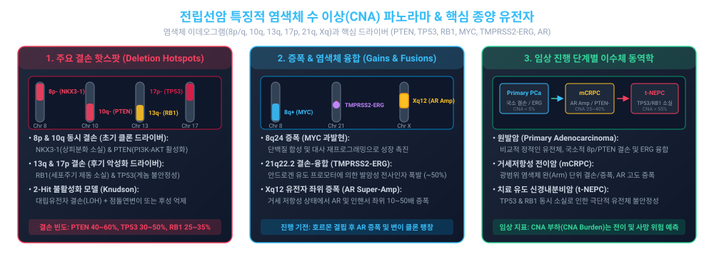
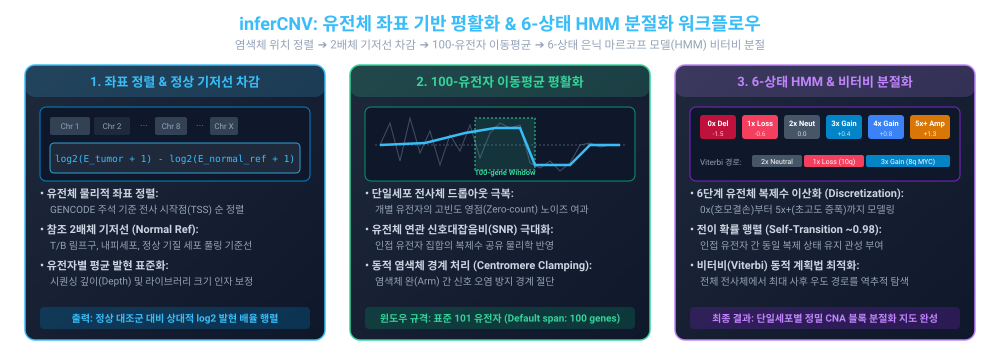
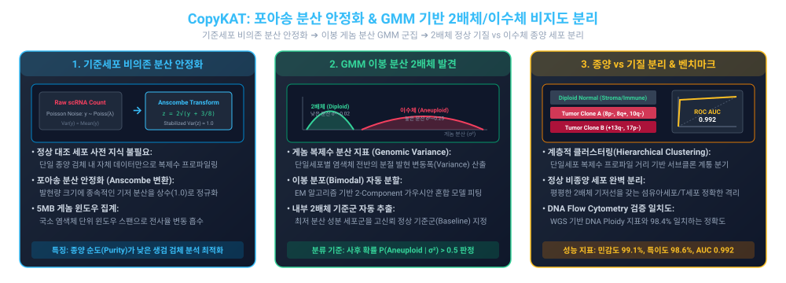
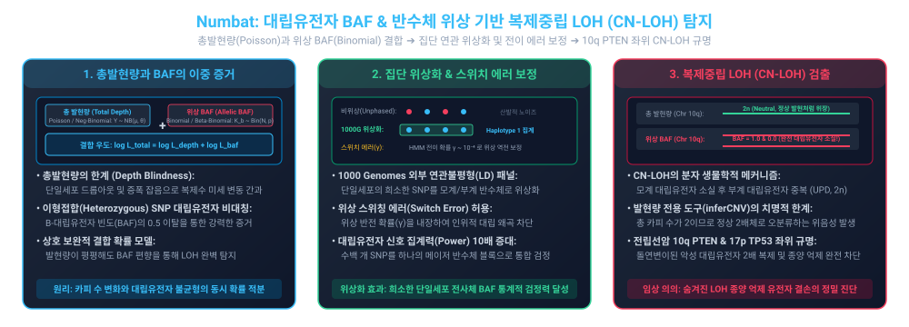
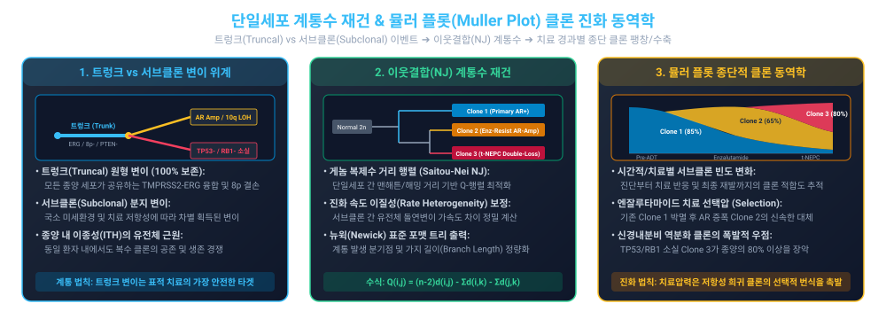
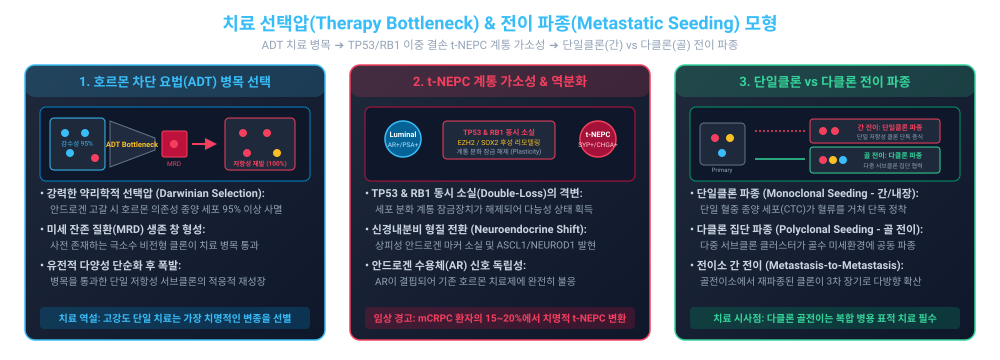

# 단일 세포 암 유전체 & 클론 진화(Single-Cell Cancer Genomics & Clonal Evolution) 마스터 교재
**From Chromosomal Aneuploidy and Copy-Neutral LOH to Clonal Phylogeny and Treatment-Resistant Lineage Plasticity**

---

## 📚 교재 전체 목차 (Table of Contents)

- [Chapter 00. 암 단일세포 전사체 기반 유전체 및 클론 진화 분석 로드맵](#part-00-00-암-단일세포-전사체-기반-유전체-및-클론-진화-분석-로드맵-cancer-single-cell-genomics--clonal-evolution-roadmap)
- [Chapter 01. 염색체 복제수 변이의 분자생물학 및 전립선암 랜드마크](#part-01-01-염색체-복제수-변이의-분자생물학-및-전립선암-랜드마크-cna-biology--prostate-cancer-hallmarks)
- [Chapter 02. inferCNV 알고리즘과 6상태 은닉 마르코프 모델](#part-02-02-infercnv-알고리즘과-6상태-은닉-마르코프-모델-infercnv-algorithm--6-state-hmm)
- [Chapter 03. 참조 비의존성 CopyKAT 알고리즘과 가우시안 혼합 모델](#part-03-03-참조-비의존성-copykat-알고리즘과-가우시안-혼합-모델-reference-free-copykat--gmm)
- [Chapter 04. 대립유전자 불균형, BAF, 그리고 Numbat 알고리즘](#part-04-04-대립유전자-불균형-baf-그리고-numbat-알고리즘-allelic-imbalance-baf--numbat)
- [Chapter 05. 서브클론 디컨볼루션 및 단일 세포 계통수 복원](#part-05-chapter-05-서브클론-디컨볼루션-및-단일-세포-계통수-복원-subclonal-deconvolution--single-cell-phylogeny)
- [Chapter 06. 체세포 단일염기변이(SNV) 및 융합 전사체 검출](#part-06-chapter-06-체세포-단일염기변이snv-및-융합-전사체-검출-somatic-mutations--gene-fusions-in-snrna-seq)
- [Chapter 07. 치료 선택압 및 계통 가소성 진화](#part-07-chapter-07-치료-선택압-및-계통-가소성-진화-treatment-selection-bottleneck--lineage-plasticity)
- [Chapter 08. 전이 파종 모델 및 다클론성 전파](#part-08-chapter-08-전이-파종-모델-및-다클론성-전파-metastasis-seeding-models--polyclonal-dissemination)
- [Chapter 09. 암 유전체 및 클론 진화 분석 트러블슈팅 및 캡스톤 프로젝트](#part-09-chapter-09-암-유전체-및-클론-진화-분석-트러블슈팅-및-캡스톤-프로젝트-troubleshooting--capstone-project)

---

# Part 00. 00. 암 단일세포 전사체 기반 유전체 및 클론 진화 분석 로드맵 (Cancer Single-Cell Genomics & Clonal Evolution Roadmap)
> **출처 원본 파일**: `tracks/04_cancer_genomics_clones/docs/00_CANCER_GENOMICS_ROADMAP.md`


---

## 학습 목표 (Cognitive Goals)

1. **단일세포 전사체 군집화의 내재적 한계 규명**: 순수 유전자 발현량(Gene Expression Count) 기반 클러스터링(t-SNE, UMAP, Leiden/Louvain) 시 발생하는 '반응성 기질/정상 상피세포(Reactive Normal Epithelia)의 악성 세포 오분류' 메커니즘을 규명하고, 왜 유전체적 복제수 변이(Copy Number Alteration, CNA) 프로파일링이 악성 세포 판별의 절대적 표준(Ground Truth)인지 설명할 수 있다.
2. **이수성(Aneuploidy)과 Nowell 클론 진화 모델의 수리생물학적 이해**: 고형암의 결정적 특징인 대규모 이수성(Aneuploidy)의 형성 원리를 이해하고, 피터 노웰(Peter Nowell)의 클론 진화 모델(선형 진화, 분지형 진화, 중립 진화)을 단일세포 유전체 분기 트리(Phylogenetic Tree) 및 클론 파편화(Clonal Architecture) 관점에서 수학적으로 모델링할 수 있다.
3. **글로벌 암 전사체 및 유전체 벤치마크 코호트 분석**: 전이성 전립선암 클론 파종을 전장 유전체로 입증한 Gundem et al. (*Nature* 2015), 원발암 다중오믹스 표준인 TCGA-PRAD, 그리고 거세저항성 전립선암(mCRPC)의 핵심 코호트인 SU2C/PCF 데이터셋의 분자생물학적 특징을 파악한다.
4. **대규모 단일세포 전사체 복제수 분석 환경 구축**: Python 생태계의 `scanpy`, `infercnvpy`, R 연동 `numbat`, 계통수 최적화 도구 `fastme`를 연계한 고성능 연산 파이프라인을 설계하고 재현 가능한 분석 환경을 구성할 수 있다.

---

## 1. 순수 전사체 군집화(Naive Transcriptomic Clustering)의 치명적 한계

단일세포 RNA 시퀀싱(scRNA-seq 및 snRNA-seq)은 종양 미세환경(Tumor Microenvironment, TME)의 이질성을 단일세포 해상도로 조명하는 혁신적 도구로 자리잡았다. 그러나 **전사체 프로파일(Transcriptomic Profile)만으로 악성 종양 세포(Malignant Tumor Cells)와 비악성 세포(Non-malignant Cells)를 분리하는 관행**은 심각한 방법론적 오류를 수반한다.

### 1.1 전사체 가소성과 염증성 유도체에 의한 표현형 왜곡

세포의 유전자 발현 프로파일은 유전체(Genotype)뿐만 아니라 국소 미세환경 자극(Microenvironmental Stimuli)에 의해 유연하게 변화하는 표현형(Phenotype)이다. 특히 암 조직 내 침윤된 대식세포(TAMs), T세포, 섬유아세포(CAFs)가 분비하는 염증성 사이토카인($\text{TNF-}\alpha$, $\text{TGF-}\beta$, $\text{IL-6}$ 등) 및 저산소 미세환경(Hypoxia)은 정상 기저세포(Basal cells)나 관강세포(Luminal cells)에 극심한 반응성 전사 변화(Reactive Atypia)를 유도한다:

*   **상피-간엽 이행(EMT-like State)**: 기질과 인접한 정상 관강 상피세포가 $\text{TGF-}\beta$ 신호전달계 활성화에 의해 관강 특이적 분화 마커(예: *KLK3*, *PRAC1*)의 발현을 낮추고 *VIM*, *FN1*, *MMP* 계열 유전자를 상향 조절한다.
*   **스트레스 반응 및 증식 신호 모방**: 세포 밀도가 높거나 괴사(Necrosis) 경계면에 위치한 정상 세포들이 열충격 단백질(Heat Shock Proteins) 및 전사인자 *JUN*, *FOS*, *MYC* 표적 유전자를 일시적으로 과발현하여 공격적인 암세포 군집과 유사한 유전자 세트를 공유하게 된다.

### 1.2 반응성 정상 상피(Reactive Normal Epithelia) 오분류의 수리적 메커니즘

단일세포 분석의 표준 차원 축소 알고리즘(PCA $\to$ UMAP) 및 그래프 기반 군집화(Leiden/Louvain)는 고차원 유전자 발현 벡터 간의 유클리드 거리(Euclidean Distance) 또는 코사인 유사도(Cosine Similarity)를 기반으로 작동한다:

$$D(\mathbf{x}_i, \mathbf{x}_j) = \sqrt{\sum_{g=1}^{G} (x_{ig} - x_{jg})^2}$$

여기서 상위 고변이 유전자(Highly Variable Genes, HVGs, 통상 2,000~3,000개) 중 상당수가 세포 주기(Cell Cycle, e.g., *MKI67*, *TOP2A*), 대사 스트레스(Metabolic Stress), 리보솜 생합성 단백질 등 종양 특이적 돌연변이와 무관한 생리적 반응 유전자에 의해 지배된다. 그 결과:

1.  **가짜 종양 아형 생성 (False Subclonal Splitting)**: 악성 돌연변이가 전혀 없는 완전한 정상 이배체(Diploid) 세포 집단이 단지 국소 염증에 반응했다는 이유로 UMAP 상에서 독립된 클러스터로 분리되어 '고위험 신규 암 서브클론'으로 잘못 명명된다.
2.  **종양 클러스터 오염 (Tumor Cluster Contamination)**: 반대로, 증식이 느리고 분화도가 높은 저위험 암세포가 정상 관강세포와 동일한 주성분 공간(PC Space)에 투영되어 정상 세포 클러스터 내부로 흡수된다.

따라서 암 생물학에서 악성 세포를 판정하기 위한 절대적 기준은 일시적 전사체 반응이 아니라, 비가역적인 **유전체 구조적 결함(Genomic Structural Defects)**, 즉 **체세포 복제수 변이(Somatic Copy Number Alterations, SCNAs)**와 **이수성(Aneuploidy)**이어야 한다.

---

## 2. 악성의 결정적 표지: 이수성(Aneuploidy)과 Nowell 클론 진화 이론

### 2.1 테오도르 보베리 가설부터 현대 유전체학까지

1914년 독일의 세포생물학자 테오도르 보베리(Theodor Boveri)는 다극성 유사분열(Multipolar Mitosis)에 의해 발생하는 염색체 수의 비정상적 불균형이 악성 종양의 본질적 기원이라는 가설을 제시하였다. 현대 암 유전체학(Hanahan & Weinberg, *Hallmarks of Cancer*)에 이르러, 인간 고형암(Solid Tumors)의 **90% 이상**에서 광범위한 염색체 이수성(Aneuploidy)과 염색체 불안정성(Chromosomal Instability, CIN)이 관찰됨이 확립되었다.

정상 체세포는 엄격한 세포분열 검문점(Spindle Assembly Checkpoint, SAC)을 통해 46개의 염색체($2n=46$)를 온전하게 보존한다. 반면 종양 세포는 유사분열 조절 유전자 결함, 중심체 과다 복제(Centrosome Amplification), 텔로미어 위기(Telomere Crisis)를 겪으며 염색체 팔(Arm) 단위의 획득(Gain)과 소실(Loss), 혹은 전장 유전체 배가(Whole-Genome Doubling, WGD)를 겪는다. 이러한 대규모 복제수 변이는 수백~수천 개의 유전자 발현 용량 효과(Gene Dosage Effect)를 유발하여 발암 경로를 영구적으로 재편한다.

### 2.2 피터 노웰(Peter Nowell, 1976)의 클론 진화 모델

1976년 피터 노웰은 단일 전구세포에서 출발한 종양이 선택압 하에서 순차적으로 클론 진화한다는 모델을 제안하였다. 아래 3번의 중립/빅뱅 모델은 노웰의 모델이 아니라 후속 연구(예: Sottoriva 등 2015, 대장암)에서 제안된 모형이며 염색체 분쇄증·WGD와 직접 결부된 모델로 단정할 수 없다.

```
[클론 진화 토폴로지 — 1·2는 Nowell(1976)의 선택 기반 클론 진화, 3은 후속 모형(예: Sottoriva 2015 Big Bang)]

1. 선형 진화 (Linear Evolution)
   [Clone 0] --(Driver A)--> [Clone 1] --(Driver B)--> [Clone 2] (Clonal Sweep)

2. 분지형 진화 (Branched Evolution)
                              +--(Driver B)--> [Clone 1A] (Subclone A)
   [Clone 0] --(Driver A)-----+
                              +--(Driver C)--> [Clone 1B] (Subclone B)

3. 중립 진화 / 빅뱅 모델 (Neutral / Big Bang Evolution)
                                  +--> [Clone 1] (Passenger mutations)
   [Truncal WGD / Catastrophe] ---+--> [Clone 2] (Equal fitness)
                                  +--> [Clone 3] (Pervasive heterogeneity)
```

1.  **선형 진화 (Linear Evolution)**: 새로운 드라이버 돌연변이를 획득한 서브클론이 기존 클론보다 압도적인 적응도(Fitness advantage)를 가져 집단 전체를 대체하는 클론 스윕(Clonal Sweep)이 연속적으로 발생한다.
2.  **분지형 진화 (Branched Evolution)**: 공간적 격리(Spatial Isolation)나 미세환경의 차이로 인해 여러 서브클론이 동시에 독자적인 돌연변이를 축적하며 공존한다. 현재 대부분의 전이성 고형암에서 확인되는 지배적 모델이다.
3.  **중립적 진화 (Neutral Evolution / Big Bang Model; Nowell 모델이 아닌 후속 모형)**: 초기 발생 단계에서 대규모 유전체 격변(Chromothripsis, WGD)이 발생한 후, 후속 돌연변이들은 세포의 적응도에 유의미한 차이를 주지 않고 중립적으로 누적되어 극도의 종양 내 이질성(Intra-tumor Heterogeneity, ITH)을 형성한다.

### 2.3 전립선암(Prostate Cancer)의 특이적 진화 동역학: CNA-Driven Malignancy

대장암(CRC)이나 흑색종(Melanoma)과 달리, 전립선암은 체세포 점돌연변이 빈도(Tumor Mutational Burden, TMB)가 메가베이스(Mb)당 1개 미만으로 매우 낮다. 대신, **전립선암의 악성화, 침윤, 안드로겐 수용체 차단 치료(ADT) 저항성에서 대규모 염색체 구조 변이 및 복제수 변이(CNA)가 핵심적 역할을 한다(단, TCGA 분자 아형의 약 74%가 *ERG* 등 유전자 융합과 *SPOP*, *FOXA1*, *IDH1* 점돌연변이로 정의되므로 융합·SNV도 필수 드라이버이다)**. 따라서 전립선암 단일세포 전사체 연구에서 CNA를 복원하는 것은 클론의 계통수를 재구성하고 환자의 불량 예후를 예측하는 데 핵심적이다.

---

## 3. 표준 벤치마크 데이터셋 카탈로그

단일세포 복제수 추정 알고리즘을 검증하고 암 진화 계통수를 검증하기 위해서는 대규모 전장 유전체(WGS) 및 다중오믹스로 검증된 레퍼런스 데이터셋의 이해가 필수적이다.

| 코호트 / 연구 | 출판 연도 및 저널 | 표본 특성 및 분석 기법 | 유전체적 핵심 의의 |
| :--- | :--- | :--- | :--- |
| **Gundem et al.** | *Nature* (2015) 520:353–357 | 전이성 전립선암 환자 10명의 다부위(Multi-region) 51개 종양 WGS (평균 약 55X; 원발 종양은 5명에서만 포함) | **전이소 간 전파(Metastasis-to-metastasis spread)**가 흔하며(단클론 de novo 파종 또는 5례에서 다클론 전달), AR 신호 유전자 변이가 서로 다른 전이소에서 수렴적으로 반복됨을 보고 |
| **TCGA-PRAD** | *Cell* (2015) 163:1011–1025 | 원발성 전립선 선암종(Primary PRAD) 333례의 WES, RNA-seq, SNP 6.0 Array 다중오믹스 (TCGA-PRAD 프로젝트 전체는 약 500례) | 전립선암의 7대 분자 아형 정의(*ERG*, *ETV1*, *ETV4*, *FLI1* 융합 및 *SPOP*, *FOXA1*, *IDH1* 돌연변이); 8p 결손, 8q 획득 등 표준 CNA 빈도 확립 |
| **SU2C/PCF mCRPC** | *Cell* (2015) 161:1215–1228<br>*PNAS* (2019) 116:11428–11436 | Cell 2015: mCRPC 150례, PNAS 2019: 444례 생검 코호트 (WES + RNA-seq) | 치료 저항성 핵심 축 규명: *AR* 유전자 증폭(GISTIC 기준 SU2C 2015에서 약 52%), *TP53*·*PTEN*·*RB1* 불활성화(빈도는 코호트·정의에 따라 상이). *AR* 650kb 상류 인핸서 tandem duplication은 별도의 Viswanathan 2018(linked-read WGS)에서 mCRPC의 70~87%, 원발암 <2%로 보고 |

```
[Genomic Architecture Comparison: Primary vs. mCRPC]

Primary PRAD (TCGA-PRAD)
  Genome Status: Predominantly Diploid (Low CIN)
  Early Events:  TMPRSS2-ERG fusion (21q deletion), NKX3-1 loss (8p21)
  Driver Alterations: SPOP mutations (10%), PTEN hemizygous loss (20%)

                │
                │ Progression under Androgen Deprivation Therapy (ADT)
                ▼

Metastatic CRPC (SU2C/PCF, Gundem et al.)
  Genome Status: High CIN, Frequent Whole-Genome Doubling (WGD, ~50%)
  Late Events:   AR locus & upstream enhancer amplification (Xq12)
                 Biallelic loss of TP53 (17p), RB1 (13q), PTEN (10q)
                 Cross-organ clonal seeding (Bone, Liver, Lymph nodes)
```

---

## 4. 계산 생물학 분석 환경 및 파이프라인 아키텍처

단일세포 전사체 복제수 분석 파이프라인은 크게 전사체 정량화, 정상 레퍼런스 세포 식별, 염색체 위치 정렬 평활화, 세그멘테이션(HMM), 그리고 계통수 구축 단계로 구성된다.

```
[Single-Cell Cancer Genomics Pipeline Flowchart]

Raw FASTQ (snRNA-seq / scRNA-seq)
         │
         ▼ (Cell Ranger / STARsolo)
Count Matrix (Cells x Genes) + Cell Metadata
         │
         ▼ (Scanpy Quality Control & Normalization)
Filtered AnnData (Mitochondrial filter, Doublet removal)
         │
         ├───────────────────────────────────┐
         ▼                                   ▼
Transcriptomic Cell Typing             Genomic Coordinate Mapping
(Immune, Stroma, Epithelial)           (Ensembl GTF v44/GRCh38)
         │                                   │
         ▼ (Select Reference Normal)         ▼
Reference Baseline Cells               Sorted Genomic Gene Matrix
(Fibroblasts, T cells, Endothelia)                   │
         │                                           │
         └─────────────────┬─────────────────────────┘
                           ▼
             Baseline Normalization & Moving Average
             (infercnvpy / CopyKAT / Numbat)
                           │
                           ▼
             HMM Copy Number State Segmentation
                           │
                           ▼
             Subclone Assignment & Phylogeny (FastME)
```

### 4.1 핵심 의존성 패키지 및 시스템 환경

| 패키지/도구명 | 권장 버전 | 역할 및 수리적 기반 |
| :--- | :--- | :--- |
| **`python`** | `>= 3.10` | 기본 분석 런타임 환경 |
| **`scanpy`** | `>= 1.9.6` | 대규모 단일세포 전사체 전처리, 차원축소, 발현 행렬 구조체(`AnnData`) 관리 |
| **`anndata`** | `>= 0.10.0` | 메모리 효율적 희소 행렬(HDF5/zarr) 및 다중 레이어 유전체 메타데이터 저장 |
| **`infercnvpy`** | `>= 0.4.0` | Python 기반 고속 병렬 inferCNV 구현체 (이동평균 및 이수성 점수 계산) |
| **`scikit-learn`**| `>= 1.3.0` | GMM 이배체 기저선 분리 및 주성분 공간 클러스터링 |
| **`fastme`** | `>= 2.1.6` | 최소 진화 원리(Minimum Evolution Principle) 기반 대규모 계통수 고속 계산 바이너리 |
| **`numbat`** | `>= 1.4.0` | R 기반 대립유전자 특이적(BAF) 단일세포 복제수/하플로타입 HMM 파이프라인 |

### 4.2 재현 가능한 분석 환경 구축 쉘 스크립트

```bash
#!/usr/bin/env bash
# cancer_genomics_env_setup.sh: 암 단일세포 유전체 분석 환경 구성
set -euo pipefail

# 1. Conda 가상환경 생성
conda create -n sc_cancer_genomics python=3.10 -y
# 비대화형 스크립트에서는 쉘 초기화 없이 conda activate가 실패하므로 먼저 초기화 스크립트를 source
source "$(conda info --base)/etc/profile.d/conda.sh"
conda activate sc_cancer_genomics

# 2. 필수 고성능 C/C++ 의존성 및 계통수 엔진 FastME 설치
conda install -c bioconda -c conda-forge fastme samtools bcftools htslib -y
# (이후 장에서 필요한 R 도구: numbat(R), copykat(R), cellsnp-lite, Eagle2는 별도 설치 필요 — 예: conda install -c bioconda cellsnp-lite eagle2, R에서 devtools::install_github('kharchenkolab/numbat'), install_github('navinlabcode/copykat'))

# 3. Python 핵심 라이브러리 및 단일세포 유전체 도구 설치
pip install --upgrade pip
pip install \
    scanpy==1.9.8 \
    anndata==0.10.5 \
    infercnvpy==0.4.2 \
    scikit-learn==1.4.0 \
    scipy==1.12.0 \
    pandas==2.2.0 \
    matplotlib==3.8.2 \
    seaborn==0.13.2

# 4. 환경 검증
python -c "
import scanpy as sc
import infercnvpy as cnp
import sklearn
print(f'Scanpy version: {sc.__version__}')
print(f'Infercnvpy version: {cnp.__version__}')
print(f'Scikit-learn version: {sklearn.__version__}')
"
echo "단일세포 암 유전체 분석 환경 구성 완료."
```

### 4.3 Scanpy 및 Infercnvpy 초기화 파이프라인 예제

```python
import scanpy as sc
import infercnvpy as cnp
import pandas as pd
import numpy as np

def initialize_cancer_genomics_pipeline(h5ad_path: str, gtf_gene_pos_path: str):
    """
    단일세포 전사체 데이터를 로드하고 유전체 좌표 기반 정렬 및 CNV 계산을 준비한다.
    
    Parameters:
        h5ad_path: 전처리된 Scanpy AnnData 경로
        gtf_gene_pos_path: 유전자별 염색체, 시작, 종료 위치가 기록된 탭 구분 파일
    
    Returns:
        adata: 유전체 위치 정보가 주석화된 AnnData 객체
    """
    # 1. 단일세포 데이터 로드
    adata = sc.read_h5ad(h5ad_path)
    adata.var_names_make_unique()
    
    # 2. 염색체 위치 메타데이터 로드
    # Format: gene_name \t chromosome \t start \t end
    gene_pos = pd.read_csv(
        gtf_gene_pos_path, 
        sep='\t', 
        names=['gene_name', 'chromosome', 'start', 'end'],   # 4열 파일이므로 이름도 4개
        index_col=0
    )
    
    # 3. 데이터셋 내 존재하는 유전자와 유전체 좌표 교집합 추출
    common_genes = adata.var_names.intersection(gene_pos.index)
    adata = adata[:, common_genes].copy()
    gene_pos_filtered = gene_pos.loc[common_genes].copy()   # SettingWithCopyWarning 방지
    
    # 4. 염색체 및 위치 정렬 (chr1 -> chr22 -> chrX -> chrY)
    chr_order = [f"chr{i}" for i in range(1, 23)] + ["chrX", "chrY"]
    gene_pos_filtered['chromosome'] = pd.Categorical(
        gene_pos_filtered['chromosome'], 
        categories=chr_order, 
        ordered=True
    )
    gene_pos_sorted = gene_pos_filtered.sort_values(by=['chromosome', 'start'])
    
    # 정렬 순서대로 AnnData 열 재배치
    adata = adata[:, gene_pos_sorted.index].copy()
    adata.var['chromosome'] = gene_pos_sorted['chromosome']
    adata.var['start'] = gene_pos_sorted['start']
    adata.var['end'] = gene_pos_sorted['end']
    
    print(f"총 {adata.n_obs}개 세포 및 {adata.n_vars}개 유전자에 대한 유전체 좌표 매핑 완료.")
    return adata
```

---

## 단원 핵심 점검 (Cognitive Checkpoint & Case Study)

### 문제 1: 반응성 비정형 정상 세포의 오분류 판별
임상 연구팀이 전립선암 환자의 전립선 전절제술 검체에서 채취한 8,000개의 단일세포 RNA 시퀀싱 데이터를 분석하였다. UMAP 상에서 고위험 관강 상피세포(Luminal epithelial cells)와 밀접하게 묶이며 증식 마커(*MKI67*, *TOP2A*) 및 EMT 마커(*VIM*)를 높게 발현하는 군집 'Cluster 4'가 발견되었다. 연구팀은 이 군집을 '신규 공격성 암 줄기세포 서브클론'으로 잠정 결론지었다. 이 결론의 타당성을 평가하고, 이를 검증하거나 기각하기 위해 수행해야 할 유전체적 분석 파이프라인을 기술하시오.

<details>
<summary>💡 모범 답안 및 해설 확인</summary>

**1. 결론의 타당성 평가 (기각)**:
잠정 결론은 타당하지 않다. 종양 미세환경 내에 존재하는 정상 관강 상피세포는 종양 주변 염증(IL-6, TNF-$\alpha$, TGF-$\beta$)이나 국소 허혈성 저산소증에 반응하여 일시적으로 세포 주기를 재가동하고 간엽성 마커(*VIM*)를 상향 조절하는 **반응성 비정형화(Reactive Atypia)** 현상을 겪는다. 순수 전사체 발현량만으로는 이 세포가 진정한 악성 클론인지, 단순한 반응성 정상 세포인지 구별할 수 없다.

**2. 검증 및 기각을 위한 유전체 분석 파이프라인**:
*   **염색체 복제수 변이(CNA) 재구성**: `infercnvpy` 또는 `CopyKAT`을 적용하여 정상 기저 기질세포(섬유아세포, 혈관내피세포, 침윤 면역세포)를 기준(Reference)으로 설정하고, Cluster 4 세포들의 염색체 단위 발현 배율(Expression fold-change)을 전장 염색체에 대해 매핑한다.
*   **전립선암 필수 유전체 랜드마크 확인**:
    *   Cluster 4가 악성 종양 클론이라면 전립선암의 대표적 드라이버 CNA인 **8p 결손(*NKX3-1*), 8q 획득(*MYC*), 10q 결손(*PTEN*)** 등의 대규모 염색체 구조 이상을 보유하는 경우가 많다(단, 원발 TCGA에서 *MYC* gain/amp는 약 31%, *PTEN* 손실은 약 32%에 그치므로 모든 악성 세포가 이를 갖는 것은 아니다).
    *   만약 Cluster 4가 1번부터 22번 염색체까지 이배체(Diploid, CNV magnitude $\approx 0$) 프로파일을 유지한다면, CNA 신호가 없는 것만으로 반응성 정상 상피로 단정하지 말고 판정을 보류하며(CNA가 약하거나 없는 종양과 CN-LOH는 inferCNV로 검출되지 않음), 변이·BAF 등 직교 근거로 확인한 뒤 제외 여부를 결정한다.

</details>

---

### 문제 2: Nowell 클론 진화 모델과 전립선암 치료 저항성 기전
피터 노웰의 클론 진화 모델에서 '선형 진화(Linear Evolution)'와 '분지형 진화(Branched Evolution)'의 분자계통학적 차이를 수리적/트리 구조 관점에서 비교 설명하시오. 또한, 안드로겐 수용체 차단 요법(Androgen Deprivation Therapy, ADT)을 받은 전립선암 환자에서 거세저항성(mCRPC)이 발생하는 과정은 두 모델 중 어느 쪽에 더 부합하는지 SU2C/PCF 코호트의 유전체적 증거를 들어 논하시오.

<details>
<summary>💡 모범 답안 및 해설 확인</summary>

**1. 수리적/트리 구조 관점의 비교**:
*   **선형 진화**: 체세포 변이 세트 $S_t \subset S_{t+1}$의 포함 관계가 성립하며 계통수 상에 분기점(Branching point) 없이 단일 궤적(Trunk)만 존재한다. 새로운 변이를 획득한 클론의 적응도 $W(C_{new}) \gg W(C_{old})$이므로 이전 클론을 완전히 도태시키는 **선택적 스윕(Selective Sweep)**이 연속적으로 발생한다.
*   **분지형 진화**: 공통 조상 줄기(Trunk)에서 다수의 서브클론이 갈라져 나오며, 각 서브클론 $A$와 $B$는 공유 변이 $S_{\text{trunk}}$ 외에 서로 배타적인 독자 변이 세트($S_A \setminus S_B \neq \emptyset$, $S_B \setminus S_A \neq \emptyset$)를 축적한다. 공간적 격리나 상이한 국소 선택압에 의해 다수의 서브클론이 공존한다.

**2. 전립선암 거세저항성(mCRPC) 발생 양상과 유전체적 증거**:
*   전립선암의 진행은 전형적인 **분지형 진화(Branched Evolution)** 모델을 따른다.
*   **다부위 연구(예: Gundem 2015)의 증거**: (SU2C/PCF의 Robinson 2015는 환자당 단일 생검 설계라 환자 내 분지 진화를 직접 보일 수 없다.) ADT 치료 압력이 가해지면 안드로겐 비의존적 생존 능력을 갖춘 다수의 잠복 서브클론이 서로 다른 분자 경로를 통해 독립적으로 진화한다. 예를 들어, 동일 환자의 전이 병변 내에서 어떤 서브클론은 *AR* 유전자 좌위 및 650kb 상류 인핸서의 고도 증폭(*AR* amplification)을 획득하는 반면, 다른 전이 부위의 서브클론은 *TP53* 및 *RB1*의 이중 결손(Biallelic loss)을 통해 신경내분비 전립선암(t-NEPC, Lineage Plasticity)으로 분기한다. 이는 선형적 대체가 아닌 치료 압력에 의한 다방향성 분지 진화의 결정적 증거이다.

</details>

---

### 문제 3: 대규모 다부위 전이 전장유전체 벤치마크 설계
Gundem et al. (*Nature* 2015) 연구는 단일 환자 내 다부위 전이 전립선암 검체의 WGS를 통해 전이 파종(Metastatic Seeding)의 새로운 패러다임을 규명하였다. 이 연구가 밝혀낸 '상호 전이 파종(Cross-metastatic Seeding)'의 개념을 설명하고, 단일세포 전사체 복제수 분석 파이프라인에서 다부위 생검 데이터를 활용하여 서브클론 간 파종 방향성을 추론할 때 발생할 수 있는 주요 계산생물학적 한계점 2가지를 제시하시오.

<details>
<summary>💡 모범 답안 및 해설 확인</summary>

**1. 상호 전이 파종 (Cross-metastatic Seeding)**:
기존의 전통적 전이 모델은 원발암(Primary tumor)에서 단방향으로 전이 세포가 림프절이나 뼈로 이동한다는 가설이었다. 그러나 Gundem et al.은 유전체 계통수 분석을 통해, 이미 형성된 전이 병변 A(예: 골 전이)의 서브클론이 또 다른 전이 병변 B(예: 간 전이)로 2차 전이를 일으키거나, 심지어 전이 병변에서 다시 원발 부위로 재파종(Self-seeding)되는 복잡한 전이 간 네트워크가 존재함을 증명하였다.

**2. 단일세포 전사체 CNA 파이프라인의 계산생물학적 한계점**:
1.  **전사체 기반 CNA의 불연속적 해상도 및 역수렴(Homoplasy/Convergence) 문제**: 단일세포 RNA 시퀀싱은 발현되는 유전자에만 의존하므로 유전자 밀도가 낮은 유전체 사막(Gene deserts)의 복제수 변화를 추적할 수 없다. 또한 서로 다른 서브클론이 독립적으로 동일한 염색체 팔 결손(예: 전립선암에서 극히 흔한 8p 결손)을 획득할 경우, 분기 계통 분석에서 이를 단일 조상 사건으로 오인하여 파종의 선후 관계를 잘못 연결할 위험이 높다.
2.  **중립 진화 및 전장 유전체 배가(WGD) 후 대립유전자 비특이성(Allelic Ambiguity)**: 전이성 암에서 흔한 WGD($2n \to 4n$)가 발생하면 단순 발현량 비율(InferCNV식 접근)만으로는 실제 유전체 카피 수가 2카피인지 4카피인지 구별할 수 없으며, 모계/부계 대립유전자의 소실 여부(Copy-Neutral LOH)를 파악하지 못해 계통수 상에서 조상 클론과 후손 클론의 분기 시간을 정확히 교정하기 어렵다.

</details>

---

<!-- REFERENCES:BEGIN (generated by scripts/apply_references.py; do not edit by hand) -->
## 참고문헌 (References)
### 본문 인용 문헌
1. Nowell PC. The clonal evolution of tumor cell populations. *Science*. 1976;194(4260):23-8. PMID: 959840. doi: 10.1126/science.959840
2. Sottoriva A, Kang H, Ma Z, et al. A Big Bang model of human colorectal tumor growth. *Nat Genet*. 2015;47(3):209-16. PMID: 25665006. doi: 10.1038/ng.3214
3. Gundem G, Van Loo P, Kremeyer B, et al. The evolutionary history of lethal metastatic prostate cancer. *Nature*. 2015;520(7547):353-357. PMID: 25830880. doi: 10.1038/nature14347
4. Robinson D, Van Allen EM, Wu YM, et al. Integrative clinical genomics of advanced prostate cancer. *Cell*. 2015;161(5):1215-1228. PMID: 26000489. doi: 10.1016/j.cell.2015.05.001
5. Abida W, Cyrta J, Heller G, et al. Genomic correlates of clinical outcome in advanced prostate cancer. *Proc Natl Acad Sci U S A*. 2019;116(23):11428-11436. PMID: 31061129. doi: 10.1073/pnas.1902651116
6. Cancer Genome Atlas Research Network. The Molecular Taxonomy of Primary Prostate Cancer. *Cell*. 2015;163(4):1011-25. PMID: 26544944. doi: 10.1016/j.cell.2015.10.025
7. Viswanathan SR, Ha G, Hoff AM, et al. Structural Alterations Driving Castration-Resistant Prostate Cancer Revealed by Linked-Read Genome Sequencing. *Cell*. 2018;174(2):433-447.e19. PMID: 29909985. doi: 10.1016/j.cell.2018.05.036
### 소프트웨어 (표기 버전은 검수 시 API를 확인한 버전이며, 파이프라인 실행 환경은 requirements-pipelines.txt 참조)
- infercnvpy 0.6.1 (github.com/icbi-lab/infercnvpy).
- NumPy 2.5.4 (numpy.org). 원 논문: Harris CR, Millman KJ, van der Walt SJ, et al. Array programming with NumPy. *Nature*. 2020;585(7825):357-362. PMID: 32939066. doi: 10.1038/s41586-020-2649-2
- Scanpy 1.12.4 (github.com/scverse/scanpy). 원 논문: Wolf FA, Angerer P, Theis FJ. SCANPY: large-scale single-cell gene expression data analysis. *Genome Biol*. 2018;19(1):15. PMID: 29409532. doi: 10.1186/s13059-017-1382-0
- pandas 2.3.3 (github.com/pandas-dev/pandas). 원 논문: McKinney W. Data Structures for Statistical Computing in Python. *Proceedings of the Python in Science Conference*. 2010:56-61. doi: 10.25080/majora-92bf1922-00a
<!-- REFERENCES:END -->


---

# Part 01. 01. 염색체 복제수 변이의 분자생물학 및 전립선암 랜드마크 (CNA Biology & Prostate Cancer Hallmarks)
> **출처 원본 파일**: `tracks/04_cancer_genomics_clones/docs/01_CNA_BIOLOGY_AND_CHROMOSOMAL_ALTERATIONS.md`


---

## 학습 목표 (Cognitive Goals)

1. **염색체 불안정성(CIN)과 유전체 대격변 기전의 수리생물학적 규명**: 수적/구조적 염색체 불안정성(Numerical vs. Structural CIN), 전장 유전체 배가(Whole-Genome Doubling, WGD), 그리고 단일 격변 사건인 염색체 분쇄증(Chromothripsis)의 분자생물학적 기전과 이를 모델링하는 수리적 원리를 설명할 수 있다.
2. **전립선암 6대 핵심 체세포 복제수 변이(SCNA) 해부**: 8p 결손(*NKX3-1*), 8q 획득(*MYC*), 10q 결손(*PTEN*), 13q 결손(*RB1*), 17p 결손(*TP53*), Xq 획득(*AR* 유전자 및 650kb 인핸서) 좌위의 생물학적 기능 및 임상적 중요성을 전사체 용량 효과(Gene Dosage Effect) 관점에서 설명할 수 있다.
3. **21q22.2 국소 결손과 *TMPRSS2-ERG* 융합 메커니즘 해석**: 21번 염색체 장완의 약 3Mb 간질성 결손(Interstitial Deletion, 융합 양성 원발암의 약 60%; 나머지는 결손 없는 전좌)에 의해 유도되는 *TMPRSS2-ERG* 유전자 융합의 형성 기전과 안드로겐 반응 인자(ARE)에 의한 종양 형성 구동 경로를 도식화할 수 있다.
4. **단일세포 해상도의 복제수 상태 정량화 모델 구현**: 종양 세포의 배수성(Ploidy) 및 순도(Tumor Purity)를 반영한 대수 복제수 비율($\log_2 \text{Ratio}$) 수리 공식을 도출하고 이를 Python 코드로 구현할 수 있다.

---

## 1. 염색체 불안정성(CIN), 전장 유전체 배가(WGD), 염색체 분쇄증(Chromothripsis)

고형암 유전체의 가장 두드러진 특징은 유사분열 과정에서 염색체가 정확하게 분배되지 못하고 지속적으로 구조적·수적 이상을 축적하는 **염색체 불안정성(Chromosomal Instability, CIN)**이다.

```
[Chromosomal Evolution Mechanisms in Carcinogenesis]

1. Spindle Assembly Checkpoint (SAC) Defect
   Mitotic Slippage / Merotelic Attachment
         │
         ▼
   Chromosomal Instability (CIN) ──> Arm-level Aneuploidy (Loss/Gain)

2. Cytokinesis Failure / Endoreduplication
         │
         ▼
   Whole-Genome Doubling (WGD: 2n -> 4n) ──> Genetic Buffer against Lethal Deletions

3. Micronucleus Rupture during Interphase
         │
         ▼
   Chromothripsis (Catastrophic Shattering) ──> Complex Rearrangements & ecDNA
```

### 1.1 염색체 불안정성(CIN): 수적 CIN 대 구조적 CIN

*   **수적 CIN (Numerical CIN, W-CIN)**: 방추사 결합 검문점(Spindle Assembly Checkpoint, SAC: *MAD2*, *BUB1*, *BUBR1*)의 결함 또는 다극성 중심체(Centrosome Amplification)로 인해 염색체 비분리(Nondisjunction)가 발생하여 전체 염색체의 획득(Trisomy, Tetrasomy) 및 소실(Monosomy)이 유발된다.
*   **구조적 CIN (Structural CIN, S-CIN)**: DNA 복제 스트레스(Replication Stress), 복제 분기점 붕괴(Replication Fork Collapse), 상동 재조합 결핍(HRD) 등으로 인해 염색체 절단(Double-Strand Breaks, DSBs)이 빈발하고 전위(Translocation), 역위(Inversion), 대규모 결실 및 증폭이 발생한다.

### 1.2 전장 유전체 배가 (Whole-Genome Doubling, WGD)

인간 고형암의 약 30~50%에서 종양 진화 초기 또는 중간 단계에 2배체 유전체($2n$) 전체가 4배체($4n$)로 배가되는 WGD 현상이 일어난다.
*   **유도 기전**: 세포질 분열 실패(Cytokinesis Failure), 유사분열 탈주(Mitotic Slippage), 또는 내복제(Endoreduplication)에 의해 발생한다.
*   **진화적 완충 효과 (Evolutionary Buffer)**: $2n$ 상태에서는 암 억제 유전자(Tumor Suppressor Genes, TSGs) 하나만 소실되어도 치명적인 적응도 손실 또는 세포 사멸이 발생할 수 있으나, WGD를 거친 $4n$ 세포는 1~2개의 대립유전자가 결손되어도 필수 유전자가 보존되므로, 종양 세포가 더 공격적이고 극단적인 비배수성(Aneuploidy) 돌연변이를 축적할 수 있는 진화적 안전망을 제공한다.

### 1.3 염색체 분쇄증 (Chromothripsis)

수십 년간 이어진 점진적 돌연변이 축적 모델과 달리, 염색체 분쇄증은 **단 한 번의 세포분열 주기 동안 단일 또는 소수의 염색체가 수십~수백 개의 조각으로 산산조각 난 뒤 무작위로 재결합**하는 대격변적 유전체 재편 현상이다.
*   **소핵(Micronucleus) 가설**: 불완전 분열로 본 핵에서 탈락된 염색체가 독자적인 소핵을 형성한다. 소핵은 핵막 단백질 결핍으로 인해 간기(Interphase) 도중 막이 파열되며 세포질 뉴클레아제에 노출되어 무차별적으로 절단된다.
*   **비상동 말단 연결(NHEJ)** 및 **미세상동 매개 절단 유도 복제(MMBIR)**: 무작위 결합 과정에서 수많은 결실과 역위가 발생하며, 원형 DNA 조각들은 **염색체외 DNA (extrachromosomal DNA, ecDNA / Double Minutes)** 형태로 분리되어 종양 유전자의 수백 배 폭발적 증폭을 야기한다.

---

## 2. 전립선암 6대 핵심 체세포 복제수 변이 (Hallmark SCNAs)

전립선암 유전체는 전형적인 'CNA 주도형 종양(CNA-driven Cancer)'으로, 다음 6대 염색체 좌위의 변이가 원발암에서 거세저항성 전이암(mCRPC)으로의 진행을 결정한다.



```
[Summary of 6 Recurrent Hallmark SCNAs in Prostate Cancer]

Locus     Alteration Type   Key Target Gene   Biological Consequence
─────────────────────────────────────────────────────────────────────────────
8p21.2    Hemizygous Loss   NKX3-1            Loss of luminal differentiation (Early)
8q24.21   Focal/Arm Gain    MYC               Ribosome biogenesis & proliferation
10q23.31  Biallelic Loss    PTEN              PI3K/AKT/mTOR pathway activation
13q14.2   Biallelic Loss    RB1               Loss of G1/S checkpoint, lineage plasticity
17p13.1   Hemizygous Loss   TP53              Genome instability & therapy resistance
Xq12      High Amplification AR + Enhancer    Castration resistance under ADT
─────────────────────────────────────────────────────────────────────────────
```

### 2.1 8p 결손 (*NKX3-1*, 8p21.2) - 원발암 형성의 초기 개시 인자
*   **유전자 특성**: 전립선 상피 특이적 호메오박스(Homeobox) 전사인자로, 정상 전립선 분화 유지 및 산화 스트레스 방어 단백질을 조절한다.
*   **병리적 기전**: GISTIC 복제수 호출 기준으로 NKX3-1 any-loss는 TCGA 원발 약 60%, SU2C 2015 82%·2019 74%이며(cBioPortal 재계산), FISH/array 기반 보고는 이보다 낮아 방법 의존적이다. 마우스 *Nkx3.1*+/- 모델에서 단일 대립유전자 소실(Haploinsufficiency)만으로 관강 상피의 과형성·이형성이 관찰되며, 인간에서 같은 방식으로 PIN을 형성한다는 직접 증거로 단정할 수는 없다.

### 2.2 8q 획득 (*MYC*, 8q24.21) - 세포 성장 및 대사 재프로그래밍
*   **유전자 특성**: 세포 성장, 리보솜 생합성, 해당과정(Glycolysis)을 총괄하는 원종양유전자(Proto-oncogene).
*   **병리적 기전**: 8q 장완의 전체 획득 또는 8q24.21 국소 증폭(Gain/Amplification)은 종양 세포의 단백질 합성 및 증식 속도를 급격히 상승시킨다. 8p 결손과 8q 획득이 동시에 일어나는 **isochromosome 8q [i(8q)]** 형성은 전립선암 클론 진화에서 관찰되는 사건으로 보고되었다(클론 진화의 '강력한 지표'로 단정할 수는 없음).

### 2.3 10q 결손 (*PTEN*, 10q23.31) - PI3K/AKT 경로의 폭주
*   **유전자 특성**: $\text{PIP}_3$를 탈인산화하여 $\text{PIP}_2$로 전환함으로써 세포 생존 신호인 $\text{PI3K/AKT/mTOR}$ 축을 억제하는 핵심 지질 인산화효소(Lipid Phosphatase).
*   **병리적 기전**: PTEN any-loss는 GISTIC 기준 TCGA 원발 약 32%(동형결손 약 17%), SU2C 2015 약 38%·2019 약 52%(동형결손 약 26~27%)로 방법·코호트 의존적이며, 한쪽 대립유전자의 결실 후 반대쪽의 돌연변이 또는 후성유전적 침묵, 혹은 양측 대립유전자 동형결합 결손(Biallelic Deletion)이 발생한다. AKT 과활성화를 통해 세포 사멸 저항성 및 침윤성이 폭발적으로 증가한다.

### 2.4 13q 결손 (*RB1*, 13q14.2) - 계통 가소성(Lineage Plasticity)의 방아쇠
*   **유전자 특성**: E2F 전사인자를 결합 억제하여 세포주기 G1/S 전이를 통제하는 문지기(Gatekeeper) 단백질.
*   **병리적 기전**: 13q14의 결손은 세포주기 제어를 붕괴시킬 뿐만 아니라, 특히 *TP53* 결손과 병발할 경우 안드로겐 수용체(AR) 의존적 관강 상피 형질을 버리고 신경내분비 전립선암(Treatment-induced Neuroendocrine Prostate Cancer, t-NEPC)으로 전환되는 **계통 가소성(Lineage Plasticity)**을 유도한다.

### 2.5 17p 결손 (*TP53*, 17p13.1) - 게놈의 수호자 상실
*   **유전자 특성**: DNA 손상 시 세포주기 억제(*CDKN1A/p21*) 및 아폽토시스(*BAX*, *PUMA*)를 유도하는 암 억제 단백질.
*   **병리적 기전**: 17p13의 편측 결손(Hemizygous Loss)과 나머지 한쪽의 미스센스 돌연변이(R175H, R248W, R273H 등) 결합은 이수성의 가속화, WGD 허용, 항암 화학요법 및 방사선 저항성을 유발한다.

### 2.6 Xq12 증폭 (*AR* 코딩 유전자 및 650kb 상류 인핸서) - 거세저항성의 최종 병기
*   **병리적 기전**: 1차 호르몬 차단 요법(Enzalutamide, Abiraterone)을 투여받은 환자에서 남성 호르몬 수용체(*AR*) 유전자 본체의 증폭(GISTIC amp 기준 SU2C 2015/2019 각각 약 52%/49%)과 함께 인핸서 변화가 보고된다. 특히 AR 상류 인핸서 탠덤 중복은 mCRPC의 70~87%, 원발암 <2%에서 보고되었으며(Viswanathan 2018) AR 본체 증폭과 동반되는 경우가 많다. 이 중 일부 환자에서는 **유전자 전사 시작점으로부터 약 650kb 상류에 위치한 슈퍼 인핸서(Super-enhancer) 영역의 고도 국소 증폭(Focal Amplification)**이 동반된다. 이는 극미량의 잔여 안드로겐 환경에서도 AR 전사를 수십 배 증폭시켜 저항성을 부여한다.

---

## 3. 21q22.2 국소 결손과 *TMPRSS2-ERG* 융합

전립선암에서 가장 빈번하게 발생하는 병리학적 시그니처는 ETS 계열 전사인자 *ERG*와 안드로겐 반응 상피 유전자 *TMPRSS2* 간의 융합 유전자(Gene Fusion) 형성이다 (서구인 전립선암의 약 50%에서 발견).

```
[Chromosome 21q22 Interstitial Deletion Architecture]

   Centromere ────────────────────────────────────────────── Telomere
                 21q22.2                       21q22.3
              ┌──────────┐                  ┌───────────┐
   ... ───────│   ERG    │◀─── ~3 Mb ───────│  TMPRSS2  │─────── ...
              └──────────┘    Deletion      └───────────┘
                    ▲                             │
                    └────── NHEJ Rejoining ───────┘
                                  │
                                  ▼
                     [TMPRSS2 promoter (ARE)]
                                  │ (Driven by Androgens)
                                  ▼
                     [Active ERG Overexpression]
                     (Invasion, Epithelial Plasticity)
```

### 3.1 3Mb 간질성 결손 (Interstitial Deletion, $Edel$)

두 유전자는 모두 21번 염색체 장완에 동일한 전사 방향(Telomere $\to$ Centromere)으로 배열되어 있다:
*   *TMPRSS2*: 21q22.3 (원위부, Telomeric)
*   *ERG*: 21q22.2 (근위부, Centromeric)

이 두 유전자 사이에 위치한 약 **3 메가베이스(Mb)** 크기의 유전체 영역(수십 개의 비필수 유전자 포함)이 토포아이소머레이즈 II(TOP2B) 및 안드로겐 수용체 결합에 따른 이중나선 절단 후 결실되면서 간질성 결손($Edel$)이 발생한다. 단, 융합은 이 결손 기전 외에 결손 없는 (균형) 전좌로도 생성되며(Perner 2006: 융합 양성 원발의 약 60%가 결손 기전), ERG 양성이 곧 21q 결손을 뜻하지는 않는다.
결과적으로 *TMPRSS2*의 강력한 **안드로겐 반응 인자(Androgen Response Element, ARE)**를 포함하는 프로모터가 *ERG*의 코딩 엑손과 직접 연결되어, 테스토스테론/DHT 자극 시 종양 억제 전사 네트워크를 파괴하는 ERG 단백질이 비정상적으로 대량 발현된다.

---

## 4. 수리 모델: 단일세포 복제수 비율 및 순도 교정

단일세포 RNA 시퀀싱에서 유전자 발현량 변화는 전사 활성도(Transcription Rate)와 유전체 카피 수(Gene Copy Number)의 합성 곱으로 나타난다.

### 4.1 대수 복제수 비율 ($\log_2 \text{Ratio}$) 공식

특정 염색체 영역 $s$ 내의 순수 암세포 절대 복제수(Absolute Copy Number)를 $q_s \in \{0, 1, 2, 3, 4, \dots\}$라 하자 (정상 이배체는 $q_{\text{diploid}} = 2$).
순수 종양 세포에서 기대되는 유전자 복제 비율 $R_s$ 및 대수 복제수 배율 $L_s$는 다음과 같이 정의된다:

$$R_s = \frac{q_s}{2}$$

$$L_s = \log_2(R_s) = \log_2(q_s) - 1$$

*   완전 결손 (Complete Loss, $q=0$): $L_s = -\infty$ (전사체상 배경 노이즈로 수렴)
*   단일 대립유전자 결손 (Loss, $q=1$): $L_s = \log_2(1/2) = -1.0$
*   중립 정상 이배체 (Neutral, $q=2$): $L_s = \log_2(1.0) = 0.0$
*   단일 대립유전자 획득 (Gain, $q=3$): $L_s = \log_2(3/2) \approx +0.585$
*   이중 획득 / 4배체 (Double Gain, $q=4$): $L_s = \log_2(4/2) = +1.0$
*   고도 증폭 (Amplification, $q \ge 5$): $L_s \ge \log_2(5/2) \approx +1.322$

> **가정 및 한계 (4.1 공식)**: 위 공식은 순수 종양·'발현 ∝ 카피수' 이상 가정입니다. 실제 발현은 유전자 용량 보상·감쇠를 따르므로 log2 +2.5가 곧 ≥10카피를 뜻하지 않습니다. 또한 남성 X 염색체는 정상 1카피(정상 q=2 가정 부적절)이고 infercnvpy의 기본 설정은 chrX/chrY를 제외합니다(`exclude_chromosomes=('chrX','chrY')`).

### 4.2 종양 순도($\alpha$) 및 정상 세포 오염 보정

만약 단일 스팟(Spatial transcriptomics) 또는 앰비언트 RNA(Ambient RNA) 오염에 의해 종양 순도가 $\alpha \in [0, 1]$인 혼합 신호가 관측될 경우, 평균 유효 복제수 $\bar{q}_s$와 관측 비율 $R_{\text{obs}, s}$는 다음과 같이 선형적으로 희석된다:

$$\bar{q}_s = \alpha q_s + (1-\alpha) \cdot 2 = 2 + \alpha(q_s - 2)$$

$$R_{\text{obs}, s} = \frac{\bar{q}_s}{2} = 1 + \frac{\alpha(q_s - 2)}{2}$$

$$L_{\text{obs}, s} = \log_2 \left( 1 + \frac{\alpha(q_s - 2)}{2} \right)$$

순도 $\alpha$가 낮아질수록 결손($q=1$) 신호는 0으로 점근하므로 통계적 검정력이 급감하며, 고도 평활화(Moving Average)와 HMM 기반 베이지안 보정이 요구된다.

---

## 5. Python 기반 유전체 좌위 어노테이션 및 CNA 시뮬레이터

```python
import numpy as np
import pandas as pd
import anndata as ad

def simulate_prostate_hallmark_cna(
    n_cells: int = 1000, 
    tumor_fraction: float = 0.7, 
    random_state: int = 42
) -> ad.AnnData:
    """
    전립선암 6대 핵심 CNA 및 21q22 결손을 모사하는 단일세포 발현 복제수 행렬을 생성한다.
    
    Parameters:
        n_cells: 시뮬레이션할 총 세포 수
        tumor_fraction: 암세포 비율 (나머지는 정상 이배체 세포)
        random_state: 난수 시드
    
    Returns:
        adata: 6개 핵심 염색체 영역의 복제수 신호가 인코딩된 AnnData 객체
    """
    np.random.seed(random_state)
    n_tumor = int(n_cells * tumor_fraction)
    n_normal = n_cells - n_tumor
    
    # 6개 랜드마크 염색체 영역 정의
    loci = [
        {"name": "chr8p_NKX3-1", "chr": "chr8", "q_tumor": 1},   # Loss (q=1)
        {"name": "chr8q_MYC",     "chr": "chr8", "q_tumor": 3},   # Gain (q=3)
        {"name": "chr10q_PTEN",   "chr": "chr10", "q_tumor": 1},  # Hemizygous Loss (q=1)
        {"name": "chr13q_RB1",    "chr": "chr13", "q_tumor": 1},  # Loss (q=1)
        {"name": "chr17p_TP53",   "chr": "chr17", "q_tumor": 1},  # Loss (q=1)
        {"name": "chr21q_TMPRSS2_ERG", "chr": "chr21", "q_tumor": 1}, # Focal Del (q=1)
        {"name": "chrXq_AR",      "chr": "chrX", "q_tumor": 5},   # High Amp (q=5; 설명용 예시. 남성 X는 정상 1카피이고 infercnvpy 기본은 chrX 제외)
    ]
    
    n_loci = len(loci)
    locus_names = [l["name"] for l in loci]
    
    # 발현 행렬 초기화 (Log2 Ratio 기준)
    mat = np.zeros((n_cells, n_loci))
    
    # 1. 정상 세포 (모두 2카피, Log2 Ratio = 0 + 가우시안 전사체 노이즈)
    mat[:n_normal, :] = np.random.normal(loc=0.0, scale=0.15, size=(n_normal, n_loci))
    
    # 2. 암세포 (절대 카피 수 q에 따른 이론적 Log2 Ratio 반영)
    for j, locus in enumerate(loci):
        q = locus["q_tumor"]
        theoretical_log2_ratio = np.log2(q / 2.0)
        # 종양 세포 전사체 신호 = 이론치 + 생물학적 가변 노이즈
        mat[n_normal:, j] = np.random.normal(
            loc=theoretical_log2_ratio, 
            scale=0.18, 
            size=n_tumor
        )
    
    # AnnData 구축
    obs_df = pd.DataFrame(
        {
            "cell_type": ["Normal_Diploid"] * n_normal + ["Tumor_Aneuploid"] * n_tumor,
            "true_clone": ["Diploid"] * n_normal + ["mCRPC_CloneA"] * n_tumor
        },
        index=[f"cell_{i:04d}" for i in range(n_cells)]
    )
    
    var_df = pd.DataFrame(
        {
            "chromosome": [l["chr"] for l in loci],
            "target_gene": ["NKX3-1", "MYC", "PTEN", "RB1", "TP53", "TMPRSS2-ERG", "AR"],
            "expected_cn_state": [l["q_tumor"] for l in loci]
        },
        index=locus_names
    )
    
    adata = ad.AnnData(X=mat, obs=obs_df, var=var_df)
    print(f"생성 완료: {adata.n_obs} 세포 x {adata.n_vars} 유전체 좌위 (정상: {n_normal}, 종양: {n_tumor})")
    return adata
```

---

## 단원 핵심 점검 (Cognitive Checkpoint & Case Study)

### 문제 1: WGD와 비배수성 적응도 역설 (The Aneuploidy Fitness Paradox)
생체 내 정상 세포에 인위적으로 염색체 비분리를 유도하면 심각한 단백질 독성 스트레스(Proteotoxic Stress)와 대사 저하로 인해 증식이 억제되거나 노화(Senescence)에 들어간다. 그러나 공격적인 고형암 세포는 극심한 비배수성(Aneuploidy)을 지니고 있음에도 불구하고 폭발적으로 증식한다. 
암세포가 이러한 이수성 유도 세포 독성을 극복하고 생존 우위를 점하게 만드는 핵심 유전체 사건(WGD 및 특정 유전자 변이)의 시너지 기전을 설명하시오.

<details>
<summary>💡 모범 답안 및 해설 확인</summary>

**1. 전장 유전체 배가(WGD)의 유전적 완충(Buffering) 효과**:
정상 이배체($2n$) 세포에서 무작위 염색체 결손이 발생하면 필수 하우스키핑 유전자(Housekeeping genes)가 결실되어 치사성(Lethality)을 유발한다. 반면 WGD를 거쳐 사배체($4n$)가 된 세포는 유전체 사본이 4개로 증가하므로, 염색체 팔이 결손되어도 필수 유전자의 잔여 카피가 보존된다. 이는 유전체 파괴에 대한 완충 지대를 제공하여 극단적인 이수성 진화를 허용한다.

**2. *TP53* 불활성화와의 결정적 시너지**:
정상 세포는 비정상적인 유사분열이나 염색체 비분리 발생 시 p53 경로를 활성화하여 G1기 세포주기를 차단하고 사멸(Apoptosis)을 유도한다. 그러나 17p13 결손 및 *TP53* 기능 상실 돌연변이가 동반되면, 염색체 분리 실패 및 사배체화 세포가 검문점을 통과하여 지속적으로 증식할 수 있게 된다. p53 결손은 비배수성 세포가 대사 스트레스를 회피하고 암 줄기세포능을 획득하는 면죄부를 제공한다.

</details>

---

### 문제 2: 안드로겐 수용체 차단제 저항성과 *AR* 좌위 국소 증폭의 분자역학
엔잘루타마이드(Enzalutamide) 치료를 받는 전이성 거세저항성 전립선암(mCRPC) 환자의 단일세포 전사체 데이터를 분석한 결과, 전신 전이 클론에서 X번 염색체(Xq12) 영역의 발현 신호가 정상 상피세포 대비 $\log_2 \text{Ratio} \approx +2.5$ 수준으로 극단적으로 치솟아 있었다.
이 현상을 유발한 유전체 구조 이상(코딩 영역 vs. 조절 영역)을 구분하여 설명하고, 왜 이 변이가 환자에게 2세대 안드로겐 표적 치료제 저항성을 부여하는지 논하시오.

<details>
<summary>💡 모범 답안 및 해설 확인</summary>

**1. 유전체 구조 이상의 본질 (코딩 유전자 + 650kb 상류 인핸서 증폭)**:
$\log_2 \text{Ratio} \approx +2.5$는 정상 이배체 대비 약 $2^{2.5} \approx 5.66$배, 즉 절대 카피 수가 10카피 이상으로 폭발적으로 증가한 **고도 국소 증폭(High Focal Amplification)** 상태를 의미한다. Viswanathan 2018/Takeda 2018 등에 따르면(SU2C 2015 연구의 결과가 아님), 이는 단순히 *AR* 코딩 유전자 자체의 중복뿐만 아니라 전사 시작점으로부터 약 **650kb 상류에 위치한 슈퍼 인핸서(Super-enhancer) 유전체 좌위의 동시 증폭**에 의해 발생한다.

**2. 엔잘루타마이드 저항성 유도 기전**:
엔잘루타마이드는 안드로겐(DHT)이 AR의 리간드 결합 도메인(LBD)에 결합하는 것을 경쟁적으로 저해하는 길항제(Antagonist)이다. 그러나 AR 단백질이 과발현(AR 증폭·인핸서 변화, 정량 배수는 근거 없음)되면:
1.  **질량 작용의 법칙(Law of Mass Action)**에 의해 약물의 유효 차단 농도를 압도하여 미량의 거세 수준 남성호르몬으로도 AR 핵 내 전위 및 전사 복합체 형성이 유도된다.
2.  고농도로 축적된 AR 단백질은 길항제의 효과를 약화시키고 리간드 비의존적 전사 활성화를 일으킬 수 있다. (엔잘루타마이드를 부분 작동제로 바꾸는 대표 변이는 AR-LBD *F877L*(구 표기 F876L; 코스는 NM_000044.6 번호 기준 F877L/T878A로 통일)이며 AR 과발현과는 구분해야 한다.)

</details>

---

### 문제 3: *TMPRSS2-ERG* 융합 유전자 검출의 계산생물학적 트랩
단일세포 RNA 시퀀싱(3' scRNA-seq) 데이터를 분석하는 생물정보학자가 *TMPRSS2* 유전자와 *ERG* 유전자의 발현량 및 복제수 변화를 조사하였다. 환자의 종양 세포에서 *ERG* 전사체 발현량은 정상 전립선 조직 대비 100배 이상 극도로 높았으나, 전장 염색체 복제수 분석(inferCNV)에서는 21번 염색체 전체가 정상 2카피(Neutral)로 추정되었다.
이러한 역설적 결과가 발생한 분자세포유전학적 원인(간질성 결손의 크기 및 3' scRNA-seq 라이브러리의 특성)을 규명하시오.

<details>
<summary>💡 모범 답안 및 해설 확인</summary>

**1. 21q22.2 간질성 결손(Interstitial Deletion)의 미세한 크기 (Focal vs. Broad)**:
*TMPRSS2-ERG* 융합을 형성하는 염색체 결손은 21번 염색체 장완 전체의 소실이 아니라, 두 유전자 사이에 존재하는 약 **3Mb 크기의 극히 좁은 간질성 결손(Focal Interstitial Deletion)**이다. 전립선암 단일세포 전사체 복제수 분석 도구(inferCNV 등)는 일반적으로 노이즈를 억제하기 위해 100~200개 유전자 창(Window)을 이동평균(Moving average)하므로, 수 메가베이스 단위의 국소 결손 영역은 평활화 과정에서 소거되어 염색체 전체가 2카피(Neutral)인 것처럼 관측된다.

**2. 3' scRNA-seq 라이브러리의 구조적 한계**:
표준 10x Genomics 3' 단일세포 시퀀싱은 전사체의 3' 말단(Poly-A tail 인접 부위) 약 300~500bp만을 캡처한다. *TMPRSS2-ERG* 융합 전사체는 5' 쪽에 *TMPRSS2*의 비코딩 엑손이 오고, 3' 쪽은 *ERG*의 온전한 코딩 엑손 및 3' UTR로 구성된다. 따라서 시퀀싱 리드는 온전히 *ERG*의 3' 말단에만 정렬되므로, 융합 접합부(Fusion junction read)를 포착하지 못하고 단순한 *ERG* 유전자의 폭발적 과발현으로만 나타나게 된다.

</details>

---

<!-- REFERENCES:BEGIN (generated by scripts/apply_references.py; do not edit by hand) -->
## 참고문헌 (References)
### 본문 인용 문헌
1. Viswanathan SR, Ha G, Hoff AM, et al. Structural Alterations Driving Castration-Resistant Prostate Cancer Revealed by Linked-Read Genome Sequencing. *Cell*. 2018;174(2):433-447.e19. PMID: 29909985. doi: 10.1016/j.cell.2018.05.036
2. Takeda DY, Spisák S, Seo JH, et al. A Somatically Acquired Enhancer of the Androgen Receptor Is a Noncoding Driver in Advanced Prostate Cancer. *Cell*. 2018;174(2):422-432.e13. PMID: 29909987. doi: 10.1016/j.cell.2018.05.037
3. Perner S, Demichelis F, Beroukhim R, et al. TMPRSS2:ERG fusion-associated deletions provide insight into the heterogeneity of prostate cancer. *Cancer Res*. 2006;66(17):8337-41. PMID: 16951139. doi: 10.1158/0008-5472.CAN-06-1482
4. Cancer Genome Atlas Research Network. The Molecular Taxonomy of Primary Prostate Cancer. *Cell*. 2015;163(4):1011-25. PMID: 26544944. doi: 10.1016/j.cell.2015.10.025
5. Robinson D, Van Allen EM, Wu YM, et al. Integrative clinical genomics of advanced prostate cancer. *Cell*. 2015;161(5):1215-1228. PMID: 26000489. doi: 10.1016/j.cell.2015.05.001
6. Abida W, Cyrta J, Heller G, et al. Genomic correlates of clinical outcome in advanced prostate cancer. *Proc Natl Acad Sci U S A*. 2019;116(23):11428-11436. PMID: 31061129. doi: 10.1073/pnas.1902651116
### 소프트웨어 (표기 버전은 검수 시 API를 확인한 버전이며, 파이프라인 실행 환경은 requirements-pipelines.txt 참조)
- anndata 0.13.4 (github.com/scverse/anndata). 원 논문: Virshup I, Rybakov S, Theis FJ, et al. anndata: Access and store annotated data matrices. *JOSS*. 2024;9(101):4371. doi: 10.21105/joss.04371
- NumPy 2.5.4 (numpy.org). 원 논문: Harris CR, Millman KJ, van der Walt SJ, et al. Array programming with NumPy. *Nature*. 2020;585(7825):357-362. PMID: 32939066. doi: 10.1038/s41586-020-2649-2
- pandas 2.3.3 (github.com/pandas-dev/pandas). 원 논문: McKinney W. Data Structures for Statistical Computing in Python. *Proceedings of the Python in Science Conference*. 2010:56-61. doi: 10.25080/majora-92bf1922-00a
<!-- REFERENCES:END -->


---

# Part 02. 02. inferCNV 알고리즘과 6상태 은닉 마르코프 모델 (inferCNV Algorithm & 6-State HMM)
> **출처 원본 파일**: `tracks/04_cancer_genomics_clones/docs/02_INFERCNV_ALGORITHM_AND_HMM.md`


---

## 학습 목표 (Cognitive Goals)

1. **전사체 신호의 유전체 좌표 정렬 및 기저선 차감 원리 규명**: 전사체 카운트 행렬을 염색체 물리적 위치($\text{chr}, \text{start}, \text{end}$)로 정렬하고, 비악성 정상 기질/면역 세포(Reference cells)의 발현 편향을 차감하여 순수 복제수 신호(Relative Expression Ratio)를 추출하는 수리적 과정을 설명할 수 있다.
2. **이동평균(Moving Average) 평활화와 전사 노이즈 억제 모델링**: 100개 유전자 슬라이딩 윈도우(Sliding Window)를 적용하여 유전자 특이적 전사 버스팅(Transcriptional Bursting) 노이즈를 상쇄하고 염색체 블록 단위 복제수 신호를 도출하는 통계적 원리를 유도할 수 있다.
3. **6상태 은닉 마르코프 모델(6-State HMM)과 세그멘테이션 수리 구조 이해**: 완전 결손($0\times$), 단일 결손($1\times$), 중립($2\times$), 단일 획득($3\times$), 이중 획득($4\times$), 고도 증폭의 6개 은닉 상태(Hidden States)에 대한 방출 확률(Emission Probability)과 전이 확률(Transition Matrix)을 정의할 수 있다. (공식 inferCNV i6 모델은 상대 복제수 $\{0, 0.5, 1, 1.5, 2, 3\}$, 즉 복제수 $0\cdot1\cdot2\cdot3\cdot4\cdot6$에 해당하는 6상태를 사용하며, 방출 평균/표준편차는 Baum-Welch가 아니라 시뮬레이션 spike-in CNV 수준에서 추정하고 전이 행렬은 고정한다.)
4. **Baum-Welch 파라미터 학습 및 Viterbi 최적 경로 디코딩 구현**: Baum-Welch(Expectation-Maximization) 알고리즘을 통한 모델 학습 원리와 Viterbi 동적 계획법(Dynamic Programming)을 Python으로 구현하여 최적 복제수 단편(CNA Segments)을 복원할 수 있다.

---

## 1. 유전체 좌표 정렬 및 정상 레퍼런스 기저선 차감

단일세포 RNA 시퀀싱 데이터에서 염색체 복제수 변이(CNA)를 추정하는 핵심 가정은 **"특정 염색체 영역의 복제수 변화는 해당 영역에 위치한 수십~수백 개 유전자의 평균 발현량의 비례적 증가 또는 감소(Gene Dosage Effect)로 나타난다"**는 것이다.



```
[inferCNV Signal Extraction Pipeline]

Raw Count Matrix (Cells x Genes)
         │
         ▼ (1. Coordinate Ordering: chr1 -> chr22, start position)
Genomically Ordered Expression Matrix
         │
         ▼ (2. Normal Reference Normalization)
Reference-subtracted log expression: y_ig = x_ig - mean_ref_g   (x = log(CP10K+1))
         │
         ▼ (3. Clipping to [-c, +c] (infercnvpy lfc_clip=3) & Centering)
tilde_y_ig = clip(y_ig) - median_g(clip(y_ig))
         │
         ▼ (4. 100-Gene Moving Average Smoothing (window 100, step 10))
Smoothed Genomic Profile: bar_y_ig
         │
         ▼ (5. 6-State HMM Viterbi Decoding)
Discrete CNA Segments (0x, 1x, 2x, 3x, 4x, 6x in inferCNV i6)
```

### 1.1 유전체 좌표 매핑 및 저발현 유전자 필터링

1.  **좌표 정렬**: 참조 유전체(GRCh38/Ensembl) GTF 주석을 기반으로 상염색체(chr1~22) 및 성염색체(chrX, chrY) 유전자를 염색체 번호 및 전사 시작 위치($\text{start}$) 순서대로 1차원 정렬한다.
2.  **노이즈 필터링**:
    *   극미량 발현 유전자: 전체 세포의 일정 비율(예: 1~3%) 미만에서만 발현되는 유전자는 드롭아웃(Dropout) 노이즈를 가중시키므로 제거한다.
    *   미토콘드리아 유전자(*MT-*): 염색체 외부 세포질 소기관 유전체이므로 분석에서 제외한다.
    *   성염색체 유전자(chrY, 불활성화 chrX): 성별 불일치 및 용량 보정 편향을 방지하기 위해 분석 목적에 따라 선별적 제외 또는 별도 정규화 모델을 적용한다.

### 1.2 정상 참조 세포(Reference Baseline) 설정 및 상대 비율 계산

암 조직 내에 함께 시퀀싱된 비악성 이배체 세포(기질세포, 혈관내피세포, T/B 림프구, 대식세포 등)의 집합을 $R$, 분석 대상 종양(또는 미지의 상피) 세포의 집합을 $T$라 하자.

1.  **라이브러리 크기 정규화**:
    세포 $i$의 총 유전자 카운트를 $N_i = \sum_{g} C_{ig}$라 할 때, 1만 개 기준(Counts Per 10K, CP10K) 또는 100만 개 기준(CPM)으로 정규화하고 대수 변환한다:
    $$x_{ig} = \log \left( \frac{C_{ig}}{N_i} \times 10^4 + 1 \right)$$

2.  **정상 참조 기저선(Reference Baseline) 도출**:
    유전자 $g$에 대해 정상 세포군 $R$의 평균 발현량을 계산한다:
    $$\mu_{g, \text{ref}} = \frac{1}{|R|} \sum_{r \in R} x_{rg}$$

3.  **참조 대비 차감 (로그 척도)**:
    $x_{ig}$가 이미 로그 변환된 발현량이므로, 비율의 로그가 아니라 로그 값의 차이로 상대 발현을 계산한다(비율에 다시 로그를 취하지 않는다):
    $$\tilde{y}_{ig} = x_{ig} - \mu_{g, \text{ref}}$$
    이후 유전자별 신호를 $[-c, +c]$ ($c=3$, infercnvpy `lfc_clip` 기본값)로 클리핑하고 평활화한다. 로그 밑의 선택은 스케일 상수일 뿐이다.
4.  **세포별 중심화(Centering)**:
    세포 전체의 글로벌 전사 활성도 차이를 보정하기 위해 각 세포 $i$의 전장 유전자 중앙값(Median)을 차감하여 0에 맞춘다:
    $$z_{ig} = \tilde{y}_{ig} - \text{median}_{g'} (\tilde{y}_{ig'})$$

---

## 2. 이동평균(Moving Average) 평활화 및 노이즈 억제

단일세포 RNA 시퀀싱 데이터는 전사 버스팅(Transcriptional Bursting), 포획 효율(Capture Efficiency)의 확률적 변동, 드롭아웃(Dropout)으로 인해 유전자 개별 단위의 신호 대 잡음비(Signal-to-Noise Ratio, SNR)가 극도로 낮다.

### 2.1 100-유전자 슬라이딩 윈도우 수리 모델

인접한 유전자들은 동일한 염색체 구조 변이 영역을 공유하므로, 염색체 상의 물리적 순서 $g$를 기준으로 좌우 $w/2$개 유전자를 포함하는 윈도우 $W_g = \left[ g - \frac{w}{2}, g + \frac{w}{2} \right]$를 정의한다 (기본 윈도우 크기 $w = 100$ 유전자):

$$\bar{z}_{ig} = \frac{1}{|W_g|} \sum_{k \in W_g} z_{ik}$$

*   **염색체 경계면 처리**: 슬라이딩 윈도우는 염색체 경계를 넘어서지 않도록 제한된다(Truncated at chromosome boundaries).
*   **이상치 절단(Outlier Capping)**: 발현량이 비정상적으로 치솟는 극소수 유전자(예: 조직 특이적 과발현 단백질)에 의한 윈도우 왜곡을 방지하기 위해, infercnvpy는 **평활화 이전**에 유전자별 참조 차감 신호를 상하한선으로 클리핑한 뒤 이동평균을 적용한다(`lfc_clip=3`, 기본 윈도우 100·보폭 10):
    $$z_{ig}^{\text{clipped}} = \max \left( -c, \min \left( c, z_{ig} \right) \right), \quad c = 3.0, \qquad \bar{z}_{ig} = \frac{1}{|W_g|} \sum_{k \in W_g} z_{ik}^{\text{clipped}}$$

이동평균을 거치면 개별 유전자의 국소 노이즈 분산은 $O(1/w)$로 감소하여 염색체 단위의 거대한 복제수 획득/결손 블록이 명확한 연속적 신호로 드러난다.

---

## 3. 6상태 은닉 마르코프 모델 (6-State Hidden Markov Model)

평활화된 연속 신호 $\bar{z}_{ig}$로부터 이산적(Discrete) 복제수 상태를 결정하기 위해 6상태 은닉 마르코프 모델(HMM)을 적용한다.

```
[inferCNV 6-State HMM Architecture]

States:  (S1: 0x) ─── (S2: 1x) ─── (S3: 2x) ─── (S4: 3x) ─── (S5: 4x) ─── (S6: 6x in i6)
                    ▲                │
                    │   Transition   │
                    └── Probability ─┘
                            A_ij
                             │
                             ▼ Emission Probability b_j(o_t)
                    Observed Continuous Ratio o_t (Smoothed Expression)
```

### 3.1 은닉 상태 공간 (State Space) 정의

염색체 상의 각 유전체 위치 $t$ ($t=1, \dots, T$)에서의 절대 카피 수 $q_t$에 대응하는 6개의 은닉 상태 $S = \{S_1, S_2, S_3, S_4, S_5, S_6\}$를 정의한다:

| 상태 ID ($S_j$) | 생물학적 유전체 상태 | 명목 복제수 ($q$) | 이론적 비율 ($q/2$) | 방출 평균 중심 ($\mu_j$) | 방출 표준편차 ($\sigma_j$) |
| :--- | :--- | :---: | :---: | :---: | :---: |
| **$S_1$** | 완전 동형접합 결손 (Complete Loss) | $0\times$ | $0.0$ | $\approx -1.5 \sim -2.0$ | $\sigma_1$ |
| **$S_2$** | 단일 대립유전자 결손 (Loss) | $1\times$ | $0.5$ | $\log_2(0.5) = -1.0$ | $\sigma_2$ |
| **$S_3$** | 정상 중립 이배체 (Neutral Diploid) | $2\times$ | $1.0$ | $\log_2(1.0) = 0.0$ | $\sigma_3$ |
| **$S_4$** | 단일 대립유전자 획득 (Gain) | $3\times$ | $1.5$ | $\log_2(1.5) \approx +0.585$| $\sigma_4$ |
| **$S_5$** | 이중 획득 / 4배체 (Double Gain) | $4\times$ | $2.0$ | $\log_2(2.0) = +1.0$ | $\sigma_5$ |
| **$S_6$** | 고도 증폭 (High Amplification) | $6\times$ (inferCNV i6 대표값) | $3.0$ | $\log_2(3.0) \approx +1.58$ | $\sigma_6$ |

### 3.2 방출 확률 (Emission Probability)

관측된 평활화 발현값 $o_t = \bar{z}_{it}$가 주어졌을 때, 은닉 상태 $S_j$에서의 조건부 방출 확률 밀도 $b_j(o_t)$는 정규분포(Gaussian Distribution)를 따른다고 가정한다:

$$b_j(o_t) = P(o_t \mid s_t = S_j) = \frac{1}{\sqrt{2\pi \sigma_j^2}} \exp \left( -\frac{(o_t - \mu_j)^2}{2\sigma_j^2} \right)$$

### 3.3 전이 확률 행렬 (Transition Matrix)

염색체 구조 변이는 단일 유전자가 아닌 수 메가베이스(Mb)에 걸친 연속 블록으로 발생한다. 따라서 **동일 상태를 유지하려는 자기 전이 확률(Self-transition Probability)이 압도적으로 높아야 한다**:

$$A = (a_{jk}) = P(s_{t+1} = S_k \mid s_t = S_j)$$

$$a_{jj} = 1 - \delta, \quad a_{jk} = \frac{\delta}{5} \quad (j \neq k)$$

여기서 $\delta$는 상태 전이 감도 파라미터(Transition Probability Parameter, 통상 $10^{-6} \sim 10^{-4}$)로, 유전체 해상도와 세그멘테이션 과분할(Over-segmentation) 방지 사이의 균형을 통제한다.

---

## 4. Baum-Welch 학습 및 Viterbi 디코딩 수리 모델

### 4.1 Baum-Welch (EM) 알고리즘을 통한 파라미터 최적화 (일반 HMM 이론)

> 아래는 일반적인 HMM 학습 이론이며, 공식 inferCNV는 Baum-Welch를 사용하지 않고 방출 파라미터를 spike-in 시뮬레이션에서 추정하며 `Viterbi.dthmm.adj`로 디코딩합니다(전이행렬: 자기 전이 $1-5t$, 그 외 상태로 각 $t$, 3상태 i3 옵션과 베이지안 사후확률 필터 단계도 존재).

초기 파라미터 $\lambda = (A, B, \pi)$가 주어졌을 때, 전방-후방(Forward-Backward) 알고리즘을 통해 관측 데이터의 우도(Likelihood)를 극대화한다.

1.  **전방 변수 ($\alpha_t(j)$)**:
    $$\alpha_1(j) = \pi_j b_j(o_1)$$
    $$\alpha_{t+1}(k) = \left[ \sum_{j=1}^{6} \alpha_t(j) a_{jk} \right] b_k(o_{t+1})$$
2.  **후방 변수 ($\beta_t(j)$)**:
    $$\beta_T(j) = 1$$
    $$\beta_t(j) = \sum_{k=1}^{6} a_{jk} b_k(o_{t+1}) \beta_{t+1}(k)$$
3.  **사후 확률 갱신 (E-step & M-step)**:
    시간 $t$에 상태 $S_j$에 있을 사후 확률 $\gamma_t(j)$:
    $$\gamma_t(j) = P(s_t = S_j \mid \mathbf{o}, \lambda) = \frac{\alpha_t(j) \beta_t(j)}{\sum_{k=1}^{6} \alpha_t(k) \beta_t(k)}$$
    시간 $t$에 상태 $S_j$, $t+1$에 상태 $S_k$일 결합 사후 확률 $\xi_t(j, k)$:
    $$\xi_t(j, k) = \frac{\alpha_t(j) a_{jk} b_k(o_{t+1}) \beta_{t+1}(k)}{\sum_{m=1}^{6} \sum_{n=1}^{6} \alpha_t(m) a_{mn} b_n(o_{t+1}) \beta_{t+1}(n)}$$
    방출 파라미터 M-step 갱신:
    $$\hat{\mu}_j = \frac{\sum_{t=1}^{T} \gamma_t(j) o_t}{\sum_{t=1}^{T} \gamma_t(j)}, \quad \hat{\sigma}_j^2 = \frac{\sum_{t=1}^{T} \gamma_t(j) (o_t - \hat{\mu}_j)^2}{\sum_{t=1}^{T} \gamma_t(j)}$$

### 4.2 Viterbi 최적 상태 경로 디코딩

학습된 HMM 모델 $\lambda$ 하에서 관측 시퀀스 $\mathbf{o} = (o_1, \dots, o_T)$를 생성했을 확률이 가장 높은 전역 최적 은닉 상태 경로 $\mathbf{s}^* = (s_1^*, \dots, s_T^*)$를 동적 계획법(Viterbi)으로 탐색한다.

1.  **초기화 ($t=1$)**:
    $$V_1(j) = \log \pi_j + \log b_j(o_1)$$
    $$\psi_1(j) = 0$$
2.  **귀납 단계 ($t = 2, \dots, T$)**:
    $$V_t(k) = \max_{1 \le j \le 6} \left[ V_{t-1}(j) + \log a_{jk} \right] + \log b_k(o_t)$$
    $$\psi_t(k) = \arg\max_{1 \le j \le 6} \left[ V_{t-1}(j) + \log a_{jk} \right]$$
3.  **종료 및 역추적 (Backtracking)**:
    $$s_T^* = \arg\max_{1 \le j \le 6} V_T(j)$$
    $$s_t^* = \psi_{t+1}(s_{t+1}^*) \quad (t = T-1, T-2, \dots, 1)$$

---

## 5. Python 기반 Viterbi 디코더 및 infercnvpy 연동 구현

### 5.1 순수 Python/NumPy 6상태 Viterbi 디코더 구현체

```python
import numpy as np

class SixStateCNAViterbiDecoder:
    """
    inferCNV 스타일의 6상태 연속 발현 복제수 HMM Viterbi 디코더.
    """
    def __init__(self, delta: float = 1e-5):
        # 6개 상태 정의: [0: CompleteLoss, 1: Loss, 2: Neutral, 3: Gain, 4: DoubleGain, 5: HighAmp]
        self.n_states = 6
        self.state_names = ["0x_CompleteLoss", "1x_Loss", "2x_Neutral", "3x_Gain", "4x_DoubleGain", "5x_Amp"]
        
        # 이론적 Log2 배율 중심 (mu)
        self.mu = np.array([-1.8, -1.0, 0.0, 0.585, 1.0, 1.5])
        # 상태별 방출 표준편차 (sigma)
        self.sigma = np.array([0.35, 0.25, 0.20, 0.25, 0.30, 0.40])
        
        # 전이 확률 행렬 A 구성 (자기 전이 1 - delta)
        self.delta = delta
        self.A = np.full((self.n_states, self.n_states), delta / (self.n_states - 1))
        np.fill_diagonal(self.A, 1.0 - delta)
        self.log_A = np.log(self.A)
        
        # 초기 상태 분포 pi (중립 2x 상태에 대부분의 사전 확률 부여)
        self.pi = np.array([0.01, 0.04, 0.90, 0.04, 0.009, 0.001])
        self.log_pi = np.log(self.pi)

    def _log_gaussian_pdf(self, x: np.ndarray, mu: float, sigma: float) -> np.ndarray:
        """가우시안 로그 방출 확률 밀도 계산"""
        var = sigma ** 2
        return -0.5 * np.log(2.0 * np.pi * var) - ((x - mu) ** 2) / (2.0 * var)

    def decode(self, observations: np.ndarray) -> np.ndarray:
        """
        1차원 연속 평활화 관측치 벡터에 대해 최적 은닉 복제수 상태 경로를 Viterbi로 복원한다.
        """
        T = len(observations)
        V = np.zeros((T, self.n_states))
        psi = np.zeros((T, self.n_states), dtype=int)
        
        # 1. 초기화 t = 0
        log_emission_0 = np.array([
            self._log_gaussian_pdf(observations[0], self.mu[s], self.sigma[s])
            for s in range(self.n_states)
        ])
        V[0, :] = self.log_pi + log_emission_0
        
        # 2. 동적 프로그래밍 전진
        for t in range(1, T):
            obs_t = observations[t]
            log_emission_t = np.array([
                self._log_gaussian_pdf(obs_t, self.mu[s], self.sigma[s])
                for s in range(self.n_states)
            ])
            for k in range(self.n_states):
                # V[t-1, :] + log_A[:, k]의 최댓값 탐색
                trans_probs = V[t - 1, :] + self.log_A[:, k]
                best_prev = np.argmax(trans_probs)
                psi[t, k] = best_prev
                V[t, k] = trans_probs[best_prev] + log_emission_t[k]
                
        # 3. 역추적 (Backtracking)
        best_path = np.zeros(T, dtype=int)
        best_path[-1] = np.argmax(V[-1, :])
        for t in range(T - 2, -1, -1):
            best_path[t] = psi[t + 1, best_path[t + 1]]
            
        return best_path
```

### 5.2 infercnvpy 기반 분석 워크플로우

> **주의**: infercnvpy는 HMM을 구현하지 않습니다(참조 차감, 클리핑, 이동평균, PCA/클러스터링, `cnv_score`만 제공). 따라서 아래 코드는 5.1의 HMM과 무관하며, 기본값으로 chrX/chrY를 제외(`exclude_chromosomes=('chrX','chrY')`)합니다.

```python
import scanpy as sc
import infercnvpy as cnp

def run_infercnvpy_analysis(adata: sc.AnnData, reference_cat: str = "cell_type", reference_label: str = "Stromal"):
    """
    infercnvpy를 실행하여 전사체 기반 복제수 평활화 및 클러스터링을 수행한다.
    """
    # 1. 정상 참조 세포 정의
    print(f"정상 참조 세포 라벨: {reference_label}")
    
    # 2. inferCNV 계산 실행 (이동평균 window_size=100)
    cnp.tl.infercnv(
        adata,
        reference_key=reference_cat,
        reference_cat=[reference_label],
        window_size=100,
        step=1,
        inplace=True
    )
    
    # 3. 복제수 변이 기반 PCA 및 이웃 그래프 구축
    cnp.tl.pca(adata)
    cnp.pp.neighbors(adata)
    
    # 4. CNA 클러스터링 (Leiden 알고리즘을 이용한 서브클론 동정)
    cnp.tl.leiden(adata, resolution=0.5, key_added="cnv_subclone")
    
    # 5. 종양 세포의 이수성 점수(CNA score) 산출
    cnp.tl.cnv_score(adata, groupby="cnv_subclone", key_added="cnv_score")
    
    print("infercnvpy 복제수 추정 및 서브클론 클러스터링 완료.")
    return adata
```

---

## 단원 핵심 점검 (Cognitive Checkpoint & Case Study)

### 문제 1: 정상 참조군(Reference Group) 선택의 오류와 대칭 왜곡
전립선암 snRNA-seq 조직에서 종양 상피세포의 복제수를 추정하기 위해, 분석자가 '단핵구/대식세포(Monocyte/Macrophage)' 단일 집단만을 정상 대조군(Reference)으로 설정하여 분석을 수행하였다. 분석 결과, 환자의 종양 세포뿐만 아니라 다른 정상 기질세포(섬유아세포)에서도 6번 염색체의 광범위한 이상 신호(참조에서 높은 영역은 비참조 세포에서 결손, 낮은 영역은 획득으로 나타나며 방향은 영역마다 다름)와 리보솜 유전자 밀집 영역의 광범위한 결손(Loss)이 위양성(False Positive)으로 검출되었다.
이러한 계통 오차(Systematic Bias)가 발생한 분자세포생물학적 원인을 설명하고, 올바른 정상 참조군 구성 전략을 제시하시오.

<details>
<summary>💡 모범 답안 및 해설 확인</summary>

**1. 위양성 계통 오차의 원인 (세포 계통 특이적 전사 편향)**:
단핵구/대식세포는 조혈모세포 유래(Hematopoietic lineage) 면역세포로, 상피세포(Epithelial cells)나 기질 섬유아세포(Stromal fibroblasts)와 근본적으로 다른 유전자 발현 패턴을 갖는다.
*   면역세포는 항원 제시 분자(MHC Class II), 사이토카인, 림포카인 등을 상시 고발현하며, 이들 유전자가 밀집된 유전체 영역(예: 6번 염색체 주조직적합복성체(MHC) 좌위 $6p21$)의 기저선이 비정상적으로 높게 설정된다(참조군에서 높은 유전자군은 다른 세포에서 상대적 결손으로, 낮은 유전자군은 상대적 획득으로 보이며 방향은 영역마다 다르다).
*   반대로 상피 특이적 구조 단백질이나 기질 단백질은 대식세포에서 전혀 발현되지 않으므로, 정상 기질세포나 종양 세포를 비교할 때 발현 비율이 상대적으로 왜곡되어 전장 염색체 단위의 위양성 획득 또는 결손으로 둔갑한다.

**2. 올바른 정상 참조군 구성 전략**:
*   **다중 계통 풀링(Multi-lineage Pooling)**: 단일 세포 유형이 아닌 조직 내 내인성 정상 세포인 **섬유아세포(CAFs/Fibroblasts), 혈관내피세포(Endothelia), T/NK 림프구**를 균형 있게 혼합하여 기저선으로 설정한다.
*   **이상적 대조군**: 동일 환자의 정상 인접 조직(Adjacent Normal Tissue)에서 유래한 정상 관강/기저 상피세포(Normal Luminal/Basal Cells)를 확보하여 계통 일치(Lineage-matched) 기준을 수립하는 것이 가장 이상적이다.

</details>

---

### 문제 2: 이동평균 윈도우 크기($w$)와 분해능의 트레이드오프 수리적 분석
inferCNV 알고리즘에서 이동평균 윈도우 크기를 $w=100$ 유전자에서 $w=20$ 유전자로 축소했을 때와 $w=300$ 유전자로 확대했을 때 발생하는 통계적 오류(Type I Error vs. Type II Error)와 물리적 유전체 해상도(Genomic Resolution)의 변화를 바이어스-분산 트레이드오프(Bias-Variance Tradeoff) 관점에서 비교 분석하시오.

<details>
<summary>💡 모범 답안 및 해설 확인</summary>

**1. 윈도우 크기 축소 ($w=20$ 유전자)**:
*   **유전체 해상도**: 매우 좁은 국소 영역(Focal deletion/amplification, 수 메가베이스 단위)을 포착할 수 있는 해상도는 증가한다.
*   **통계적 문제점 (분산 폭발, 제1종 오류 증가)**: 20개 유전자 내에 세포 주기, 저산소증, 특정 대사 경로 활성화에 의해 일시적으로 동시 과발현/저발현된 정상 유전자 클러스터가 포함될 경우, 이를 실제 염색체 구조 이상으로 오인하는 **위양성(Type I Error)이 급증**한다. 분산(Variance)이 커져 HMM이 거짓 단편을 과분할(Over-segmentation)하게 된다.

**2. 윈도우 크기 확대 ($w=300$ 유전자)**:
*   **노이즈 억제**: 개별 유전자 전사 노이즈가 완벽히 상쇄되어 기저선 분산이 극도로 안정화된다.
*   **통계적 문제점 (바이어스 증가, 제2종 오류 증가)**: 300개 유전자가 차지하는 물리적 거리가 염색체 팔(Arm)의 상당 부분을 덮게 되므로, 좁은 국소 복제수 변이 신호가 인접한 정상 이배체 유전자들의 평균값에 희석되어 사라지는 **위음성(Type II Error)이 발생**한다. (소수 유전자로 이루어진 *PTEN* 국소 결손이나 *AR* 증폭 앰플리콘은 $w=100$에서도 이미 20~30배 희석되기 쉬워 HMM 입력에 남지 않을 수 있고, 이런 국소 변이는 WES/WGS/FISH 등 직교 검증이 필요하다.)

</details>

---

### 문제 3: HMM 상태 전이 파라미터($\delta$)의 영향과 국소 증폭 복원 실패
한 연구원이 전립선암 전이 세포주에서 *AR* 유전자 좌위의 국소 증폭을 Viterbi 디코딩으로 복원하고자 한다(현실적으로는 소수 유전자 앰플리콘이 평활화 단계에서 이미 희석되고 infercnvpy는 기본적으로 chrX를 제외하므로 이 전제 자체가 어렵다는 점을 감안한 가상의 이론 문제이다). 그러나 상태 전이 확률 파라미터 $\delta$를 지나치게 작은 값($\delta = 10^{-12}$)으로 고정하여 디코딩한 결과, 분명히 원시 발현 비율이 높은 *AR* 영역(Xq12)이 인접한 정상 영역에 동화되어 중립 상태($S_3: 2\times$)로 오분류되었다.
Viterbi 알고리즘의 로그 우도 재귀식에 기반하여 왜 이 현상이 발생했는지 설명하고, 이를 해결하기 위한 알고리즘적 개선책을 제시하시오.

<details>
<summary>💡 모범 답안 및 해설 확인</summary>

**1. Viterbi 재귀식에 기반한 원인 분석**:
Viterbi 동적 계획법의 상태 갱신 점화식은 다음과 같다:
$$V_t(k) = \max_{j} \left[ V_{t-1}(j) + \log a_{jk} \right] + \log b_k(o_t)$$
여기서 다른 상태로 전이할 때 지불해야 하는 전이 페널티는 $\log a_{jk} = \log(\delta / 5)$이다.
$\delta = 10^{-12}$이면 전이 페널티 $\log(2 \times 10^{-13}) \approx -29.2$라는 극단적인 음수 가중치가 부과된다.
*AR* 국소 증폭 영역의 유전자 수가 소수(예: 3~5개)에 불과할 경우, 높은 방출 확률 $\log b_6(o_t)$에 의한 이득의 합보다 상태를 $S_3 \to S_6$로 전환했다가 다시 $S_6 \to S_3$로 복귀하는 데 지불해야 하는 두 번의 전이 페널티($2 \times -29.2 \approx -58.4$)가 훨씬 크다. 따라서 Viterbi 알고리즘은 전체 경로 우도를 최대화하기 위해 국소 신호를 노이즈로 간주하고 중립 상태($S_3$)를 유지하는 경로를 선택하게 된다. (수식상의 원인 진단이며, 실제 파이프라인에서의 병목은 평활화·염색체 제외인 경우가 더 많다.)

**2. 알고리즘적 해결책**:
1.  **전이 파라미터 $\delta$의 적응형 완화(Tuning)**: 전이 확률 $\delta$를 $10^{-4} \sim 10^{-5}$ 수준으로 완화하여 좁은 국소 단편으로의 전이 장벽을 낮춘다.
2.  **물리적 유전체 거리 가중 전이 행렬 도입**: 고정된 $\delta$ 대신 두 인접 유전자 사이의 물리적 거리($\Delta d = \text{pos}_{t} - \text{pos}_{t-1}$)에 반비례하는 거리 기반 감쇄 전이 확률 $a_{jk}(\Delta d) = 1 - \exp(-\Delta d / D_0)$를 적용한다.
3.  **사후 확률 기반 디코딩(Posterior Decoding)**: 엄격한 전역 최적화인 Viterbi 대신 각 유전체 위치별 사후 확률 $\gamma_t(k) = P(s_t = S_k \mid \mathbf{o})$를 직접 계산하여 임계값을 넘을 경우 국소 증폭을 판정하는 방식을 병행한다.

</details>

---

<!-- REFERENCES:BEGIN (generated by scripts/apply_references.py; do not edit by hand) -->
## 참고문헌 (References)
### 소프트웨어 (표기 버전은 검수 시 API를 확인한 버전이며, 파이프라인 실행 환경은 requirements-pipelines.txt 참조)
- infercnvpy 0.6.1 (github.com/icbi-lab/infercnvpy).
- NumPy 2.5.4 (numpy.org). 원 논문: Harris CR, Millman KJ, van der Walt SJ, et al. Array programming with NumPy. *Nature*. 2020;585(7825):357-362. PMID: 32939066. doi: 10.1038/s41586-020-2649-2
- Scanpy 1.12.4 (github.com/scverse/scanpy). 원 논문: Wolf FA, Angerer P, Theis FJ. SCANPY: large-scale single-cell gene expression data analysis. *Genome Biol*. 2018;19(1):15. PMID: 29409532. doi: 10.1186/s13059-017-1382-0
<!-- REFERENCES:END -->


---

# Part 03. 03. 참조 비의존성 CopyKAT 알고리즘과 가우시안 혼합 모델 (Reference-Free CopyKAT & GMM)
> **출처 원본 파일**: `tracks/04_cancer_genomics_clones/docs/03_REFERENCE_FREE_COPYKAT.md`


---

## 학습 목표 (Cognitive Goals)

1. **임상 미세 생검 검체에서 정상 대조군 결핍 문제의 본질 규명**: 중심부 바늘 생검(Core Needle Biopsy), 미세침 흡인(FNA), 고밀도 골 전이 검체 등 비악성 기질/면역 세포가 적거나 식별하기 어려운 임상 환경에서 전통적 inferCNV가 직면하는 '기저선 역전 왜곡(Baseline Inversion Artifact)'을 설명할 수 있다.
2. **포아송-감마(Poisson-Gamma) 모델과 분산 안정화 변환의 수리 유도**: 단일세포 전사체 카운트의 과산포(Overdispersion)를 포아송-감마(Negative Binomial) 계층 모델 및 분산 안정화 변환(Variance-Stabilizing Transformation, VST)으로 모델링하는 일반 수리 과정을 유도할 수 있다. (단, 원 논문의 CopyKAT에서 포아송-감마는 정규화가 아니라 **분절(segmentation)** 단계에, 정규화는 로그 Freeman-Tukey 변환에 쓰인다.)
3. **가우시안 혼합 모델(GMM) 기반 내인성 이배체(Diploid) 기저선 자동 탐색**: 전장 염색체 발현 분산(CNA Variance) 분포에 가우시안 혼합 모델(GMM)과 기대값 최대화(Expectation-Maximization, EM) 알고리즘을 적용하여 외부 참조 없이 순수 이배체 정상 세포군을 통계적으로 분리하는 원리를 설명할 수 있다.
4. **염색체 변곡점 검출(Breakpoint Detection) 및 이수성 분류기 구현**: 콜모고로프-스미르노프(Kolmogorov-Smirnov) 검정 기반 단편화와 Python `scikit-learn`을 활용한 이배체/이수성 분리 파이프라인을 구축할 수 있다.

---

## 1. 정상 참조 세포 결핍의 임상적 딜레마

inferCNV와 같은 전통적 복제수 추정 알고리즘은 **"조직 내에 유전적으로 완전한 정상 이배체(Diploid) 세포(섬유아세포, 림프구 등)가 풍부하게 존재하며, 이들의 세포 유형이 사전에 정확히 식별되어 있다"**는 가정을 전제로 한다. 그러나 실제 임상 종양학 현장에서는 이 가정이 빈번하게 붕괴된다.



```
[Clinical Biopsy Baseline Inversion Pitfall]

Core Needle Biopsy of Advanced High-Grade Tumor (Tumor Purity > 98%)
                  │
                  ▼
Naive inferCNV Execution without True Normal Baseline
(Malignant Epithelial Cells accidentally selected as "Reference")
                  │
                  ▼
Catastrophic Baseline Inversion Artifact:
- True Chromosome 8q Gain (q=3)  ──> Treated as Baseline ──> Observed as 0 (Neutral)
- True Diploid Baseline (q=2)    ──> Relative Drop         ──> Observed as Loss (q=1)
- True Chromosome 8p Loss (q=1)  ──> Severe Relative Drop  ──> Observed as Complete Loss (q=0)
```

### 1.1 임상 검체의 생물학적 제약

*   **미세침 흡인 및 중심부 바늘 생검(Core Needle Biopsy)**: 진행성 전립선암, 췌장암, 유방암 등의 진단 생검은 종양 핵심부를 표적하므로 검체에 따라 기질세포나 침윤 면역세포 비율이 낮을 수 있다(정확한 비율은 검체마다 다르며 일반화된 수치는 없다).
*   **골 전이(Bone Metastasis) 검체**: 골 기질의 탈회(Decalcification) 과정에서 세포 손상이 심하고, 잔여 골수 세포가 종양 세포와 뒤섞여 세포 마커 기반 정상 세포 동정이 어려울 수 있다.

### 1.2 기저선 역전 왜곡 (Baseline Inversion Artifact)의 수리적 참사

만약 암세포 군집 $C_{\text{tumor}}$가 대조군으로 오인 지정될 경우:
1.  실제 종양에서 획득된 영역(예: 전립선암 8q $MYC$ 획득, 카피 수 $q=3$)의 발현량이 기저선 $\mu_{g, \text{ref}}$로 설정된다.
2.  이 상태에서 정상 이배체 세포($q=2$)를 관측하면:
    $$\log_2 \left( \frac{2}{3} \right) \approx -0.585$$
    즉, 정상 세포가 오히려 '8q 결손 세포'로 역전 판정된다.
3.  (영역별 기저선) 기저선은 영역마다 계산됩니다. 종양 세포를 참조로 삼으면 8p 영역의 참조 값은 종양의 $q=1$이므로 8p 결손 세포의 신호는 0이 되고, 오히려 정상 세포($q=2$)가 $\log_2(2/1)=+1$ 획득으로 보입니다. 즉 8q 항목은 위 예시와 같이 정상 세포의 '결손' 역전으로, 8p 항목은 정상 세포의 '획득' 역전으로 나타납니다.

따라서 외부 정상 대조군에 의존하지 않고, **단일세포 데이터 자체의 유전체 분산 특성으로부터 내인성 정상 이배체(Diploid Baseline)를 통계적으로 자율 동정하는 참조 비의존성(Reference-Free) 알고리즘**인 **CopyKAT (Copynumber Karyotyping of Tumors)**이 고안되었다.

---

## 2. 포아송-감마(Poisson-Gamma) 분산 안정화 정규화

단일세포 RNA 시퀀싱 카운트 데이터는 극심한 기술적 드롭아웃(Dropout)과 유전자별 전사율의 불균일성으로 인해 심각한 과산포(Overdispersion)를 나타낸다. CopyKAT은 원시 카운트 행렬에 포아송-감마 계층 베이지안 모델을 적용하여 전사 노이즈를 정규화한다.

> **원 논문과의 차이 (Gao et al. 2021, Nat Biotechnol, PMID 33462507)**: 아래 2절은 포아송-감마/NB와 Freeman-Tukey 변환의 *일반 이론* 설명이다. 실제 CopyKAT 파이프라인은 (1) 카운트에 **로그 Freeman-Tukey 변환**을 적용해 분산을 안정화하고, (2) 폴리노미얼 동적 선형 모델(dlm)로 유전자 순서대로 평활화한 뒤, (3) 평활화된 프로파일을 **MCMCpack의 `MCpoissongamma`(Poisson-gamma) 모델과 Kolmogorov-Smirnov 검정**으로 분절하는 구조이다. 즉 Poisson-gamma는 정규화가 아니라 분절 단계에서 쓰인다.

```
[CopyKAT Hierarchical Bayesian Data Flow]

Raw Unique Molecular Identifier (UMI) Count: Y_ig
                  │
                  ▼
Poisson-Gamma Mixture Model:
   Y_ig ~ Poisson(s_i * mu_g * theta_ig)
   theta_ig ~ Gamma(alpha_g, beta_g)
                  │
                  ▼ Marginalization
Negative Binomial Count Model (Variance-Stabilizing Transformation)
                  │
                  ▼
Genomically Smoothed Relative Copy Profile (Anscombe / Freeman-Tukey)
```

### 2.1 포아송-감마 계층 모델 (Poisson-Gamma Hierarchical Model)

세포 $i$ ($i=1, \dots, N$)에서 유전자 $g$ ($g=1, \dots, G$)의 관측된 UMI 카운트를 $Y_{ig}$라 하자.
$Y_{ig}$는 세포별 시퀀싱 깊이 인자 $s_i$와 유전자별 고유 전사율 $\mu_g$, 그리고 세포 간 생물학적 전사 변동을 나타내는 잠재 변수 $\theta_{ig}$에 의해 조절되는 포아송 분포를 따른다:

$$Y_{ig} \mid \theta_{ig} \sim \text{Poisson}(\lambda_{ig}), \quad \lambda_{ig} = s_i \mu_g \theta_{ig}$$

여기서 잠재 변수 $\theta_{ig}$는 감마 분포(Gamma Distribution)를 사전 분포로 갖는다고 가정한다:

$$\theta_{ig} \sim \text{Gamma}(\alpha_g, \beta_g), \quad E[\theta_{ig}] = 1 \implies \beta_g = \alpha_g$$

### 2.2 음이항 분포 (Negative Binomial) 주변화

잠재 변수 $\theta_{ig}$에 대해 주변화(Marginalization)를 수행하면, $Y_{ig}$의 주변 분포는 과산포를 완벽히 설명하는 음이항 분포(Negative Binomial, NB)로 수렴한다:

$$P(Y_{ig} = y) = \int_{0}^{\infty} \text{Poisson}(y \mid s_i \mu_g \theta) \text{Gamma}(\theta \mid \alpha_g, \alpha_g) d\theta$$

$$Y_{ig} \sim \text{NB}\left( r_g = \alpha_g, \, p_i = \frac{\alpha_g}{\alpha_g + s_i \mu_g} \right)$$

기대값과 분산은 다음과 같다:

$$E[Y_{ig}] = s_i \mu_g$$

$$\text{Var}(Y_{ig}) = s_i \mu_g + \frac{(s_i \mu_g)^2}{\alpha_g} = E[Y_{ig}] + \phi_g E[Y_{ig}]^2$$

여기서 $\phi_g = 1/\alpha_g$는 유전자별 과산포 파라미터(Dispersion Parameter)이다.

### 2.3 분산 안정화 변환 (Variance-Stabilizing Transformation, VST)

카운트 값의 크기에 따라 분산이 평균의 이차(NB: Var=μ+μ²/α)로 증가하는 평균-분산 종속성을 줄이기 위해 앤스컴(Anscombe) 또는 프리먼-튜키(Freeman-Tukey) 변환을 적용하여 분산을 안정화한 연속 변수 $Z_{ig}$(이 변환들은 Poisson 가정 하의 분산 안정화이며 과산포 NB에서는 일정 분산이 보장되지 않음)를 도출한다:

$$Z_{ig} = 2 \sqrt{Y_{ig} + \frac{3}{8}}$$

---

## 3. 가우시안 혼합 모델(GMM) 기반 내인성 이배체 기저선 탐색

정규화 및 평활화된 유전체 프로파일로부터 암세포(이수성, Aneuploid)와 정상 세포(이배체, Diploid)를 분리하는 핵심 수학적 원리는 **"정상 이배체 세포는 전장 염색체에 걸쳐 복제수 신호의 분산(Chromosomal Variance)이 0에 수렴하는 반면, 암세포는 대규모 결손 및 획득으로 인해 유전체 전반의 신호 분산이 크다"**는 점이다.

```
[GMM Separation Architecture: Diploid vs. Aneuploid]

All Cells in Biopsy (Unknown Malignancy)
                  │
                  ▼
Calculate Genome-wide CNA Signal Variance v_i for each cell:
v_i = (1/G) * sum_g (bar_z_ig - median_bar_z_i)^2
                  │
                  ▼
Fit 2-Component Gaussian Mixture Model (GMM):
p(v_i) = pi_dip * N(v_i | mu_dip, sigma_dip^2) + pi_aneu * N(v_i | mu_aneu, sigma_aneu^2)
                  │
                  ▼
Identify Diploid Cluster:
Cluster with lowest mean variance: mu_dip = min(mu_1, mu_2)
                  │
                  ▼
Compute Posterior Responsibility gamma_i(diploid)
                  │
   ┌──────────────┴──────────────┐
   ▼                             ▼
gamma_i >= 0.99              gamma_i < 0.5
High-Confidence Diploid      Aneuploid Tumor Cells
(Used as True Baseline!)     (Segmented for Subclones)
```

### 3.1 단일세포 유전체 복제수 분산 지표 (Genomic Variance Score)

각 세포 $i$에 대해 평활화된 전장 유전체 상대 신호 벡터를 $\bar{\mathbf{z}}_i = (\bar{z}_{i1}, \dots, \bar{z}_{iG})$라 할 때, 유전체 신호 분산 $v_i$는 다음과 같이 정의된다:

$$v_i = \frac{1}{G} \sum_{g=1}^{G} \left( \bar{z}_{ig} - \tilde{\mu}_i \right)^2, \quad \tilde{\mu}_i = \text{median}(\bar{\mathbf{z}}_i)$$

*   **정상 이배체 세포**: 모든 염색체가 2카피이므로 생물학적 CNA 신호가 없다. 따라서 $v_i$는 순수 기술적 전사 잔차 노이즈 $\sigma_{\text{noise}}^2$만을 반영하여 매우 작은 값을 갖는다.
*   **이수성 종양 세포**: 8p 결손, 8q 획득, 10q 결손 등 염색체 단위의 거대한 발현 편차가 존재하므로 $v_i$가 매우 큰 값을 형성한다.

### 3.2 2-컴포넌트 GMM 수리 공식

전체 세포 집단의 유전체 분산 분포 $\mathbf{v} = (v_1, \dots, v_N)$를 $K=2$개의 정규분포 혼합으로 모델링한다:

$$p(v_i \mid \mathbf{\Theta}) = \sum_{k=1}^{2} \pi_k \mathcal{N}(v_i \mid \mu_k, \sigma_k^2)$$

제약 조건: $\pi_1 + \pi_2 = 1$, $\pi_k \ge 0$.

### 3.3 기대값 최대화 (Expectation-Maximization, EM) 알고리즘

1.  **E-단계 (Expectation Step)**:
    현재 파라미터 $\mathbf{\Theta}^{(t)} = \{(\pi_k, \mu_k, \sigma_k)\}_{k=1}^2$를 바탕으로 세포 $i$가 컴포넌트 $k$에 속할 사후 책임도(Responsibility) $\gamma_{ik}$를 계산한다:
    $$\gamma_{ik} = \frac{\pi_k \mathcal{N}(v_i \mid \mu_k, \sigma_k^2)}{\sum_{j=1}^{2} \pi_j \mathcal{N}(v_i \mid \mu_j, \sigma_j^2)}$$

2.  **M-단계 (Maximization Step)**:
    사후 책임도를 가중치로 사용하여 파라미터를 갱신한다:
    $$N_k = \sum_{i=1}^{N} \gamma_{ik}$$
    $$\pi_k^{(t+1)} = \frac{N_k}{N}$$
    $$\mu_k^{(t+1)} = \frac{1}{N_k} \sum_{i=1}^{N} \gamma_{ik} v_i$$
    $$\left(\sigma_k^2\right)^{(t+1)} = \frac{1}{N_k} \sum_{i=1}^{N} \gamma_{ik} \left( v_i - \mu_k^{(t+1)} \right)^2$$

3.  **이배체 기저선 지정**:
    수렴 후, 평균 분산이 더 작은 컴포넌트를 정상 이배체 클러스터로 확정한다:
    $$k_{\text{diploid}} = \arg\min_{k \in \{1, 2\}} \mu_k$$
    $$\text{Diploid Cells} = \{ i \mid \gamma_{i, k_{\text{diploid}}} \ge 0.95 \}$$

선별된 고신뢰도 이배체 세포들의 평균 프로파일을 새로운 레퍼런스 기저선으로 삼아 전체 종양 세포의 상대 비율을 재조정(Re-centering)한다.

> **CopyKAT의 실제 이배체 판정 (Gao 2021)**: 위 3절의 분산 기반 2-컴포넌트 GMM + EM은 개념 설명용 단순화이다. 원 논문의 기본 경로는 평활화 프로파일을 계층적 클러스터링(기본 6개 군집)한 뒤, 군집 간 분산을 비교해 **Fisher 검정(F-test, $p<0.05$, 분산 차이 $W_d^2\ge0.15$, 신뢰도 높은 정상 세포 5개 이상)**으로 신뢰할 수 있는 정상 군집을 정하는 것이다. GMM은 이 경로가 실패할 때의 대체 정의("GMM definition", 중립 유전자 비율 $\ge99\%$인 세포 등)에 쓰인다. 본문의 $0.95$, $0.99$ 등 임계값은 교육용 예시이며 CopyKAT 파라미터가 아니다.

---

## 4. 유전체 변곡점 검출 (Breakpoint Detection)

복제수 단편의 경계면(Breakpoint)을 정확히 포착하기 위해 CopyKAT은 인접한 유전체 윈도우 간의 누적 분포 함수(CDF) 차이를 검정하는 **2-표본 콜모고로프-스미르노프(Two-sample Kolmogorov-Smirnov, K-S) 검정**을 사용한다.

두 인접 유전체 윈도우 $W_1$과 $W_2$의 경험적 누적 분포 함수를 각각 $F_1(x)$, $F_2(x)$라 할 때, K-S 통계량 $D$는 다음과 같다:

$$D = \sup_{x} |F_1(x) - F_2(x)|$$

> **CopyKAT 실제 구현 (Gao 2021 Methods)**: 위 K-S 설명은 일반 이론이며, CopyKAT의 K-S는 윈도우 내 유전자 ECDF가 아니라 MCMC(MCpoissongamma)로 시뮬레이션한 사후평균 분포(윈도우당 1,000 draws)에 적용되고 병합 임계는 `KS.cut`(기본 0.1, 통계량 기준)입니다. 윈도우는 기본 25유전자(약 5 Mb 해상도, `win.size`)입니다.

통계량 $D$가 임계값을 초과하는 유전체 위치를 염색체 구조 변이의 물리적 절단 경계면(Breakpoint)으로 등록하고 세그멘테이션을 확정한다(위 $p<10^{-4}$는 일반 이론 예시 임계값).

---

## 5. Python 기반 GMM 이배체 기저선 자동 분리 구현

```python
import numpy as np
import pandas as pd
from sklearn.mixture import GaussianMixture
import anndata as ad

def extract_reference_free_diploid_baseline(
    adata: ad.AnnData, 
    cna_layer: str = "cna_smoothed", 
    posterior_threshold: float = 0.95
) -> ad.AnnData:
    """
    CopyKAT의 GMM 원리를 모사하여 외부 정상 대조군 없이 
    단일세포 복제수 분산 분포로부터 순수 이배체 정상 세포를 자율 분리한다.
    
    Parameters:
        adata: 평활화된 발현 데이터가 포함된 AnnData 객체
        cna_layer: 유전체 평활화 신호가 저장된 adata.layers 키 (또는 .X)
        posterior_threshold: 정상 이배체 판정을 위한 GMM 사후 확률 임계값
    
    Returns:
        adata: 'predicted_ploidy' 및 'diploid_probability'가 주석화된 AnnData
    """
    # 1. 평활화된 복제수 신호 행렬 추출
    if cna_layer in adata.layers:
        C = adata.layers[cna_layer]
    else:
        C = adata.X
        
    if hasattr(C, "toarray"):
        C = C.toarray()
        
    # 2. 세포별 전장 유전체 신호 분산(Variance Score) 계산
    # 정상 세포는 분산이 극히 작고, 이수성 종양 세포는 분산이 큼
    cell_variances = np.var(C, axis=1).reshape(-1, 1)
    
    # 분산의 대수 변환 (수치적 안정성 확보)
    log_var = np.log(cell_variances + 1e-6)
    
    # 3. 2-컴포넌트 가우시안 혼합 모델(GMM) 적합
    gmm = GaussianMixture(
        n_components=2, 
        covariance_type='full', 
        random_state=42, 
        max_iter=200
    )
    gmm.fit(log_var)
    
    # 4. 이배체 컴포넌트(평균 분산이 더 작은 컴포넌트) 식별
    diploid_comp_idx = np.argmin(gmm.means_.flatten())
    aneuploid_comp_idx = 1 - diploid_comp_idx
    
    # 5. 세포별 이배체 사후 확률(Posterior Probability) 산출
    probs = gmm.predict_proba(log_var)
    diploid_probs = probs[:, diploid_comp_idx]
    
    # 6. 이배체 및 이수성 판정
    predictions = []
    for p in diploid_probs:
        if p >= posterior_threshold:
            predictions.append("diploid_normal")
        elif p <= (1.0 - posterior_threshold):
            predictions.append("aneuploid_tumor")
        else:
            predictions.append("unassigned_ambiguous")
            
    # 7. 메타데이터 기록
    adata.obs["cna_variance"] = cell_variances.flatten()
    adata.obs["diploid_probability"] = diploid_probs
    adata.obs["copykat_prediction"] = predictions
    
    n_dip = np.sum(np.array(predictions) == "diploid_normal")
    n_aneu = np.sum(np.array(predictions) == "aneuploid_tumor")
    n_amb = np.sum(np.array(predictions) == "unassigned_ambiguous")
    
    print(f"GMM 기저선 탐색 완료: 정상 이배체 {n_dip}개, 이수성 종양 {n_aneu}개, 모호 {n_amb}개")
    return adata
```

---

## 단원 핵심 점검 (Cognitive Checkpoint & Case Study)

### 문제 1: 고순도 종양 생검 검체에서의 GMM 붕괴 현상
환자의 전립선암 간 전이 병변에서 채취한 중심부 바늘 생검(Core Biopsy) 검체를 시퀀싱하였다. 병리과 검토 결과 검체 내 암세포 순도는 99.5%에 달했다. 이 데이터에 CopyKAT GMM 알고리즘을 기본 설정대로 적용하자, 실제로는 모두 공격적인 이수성 암세포임에도 불구하고 알고리즘이 그중 절반의 암세포를 '정상 이배체 세포(Diploid)'로 오판정하였다.
GMM의 사전 확률 및 컴포넌트 최적화 수식 관점에서 이 위양성 이배체 판정이 발생한 수학적 원인을 규명하고, 이를 방지하기 위한 안전 대책을 제시하시오.

<details>
<summary>💡 모범 답안 및 해설 확인</summary>

**1. GMM 오판정의 수학적 원인 (강제된 2-컴포넌트 분할)**:
GMM 목적 함수는 데이터에 $K=2$개의 가우시안 컴포넌트가 항상 존재한다고 강제 가정한다:
$$p(v_i) = \pi_1 \mathcal{N}(v_i \mid \mu_1, \sigma_1^2) + \pi_2 \mathcal{N}(v_i \mid \mu_2, \sigma_2^2)$$
검체 내에 실제 정상 이배체 세포가 사실상 전무할 경우($\pi_{\text{diploid}} \approx 0$), 관측된 분산 벡터 $\mathbf{v}$는 모두 이수성 암세포 집단에서 유래한 단일 모달(Unimodal) 또는 이수성 서브클론 간의 분포이다.
알고리즘은 규칙 $\mu_{\text{diploid}} = \min(\mu_1, \mu_2)$에 따라 기계적으로 평균 분산이 상대적으로 조금 더 낮은 암세포 하위 서브클론(예: 복제수 변이 사건 수가 비교적 적은 초기 서브클론)을 '정상 이배체'로 지정해 버린다.

**2. 안전 대책 (Safeguards)**:
1.  **절대 분산 임계값 검정 (Absolute Variance Gate)**: $\mu_{\text{min}}$이 사전에 정의된 물리적 정상 세포 노이즈 상한선(Empirical diploid variance threshold, $\theta_{\text{cutoff}}$)보다 큰 경우, 정상 세포가 검체 내에 존재하지 않는 것으로 판단하고 분석을 중단하거나 경고를 발생시킨다.
2.  **베이지안 정보 기준(BIC) 기반 모델 선택**: $K=1$ 컴포넌트 모델과 $K=2$ 컴포넌트 모델의 BIC($\text{BIC} = k \ln N - 2\ln \hat{L}$)를 비교하여, $K=1$이 더 우수할 경우 단일 종양군으로 확정한다.
3.  **외부 정상 유전자 마커 교차 검증**: 분리된 '이배체' 세포들이 실제로 섬유아세포(*DCN*, *LUM*), 내피세포(*PECAM1*), 면역세포(*PTPRC*) 전사체 마커를 발현하는지 검증한다.

</details>

---

### 문제 2: 포아송-감마 모델과 앤스컴 변환의 수학적 필요성
원시 단일세포 전사체 카운트 데이터 $Y_{ig}$에 분산 안정화 변환(VST)을 적용하지 않고 원시 UMI 카운트나 단순 CPM(Counts Per Million) 정규화 값만을 사용하여 유전체 분산 $v_i$를 계산할 경우, 고발현 유전자(High-abundance genes)에 의해 이배체 분리 모델이 왜곡되는 수리통계학적 이유를 설명하시오.

<details>
<summary>💡 모범 답안 및 해설 확인</summary>

**1. 포아송 계수 과정의 본질적 특성 (평균-분산 비례 관계)**:
RNA 시퀀싱의 카운트 생성 과정은 포아송-음이항 분포를 따른다. 이 분포에서 분산은 발현량의 제곱에 비례하여 증가한다:
$$\text{Var}(Y_{ig}) = E[Y_{ig}] + \phi_g E[Y_{ig}]^2$$
단순 CPM 변환은 평균에 비례하여 스케일링할 뿐, 고발현 유전자의 극단적인 분산을 보정하지 못한다.

**2. 모델 왜곡의 메커니즘**:
전사체 내 상위 1%에 해당하는 초고발현 하우스키핑 유전자(액틴, 리보솜 단백질 등)는 세포 간의 미세한 생물학적 변동이나 포획 효율 차이만으로도 수천 단위의 절대 분산 편차를 유발한다. 반면 실제 암 유전체 변이 영역에 존재하는 대다수 전사인자나 신호전달 수용체는 중간 이하의 발현량을 갖는다.
원시 분산을 그대로 사용할 경우, 전장 유전체 분산 $v_i$는 실제 염색체 구조 변이가 아닌 **극소수 고발현 유전자의 전사 버스팅 노이즈에 크게 좌우**될 수 있다(구체적 비율은 근거 없는 수치라 삭제). 그 결과 GMM은 복제수 신호가 아닌 '전사 활성도/세포 크기'를 기준으로 세포를 분할하는 치명적 오류를 범하게 된다. 앤스컴 변환($2\sqrt{Y + 3/8}$)은 분산을 평균과 독립적인 일정한 상수($\approx 1$)로 안정화시켜 이 왜곡을 차단한다.

</details>

---

### 문제 3: K-S 검정을 이용한 염색체 변곡점 탐색의 통계적 검정력
CopyKAT은 염색체 복제수 단편의 물리적 경계(Breakpoint)를 확정하기 위해 인접한 두 유전체 슬라이딩 창 사이의 차이를 2-표본 콜모고로프-스미르노프(K-S) 검정으로 판별한다. 만약 염색체 절단점이 유전자 밀도가 극도로 희소한 '유전자 사막(Gene Desert)' 영역(약 5Mb 동안 발현되는 유전자가 2개에 불과함)에 위치할 때, K-S 검정의 통계적 검정력(Power)이 급감하는 이유와 이를 보완하기 위한 전사체-유전체 융합 전략을 기술하시오.

<details>
<summary>💡 모범 답안 및 해설 확인</summary>

**1. 통계적 검정력 급감의 원인**:
2-표본 K-S 검정 통계량 $D$의 유의성은 표본 크기 $n_1, n_2$에 직접 의존한다:
$$D_{\alpha} = c(\alpha) \sqrt{\frac{n_1 + n_2}{n_1 n_2}}$$
여기서 $n_1, n_2$는 슬라이딩 윈도우 내에 포함된 유전자의 개수이다.
유전자 사막 영역에서는 5Mb의 거대한 물리적 유전체 구간임에도 불구하고 전사체로 캡처되는 발현 유전자 수가 극소수($n \le 2$)에 불과하다. 경험적 누적 분포 함수(ECDF)를 구축하기에 표본 수가 극단적으로 부족하므로, 실제 유전체 상에 명백한 염색체 절단(Breakpoint)이 존재하더라도 K-S 통계량의 신뢰구간이 지나치게 넓어져 귀무가설($H_0$: 두 구간의 분포가 동일하다)을 기각하지 못하는 **위음성(Type II Error)**이 발생한다.

(참고: 실제 CopyKAT에서는 K-S가 시뮬레이션된 사후평균 분포에 적용되므로, 검정력 저하의 실제 원인은 낮은 카운트로 인해 사후 분포가 넓어지는 데 있으며 위의 'n≤2 유전자 ECDF' 논거는 일반 K-S 이론에 한정됩니다.)

**2. 보완 전략**:
*   **물리적 유전체 거리 기반 가변 윈도우(Adaptive Physical-Distance Window)**: 유전자 개수 고정 방식 대신 물리적 염색체 염기쌍(Base pair) 길이를 기준으로 윈도우를 동적 확장한다.
*   **단일세포 DNA 시퀀싱(scDNA-seq) 또는 공간 전사체(Spatial transcriptomics) 융합**: 전사 활성도에 의존하지 않는 전장 유전체 저심도 시퀀싱(Low-pass scWGS) 데이터를 결합하여 유전자 유무와 상관없이 균일한 빈(Bin, e.g. 500kb) 단위 리드 깊이(Read depth)로 절단점을 정확히 보정한다.

</details>

---

<!-- REFERENCES:BEGIN (generated by scripts/apply_references.py; do not edit by hand) -->
## 참고문헌 (References)
### 본문 인용 문헌
1. Gao R, Bai S, Henderson YC, et al. Delineating copy number and clonal substructure in human tumors from single-cell transcriptomes. *Nat Biotechnol*. 2021;39(5):599-608. PMID: 33462507. doi: 10.1038/s41587-020-00795-2
### 검수 근거 문헌
1. Kfoury Y, Baryawno N, Severe N, et al. Human prostate cancer bone metastases have an actionable immunosuppressive microenvironment. *Cancer Cell*. 2021;39(11):1464-1478.e8. PMID: 34719426. doi: 10.1016/j.ccell.2021.09.005
### 소프트웨어 (표기 버전은 검수 시 API를 확인한 버전이며, 파이프라인 실행 환경은 requirements-pipelines.txt 참조)
- anndata 0.13.4 (github.com/scverse/anndata). 원 논문: Virshup I, Rybakov S, Theis FJ, et al. anndata: Access and store annotated data matrices. *JOSS*. 2024;9(101):4371. doi: 10.21105/joss.04371
- NumPy 2.5.4 (numpy.org). 원 논문: Harris CR, Millman KJ, van der Walt SJ, et al. Array programming with NumPy. *Nature*. 2020;585(7825):357-362. PMID: 32939066. doi: 10.1038/s41586-020-2649-2
- pandas 2.3.3 (github.com/pandas-dev/pandas). 원 논문: McKinney W. Data Structures for Statistical Computing in Python. *Proceedings of the Python in Science Conference*. 2010:56-61. doi: 10.25080/majora-92bf1922-00a
- scikit-learn 1.9.1 (github.com/scikit-learn/scikit-learn).
<!-- REFERENCES:END -->


---

# Part 04. 04. 대립유전자 불균형, BAF, 그리고 Numbat 알고리즘 (Allelic Imbalance, BAF & Numbat)
> **출처 원본 파일**: `tracks/04_cancer_genomics_clones/docs/04_ALLELIC_IMBALANCE_AND_BAF_NUMBAT.md`


---

## 학습 목표 (Cognitive Goals)

1. **복제수 중립 이형접합성 상실(Copy-Neutral LOH)과 발현 평활화의 한계 규명**: 총 복제수($q=2$)가 보존되어 inferCNV나 CopyKAT 등 순수 발현량 평활화 도구로는 검출이 불가능한 복제수 중립 이형접합성 상실(CN-LOH / Uniparental Disomy)의 발암 유전학적 메커니즘을 설명할 수 있다.
2. **단일세포 B-대립유전자 빈도(B-Allele Frequency, BAF)의 이항 혼합 모델링**: 이형접합 생식세포 단일염기다형성(Heterozygous Germline SNPs) 좌위에서 관측되는 대립유전자 리드 카운트를 이항 분포($\text{Binomial}$) 및 베타-이항 분포($\text{Beta-Binomial}$)로 정식화할 수 있다.
3. **1000 Genomes 집단 유전체 패널을 이용한 하플로타입 위상 정렬(Haplotype Phasing)**: 단일세포 전사체의 극심한 희소성(Sparsity)과 대립유전자 드롭아웃을 극복하기 위해 SHAPEIT4/Eagle2 기반 집단 연관 불균형(Linkage Disequilibrium, LD)을 활용하여 모계/부계 하플로타입 블록을 위상 정렬하는 수리적 원리를 도출할 수 있다.
4. **결합 베이지안 HMM(Joint Bayesian HMM)과 Numbat 파이프라인 구현**: 발현 깊이(Expression Depth; Numbat은 Poisson-lognormal)와 위상 정렬된 BAF(Phased BAF; beta-binomial)를 결합한 통합 우도 함수를 설계하고, Python 및 CLI 기반 Numbat 분석 파이프라인을 구축할 수 있다.

---

## 1. 순수 발현 평활화의 사각지대: 복제수 중립 LOH (Copy-Neutral LOH)

inferCNV와 CopyKAT은 전사체 발현 깊이(Expression Depth / Gene Dosage)의 증감에 전적으로 의존한다. 그러나 암 유전체에는 **총 복제수는 정상 2카피($q=2$)를 유지하지만, 유전적으로 심각한 악성 변화가 일어난 상태**가 광범위하게 존재한다. 이를 **복제수 중립 이형접합성 상실(Copy-Neutral Loss of Heterozygosity, CN-LOH)** 또는 **체세포 편친 이체증(Somatic Uniparental Disomy, aUPD)**이라 한다.



```
[Mechanism of Copy-Neutral LOH (Knudson's Two-Hit Model)]

1. Normal Germline Heterozygote (Diploid 1:1)
   Maternal Chromosome: [ wild-type TP53 (+) ] ─── Total Copies: 2
   Paternal Chromosome: [ wild-type TP53 (+) ] ─── Total Expression: 1.0 (Neutral)

2. First Hit: Somatic Point Mutation
   Maternal Chromosome: [ mutated TP53 (*)   ] ─── Total Copies: 2
   Paternal Chromosome: [ wild-type TP53 (+) ] ─── Total Expression: 1.0 (Neutral)

3. Second Hit: Mitotic Homologous Recombination (CN-LOH: 2:0)
   Maternal Chromosome: [ mutated TP53 (*)   ] ─── Total Copies: 2 (Unchanged!)
   Duplicated Maternal: [ mutated TP53 (*)   ] ─── Total Expression: 1.0 (inferCNV BLIND!)
   Paternal Chromosome: [     LOST           ] ─── Allelic Ratio: 100% Mutant!
```

### 1.1 크누드슨의 2-히트 가설(Two-Hit Hypothesis)과 체세포 재조합

정상 이배체 세포는 모계와 부계로부터 각각 1카피씩의 염색체를 물려받는다 ($A/B$, 대립유전자 비율 $1:1$).
암 억제 유전자(Tumor Suppressor Genes, TSGs: *TP53* 17p, *PTEN* 10q, *RB1* 13q, *VHL* 3p, *APC* 5q 등)가 완전히 불활성화되기 위해서는 양측 대립유전자가 모두 무력화되어야 한다:
1.  **제1 타격 (First Hit)**: 한쪽 대립유전자(예: 모계)에 기능 상실 점돌연변이(Missense/Nonsense)가 발생한다.
2.  **제2 타격 (Second Hit via Mitotic Recombination)**: 유사분열 중 비정상적인 상동 재조합(Homologous Recombination)이나 염색체 비분리 후 중복(Nondisjunction followed by duplication)이 발생하여, 돌연변이를 가진 모계 염색체 팔이 복제되고 정상 야생형(Wild-type) 부계 염색체가 완전히 소실된다.

### 1.2 발현량 기반 알고리즘의 치명적 위음성

CN-LOH 상태에서 해당 염색체 영역의 물리적 복제수는 정확히 2카피($q=2$)이다. 따라서:
$$\log_2 \left( \frac{q_{\text{tumor}}}{q_{\text{normal}}} \right) = \log_2 \left( \frac{2}{2} \right) = 0.0$$
*   **inferCNV / CopyKAT의 한계**: 총 발현량이 정상 세포와 완전히 동일하므로, 알고리즘은 이 영역을 '정상 중립(Neutral)'으로 판정한다.
*   **실제 임상적 위험**: 암 억제 유전자의 야생형 대립유전자가 완전히 사라지고 돌연변이 단백질만 2배로 발현되어 가장 공격적인 암 클론으로 진화했음에도 불구하고, 유전체 분석에서 완전히 누락되는 **치명적 위음성(False Negative)**을 초래한다.

이 블라인드 스팟을 해결하기 위해서는 발현량이 아닌 **대립유전자 특이적 발현 비율(Allelic Imbalance / BAF)**을 동시에 추적해야 한다.

---

## 2. 단일세포 B-대립유전자 빈도 (BAF) 수리 모델

인간 유전체 전반에 이형접합 단일염기다형성(Heterozygous Germline SNPs)이 대략 수 kb(약 1~1.5 kb)당 1개 수준으로 존재한다(개인별 차이가 크며, 단일세포 RNA에서는 전사된 엑손/인트론 내 SNP만 관측된다).

```
[Single-Cell SNP Allele Counting]

Sequencing Reads covering SNP locus k:
Read 1: ... A C G [T] A C G ... (Alternative / B-allele)
Read 2: ... A C G [T] A C G ... (Alternative / B-allele)
Read 3: ... A C G [C] A C G ... (Reference / A-allele)

Total Reads N_k = 3, B-allele Reads Y_k = 2 ──> Raw BAF = 2/3 ≈ 0.67
```

### 2.1 단일 SNP 좌위의 이항 분포 모델

이형접합 SNP 좌위 $k$ ($k=1, \dots, K$)에서 매핑된 총 UMI 리드 수를 $N_k$, 그중 변이 대립유전자(Alternative or B-allele)를 지지하는 리드 수를 $Y_k$라 하자.
단일세포에서 리드 샘플링은 이항 분포(Binomial Distribution)를 따른다:

$$Y_k \sim \text{Binomial}(N_k, p_k)$$

$$P(Y_k = y \mid N_k, p_k) = \binom{N_k}{y} p_k^y (1 - p_k)^{N_k - y}$$

여기서 $p_k$는 세포 내 실제 유전체 카피 구성에 따른 B-대립유전자 이론적 비율(True BAF)이다:
*   **정상 이배체 ($A/B$, 1:1)**: $p_k = 0.5$
*   **단일 결손 Loss ($A/-$ 또는 $-/B$, 1:0 또는 0:1)**: $p_k \in \{0.0, 1.0\}$
*   **단일 획득 Gain ($A/A/B$ 또는 $A/B/B$, 2:1 또는 1:2)**: $p_k \in \{0.333, 0.667\}$
*   **복제수 중립 LOH ($A/A$ 또는 $B/B$, 2:0 또는 0:2)**: $p_k \in \{0.0, 1.0\}$

### 2.2 단일세포 RNA 시퀀싱에서의 기술적 극복 과제

단일세포 RNA 시퀀싱에서 개별 SNP를 직접 분석하는 것은 다음과 같은 이유로 극히 어렵다:
1.  **극심한 카운트 희소성 (Extreme Sparsity)**: 개별 세포의 특정 단일 SNP 좌위에 매핑되는 리드 수 $N_k$는 대부분 0, 1, 혹은 2에 불과하다. $N_k=1$일 때 관측 BAF는 0 또는 1로만 양극화되어 통계적 추론이 불가능하다.
2.  **대립유전자 드롭아웃 (Allelic Dropout)**: 전사 버스팅으로 인해 특정 순간에 한쪽 대립유전자만 전사될 수 있다.
3.  **위상 모호성 (Phase Ambiguity)**: 유전체 상에서 인접한 두 SNP 좌위 $k$와 $k+1$이 있을 때, 어떤 대립유전자가 동일한 염색체(Maternal vs. Paternal) 상에 연결되어 있는지 알지 못하면 신호를 집계(Aggregate)할 수 없다.

---

## 3. 1000 Genomes 참조 패널과 하플로타입 위상 정렬 (Haplotype Phasing)

개별 SNP의 극심한 노이즈를 극복하는 통계유전학적 해법은 **집단 유전체 연관 불균형(Linkage Disequilibrium, LD)을 활용하여 수백 개의 연속된 SNP를 단일 하플로타입(Haplotype Block)으로 묶는 위상 정렬(Phasing)**이다.

```
[Haplotype Phasing Amplifies Allelic Imbalance Signal]

Unphased Individual SNPs (Mirrored Random Noise):
SNP 1 (A/B): BAF = 0.8  (B is major)
SNP 2 (A/B): BAF = 0.2  (A is major) ──> Mean BAF across loci ≈ 0.5 (Signal Cancels Out!)
SNP 3 (A/B): BAF = 0.9  (B is major)

            │
            ▼ (Phase with 1000 Genomes Reference Panel: Eagle2, pileup_and_phase.R 내부 사용)
            ▼ Order along Maternal (H1) vs. Paternal (H2) Backbone

Phased Haplotype Blocks (Coherent Phase):
Haplotype 1 (Maternal): [ Allele B ] ─── [ Allele A ] ─── [ Allele B ]
Haplotype 2 (Paternal): [ Allele A ] ─── [ Allele B ] ─── [ Allele A ]

Pooled Haplotype 1 Count: Y_H1 = 250
Total Allelic Reads:      N_total = 300
Phased BAF = 250 / 300 = 0.833  ───> Statistically Definitive LOH! (p < 10^-15)
```

### 3.1 은닉 마르코프 모델 기반 통계적 위상 정렬 (Eagle2)

인구 집단 참조 패널(1000 Genomes Project, Haplotype Reference Consortium 등)의 수천 명의 완성된 하플로타입 시퀀스 풀을 $\mathcal{H} = \{h_1, \dots, h_M\}$이라 하자.
환자의 유전자형(Genotype) $G = (g_1, \dots, g_K)$가 주어졌을 때, 환자의 두 하플로타입 $H = (h^{(1)}, h^{(2)})$의 결합 조건부 사후 확률을 Li & Stephens 가도 모델(Hidden Markov Genealogy Model)로 계산한다:

$$P(H \mid G, \mathcal{H}) \propto \prod_{k=1}^{K} P(g_k \mid h_k^{(1)}, h_k^{(2)}) \cdot P(h_k^{(1)}, h_k^{(2)} \mid h_{k-1}^{(1)}, h_{k-1}^{(2)}, \mathcal{H})$$

전이 확률은 유전적 재조합 거리(Genetic Map Distance, cM)에 기반하여 연관 불균형이 강한 대립유전자 조합을 단일 위상 블록($H_1$ 대 $H_2$)으로 완벽히 재구성한다.

### 3.2 위상 정렬된 BAF의 신호 증폭

위상 정렬이 완료되면, 염색체 단편 내의 모든 이형접합 SNP 리드를 '모계 하플로타입($H_1$)' 지지 리드 $Y_{\text{phased}}$와 '부계 하플로타입($H_2$)' 지지 리드로 통합(Pooling)할 수 있다:

$$Y_{\text{phased}} = \sum_{k \in \text{Region}} Y_{k, H_1}, \quad N_{\text{total}} = \sum_{k \in \text{Region}} N_k$$

개별 SNP 단위에서는 리드 수가 1~2개에 불과했으나, 100개 SNP가 포함된 영역을 통합하면 $N_{\text{total}} \ge 100 \sim 500$에 도달하여 통계적 검정력이 극대화된다.

---

## 4. 결합 베이지안 HMM: 발현 깊이 + 위상 BAF (Numbat)

Harvard Medical School Kharchenko 랩(Gao 등)에서 개발한 **Numbat**은 단일세포 RNA 시퀀싱에서 **발현 깊이(Expression Depth, $D$)**와 **위상 BAF(Phased BAF, $B$)**를 동시에 모델링하는 결합 베이지안 은닉 마르코프 모델(Joint Bayesian HMM)을 구축하였다.

```
[Numbat Joint Likelihood Architecture]

Hidden Genomic State: S_t = (c_t, m_t)
   c_t in {0, 1, 2, 3, 4, ...} (Total Copy Number)
   m_t in {0, 1, 2, ...}       (Minor / Major Allelic Copy)
                 │
   ┌─────────────┴─────────────┐
   ▼                           ▼
Expression Depth Emission   Phased BAF Emission
P(D_t | c_t)                P(B_t | c_t, m_t, theta_t)
[Poisson-lognormal in Numbat] [Beta-Binomial]
   │                           │
   └─────────────┬─────────────┘
                 ▼ Joint Product
   P(Data_t | S_t) = P(D_t | c_t) * P(B_t | c_t, m_t, theta_t)
                 │
                 ▼
   Viterbi / Posterior Decoding ──> Complete Haplotype-resolved Karyotype
```

> **Numbat 실제 구현과의 차이 (Gao et al. 2023, 공식 코드/문서 기준)**: 아래 4절의 $(c, m)$ 상태표, NB 방출식, 베타-이항 혼합은 개념 이해를 위한 *일반화된 교육용 모형*이다. 실제 Numbat HMM은 **6개 상태(`neu`, `loh`, `del`, `amp`, `bamp`, `bdel`)**를 쓰며, 발현 깊이는 NB가 아니라 **Poisson-lognormal**(`dpoilog`), 대립유전자 계수는 **beta-binomial**(`dbbinom`, 과산포 `gamma=20`)로 모델링한다. 개별 CNV 호출은 HMM 디코딩 뒤 `min_LLR=5` 기준의 로그우도비(LLR) 검정으로 걸러지고, 이웃 연결(NJ)+NNI로 클론 트리를 만든 뒤 반복 정제한다. 입력은 `run_numbat(count_mat, lambdas_ref, df_allele, ...)`이며, 위상 BAF는 `pileup_and_phase.R`(cellsnp-lite 픽업 + Eagle2 위상 보정)로 만든다.

### 4.1 대립유전자 특이적 유전체 상태 공간 (Allelic State Space)

각 유전체 단편 $t$에서의 상태는 총 카피 수 $c_t$와 대립유전자 조합 $(c_{t, \text{maj}}, c_{t, \text{min}})$으로 정의된다:

| 상태 ID | 상태 기호 | 총 카피 수 ($c$) | 대립유전자 비율 | 이론적 발현 배율 | 이론적 위상 BAF ($p$) | 생물학적 분류 |
| :--- | :---: | :---: | :---: | :---: | :---: | :--- |
| **$S_{\text{neu}}$** | $(1, 1)$ | 2 | $1:1$ | $1.0$ | $0.5$ | 정상 중립 이배체 |
| **$S_{\text{del}}$** | $(1, 0)$ | 1 | $1:0$ | $0.5$ | $1.0$ 또는 $0.0$ | 단일 결손 (Hemizygous Loss) |
| **$S_{\text{cnloh}}$**| $(2, 0)$ | 2 | $2:0$ | **$1.0$ (동일!)** | **$1.0$ 또는 $0.0$** | **복제수 중립 LOH (CN-LOH)** |
| **$S_{\text{gain1}}$**| $(2, 1)$ | 3 | $2:1$ | $1.5$ | $0.667$ 또는 $0.333$| 단일 획득 (Gain) |
| **$S_{\text{gain2}}$**| $(3, 1)$ | 4 | $3:1$ | $2.0$ | $0.750$ 또는 $0.250$| 이중 획득 (Double Gain) |
| **$S_{\text{amp}}$** | $(n, 0)$ | $n$ | $n:0$ | $n/2$ | $1.0$ 또는 $0.0$ | LOH 동반 고도 증폭 |

### 4.2 결합 방출 확률 밀도 함수 (Joint Emission Probability)

단편 $t$에서 관측된 총 발현량 $D_t$와 위상 BAF 리드 카운트 $Y_t, N_t$가 주어졌을 때:

$$P(\text{Data}_t \mid S_t) = P(D_t \mid c_t) \times P(Y_t \mid N_t, S_t, \phi_t)$$

1.  **발현 깊이 방출 확률 (교육용 Negative Binomial 근사; 실제 Numbat은 Poisson-lognormal)**:
    $$P(D_t \mid c_t) = \text{NB}\left( D_t \mid \mu = s_i \cdot \frac{c_t}{2} \cdot \mu_{\text{ref}, t}, \, r_t \right)$$
2.  **위상 BAF 방출 확률 (베타-이항 모델)**:
    기술적 전사 편향(과산포)을 흡수하기 위해 베타-이항 분포(Beta-Binomial)를 적용한다(위상 반전 오차율 $\epsilon_{\text{switch}}$는 Numbat에서 HMM의 하플로타입 전이 확률 $\theta$로 명시적으로 모형화되며 베타-이항의 주된 역할이 아님):
    $$P(Y_t \mid N_t, S_t) = \int_{0}^{1} \text{Binomial}(Y_t \mid N_t, p) \text{Beta}(p \mid \alpha(S_t), \beta(S_t)) dp$$

### 4.3 CN-LOH 판별의 수리적 결론

$(1, 1)$ 정상 상태와 $(2, 0)$ CN-LOH 상태를 비교할 때:
*   발현 우도비:
    $$\frac{P(D_t \mid c=2)}{P(D_t \mid c=2)} = 1.0 \quad (\text{구별 불가능})$$
*   위상 BAF 우도비:
    $$\frac{P(Y_t \mid N_t, p=1.0)}{P(Y_t \mid N_t, p=0.5)} = \frac{\binom{N_t}{N_t} 1.0^{N_t}}{\binom{N_t}{N_t} (0.5)^{N_t}} = 2^{N_t} \gg 1$$
$N_t = 30$개의 리드만 확보되어도 BAF 우도는 정상 이배체 대비 $2^{30} \approx 10^9$배 급증하므로, Numbat은 완벽하게 CN-LOH 영역을 분리해 낸다.

---

## 5. Python 및 CLI 기반 Numbat 전처리 및 실행 파이프라인

Numbat 실행은 크게 (1) 단일세포 BAM 파일로부터의 이형접합 SNP 파일업 추출, (2) 1000 Genomes 기반 하플로타입 위상 정렬, (3) R/Python 베이지안 HMM 실행으로 구성된다.

```python
import subprocess
import os
import pandas as pd

def run_numbat_preprocessing_pipeline(
    bam_file: str,
    barcodes_file: str,
    out_dir: str,
    snp_vcf: str,
    panel_dir: str,
    gmap: str,
    sample_id: str = "Prostate_Cancer",
    n_threads: int = 8
):
    """
    단일세포 BAM 파일로부터 Numbat에 입력할 대립유전자 카운트 행렬을 생성하고 
    하플로타입 위상 정렬(Phasing)을 실행한다.
    (cellsnp-lite, eagle2, samtools가 PATH에 있어야 한다.)
    
    Parameters:
        bam_file: Cell Ranger 등으로 정렬된 scRNA-seq BAM 경로
        barcodes_file: 유효 세포 바코드 텍스트 파일
        out_dir: 결과 저장 디렉토리
        snp_vcf: pileup용 공통 SNP VCF (예: genome1K.phase3.SNP_AF5e2.chr1toX.hg38.vcf.gz)
        panel_dir: 위상 정렬용 1000G 참조 패널(BCF) 디렉토리 (예: 1000G_hg38)
        gmap: Eagle2 유전자 지도 (예: Eagle_v2.4.1/tables/genetic_map_hg38_withX.txt.gz)
        sample_id: 개체/샘플 라벨 (출력 파일명 {sample_id}_allele_counts.tsv.gz에 사용)
        n_threads: 병렬 연산 CPU 코어 수
    """
    os.makedirs(out_dir, exist_ok=True)
    
    # 1. pileup_and_phase 명령어를 통한 SNP 카운트 추출(cellsnp-lite) 및 Eagle2 위상 정렬
    #    필수 인자: --bams, --snpvcf, --outdir, --paneldir, --gmap
    pileup_cmd = [
        "pileup_and_phase.R",         # numbat/inst/bin/pileup_and_phase.R (PATH에 없으면 전체 경로 지정)
        "--label", sample_id,
        "--samples", sample_id,
        "--bams", bam_file,
        "--barcodes", barcodes_file,
        "--gmap", gmap,
        "--snpvcf", snp_vcf,
        "--paneldir", panel_dir,
        "--outdir", out_dir,
        "--ncores", str(n_threads)
    ]
    
    print("1단계: SNP 대립유전자 카운트 추출 및 집단 유전체 위상 정렬 시작...")
    subprocess.run(pileup_cmd, check=True)
    print("1단계 완료: Phased allele counts 생성됨.")

def generate_numbat_r_script(out_dir: str, sample_id: str = "Prostate_Cancer"):
    """
    추출된 파일업 카운트와 발현 행렬을 기반으로 Numbat을 구동하는 R 실행 스크립트를 작성한다.
    """
    r_script_content = f"""
    library(numbat)
    library(Matrix)
    
    # 1. 파일 경로 설정
    count_mat_path <- file.path("{out_dir}", "raw_counts.rds")
    allele_df_path <- file.path("{out_dir}", "{sample_id}_allele_counts.tsv.gz")
    
    # 2. 데이터 로드
    raw_counts <- readRDS(count_mat_path)
    df_allele <- read.table(allele_df_path, header = TRUE, sep = "\\t")
    
    # 3. Numbat 실행 (Joint HMM: Expression + Phased BAF)
    # lambdas_ref(참조 발현 프로파일)는 필수 인자: 패키지 내장 ref_hca 또는
    # aggregate_counts()로 만든 자체 참조(정상 기질/면역 세포 등)를 사용
    out <- run_numbat(
        count_mat = raw_counts,
        lambdas_ref = ref_hca,
        df_allele = df_allele,
        genome = "hg38",
        t = 1e-5,
        ncores = 8,
        plot = TRUE,
        out_dir = file.path("{out_dir}", "numbat_results")
    )
    
    message("Numbat 분석 및 서브클론 계통수 구축 완료.")
    """
    
    script_path = os.path.join(out_dir, "run_numbat.R")
    with open(script_path, "w") as f:
        f.write(r_script_content)
    print(f"Numbat R 실행 스크립트 작성 완료: {script_path}")
```

---

## 단원 핵심 점검 (Cognitive Checkpoint & Case Study)

### 문제 1: *TP53* 좌위의 Copy-Neutral LOH와 임상적 예후 추정 오류
원발성 전립선암 환자의 조직을 단일세포 전사체(inferCNV)로 분석한 결과, 17번 염색체(17p)의 복제수 배율이 정상 2카피(Neutral)로 보고되었다. 그러나 표적 차세대 염기서열 분석(Targeted NGS) 결과, 환자의 *TP53* 유전자 좌위(17p13.1)에서 병원성 핫스팟 변이(R248W)의 대립유전자 빈도(VAF)가 98%로 측정되었다.
1. inferCNV가 이 세포를 왜 정상 중립으로 판정했는지 수리적 원인을 밝히시오.
2. Numbat이 위상 BAF 모델을 통해 이 영역을 $(2, 0)$ CN-LOH로 성공적으로 검출할 수 있는 원리를 우도비(Likelihood Ratio) 관점에서 증명하시오.

<details>
<summary>💡 모범 답안 및 해설 확인</summary>

**1. inferCNV 오판정의 수리적 원인**:
inferCNV는 유전자 발현량의 이동평균 배율 $L_s = \log_2(q/2)$만을 관측한다. 체세포 재조합으로 인해 발생한 CN-LOH는 모계 대립유전자가 결실되면서 돌연변이를 가진 부계 대립유전자가 중복되어 총 복제수는 정확히 2카피($q=2$)를 유지한다. 따라서 $\log_2(2/2) = 0.0$이 되어 정상 중립($S_3: 2\times$)으로 잘못 수렴한다.

**2. Numbat의 우도비 기반 CN-LOH 증명**:
Numbat은 결합 우도 $P(\text{Data} \mid S) = P(D \mid c) \times P(Y \mid N, S)$를 평가한다.
17p 영역 내 $K$개의 이형접합 SNP 좌위에서 모계 하플로타입 지지 리드 수는 $Y \approx 0$, 부계 하플로타입 지지 리드 수는 $N$이 된다.
정상 중립 상태 $S_{\text{neu}} = (1, 1)$의 BAF 기대값은 $p=0.5$이고, CN-LOH 상태 $S_{\text{cnloh}} = (2, 0)$의 BAF 기대값은 $p=1.0$이다.
두 상태 간의 BAF 우도비(Likelihood Ratio)는 다음과 같다:
$$\Lambda = \frac{P(Y=N \mid N, p=1.0)}{P(Y=N \mid N, p=0.5)} = \frac{1.0^N}{(0.5)^N} = 2^N$$
17p 염색체 팔 전체에 걸친 위상 정렬된 누적 리드 수 $N$이 100개만 되어도 우도비는 $2^{100} \approx 1.26 \times 10^{30}$에 도달한다. 따라서 총 발현량이 동일하더라도 결합 사후 확률은 거의 100%의 신뢰도로 $(2, 0)$ CN-LOH 상태를 확정하게 된다.

</details>

---

### 문제 2: 집단 참조 패널 하플로타입 위상 정렬의 스위치 에러(Switch Error)와 베타-이항 분포
Numbat 파이프라인에서 Eagle2(SHAPEIT4가 아님)를 사용하여 1000 Genomes 데이터로부터 하플로타입을 위상 정렬할 때, 희귀 변이(Rare variants) 구간에서 모계와 부계 하플로타입이 뒤바뀌는 '스위치 에러(Switch Error)'가 발생할 수 있다.
단순 이항 분포($\text{Binomial}$) 대신 베타-이항 분포($\text{Beta-Binomial}$)를 BAF 방출 확률 모델로 사용하는 것이 어떻게 스위치 에러 및 기술적 노이즈에 대한 모델의 견고성(Robustness)을 향상시키는지 분산 구조 관점에서 논하시오.

<details>
<summary>💡 모범 답안 및 해설 확인</summary>

**1. 단순 이항 분포의 취약성 (과적합 및 우도 붕괴)**:
단순 이항 분포 $\text{Binomial}(N, p)$는 고정된 성공 확률 $p$를 가정한다. 만약 스위치 에러로 인해 국소적으로 하플로타입 위상이 반전되어 실제 $p=1.0$인 LOH 영역에서 단 1~2개의 대립유전자 리드가 반대편 하플로타입으로 집계될 경우:
$$P(Y = N-1 \mid N, p=1.0) = 0$$
우도가 즉각 0으로 붕괴되면서 HMM 알고리즘 전체가 중단되거나 비정상적으로 파편화된 다중 전이 오류를 일으킨다.

**2. 베타-이항 분포의 과산포(Overdispersion) 흡수 기전**:
베타-이항 분포는 성공 확률 $p$ 자체가 베타 분포 $\text{Beta}(\alpha, \beta)$를 따르는 확률 변수라고 모델링한다:
$$\text{Var}(Y) = N \mu (1 - \mu) \left[ 1 + (N - 1)\rho \right]$$
여기서 $\rho = 1 / (\alpha + \beta + 1)$는 대립유전자 간 상관도 및 노이즈 분산(과산포)을 흡수하는 파라미터이다.
베타-이항 모델은 스위치 에러, PCR 증폭 편향, RNA 편집(RNA editing)에 의해 발생하는 소수의 이상치 리드가 존재하더라도 우도가 0으로 붕괴되지 않고 적절한 분산 페널티만을 부과함으로써, 전장 염색체 단위의 LOH 신호를 안정적으로 보존하고 세그멘테이션의 연속성을 유지한다.

</details>

---

### 문제 3: 삼배체(Triploidy) 및 전장 유전체 배가(WGD) 후 대립유전자 균형 해석
세포질 분열 실패로 전장 유전체 배가(WGD)를 거쳐 $4n$이 된 전립선암 세포가 이후 8번 염색체 한쪽 팔을 소실하여 $3n$ (Triploid: 8p는 1카피 소실되어 $2:1$, 8q는 복제되어 $3:1$)이 되었다.
1. 이 세포의 8p 및 8q 영역에 대해 inferCNV식 발현 배율($\log_2 \text{Ratio}$)이 나타내는 값과, Numbat의 위상 대립유전자 비율($c_{\text{maj}} : c_{\text{min}}$)을 각각 수치로 제시하시오.
2. 왜 BAF 결합 분석이 암세포의 '단순 $2n$ 세포의 획득'과 'WGD 후 소실'을 정확히 구별할 수 있는지 유전체 진화적 관점에서 설명하시오.

<details>
<summary>💡 모범 답안 및 해설 확인</summary>

**1. 8p 및 8q 유전체 수치 비교**:
*   **8p 영역 (WGD 후 1카피 소실, 총 3카피: $2:1$ 구조)**:
    *   총 카피 수: $c = 3$ (정상 $2n=2$ 대비)
    *   inferCNV 발현 배율: $L_{\text{8p}} = \log_2(3/2) \approx +0.585$ (총 발현량만 보면 'Gain'으로 나타남!)
    *   Numbat 위상 대립유전자 상태: $(c_{\text{maj}}, c_{\text{min}}) = (2, 1)$, 이론적 $\text{BAF} \in \{2/3, 1/3\} \approx \{0.667, 0.333\}$
*   **8q 영역 (WGD 후 추가 획득, 총 4카피: $3:1$ 또는 5카피)**:
    *   $3:1$ 구조 가정 시: $c = 4$, inferCNV $L_{\text{8q}} = \log_2(4/2) = +1.0$
    *   Numbat 위상 대립유전자 상태: $(c_{\text{maj}}, c_{\text{min}}) = (3, 1)$, 이론적 $\text{BAF} \in \{3/4, 1/4\} = \{0.75, 0.25\}$

**2. 진화적 구별의 결정적 중요성**:
*   **inferCNV의 오류**: 단순 발현량만 보면 8p가 $+0.585$로 증가했으므로, 알고리즘은 8p 영역을 '획득(Gain)'으로 호출하며, 이를 총 복제수 증가만으로 '종양 억제 기능 보존'이라고 해석하면 오판이 된다. 이는 8p에 위치한 핵심 종양 억제 유전자 *NKX3-1*이 소실되었다는 생물학적 진실과 정반대의 결론이다.
*   **BAF 결합 분석의 해법**: Numbat은 BAF가 $0.667$로 불균형을 이루고 있음을 포착하여 대립유전자 구성이 $(2, 1)$임을 규명한다. 암세포가 먼저 WGD($2:2$, 4카피)를 겪은 후, 종양 억제 유전자가 위치한 한쪽 대립유전자를 제거($2:1$)하는 **진화적 후속 결손 사건(Post-WGD Loss)**이 일어났음을 재구성하는 가장 직접적인 단서가 BAF 분석이다(발현 배율은 이배체 참조 대비 상대값이므로 8p의 $+0.585$는 '이배체 대비 3카피'라는 올바른 값이며, 오류는 알고리즘이 아니라 '획득=종양유전자 활성화'로 해석하는 데 있다. 최종 확인은 WES/WGS 등 직교 검증이 필요하다).

</details>

---

<!-- REFERENCES:BEGIN (generated by scripts/apply_references.py; do not edit by hand) -->
## 참고문헌 (References)
### 본문 인용 문헌
1. Gao T, Soldatov R, Sarkar H, et al. Haplotype-aware analysis of somatic copy number variations from single-cell transcriptomes. *Nat Biotechnol*. 2023;41(3):417-426. PMID: 36163550. doi: 10.1038/s41587-022-01468-y
### 검수 근거 문헌
1. Kaufmann TL, Petkovic M, Watkins TBK, et al. MEDICC2: whole-genome doubling aware copy-number phylogenies for cancer evolution. *Genome Biol*. 2022;23(1):241. PMID: 36376909. doi: 10.1186/s13059-022-02794-9
### 소프트웨어 (표기 버전은 검수 시 API를 확인한 버전이며, 파이프라인 실행 환경은 requirements-pipelines.txt 참조)
- pandas 2.3.3 (github.com/pandas-dev/pandas). 원 논문: McKinney W. Data Structures for Statistical Computing in Python. *Proceedings of the Python in Science Conference*. 2010:56-61. doi: 10.25080/majora-92bf1922-00a
<!-- REFERENCES:END -->


---

# Part 05. Chapter 05. 서브클론 디컨볼루션 및 단일 세포 계통수 복원 (Subclonal Deconvolution & Single-Cell Phylogeny)
> **출처 원본 파일**: `tracks/04_cancer_genomics_clones/docs/05_SUBCLONAL_DECONVOLUTION_AND_PHYLOGENY.md`


> **Cognitive Goal**: 단일 세포 전사체(snRNA-seq)로부터 추론된 대규모 카피수 변이(Copy Number Alteration, CNA) 프로파일을 기반으로 종양 내 서브클론(Subclones)을 식별(Deconvolution)하고, 세포 간 진화적 거리를 정량화하여 종양 계통수(Phylogenetic Tree)를 수학적으로 복원하는 방법론을 체득한다. 최소 진화(Minimum Evolution) 원리와 이웃 결합(Neighbor-Joining, NJ) 알고리즘의 유도 과정을 이해하고, 유한 상태 기계(Finite-State Machine) 기반의 `MEDICC2` 모델을 통해 대립유전자 특이적 복제수 진화 사건을 재구성한다. 나아가 전립선암의 분기 진화(Branching Evolution)에서 조상(Truncal) 변이와 가지(Branch) 변이를 분리하고, 시간 및 치료 경과에 따른 뮬러 플롯(Muller Plot) 클론 동역학을 시각화하는 능력을 배양한다.

---

## 1. 단일 세포 CNA 프로파일 기반 클론 이질성 및 거리 측정 행렬 (Distance Matrices on Single-Cell CNA Profiles)

단일 세포 전사체 분석(inferCNV, CopyKAT 등)을 통해 산출된 결과는 각 개별 세포 $i$ ($i = 1, \dots, n$)에 대해 정렬된 $m$개의 연속적인 게놈 유전자 윈도우 또는 분절(Segment) $k$ ($k = 1, \dots, m$)에서의 상대적 카피수 비율 또는 이산적 정수 복제수 상태 행렬 $C \in \mathbb{R}^{n \times m}$ (또는 $\mathbb{N}^{n \times m}$)로 표현됩니다.

```
┌────────────────────────────────────────────────────────────────────────────────────────┐
│                   단일 세포 CNA 프로파일로부터 계통수 복원까지의 워크플로우            │
│                                                                                        │
│   [단일 세포 CNA 행렬 C]                 [세포 간 거리 행렬 D]                          │
│   세포 1: [2, 2, 1, 1, 3, 3, 2, ...]       D_ij = dist(C_i, C_j)                       │
│   세포 2: [2, 2, 1, 1, 4, 4, 2, ...]  ──►  - Manhattan (L1)                            │
│   ...                                      - Euclidean (L2)                            │
│   세포 n: [2, 2, 2, 2, 3, 3, 2, ...]       - Breakpoint Distance (대칭 차집합)          │
│                                                          │                             │
│                                                          ▼                             │
│   [계통수 및 뮬러 플롯 복원]              [진화 알고리즘 적용]                          │
│   - Truncal: TMPRSS2-ERG, PTEN 손실  ◄──  - Neighbor-Joining (NJ: Q-matrix 최적화)      │
│   - Branch: TP53/RB1, AR 증폭              - MEDICC2 (FSM 기반 최소 사건 거리)         │
└────────────────────────────────────────────────────────────────────────────────────────┘
```

두 단일 세포 $u$와 $v$ 간의 유전체적 발산(Divergence)을 정량화하기 위해 상이한 생물학적 가정을 내포하는 세 가지 수학적 거리 척도가 활용됩니다.

### 1.1 맨해튼 거리 (Manhattan Distance, $L_1$ Norm)
맨해튼 거리는 각 게놈 유전자좌에서 발생하는 복제수 차이의 절대량 합으로 정의됩니다:

$$d_M(u, v) = \|C_u - C_v\|_1 = \sum_{k=1}^m |C_{u, k} - C_{v, k}|$$

- **생물학적 의미**: 복제수 획득(Duplication) 또는 결실(Deletion)이 점진적이고 선형적인 단일 단위 사건(Single-unit event)들의 누적으로 발생한다고 가정할 때, 두 세포가 공유하는 총 변이 크기의 차이를 직접적으로 측정합니다.

### 1.2 유클리드 거리 (Euclidean Distance, $L_2$ Norm)
연속적 신호(Log2 Ratio 또는 스무딩된 발현율)로 표현되는 CNA 프로파일에서 두 세포 간의 기하학적 직선 거리를 계산합니다:

$$d_E(u, v) = \|C_u - C_v\|_2 = \sqrt{\sum_{k=1}^m (C_{u, k} - C_{v, k})^2}$$

- **특징**: 특정 염색체 영역에서 발생하는 대규모 국소적 증폭(High-level Focal Amplification, 예: 전립선암의 *AR* 8-copy 증폭)과 같은 거대 편차에 더 큰 가중치를 부여합니다.

### 1.3 절단점 거리 (Breakpoint Distance)
단순한 복제수의 크기 차이보다 염색체 절단 및 재배열(Chromosomal Rearrangement) 사건 자체가 훨씬 더 드물고 비가역적인 진화적 사건이라는 점에 착안한 위상수학적 거리 척도입니다.

게놈 상에서 인접한 두 윈도우 간의 복제수 변화가 일어나는 위치를 절단점(Breakpoint)으로 정의합니다. 세포 $u$의 절단점 집합 $BP(u)$는 다음과 같습니다:

$$BP(u) = \left\{ k \in \{1, \dots, m-1\} \;\middle|\; C_{u, k} \neq C_{u, k+1} \right\}$$

두 세포 $u$와 $v$ 사이의 절단점 거리는 두 세포가 공유하지 않는 고유한 절단점들의 수, 즉 대칭 차집합(Symmetric Difference)의 크기로 정의됩니다:

$$d_{BP}(u, v) = |BP(u) \Delta BP(v)| = |(BP(u) \setminus BP(v)) \cup (BP(v) \setminus BP(u))|$$

- **장점/한계**: 복제수 추정치의 절대적 기저선(Baseline)이 드리프트(Drift)해도 절단점 위치는 상대적으로 덜 영향을 받을 수 있습니다. 다만 발현 기반 CNA의 절단점은 윈도우 해상도(CopyKAT 약 5Mb, inferCNV 100유전자 창)로만 결정되어 불확실하고, 대칭 차집합 거리는 1윈도우 어긋남도 2개 사건으로 계수해 지터에 취약하므로 경계 허용 오차나 세그먼트 기반 거리를 쓰는 것이 좋습니다. 정수 allele-specific 프로파일(예: Numbat)에서는 타당성이 높아집니다.

---

## 2. 최소 진화 원리 및 이웃 결합(Neighbor-Joining, NJ) 알고리즘의 수학적 유도

단일 세포 계통수 복원에서 가장 널리 사용되는 거리 기반 계통학적 접근법은 Saitou와 Nei(1987)가 제안한 **이웃 결합(Neighbor-Joining, NJ)** 알고리즘입니다. NJ 알고리즘은 **최소 진화(Minimum Evolution)** 원리를 기반으로 하며, 분기군(Star-decomposition) 트리에서 출발하여 전체 트리의 총 가지 길이(Total Branch Length, $S$)를 최소화하는 이웃 노드 쌍을 반복적으로 탐색하여 결합합니다.

### 2.1 $Q$-행렬의 수학적 유도
현재 $n$개의 말단 노드(Taxa / Single cells)가 존재하는 성상(Star) 트리에서 두 노드 $i$와 $j$를 새로운 가상 공통 조상 노드 $u$로 묶었을 때의 트리 총 길이 $S_{ij}$를 최소화해야 합니다.

노드 $i$에서 다른 모든 노드까지의 거리 합을 $R_i$라 정의합니다:

$$R_i = \sum_{k=1}^n d(i, k)$$

노드 $i$와 $j$를 결합하여 형성된 내부 노드 $u$와 다른 임의의 노드 $k$ ($k \neq i, j$) 사이의 거리는 가산성 트리(Additive Tree) 가정 하에 다음과 같이 주어집니다:

$$d(u, k) = \frac{1}{2} \big( d(i, k) + d(j, k) - d(i, j) \big)$$

새롭게 축소된 트리의 총 가지 길이 $S_{ij}$를 계산하면 다음과 같습니다:

$$S_{ij} = d(i, u) + d(j, u) + \sum_{k \neq i, j} d(u, k) + \text{(나머지 고정된 가지들의 길이)}$$

이를 정리하면 $S_{ij}$는 다음과 같은 수식에 비례하게 됩니다:

$$S_{ij} = \frac{1}{2(n - 2)} \left( \sum_{k=1}^n R_k - R_i - R_j \right) + \frac{1}{2} d(i, j)$$

모든 쌍 $(i, j)$에 대해 $\sum_{k=1}^n R_k$는 상수이므로, $S_{ij}$를 최소화하는 것은 아래의 $Q$-행렬 원소 $Q(i, j)$를 최소화하는 것과 동치입니다:

$$Q(i, j) = (n - 2) d(i, j) - \sum_{k=1}^n d(i, k) - \sum_{k=1}^n d(j, k) = (n - 2) d(i, j) - R_i - R_j$$

### 2.2 가지 길이(Branch Length) 계산
$Q(i, j)$가 최소인 노드 쌍 $(i^*, j^*)$가 선택되면, 이들을 병합하여 새로운 노드 $u$를 생성하고 각 노드에서 $u$까지의 가지 길이를 다음과 같이 계산합니다:

$$d(i^*, u) = \frac{1}{2} d(i^*, j^*) + \frac{1}{2(n - 2)} \big( R_{i^*} - R_{j^*} \big)$$

$$d(j^*, u) = d(i^*, j^*) - d(i^*, u)$$

### 2.3 거리 행렬 업데이트 및 반복
새로운 노드 $u$와 나머지 모든 노드 $k$ ($k \neq i^*, j^*$) 사이의 거리를 계산하여 거리 행렬 $D$를 $(n-1) \times (n-1)$ 크기로 갱신합니다:

$$d(u, k) = \frac{1}{2} \big( d(i^*, k) + d(j^*, k) - d(i^*, j^*) \big)$$

이 과정을 노드가 3개 남을 때까지 반복하여 루트가 없는(Unrooted) 이진 트리를 완성합니다. 정상 이배체 기준 세포(Diploid reference cells)를 외집단(Outgroup)으로 설정함으로써 루트(Root)를 결정할 수 있습니다.

- **계산 복잡도**: $n$개의 세포에 대해 $Q$-행렬 탐색 및 업데이트를 $n-3$회(3노드가 남을 때까지) 반복하므로 표준 NJ는 $O(n^3)$입니다. $O(n^2)$는 RapidNJ/FastME류 휴리스틱·ME 최적화 구현에서 보고된 복잡도이며, 이를 통해 수천 개 규모의 단일 세포 계통수를 구성할 수 있습니다.

---

## 3. `MEDICC2`: 유한 상태 기계(FSM) 기반 최소 사건 거리 모델링

기존의 $L_1$ 맨해튼 거리나 유클리드 거리는 중요한 진화생물학적 원리를 위배합니다. 예를 들어 염색체 한쪽 팔(Arm) 전체가 한 번에 결실되는 사건(A single large-scale deletion)은 수백 개의 유전자 복제수를 동시에 2에서 1로 떨어뜨리지만, 이는 "단 1회의 진화 사건"입니다. 그러나 $L_1$ 거리를 적용하면 수백 단위의 거리가 증가하여 작은 국소 증폭(Focal amplification) 수십 번보다 더 먼 거리로 과대평가됩니다.

Schwarz et al.의 MEDICC을 확장한 Kaufmann et al. (2022)의 **`MEDICC2`**는 이 한계를 극복하기 위해 **가중 유한 상태 변환기(Weighted Finite-State Transducer, FST)** 프레임워크를 사용합니다. 입력은 **하플로타입 특이적 정수 복제수 프로파일**(대립유전자별 0~8; 단일세포 또는 bulk)이며, 최소 사건 거리(MED)는 임의 길이의 이득·소실(및 WGD)의 **최소 개수**로 정의됩니다. 따라서 inferCNV/CopyKAT의 연속 상대 프로파일은 직접 입력할 수 없고 Numbat 등 allele-specific 정수 상태가 필요합니다.

```
┌────────────────────────────────────────────────────────────────────────────────────────┐
│                        MEDICC2 유한 상태 기계(FSM) 전이 다이어그램                     │
│                                                                                        │
│               [정상 대립유전자 상태 (1, 1)] ──(WGD 사건)──► [(2, 2)]      │
│                     │                   ▲                                 │            │
│       (결실 사건)   │                   │ (복제 사건)                     │            │
│       (소실 사건)   ▼                   │ (이득 사건)                     ▼            │
│               [(1, 0) LOH] ─────────────┴─────────────► [(2, 0) 복제된 LOH]            │
│                                                                                        │
│   * 핵심 원리: 연속된 게놈 구간에 걸친 복제수 전이를 단일 간선 사건(Single Edge)으로   │
│                압축 모델링하여, 최소 사건 비용(Minimum Event Cost) 기반 계통수를 복원함  │
└────────────────────────────────────────────────────────────────────────────────────────┘
```

### 3.1 최소 사건 거리(Minimum Event Distance)의 정의
염색체 상에서 대립유전자 특이적 복제수 프로파일이 주어졌을 때, 프로파일 $A$에서 프로파일 $B$로 변환하는 데 필요한 생물학적 사건(Event)들의 집합을 $\mathcal{E} = \{e_1, e_2, \dots, e_p\}$라 합니다. 가능한 사건 유형은 다음과 같습니다:
1. **단편적 증폭/결실 (Segmental / Focal CNAs)**: 임의 길이의 영역에 대한 복제수 증감 (사건 1회로 계수).
2. **염색체 암 수준 사건 (Arm-level events)**: 동원체(Centromere)를 기준으로 한쪽 팔 전체의 변화 (사건 1회로 계수).
3. **전장 유전체 중복 (Whole-Genome Duplication, WGD)**: 게놈 전체의 배수성 배가 ($2N \to 4N$, 별도 사건).

프로파일 $A$와 $B$ 사이의 최소 사건 거리 $d_{\text{MED}}(A, B)$는 $A$를 $B$로 변환하는 모든 유효한 진화 경로 중 사건 수의 최솟값으로 정의됩니다(사건당 단위 비용; 종류별 가중치 없음):

$$d_{\text{MED}}(A, B) = \min_{\mathcal{P}: A \to B} |\mathcal{P}|$$

### 3.2 FST를 이용한 최적 경로 탐색 및 조상 복원
`MEDICC2`는 대립유전자 프로파일을 유한 상태 수용기(FSA), 사건을 FST로 표현하고 FST 합성/최단 경로 탐색으로 두 프로파일 사이의 MED를 서열 길이에 대해 선형 시간으로 계산합니다. 쌍별 MED로 neighbor joining 트리를 만든 뒤, 분기 노드의 **가상 조상(Unobserved Ancestral Clone)의 복제수 상태를 대립유전자 해상도로 복원(Ancestral Reconstruction)**하고 전체 사건 수가 최소가 되도록 가지 길이를 정합니다.

---

## 4. 전립선암의 트렁컬(Truncal) vs 브랜치(Branch) 변이 구조 및 뮬러 플롯(Muller Plot)

전립선암(Prostate Cancer, PCa)은 고도의 다초점성(Multifocality)과 클론 이질성을 특징으로 합니다. 계통수를 복원하면 종양 발생의 최초 기원 세포로부터 유래된 **트렁컬(Truncal, 조상) 변이**와 약제 내성 및 전이 과정에서 분기된 **브랜치(Branch, 서브클론) 변이**가 명확히 분리됩니다.



### 4.1 전립선암의 분기 진화 유전체 구조
```
[정상 전립선 상피세포 (2N Diad)]
       │
       ▼ (Truncal 사건 1 [ERG+ 아형 한정]: 21q 결실 또는 전좌를 통한 TMPRSS2-ERG 융합; 사건 순서는 설명용 가설)
       ▼ (Truncal 사건 2: Chr 10q23 결실을 통한 PTEN 단일/양측 소실)
       ▼ (Truncal 사건 3: Chr 8p21 결실을 통한 NKX3-1 소실)
[공통 조상 클론 (MRCA: Most Recent Common Ancestor - Clone 0)]
       │
       ├───────────────────────────────────────────┐
       │ (Branch A: 호르몬 민감성 유지)            │ (Branch B: 호르몬 치료 저항성 및 악성화)
       │ - Chr 8q 증폭 (MYC 활성화)               │ - TP53 점돌연변이 (R273H) 및 Chr 17p 결실
       ▼                                           ▼ - RB1 양측 결실 (Chr 13q14)
  [Clone 1: AR+ 원발암 우세종]                [Clone 2: 치료 전 극소수 존재 잠복 클론]
                                                   │
                                                   ▼ [ADT / AR 신호 억제제(ARSI, 예: Enzalutamide) 치료 병목 압력]
                                                   ├──────────────────────────┐
                                                   │                          │
                                                   ▼ (Branch B-1)             ▼ (Branch B-2: t-NEPC 전이)
                                            [Clone 2A: AR 증폭]        [Clone 2B: AR 소실]
                                            - Chr Xq12 AR 과발현      - REST 소실, ASCL1/INSM1 발현
                                            - AR-LBD T878A 변이        - 소세포 신경내분비암 완전 전환
```

1. **트렁컬 변이 (Truncal / Founder Alterations)**:
   - 종양 계통수의 뿌리(Trunk)에 위치하며, 해당 환자의 모든 전립선암 세포가 공유하는 변이입니다. (아래 예시는 ERG 융합 양성 종양을 가정한 것이며, 융합은 서구 원발암의 약 45~50%에서만, PTEN 손실은 TCGA 원발의 약 32%에서만 관찰되므로 모든 환자에서 truncal인 것은 아닙니다.)
   - **TMPRSS2-ERG 융합**: Chr 21q22.2-3 영역의 약 3Mb 간질성 결실(Interstitial Deletion) 또는 전좌에 의해 안드로겐 조절 프로모터와 ETS 전사인자가 융합됨.
   - **PTEN 결실**: Chr 10q23 결손으로 인한 PI3K-AKT 경로의 항구적 탈억제.
   - **NKX3-1 결실**: Chr 8p21 결손.

2. **브랜치 변이 (Branch / Subclonal Alterations)**:
   - 계통수의 가지 끝에 위치하며, 특정 치료 압력(ADT, ARSI) 하에서 진화적 이점을 제공합니다.
   - **TP53 변이 및 Chr 17p 결실**: 세포 사멸 회피 및 유전체 불안정성 가속.
   - **RB1 양측 결손 (Chr 13q14)**: *TP53* 결손과 동시 발생하여 계통 가소성(Lineage Plasticity)의 문을 염.
   - **AR 증폭 (Chr Xq12)** 및 **AR 상류 인핸서 증폭**: 거세 저항성 전립선암(CRPC)에서 극소량의 안드로겐으로도 신호 전달을 유지하기 위한 적응.

### 4.2 뮬러 플롯(Muller Plot)을 통한 서브클론 동역학 시각화
뮬러 플롯은 X축에 시간(Time / 치료 단계), Y축에 총 종양 부피 또는 클론 빈도(Frequency, $0 \sim 100\%$)를 두고, 각 서브클론이 부모 클론의 내부로부터 싹을 틔워 분기하는 계통학적 포괄 관계(Ancestry)를 연속된 다각형 면적으로 표현합니다.

- **클론 스위핑(Clonal Sweeping)**: 치료 전에는 Clone 1이 종양의 95%를 차지하였으나, ARSI(엔잘루타마이드; ADT와 구분되는 AR 신호 억제제) 투여 후 Clone 1이 사멸하면서 극소수(0.1%) 존재하던 Clone 2(TP53/RB1 결손 클론)가 선택압을 이겨내고 전체 종양의 90% 이상으로 팽창하는 과정을 극적으로 가시화합니다.

---

## 5. Python 실습: 단일 세포 CNA 거리 계산 및 계통수 구축 파이프라인

단일 세포 전사체 데이터에서 추출된 유전자별 복제수 행렬로부터 세포 간 맨해튼 및 절단점 거리를 계산하고, `scikit-bio` 또는 이웃 결합(NJ) 알고리즘을 통해 계통수를 구축한 후 Newick 포맷으로 내보내는 완전한 파이프라인입니다.

```python
import numpy as np
import pandas as pd
import scipy.spatial.distance as pdist
from scipy.cluster.hierarchy import linkage, to_tree
import ete3

def calculate_cna_distance_matrix(cna_df: pd.DataFrame, metric: str = "manhattan") -> np.ndarray:
    """
    단일 세포 CNA 프로파일 데이터프레임(세포 x 게놈 윈도우)으로부터 거리 행렬을 계산합니다.
    
    Parameters:
    -----------
    cna_df : pd.DataFrame
        행: 단일 세포 바코드, 열: 연속된 염색체 유전자 윈도우의 카피수 비율
    metric : str
        'manhattan', 'euclidean', 또는 'breakpoint'
        
    Returns:
    --------
    dist_matrix : np.ndarray
        N x N 대칭 거리 행렬
    """
    X = cna_df.values
    n_cells, n_windows = X.shape
    
    if metric in ["manhattan", "euclidean"]:
        condensed_dist = pdist.pdist(X, metric=metric)
        dist_matrix = pdist.squareform(condensed_dist)
    elif metric == "breakpoint":
        # 1차 차분을 통해 절단점(Breakpoint) 이진 행렬 생성
        diff = np.abs(np.diff(X, axis=1))
        # 노이즈를 배제하기 위한 임계값 적용 (|C_{k+1} - C_k| > 0.2; 임의의 예시값)
        breakpoints = (diff > 0.2).astype(int)
        
        # 절단점 간 대칭 차집합 크기(맨해튼 거리와 동치) 계산
        condensed_dist = pdist.pdist(breakpoints, metric="cityblock")
        dist_matrix = pdist.squareform(condensed_dist)
    else:
        raise ValueError(f"지원하지 않는 거리 척도입니다: {metric}")
        
    return dist_matrix

def run_neighbor_joining(dist_matrix: np.ndarray, cell_names: list) -> str:
    """
    Saitou-Nei Neighbor-Joining 알고리즘을 수학적으로 직접 수행하여 Newick 문자열을 반환합니다.
    """
    n = dist_matrix.shape[0]
    nodes = [f"cell_{name}" for name in cell_names]
    D = dist_matrix.astype(float).copy()
    
    # 노드 매핑 딕셔너리
    tree_topology = {node: node for node in nodes}
    
    while n > 2:
        # 1. R_i 벡터 계산 (각 노드에서 다른 모든 노드까지의 거리 합)
        R = D.sum(axis=1)
        
        # 2. Q 행렬 계산: Q(i, j) = (n - 2)*D(i, j) - R_i - R_j
        Q = np.zeros((n, n))
        for i in range(n):
            for j in range(n):
                if i != j:
                    Q[i, j] = (n - 2) * D[i, j] - R[i] - R[j]
                else:
                    Q[i, j] = np.inf
                    
        # 3. Q 최솟값을 갖는 쌍 (i*, j*) 탐색
        min_idx = np.unravel_index(np.argmin(Q), Q.shape)
        i_star, j_star = min_idx[0], min_idx[1]
        if i_star > j_star:
            i_star, j_star = j_star, i_star
            
        # 4. 가지 길이 계산
        d_ij = D[i_star, j_star]
        branch_i = 0.5 * d_ij + (R[i_star] - R[j_star]) / (2 * (n - 2))
        branch_j = d_ij - branch_i
        
        # 가지 길이가 음수가 되지 않도록 경계 조건 보정
        branch_i = max(branch_i, 0.0)
        branch_j = max(branch_j, 0.0)
        
        # 5. 새로운 내부 노드 명명 및 Newick 서브트리 생성
        new_node_name = f"Node_{len(tree_topology)}"
        sub_newick = f"({tree_topology[nodes[i_star]]}:{branch_i:.4f},{tree_topology[nodes[j_star]]}:{branch_j:.4f})"
        tree_topology[new_node_name] = sub_newick
        
        # 6. 새 노드 u와 나머지 노드 k 간의 거리 계산
        d_u = []
        for k in range(n):
            if k != i_star and k != j_star:
                dist_uk = 0.5 * (D[i_star, k] + D[j_star, k] - d_ij)
                d_u.append(max(dist_uk, 0.0))
                
        # 7. 거리 행렬 축소
        remaining_indices = [k for k in range(n) if k != i_star and k != j_star]
        D_reduced = D[np.ix_(remaining_indices, remaining_indices)]
        
        # 새 행/열 추가
        d_u = np.array(d_u)
        D_new = np.zeros((n - 1, n - 1))
        D_new[:-1, :-1] = D_reduced
        D_new[-1, :-1] = d_u
        D_new[:-1, -1] = d_u
        
        # 리스트 갱신
        nodes = [nodes[k] for k in remaining_indices] + [new_node_name]
        D = D_new
        n -= 1
        
    # 마지막 두 노드 결합
    final_dist = D[0, 1]
    final_newick = f"({tree_topology[nodes[0]]}:{final_dist/2:.4f},{tree_topology[nodes[1]]}:{final_dist/2:.4f});"
    return final_newick

# --- 실행 시뮬레이션 ---
if __name__ == "__main__":
    np.random.seed(42)
    # 가상의 단일 세포 5개와 100개 게놈 윈도우 생성
    cells = ["CloneA_1", "CloneA_2", "CloneB_1", "CloneB_2", "Ref_Diploid"]
    
    # Clone A: 20~40 윈도우 결실 (PTEN 유사)
    # Clone B: 20~40 결실 + 60~80 윈도우 증폭 (AR 유사)
    data = np.ones((5, 100)) * 2.0
    data[0:2, 20:40] = 1.0  # Clone A
    data[2:4, 20:40] = 1.0  # Clone B
    data[2:4, 60:80] = 4.0  # Clone B
    data += np.random.normal(0, 0.05, data.shape)  # 측정 노이즈
    
    df_cna = pd.DataFrame(data, index=cells, columns=[f"win_{i}" for i in range(100)])
    
    # 1. 절단점 거리 행렬 산출
    D_bp = calculate_cna_distance_matrix(df_cna, metric="breakpoint")
    print("[Breakpoint Distance Matrix]\n", pd.DataFrame(D_bp, index=cells, columns=cells))
    
    # 2. NJ 계통수 복원
    newick_tree = run_neighbor_joining(D_bp, cells)
    print("\n[Restored Newick Tree]\n", newick_tree)
```

---

## 단원 핵심 점검 (Cognitive Checkpoint & Case Study)

### Q1. [능동 회상 (Active Recall)]
단일 세포 전사체 데이터에서 카피수 변이(CNA) 기반 계통수를 복원할 때, 단순 유클리드 거리($L_2$)나 맨해튼 거리($L_1$) 대신 절단점 거리(Breakpoint Distance) 또는 `MEDICC2`의 최소 사건 거리(Minimum Event Distance)를 사용해야 하는 진화생물학적 이유를 설명하시오.

<details>
<summary>💡 모범 답안 및 해설 확인</summary>

- **$L_1 / L_2$ 거리의 결정적 한계**:
  - $L_1$ 및 $L_2$ 거리는 게놈 윈도우별 복제수 차이의 수치적 합산에 의존합니다. 이로 인해 염색체 한쪽 팔(Arm-level) 전체가 단 1회의 유사분열 오류로 통째로 결실되는 사건(단일 진화 사건)이 발생할 경우, 수백 개의 연속된 유전자 윈도우가 모두 변하므로 거리가 수백 단위로 폭증하게 됩니다. 반면, 3~4회의 독립적인 점돌연변이나 국소적 증폭은 작은 유전자 수에 국한되므로 거리가 매우 작게 계산되어, 실제 진화적 사건의 횟수(Evolutionary Events)와 거리 척도 간에 심각한 왜곡이 발생합니다.
- **절단점 및 최소 사건 거리의 우수성**:
  - **절단점 거리(Breakpoint Distance)**는 복제수 크기 자체가 아니라 염색체 구조가 절단된 좌표(경계선)의 일치 여부만을 대칭 차집합으로 계산하므로 기저선 변동에는 덜 민감할 수 있습니다(단, 발현 기반 CNA에서는 절단점 위치 불확실성과 윈도우 어긋남에 취약하므로 허용 오차가 필요합니다).
  - **`MEDICC2`의 최소 사건 거리**는 유한 상태 기계(FSM)를 활용하여 임의 길이의 이득·소실(및 WGD)을 사건 1회로 계수하고 한 프로파일에서 다른 프로파일로 도달하는 최소 사건 수를 FST로 계산하므로, 팔 수준 사건이 거리를 과대평가하는 문제를 피하고 간명한(Parsimonious) 분기 진화 역사를 복원하는 데 유리합니다(단, allele-specific 정수 복제수 입력이 필요합니다).

</details>

---

### Q2. [수학적 원리 규명 (Mathematical Rigor)]
Neighbor-Joining(NJ) 알고리즘에서 두 노드 $i, j$를 결합할 때 단순 거리 $d(i, j)$의 최솟값을 선택하지 않고, $Q$-행렬 원소 $Q(i, j) = (n - 2) d(i, j) - \sum_{k=1}^n d(i, k) - \sum_{k=1}^n d(j, k)$를 최소화하는 노드 쌍을 선택해야 하는 수학적 필연성을 분기 속도(Rate of Evolution)의 비균일성 관점에서 증명하시오.

<details>
<summary>💡 모범 답안 및 해설 확인</summary>

- **단순 거리 $d(i, j)$ 최소화의 결함 (분자 시계 가설 파탄)**:
  - 단순 최소 거리 $\min d(i, j)$를 선택하는 방식(예: UPGMA)은 모든 계통의 진화 속도가 동일하다는 엄격한 울트라메트릭(Ultrametric / Molecular Clock) 가정을 전제합니다.
  - 그러나 종양 세포 클론은 *TP53* 변이나 상동 재조합 결핍(HRD) 등을 획득한 특정 서브클론에서 돌연변이 속도가 급격히 빨라지는 비균일 진화 속도(Heterogeneous Evolutionary Rates)를 나타냅니다(이로 인한 UPGMA류의 위상 오류를 가리키며, '장가지 유인'은 본래 파시모니/ML 계통수 방법의 아티팩트 용어입니다).
  - 만약 한 노드 $i$가 긴 가지(빠른 진화)를 갖고 노드 $j$와 $k$가 짧은 가지(느린 진화)를 가질 때, 비록 $i$와 $j$가 진정한 자매 노드(Sister Taxa)라 할지라도 $d(j, k) < d(i, j)$가 성립하여 엉뚱한 노드 $j$와 $k$가 먼저 결합되는 치명적인 위상학적 오류를 범하게 됩니다.
- **$Q$-행렬의 수학적 보정 원리**:
  - $Q(i, j)$ 수식에서 차감되는 항 $R_i = \sum_{k=1}^n d(i, k)$는 노드 $i$에서 트리 내의 다른 모든 노드들까지의 평균 거리, 즉 **노드 $i$의 순수한 개별 진화 속도(진화 거리의 팽창 정도)**를 나타냅니다.
  - 따라서 $(n - 2) d(i, j)$에서 각 노드의 총 진화량 $R_i$와 $R_j$를 빼주는 것은, 두 노드 간의 거리에서 "각자가 독자적으로 축적한 개별 진화 속도의 편향"을 정규화(Normalization)하여 차감하는 효과를 갖습니다.
  - NJ는 균형 최소진화(ME) 기준의 탐욕적 휴리스틱으로, 거리가 정확한 가산성 거리일 때 올바른 위상을 복원하는 일관성(consistency)이 있으며(속도 이질성에도 UPGMA와 달리 동작), 노이즈가 있는 CNA 거리에서는 근사일 뿐 전역 최적이나 항상 올바른 자매 계통을 보장하지는 않습니다.

</details>

---

### Q3. [임상 케이스 분석 (Clinical Problem Solving)]
호르몬 요법(LHRH 작용제 + Enzalutamide) 치료 중 PSA 수치가 다시 급상승하여 거세 저항성 전립선암(mCRPC)으로 진행된 환자의 전이 생검 검체에 대해 단일핵 전사체(snRNA-seq) 기반 클론 계통수를 분석하였다.
분석 결과, 전체 세포가 *TMPRSS2-ERG* 융합과 *PTEN* 결손을 공유하는 단일 트렁크(Trunk)에서 시작하였으나, 두 개의 뚜렷한 브랜치 클론(Clone $\alpha$, Clone $\beta$)으로 분기되어 있었다:
- Clone $\alpha$ (전체 종양의 70%): Chr Xq12 *AR* 좌위의 고도 증폭 및 *AR* mRNA의 폭발적 과발현, 관상세포(Luminal) 마커 유지.
- Clone $\beta$ (전체 종양의 30%): *AR* 증폭 없음, Chr 17p (*TP53*) 결실 및 Chr 13q (*RB1*) 양측 결손, *ASCL1* 및 *CHGA* 발현.

1) 이 종양의 뮬러 플롯 상에서 시간 경과에 따른 두 클론의 역동적 거동을 예측하시오.
2) 환자에게 차세대 안드로겐 차단 치료(예: Abiraterone)를 추가 투여했을 때 발생할 진화적 클론 선택(Clonal Selection)의 파동을 설명하고, 종양학자로서 이를 억제하기 위해 제안할 수 있는 분자 기전 기반의 병용 치료 전략을 제시하시오.

<details>
<summary>💡 모범 답안 및 해설 확인</summary>

- **1. 뮬러 플롯 상의 클론 동역학 예측**:
  - 치료 전 초기 단계에는 공통 조상(Truncal: *TMPRSS2-ERG*, *PTEN* loss) 클론에서 유래한 Clone $\alpha$의 선조가 대부분을 차지하고 있었을 것입니다.
  - Enzalutamide 투여로 인해 호르몬 차단 병목이 발생하자, *AR* 유전자를 거대 증폭시켜 극미량의 리간드로도 신호를 유지할 수 있게 진화한 Clone $\alpha$가 급격히 팽창(Clonal Expansion)하여 70%를 점유하게 되었습니다.
  - 한편, *TP53*과 *RB1*의 동시 결손을 획득한 Clone $\beta$는 안드로겐 신호에 대한 의존성을 완전히 탈피하여 신경내분비 계통 가소성(t-NEPC) 상태로 전분화하면서 독자적인 서브클론 가지를 형성하였습니다.
- **2. 추가 치료 시의 클론 선택 파동 및 병용 치료 전략**:
  - **진화적 클론 선택의 파동 (Clonal Selection Wave)**:
    - 여기에 또 다른 안드로겐 생합성 억제제인 아비라테론(Abiraterone)을 추가 투여하면, 여전히 AR 신호에 의존하는 Clone $\alpha$ (70%)는 강력한 치료 압력에 의해 일시적으로 퇴행할 것입니다.
    - 그러나 AR 비의존적이며 신경내분비 분화를 완료한 Clone $\beta$ (30%)는 아비라테론에 전혀 반응하지 않고 완전한 선택적 이점(Selective Advantage)을 얻게 되어, 뮬러 플롯 상에서 Clone $\alpha$의 빈 자리를 메우며 종양 전체를 100% 장악하는 **치명적인 t-NEPC 클론 스위핑(Clonal Sweeping)**이 일어납니다.
  - **병용 치료 전략 (탐색적 가설; 아래 약제들의 NEPC 근거는 초기 임상·전임상 단계)**:
    - Clone $\beta$의 독점을 막기 위해 AR 표적 약물 단독 증량이 아닌, **복합 병용 요법**을 고려할 수 있습니다:
    - 1) **백금계 기반 세포독성 항암화학요법(Cisplatin/Carboplatin + Etoposide)**: 소세포 신경내분비암(t-NEPC) 표현형을 보이는 Clone $\beta$의 신속한 DNA 손상 유도 및 사멸.
    - 2) **EZH2 후성유전학적 억제제(예: Tazemetostat)**: *TP53/RB1* 결손 하에서 계통 가소성에 관여하는 PRC2(EZH2) 활성을 억제하려는 접근(전임상·초기 임상 단계). 별개로 **Aurora Kinase A 저해제(예: Alisertib)**는 N-Myc 안정화 차단 논리에 기반한 접근이며 PRC2 억제와는 무관한 기전입니다.

</details>

---

<!-- REFERENCES:BEGIN (generated by scripts/apply_references.py; do not edit by hand) -->
## 참고문헌 (References)
### 본문 인용 문헌
1. Saitou N, Nei M. The neighbor-joining method: a new method for reconstructing phylogenetic trees. *Mol Biol Evol*. 1987;4(4):406-25. PMID: 3447015. doi: 10.1093/oxfordjournals.molbev.a040454
2. Schwarz RF, Trinh A, Sipos B, et al. Phylogenetic quantification of intra-tumour heterogeneity. *PLoS Comput Biol*. 2014;10(4):e1003535. PMID: 24743184. doi: 10.1371/journal.pcbi.1003535
3. Kaufmann TL, Petkovic M, Watkins TBK, et al. MEDICC2: whole-genome doubling aware copy-number phylogenies for cancer evolution. *Genome Biol*. 2022;23(1):241. PMID: 36376909. doi: 10.1186/s13059-022-02794-9
4. Cancer Genome Atlas Research Network. The Molecular Taxonomy of Primary Prostate Cancer. *Cell*. 2015;163(4):1011-25. PMID: 26544944. doi: 10.1016/j.cell.2015.10.025
### 소프트웨어 (표기 버전은 검수 시 API를 확인한 버전이며, 파이프라인 실행 환경은 requirements-pipelines.txt 참조)
- NumPy 2.5.4 (numpy.org). 원 논문: Harris CR, Millman KJ, van der Walt SJ, et al. Array programming with NumPy. *Nature*. 2020;585(7825):357-362. PMID: 32939066. doi: 10.1038/s41586-020-2649-2
- SciPy 1.16.3 (github.com/scipy/scipy). 원 논문: Virtanen P, Gommers R, Oliphant TE, et al. SciPy 1.0: fundamental algorithms for scientific computing in Python. *Nat Methods*. 2020;17(3):261-272. PMID: 32015543. doi: 10.1038/s41592-019-0686-2
- ETE 3 (github.com/etetoolkit/ete). 원 논문: Huerta-Cepas J, Serra F, Bork P. ETE 3: Reconstruction, Analysis, and Visualization of Phylogenomic Data. *Mol Biol Evol*. 2016;33(6):1635-8. PMID: 26921390. doi: 10.1093/molbev/msw046
- pandas 2.3.3 (github.com/pandas-dev/pandas). 원 논문: McKinney W. Data Structures for Statistical Computing in Python. *Proceedings of the Python in Science Conference*. 2010:56-61. doi: 10.25080/majora-92bf1922-00a
<!-- REFERENCES:END -->


---

# Part 06. Chapter 06. 체세포 단일염기변이(SNV) 및 융합 전사체 검출 (Somatic Mutations & Gene Fusions in snRNA-seq)
> **출처 원본 파일**: `tracks/04_cancer_genomics_clones/docs/06_SOMATIC_MUTATIONS_AND_FUSIONS.md`


> **Cognitive Goal**: 단일핵 전사체(snRNA-seq)의 정렬 데이터(BAM)로부터 세포 바코드(`CB` tag)와 고유 분자 식별자(`UB`/UMI tag)를 추출하여 단일 세포 해상도의 체세포 단일염기변이(Somatic Single Nucleotide Variants, SNVs) 및 키메라 융합 전사체(Gene Fusions)를 검출하는 생물정보학적 원리를 체득한다. 전립선암의 대표적 드라이버 구조 변이인 *TMPRSS2-ERG* 접합부 리드(Split reads 및 Discordant read pairs)를 식별하고 위양성(Artifacts)을 제거하는 판독 알고리즘을 이해한다. 나아가 주요 발암 드라이버 돌연변이(*SPOP* p.F133V, *FOXA1*, *TP53* R273H, *AR* LBD 변이)의 단일 세포 대립유전자 변이 빈도(VAF)를 산출하고, 전사 버스팅 및 모노알렐릭 발현을 보정하는 베이지안 유전자형 모델을 도출한다. 최종적으로 체세포 돌연변이와 대규모 카피수 변이(CNA) 서브클론을 결합하는 공클러스터링(Co-clustering) 프레임워크를 정립한다.

---

## 1. 단일핵 전사체 BAM 파일의 구조와 세포 바코드 기반 판독 (BAM Structure & CB/UB Extraction)

단일 세포 전사체 데이터(10x Genomics Chromium, DroNc-seq 등)의 표준 정렬 파일은 게놈 좌표뿐만 아니라 각 리드가 유래한 개별 세포와 원본 RNA 분자를 특정할 수 있는 보조 SAM 태그(Optional SAM tags)를 포함합니다.

```
┌────────────────────────────────────────────────────────────────────────────────────────┐
│              단일핵 전사체 정렬 리드(SAM/BAM)의 핵심 태그 구조                         │
│                                                                                        │
│   QNAME: A00123:456:H7K3FDSX2:1:1101:1000:2048                                         │
│   FLAG : 99 (Read paired, Read mapped in proper pair, Mate reverse strand)             │
│   RNAME: chr21                POS  : 41498119             MAPQ: 60 (예시; STAR 고유 정렬은 255)│
│   CIGAR: 54M76S (54bp Match, 76bp Soft-clipped)                                        │
│   TAGS :                                                                               │
│     CB:Z:AAACCTGAGTCGTTTG-1   <── [Cell Barcode: 단일 세포 식별자]                    │
│     UB:Z:TAGGCTAACG            <── [UMI: 단일 RNA 전사 분자 식별자]                     │
│     GN:Z:ERG                   <── [Gene Name: 정렬된 유전자]                           │
│     SA:Z:chr21,41498120,+,54M,60,0;  <── [Supplementary Alignment: 키메라 분할 접합]  │
└────────────────────────────────────────────────────────────────────────────────────────┘
```

### 1.1 핵심 메타데이터 태그
1. **`CB` (Cell Barcode)**: 각 비드(Bead) 또는 액적(Droplet)에 고유하게 부여된 세포 식별 바코드입니다. 셀 벤더 파이프라인(Cell Ranger 등)에서 에러 보정(Error-corrected)된 바코드 뒤에 하이픈과 젬 웰(Gem group) 번호(예: `-1`)가 붙습니다.
2. **`UB` (Unique Molecular Identifier, UMI)**: PCR 증폭 전 단일 RNA 분자에 결찰(Ligation)된 무작위 염기서열(10~12bp)입니다. 동일한 `CB`와 `UB`를 공유하는 복수의 리드는 단 1개의 원본 mRNA 분자로부터 증폭된 중복 리드(PCR duplicates)이므로 1회로 병합(Deduplication)되어야 합니다.
3. **`NH` (Number of reported alignments)**: 해당 리드가 게놈 상에 매핑된 위치의 수입니다. $\text{NH} = 1$인 고유 정렬(Uniquely mapped reads)만을 사용하여 위양성 변이 검출을 억제합니다.

---

## 2. *TMPRSS2-ERG* 키메라 융합 전사체 검출 알고리즘 (Chimeric Junction & Split-Read Analysis)

전립선암 환자의 50% 이상에서 관찰되는 *TMPRSS2-ERG* 유전자 융합은 염색체 21q22 영역의 약 3Mb 간질성 결실(Interstitial deletion) 또는 상호 전좌(Translocation)에 의해 발생합니다. 안드로겐 반응성 프로모터를 지닌 *TMPRSS2* (엑손 1 또는 2)의 비번역 영역이 ETS 전사인자 계열인 *ERG* (엑손 4 또는 2)의 단백질 코딩 서열과 연결되어 안드로겐에 의해 ERG 종양 단백질이 대량으로 전사 유도됩니다.

```
┌────────────────────────────────────────────────────────────────────────────────────────┐
│                   TMPRSS2-ERG 키메라 접합부 리드 검출의 두 가지 기하학                 │
│                                                                                        │
│   [1. Split-Read (분할 리드)]                                                          │
│   TMPRSS2 Exon 1              ERG Exon 4                                               │
│   ───────────────┬───────────────────────────────────                                  │
│   ... G G C A G C│A T T C A G G A C T C A G T C C ...                                  │
│   ▲              ▲                  ▲                                                  │
│   └──────────────┼──────────────────┘                                                  │
│      Read: [ 35bp Match | 65bp Match ]  ==> CIGAR: 35M65S 및 SA 태그 생성               │
│                                                                                        │
│   [2. Discordant Read Pair (불일치 리드 쌍)]                                           │
│   R1 ──► [TMPRSS2 정렬]                  R2 ◄── [ERG 정렬]                             │
│   (정상 거리인 300bp를 초과하여 약 3Mb 떨어진 위치 또는 이종 염색체 간 불일치 정렬)       │
└────────────────────────────────────────────────────────────────────────────────────────┘
```

### 2.1 키메라 접합부(Chimeric Junction) 판독의 두 가지 축
> **적용 범위 주의**: 아래 두 축은 paired-end 전장 전사체/DNA 시퀀싱에 일반적인 융합 검출 기하학입니다. 10x 3' snRNA-seq에서는 R1이 바코드/UMI이고 R2가 poly(A) 부근 cDNA의 단일 말단 읽기이므로 불일치 리드 쌍(discordant pair)은 적용할 수 없고, 5' 쪽에 있는 *TMPRSS2-ERG* 접합부를 가로지르는 분할 리드도 원리적으로 거의 포획되지 않습니다(*ERG* 발현 증가를 대리 지표로 사용; 접합부 검출은 5' 라이브러리·롱리드·타깃 증폭 한정).

1. **분할 리드(Split-Reads)**:
   - 단일 시퀀싱 리드($100 \sim 150\text{bp}$) 자체가 정확히 융합 접합부(Fusion breakpoint)를 가로질러 형성된 경우입니다.
   - 리드의 전반부는 *TMPRSS2*의 엑손 말단에 정렬되고, 후반부는 *ERG*의 엑손 시작점에 정렬됩니다. 정렬기(STAR, Minimap2)는 이를 주 정렬(Primary alignment)과 보충 정렬(Supplementary alignment, `SA` tag)로 분할 보고하며, CIGAR 문자열에 소프트 클리핑(`S`)이 발생합니다.
2. **불일치 리드 쌍(Discordant Read Pairs)**:
   - Paired-end 라이브러리에서 Read 1은 *TMPRSS2*에 매핑되고, 메이트인 Read 2는 수 메가베이스(Mb) 떨어진 *ERG*에 매핑되는 경우입니다. 정상적인 cDNA 삽입 크기(Insert size, $200 \sim 500\text{bp}$)를 극단적으로 벗어나는 이상 정렬을 통해 융합을 포착합니다.

### 2.2 단일 세포 융합 유전자 판독의 위양성(Artifact) 필터링
단일 세포 전사체 역전사(RT) 효소 반응 중 발생하는 가짜 키메라(Artifactual chimeras)를 제거하기 위해 다음과 같은 엄격한 3단계 필터링 기준을 수립합니다:
- **RT 템플릿 스위칭(Template Switching) 방지 (4bp·UMI≥2 등 아래 기준은 임의 예시)**: 접합부 양측에 4bp 이상의 미세 상동성(Microhomology) 서열이 존재하여 역전사 효소가 비특이적으로 이동하면서 합성된 인공 산물인지 검증.
- **최소 독립 UMI 수**: 동일한 `CB` 내에서 최소 2개 이상의 독립된 `UB`가 동일 접합부를 지지해야 단일 세포 융합 양성($\text{Fusion}^+$)으로 판정.
- **정상 상피 및 기질 세포 대조**: 정상 전립선 상피세포, 내피세포, 섬유아세포 등 비종양 참조 세포군에서 해당 접합부 리드가 전혀 검출되지 않아야 함.

---

## 3. 발현된 체세포 단일염기변이(SNV) 호출 및 VAF 통계 모델링

전립선암의 주요 서브클론 드라이버 변이는 특정 코돈의 점돌연변이 형태로 발생합니다.
- **_SPOP_ (p.F133V, p.W131G)**: E3 유비퀴틴 리가아제의 MATH 기질 인식 도메인 변이로, AR 복합체 및 ERG 단백질의 분해를 억제하여 종양 형성을 유도함 (*ERG* 융합과 상호 배타적).
- **_FOXA1_ (p.M253K, Wing2 도메인 변이)**: 안드로겐 수용체의 개척자(Pioneer) 인자로서 염색질을 강제로 개방.
- **_TP53_ (p.R273H, p.R248W)**: DNA 결합 도메인의 핫스팟 변이로 p53 종양 억제 기능 상실.
- **_AR_ LBD 변이**: 엔잘루타마이드를 길항제에서 작동제로 바꾸는 대표 변이는 *F877L*(구 표기 F876L)이며, *T878A*는 프로게스테론·일부 항안드로겐에 의해, *L702H*(엑손 4)는 글루코코르티코이드(프레드니손)에 의해 활성화되는 변이로 구분된다.

### 3.1 단일 세포 대립유전자 변이 빈도 (Single-Cell VAF)
특정 단일 세포 $c$에서 유전자좌 $j$에 매핑된 참조 대립유전자(Reference) UMI 카운트를 $k_{c, j}^{\text{ref}}$, 대립유전자 변이(Alternative/Mutant) UMI 카운트를 $k_{c, j}^{\text{alt}}$라 정의합니다. 총 검출 분자 수 $N_{c, j} = k_{c, j}^{\text{ref}} + k_{c, j}^{\text{alt}}$일 때, 관측된 VAF는 다음과 같습니다:

$$VAF_{c, j} = \frac{k_{c, j}^{\text{alt}}}{k_{c, j}^{\text{ref}} + k_{c, j}^{\text{alt}}}$$

### 3.2 전사체 기반 변이 호출의 한계: 전사 버스팅과 알렐릭 드롭아웃
단일 세포 전사체 데이터는 DNA 시퀀싱과 달리 다음과 같은 심각한 생물학적/기술적 교란 요인을 갖습니다:
1. **단일 대립유전자 전사 버스팅 (Monoallelic Transcriptional Bursting)**:
   - 암세포가 이형접합체(Heterozygous, Genotype $0/1$) 돌연변이를 지니고 있더라도, 전사가 발생하는 짧은 순간 동안 돌연변이 대립유전자 또는 정상 대립유전자 중 단 한 가닥만 전사 버스팅을 일으킬 수 있습니다.
   - 결과적으로 실제 이형접합체 세포임에도 불구하고 $VAF = 1$ 또는 $VAF = 0$으로 극단적인 양극화 현상이 발생합니다.
2. **시퀀싱 깊이 부족 및 드롭아웃 (Low Depth & Dropout)**:
   - 많은 단일 세포에서 $N_{c, j} = 0$이거나 $N_{c, j} \le 2$로 매우 낮아 단순 빈도주의적 접근으로는 유전자형을 확정할 수 없습니다.

### 3.3 베이지안 베타-이항 혼합 모델 (Beta-Binomial Mixture Model)
단일 세포의 실제 기저 유전자형 $G_c \in \{0, 1, 2\}$ (0: Ref 동형접합 $0/0$, 1: 이형접합 $0/1$, 2: Alt 동형접합 $1/1$)에 대한 사후 확률을 추정하기 위해 베타-이항(Beta-Binomial) 모델을 구축합니다.

관측된 변이 분자 수 $k_c^{\text{alt}}$는 주어진 총 분자 수 $N_c$와 유전자형 $g$ 하에서 대립유전자 발현 비율 $\theta \sim \text{Beta}(\alpha_g, \beta_g)$를 따르는 베타-이항 분포를 따릅니다:

$$P(k_c^{\text{alt}} \mid N_c, G_c = g) = \binom{N_c}{k_c^{\text{alt}}} \frac{\text{B}(k_c^{\text{alt}} + \alpha_g, \, N_c - k_c^{\text{alt}} + \beta_g)}{\text{B}(\alpha_g, \beta_g)}$$

여기서 $\text{B}(\cdot, \cdot)$는 베타 함수(Beta function)입니다. 유전자형별 초매개변수(Hyperparameters)는 시퀀싱 에러율 $\epsilon \approx 0.005$와 오버디스퍼전(Overdispersion) $\gamma$를 반영하여 설정됩니다:
- $g = 0$ (Homozygous Ref): 평균 대립유전자 비율 $\mu_0 = \epsilon$
- $g = 1$ (Heterozygous Mut): 평균 대립유전자 비율 $\mu_1 = 0.5$ (CNA가 2인 이배체 기준)
- $g = 2$ (Homozygous Alt / LOH): 평균 대립유전자 비율 $\mu_2 = 1 - \epsilon$

베이즈 정리에 의해 단일 세포 $c$의 유전자형 사후 확률(Posterior Probability)은 다음과 같이 계산됩니다:

$$P(G_c = g \mid k_c^{\text{alt}}, N_c) = \frac{P(k_c^{\text{alt}} \mid N_c, G_c = g) \cdot P(G_c = g)}{\sum_{g' \in \{0, 1, 2\}} P(k_c^{\text{alt}} \mid N_c, G_c = g') \cdot P(G_c = g')}$$

사후 확률 $P(G_c = 1 \text{ or } 2 \mid \text{Data}) \ge 0.85$인 세포만을 해당 돌연변이 양성 세포($\text{Mutant}^+$)로 확정 분류합니다.

---

## 4. 체세포 변이(SNV/Fusion)와 카피수 변이(CNA)의 결합 공클러스터링 (Joint Co-clustering)

CNA 프로파일은 게놈 전반의 광역적 복제수 변화를 통해 세포들을 거시적 클론(Macro-clones)으로 분리하는 데 우수하지만, 점돌연변이나 융합 유전자와 같은 국소 분자 사건을 감지하지 못합니다. 반대로 SNV/Fusion 분석은 정밀한 드라이버 사건을 포착하지만 드롭아웃으로 인해 많은 세포에서 유전자형이 결측됩니다.

따라서 두 정보를 상호 보완하는 **이중 앵커(Dual-Anchor) 통합 계통 분석**을 수행합니다.

```
┌────────────────────────────────────────────────────────────────────────────────────────┐
│             CNA 거시 클론과 체세포 변이(SNV/Fusion) 결합 공클러스터링 매트릭스        │
│                                                                                        │
│   [CNA Macro-Clones]          [Somatic Drivers]             [통합 고해상도 서브클론]    │
│   Macro-Clone A ─────────────► TMPRSS2-ERG (+), PTEN loss ─► Truncal Ancestral Subclone │
│     │                                                                                  │
│     ├─► Sub-divergence 1 ────► FOXA1 (p.M253K) ────────────► Clonal Lineage 1          │
│     │                                                                                  │
│     └─► Sub-divergence 2 ────► TP53 (p.R273H) ─────────────► Pre-plastic Subclone      │
│           │                                                                            │
│           └─► + RB1 Co-loss ─► AR (T878A LBD mutation) ────► Resistant t-NEPC Subclone │
└────────────────────────────────────────────────────────────────────────────────────────┘
```

1. **상호 배타성 검증 (Mutual Exclusivity)**:
   - 전립선암 단일 세포 코호트에서 *TMPRSS2-ERG* 융합 양성 세포 집단과 *SPOP* 돌연변이 양성 세포 집단이 상호 배타적인 클러스터를 형성하는지 교차 검증하여 분석 파이프라인의 신뢰도를 보증합니다.
2. **트렁컬-브랜치 유전체 정렬**:
   - 모든 CNA 서브클론이 *TMPRSS2-ERG* 융합 리드를 공유하면 해당 융합은 초기 트렁컬 사건임이 확정됩니다.
   - 반면 *TP53* R273H 돌연변이 분자가 Chr 17p 결손을 지닌 특정 CNA 서브클론에만 농축되어 검출된다면, 이는 질병 진행 과정에서 분기된 후기 브랜치 사건으로 정의됩니다.

---

## 5. Python 실습: `pysam`을 활용한 단일 세포 BAM 파싱 및 SNV/융합 검출 파이프라인

`pysam` 라이브러리를 이용하여 단일핵 전사체 BAM 파일로부터 지정된 유전자좌(*TP53* R273H)의 세포 바코드별 대립유전자 카운트를 집계하고, VAF 매트릭스를 구축하는 실전 파이프라인입니다.

```python
import pysam
import numpy as np
import pandas as pd
from scipy.stats import betabinom

def extract_single_cell_snv(
    bam_path: str,
    chrom: str,
    pos_1based: int,
    ref_allele: str,
    alt_allele: str,
    min_bq: int = 30,
    min_mq: int = 50   # 예시 임계값. STAR 고유 정렬 MAPQ는 255이고 BWA/minimap2류는 60이므로 정렬기별로 조정
) -> pd.DataFrame:
    """
    단일핵 전사체 BAM 파일에서 특정 게놈 유전자좌의 세포 바코드(CB)별 Ref/Alt UMI 카운트를 추출합니다.
    
    Parameters:
    -----------
    bam_path : str
        인덱싱된 BAM 파일 경로 (.bam 및 .bai 필요)
    chrom : str
        염색체 이름 (예: "chr17")
    pos_1based : int
        1-based 게놈 위치 (예: TP53 R273H 좌표 7673802)
    ref_allele : str
        참조 염기 (예: "C")
    alt_allele : str
        변이 염기 (예: "T")
    min_bq : int
        최소 염기 품질 점수 (Base Quality)
    min_mq : int
        최소 매핑 품질 점수 (Mapping Quality)
        
    Returns:
    --------
    df_snv : pd.DataFrame
        세포 바코드(CB)를 인덱스로 갖고 Ref_UMI, Alt_UMI, VAF를 포함하는 데이터프레임
    """
    samfile = pysam.AlignmentFile(bam_path, "rb")
    pos_0based = pos_1based - 1
    
    # {cell_barcode: {'ref_umis': set(), 'alt_umis': set()}}
    cell_data = {}
    
    # 해당 위치를 포함하는 리드 반복 탐색
    for pileupcolumn in samfile.pileup(chrom, pos_0based, pos_0based + 1, truncate=True, min_base_quality=min_bq):
        if pileupcolumn.pos != pos_0based:
            continue
            
        for pileupread in pileupcolumn.pileups:
            if pileupread.is_del or pileupread.is_refskip:
                continue
                
            alignment = pileupread.alignment
            if alignment.mapping_quality < min_mq:
                continue
                
            # SAM 태그에서 CB 및 UB 추출
            if not alignment.has_tag("CB") or not alignment.has_tag("UB"):
                continue
                
            cb = alignment.get_tag("CB")
            ub = alignment.get_tag("UB")
            
            read_base = alignment.query_sequence[pileupread.query_position].upper()
            
            if cb not in cell_data:
                cell_data[cb] = {"ref_umis": set(), "alt_umis": set()}
                
            if read_base == ref_allele.upper():
                cell_data[cb]["ref_umis"].add(ub)
            elif read_base == alt_allele.upper():
                cell_data[cb]["alt_umis"].add(ub)
                
    samfile.close()
    
    # 통계 요약 및 VAF 계산
    records = []
    for cb, data in cell_data.items():
        n_ref = len(data["ref_umis"])
        n_alt = len(data["alt_umis"])
        total = n_ref + n_alt
        vaf = n_alt / total if total > 0 else np.nan
        records.append({
            "cell_barcode": cb,
            "ref_umi_count": n_ref,
            "alt_umi_count": n_alt,
            "total_umi_count": total,
            "vaf": vaf
        })
        
    df_snv = pd.DataFrame(records).set_index("cell_barcode")
    return df_snv

def call_genotype_beta_binomial(df_snv: pd.DataFrame, error_rate: float = 0.005,
                                min_total_umi: int = 2,
                                priors=(1/3, 1/3, 1/3)) -> pd.DataFrame:
    """
    베타-이항 혼합 모델을 적용하여 각 단일 세포의 유전자형 사후 확률을 계산합니다.
    min_total_umi 미만(기본 2)의 세포는 판정 불가(NaN→UNCERTAIN)로 둡니다(1개 UMI만으로 MUT를 호출하지 않음).
    priors=(Hom Ref, Het, Hom Alt) 사전확률: 기본 균등은 교육용 가정이며, 실제 체세포 변이는 희귀하므로
    ambient RNA·시퀀싱 오류·변이 사전확률을 반영해 조정해야 합니다.
    """
    results = df_snv.copy()
    post_mutant = []
    
    for _, row in results.iterrows():
        k = int(row["alt_umi_count"])
        N = int(row["total_umi_count"])
        
        if N < min_total_umi:
            post_mutant.append(np.nan)
            continue
            
        # 가설 0: Hom Ref (0/0) -> beta(1, 1/error_rate) (error_rate=0.005면 beta(1, 200))
        p_data_g0 = betabinom.pmf(k, N, 1, int(1 / error_rate))
        # 가설 1: Het (0/1) -> beta(10, 10)
        p_data_g1 = betabinom.pmf(k, N, 10, 10)
        # 가설 2: Hom Alt (1/1) -> beta(100, 1)
        p_data_g2 = betabinom.pmf(k, N, int(1 / error_rate), 1)
        
        # 사전 확률 (기본 균등 1/3: 교육용 가정)
        evidence = priors[0] * p_data_g0 + priors[1] * p_data_g1 + priors[2] * p_data_g2
        if evidence == 0:
            post_mutant.append(0.0)
        else:
            p_mut = (priors[1] * p_data_g1 + priors[2] * p_data_g2) / evidence
            post_mutant.append(p_mut)
            
    results["posterior_mutant_prob"] = post_mutant
    results["genotype_call"] = results["posterior_mutant_prob"].apply(
        lambda p: "MUT" if p >= 0.85 else ("WT" if p <= 0.15 else "UNCERTAIN")
    )
    return results

# --- 가상 데이터 실행 시연 ---
if __name__ == "__main__":
    mock_data = pd.DataFrame({
        "cell_barcode": ["Cell_A-1", "Cell_B-1", "Cell_C-1", "Cell_D-1", "Cell_E-1"],
        "ref_umi_count": [12, 0, 4, 1, 0],
        "alt_umi_count": [0, 8, 5, 0, 1],
        "total_umi_count": [12, 8, 9, 1, 1],
        "vaf": [0.0, 1.0, 0.555, 0.0, 1.0]
    }).set_index("cell_barcode")
    
    df_calls = call_genotype_beta_binomial(mock_data)
    print("[Single-cell SNV Genotyping Results]")
    print(df_calls[["total_umi_count", "vaf", "posterior_mutant_prob", "genotype_call"]])
```

---

## 단원 핵심 점검 (Cognitive Checkpoint & Case Study)

### Q1. [능동 회상 (Active Recall)]
단일 세포 전사체(snRNA-seq) 데이터에서 체세포 돌연변이(SNV)를 호출할 때, 단순 벌크 DNA 시퀀싱에서 유효한 기준인 "VAF $\approx 0.5 \implies$ 이형접합체(Heterozygous) 변이"라는 등식이 단일 세포 수준에서는 파탄에 이르는 두 가지 분자생물학적/기술적 기전을 설명하시오.

<details>
<summary>💡 모범 답안 및 해설 확인</summary>

- **1. 단일 대립유전자 전사 버스팅 (Monoallelic Transcriptional Bursting)**:
  - 진핵세포 유전자의 전사는 연속적이지 않고 무작위적인 온/오프(On/Off) 펄스 형태로 일어나는 '전사 버스팅'을 따릅니다.
  - 이형접합체($0/1$) 변이를 가진 세포일지라도, 세포를 용해하여 RNA를 포획하는 순간에 우연히 정상 대립유전자(Ref) 또는 변이 대립유전자(Alt) 중 오직 한쪽 대립유전자에서만 전사가 활성화되어 있을 수 있습니다.
  - 결과적으로 세포 내에는 단일 종류의 전사체만 존재하게 되어, 실제 게놈은 이형접합체임에도 관측되는 전사체 기반 VAF는 0.0 또는 1.0으로 극단적으로 왜곡(Allelic Dropout)됩니다.
- **2. 시퀀싱 깊이의 극단적 저하 및 UMI 샘플링 오차 (Low Depth & Sampling Bias)**:
  - 단일핵 시퀀싱은 포획 효율의 한계로 인해 대다수의 유전자좌에서 단 1개 내지 3개의 UMI 분자만 포획됩니다.
  - 분자 수가 1개일 경우 관측 가능한 VAF는 물리적으로 0.0 또는 1.0 외에는 존재할 수 없습니다 ($k/1 \in \{0, 1\}$).
  - 따라서 $0.5$라는 중간값은 수천 개의 세포가 섞인 벌크 평균에서만 통계적으로 관측되는 수치일 뿐, 단일 세포 전사체에서는 VAF의 이산적 표본 추출 오차가 발생하므로 베이지안 확률 모델링 없이는 이형접합성을 직접 판정할 수 없습니다.

</details>

---

### Q2. [수학적 원리 규명 (Mathematical Rigor)]
단일 세포에서 $N$개의 UMI 분자가 검출되었을 때, 이형접합체($G=1$, 기대 비율 $p=0.5$) 변이를 가진 세포가 전사 버스팅 또는 샘플링 오차로 인해 변이 분자가 단 1개도 검출되지 않아($k^{\text{alt}} = 0$) 정상 야생형 세포(WT)로 오분류될 가짜 음성(False Negative) 확률 $P(k^{\text{alt}} = 0 \mid G=1, N)$을 단순 이항 모델과 베타-이항(Beta-Binomial) 과포산 모델에서 각각 유도하고, 과포산 계수 $\rho > 0$가 가짜 음성률에 미치는 영향을 비교하시오.

<details>
<summary>💡 모범 답안 및 해설 확인</summary>

- **1. 단순 이항 분포 모델에서의 위음성 확률**:
  - 각 전사 분자가 변이 대립유전자일 확률이 독립적으로 $p = 0.5$라고 가정하면, $N$개의 분자 중 변이 분자가 0개일 확률은 다음과 같습니다:
    $$P_{\text{binom}}(k^{\text{alt}} = 0 \mid N) = \binom{N}{0} (0.5)^0 (1 - 0.5)^N = \left(\frac{1}{2}\right)^N = 2^{-N}$$
  - $N=5$일 때 위음성 확률은 $2^{-5} = 0.03125$ ($3.1\%$)에 불과합니다.
- **2. 베타-이항 과포산 모델에서의 위음성 확률**:
  - 전사 버스팅으로 인해 대립유전자 발현 비율 $\theta$ 자체가 세포 간에 요동치는 현상을 반영하여 $\theta \sim \text{Beta}(\alpha, \beta)$로 모델링합니다. 대칭적 이형접합성이므로 $\alpha = \beta$이며, 상관 계수(과포산 계수)를 $\rho = \frac{1}{2\alpha + 1}$ ($\alpha = \frac{1 - \rho}{2\rho}$)라 둘 수 있습니다.
  - 베타-이항 분포의 주변 확률(Marginal PMF)에서 $k=0$을 대입하면:
    $$P_{\text{betabinom}}(k^{\text{alt}} = 0 \mid N) = \frac{\text{B}(\alpha, N + \beta)}{\text{B}(\alpha, \beta)} = \prod_{j=0}^{N-1} \frac{\beta + j}{\alpha + \beta + j} = \prod_{j=0}^{N-1} \frac{\alpha + j}{2\alpha + j}$$
  - 이를 $\rho$로 표현하면:
    $$P_{\text{betabinom}}(k^{\text{alt}} = 0 \mid N) = \prod_{j=0}^{N-1} \frac{\frac{1-\rho}{2\rho} + j}{\frac{1-\rho}{\rho} + j} = \prod_{j=0}^{N-1} \frac{1 - \rho + 2j\rho}{2(1 - \rho + j\rho)}$$
- **과포산 계수 $\rho$의 영향 비교**:
  - $\rho \to 0$ ($\alpha \to \infty$)이면 단순 이항 모델인 $2^{-N}$으로 수렴합니다.
  - 그러나 전사 버스팅이 심하여 과포산이 커질수록 ($\rho > 0$), 모든 $j \ge 1$에 대해 $\frac{1 - \rho + 2j\rho}{2(1 - \rho + j\rho)} > \frac{1}{2}$가 성립합니다.
  - 예를 들어 강한 버스팅($\rho = 0.5 \implies \alpha = \beta = 0.5$) 환경에서 $N=5$일 때:
    $$P(k=0) = \frac{0.5 \times 1.5 \times 2.5 \times 3.5 \times 4.5}{1 \times 2 \times 3 \times 4 \times 5} \approx 0.246 \quad (24.6\%)$$
  - 즉, 전사 버스팅 과포산이 존재할 경우 단순 이항 모델($3.1\%$)에 비해 위음성 확률이 약 8배 급증하므로, 단일 세포 유전자형 추정 시 반드시 베타-이항 과포산 보정을 적용해야 함이 수학적으로 증명됩니다.

</details>

---

### Q3. [임상 케이스 분석 (Clinical Problem Solving)]
원발성 전립선암 환자의 근치적 전립선 절제술(Radical Prostatectomy) 검체로부터 단일핵 전사체(snRNA-seq) 시퀀싱을 수행하여 5,000개의 종양 세포를 분석하였다.
분석 파이프라인에서 다음 두 가지 상호 배타적 분자 아형의 드라이버 변이가 보고되었다:
- Cluster 1 (2,800개 세포): *ERG* 전사체 발현 15배 상향(3' 라이브러리에서는 접합부 분할 리드 포획이 원리적으로 드물어 *ERG* 과발현이 융합의 주된 대리 지표이며, 접합부 리드는 소수만 관찰된다고 가정).
- Cluster 2 (1,400개 세포): *TMPRSS2-ERG* 리드 완전 결손, 대신 *SPOP* 유전자의 exon 6에서 c.397T>G (p.F133V) 돌연변이 UMI 다수 검출.
- 나머지 800개 세포: 두 변이 모두 미검출이나, Chr 8p 결실 및 Chr 10q (*PTEN*) 결손을 공유함.

1) 전립선암의 발암 기전(Oncogenesis)에 기반하여 Cluster 1과 Cluster 2가 단일 종양 내에서 공존하는 현상을 클론 진화(Clonal Evolution) 관점에서 설명하시오.
2) 두 변이가 모두 검출되지 않은 800개 세포의 진화적 정체를 규명하기 위해 생물정보학 연구자로서 추가로 수행해야 할 유전체 분석 단계 2가지를 제시하시오.

<details>
<summary>💡 모범 답안 및 해설 확인</summary>

- **1. 단일 종양 내 공존 현상의 클론 진화적 해석**:
  - 전립선암은 대표적인 **다중 중심성(Multifocal) 종양**입니다.
  - 대규모 유전체 연구(TCGA, Barbieri et al.)에서 입증된 바와 같이, *TMPRSS2-ERG* 융합과 *SPOP* 점돌연변이는 분자생물학적으로 엄격히 **상호 배타적(Mutually Exclusive)**인 발암 드라이버 사건입니다. SPOP 돌연변이 단백질은 야생형 ERG를 유비퀴틴화시켜 분해하지 못하는 등 두 경로는 세포 내에서 서로 양립할 수 없는 상이한 발암 경로를 구동합니다.
  - 따라서 Cluster 1과 Cluster 2가 동일 검체 내에서 공존한다는 것은, 하나의 암세포가 진화하는 과정에서 두 변이가 순차적으로 갈라진 것이 아니라, 전립선 상피 조직의 서로 다른 위치에서 독립적인 전암 병변으로부터 각각 독자적으로 발생한 **이차 독립 기원(Independent Multiclonal Origins / Collision Tumor)**의 결과임을 시사합니다.
- **2. 미검출 800개 세포의 정체 규명을 위한 추가 분석 단계**:
  - **단계 1: 전사체 드롭아웃 보정을 위한 Pseudo-bulk 및 DNA 일치성 검증**:
    - 800개 세포가 Chr 8p 및 Chr 10q 결손을 공유하고 있다면, 이들은 이미 악성화된 종양 세포입니다. 이들 세포에서 *TMPRSS2-ERG*나 *SPOP* 변이가 검출되지 않은 것이 단순 전사체 드롭아웃(Dropout) 때문인지 확인하기 위해, 800개 세포의 리드를 병합(Pseudo-bulk aggregation)하여 극미량의 접합부 리드나 변이 UMI가 존재하는지 재스캔하거나, 단일 세포 DNA 시퀀싱 또는 환자 맞춤형 정밀 타깃 패널(Targeted Capture)로 유전형을 확정해야 합니다.
  - **단계 2: 제3의 상호 배타적 드라이버 변이 탐색 (FOXA1, IDH1, ETV1/4 융합)**:
    - 전립선암 발암 분류 체계에 따라, *ERG* 음성 및 *SPOP* 음성 종양은 종종 다른 ETS 계열 융합 유전자(*ETV1*, *ETV4*, *FLI1*)나 개척자 인자인 *FOXA1* 변이, 혹은 *IDH1* 돌연변이에 의해 발생합니다.
    - 따라서 BAM 파일 전체를 대상으로 *ETV1/4* 키메라 리드 재스캔 및 *FOXA1* 코딩 영역 변이 호출을 수행하여, 이 800개 세포가 독립된 제3의 발암 클론인지 혹은 공통 조상 줄기세포로부터 미분화된 상태인지를 판별해야 합니다.

</details>

---

<!-- REFERENCES:BEGIN (generated by scripts/apply_references.py; do not edit by hand) -->
## 참고문헌 (References)
### 본문 인용 문헌
1. Cancer Genome Atlas Research Network. The Molecular Taxonomy of Primary Prostate Cancer. *Cell*. 2015;163(4):1011-25. PMID: 26544944. doi: 10.1016/j.cell.2015.10.025
2. Barbieri CE, Baca SC, Lawrence MS, et al. Exome sequencing identifies recurrent SPOP, FOXA1 and MED12 mutations in prostate cancer. *Nat Genet*. 2012;44(6):685-9. PMID: 22610119. doi: 10.1038/ng.2279
### 소프트웨어 (표기 버전은 검수 시 API를 확인한 버전이며, 파이프라인 실행 환경은 requirements-pipelines.txt 참조)
- NumPy 2.5.4 (numpy.org). 원 논문: Harris CR, Millman KJ, van der Walt SJ, et al. Array programming with NumPy. *Nature*. 2020;585(7825):357-362. PMID: 32939066. doi: 10.1038/s41586-020-2649-2
- SciPy 1.16.3 (github.com/scipy/scipy). 원 논문: Virtanen P, Gommers R, Oliphant TE, et al. SciPy 1.0: fundamental algorithms for scientific computing in Python. *Nat Methods*. 2020;17(3):261-272. PMID: 32015543. doi: 10.1038/s41592-019-0686-2
- STAR 2.7.11 (github.com/alexdobin/STAR). 원 논문: Dobin A, Davis CA, Schlesinger F, et al. STAR: ultrafast universal RNA-seq aligner. *Bioinformatics*. 2013;29(1):15-21. PMID: 23104886. doi: 10.1093/bioinformatics/bts635
- pandas 2.3.3 (github.com/pandas-dev/pandas). 원 논문: McKinney W. Data Structures for Statistical Computing in Python. *Proceedings of the Python in Science Conference*. 2010:56-61. doi: 10.25080/majora-92bf1922-00a
- pysam 0.24.1 (github.com/pysam-developers/pysam).
<!-- REFERENCES:END -->


---

# Part 07. Chapter 07. 치료 선택압 및 계통 가소성 진화 (Treatment Selection Bottleneck & Lineage Plasticity)
> **출처 원본 파일**: `tracks/04_cancer_genomics_clones/docs/07_TREATMENT_SELECTION_AND_LINEAGE_PLASTICITY.md`


> **Cognitive Goal**: 안드로겐 박탈 요법(Androgen Deprivation Therapy, ADT) 및 차세대 안드로겐 수용체 신호 억제제(ARSI: Enzalutamide, Abiraterone)가 가하는 강력한 진화적 병목(Evolutionary Bottleneck) 하에서 암세포 집단이 겪는 클론 선택(Clonal Selection)의 수리적 동역학을 이해한다. 치료 전 기저에 잠재되어 있던 희귀 내성 서브클론의 선별적 팽창(Selection of Pre-existing Subclones)과 약제 노출에 의한 적응적 후성유전 재프로그래밍(Adaptive De Novo Reprogramming)의 집단유전학적 모델을 규명한다. 특히 *TP53*과 *RB1*의 동시 결손(Co-loss)이 신경 전사 억제자 *REST* 복합체를 해체하고, 신경내분비 파이오니어 전사인자(*ASCL1*, *NEUROD1*, *INSM1*, *SOX2*) 및 *EZH2* 매개 염색질 재구성을 촉발하여 치료 유발 신경내분비 전립선암(t-NEPC)으로의 계통 가소성(Lineage Plasticity)을 완성하는 분자 기전과 그 일부 가역성(EZH2/SOX2 의존)을 체득한다. 최종적으로 단일 세포 유전체 서브클론을 AR/NE 축 기반 4대 표현형 상태(Labrecque 2019, Bluemn 2017 참고)와 매핑하는 전이 역학 프레임워크를 정립한다.

---

## 1. 호르몬 치료 병목(Evolutionary Bottleneck)과 클론 선택 역학

전립선암은 전통적으로 안드로겐 수용체(Androgen Receptor, AR) 신호 전달 경로에 절대적으로 의존하는 호르몬 의존성 종양입니다. 테스토스테론을 고갈시키는 LHRH 작용제/길항제 기반의 1차 ADT 및 AR 리간드 결합을 강력히 저해하는 2차 ARSI(Enzalutamide, Apalutamide, Darolutamide) 치료는 종양 집단에 극단적인 선택압(Selective Pressure)을 가합니다.

```
┌────────────────────────────────────────────────────────────────────────────────────────┐
│               치료 병목(Evolutionary Bottleneck) 하의 클론 선택 다이어그램              │
│                                                                                        │
│   [치료 전: 이질적 다클론성 원발암]                                                    │
│   ● Clone 1 (AR+ 민감 클론): 99% ──► [ADT / Enzalutamide 투여] ──► 대량 세포사멸(PSA 급감)│
│   ▲ Clone 2 (TP53/RB1 결손): 1%  ──► [치료 저항 및 생존]      ──► Clonal Sweeping     │
│                                                                                        │
│   [치료 후: 거세 저항성 진행 (CRPC / t-NEPC)]                                          │
│   ▲ Clone 2의 적응적 팽창 ──► 95% 점유 (AR 발현 소실, 신경내분비 마커 폭발적 발현)    │
│                                                                                        │
│   * 핵심 질문: Clone 2는 치료 전 이미 존재하였는가(Pre-existing),                      │
│                아니면 약제 스트레스가 유도한 신규 획득(De novo)인가?                   │
└────────────────────────────────────────────────────────────────────────────────────────┘
```

### 1.1 상미분방정식(ODE) 기반 클론 경쟁 및 적합도(Fitness) 모델
종양 내에 $K$개의 서브클론이 존재한다고 가정합니다. 각 클론 $i \in \{1, \dots, K\}$의 세포 수를 $N_i(t)$, 총 종양 세포 수를 $N(t) = \sum_{i=1}^K N_i(t)$라 합니다. 약물 농도 $u(t)$ 하에서 각 클론의 증식률을 $r_i(u)$, 사멸률을 $d_i(u)$라 할 때, 클론별 순성장률(Net Growth Rate / Fitness) $s_i(u) = r_i(u) - d_i(u)$는 다음과 같은 미분방정식계를 따릅니다:

$$\frac{dN_i(t)}{dt} = r_i(u(t)) N_i(t) \left( 1 - \frac{N(t)}{K_{\text{carry}}} \right) - d_i(u(t)) N_i(t)$$

(수용 용량 항은 증식에만 곱해집니다. 순성장률 $s_i<0$에 로지스틱 항을 그대로 곱하면 $N\approx K$에서 사멸이 멈추는 비물리적 거동이 생기기 때문입니다. $N\ll K$인 구간에서는 $dN_i/dt\approx s_i N_i$의 지수 근사가 성립하며 아래 Q2는 이 근사를 사용합니다.)

여기서 $K_{\text{carry}}$는 종양 미세환경의 자원(산소, 영양분, 물리적 공간) 제약에 따른 수용 용량(Carrying Capacity)입니다.

- **약제 투여 전 ($u = 0$)**:
  - AR 신호가 온전한 민감 클론 $S$가 가장 높은 적합도를 갖습니다: $s_S(0) > s_R(0)$. 따라서 클론 $S$가 종양의 대부분($>99\%$)을 차지합니다.
- **치료 병목 적용 ($u(t) = u_{\text{enzalutamide}}$)**:
  - 민감 클론 $S$의 사멸률이 증식률을 압도하여 순성장률이 음수로 전락합니다: $s_S(u) \ll 0$.
  - 반면, AR 비의존적 내성 클론 $R$은 약물에 영향을 받지 않고 양의 순성장률을 유지합니다: $s_R(u) > 0$.
  - 클론 $S$가 대량 사멸하면서 가용 자원 공간($K_{\text{carry}} - N(t)$)이 개방되고, 클론 $R$이 급격히 빈 공간을 메우며 종양 전체를 독점하는 **클론 스위핑(Clonal Sweeping)**이 일어납니다.

### 1.2 사전 존재(Pre-existing) vs 신규 획득(De Novo) 판별 모델
집단유전학의 고전적인 **룰리아-델브뤽(Luria-Delbrück) 요동 검정(Fluctuation Test)** 원리는 단일 세포 계통수 해석에 직결됩니다:
1. **Pre-existing Selection (다윈적 선택 모델)**:
   - 치료 전 환자의 단일핵 전사체/유전체 데이터를 초고심도로 탐색했을 때, $0.01\% \sim 0.1\%$ 빈도로 *TP53* 결손 및 *RB1* 결손을 이미 보유한 미세 서브클론이 발견되는 경우입니다. 이 경우 치료는 단지 기존에 존재하던 클론을 체(Sieve)처럼 걸러내어 농축시키는 역할을 합니다.
2. **De Novo Adaptive Plasticity (라마르크적 적응 모델)**:
   - 치료 전에는 유전적으로 균일한 상피세포였으나, 극심한 안드로겐 차단 스트레스가 세포 내 후성유전학적 탈메틸화 및 히스톤 수식을 유도하여 중간 가소성 상태(Plastic intermediate state)를 거쳐 신경내분비 상태로 재프로그래밍되는 경우입니다.
   - 단일 세포 전사체 분석은 이 두 가설이 상호 배타적인 것이 아니라, **"Pre-existing 유전적 취약성(*TP53/RB1* co-loss)을 지닌 서브클론이 약제 선택압 하에서 후성유전학적 De Novo 가소성을 가속화한다"**는 복합 모델을 규명하고 있습니다.

---

## 2. *TP53* 및 *RB1* 동시 결손(Co-loss)과 계통 가소성 유도 기전

정상 전립선 상피 조직에서 세포는 관상세포(Luminal), 기저세포(Basal), 소수의 신경내분비세포(Neuroendocrine)로 분화 운명이 엄격히 고정되어 있습니다. 이러한 계통 정체성(Lineage Fidelity)을 유지하는 핵심 분자적 수호자가 바로 p53과 pRb입니다.

Ku et al. (Science 2017, PMID 28059767)은 *PTEN* 결손 배경의 마우스 모델에서 *RB1*과 *TP53*이 협력하여 계통 가소성·전이·항안드로겐 저항성을 억제함을(두 유전자의 동시 결손에서 가소성과 저항성이 크게 증가함을), Mu et al. (Science 2017, PMID 28059768)은 *TP53*/*RB1* 결손 전립선암에서 *SOX2*가 계통 가소성과 항안드로겐 저항성을 촉진함을 보고하였습니다. 아래 단계별 분자 연쇄(특히 *REST* 복합체 분해)는 이들 논문의 직접 결과가 아니라 후속 문헌을 종합한 *모형적 설명*으로 읽어야 합니다.

```
┌────────────────────────────────────────────────────────────────────────────────────────┐
│            TP53 / RB1 동시 결손 매개 계통 가소성(Lineage Plasticity) 신호 전달망      │
│                                                                                        │
│   [TP53 손실 (Chr 17p)]  +  [RB1 양측 결손 (Chr 13q)]                                  │
│               │                         │                                              │
│               ▼                         ▼                                              │
│      p53 사멸 회피 / 유전체 불안정   E2F1 전사인자 과활성화                             │
│               └─────────────┬───────────┘                                              │
│                             ▼                                                          │
│   [1단계: 분화 억제자 해체]  REST (RE1-Silencing TF) 복합체 단백 분해 및 전사 억제 해제 │
│                             │                                                          │
│                             ▼                                                          │
│   [2단계: 파이오니어 TF 발현] ASCL1, NEUROD1, INSM1, SOX2 폭발적 전사 개방            │
│                             │                                                          │
│                             ▼                                                          │
│   [3단계: 후성유전학적 침묵] EZH2 (PRC2 복합체) 상향 조절 ──► H3K27me3 침착            │
│                             ├──► AR, KLK3 (관상세포 마커) 프로모터 강한 후성유전 침묵    │
│                             └──► CHGA, SYP, NCAM1 (신경내분비 마커) 고도 전사 활성화   │
└────────────────────────────────────────────────────────────────────────────────────────┘
```

### 2.1 분자 연쇄 반응 단계
1. **E2F1 탈억제 및 REST 축 약화 (모형적 가설)**:
   - *RB1*이 결손되면 E2F 전사인자가 항구적으로 유리되어 세포 주기를 가속할 뿐만 아니라, 신경 유전자 억제자인 **REST (RE1-Silencing Transcription Factor)** 축의 약화와 연결되는 것으로 제안되어 왔습니다(Ku/Mu 2017의 직접 결과는 아님).
2. **신경내분비 마스터 전사인자(Master TFs)의 개방**:
   - REST 억제가 풀리면서, 평소에는 강력하게 응축되어 닫혀 있던 **ASCL1 (Achaete-scute homolog 1)**, **NEUROD1**, **INSM1 (Insulinoma-associated protein 1)**, **SOX2**의 유전자 인핸서/프로모터가 개방(Chromatin accessibility 획득)되고 대량 전사됩니다.
3. **EZH2 활성화 및 루미날 전사체의 후성유전학적 억제**:
   - *TP53/RB1* 결손은 폴리콤 억제 복합체 2(PRC2)의 촉매 효소인 **EZH2 (Enhancer of zeste homolog 2)**의 과발현을 직접 유도합니다.
   - EZH2는 *AR*, *KLK3*(PSA), *NKX3-1* 등 전립선 루미날 분화 마커의 전사 조절 부위에 억제성 히스톤 마크인 **H3K27me3 (Histone H3 Lysine 27 Trimethylation)**을 대량 침착시켜 유전자를 후성유전학적으로 강하게 침묵(Silencing)시킵니다.
   - 결과적으로 종양 세포는 안드로겐 수용체 없이도 생존과 증식이 가능한 소세포 신경내분비암(t-NEPC)으로 전환될 수 있습니다. 이 전환은 EZH2/SOX2 의존적이며 일부 되돌릴 수 있다는 보고가 있습니다(Ku et al. 2017: EZH2 억제제가 AR 발현과 항안드로겐 민감성을 회복; Mu et al. 2017: TP53/RB1 기능 회복 또는 SOX2 억제로 가소성이 역전).

---

## 3. 유전체 서브클론과 4단계 표현형 상태의 시공간적 매핑

전립선암의 4대 표현형 상태(AR-PC/Amphicrine/DNPC/t-NEPC; Labrecque 2019, Bluemn 2017 등의 AR/NE 축 분류를 참고하며 Tang 2022의 CRPC 4군 분류와는 다름)는 아래와 같이 유전체 서브클론과 *경향적으로* 대응합니다. 이 대응은 단순화한 가설이며 아형별 유전형이 필수·보편적이라는 뜻이 아닙니다(예: t-NEPC도 TP53/RB1 양측 결손이 필수·보편은 아님).

```
┌────────────────────────────────────────────────────────────────────────────────────────┐
│                   전립선암 4대 표현형 상태와 유전체 서브클론 매핑 표                   │
│                                                                                        │
│   상태 (State)        대표 전사체 마커               주요 유전체 이상 (Genomic Driver)  │
│   ──────────────────────────────────────────────────────────────────────────────────   │
│   1. AR-PC (Adeno)    AR+, KLK3+, CHGA-, ASCL1-      TMPRSS2-ERG, PTEN loss (Truncal)   │
│   2. Amphicrine       AR+, KLK3+, CHGA+, SYP+        TP53 mut 또는 RB1 mono-loss (전이) │
│   3. DNPC             AR-, KLK3-, NE-                FGF/MAPK 활성(Bluemn), Wnt는 별개 CRPC-WNT 아형(Tang)│
│   4. t-NEPC           AR-, KLK3-, ASCL1++, INSM1++   TP53 / RB1 양측 완전 결손 (Biallelic)│
└────────────────────────────────────────────────────────────────────────────────────────┘
```

1. **AR+ 선암종 (AR-PC, Adenocarcinoma)**:
   - 전형적인 안드로겐 의존적 상태로, 트렁컬 변이(*TMPRSS2-ERG*, *PTEN* 결손)를 지니며 ARSI 약제에 초기 반응을 보입니다.
2. **양성분비 상태 (Amphicrine / Double-Positive)**:
   - 단일 세포 내에서 안드로겐 수용체와 신경내분비 마커(*CHGA*, *SYP*)가 동시에 검출되는 과도기적 전이 상태(Plastic Intermediate)입니다. 주로 *TP53* 변이를 먼저 획득한 후 *RB1* 결손이 진행되는 도중에 포착됩니다.
3. **이중 음성 전립선암 (DNPC, Double-Negative Prostate Cancer)**:
   - AR 발현과 신경내분비 마커가 둘 다 결핍된 상태($\text{AR}^- / \text{NE}^-$)입니다. 안드로겐 신호 대신 FGF/MAPK 경로 활성이 보고되었고(Bluemn 2017), Wnt/$\beta$-catenin 경로는 Tang 2022의 CRPC-WNT 아형(AR 저/음성)에서 논의된 별개의 개념입니다.
4. **치료 유발 신경내분비암 (t-NEPC)**:
   - *TP53* 및 *RB1*의 양측 완전 결손(Biallelic Co-loss)이 완결된 서브클론으로, 극단적인 신경내분비 분화(*ASCL1*, *INSM1*, *DLL3* 과발현)와 함께 안드로겐 신호로부터 100% 해방되어 임상적으로 가장 치명적인 경과를 보입니다.

---

## 4. 가소성 상태 전이 마르코프 모델 (Markov State Transition Model)

시간에 따른 단일 세포의 표현형 상태 전이는 연속 시간 마르코프 연쇄(Continuous-Time Markov Chain, CTMC)로 모델링할 수 있습니다. 4개의 이산적 상태 공간 $\mathcal{S} = \{1: \text{AR-PC}, 2: \text{Amphicrine}, 3: \text{DNPC}, 4: \text{t-NEPC}\}$에 대해, 상태 전이 속도 행렬 $Q(\mathbf{u}, \mathbf{G})$는 약제 농도 벡터 $\mathbf{u}$와 세포의 유전체 유전자형 $\mathbf{G} = (\text{TP53}, \text{RB1})$에 의해 결정됩니다:

$$Q = \begin{pmatrix} 
-q_{12} - q_{13} & q_{12}(\mathbf{u}) & q_{13}(\mathbf{u}) & 0 \\
q_{21} & -q_{21} - q_{24} & 0 & q_{24}(\mathbf{u}, \mathbf{G}) \\
q_{31} & 0 & -q_{31} - q_{34} & q_{34}(\mathbf{u}, \mathbf{G}) \\
0 & 0 & 0 & 0 
\end{pmatrix}$$

- **흡수 상태 가정과 그 한계**:
  - 모형을 단순화하기 위해 $\mathbf{G} = (\text{TP53}^{\text{loss}}, \text{RB1}^{\text{loss}})$인 유전체 배경에서 t-NEPC 상태(State 4)를 흡수 상태(Absorbing State)로 가정할 수 있습니다: 즉, $q_{4j} = 0$ ($j \neq 4$).
  - 그러나 이는 모형상의 가정일 뿐 생물학적 비가역성을 뜻하지 않습니다. Mu et al. (Science 2017)은 *TP53*/*RB1* 기능 회복 또는 *SOX2* 억제로 이 가소성이 역전될 수 있음을, Ku et al. (Science 2017)은 EZH2 억제제가 *AR* 발현과 항안드로겐 민감성을 회복시킴을 보고했습니다. 따라서 현실적인 모형에서는 EZH2/SOX2 의존적인 $q_{4j} > 0$을 허용하는 것이 타당하며, 테스토스테론 보충(Bipolar Androgen Therapy) 후 AR-PC로의 역분화 여부는 별도의 임상·실험 근거가 필요합니다.

---

## 5. Python 실습: 단일 세포 서브클론별 4-State 표현형 시그니처 점수화 파이프라인

`scanpy`를 활용하여 단일핵 전사체 데이터에서 AR-PC, Amphicrine, DNPC, t-NEPC의 유전자 시그니처 점수를 산출하고, CNA 서브클론과의 교차 매핑을 시각화하는 파이프라인입니다.

```python
import numpy as np
import pandas as pd
import scanpy as sc
import matplotlib.pyplot as plt

def score_prostate_lineage_states(adata: sc.AnnData) -> sc.AnnData:
    """
    단일 세포 전사체 데이터에 대해 전립선암 4대 표현형 상태 시그니처 점수를 계산합니다.
    """
    # 유전자 세트 정의
    gene_sets = {
        "AR_Luminal": ["AR", "KLK3", "KLK2", "TMPRSS2", "NKX3-1", "FOLH1"],
        "Neuroendocrine": ["CHGA", "CHGB", "SYP", "ASCL1", "NEUROD1", "INSM1", "PEG10"],
        "DNPC_Alternative": ["FGFR1", "FGFR2", "FGF2", "WNT5A", "FZD5", "SOX9"],
        "Proliferation_E2F": ["MKI67", "TOP2A", "E2F1", "CCNE1", "EZH2"]
    }
    
    # Scanpy score_genes를 이용한 모듈 점수 산출
    for set_name, genes in gene_sets.items():
        valid_genes = [g for g in genes if g in adata.var_names]
        if len(valid_genes) >= 2:
            sc.tl.score_genes(adata, gene_list=valid_genes, score_name=f"score_{set_name}")
        else:
            print(f"경고: {set_name} 세트의 검출 유전자 수가 부족합니다.")
            
    # 4대 상태 이산적 분류
    states = []
    for i in range(adata.n_obs):
        s_ar = adata.obs["score_AR_Luminal"].iloc[i]
        s_ne = adata.obs["score_Neuroendocrine"].iloc[i]
        
        if s_ar > 0.1 and s_ne <= 0.0:
            states.append("1_AR-PC")
        elif s_ar > 0.0 and s_ne > 0.1:
            states.append("2_Amphicrine")
        elif s_ar <= 0.0 and s_ne > 0.2:
            states.append("4_t-NEPC")
        elif s_ar <= 0.0 and s_ne <= 0.1:
            states.append("3_DNPC")   # AR-/NE- 명시 조건
        else:
            states.append("Unclassified")   # 경계 영역(예: AR+ 약한 NE)은 억지 분류하지 않음 (임계값 0.1/0.2는 임의 예시)
            
    adata.obs["Lineage_State"] = pd.Categorical(states)
    return adata

# --- 가상 데이터 시뮬레이션 ---
if __name__ == "__main__":
    np.random.seed(42)
    n_cells = 400
    genes = ["AR", "KLK3", "TMPRSS2", "CHGA", "SYP", "ASCL1", "INSM1", "EZH2", "FGFR1", "MKI67"]
    
    # 4개 클론 서브그룹 생성
    # Clone 1: AR-PC (200개)
    # Clone 2: t-NEPC (100개)
    # Clone 3: Amphicrine (50개)
    # Clone 4: DNPC (50개)
    X = np.zeros((n_cells, len(genes)))
    
    # Clone 1 (AR-PC)
    X[:200, :3] = np.random.normal(3.0, 0.5, (200, 3))
    # Clone 2 (t-NEPC)
    X[200:300, 3:8] = np.random.normal(3.5, 0.6, (100, 5))
    # Clone 3 (Amphicrine)
    X[300:350, :5] = np.random.normal(2.0, 0.5, (50, 5))
    # Clone 4 (DNPC)
    X[350:, 8] = np.random.normal(3.0, 0.5, (50,))
    
    # 양수화 및 희소화
    X = np.clip(X, 0, None)
    
    adata = sc.AnnData(X=X)
    adata.var_names = genes
    adata.obs_names = [f"cell_{i}" for i in range(n_cells)]
    
    # CNA 클론 메타데이터 주입
    cna_clones = ["Clone_WT_PTEN"] * 200 + ["Clone_TP53_RB1_loss"] * 100 + ["Clone_TP53_mut"] * 50 + ["Clone_FGF_amp"] * 50
    adata.obs["CNA_Subclone"] = cna_clones
    
    # 계통 점수 계산
    adata = score_prostate_lineage_states(adata)
    
    # 교차 분할표 출력
    cross_tab = pd.crosstab(adata.obs["CNA_Subclone"], adata.obs["Lineage_State"])
    print("\n[CNA 서브클론 vs 계통 표현형 상태 교차표]")
    print(cross_tab)
```

---

## 단원 핵심 점검 (Cognitive Checkpoint & Case Study)

### Q1. [능동 회상 (Active Recall)]
전립선암 세포에서 *TP53* 단독 결손이나 *RB1* 단독 결손만으로는 신경내분비 전립선암(t-NEPC)으로의 계통 가소성(Lineage Plasticity) 전이가 촉발되지 않고, 반드시 두 유전자의 동시 결손(Double Co-loss)이 수반되어야 하는 분자세포생물학적 기전을 신경 억제 복합체 *REST* 및 후성유전학 조절자 *EZH2*와 연계하여 설명하시오.

<details>
<summary>💡 모범 답안 및 해설 확인</summary>

- **상보적 분화 억제 장벽의 유지**:
  - 정상 전립선 상피에서 pRb는 E2F 계열 전사인자를 억제하여 세포 분열을 통제함과 동시에, 신경 유전자 억제자인 **REST (RE1-Silencing Transcription Factor)** 복합체를 안정화하여 신경내분비 프로그램(*ASCL1*, *CHGA* 등)을 물리적으로 봉쇄합니다.
  - 한편 p53은 유전체 손상 감시뿐만 아니라 비정상적인 계통 이탈이나 줄기세포성 역분화 신호가 감지될 때 p21 매개 세포 주기 정지 또는 아포토시스(Apoptosis)를 유도하는 자살 스위치로 기능합니다.
- **단독 결손 시의 안전장치 가동**:
  - *RB1*만 단독으로 결손될 경우: E2F 활성화로 인해 가소성 유도 신호가 발생하지만, 온전한 p53 단백질이 비정상적 증식 스트레스를 감지하여 암세포를 즉각 노화(Senescence)시키거나 사멸(Apoptosis)로 유도하므로 t-NEPC 클론으로 팽창하지 못합니다.
  - *TP53*만 단독으로 결손될 경우: 사멸 장벽은 무너지지만, 온전한 pRb-REST 축이 신경 프로모터를 여전히 단단히 억제하고 있으므로 계통 전환이 일어나지 않습니다.
- **동시 결손(Double Co-loss) 시의 협동적 폭발 기전**:
  - 두 유전자가 동시에 소실되면, p53 사멸 감시망이 마비된 상태에서 pRb 소실에 따른 E2F1 과활성화가 급격히 진행됩니다.
  - 이로 인해 신경 억제자인 **REST 복합체의 기능이 소실**되어 프로모터 억제가 풀리고(이 단계는 모형적 가설), 파이오니어 전사인자인 **ASCL1, NEUROD1, INSM1, SOX2**가 폭발적으로 전사됩니다.
  - 동시에 E2F1은 PRC2 복합체의 촉매 소단위인 **EZH2**의 전사를 대량 유도하여, 전립선 루미날 분화 유전자(*AR*, *KLK3*)의 프로모터에 억제성 **H3K27me3** 마크를 침착시켜 강하게 침묵시킵니다.
  - 결과적으로 세포 사멸 회피와 후성유전학적 계통 전환이 동시에 결합되어 t-NEPC 가소성이 확립됩니다(다만 EZH2/SOX2 의존적으로 일부 가역적일 수 있음).

</details>

---

### Q2. [수학적 원리 규명 (Mathematical Rigor)]
약제 농도 $u$ 하에서 증식하는 민감 암세포 클론 $S$와 내성 클론 $R$의 세포 수를 각각 $N_S(t)$, $N_R(t)$라 하자.
치료 전($t=0$) 종양의 총 세포 수는 $N(0) = N_S(0) + N_R(0) = 10^{10}$개이며, 내성 클론은 $0.01\%$ ($N_R(0) = 10^6$개)의 극미량으로 존재하였다.
약제 투여 시 민감 클론의 순성장률은 $s_S = -0.05 \text{ day}^{-1}$ (지수적 사멸)이고, 내성 클론의 순성장률은 $s_R = +0.02 \text{ day}^{-1}$ (지수적 증식)이다.
1) 종양 내에서 내성 클론의 분율 $f_R(t) = \frac{N_R(t)}{N_S(t) + N_R(t)}$이 $50\%$에 도달하여 임상적 치료 실패(PSA 최저점 통과 후 재발)가 일어나는 시점 $t^*$를 계산하시오.
2) 내성 클론이 사전 존재하는 모델(Pre-existing)과 치료에 의해 매일 민감 세포의 일부가 속도 $\mu = 10^{-6} \text{ day}^{-1}$로 내성 세포로 획득 전환되는 모델(De Novo Plasticity) 간의 분율 도함수 $\frac{df_R}{dt}$ 수식을 비교 유도하시오.

<details>
<summary>💡 모범 답안 및 해설 확인</summary>

- **1. $50\%$ 도달 시점 $t^*$의 수리적 계산**:
  - $N_S(t) = N_S(0) e^{s_S t} \approx 10^{10} e^{-0.05 t}$
  - $N_R(t) = N_R(0) e^{s_R t} = 10^6 e^{+0.02 t}$
  - 내성 분율 $f_R(t^*) = 0.5$라는 것은 두 클론의 세포 수가 일치함을 의미합니다:
    $$N_S(t^*) = N_R(t^*) \iff 10^{10} e^{-0.05 t^*} = 10^6 e^{+0.02 t^*}$$
    $$\frac{10^{10}}{10^6} = e^{(0.02 - (-0.05)) t^*} \iff 10^4 = e^{0.07 t^*}$$
    $$0.07 t^* = \ln(10^4) = 4 \ln(10) \approx 4 \times 2.3026 = 9.2104$$
    $$t^* = \frac{9.2104}{0.07} \approx 131.58 \text{ 일}$$
  - 즉, 약제 투여 후 약 132일(약 4.4개월) 시점에 내성 클론이 종양의 과반을 점유하게 됩니다.
- **2. 분율 도함수 $\frac{df_R}{dt}$의 유도 및 비교**:
  - **사전 존재 모델 (Pre-existing Selection)**:
    $$f_R = \frac{N_R}{N_S + N_R}$$
    $$\frac{df_R}{dt} = \frac{\dot{N}_R (N_S + N_R) - N_R (\dot{N}_S + \dot{N}_R)}{(N_S + N_R)^2} = \frac{s_R N_R N_{\text{tot}} - N_R (s_S N_S + s_R N_R)}{N_{\text{tot}}^2}$$
    $$\frac{df_R}{dt} = (s_R - s_S) f_R (1 - f_R)$$
    이는 로지스틱 형태의 적합도 차이 $(s_R - s_S)$에 정비례하는 순수 다윈적 선택 방정식입니다.
  - **신규 적응 전환 모델 (De Novo Plasticity)**:
    민감 세포가 속도 $\mu$로 내성 세포로 상태 전이되므로:
    $$\dot{N}_S = s_S N_S - \mu N_S = (s_S - \mu) N_S$$
    $$\dot{N}_R = s_R N_R + \mu N_S$$
    도함수를 전개하면:
    $$\frac{df_R}{dt} = \frac{(s_R N_R + \mu N_S) N_{\text{tot}} - N_R (s_S N_S + s_R N_R)}{N_{\text{tot}}^2}$$
    $$\frac{df_R}{dt} = (s_R - s_S) f_R (1 - f_R) + \mu (1 - f_R)$$
  - **수학적 비교 결론**:
    - 사전 존재 모델에서는 $f_R(0) = 0$이면 $\frac{df_R}{dt} = 0$이 되어 내성 클론이 영원히 발생할 수 없습니다.
    - 반면 De Novo 가소성 항 $\mu(1 - f_R)$이 추가되면, 초기에 내성 클론이 전혀 없더라도($f_R(0)=0$) 초기 발생 속도 $\left.\frac{df_R}{dt}\right|_{t=0} = \mu > 0$가 보장되어 치료 스트레스 자체가 내성의 기폭제로 작동함을 증명합니다.

</details>

---

### Q3. [임상 케이스 분석 (Clinical Problem Solving)]
전이성 거세 저항성 전립선암(mCRPC) 환자가 Enzalutamide 치료 9개월 후 간 전이 병변이 급격히 커지며 임상적으로 악화되었다. 혈액 검사상 혈중 PSA는 $0.5 \text{ ng/mL}$로 매우 낮았으나 혈청 뉴런 특이 에놀라아제(NSE)와 크로모그라닌 A(CgA) 수치는 정상 상한치의 15배 이상 폭증하였다.
간 생검 조직의 단일핵 전사체 및 타깃 DNA 시퀀싱 결과:
- 종양 세포의 98%가 Chr 17p (*TP53*) 및 Chr 13q (*RB1*)의 양측 완전 결손(Biallelic loss)을 보유함.
- 전사체 상에서 *AR*, *KLK3* 발현은 0에 수렴하였으며, *ASCL1*, *INSM1*, *EZH2*가 고도 발현됨.

1) 이 환자에서 발생한 질환의 정확한 병리학적/분자생물학적 진명(Diagnosis)을 기술하고, PSA가 정상 수준임에도 간 병변이 급속 진행하는 모순적 임상 양상의 분자적 이유를 설명하시오.
2) 이 환자에게 안드로겐 차단 약제(예: Abiraterone)를 지속하거나 증량 투여하는 것이 무의미한 이유를 진화적 관점에서 기술하고, 현재 임상 지침(NCCN Guideline) 및 최신 표적 치료 기전에 기반하여 즉각 권고해야 할 1차 구제 요법(Salvage Therapy)을 제시하시오.

<details>
<summary>💡 모범 답안 및 해설 확인</summary>

- **1. 최종 진단명 및 모순적 임상 양상의 원인**:
  - **최종 진단명**: 치료 유발 신경내분비 전립선암 (Treatment-induced Neuroendocrine Prostate Cancer, **t-NEPC**).
  - **모순적 임상 양상의 원인**:
    - *PSA (Prostate-Specific Antigen, KLK3)*는 안드로겐 수용체(AR)가 전사인자로서 프로모터에 직접 결합해야만 발현되는 단백질입니다.
    - 종양 세포가 *TP53* 및 *RB1* 동시 결손 하에서 EZH2 매개 H3K27me3 침착으로 *AR*과 *KLK3* 유전자를 강하게 침묵시켰기 때문에, 암세포가 체내에 수조 개 증식하더라도 혈중 PSA는 전혀 분비되지 않아 정상치($0.5\text{ ng/mL}$)를 보입니다.
    - 반면 REST 억제 해제로 인해 신경내분비 과립 단백질인 NSE와 Chromogranin A(CgA)의 합성이 폭발적으로 증가하여 혈중으로 분비되며, AR 비의존적 고증식성 소세포 암종의 특성상 간, 내장기 등으로 치명적인 공격적 전이를 일으킵니다.
- **2. 호르몬 치료 무용성 및 구제 치료 전략**:
  - **호르몬 약제 지속/증량의 무용성**:
    - t-NEPC 클론은 AR 신호 경로를 이미 완전히 이탈(Lineage Switch)하였으므로, Abiraterone을 투여하여 안드로겐 합성을 억제하거나 AR을 차단하더라도 종양 세포의 적합도(Fitness)에는 아무런 타격을 주지 못하며 불필요한 약물 독성만을 초래합니다.
  - **권고 구제 치료 전략**:
    - 1) **백금 기반 복합 항암화학요법 (Platinum-based Chemotherapy)**:
      - 소세포폐암(SCLC)과 분자 프로파일(*TP53/RB1* 결손, *ASCL1* 활성)이 동일하므로, **카보플라틴(Carboplatin) 또는 시스플라틴 + 에토포사이드(Etoposide)** 요법(소세포 전립선암/t-NEPC에서 흔히 고려되는 레지멘; 가이드라인 확인 필요)을 고려하여 DNA 손상을 유도하고 급속 분열 세포를 제거해야 합니다.
    - 2) **차세대 표적 치료 임상시험 고려 (DLL3 또는 EZH2 표적)**:
      - ASCL1의 직접 하류 표적인 델타-유사 리간드 3(**DLL3**)를 표적으로 하는 T세포 인게이저(BiTE, 예: Tarlatamab) 또는 후성유전학적 PRC2 억제제(**Tazemetostat**)의 병용은 임상시험·전임상 단계의 *시험적 선택지*로 고려할 수 있습니다(전립선 NEPC에서 확립된 근거는 아직 없음).

</details>

---

<!-- REFERENCES:BEGIN (generated by scripts/apply_references.py; do not edit by hand) -->
## 참고문헌 (References)
### 본문 인용 문헌
1. Bluemn EG, Coleman IM, Lucas JM, et al. Androgen Receptor Pathway-Independent Prostate Cancer Is Sustained through FGF Signaling. *Cancer Cell*. 2017;32(4):474-489.e6. PMID: 29017058. doi: 10.1016/j.ccell.2017.09.003
2. Labrecque MP, Coleman IM, Brown LG, et al. Molecular profiling stratifies diverse phenotypes of treatment-refractory metastatic castration-resistant prostate cancer. *J Clin Invest*. 2019;129(10):4492-4505. PMID: 31361600. doi: 10.1172/JCI128212
3. Tang F, Xu D, Wang S, et al. Chromatin profiles classify castration-resistant prostate cancers suggesting therapeutic targets. *Science*. 2022;376(6596):eabe1505. PMID: 35617398. doi: 10.1126/science.abe1505
4. Ku SY, Rosario S, Wang Y, et al. Rb1 and Trp53 cooperate to suppress prostate cancer lineage plasticity, metastasis, and antiandrogen resistance. *Science*. 2017;355(6320):78-83. PMID: 28059767. doi: 10.1126/science.aah4199
5. Mu P, Zhang Z, Benelli M, et al. SOX2 promotes lineage plasticity and antiandrogen resistance in TP53- and RB1-deficient prostate cancer. *Science*. 2017;355(6320):84-88. PMID: 28059768. doi: 10.1126/science.aah4307
### 소프트웨어 (표기 버전은 검수 시 API를 확인한 버전이며, 파이프라인 실행 환경은 requirements-pipelines.txt 참조)
- NumPy 2.5.4 (numpy.org). 원 논문: Harris CR, Millman KJ, van der Walt SJ, et al. Array programming with NumPy. *Nature*. 2020;585(7825):357-362. PMID: 32939066. doi: 10.1038/s41586-020-2649-2
- Scanpy 1.12.4 (github.com/scverse/scanpy). 원 논문: Wolf FA, Angerer P, Theis FJ. SCANPY: large-scale single-cell gene expression data analysis. *Genome Biol*. 2018;19(1):15. PMID: 29409532. doi: 10.1186/s13059-017-1382-0
- Matplotlib 3.11.2 (github.com/matplotlib/matplotlib). 원 논문: Hunter JD. Matplotlib: A 2D Graphics Environment. *Comput. Sci. Eng*. 2007;9(3):90-95. doi: 10.1109/mcse.2007.55
- pandas 2.3.3 (github.com/pandas-dev/pandas). 원 논문: McKinney W. Data Structures for Statistical Computing in Python. *Proceedings of the Python in Science Conference*. 2010:56-61. doi: 10.25080/majora-92bf1922-00a
<!-- REFERENCES:END -->


---

# Part 08. Chapter 08. 전이 파종 모델 및 다클론성 전파 (Metastasis Seeding Models & Polyclonal Dissemination)
> **출처 원본 파일**: `tracks/04_cancer_genomics_clones/docs/08_METASTASIS_SEEDING_MODELS.md`


> **Cognitive Goal**: 원발성 전립선암(Primary Prostate Cancer)으로부터 뼈(Bone), 간(Liver), 원격 림프절(Distant Lymph Nodes) 등으로 암세포가 파종되는 파종 모델(Seeding Models)의 유전체 아키텍처를 규명한다. 단일 클론 전이(Monoclonal Seeding)와 순환 종양 세포 군집(CTC Clusters)을 통한 다클론 전이(Polyclonal Seeding)의 생체역학적 효율 차이를 수학적으로 유도한다. 고전적인 선형 진행(Linear Progression)과 조기 파종을 설명하는 평행 진행(Parallel Progression) 모델의 계통학적 발산(Genetic Divergence)을 비교 분석하고, 전이소 간 전이(Metastasis-to-Metastasis) 및 원발암 재파종(Self-Seeding)을 추적하는 클론 마이그레이션 그래프(Clonal Migration Graph)의 원리를 체득한다. 최종적으로 골 전이 미세환경에서 서로 다른 서브클론들이 공간적으로 상호작용하며 생존을 도모하는 비세포 자율적 클론 간 협력(Inter-clonal Cooperation) 기전을 이해한다.

---

## 1. 전이 파종의 유전체 모델: 단클론(Monoclonal) vs 다클론(Polyclonal) 파종

전이(Metastasis)는 원발 부위 이탈(Intravasation), 혈류 내 면역 감시 회피, 원격 장기 혈관벽 부착 및 혈관 외 유출(Extravasation), 휴면(Dormancy) 탈출, 그리고 최종적인 미세환경 군집화(Colonization)로 이어지는 극도로 가혹한 진화적 여정입니다. 이 과정에서 전이소를 형성하는 클론의 구성 방식은 크게 두 가지 모델로 나뉩니다.

```
┌────────────────────────────────────────────────────────────────────────────────────────┐
│                   단클론(Monoclonal) vs 다클론(Polyclonal) 전이 파종 메커니즘           │
│                                                                                        │
│   [단클론 파종 (Monoclonal Seeding)]                                                   │
│   원발암 (클론 A, B, C) ──► 단일 CTC (클론 B) 단독 침투 ──► 전이소 (100% 클론 B 균일종) │
│   * 특징: 전이소 내 유전적 다양성 극소, 병목(Bottleneck) 효과 극대화                  │
│                                                                                        │
│   [다클론 파종 (Polyclonal Seeding)]                                                   │
│   원발암 (클론 A, B, C) ──► 다세포 CTC 군집 (클론 A + B 복합체) ──► 다클론 전이소 형성  │
│   * 특징: 군집은 단일 세포보다 전이 효율이 높을 수 있음(Aceto 2014, 유방암 마우스 약 23~50배), 클론 간 협력 가능│
└────────────────────────────────────────────────────────────────────────────────────────┘
```

### 1.1 순환 종양 세포 군집(CTC Clusters)과 파종 성공 확률의 수학적 모델
혈류로 유출된 단일 암세포(Single CTC)의 전이 착상 성공률을 $P_{\text{single}} \ll 10^{-4}$라 합시다. 단일 세포는 혈류 내 전단 응력(Fluid Shear Stress), 자연살해(NK) 세포의 면역 공격, 그리고 부착 상실에 의한 세포사멸(Anoikis)에 의해 대부분 사멸합니다.

반면, $k$개의 세포가 결합된 **다세포 CTC 군집(CTC Cluster / Microemboli)**은 세포 간 카드헤린(CDH1) 결합, 혈소판(Platelet) 및 호중구(Neutrophil)의 외벽 차폐 효과, 그리고 클론 간 상호 방출하는 생존 신호에 의해 비약적인 생존 이득을 얻습니다.

세포 간 협력 효과(Cooperation / Chaperoning factor)를 나타내는 증폭 계수를 $\gamma > 0$라 할 때, 크기 $k$인 CTC 군집의 전이 착상 성공 확률 $P_{\text{cluster}}(k)$는 다음과 같이 비선형적으로 증가합니다:

$$P_{\text{cluster}}(k) = 1 - \big( 1 - P_{\text{single}} \big)^k \cdot \exp\big( -\gamma (k - 1) \big)$$

- $k=1$ (단일 세포): $P_{\text{cluster}}(1) = P_{\text{single}}$
- $k \ge 2$: $\exp(-\gamma(k-1)) < 1$이므로 사멸 확률 항 $\big( 1 - P_{\text{single}} \big)^k \exp\big( -\gamma (k - 1) \big)$이 지수함수적으로 급감하여, 군집 크기가 커질수록 전이 형성 확률이 상승합니다. 다만 이 식은 임의의 *가상 예시 모형*이며 $\gamma>0$이면 $k$가 커질수록 $P_{\text{cluster}}\to1$로 수렴하는 한계가 있습니다(예: $P_{\text{single}}=10^{-4}$, $\gamma=0.05\sim0.5$, $k=2\sim5$이면 배율이 약 490~8,600배로 위의 문헌 수치와 다름). 수십 배 이상의 효율 증가를 전립선암에 일반화할 근거는 없습니다(Aceto 2014는 유방암 마우스 결과).

---

## 2. 선형 진행(Linear Progression) vs 평행 진행(Parallel Progression) 모델

원발암과 원격 전이암 사이의 진화적 시간차와 유전적 거리(Genetic Divergence)를 설명하는 두 가지 핵심 패러다임이 존재합니다.

```
┌────────────────────────────────────────────────────────────────────────────────────────┐
│                 선형 진행(Linear) vs 평행 진행(Parallel) 진화 계통수 비교               │
│                                                                                        │
│   [선형 진행 모델 (Nowell)]                 [평행 진행 모델 (Klein)]                   │
│   원발암 (단계적 변이 축적)                 원발암                                     │
│      │                                         │ (조기 파종: DTC 골수 침투)            │
│      ▼ (말기 단계)                             ├──────────────────────────┐            │
│   [전이능 획득 클론]                            ▼                          ▼            │
│      │                                    [원발암 독립 진화]         [전이암 독립 진화] │
│      ▼                                         │                          │            │
│   전이소 (원발암과 유전적 유사도 높음)          ▼                          ▼            │
│                                            (원발암과 전이암 간 거대한 유전적 분기 발생)  │
└────────────────────────────────────────────────────────────────────────────────────────┘
```

### 2.1 선형 진행 모델 (Linear Progression Model)
- **개념**: 종양은 원발 부위에서 오랜 시간에 걸쳐 수많은 드라이버 변이를 순차적으로 축적하며, 종양 발생의 최말기(Late stage)에 이르러서야 비로소 전이 능력을 획득한 최상위 악성 클론이 원격 장기로 파종된다는 고전적 모델입니다.
- **계통수적 특징**: 원발암의 최외곽 가지(Branch tip)로부터 전이암의 가지가 직접 연장되어 형성됩니다. 원발암과 전이암의 유전적 거리 $d(\text{Primary}, \text{Met})$는 매우 가깝고, 전이암은 원발암의 거의 모든 변이를 선조 변이(Ancestral mutations)로서 공유합니다.

### 2.2 평행 진행 모델 (Parallel Progression Model)
- **개념**: 일부 암종에서는 침습성 클론이 종양이 임상적으로 발견되기 전의 초기 단계에 이미 원발 부위를 탈출하여 원격 장기(주로 골수)에 파종 종양 세포(Disseminated Tumor Cells, DTCs)로 안착한다는 가설이 제안되어 왔습니다(Klein 모델). 전립선암에서 이 모델이 얼마나 일반적인지는 환자별로 달라 일반화하기 어렵습니다.
- **계통수적 특징**: DTC는 골수 내에서 오랜 기간 휴면(Dormancy) 상태를 유지하거나, 원발암과는 다른 골 미세환경의 선택압 하에서 독자적으로 돌연변이를 축적할 수 있습니다(휴면 기간은 환자별로 다르며 일반 수치는 제시하지 않습니다).
- **유전적 발산 거리의 도출**:
  초기 분기 시점을 $t_{\text{split}}$, 전이암 임상 검출 시점을 $t_{\text{met}}$, 원발암 수술 시점을 $t_{\text{prim}}$이라 하고, 원발암과 전이암의 단위 시간당 돌연변이 축적 속도를 각각 $\mu_{\text{prim}}$, $\mu_{\text{met}}$이라 할 때, 두 병변 사이의 유전적 발산 거리 $d_{\text{parallel}}$은 다음과 같이 양측 가지 길이의 합으로 주어집니다:

$$d_{\text{parallel}} = \mu_{\text{prim}} (t_{\text{prim}} - t_{\text{split}}) + \mu_{\text{met}} (t_{\text{met}} - t_{\text{split}})$$

조기 분기($t_{\text{split}} \to 0$)일수록 $d_{\text{parallel}}$은 극대화되며, 이는 임상적으로 원발암 조직의 유전자 검사 결과만으로는 전이암의 약제 내성 돌연변이를 예측하기 어려운 이유 중 하나가 될 수 있습니다(위 식은 단순화한 개념 모형이며 실측 속도 $\mu$가 필요합니다).

---

## 3. 클론 마이그레이션 그래프 및 전이 간 전파 (Clonal Migration Graph & Metastasis-to-Metastasis)

Gundem et al. (Nature 2015)은 치명적인 전이성 전립선암 환자들의 전신 다발성 전이 병변을 전장 유전체 및 단일 세포 해상도로 추적하여, 암세포의 전파가 결코 원발암에서 전이소로 향하는 단순 단방향(Single-source) 경로에 그치지 않음을 밝혔습니다.



### 3.1 마이그레이션 그래프의 위상학적 분류
모든 종양 병변(원발암 $P$, 골 전이 $M_{\text{bone}}$, 간 전이 $M_{\text{liver}}$, 림프절 $M_{\text{LN}}$)을 정점(Vertices)으로 하고 클론의 이동 사건을 방향성 간선(Directed Edges)으로 갖는 유향 그래프 $G = (V, E)$를 구성합니다.

1. **원발암 중심 파종 (Single-Source Seeding)**:
   - 모든 간선이 원발암에서만 출발합니다: $E \subseteq \{(P, M_i) \mid M_i \in V \setminus \{P\}\}$.
2. **전이 간 전파 (Metastasis-to-Metastasis Seeding)**:
   - 이미 원격 장기에 안착한 전이소 $M_1$ (예: 골반 림프절 또는 늑골 전이)이 혈관 재침윤을 통해 또 다른 제2, 제3의 원격 장기 $M_2$ (예: 간, 척추, 뇌)로 암세포를 전파합니다: $(M_1, M_2) \in E$.
   - 부검 전체 게놈 시퀀싱 연구(Gundem et al., Nature 2015, PMID 25830880; 10명 51개 종양, 벌크 WGS)에서 전이소 간 전파(metastasis-to-metastasis spread)와 수렴적 *AR* 사건이 보고되었습니다. 다만 특정 장기(예: 간) 전이가 일반적으로 골 전이소에서 유래한다고 일반화할 근거는 아닙니다.
3. **원발암 재파종 (Self-Seeding)**:
   - 전이소에서 유리된 고악성도 순환 암세포가 다시 원래의 고향인 원발 전립선 조직으로 회귀하여 재안착합니다: $(M_i, P) \in E$. 이로 인해 원발암 조직 내에 후기 악성 변이가 역유입될 수 있다는 가설이며, 주로 실험 모델에서 제안된 개념으로 환자 데이터에서의 근거는 제한적입니다.

---

## 4. 골 전이 전선의 서브클론 간 협력(Inter-clonal Cooperation) 및 공간적 니치

전립선암은 뼈(Bone)로 전이되는 빈도가 80~90%에 달하는 극단적인 골 친화성(Bone Organotropism)을 나타냅니다. 골 기질은 단단한 석회화 구조물로서 암세포 단독의 힘으로는 물리적 공간을 확장할 수 없습니다.

```
┌────────────────────────────────────────────────────────────────────────────────────────┐
│                 골 전이 전선에서의 비세포 자율적 서브클론 간 협동 회로                │
│                                                                                        │
│   [Subclone A: 개척자 클론 (Pioneer)]       [Subclone B: 증식자 클론 (Proliferator)]   │
│   - RANKL, PTHrP, VEGF 대량 분비            - 고증식성 (AR 증폭, MYC 과발현)           │
│   - 골 흡수/신생 자극 및 기질 개방           - 개방된 공간에서 폭발적 콜로니 형성       │
│               │                                         ▲                              │
│               ▼                                         │                              │
│   [골 기질 용해 및 미세환경 개척] ──────────────────────┘                              │
│   - 파골세포 활성화 ──► 골 기질 용해 ──► 포획된 TGF-β, IGF1 대량 방출 ──► B 증식 촉진 │
└────────────────────────────────────────────────────────────────────────────────────────┘
```

### 4.1 비세포 자율적(Non-cell-autonomous) 상호작용
1. **개척자 클론 (Subclone A - The Pioneer)**:
   - 스스로의 증식 속도는 느리지만, 고농도의 **PTHrP (Parathyroid hormone-related protein)** 및 **RANKL**을 분비하여 파골세포(Osteoclast)를 자극합니다.
   - 파골세포가 뼈를 흡수하면서 단단한 뼈 기질 내에 갇혀 있던 고농도의 **TGF-$\beta$**와 **IGF-1** 성장인자가 주변 간질강으로 방출됩니다.
2. **증식자 클론 (Subclone B - The Proliferator)**:
   - *AR* 증폭 또는 *MYC* 과발현을 지닌 고적합도 클론입니다. 스스로는 뼈를 녹이지 못하지만, 클론 A가 유도한 풍부한 TGF-$\beta$와 IGF-1 니치 신호를 포획하여 폭발적인 군집 증식을 달성합니다.
3. **공간적 격리 및 경계 형성**:
   - 공간 전사체(Spatial Transcriptomics) 분석을 적용하면 *가설적으로* 다음과 같은 공간적 분업이 관찰될 수 있습니다(확립된 사실이 아니며, 전립선암 골전이는 주로 조골성/혼합 병변이어서 파골세포 'vicious cycle' 서사는 용해성 병변에 더 부합하는 면이 있고 Track 07·Track 00의 조골/Wnt/BMP 서술과도 다름): 골 흡수 전선(Resorption Front)에는 클론 A가 주로 배치되어 외벽을 개척하고, 그 내부의 공동(Cavity) 중심부에는 클론 B가 대규모 종양 둥지(Tumor Nest)를 이루는 정밀한 공간적 분업이 확인됩니다.

---

## 5. Python 실습: 전이 병변 간 유전적 거리 행렬 및 클론 마이그레이션 그래프 구축

다발성 전이 검체로부터 얻어진 서브클론별 대립유전자/복제수 빈도 데이터를 활용하여 병변 간 유전적 거리를 계산하고, 최소 마이그레이션 간선(Minimum Migration Edges)을 방향성 네트워크로 복원하는 파이프라인입니다.

```python
import numpy as np
import pandas as pd
import networkx as nx
import matplotlib.pyplot as plt

def build_metastatic_migration_graph(
    clonality_matrix: pd.DataFrame, 
    primary_label: str = "Primary_Prostate"
) -> nx.DiGraph:
    """
    각 병변별 서브클론 암세포 분율(Cancer Cell Fraction, CCF)로부터
    간명도(Parsimony) 기반 마이그레이션 방향성 그래프를 복원합니다.
    
    Parameters:
    -----------
    clonality_matrix : pd.DataFrame
        행: 병변 위치 (Primary, Bone, Liver, Lymph_Node 등)
        열: 환자 내 고유 서브클론 (Clone_1, Clone_2, ...)
        값: 해당 병변 내 각 서브클론의 CCF (0.0 ~ 1.0)
    primary_label : str
        원발암 병변 명칭
    """
    lesions = list(clonality_matrix.index)
    G = nx.DiGraph()
    
    # 1. 그래프 노드 추가
    for lesion in lesions:
        G.add_node(lesion, is_primary=(lesion == primary_label))
        
    # 2. 서브클론별 출현(Appearance) 및 이동 추적
    # CCF > 0.05인 클론을 양성으로 판정
    presence = (clonality_matrix > 0.05).astype(int)
    
    # 각 클론의 계통적 선후 관계를 기반으로 최소 간선 연결
    # 여기서는 각 전이소가 공유하는 클론의 중첩도와 고유 클론 수를 기반으로 방향성 추정
    for i, source in enumerate(lesions):
        for j, target in enumerate(lesions):
            if source == target:
                continue
                
            # Source가 가진 클론의 집합
            clones_src = set(clonality_matrix.columns[presence.loc[source] == 1])
            clones_tgt = set(clonality_matrix.columns[presence.loc[target] == 1])
            
            # Target이 Source의 서브클론을 진화적 조상으로 포함하고 있는가?
            shared_clones = clones_src.intersection(clones_tgt)
            unique_in_target = clones_tgt - clones_src
            
            # Source -> Target 이동 조건:
            # 1) 원발암 -> 전이소: 원발암에서 발견된 클론이 전이소에 존재할 때
            if source == primary_label and len(shared_clones) > 0:
                weight = 1.0 / (len(shared_clones) + 0.1)
                G.add_edge(source, target, weight=weight, type="Primary_Seeding")
            # 2) 전이소 -> 전이소: Source가 가진 모든 클론을 포함하면서 Target이 추가적인 진화 변이를 획득했을 때
            elif source != primary_label and target != primary_label:
                if len(shared_clones) >= 2 and len(unique_in_target) > 0:
                    weight = 0.5
                    G.add_edge(source, target, weight=weight, type="Met_to_Met")
                    
    return G

# --- 가상 데이터 시뮬레이션 ---
if __name__ == "__main__":
    # 병변: Primary, LN (림프절), Bone (골), Liver (간)
    # 클론: C0(Truncal), C1(AR-PC), C2(TP53 loss), C3(t-NEPC plastic)
    ccf_data = pd.DataFrame({
        "Clone_C0_Trunk": [1.0, 1.0, 1.0, 1.0],
        "Clone_C1_AR":    [0.8, 0.9, 0.3, 0.0],
        "Clone_C2_TP53":  [0.1, 0.0, 0.7, 0.95],
        "Clone_C3_NEPC":  [0.0, 0.0, 0.2, 0.90]
    }, index=["Primary_Prostate", "LN_Pelvic", "Bone_Spine", "Liver_Met"])
    
    print("[Lesion x Subclone CCF Matrix]")
    print(ccf_data)
    
    G_mig = build_metastatic_migration_graph(ccf_data, primary_label="Primary_Prostate")
    
    print("\n[Restored Directed Migration Edges]")
    for u, v, d in G_mig.edges(data=True):
        print(f"{u} ───({d['type']})───► {v}")
```

---

## 단원 핵심 점검 (Cognitive Checkpoint & Case Study)

### Q1. [능동 회상 (Active Recall)]
순환 종양 세포(CTC) 연구에서 단일 암세포(Single CTC)에 비해 다세포 CTC 군집(CTC Clusters)이 전이 형성 효율에서 20~50배 이상의 비약적인 우위를 점하는 생체역학적 및 면역학적 기전 3가지를 설명하시오.

<details>
<summary>💡 모범 답안 및 해설 확인</summary>

- **1. 부착 상실 세포사멸(Anoikis) 회피 및 세포 간 생존 신호 유지**:
  - 단일 암세포는 세포외 기질(ECM)과의 물리적 접촉이 단절되는 즉시 인테그린 매개 생존 신호가 차단되어 세포자멸사(Anoikis)에 들어갑니다.
  - 반면 CTC 군집은 세포 간에 E-cadherin 및 데스모좀(Desmosome)을 통한 세포-세포 간 연접(Intercellular Junctions)을 유지하고 있으므로, 혈류 내 부유 상태에서도 지속적인 세포 내 생존 및 항-아포토시스 신호(BCL2, AKT 활성화)를 교환하여 생존율을 극대화합니다.
- **2. 혈류 전단 응력(Shear Stress) 및 면역 공격으로부터의 물리적 차폐**:
  - 모세혈관 및 심장 박출에 따른 강력한 유체역학적 전단 응력에 노출될 때, 군집은 표면적 대 부피비가 작아 내부 세포들을 기계적 파괴로부터 보호합니다.
  - 또한 CTC 군집은 혈소판(Platelets) 및 종양 관련 호중구(Neutrophils)를 끌어들여 외벽에 두꺼운 세포성 외투(Microthrombus Shield)를 형성함으로써, 혈류를 순찰하는 자연살해(NK) 세포의 표면 수용체 인식을 물리적으로 차단합니다.
- **3. 미세혈관 포획(Mechanical Entrapment) 및 다클론 협력 착상**:
  - 단일 세포는 직경이 $10 \sim 15\mu\text{m}$로 좁은 모세혈관을 통과해 지나치기 쉽지만, 직경이 $50 \sim 100\mu\text{m}$에 달하는 거대 군집은 원격 장기(골수, 간 동양혈관 등)의 미세순환계에 물리적으로 즉각 걸려 포획(Mechanical Lodging)됩니다.
  - 포획된 직후 군집 내에 공존하는 상피성 증식 클론과 간엽성 기질 분해 클론이 협동하여 혈관 내피세포 간극을 뚫고 신속하게 혈관 외 유출(Extravasation)을 완료할 수 있습니다.

</details>

---

### Q2. [수학적 원리 규명 (Mathematical Rigor)]
원발암 $P$와 원격 전이암 $M$ 사이의 계통학적 분기 모델에서, 선형 진행 모델(Linear)과 평행 진행 모델(Parallel) 간의 유전적 발산 거리 $d(P, M)$의 기하학적 차이를 수식으로 유도하고, 원발암 세포의 분열 속도 $\lambda_P$와 전이암 세포의 분열 속도 $\lambda_M$이 동일한 일정 돌연변이 속도 $\mu$ 하에서 발생할 때, 초기 조기 파종 시점($t_{\text{split}} \to 0$)이 전체 종양 이질성(Inter-lesional Heterogeneity)을 왜곡시키는 한계치를 증명하시오.

<details>
<summary>💡 모범 답안 및 해설 확인</summary>

- **1. 두 모델의 유전적 발산 거리 $d(P, M)$ 수식 유도**:
  - 종양 발생 시점을 $t=0$, 조상 클론에서 원발암과 전이암의 계통이 분기된 시점을 $t_{\text{split}}$, 최종적으로 두 병변을 채취하여 염기서열을 분석한 시점을 각각 $t_P, t_M$이라 하자.
  - 단위 시간당 돌연변이 축적률을 $\mu_P = \mu \lambda_P$, $\mu_M = \mu \lambda_M$이라 할 때:
  - **선형 진행 모델**:
    전이가 원발암의 최종 진화 말기($t_{\text{split}} \approx t_P$)에 발생하므로:
    $$d_{\text{linear}}(P, M) = \mu_M (t_M - t_P)$$
    즉, 원발암과 전이암 사이의 유전적 차이는 원발암 진화가 끝난 후 전이암이 독자적으로 보낸 짧은 시간 $(t_M - t_P)$ 동안 축적된 소수의 돌연변이에 불과합니다.
  - **평행 진행 모델**:
    전이가 종양 발생 극초기($t_{\text{split}} \ll t_P$)에 발생하므로, 두 계통은 분기점 이후 각각 독자적인 가지를 뻗어나갑니다:
    $$d_{\text{parallel}}(P, M) = \mu_P (t_P - t_{\text{split}}) + \mu_M (t_M - t_{\text{split}})$$
- **2. 조기 파종($t_{\text{split}} \to 0$) 극한에서의 이질성 왜곡 한계치 증명**:
  - $\lambda_P = \lambda_M = \lambda$, $\mu_P = \mu_M = \mu_0 = \mu \lambda$이고, 거의 동시점에 채취($t_P \approx t_M = T$)되었다고 가정하자.
  - $t_{\text{split}} \to 0$일 때 평행 진행 거리의 극한값은:
    $$\lim_{t_{\text{split}} \to 0} d_{\text{parallel}}(P, M) = \mu_0 (T - 0) + \mu_0 (T - 0) = 2 \mu_0 T$$
  - 반면 공통 조상이 살아있던 시간 동안 축적된 트렁컬(Truncal) 변이의 거리는 $d_{\text{truncal}} = \mu_0 t_{\text{split}} \to 0$입니다.
  - 따라서 공유하는 공통 변이 대비 각 병변의 고유 변이 비율(Private Mutation Ratio) $R_{\text{private}}$는:
    $$R_{\text{private}} = \frac{d(P, M)}{d_{\text{truncal}} + d(P, M)} = \frac{2 \mu_0 T}{0 + 2 \mu_0 T} = 1.0 \quad (100\%)$$
  - (전제 한정: 여기서 $t_{\text{split}}=0$은 종양 개시 시점을 뜻하며, 개시 이후 축적된 founder 변이(TMPRSS2-ERG 등)와 생식세포 공유 변이는 무시한 이상화입니다. 선형·평행 모델은 동일한 거리식에서 $t_{\text{split}}$ 값만 다릅니다.)
  - **수학적 결론(이상화 극한)**: 조기 파종이 일어날 경우, 원발암과 전이암은 동일한 환자 내의 암세포임에도 불구하고 공유하는 유전적 변이가 거의 0에 수렴하여 마치 서로 다른 두 명의 환자에서 발생한 독립 암(Synchronous Independent Primaries)처럼 보이는 극단적인 유전적 분기를 초래합니다.

</details>

---

### Q3. [임상 케이스 분석 (Clinical Problem Solving)]
다발성 골 전이 및 간 전이를 동반한 68세 거세 저항성 전립선암(mCRPC) 환자의 부검(Autopsy) 검체로부터 원발 전립선암(Primary), 척추 골 전이(Bone-1), 대퇴골 골 전이(Bone-2), 그리고 간 전이(Liver) 병변을 채취하여 단일 세포 클론 계통도를 복원하였다.
분석 결과 다음과 같은 클론 분포가 관찰되었다:
- Primary: Clone A (Truncal: *TMPRSS2-ERG*, *PTEN* loss) 95%, Clone B (*TP53* mut) 5%.
- Bone-1 (척추): Clone B 80%, Clone C (*AR* amplification) 20%.
- Bone-2 (대퇴골): Clone B 10%, Clone C 90%.
- Liver (간): Clone D (Clone C의 유전체 배경 위에 Chr 13q *RB1* 결손 및 *ASCL1* 과발현 획득) 100%.

1) 이 환자에서 발생한 전이 파종 경로(Metastatic Migration Route)를 방향성 간선으로 기술하고, 간 전이(Liver) 병변이 원발암에서 직접 유래한 것인지 아니면 전이소 간 전이(Metastasis-to-Metastasis)인지 유전체적 근거를 들어 규명하시오.
2) Bone-1과 Bone-2에 공존하는 Clone B와 Clone C의 상호작용을 비세포 자율적 클론 간 협력(Inter-clonal Cooperation) 관점에서 분석하고, 왜 골 전이 병변에는 Clone C가 풍부한 반면 간 전이 병변은 Clone D가 독점하게 되었는지 미세환경 선택압 차이로 설명하시오.

<details>
<summary>💡 모범 답안 및 해설 확인</summary>

- **1. 전이 파종 경로 복원 및 유전체적 근거** (가상 시나리오이며 아래는 하나의 *가설적 해석*입니다):
  - **복원된 이동 경로**:
    $$\text{Primary (Clone B)} \longrightarrow \text{Bone-1} \longrightarrow \text{Bone-2 (Clone C)} \longrightarrow \text{Liver (Clone D)}$$
  - **간 전이의 기원 규명**:
    - 간 전이소(Liver)의 암세포는 100% Clone D로 구성되어 있으며, Clone D는 'Truncal(A) $\to$ *TP53*(B) $\to$ *AR* 증폭(C) $\to$ *RB1* 결손(D)'의 중첩된 유전체 진화 단계를 완벽히 내포하고 있습니다.
    - 그러나 원발암(Primary)에는 Clone C나 D의 핵심 표지인 *AR* 증폭이 전혀 존재하지 않습니다 ($0\%$).
    - 반면 Bone-1과 Bone-2에서 Clone C가 대량으로 번성하고 있었습니다.
    - 따라서 간 전이는 원발암에서 직접 파종된(Single-source) 것이 아니라, 골 전이소(Bone)에서 *AR* 증폭을 획득하며 번성하던 Clone C가 혈관으로 재침윤한 뒤 *RB1* 결손을 획득하여 간으로 원격 이차 파종된 **전이소 간 전이(Metastasis-to-Metastasis Seeding)**임을 가장 간결하게(parsimony) 설명합니다. 다만 벌크 클론 비율만으로는 방향성을 확정할 수 없고(원발 검체의 샘플링 한계로 *AR* 증폭 클론이 미검출되었을 가능성, Bone-1이 아닌 Bone-2가 공급원이라는 가정의 불확실성), 단일세포 계통수·위상 정보로 검증이 필요합니다.
- **2. 골 전이 내 클론 간 협력 및 장기 특이적 선택압 차이**:
  - **골 미세환경 내 Clone B와 C의 협력 (가설적 예시; 아래 인자/기전은 이 가상 케이스를 위한 설명이며 입증된 사실이 아닙니다)**:
    - Clone B(*TP53* 변이)는 골 기질을 파괴하는 파골세포 자극 인자(PTHrP, RANKL)를 분비하여 단단한 뼈 기질을 용해하는 개척자(Pioneer) 역할을 담당합니다.
    - Clone C는 *AR* 증폭을 통해 방출된 골 유래 성장인자(IGF-1, TGF-$\beta$)를 흡수하여 강력한 증식력을 발휘하는 정착자(Colonizer) 역할을 수행하여 두 클론이 공존하는 시너지를 형성합니다.
  - **장기 특이적 미세환경 선택압과 Clone D의 간 독점**:
    - 뼈는 안드로겐 농도가 비교적 유지되며 골 기질 지지 신호가 풍부하여 AR 증폭 클론(Clone C)이 생존하기에 최적의 환경입니다.
    - 반면 간(Liver)은 골과 다른 미세환경(면역 세포 구성, 성장 인자 환경 등)을 가지므로 서로 다른 선택압이 작용할 수 있다고 가정합니다(안드로겐 수준 등 구체적 차이는 이 사례에서 측정되지 않았습니다).
    - 이 환경에서는 AR 신호에 의존하는 Clone C는 생존하기 어려우며, *RB1* 결손을 추가하여 AR 경로를 완전히 탈피하고 극도의 증식 능력을 획득한 신경내분비 특성을 띠는 클론(Clone D)이 선택적 이점을 얻어 간 병변을 우세하게 차지했을 *가능성*이 있습니다(Clonal Sweeping 가설).

</details>

---

<!-- REFERENCES:BEGIN (generated by scripts/apply_references.py; do not edit by hand) -->
## 참고문헌 (References)
### 본문 인용 문헌
1. Aceto N, Bardia A, Miyamoto DT, et al. Circulating tumor cell clusters are oligoclonal precursors of breast cancer metastasis. *Cell*. 2014;158(5):1110-1122. PMID: 25171411. doi: 10.1016/j.cell.2014.07.013
2. Gundem G, Van Loo P, Kremeyer B, et al. The evolutionary history of lethal metastatic prostate cancer. *Nature*. 2015;520(7547):353-357. PMID: 25830880. doi: 10.1038/nature14347
### 소프트웨어 (표기 버전은 검수 시 API를 확인한 버전이며, 파이프라인 실행 환경은 requirements-pipelines.txt 참조)
- NumPy 2.5.4 (numpy.org). 원 논문: Harris CR, Millman KJ, van der Walt SJ, et al. Array programming with NumPy. *Nature*. 2020;585(7825):357-362. PMID: 32939066. doi: 10.1038/s41586-020-2649-2
- Matplotlib 3.11.2 (github.com/matplotlib/matplotlib). 원 논문: Hunter JD. Matplotlib: A 2D Graphics Environment. *Comput. Sci. Eng*. 2007;9(3):90-95. doi: 10.1109/mcse.2007.55
- NetworkX 3.7 (github.com/networkx/networkx).
- pandas 2.3.3 (github.com/pandas-dev/pandas). 원 논문: McKinney W. Data Structures for Statistical Computing in Python. *Proceedings of the Python in Science Conference*. 2010:56-61. doi: 10.25080/majora-92bf1922-00a
<!-- REFERENCES:END -->


---

# Part 09. Chapter 09. 암 유전체 및 클론 진화 분석 트러블슈팅 및 캡스톤 프로젝트 (Troubleshooting & Capstone Project)
> **출처 원본 파일**: `tracks/04_cancer_genomics_clones/docs/09_TROUBLESHOOTING_AND_BEST_PRACTICES.md`


> **Cognitive Goal**: 단일핵 전사체(snRNA-seq) 데이터로부터 카피수 변이(CNA) 및 체세포 변이를 추론할 때 발생하는 치명적인 기술적 아티팩트와 편향을 진단하고 해결하는 고급 트러블슈팅 역량을 확립한다. 특히 유전자 고밀도 발현 영역(Chr 6p MHC, Chr 12/17 Keratin, Chr 19q Kallikrein 클러스터)에서 기인하는 가짜 발현 파동(Expression Wave Artifacts)의 수리생물학적 원인을 규명하고 이를 필터링하는 정규화 프로토콜을 체득한다. 비종양 정상 참조 세포(Reference Cells) 선택 편향에 따른 이배체 기저선 드리프트(Baseline Drift)를 교정하고, snRNA-seq의 저조한 시퀀싱 깊이(Coverage) 하에서 체세포 돌연변이(SNV) 호출의 위양성/위음성을 통제하는 베스트 프랙티스를 정립한다. 마지막으로 학습한 전 과정을 집약하여 실제 환자 다중 오믹스 데이터를 분석하는 5단계 캡스톤 프로젝트(Capstone Project) 가이드라인과 100점 만점 평가 루브릭을 제시한다.

---

## 1. 발현 파동 아티팩트(Expression Wave Artifacts) 진단 및 제거

단일 세포 전사체 기반 CNA 추론 도구(inferCNV, CopyKAT 등)는 각 염색체를 따라 유전자 발현량의 이동 평균(Moving Average) 또는 가우스 커널 스무딩(Gaussian Kernel Smoothing)을 적용하여 연속된 유전체 영역의 상대적 전사 활성도를 측정합니다. 그러나 이 과정에서 특정 염색체 영역에 국소적으로 유전자들이 밀집되어 있거나, 생물학적으로 폭발적인 과발현이 일어나는 유전자 군집(Gene Clusters)이 존재할 경우 유전체 복제수가 실제로 변하지 않았음에도 거대한 증폭(Amplification)으로 오인되는 **발현 파동 아티팩트(Expression Wave Artifacts)**가 필연적으로 발생합니다.

```
┌────────────────────────────────────────────────────────────────────────────────────────┐
│                   주요 발현 파동 아티팩트 발생 유전자좌 및 생물학적 기전                │
│                                                                                        │
│   게놈 유전자좌     밀집 유전자 군집 (Gene Clusters)       주요 생물학적 활성화 원인    │
│   ──────────────────────────────────────────────────────────────────────────────────   │
│   1. Chr 6p21       HLA 복합체 (HLA-A, HLA-B, HLA-C 등)   인터페론 신호 및 면역 반응   │
│   2. Chr 12q / 17q  케라틴 패밀리 (KRT8, KRT18, KRT19 등)  상피세포 계통 분화 기본 발현 │
│   3. Chr 19q13.3-4  칼리크레인 패밀리 (KLK2, KLK3, KLK4)  안드로겐 수용체(AR) 과활성화 │
│   4. Chr 14q32      면역글로불린 중쇄 (IGH locus)          형질세포/B세포 오염 유입     │
└────────────────────────────────────────────────────────────────────────────────────────┘
```

### 1.1 전립선암에서의 결정적 함정: Chr 19q Kallikrein (*KLK*) 클러스터
- **현상**: 전립선암 상피세포에서 염색체 19q13.3-4 영역에 약 300kb에 걸쳐 밀집된 **KLK2, KLK3 (PSA), KLK4** 유전자는 강력한 안드로겐 수용체(AR) 전사 활성화에 의해 상당히 높은 수준으로 발현됩니다(세포 내 RNA 점유율은 검체별로 다르며 일반 수치는 제시하지 않습니다).
- **아티팩트 발생**: 이동 윈도우 스무딩($100 \sim 150$ 유전자 윈도우)을 적용하면, *KLK3* 등의 초고발현 값이 윈도우 안의 인접한 정상 유전자들로 번져나가면서 해당 국소 구간(윈도우 폭 안팎)에 가짜 피크(Pseudo-peak)를 형성할 수 있습니다. 번지는 범위는 윈도우 크기로 제한되며 19q 전체가 아닙니다. 또한 infercnvpy는 평활화 이전에 신호를 $\pm3$(`lfc_clip`)으로 클리핑하므로 영향이 더 줄어듭니다. 예시 산술: 로그 척도에서 +3으로 클리핑된 3개 유전자가 100유전자 윈도우에 있으면 윈도우 평균은 약 $3\times3/100=0.09$ 상승에 그쳐, 복제수 3(상대 $\ln 1.5\approx0.41$)보다 작은 효과입니다. 실제 크기는 발현 수준·참조군·정규화에 따라 달라지므로 KLK 구간의 피크는 '고도 증폭'이 아닌 '국소 위양성 후보'로 보고 마스킹 전후를 비교해 확인하십시오.

### 1.2 아티팩트 필터링 수학적 알고리즘: 블랙리스트 마스킹 및 유전자 밀도 가중 Z-점수
이를 방지하기 위해 윈도우 스무딩 전 단계에서 극단적 이상치 유전자를 제거하는 3단계 정규화 프로토콜을 적용합니다:

1. **사전 지식 기반 유전자 블랙리스트(Blacklist Masking)**:
   - 생물학적 과발현 클러스터(HLA, KRT, KLK, 리보솜 단백질 RPL/RPS, 미토콘드리아 유전자 MT-)를 CNA 계산 입력 대상에서 사전에 마스킹하여 배제합니다.
2. **윈도우 가중 Z-점수(Weighted Z-Score) 정규화**:
   - 각 유전자 $i$에 대해 정상 이배체 참조 세포 집단(Ref)에서의 평균 $\mu_{\text{ref}, i}$과 표준편차 $\sigma_{\text{ref}, i}$를 계산하여 국소 정규화를 수행합니다:

$$\tilde{R}_{c, i} = \frac{R_{c, i} - \mu_{\text{ref}, i}}{\sigma_{\text{ref}, i} + \epsilon}$$

   - 여기서 $\epsilon$은 분모가 0이 되는 것을 방지하는 정규화 상수입니다.
3. **윈도우 절삭 평균(Trimmed Window Mean)**:
   - 윈도우 내 $W$개의 유전자 중 상위/하위 5%의 극단값을 절삭(Trimming)한 후 평균을 산출함으로써, 단일 유전자의 폭발적 발현이 주변 윈도우 전체를 왜곡하는 엣지 파동 효과를 원천 차단합니다.

---

## 2. 정상 참조 세포(Reference Cells) 선택 편향 및 기저선 드리프트 방지

CNA 추론 알고리즘의 성패는 **"진정한 정상 이배체(2N Diad) 기준선"**을 얼마나 신뢰성 있게 설정하느냐에 전적으로 의존합니다.

```
┌────────────────────────────────────────────────────────────────────────────────────────┐
│                   정상 참조 세포 선택 편향에 따른 기저선 왜곡 메커니즘                 │
│                                                                                        │
│   [시나리오 A: 편향된 단일 참조군 (오직 T세포만 사용)]                                 │
│   - T세포 특이적 발현 유전자와 상피세포 발현 유전자 간의 거대한 계통적 발현 격차 발생  │
│   ──► 종양 세포 전체에서 수많은 염색체 팔이 가짜 결실/증폭으로 산출됨 (기저선 왜곡)     │
│                                                                                        │
│   [시나리오 B: 권고되는 다중 계통 캘리브레이션 (Multi-Lineage Reference)]             │
│   - 기질세포(섬유아세포/내피세포) + 면역세포(T세포/단핵구) + 정상 전립선 기저/상피세포 │
│   ──► 계통 특이적 전사 노이즈가 상쇄되어 순수한 염색체 복제수 2N 기저선 확립         │
└────────────────────────────────────────────────────────────────────────────────────────┘
```

### 2.1 기저선 드리프트(Baseline Drift) 교정 프로토콜
1. **다중 세포 계통 풀링(Multi-Lineage Pooling)**:
   - 단일 세포 유형(예: T세포만 선택)을 참조군으로 사용할 경우 세포 계통 특이적 유전자 발현 패턴이 복제수 신호로 오인됩니다.
   - 따라서 조직에 실제 존재하는 비악성 계통(기질세포: Fibroblasts·Endothelial cells, 면역세포: T cells·Myeloid cells 등)을 포괄하도록 참조군을 구성하는 것이 권장됩니다(혼합 비율의 정답은 없으며 $1:1$은 예시일 뿐, 비율 변화에 대한 민감도 확인이 필요합니다).
2. **GMM 기반 기저선 센터링(Gaussian Mixture Model Centering)**:
   - 암세포 전체의 스무딩된 복제수 분포에 3-성분 가우스 혼합 모델(Loss, Neutral $2N$, Gain)을 적합(Fitting)하여, 중립 성분의 최빈값(Mode)이 $0.0$ ($\log_2 \text{Ratio}$)에 오도록 전역 기저선을 정렬하는 휴리스틱입니다(중립 성분이 최대 성분이라는 가정이 필요하며, 전장 배가(WGD)·고배수성 종양에서는 틀릴 수 있어 BAF 등 직교 정보로 확인해야 합니다).

---

## 3. snRNA-seq 체세포 SNV 호출 최적화 및 커버리지 극복 프로토콜

단일핵 전사체(snRNA-seq)는 전장 게놈 시퀀싱(WGS)에 비해 유전자 코딩 영역에 리드가 집중되지만, 포획 효율의 한계로 인해 타깃 유전자좌의 시퀀싱 깊이(Depth)가 일반적으로 낮고 유전자별 편차가 매우 큽니다(구체적 수치는 라이브러리·발현량에 따라 달라 일반값을 제시하지 않습니다). 이로 인해 다음과 같은 품질 관리 기준(QC Filters)을 엄격히 준수해야 합니다.

### 3.1 5대 체세포 변이 필터링 기준
1. **염기 품질 점수 (Base Quality $\ge 30$)**:
   - 일루미나 시퀀싱의 광학적 오류 확률이 $0.1\%$ 미만인 염기만 판독에 반영합니다.
2. **매핑 품질 점수 (Mapping Quality, 예시 임계값 $\ge 50$; 정렬기마다 MAPQ 체계가 다름)**:
   - 가위 유전자(Pseudogenes)나 반복 서열(Repeat elements)로 인한 오정렬을 배제하기 위해 고유 정렬 리드만 허용합니다.
3. **독립 UMI 수 (Unique UMI $\ge 2$)**:
   - PCR 증폭 과정 중 최초 사이클에서 발생한 Taq 중합효소 오류(Taq error)가 다수의 리드로 복제되어 단일 세포 돌연변이로 둔갑하는 현상을 방지하기 위해, 반드시 서로 다른 UMI를 가진 최소 2개 이상의 독립 분자가 동일 변이를 지지해야 합니다.
4. **리드 위치 편향 필터 (Read Position Bias Filtering)**:
   - 변이 염기가 리드의 양 끝단(5bp 이내)에만 편중되어 위치하는 경우(정렬기의 엣지 미스매치 아티팩트) 제거합니다.
5. **가닥 편향 필터 (Strand Bias Filtering)**:
   - 전사체의 정방향(Forward) 및 역방향(Reverse) 가닥 중 단 한쪽 가닥에서만 100% 검출되는 산화적 손상 손상 변이(예: 8-oxoG에 의한 $G \to T$ 치환)를 배제합니다.

---

## 4. 암 유전체학 및 클론 진화 실전 캡스톤 프로젝트 루브릭 (5-Stage Capstone Project Rubric)

본 트랙의 전 과정을 통합하여 실제 임상 암 환자의 단일 세포 다중 오믹스 데이터셋을 분석하는 실전 연구 프로젝트를 수행합니다.

```
┌────────────────────────────────────────────────────────────────────────────────────────┐
│                   암 유전체학 및 클론 진화 5단계 캡스톤 프로젝트 파이프라인             │
│                                                                                        │
│   [Stage 1] 전처리 및 이배체 정상 참조군 다중 계통 캘리브레이션 (20점)                 │
│        │                                                                               │
│   [Stage 2] 염색체 단위 CNA 추론 및 은닉 마르코프 모델(HMM) 분절화 (20점)              │
│        │                                                                               │
│   [Stage 3] 체세포 SNV / TMPRSS2-ERG 융합 검출 및 듀얼 클론 디컨볼루션 (20점)          │
│        │                                                                               │
│   [Stage 4] NJ / MEDICC2 계통수 복원 및 뮬러 플롯(Muller Plot) 클론 동역학 시각화 (20점)│
│        │                                                                               │
│   [Stage 5] ADT 치료 병목 선택압 및 전이 파종 마이그레이션 모델링 (20점)               │
│        │                                                                               │
│        ▼                                                                               │
│   [최종 판정] 총 100점 만점 / 80점 이상 연구 수행 합격 (Pass)                          │
└────────────────────────────────────────────────────────────────────────────────────────┘
```

### 4.1 정량적 평가 루브릭 (Grading Rubric)

> 아래 배점·80점 합격선은 학습 평가를 위한 *임의 설계값*입니다. 점수와 함께 재현성(코드·환경 고정), 직교 검증(DNA/FISH 등) 수행 여부, 한계 서술 같은 정성 기준을 병행해 평가하는 것을 권장합니다.

| 평가 단계 (Stage) | 핵심 평가 항목 (Criteria) | 배점 | 감점 요인 (Penalties) |
| :--- | :--- | :---: | :--- |
| **Stage 1: 전처리 및 참조군 캘리브레이션** | - QC 통과 단일핵 선별<br>- 다중 계통(면역+기질) 이배체 참조군 구성<br>- 발현 파동(HLA, KLK, KRT) 마스킹 | **20점** | - 단일 면역세포만 참조군으로 사용하여 기저선 왜곡 발생 (-10점)<br>- KLK 클러스터 미마스킹으로 Chr 19q 가짜 증폭 보고 (-10점) |
| **Stage 2: CNA 추론 및 HMM 분절화** | - 염색체별 스무딩 및 기저선 센터링<br>- HMM 기반 복제수 상태 산출(inferCNV i6 모델: 상대 복제수 {0,0.5,1,1.5,2,3}, 즉 CN 0·1·2·3·4·6의 6상태)<br>- *PTEN*(10q), *NKX3-1*(8p) 결손 정확한 감지 | **20점** | - 과도한 스무딩으로 국소 드라이버 결손 소실 (-8점)<br>- HMM 전이 확률 튜닝 실패로 인한 과다 분절화 (-10점) |
| **Stage 3: 체세포 변이 및 융합 검출** | - `CB`/`UB` 기반 *TMPRSS2-ERG* 접합부 리드 식별<br>- *TP53* R273H, *SPOP* F133V 단일 세포 VAF 계산<br>- 베타-이항 과포산 유전자형 호출 | **20점** | - PCR 중복 미제거로 단일 UMI를 다세포 변이로 과대평가 (-10점)<br>- 융합 유전자 위양성 필터 미적용 (-8점) |
| **Stage 4: 계통수 복원 및 뮬러 플롯** | - 절단점 거리 또는 `MEDICC2` 최소 사건 거리 산출<br>- Saitou-Nei NJ 또는 최소 진화 계통수 완성<br>- 시간/치료 경과별 뮬러 플롯 클론 팽창 가시화 | **20점** | - 단순 $L_2$ 유클리드 거리 사용으로 절단점·사건 기반 구조를 반영하지 못한 계통수(비균일 진화 속도로 인한 위상 오류 포함) (-10점)<br>- 비간명적(Non-parsimonious) 위상 오류 (-10점) |
| **Stage 5: 치료 선택압 및 전이 모델링** | - ADT/ARSI 병목 하 클론 스위핑 역학 ODE 적합<br>- *TP53/RB1* co-loss 매개 t-NEPC 가소성 매핑<br>- 전이 간(Met-to-Met) 마이그레이션 그래프 도출 | **20점** | - t-NEPC 표현형을 새로운 원발암으로 오분류 (-10점)<br>- 다클론 파종 증거 무시 및 단순 선형 전이 단정 (-10점) |
| **합계 (Total)** | **전체 5단계 종합 연구 결과 보고서** | **100점** | **80점 이상: 이수 (Pass) / 80점 미만: 재수행 (Fail)** |

---

## 5. Python 실습: 발현 파동 아티팩트 마스킹 및 기저선 자동 캘리브레이션 파이프라인

단일 세포 발현 행렬에서 Chr 19q *KLK* 및 Chr 6p *HLA* 클러스터를 탐색하여 마스킹하고, 가우스 혼합 모델(GMM)을 통해 복제수 기저선(Baseline)을 $0.0$으로 자동 보정하는 파이프라인입니다.

```python
import numpy as np
import pandas as pd
from sklearn.mixture import GaussianMixture

def filter_expression_wave_artifacts(
    expr_df: pd.DataFrame, 
    gene_annotation: pd.DataFrame,
    blacklist_clusters: list = None
) -> pd.DataFrame:
    """
    발현 파동 아티팩트를 유발하는 유전자 군집(HLA, KLK, KRT 등)을 마스킹합니다.
    
    Parameters:
    -----------
    expr_df : pd.DataFrame
        세포(행) x 유전자(열) 정규화 발현 행렬
    gene_annotation : pd.DataFrame
        유전자별 염색체(chromosome) 및 물리적 위치(start, end) 정보
    blacklist_clusters : list
        배제할 유전자 심볼 리스트 (예: KLK2, KLK3, HLA-A, KRT8 등)
    """
    if blacklist_clusters is None:
        blacklist_clusters = [
            "KLK2", "KLK3", "KLK4",
            "HLA-A", "HLA-B", "HLA-C", "HLA-DRA", "HLA-DRB1",
            "KRT8", "KRT18", "KRT19"
        ]
        
    genes_to_mask = [g for g in blacklist_clusters if g in expr_df.columns]
    print(f"[아티팩트 필터링] 마스킹 대상 유전자 {len(genes_to_mask)}개 배제 완료: {genes_to_mask[:5]}...")
    
    # 해당 유전자 제외
    filtered_df = expr_df.drop(columns=genes_to_mask)
    return filtered_df

def calibrate_diploid_baseline_gmm(
    cna_signal_df: pd.DataFrame, 
    n_components: int = 3
) -> pd.DataFrame:
    """
    Gaussian Mixture Model (GMM)을 적용하여 복제수 중립(2N) 상태의 중심점을 0.0으로 캘리브레이션합니다.
    """
    # 전체 세포 및 유전자 윈도우의 신호를 1차원 배열로 평탄화
    flat_signals = cna_signal_df.values.flatten().reshape(-1, 1)
    
    # 3-성분 GMM 적합 (Loss, Neutral 2N, Gain)
    gmm = GaussianMixture(n_components=n_components, random_state=42)
    gmm.fit(flat_signals)
    
    # 가장 가중치(비율)가 높은 성분을 정상 이배체(2N) 기저선으로 추정
    diploid_comp_idx = np.argmax(gmm.weights_)
    diploid_baseline_shift = gmm.means_[diploid_comp_idx][0]
    
    print(f"[기저선 캘리브레이션] 추정된 2N 기저선 오프셋: {diploid_baseline_shift:.4f}")
    
    # 오프셋 차감으로 센터링
    calibrated_df = cna_signal_df - diploid_baseline_shift
    return calibrated_df

# --- 실행 시뮬레이션 ---
if __name__ == "__main__":
    np.random.seed(42)
    genes = [f"Gene_{i}" for i in range(50)] + ["KLK2", "KLK3", "HLA-A", "HLA-B"]
    cells = [f"Cell_{j}" for j in range(100)]
    
    # 배경 발현 데이터 생성
    data = np.random.normal(1.0, 0.3, (100, len(genes)))
    # KLK 및 HLA 유전자에 극단적인 20배 폭발 발현 주입 (아티팩트 시뮬레이션)
    data[:, -4:] = np.random.normal(20.0, 2.0, (100, 4))
    
    df_expr = pd.DataFrame(data, index=cells, columns=genes)
    
    # 1. 아티팩트 유전자 마스킹
    df_clean = filter_expression_wave_artifacts(df_expr, gene_annotation=None)
    
    # 2. 기저선 드리프트 보정
    # 기저선이 1.2로 치우쳐진 신호 시뮬레이션
    mock_cna_signal = df_clean + 0.25
    df_calibrated = calibrate_diploid_baseline_gmm(mock_cna_signal)
    
    print("\n[캘리브레이션 완료 후 요약 통계]")
    print(df_calibrated.iloc[:5, :5])
```

---

## 단원 핵심 점검 (Cognitive Checkpoint & Case Study)

### Q1. [능동 회상 (Active Recall)]
단일 세포 전사체 데이터에서 카피수 변이(CNA) 분석을 수행할 때, 전립선암 조직에서 염색체 19q에 위치한 칼리크레인(*KLK*) 유전자 군집과 염색체 6p에 위치한 주조직적합성복합체(*HLA*) 유전자 군집이 일으키는 '발현 파동 아티팩트(Expression Wave Artifacts)'의 수리생물학적 원인과, 이를 단일 세포 알고리즘 차원에서 사전 차단하기 위한 최적의 계산적 해결책을 제시하시오.

<details>
<summary>💡 모범 답안 및 해설 확인</summary>

- **수리생물학적 발생 원인**:
  - inferCNV, CopyKAT 등의 도구는 염색체 물리적 좌표 순서대로 정렬된 수백 개의 유전자 발현량을 이동 윈도우(Moving average / Gaussian window)로 스무딩하여 카피수 신호를 추론합니다.
  - 전립선 상피암세포에서 *KLK2, KLK3(PSA), KLK4*는 안드로겐 수용체(AR)에 의해, *HLA-A, HLA-B, HLA-C*는 종양 미세환경의 인터페론 신호에 의해 인접한 일반 유전자들보다 크게 과발현될 수 있습니다.
  - 윈도우 스무딩 연산 시 이 극단적인 국소 이상치(Outlier) 값이 윈도우 너비(예: 100 유전자)만큼 좌우로 번져나가면서, 실제로는 정상 복제수($2N$)를 유지하고 있는 19q 또는 6p의 국소 구간(윈도우 폭 안팎)의 평균 발현 비율을 인위적으로 끌어올려 가짜 파동(False Positive Peak)을 형성할 수 있습니다(번지는 범위는 윈도우 크기로 제한되며, 염색체 팔 전체 수준의 효과는 아닙니다).
- **최적의 계산적 해결책**:
  - **1. 사전 지식 기반 블랙리스트 마스킹(Blacklist Masking)**: 윈도우 스무딩을 수행하기 전 단계에서 *KLK* 패밀리, *HLA* 복합체, *KRT*(케라틴), 리보솜 단백질 유전자들을 계산 대상 목록에서 영구 배제(Masking out)합니다.
  - **2. 윈도우 절삭 평균(Trimmed Mean) 및 유전자별 Z-점수 정규화**: 윈도우 내 상하위 극단값을 잘라내고, 각 유전자 발현량을 이배체 정상 참조 세포의 분산($\sigma_{\text{ref}}$)으로 나눈 표준화 점수를 활용하여 단일 유전자의 과발현이 전체 윈도우에 미치는 전파 왜곡을 원천 차단합니다.

</details>

---

### Q2. [수학적 원리 규명 (Mathematical Rigor)]
정상 참조 세포 집단(Reference)의 선택이 편향되어(특히 *영역 특이적* 참조 편향이 실제 위험이며, 02장의 세포별 median 중심화는 아래의 *전역 오프셋*을 일부 제거하므로 이 시나리오는 중심화가 불완전한 경우를 가정), 참조군의 실제 배수성이 이배체($2N$)가 아닌 림프구 집단의 전사 억제나 측정 오류로 인해 $\theta_{\text{ref}} = 2N - \delta$ ($\delta > 0$)로 과소평가되었다고 가정하자.
종양 세포 $c$의 실제 게놈 복제수가 중립($C_{c, k} = 2N$)인 영역 $k$에서, 추론된 로그 복제수 비율 $R_{c, k} = \log_2 \left( \frac{C_{c, k}}{\theta_{\text{ref}}} \right)$의 드리프트 편향을 수학적으로 유도하고, 이 왜곡이 HMM(은닉 마르코프 모델)의 유전자 상태 디코딩에서 전체 게놈 단위의 광범위한 위양성 증폭(False Positive Genome-wide Amplification)을 유발하는 메커니즘을 전이 확률 관점에서 증명하시오.

<details>
<summary>💡 모범 답안 및 해설 확인</summary>

- **1. 로그 복제수 비율 $R_{c, k}$의 기저선 드리프트 편향 유도**:
  - 참된 정상 이배체 기저선을 $2N$이라 할 때, 편향된 참조군의 기준치는 $\theta_{\text{ref}} = 2N - \delta = 2N(1 - \frac{\delta}{2N})$입니다.
  - 종양 세포의 실제 복제수가 완전히 정상($C_{c, k} = 2N$)인 영역에서 관측되는 추정 비율 $R_{c, k}$는:
    $$R_{c, k} = \log_2 \left( \frac{2N}{2N(1 - \frac{\delta}{2N})} \right) = -\log_2 \left( 1 - \frac{\delta}{2N} \right)$$
  - 테일러 전개($\ln(1 - x) \approx -x$)를 적용하면:
    $$R_{c, k} \approx \frac{1}{\ln 2} \cdot \frac{\delta}{2N} > 0$$
  - 즉, 실제로는 아무런 카피수 변이가 없는 모든 정상 염색체 영역의 관측 신호가 $+ \Delta R$만큼 전역적으로 상향 편향(Positive Baseline Drift)됩니다.
- **2. HMM 디코딩에서의 위양성 증폭 유발 메커니즘 증명**:
  - HMM의 은닉 상태를 $S_k \in \{0: \text{Loss}, 1: \text{Neutral } 2N, 2: \text{Gain}\}$이라 하자.
  - 방출 확률(Emission Probability)은 가우스 분포 $P(R_k \mid S_k = s) = \frac{1}{\sqrt{2\pi}\sigma} \exp\left( -\frac{(R_k - \mu_s)^2}{2\sigma^2} \right)$를 따르며, 이론적 중심값은 $\mu_1 = 0.0$, $\mu_2 = \log_2(3/2) \approx 0.585$입니다.
  - 전역 기저선 오프셋 $\Delta R = \frac{\delta}{2N \ln 2}$가 발생하면, 중립 상태($S_k=1$)의 방출 확률 로그 우도는:
    $$\ln P(R_k \mid S_k = 1) = -\frac{(\Delta R - 0)^2}{2\sigma^2} + C$$
    반면 증폭 상태($S_k=2$)의 방출 확률 로그 우도는:
    $$\ln P(R_k \mid S_k = 2) = -\frac{(\Delta R - \mu_2)^2}{2\sigma^2} + C$$
  - 두 우도의 차이를 계산하면:
    $$\ln \frac{P(R_k \mid S_k = 2)}{P(R_k \mid S_k = 1)} = \frac{\mu_2}{\sigma^2} \left( \Delta R - \frac{\mu_2}{2} \right)$$
  - 편향 $\Delta R$이 임계값 $\frac{\mu_2}{2} \approx 0.29$를 초과하거나, HMM의 전이 지속성(Self-transition probability $T_{22} \gg T_{12}$)과 결합되면, 비터비(Viterbi) 알고리즘은 실제 정상인 염색체 전체를 증폭 상태($S_k = 2$)로 디코딩하게 됩니다.
  - 결과적으로 환자의 암세포 전체 게놈이 광범위하게 증폭된 것으로 잘못 판정되는 치명적인 전역 위양성이 발생합니다.

</details>

---

### Q3. [임상 케이스 분석 (Clinical Problem Solving)]
다발성 골 전이를 동반한 전립선암 환자의 전립선 절제 검체에서 8,000개의 단일핵(snRNA-seq)을 분석한 연구원이 다음과 같은 문제에 봉착하여 프로젝트 심사(Rubric 평가)에서 불합격 판정(65점)을 받았다:
1) Chr 19q 전체가 모든 암세포에서 8-copy 증폭으로 보고되었음.
2) 환자의 골 미세환경 T세포 500개만을 유일한 정상 참조군으로 지정하여 분석한 결과, 종양 세포뿐만 아니라 검체 내 정상 혈관 내피세포마저 염색체 8번과 10번 전체가 결실된 것으로 보고됨.
3) *TP53* 점돌연변이(R273H) 분석에서 시퀀싱 리드가 단 1개만 매핑된 세포들을 모두 돌연변이 양성 세포로 판정하여 환자 종양의 95%가 *TP53* 변이 클론이라고 결론지었으나, 벌크 DNA 전장 엑솜 시퀀싱(WES) 결과 해당 변이의 VAF는 12%에 불과하였음.

본 장의 트러블슈팅 가이드라인 및 캡스톤 프로젝트 루브릭에 근거하여, 위 3가지 결함의 근본 원인을 진단하고 점수를 만점(100점)으로 개선하기 위해 즉각 적용해야 할 수정 파이프라인 단계를 상세히 서술하시오.

<details>
<summary>💡 모범 답안 및 해설 확인</summary>

- **1. Chr 19q 증폭 아티팩트의 진단 및 교정**:
  - **원인 진단**: 안드로겐 수용체(AR)에 의해 극단적으로 과발현된 *KLK2, KLK3(PSA), KLK4* 유전자가 윈도우 스무딩 과정에서 주변 19q 구간으로 발현 파동(Expression Wave)을 전파시킨 전형적인 위양성 피크 후보입니다.
  - **교정 단계**: 윈도우 스무딩 전처리 단계에서 *KLK* 유전자 클러스터를 블랙리스트로 지정하여 마스킹 배제하고, 절삭 평균(Trimmed mean) 윈도우 필터를 적용하여 Chr 19q의 참된 카피수 기저선을 재산출합니다.
- **2. 정상 참조군 선택 편향 및 기저선 드리프트의 진단 및 교정**:
  - **원인 진단**: 오직 활성화된 T세포만을 단일 참조군으로 사용함으로써 면역세포 특이적 전사체 패턴이 상피/내피세포의 기준선을 심각하게 왜곡시켰습니다. 정상 내피세포마저 Chr 8, 10 결실로 나타난 것은 기저선 드리프트에 의해 정상 이배체($2N$)가 결실 상태로 오분류되었음을 강하게 시사하는 단서입니다.
  - **교정 단계**: T세포 외에 검체 내의 정상 섬유아세포(Fibroblasts)와 정상 혈관 내피세포(Endothelial cells)를 동등한 비율로 병합한 **다중 계통 참조군(Multi-lineage reference pool)**을 재구성하고, GMM 센터링 알고리즘을 실행하여 비종양 정상 세포들의 복제수 상대 비율이 정확히 $0.0$ ($2N$)에 정렬되도록 기저선을 자동 보정합니다.
- **3. 단일 세포 SNV 오분류 및 과대평가의 진단 및 교정**:
  - **원인 진단**: snRNA-seq의 PCR 증폭 오류(Taq polymerase error) 및 시퀀싱 에러를 고려하지 않고, 단 1개의 UMI 리드($\text{Depth}=1, k^{\text{alt}}=1$)만을 지지 근거로 돌연변이를 확정했습니다. 이로 인해 수많은 야생형 세포가 위양성 변이 세포로 둔갑하여 WES 결과(12%)와 8배 이상의 불일치를 초래했습니다.
  - **교정 단계**:
    - 최소 2개 이상의 독립적인 고유 분자 식별자(Unique UMI $\ge 2$)가 변이를 지지하는 엄격한 분자 중복 필터를 적용합니다.
    - 염기 품질(BQ $\ge 30$) 및 매핑 품질(MQ $\ge 50$) 필터를 적용한 후, 본문에서 유도한 **베타-이항 혼합 모델(Beta-Binomial Mixture Model)**을 구동하여 사후 확률 $P(G_c = \text{Mut} \mid \text{Data}) \ge 0.85$인 세포만을 변이 클론으로 판정함으로써 벌크 WES VAF(12%)와 대략적으로 일치하는지로 교차 검증합니다(snRNA 기반 변이 양성 세포 분율은 대립유전자 특이 발현·NMD·발현 수준에 의존해 DNA VAF와 정확히 일치할 수 없으며, 순도·카피수 보정 후 세포분율 ≈ 2×VAF/순도 등으로 비교해야 합니다).

</details>

---

<!-- REFERENCES:BEGIN (generated by scripts/apply_references.py; do not edit by hand) -->
## 참고문헌 (References)
### 본문 인용 문헌
1. Saitou N, Nei M. The neighbor-joining method: a new method for reconstructing phylogenetic trees. *Mol Biol Evol*. 1987;4(4):406-25. PMID: 3447015. doi: 10.1093/oxfordjournals.molbev.a040454
### 소프트웨어 (표기 버전은 검수 시 API를 확인한 버전이며, 파이프라인 실행 환경은 requirements-pipelines.txt 참조)
- NumPy 2.5.4 (numpy.org). 원 논문: Harris CR, Millman KJ, van der Walt SJ, et al. Array programming with NumPy. *Nature*. 2020;585(7825):357-362. PMID: 32939066. doi: 10.1038/s41586-020-2649-2
- pandas 2.3.3 (github.com/pandas-dev/pandas). 원 논문: McKinney W. Data Structures for Statistical Computing in Python. *Proceedings of the Python in Science Conference*. 2010:56-61. doi: 10.25080/majora-92bf1922-00a
- scikit-learn 1.9.1 (github.com/scikit-learn/scikit-learn).
<!-- REFERENCES:END -->


---

