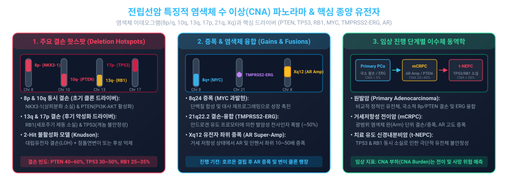

# 01. 염색체 복제수 변이의 분자생물학 및 전립선암 랜드마크 (CNA Biology & Prostate Cancer Hallmarks)

---

## 학습 목표 (Cognitive Goals)

1. **염색체 불안정성(CIN)과 유전체 대격변 기전의 수리생물학적 규명**: 수적/구조적 염색체 불안정성(Numerical vs. Structural CIN), 전장 유전체 배가(Whole-Genome Doubling, WGD), 그리고 단일 격변 사건인 염색체 분쇄증(Chromothripsis)의 분자생물학적 기전과 이를 모델링하는 수리적 원리를 설명할 수 있다.
2. **전립선암 6대 핵심 체세포 복제수 변이(SCNA) 해부**: 8p 결손(*NKX3-1*), 8q 획득(*MYC*), 10q 결손(*PTEN*), 13q 결손(*RB1*), 17p 결손(*TP53*), Xq 획득(*AR* 유전자 및 650kb 인핸서) 좌위의 생물학적 기능 및 임상적 중요성을 전사체 용량 효과(Gene Dosage Effect) 관점에서 설명할 수 있다.
3. **21q22.2 국소 결손과 *TMPRSS2-ERG* 융합 메커니즘 해석**: 21번 염색체 장완의 약 3Mb 간질성 결손(Interstitial Deletion, 융합 양성 원발암의 약 60%; 나머지는 결손 없는 전좌)에 의해 유도되는 *TMPRSS2-ERG* 유전자 융합의 형성 기전과 안드로겐 반응 인자(ARE)에 의한 종양 형성 구동 경로를 도식화할 수 있다.
4. **단일세포 해상도의 복제수 상태 정량화 모델 구현**: 종양 세포의 배수성(Ploidy) 및 순도(Tumor Purity)를 반영한 대수 복제수 비율($\log_2 \text{Ratio}$) 수리 공식을 도출하고 이를 Python 코드로 구현할 수 있다.

---

## 1. 염색체 불안정성(CIN), 전장 유전체 배가(WGD), 염색체 분쇄증(Chromothripsis)

고형암 유전체의 가장 두드러진 특징은 유사분열 과정에서 염색체가 정확하게 분배되지 못하고 지속적으로 구조적·수적 이상을 축적하는 **염색체 불안정성(Chromosomal Instability, CIN)**이다.

```
[Chromosomal Evolution Mechanisms in Carcinogenesis]

1. Spindle Assembly Checkpoint (SAC) Defect
   Mitotic Slippage / Merotelic Attachment
         │
         ▼
   Chromosomal Instability (CIN) ──> Arm-level Aneuploidy (Loss/Gain)

2. Cytokinesis Failure / Endoreduplication
         │
         ▼
   Whole-Genome Doubling (WGD: 2n -> 4n) ──> Genetic Buffer against Lethal Deletions

3. Micronucleus Rupture during Interphase
         │
         ▼
   Chromothripsis (Catastrophic Shattering) ──> Complex Rearrangements & ecDNA
```

### 1.1 염색체 불안정성(CIN): 수적 CIN 대 구조적 CIN

*   **수적 CIN (Numerical CIN, W-CIN)**: 방추사 결합 검문점(Spindle Assembly Checkpoint, SAC: *MAD2*, *BUB1*, *BUBR1*)의 결함 또는 다극성 중심체(Centrosome Amplification)로 인해 염색체 비분리(Nondisjunction)가 발생하여 전체 염색체의 획득(Trisomy, Tetrasomy) 및 소실(Monosomy)이 유발된다.
*   **구조적 CIN (Structural CIN, S-CIN)**: DNA 복제 스트레스(Replication Stress), 복제 분기점 붕괴(Replication Fork Collapse), 상동 재조합 결핍(HRD) 등으로 인해 염색체 절단(Double-Strand Breaks, DSBs)이 빈발하고 전위(Translocation), 역위(Inversion), 대규모 결실 및 증폭이 발생한다.

### 1.2 전장 유전체 배가 (Whole-Genome Doubling, WGD)

인간 고형암의 약 30~50%에서 종양 진화 초기 또는 중간 단계에 2배체 유전체($2n$) 전체가 4배체($4n$)로 배가되는 WGD 현상이 일어난다.
*   **유도 기전**: 세포질 분열 실패(Cytokinesis Failure), 유사분열 탈주(Mitotic Slippage), 또는 내복제(Endoreduplication)에 의해 발생한다.
*   **진화적 완충 효과 (Evolutionary Buffer)**: $2n$ 상태에서는 암 억제 유전자(Tumor Suppressor Genes, TSGs) 하나만 소실되어도 치명적인 적응도 손실 또는 세포 사멸이 발생할 수 있으나, WGD를 거친 $4n$ 세포는 1~2개의 대립유전자가 결손되어도 필수 유전자가 보존되므로, 종양 세포가 더 공격적이고 극단적인 비배수성(Aneuploidy) 돌연변이를 축적할 수 있는 진화적 안전망을 제공한다.

### 1.3 염색체 분쇄증 (Chromothripsis)

수십 년간 이어진 점진적 돌연변이 축적 모델과 달리, 염색체 분쇄증은 **단 한 번의 세포분열 주기 동안 단일 또는 소수의 염색체가 수십~수백 개의 조각으로 산산조각 난 뒤 무작위로 재결합**하는 대격변적 유전체 재편 현상이다.
*   **소핵(Micronucleus) 가설**: 불완전 분열로 본 핵에서 탈락된 염색체가 독자적인 소핵을 형성한다. 소핵은 핵막 단백질 결핍으로 인해 간기(Interphase) 도중 막이 파열되며 세포질 뉴클레아제에 노출되어 무차별적으로 절단된다.
*   **비상동 말단 연결(NHEJ)** 및 **미세상동 매개 절단 유도 복제(MMBIR)**: 무작위 결합 과정에서 수많은 결실과 역위가 발생하며, 원형 DNA 조각들은 **염색체외 DNA (extrachromosomal DNA, ecDNA / Double Minutes)** 형태로 분리되어 종양 유전자의 수백 배 폭발적 증폭을 야기한다.

---

## 2. 전립선암 6대 핵심 체세포 복제수 변이 (Hallmark SCNAs)

전립선암 유전체는 전형적인 'CNA 주도형 종양(CNA-driven Cancer)'으로, 다음 6대 염색체 좌위의 변이가 원발암에서 거세저항성 전이암(mCRPC)으로의 진행을 결정한다.



```
[Summary of 6 Recurrent Hallmark SCNAs in Prostate Cancer]

Locus     Alteration Type   Key Target Gene   Biological Consequence
─────────────────────────────────────────────────────────────────────────────
8p21.2    Hemizygous Loss   NKX3-1            Loss of luminal differentiation (Early)
8q24.21   Focal/Arm Gain    MYC               Ribosome biogenesis & proliferation
10q23.31  Biallelic Loss    PTEN              PI3K/AKT/mTOR pathway activation
13q14.2   Biallelic Loss    RB1               Loss of G1/S checkpoint, lineage plasticity
17p13.1   Hemizygous Loss   TP53              Genome instability & therapy resistance
Xq12      High Amplification AR + Enhancer    Castration resistance under ADT
─────────────────────────────────────────────────────────────────────────────
```

### 2.1 8p 결손 (*NKX3-1*, 8p21.2) - 원발암 형성의 초기 개시 인자
*   **유전자 특성**: 전립선 상피 특이적 호메오박스(Homeobox) 전사인자로, 정상 전립선 분화 유지 및 산화 스트레스 방어 단백질을 조절한다.
*   **병리적 기전**: GISTIC 복제수 호출 기준으로 NKX3-1 any-loss는 TCGA 원발 약 60%, SU2C 2015 82%·2019 74%이며(cBioPortal 재계산), FISH/array 기반 보고는 이보다 낮아 방법 의존적이다. 마우스 *Nkx3.1*+/- 모델에서 단일 대립유전자 소실(Haploinsufficiency)만으로 관강 상피의 과형성·이형성이 관찰되며, 인간에서 같은 방식으로 PIN을 형성한다는 직접 증거로 단정할 수는 없다.

### 2.2 8q 획득 (*MYC*, 8q24.21) - 세포 성장 및 대사 재프로그래밍
*   **유전자 특성**: 세포 성장, 리보솜 생합성, 해당과정(Glycolysis)을 총괄하는 원종양유전자(Proto-oncogene).
*   **병리적 기전**: 8q 장완의 전체 획득 또는 8q24.21 국소 증폭(Gain/Amplification)은 종양 세포의 단백질 합성 및 증식 속도를 급격히 상승시킨다. 8p 결손과 8q 획득이 동시에 일어나는 **isochromosome 8q [i(8q)]** 형성은 전립선암 클론 진화에서 관찰되는 사건으로 보고되었다(클론 진화의 '강력한 지표'로 단정할 수는 없음).

### 2.3 10q 결손 (*PTEN*, 10q23.31) - PI3K/AKT 경로의 폭주
*   **유전자 특성**: $\text{PIP}_3$를 탈인산화하여 $\text{PIP}_2$로 전환함으로써 세포 생존 신호인 $\text{PI3K/AKT/mTOR}$ 축을 억제하는 핵심 지질 인산화효소(Lipid Phosphatase).
*   **병리적 기전**: PTEN any-loss는 GISTIC 기준 TCGA 원발 약 32%(동형결손 약 17%), SU2C 2015 약 38%·2019 약 52%(동형결손 약 26~27%)로 방법·코호트 의존적이며, 한쪽 대립유전자의 결실 후 반대쪽의 돌연변이 또는 후성유전적 침묵, 혹은 양측 대립유전자 동형결합 결손(Biallelic Deletion)이 발생한다. AKT 과활성화를 통해 세포 사멸 저항성 및 침윤성이 폭발적으로 증가한다.

### 2.4 13q 결손 (*RB1*, 13q14.2) - 계통 가소성(Lineage Plasticity)의 방아쇠
*   **유전자 특성**: E2F 전사인자를 결합 억제하여 세포주기 G1/S 전이를 통제하는 문지기(Gatekeeper) 단백질.
*   **병리적 기전**: 13q14의 결손은 세포주기 제어를 붕괴시킬 뿐만 아니라, 특히 *TP53* 결손과 병발할 경우 안드로겐 수용체(AR) 의존적 관강 상피 형질을 버리고 신경내분비 전립선암(Treatment-induced Neuroendocrine Prostate Cancer, t-NEPC)으로 전환되는 **계통 가소성(Lineage Plasticity)**을 유도한다.

### 2.5 17p 결손 (*TP53*, 17p13.1) - 게놈의 수호자 상실
*   **유전자 특성**: DNA 손상 시 세포주기 억제(*CDKN1A/p21*) 및 아폽토시스(*BAX*, *PUMA*)를 유도하는 암 억제 단백질.
*   **병리적 기전**: 17p13의 편측 결손(Hemizygous Loss)과 나머지 한쪽의 미스센스 돌연변이(R175H, R248W, R273H 등) 결합은 이수성의 가속화, WGD 허용, 항암 화학요법 및 방사선 저항성을 유발한다.

### 2.6 Xq12 증폭 (*AR* 코딩 유전자 및 650kb 상류 인핸서) - 거세저항성의 최종 병기
*   **병리적 기전**: 1차 호르몬 차단 요법(Enzalutamide, Abiraterone)을 투여받은 환자에서 남성 호르몬 수용체(*AR*) 유전자 본체의 증폭(GISTIC amp 기준 SU2C 2015/2019 각각 약 52%/49%)과 함께 인핸서 변화가 보고된다. 특히 AR 상류 인핸서 탠덤 중복은 mCRPC의 70~87%, 원발암 <2%에서 보고되었으며(Viswanathan 2018) AR 본체 증폭과 동반되는 경우가 많다. 이 중 일부 환자에서는 **유전자 전사 시작점으로부터 약 650kb 상류에 위치한 슈퍼 인핸서(Super-enhancer) 영역의 고도 국소 증폭(Focal Amplification)**이 동반된다. 이는 극미량의 잔여 안드로겐 환경에서도 AR 전사를 수십 배 증폭시켜 저항성을 부여한다.

---

## 3. 21q22.2 국소 결손과 *TMPRSS2-ERG* 융합

전립선암에서 가장 빈번하게 발생하는 병리학적 시그니처는 ETS 계열 전사인자 *ERG*와 안드로겐 반응 상피 유전자 *TMPRSS2* 간의 융합 유전자(Gene Fusion) 형성이다 (서구인 전립선암의 약 50%에서 발견).

```
[Chromosome 21q22 Interstitial Deletion Architecture]

   Centromere ────────────────────────────────────────────── Telomere
                 21q22.2                       21q22.3
              ┌──────────┐                  ┌───────────┐
   ... ───────│   ERG    │◀─── ~3 Mb ───────│  TMPRSS2  │─────── ...
              └──────────┘    Deletion      └───────────┘
                    ▲                             │
                    └────── NHEJ Rejoining ───────┘
                                  │
                                  ▼
                     [TMPRSS2 promoter (ARE)]
                                  │ (Driven by Androgens)
                                  ▼
                     [Active ERG Overexpression]
                     (Invasion, Epithelial Plasticity)
```

### 3.1 3Mb 간질성 결손 (Interstitial Deletion, $Edel$)

두 유전자는 모두 21번 염색체 장완에 동일한 전사 방향(Telomere $\to$ Centromere)으로 배열되어 있다:
*   *TMPRSS2*: 21q22.3 (원위부, Telomeric)
*   *ERG*: 21q22.2 (근위부, Centromeric)

이 두 유전자 사이에 위치한 약 **3 메가베이스(Mb)** 크기의 유전체 영역(수십 개의 비필수 유전자 포함)이 토포아이소머레이즈 II(TOP2B) 및 안드로겐 수용체 결합에 따른 이중나선 절단 후 결실되면서 간질성 결손($Edel$)이 발생한다. 단, 융합은 이 결손 기전 외에 결손 없는 (균형) 전좌로도 생성되며(Perner 2006: 융합 양성 원발의 약 60%가 결손 기전), ERG 양성이 곧 21q 결손을 뜻하지는 않는다.
결과적으로 *TMPRSS2*의 강력한 **안드로겐 반응 인자(Androgen Response Element, ARE)**를 포함하는 프로모터가 *ERG*의 코딩 엑손과 직접 연결되어, 테스토스테론/DHT 자극 시 종양 억제 전사 네트워크를 파괴하는 ERG 단백질이 비정상적으로 대량 발현된다.

---

## 4. 수리 모델: 단일세포 복제수 비율 및 순도 교정

단일세포 RNA 시퀀싱에서 유전자 발현량 변화는 전사 활성도(Transcription Rate)와 유전체 카피 수(Gene Copy Number)의 합성 곱으로 나타난다.

### 4.1 대수 복제수 비율 ($\log_2 \text{Ratio}$) 공식

특정 염색체 영역 $s$ 내의 순수 암세포 절대 복제수(Absolute Copy Number)를 $q_s \in \{0, 1, 2, 3, 4, \dots\}$라 하자 (정상 이배체는 $q_{\text{diploid}} = 2$).
순수 종양 세포에서 기대되는 유전자 복제 비율 $R_s$ 및 대수 복제수 배율 $L_s$는 다음과 같이 정의된다:

$$R_s = \frac{q_s}{2}$$

$$L_s = \log_2(R_s) = \log_2(q_s) - 1$$

*   완전 결손 (Complete Loss, $q=0$): $L_s = -\infty$ (전사체상 배경 노이즈로 수렴)
*   단일 대립유전자 결손 (Loss, $q=1$): $L_s = \log_2(1/2) = -1.0$
*   중립 정상 이배체 (Neutral, $q=2$): $L_s = \log_2(1.0) = 0.0$
*   단일 대립유전자 획득 (Gain, $q=3$): $L_s = \log_2(3/2) \approx +0.585$
*   이중 획득 / 4배체 (Double Gain, $q=4$): $L_s = \log_2(4/2) = +1.0$
*   고도 증폭 (Amplification, $q \ge 5$): $L_s \ge \log_2(5/2) \approx +1.322$

> **가정 및 한계 (4.1 공식)**: 위 공식은 순수 종양·'발현 ∝ 카피수' 이상 가정입니다. 실제 발현은 유전자 용량 보상·감쇠를 따르므로 log2 +2.5가 곧 ≥10카피를 뜻하지 않습니다. 또한 남성 X 염색체는 정상 1카피(정상 q=2 가정 부적절)이고 infercnvpy의 기본 설정은 chrX/chrY를 제외합니다(`exclude_chromosomes=('chrX','chrY')`).

### 4.2 종양 순도($\alpha$) 및 정상 세포 오염 보정

만약 단일 스팟(Spatial transcriptomics) 또는 앰비언트 RNA(Ambient RNA) 오염에 의해 종양 순도가 $\alpha \in [0, 1]$인 혼합 신호가 관측될 경우, 평균 유효 복제수 $\bar{q}_s$와 관측 비율 $R_{\text{obs}, s}$는 다음과 같이 선형적으로 희석된다:

$$\bar{q}_s = \alpha q_s + (1-\alpha) \cdot 2 = 2 + \alpha(q_s - 2)$$

$$R_{\text{obs}, s} = \frac{\bar{q}_s}{2} = 1 + \frac{\alpha(q_s - 2)}{2}$$

$$L_{\text{obs}, s} = \log_2 \left( 1 + \frac{\alpha(q_s - 2)}{2} \right)$$

순도 $\alpha$가 낮아질수록 결손($q=1$) 신호는 0으로 점근하므로 통계적 검정력이 급감하며, 고도 평활화(Moving Average)와 HMM 기반 베이지안 보정이 요구된다.

---

## 5. Python 기반 유전체 좌위 어노테이션 및 CNA 시뮬레이터

```python
import numpy as np
import pandas as pd
import anndata as ad

def simulate_prostate_hallmark_cna(
    n_cells: int = 1000, 
    tumor_fraction: float = 0.7, 
    random_state: int = 42
) -> ad.AnnData:
    """
    전립선암 6대 핵심 CNA 및 21q22 결손을 모사하는 단일세포 발현 복제수 행렬을 생성한다.
    
    Parameters:
        n_cells: 시뮬레이션할 총 세포 수
        tumor_fraction: 암세포 비율 (나머지는 정상 이배체 세포)
        random_state: 난수 시드
    
    Returns:
        adata: 6개 핵심 염색체 영역의 복제수 신호가 인코딩된 AnnData 객체
    """
    np.random.seed(random_state)
    n_tumor = int(n_cells * tumor_fraction)
    n_normal = n_cells - n_tumor
    
    # 6개 랜드마크 염색체 영역 정의
    loci = [
        {"name": "chr8p_NKX3-1", "chr": "chr8", "q_tumor": 1},   # Loss (q=1)
        {"name": "chr8q_MYC",     "chr": "chr8", "q_tumor": 3},   # Gain (q=3)
        {"name": "chr10q_PTEN",   "chr": "chr10", "q_tumor": 1},  # Hemizygous Loss (q=1)
        {"name": "chr13q_RB1",    "chr": "chr13", "q_tumor": 1},  # Loss (q=1)
        {"name": "chr17p_TP53",   "chr": "chr17", "q_tumor": 1},  # Loss (q=1)
        {"name": "chr21q_TMPRSS2_ERG", "chr": "chr21", "q_tumor": 1}, # Focal Del (q=1)
        {"name": "chrXq_AR",      "chr": "chrX", "q_tumor": 5},   # High Amp (q=5; 설명용 예시. 남성 X는 정상 1카피이고 infercnvpy 기본은 chrX 제외)
    ]
    
    n_loci = len(loci)
    locus_names = [l["name"] for l in loci]
    
    # 발현 행렬 초기화 (Log2 Ratio 기준)
    mat = np.zeros((n_cells, n_loci))
    
    # 1. 정상 세포 (모두 2카피, Log2 Ratio = 0 + 가우시안 전사체 노이즈)
    mat[:n_normal, :] = np.random.normal(loc=0.0, scale=0.15, size=(n_normal, n_loci))
    
    # 2. 암세포 (절대 카피 수 q에 따른 이론적 Log2 Ratio 반영)
    for j, locus in enumerate(loci):
        q = locus["q_tumor"]
        theoretical_log2_ratio = np.log2(q / 2.0)
        # 종양 세포 전사체 신호 = 이론치 + 생물학적 가변 노이즈
        mat[n_normal:, j] = np.random.normal(
            loc=theoretical_log2_ratio, 
            scale=0.18, 
            size=n_tumor
        )
    
    # AnnData 구축
    obs_df = pd.DataFrame(
        {
            "cell_type": ["Normal_Diploid"] * n_normal + ["Tumor_Aneuploid"] * n_tumor,
            "true_clone": ["Diploid"] * n_normal + ["mCRPC_CloneA"] * n_tumor
        },
        index=[f"cell_{i:04d}" for i in range(n_cells)]
    )
    
    var_df = pd.DataFrame(
        {
            "chromosome": [l["chr"] for l in loci],
            "target_gene": ["NKX3-1", "MYC", "PTEN", "RB1", "TP53", "TMPRSS2-ERG", "AR"],
            "expected_cn_state": [l["q_tumor"] for l in loci]
        },
        index=locus_names
    )
    
    adata = ad.AnnData(X=mat, obs=obs_df, var=var_df)
    print(f"생성 완료: {adata.n_obs} 세포 x {adata.n_vars} 유전체 좌위 (정상: {n_normal}, 종양: {n_tumor})")
    return adata
```

---

## 단원 핵심 점검 (Cognitive Checkpoint & Case Study)

### 문제 1: WGD와 비배수성 적응도 역설 (The Aneuploidy Fitness Paradox)
생체 내 정상 세포에 인위적으로 염색체 비분리를 유도하면 심각한 단백질 독성 스트레스(Proteotoxic Stress)와 대사 저하로 인해 증식이 억제되거나 노화(Senescence)에 들어간다. 그러나 공격적인 고형암 세포는 극심한 비배수성(Aneuploidy)을 지니고 있음에도 불구하고 폭발적으로 증식한다. 
암세포가 이러한 이수성 유도 세포 독성을 극복하고 생존 우위를 점하게 만드는 핵심 유전체 사건(WGD 및 특정 유전자 변이)의 시너지 기전을 설명하시오.

<details>
<summary>💡 모범 답안 및 해설 확인</summary>

**1. 전장 유전체 배가(WGD)의 유전적 완충(Buffering) 효과**:
정상 이배체($2n$) 세포에서 무작위 염색체 결손이 발생하면 필수 하우스키핑 유전자(Housekeeping genes)가 결실되어 치사성(Lethality)을 유발한다. 반면 WGD를 거쳐 사배체($4n$)가 된 세포는 유전체 사본이 4개로 증가하므로, 염색체 팔이 결손되어도 필수 유전자의 잔여 카피가 보존된다. 이는 유전체 파괴에 대한 완충 지대를 제공하여 극단적인 이수성 진화를 허용한다.

**2. *TP53* 불활성화와의 결정적 시너지**:
정상 세포는 비정상적인 유사분열이나 염색체 비분리 발생 시 p53 경로를 활성화하여 G1기 세포주기를 차단하고 사멸(Apoptosis)을 유도한다. 그러나 17p13 결손 및 *TP53* 기능 상실 돌연변이가 동반되면, 염색체 분리 실패 및 사배체화 세포가 검문점을 통과하여 지속적으로 증식할 수 있게 된다. p53 결손은 비배수성 세포가 대사 스트레스를 회피하고 암 줄기세포능을 획득하는 면죄부를 제공한다.

</details>

---

### 문제 2: 안드로겐 수용체 차단제 저항성과 *AR* 좌위 국소 증폭의 분자역학
엔잘루타마이드(Enzalutamide) 치료를 받는 전이성 거세저항성 전립선암(mCRPC) 환자의 단일세포 전사체 데이터를 분석한 결과, 전신 전이 클론에서 X번 염색체(Xq12) 영역의 발현 신호가 정상 상피세포 대비 $\log_2 \text{Ratio} \approx +2.5$ 수준으로 극단적으로 치솟아 있었다.
이 현상을 유발한 유전체 구조 이상(코딩 영역 vs. 조절 영역)을 구분하여 설명하고, 왜 이 변이가 환자에게 2세대 안드로겐 표적 치료제 저항성을 부여하는지 논하시오.

<details>
<summary>💡 모범 답안 및 해설 확인</summary>

**1. 유전체 구조 이상의 본질 (코딩 유전자 + 650kb 상류 인핸서 증폭)**:
$\log_2 \text{Ratio} \approx +2.5$는 정상 이배체 대비 약 $2^{2.5} \approx 5.66$배, 즉 절대 카피 수가 10카피 이상으로 폭발적으로 증가한 **고도 국소 증폭(High Focal Amplification)** 상태를 의미한다. Viswanathan 2018/Takeda 2018 등에 따르면(SU2C 2015 연구의 결과가 아님), 이는 단순히 *AR* 코딩 유전자 자체의 중복뿐만 아니라 전사 시작점으로부터 약 **650kb 상류에 위치한 슈퍼 인핸서(Super-enhancer) 유전체 좌위의 동시 증폭**에 의해 발생한다.

**2. 엔잘루타마이드 저항성 유도 기전**:
엔잘루타마이드는 안드로겐(DHT)이 AR의 리간드 결합 도메인(LBD)에 결합하는 것을 경쟁적으로 저해하는 길항제(Antagonist)이다. 그러나 AR 단백질이 과발현(AR 증폭·인핸서 변화, 정량 배수는 근거 없음)되면:
1.  **질량 작용의 법칙(Law of Mass Action)**에 의해 약물의 유효 차단 농도를 압도하여 미량의 거세 수준 남성호르몬으로도 AR 핵 내 전위 및 전사 복합체 형성이 유도된다.
2.  고농도로 축적된 AR 단백질은 길항제의 효과를 약화시키고 리간드 비의존적 전사 활성화를 일으킬 수 있다. (엔잘루타마이드를 부분 작동제로 바꾸는 대표 변이는 AR-LBD *F877L*(구 표기 F876L; 코스는 NM_000044.6 번호 기준 F877L/T878A로 통일)이며 AR 과발현과는 구분해야 한다.)

</details>

---

### 문제 3: *TMPRSS2-ERG* 융합 유전자 검출의 계산생물학적 트랩
단일세포 RNA 시퀀싱(3' scRNA-seq) 데이터를 분석하는 생물정보학자가 *TMPRSS2* 유전자와 *ERG* 유전자의 발현량 및 복제수 변화를 조사하였다. 환자의 종양 세포에서 *ERG* 전사체 발현량은 정상 전립선 조직 대비 100배 이상 극도로 높았으나, 전장 염색체 복제수 분석(inferCNV)에서는 21번 염색체 전체가 정상 2카피(Neutral)로 추정되었다.
이러한 역설적 결과가 발생한 분자세포유전학적 원인(간질성 결손의 크기 및 3' scRNA-seq 라이브러리의 특성)을 규명하시오.

<details>
<summary>💡 모범 답안 및 해설 확인</summary>

**1. 21q22.2 간질성 결손(Interstitial Deletion)의 미세한 크기 (Focal vs. Broad)**:
*TMPRSS2-ERG* 융합을 형성하는 염색체 결손은 21번 염색체 장완 전체의 소실이 아니라, 두 유전자 사이에 존재하는 약 **3Mb 크기의 극히 좁은 간질성 결손(Focal Interstitial Deletion)**이다. 전립선암 단일세포 전사체 복제수 분석 도구(inferCNV 등)는 일반적으로 노이즈를 억제하기 위해 100~200개 유전자 창(Window)을 이동평균(Moving average)하므로, 수 메가베이스 단위의 국소 결손 영역은 평활화 과정에서 소거되어 염색체 전체가 2카피(Neutral)인 것처럼 관측된다.

**2. 3' scRNA-seq 라이브러리의 구조적 한계**:
표준 10x Genomics 3' 단일세포 시퀀싱은 전사체의 3' 말단(Poly-A tail 인접 부위) 약 300~500bp만을 캡처한다. *TMPRSS2-ERG* 융합 전사체는 5' 쪽에 *TMPRSS2*의 비코딩 엑손이 오고, 3' 쪽은 *ERG*의 온전한 코딩 엑손 및 3' UTR로 구성된다. 따라서 시퀀싱 리드는 온전히 *ERG*의 3' 말단에만 정렬되므로, 융합 접합부(Fusion junction read)를 포착하지 못하고 단순한 *ERG* 유전자의 폭발적 과발현으로만 나타나게 된다.

</details>

---

<!-- REFERENCES:BEGIN (generated by scripts/apply_references.py; do not edit by hand) -->
## 참고문헌 (References)
### 본문 인용 문헌
1. Viswanathan SR, Ha G, Hoff AM, et al. Structural Alterations Driving Castration-Resistant Prostate Cancer Revealed by Linked-Read Genome Sequencing. *Cell*. 2018;174(2):433-447.e19. PMID: 29909985. doi: 10.1016/j.cell.2018.05.036
2. Takeda DY, Spisák S, Seo JH, et al. A Somatically Acquired Enhancer of the Androgen Receptor Is a Noncoding Driver in Advanced Prostate Cancer. *Cell*. 2018;174(2):422-432.e13. PMID: 29909987. doi: 10.1016/j.cell.2018.05.037
3. Perner S, Demichelis F, Beroukhim R, et al. TMPRSS2:ERG fusion-associated deletions provide insight into the heterogeneity of prostate cancer. *Cancer Res*. 2006;66(17):8337-41. PMID: 16951139. doi: 10.1158/0008-5472.CAN-06-1482
4. Cancer Genome Atlas Research Network. The Molecular Taxonomy of Primary Prostate Cancer. *Cell*. 2015;163(4):1011-25. PMID: 26544944. doi: 10.1016/j.cell.2015.10.025
5. Robinson D, Van Allen EM, Wu YM, et al. Integrative clinical genomics of advanced prostate cancer. *Cell*. 2015;161(5):1215-1228. PMID: 26000489. doi: 10.1016/j.cell.2015.05.001
6. Abida W, Cyrta J, Heller G, et al. Genomic correlates of clinical outcome in advanced prostate cancer. *Proc Natl Acad Sci U S A*. 2019;116(23):11428-11436. PMID: 31061129. doi: 10.1073/pnas.1902651116
### 소프트웨어 (표기 버전은 검수 시 API를 확인한 버전이며, 파이프라인 실행 환경은 requirements-pipelines.txt 참조)
- anndata 0.13.4 (github.com/scverse/anndata). 원 논문: Virshup I, Rybakov S, Theis FJ, et al. anndata: Access and store annotated data matrices. *JOSS*. 2024;9(101):4371. doi: 10.21105/joss.04371
- NumPy 2.5.4 (numpy.org). 원 논문: Harris CR, Millman KJ, van der Walt SJ, et al. Array programming with NumPy. *Nature*. 2020;585(7825):357-362. PMID: 32939066. doi: 10.1038/s41586-020-2649-2
- pandas 2.3.3 (github.com/pandas-dev/pandas). 원 논문: McKinney W. Data Structures for Statistical Computing in Python. *Proceedings of the Python in Science Conference*. 2010:56-61. doi: 10.25080/majora-92bf1922-00a
<!-- REFERENCES:END -->
