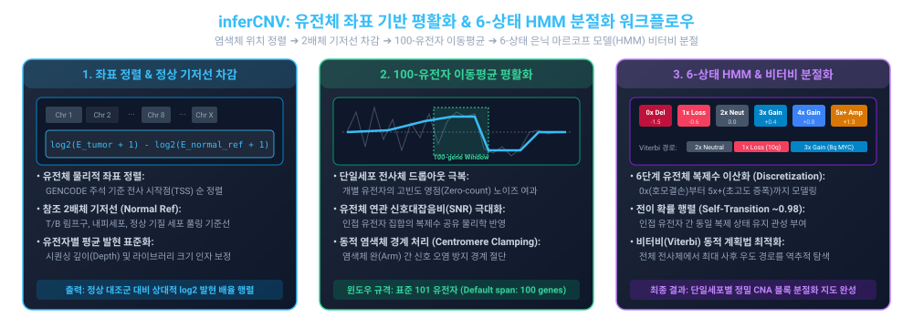

# 02. inferCNV 알고리즘과 6상태 은닉 마르코프 모델 (inferCNV Algorithm & 6-State HMM)

---

## 학습 목표 (Cognitive Goals)

1. **전사체 신호의 유전체 좌표 정렬 및 기저선 차감 원리 규명**: 전사체 카운트 행렬을 염색체 물리적 위치($\text{chr}, \text{start}, \text{end}$)로 정렬하고, 비악성 정상 기질/면역 세포(Reference cells)의 발현 편향을 차감하여 순수 복제수 신호(Relative Expression Ratio)를 추출하는 수리적 과정을 설명할 수 있다.
2. **이동평균(Moving Average) 평활화와 전사 노이즈 억제 모델링**: 100개 유전자 슬라이딩 윈도우(Sliding Window)를 적용하여 유전자 특이적 전사 버스팅(Transcriptional Bursting) 노이즈를 상쇄하고 염색체 블록 단위 복제수 신호를 도출하는 통계적 원리를 유도할 수 있다.
3. **6상태 은닉 마르코프 모델(6-State HMM)과 세그멘테이션 수리 구조 이해**: 완전 결손($0\times$), 단일 결손($1\times$), 중립($2\times$), 단일 획득($3\times$), 이중 획득($4\times$), 고도 증폭의 6개 은닉 상태(Hidden States)에 대한 방출 확률(Emission Probability)과 전이 확률(Transition Matrix)을 정의할 수 있다. (공식 inferCNV i6 모델은 상대 복제수 $\{0, 0.5, 1, 1.5, 2, 3\}$, 즉 복제수 $0\cdot1\cdot2\cdot3\cdot4\cdot6$에 해당하는 6상태를 사용하며, 방출 평균/표준편차는 Baum-Welch가 아니라 시뮬레이션 spike-in CNV 수준에서 추정하고 전이 행렬은 고정한다.)
4. **Baum-Welch 파라미터 학습 및 Viterbi 최적 경로 디코딩 구현**: Baum-Welch(Expectation-Maximization) 알고리즘을 통한 모델 학습 원리와 Viterbi 동적 계획법(Dynamic Programming)을 Python으로 구현하여 최적 복제수 단편(CNA Segments)을 복원할 수 있다.

---

## 1. 유전체 좌표 정렬 및 정상 레퍼런스 기저선 차감

단일세포 RNA 시퀀싱 데이터에서 염색체 복제수 변이(CNA)를 추정하는 핵심 가정은 **"특정 염색체 영역의 복제수 변화는 해당 영역에 위치한 수십~수백 개 유전자의 평균 발현량의 비례적 증가 또는 감소(Gene Dosage Effect)로 나타난다"**는 것이다.



```
[inferCNV Signal Extraction Pipeline]

Raw Count Matrix (Cells x Genes)
         │
         ▼ (1. Coordinate Ordering: chr1 -> chr22, start position)
Genomically Ordered Expression Matrix
         │
         ▼ (2. Normal Reference Normalization)
Reference-subtracted log expression: y_ig = x_ig - mean_ref_g   (x = log(CP10K+1))
         │
         ▼ (3. Clipping to [-c, +c] (infercnvpy lfc_clip=3) & Centering)
tilde_y_ig = clip(y_ig) - median_g(clip(y_ig))
         │
         ▼ (4. 100-Gene Moving Average Smoothing (window 100, step 10))
Smoothed Genomic Profile: bar_y_ig
         │
         ▼ (5. 6-State HMM Viterbi Decoding)
Discrete CNA Segments (0x, 1x, 2x, 3x, 4x, 6x in inferCNV i6)
```

### 1.1 유전체 좌표 매핑 및 저발현 유전자 필터링

1.  **좌표 정렬**: 참조 유전체(GRCh38/Ensembl) GTF 주석을 기반으로 상염색체(chr1~22) 및 성염색체(chrX, chrY) 유전자를 염색체 번호 및 전사 시작 위치($\text{start}$) 순서대로 1차원 정렬한다.
2.  **노이즈 필터링**:
    *   극미량 발현 유전자: 전체 세포의 일정 비율(예: 1~3%) 미만에서만 발현되는 유전자는 드롭아웃(Dropout) 노이즈를 가중시키므로 제거한다.
    *   미토콘드리아 유전자(*MT-*): 염색체 외부 세포질 소기관 유전체이므로 분석에서 제외한다.
    *   성염색체 유전자(chrY, 불활성화 chrX): 성별 불일치 및 용량 보정 편향을 방지하기 위해 분석 목적에 따라 선별적 제외 또는 별도 정규화 모델을 적용한다.

### 1.2 정상 참조 세포(Reference Baseline) 설정 및 상대 비율 계산

암 조직 내에 함께 시퀀싱된 비악성 이배체 세포(기질세포, 혈관내피세포, T/B 림프구, 대식세포 등)의 집합을 $R$, 분석 대상 종양(또는 미지의 상피) 세포의 집합을 $T$라 하자.

1.  **라이브러리 크기 정규화**:
    세포 $i$의 총 유전자 카운트를 $N_i = \sum_{g} C_{ig}$라 할 때, 1만 개 기준(Counts Per 10K, CP10K) 또는 100만 개 기준(CPM)으로 정규화하고 대수 변환한다:
    $$x_{ig} = \log \left( \frac{C_{ig}}{N_i} \times 10^4 + 1 \right)$$

2.  **정상 참조 기저선(Reference Baseline) 도출**:
    유전자 $g$에 대해 정상 세포군 $R$의 평균 발현량을 계산한다:
    $$\mu_{g, \text{ref}} = \frac{1}{|R|} \sum_{r \in R} x_{rg}$$

3.  **참조 대비 차감 (로그 척도)**:
    $x_{ig}$가 이미 로그 변환된 발현량이므로, 비율의 로그가 아니라 로그 값의 차이로 상대 발현을 계산한다(비율에 다시 로그를 취하지 않는다):
    $$\tilde{y}_{ig} = x_{ig} - \mu_{g, \text{ref}}$$
    이후 유전자별 신호를 $[-c, +c]$ ($c=3$, infercnvpy `lfc_clip` 기본값)로 클리핑하고 평활화한다. 로그 밑의 선택은 스케일 상수일 뿐이다.
4.  **세포별 중심화(Centering)**:
    세포 전체의 글로벌 전사 활성도 차이를 보정하기 위해 각 세포 $i$의 전장 유전자 중앙값(Median)을 차감하여 0에 맞춘다:
    $$z_{ig} = \tilde{y}_{ig} - \text{median}_{g'} (\tilde{y}_{ig'})$$

---

## 2. 이동평균(Moving Average) 평활화 및 노이즈 억제

단일세포 RNA 시퀀싱 데이터는 전사 버스팅(Transcriptional Bursting), 포획 효율(Capture Efficiency)의 확률적 변동, 드롭아웃(Dropout)으로 인해 유전자 개별 단위의 신호 대 잡음비(Signal-to-Noise Ratio, SNR)가 극도로 낮다.

### 2.1 100-유전자 슬라이딩 윈도우 수리 모델

인접한 유전자들은 동일한 염색체 구조 변이 영역을 공유하므로, 염색체 상의 물리적 순서 $g$를 기준으로 좌우 $w/2$개 유전자를 포함하는 윈도우 $W_g = \left[ g - \frac{w}{2}, g + \frac{w}{2} \right]$를 정의한다 (기본 윈도우 크기 $w = 100$ 유전자):

$$\bar{z}_{ig} = \frac{1}{|W_g|} \sum_{k \in W_g} z_{ik}$$

*   **염색체 경계면 처리**: 슬라이딩 윈도우는 염색체 경계를 넘어서지 않도록 제한된다(Truncated at chromosome boundaries).
*   **이상치 절단(Outlier Capping)**: 발현량이 비정상적으로 치솟는 극소수 유전자(예: 조직 특이적 과발현 단백질)에 의한 윈도우 왜곡을 방지하기 위해, infercnvpy는 **평활화 이전**에 유전자별 참조 차감 신호를 상하한선으로 클리핑한 뒤 이동평균을 적용한다(`lfc_clip=3`, 기본 윈도우 100·보폭 10):
    $$z_{ig}^{\text{clipped}} = \max \left( -c, \min \left( c, z_{ig} \right) \right), \quad c = 3.0, \qquad \bar{z}_{ig} = \frac{1}{|W_g|} \sum_{k \in W_g} z_{ik}^{\text{clipped}}$$

이동평균을 거치면 개별 유전자의 국소 노이즈 분산은 $O(1/w)$로 감소하여 염색체 단위의 거대한 복제수 획득/결손 블록이 명확한 연속적 신호로 드러난다.

---

## 3. 6상태 은닉 마르코프 모델 (6-State Hidden Markov Model)

평활화된 연속 신호 $\bar{z}_{ig}$로부터 이산적(Discrete) 복제수 상태를 결정하기 위해 6상태 은닉 마르코프 모델(HMM)을 적용한다.

```
[inferCNV 6-State HMM Architecture]

States:  (S1: 0x) ─── (S2: 1x) ─── (S3: 2x) ─── (S4: 3x) ─── (S5: 4x) ─── (S6: 6x in i6)
                    ▲                │
                    │   Transition   │
                    └── Probability ─┘
                            A_ij
                             │
                             ▼ Emission Probability b_j(o_t)
                    Observed Continuous Ratio o_t (Smoothed Expression)
```

### 3.1 은닉 상태 공간 (State Space) 정의

염색체 상의 각 유전체 위치 $t$ ($t=1, \dots, T$)에서의 절대 카피 수 $q_t$에 대응하는 6개의 은닉 상태 $S = \{S_1, S_2, S_3, S_4, S_5, S_6\}$를 정의한다:

| 상태 ID ($S_j$) | 생물학적 유전체 상태 | 명목 복제수 ($q$) | 이론적 비율 ($q/2$) | 방출 평균 중심 ($\mu_j$) | 방출 표준편차 ($\sigma_j$) |
| :--- | :--- | :---: | :---: | :---: | :---: |
| **$S_1$** | 완전 동형접합 결손 (Complete Loss) | $0\times$ | $0.0$ | $\approx -1.5 \sim -2.0$ | $\sigma_1$ |
| **$S_2$** | 단일 대립유전자 결손 (Loss) | $1\times$ | $0.5$ | $\log_2(0.5) = -1.0$ | $\sigma_2$ |
| **$S_3$** | 정상 중립 이배체 (Neutral Diploid) | $2\times$ | $1.0$ | $\log_2(1.0) = 0.0$ | $\sigma_3$ |
| **$S_4$** | 단일 대립유전자 획득 (Gain) | $3\times$ | $1.5$ | $\log_2(1.5) \approx +0.585$| $\sigma_4$ |
| **$S_5$** | 이중 획득 / 4배체 (Double Gain) | $4\times$ | $2.0$ | $\log_2(2.0) = +1.0$ | $\sigma_5$ |
| **$S_6$** | 고도 증폭 (High Amplification) | $6\times$ (inferCNV i6 대표값) | $3.0$ | $\log_2(3.0) \approx +1.58$ | $\sigma_6$ |

### 3.2 방출 확률 (Emission Probability)

관측된 평활화 발현값 $o_t = \bar{z}_{it}$가 주어졌을 때, 은닉 상태 $S_j$에서의 조건부 방출 확률 밀도 $b_j(o_t)$는 정규분포(Gaussian Distribution)를 따른다고 가정한다:

$$b_j(o_t) = P(o_t \mid s_t = S_j) = \frac{1}{\sqrt{2\pi \sigma_j^2}} \exp \left( -\frac{(o_t - \mu_j)^2}{2\sigma_j^2} \right)$$

### 3.3 전이 확률 행렬 (Transition Matrix)

염색체 구조 변이는 단일 유전자가 아닌 수 메가베이스(Mb)에 걸친 연속 블록으로 발생한다. 따라서 **동일 상태를 유지하려는 자기 전이 확률(Self-transition Probability)이 압도적으로 높아야 한다**:

$$A = (a_{jk}) = P(s_{t+1} = S_k \mid s_t = S_j)$$

$$a_{jj} = 1 - \delta, \quad a_{jk} = \frac{\delta}{5} \quad (j \neq k)$$

여기서 $\delta$는 상태 전이 감도 파라미터(Transition Probability Parameter, 통상 $10^{-6} \sim 10^{-4}$)로, 유전체 해상도와 세그멘테이션 과분할(Over-segmentation) 방지 사이의 균형을 통제한다.

---

## 4. Baum-Welch 학습 및 Viterbi 디코딩 수리 모델

### 4.1 Baum-Welch (EM) 알고리즘을 통한 파라미터 최적화 (일반 HMM 이론)

> 아래는 일반적인 HMM 학습 이론이며, 공식 inferCNV는 Baum-Welch를 사용하지 않고 방출 파라미터를 spike-in 시뮬레이션에서 추정하며 `Viterbi.dthmm.adj`로 디코딩합니다(전이행렬: 자기 전이 $1-5t$, 그 외 상태로 각 $t$, 3상태 i3 옵션과 베이지안 사후확률 필터 단계도 존재).

초기 파라미터 $\lambda = (A, B, \pi)$가 주어졌을 때, 전방-후방(Forward-Backward) 알고리즘을 통해 관측 데이터의 우도(Likelihood)를 극대화한다.

1.  **전방 변수 ($\alpha_t(j)$)**:
    $$\alpha_1(j) = \pi_j b_j(o_1)$$
    $$\alpha_{t+1}(k) = \left[ \sum_{j=1}^{6} \alpha_t(j) a_{jk} \right] b_k(o_{t+1})$$
2.  **후방 변수 ($\beta_t(j)$)**:
    $$\beta_T(j) = 1$$
    $$\beta_t(j) = \sum_{k=1}^{6} a_{jk} b_k(o_{t+1}) \beta_{t+1}(k)$$
3.  **사후 확률 갱신 (E-step & M-step)**:
    시간 $t$에 상태 $S_j$에 있을 사후 확률 $\gamma_t(j)$:
    $$\gamma_t(j) = P(s_t = S_j \mid \mathbf{o}, \lambda) = \frac{\alpha_t(j) \beta_t(j)}{\sum_{k=1}^{6} \alpha_t(k) \beta_t(k)}$$
    시간 $t$에 상태 $S_j$, $t+1$에 상태 $S_k$일 결합 사후 확률 $\xi_t(j, k)$:
    $$\xi_t(j, k) = \frac{\alpha_t(j) a_{jk} b_k(o_{t+1}) \beta_{t+1}(k)}{\sum_{m=1}^{6} \sum_{n=1}^{6} \alpha_t(m) a_{mn} b_n(o_{t+1}) \beta_{t+1}(n)}$$
    방출 파라미터 M-step 갱신:
    $$\hat{\mu}_j = \frac{\sum_{t=1}^{T} \gamma_t(j) o_t}{\sum_{t=1}^{T} \gamma_t(j)}, \quad \hat{\sigma}_j^2 = \frac{\sum_{t=1}^{T} \gamma_t(j) (o_t - \hat{\mu}_j)^2}{\sum_{t=1}^{T} \gamma_t(j)}$$

### 4.2 Viterbi 최적 상태 경로 디코딩

학습된 HMM 모델 $\lambda$ 하에서 관측 시퀀스 $\mathbf{o} = (o_1, \dots, o_T)$를 생성했을 확률이 가장 높은 전역 최적 은닉 상태 경로 $\mathbf{s}^* = (s_1^*, \dots, s_T^*)$를 동적 계획법(Viterbi)으로 탐색한다.

1.  **초기화 ($t=1$)**:
    $$V_1(j) = \log \pi_j + \log b_j(o_1)$$
    $$\psi_1(j) = 0$$
2.  **귀납 단계 ($t = 2, \dots, T$)**:
    $$V_t(k) = \max_{1 \le j \le 6} \left[ V_{t-1}(j) + \log a_{jk} \right] + \log b_k(o_t)$$
    $$\psi_t(k) = \arg\max_{1 \le j \le 6} \left[ V_{t-1}(j) + \log a_{jk} \right]$$
3.  **종료 및 역추적 (Backtracking)**:
    $$s_T^* = \arg\max_{1 \le j \le 6} V_T(j)$$
    $$s_t^* = \psi_{t+1}(s_{t+1}^*) \quad (t = T-1, T-2, \dots, 1)$$

---

## 5. Python 기반 Viterbi 디코더 및 infercnvpy 연동 구현

### 5.1 순수 Python/NumPy 6상태 Viterbi 디코더 구현체

```python
import numpy as np

class SixStateCNAViterbiDecoder:
    """
    inferCNV 스타일의 6상태 연속 발현 복제수 HMM Viterbi 디코더.
    """
    def __init__(self, delta: float = 1e-5):
        # 6개 상태 정의: [0: CompleteLoss, 1: Loss, 2: Neutral, 3: Gain, 4: DoubleGain, 5: HighAmp]
        self.n_states = 6
        self.state_names = ["0x_CompleteLoss", "1x_Loss", "2x_Neutral", "3x_Gain", "4x_DoubleGain", "5x_Amp"]
        
        # 이론적 Log2 배율 중심 (mu)
        self.mu = np.array([-1.8, -1.0, 0.0, 0.585, 1.0, 1.5])
        # 상태별 방출 표준편차 (sigma)
        self.sigma = np.array([0.35, 0.25, 0.20, 0.25, 0.30, 0.40])
        
        # 전이 확률 행렬 A 구성 (자기 전이 1 - delta)
        self.delta = delta
        self.A = np.full((self.n_states, self.n_states), delta / (self.n_states - 1))
        np.fill_diagonal(self.A, 1.0 - delta)
        self.log_A = np.log(self.A)
        
        # 초기 상태 분포 pi (중립 2x 상태에 대부분의 사전 확률 부여)
        self.pi = np.array([0.01, 0.04, 0.90, 0.04, 0.009, 0.001])
        self.log_pi = np.log(self.pi)

    def _log_gaussian_pdf(self, x: np.ndarray, mu: float, sigma: float) -> np.ndarray:
        """가우시안 로그 방출 확률 밀도 계산"""
        var = sigma ** 2
        return -0.5 * np.log(2.0 * np.pi * var) - ((x - mu) ** 2) / (2.0 * var)

    def decode(self, observations: np.ndarray) -> np.ndarray:
        """
        1차원 연속 평활화 관측치 벡터에 대해 최적 은닉 복제수 상태 경로를 Viterbi로 복원한다.
        """
        T = len(observations)
        V = np.zeros((T, self.n_states))
        psi = np.zeros((T, self.n_states), dtype=int)
        
        # 1. 초기화 t = 0
        log_emission_0 = np.array([
            self._log_gaussian_pdf(observations[0], self.mu[s], self.sigma[s])
            for s in range(self.n_states)
        ])
        V[0, :] = self.log_pi + log_emission_0
        
        # 2. 동적 프로그래밍 전진
        for t in range(1, T):
            obs_t = observations[t]
            log_emission_t = np.array([
                self._log_gaussian_pdf(obs_t, self.mu[s], self.sigma[s])
                for s in range(self.n_states)
            ])
            for k in range(self.n_states):
                # V[t-1, :] + log_A[:, k]의 최댓값 탐색
                trans_probs = V[t - 1, :] + self.log_A[:, k]
                best_prev = np.argmax(trans_probs)
                psi[t, k] = best_prev
                V[t, k] = trans_probs[best_prev] + log_emission_t[k]
                
        # 3. 역추적 (Backtracking)
        best_path = np.zeros(T, dtype=int)
        best_path[-1] = np.argmax(V[-1, :])
        for t in range(T - 2, -1, -1):
            best_path[t] = psi[t + 1, best_path[t + 1]]
            
        return best_path
```

### 5.2 infercnvpy 기반 분석 워크플로우

> **주의**: infercnvpy는 HMM을 구현하지 않습니다(참조 차감, 클리핑, 이동평균, PCA/클러스터링, `cnv_score`만 제공). 따라서 아래 코드는 5.1의 HMM과 무관하며, 기본값으로 chrX/chrY를 제외(`exclude_chromosomes=('chrX','chrY')`)합니다.

```python
import scanpy as sc
import infercnvpy as cnp

def run_infercnvpy_analysis(adata: sc.AnnData, reference_cat: str = "cell_type", reference_label: str = "Stromal"):
    """
    infercnvpy를 실행하여 전사체 기반 복제수 평활화 및 클러스터링을 수행한다.
    """
    # 1. 정상 참조 세포 정의
    print(f"정상 참조 세포 라벨: {reference_label}")
    
    # 2. inferCNV 계산 실행 (이동평균 window_size=100)
    cnp.tl.infercnv(
        adata,
        reference_key=reference_cat,
        reference_cat=[reference_label],
        window_size=100,
        step=1,
        inplace=True
    )
    
    # 3. 복제수 변이 기반 PCA 및 이웃 그래프 구축
    cnp.tl.pca(adata)
    cnp.pp.neighbors(adata)
    
    # 4. CNA 클러스터링 (Leiden 알고리즘을 이용한 서브클론 동정)
    cnp.tl.leiden(adata, resolution=0.5, key_added="cnv_subclone")
    
    # 5. 종양 세포의 이수성 점수(CNA score) 산출
    cnp.tl.cnv_score(adata, groupby="cnv_subclone", key_added="cnv_score")
    
    print("infercnvpy 복제수 추정 및 서브클론 클러스터링 완료.")
    return adata
```

---

## 단원 핵심 점검 (Cognitive Checkpoint & Case Study)

### 문제 1: 정상 참조군(Reference Group) 선택의 오류와 대칭 왜곡
전립선암 snRNA-seq 조직에서 종양 상피세포의 복제수를 추정하기 위해, 분석자가 '단핵구/대식세포(Monocyte/Macrophage)' 단일 집단만을 정상 대조군(Reference)으로 설정하여 분석을 수행하였다. 분석 결과, 환자의 종양 세포뿐만 아니라 다른 정상 기질세포(섬유아세포)에서도 6번 염색체의 광범위한 이상 신호(참조에서 높은 영역은 비참조 세포에서 결손, 낮은 영역은 획득으로 나타나며 방향은 영역마다 다름)와 리보솜 유전자 밀집 영역의 광범위한 결손(Loss)이 위양성(False Positive)으로 검출되었다.
이러한 계통 오차(Systematic Bias)가 발생한 분자세포생물학적 원인을 설명하고, 올바른 정상 참조군 구성 전략을 제시하시오.

<details>
<summary>💡 모범 답안 및 해설 확인</summary>

**1. 위양성 계통 오차의 원인 (세포 계통 특이적 전사 편향)**:
단핵구/대식세포는 조혈모세포 유래(Hematopoietic lineage) 면역세포로, 상피세포(Epithelial cells)나 기질 섬유아세포(Stromal fibroblasts)와 근본적으로 다른 유전자 발현 패턴을 갖는다.
*   면역세포는 항원 제시 분자(MHC Class II), 사이토카인, 림포카인 등을 상시 고발현하며, 이들 유전자가 밀집된 유전체 영역(예: 6번 염색체 주조직적합복성체(MHC) 좌위 $6p21$)의 기저선이 비정상적으로 높게 설정된다(참조군에서 높은 유전자군은 다른 세포에서 상대적 결손으로, 낮은 유전자군은 상대적 획득으로 보이며 방향은 영역마다 다르다).
*   반대로 상피 특이적 구조 단백질이나 기질 단백질은 대식세포에서 전혀 발현되지 않으므로, 정상 기질세포나 종양 세포를 비교할 때 발현 비율이 상대적으로 왜곡되어 전장 염색체 단위의 위양성 획득 또는 결손으로 둔갑한다.

**2. 올바른 정상 참조군 구성 전략**:
*   **다중 계통 풀링(Multi-lineage Pooling)**: 단일 세포 유형이 아닌 조직 내 내인성 정상 세포인 **섬유아세포(CAFs/Fibroblasts), 혈관내피세포(Endothelia), T/NK 림프구**를 균형 있게 혼합하여 기저선으로 설정한다.
*   **이상적 대조군**: 동일 환자의 정상 인접 조직(Adjacent Normal Tissue)에서 유래한 정상 관강/기저 상피세포(Normal Luminal/Basal Cells)를 확보하여 계통 일치(Lineage-matched) 기준을 수립하는 것이 가장 이상적이다.

</details>

---

### 문제 2: 이동평균 윈도우 크기($w$)와 분해능의 트레이드오프 수리적 분석
inferCNV 알고리즘에서 이동평균 윈도우 크기를 $w=100$ 유전자에서 $w=20$ 유전자로 축소했을 때와 $w=300$ 유전자로 확대했을 때 발생하는 통계적 오류(Type I Error vs. Type II Error)와 물리적 유전체 해상도(Genomic Resolution)의 변화를 바이어스-분산 트레이드오프(Bias-Variance Tradeoff) 관점에서 비교 분석하시오.

<details>
<summary>💡 모범 답안 및 해설 확인</summary>

**1. 윈도우 크기 축소 ($w=20$ 유전자)**:
*   **유전체 해상도**: 매우 좁은 국소 영역(Focal deletion/amplification, 수 메가베이스 단위)을 포착할 수 있는 해상도는 증가한다.
*   **통계적 문제점 (분산 폭발, 제1종 오류 증가)**: 20개 유전자 내에 세포 주기, 저산소증, 특정 대사 경로 활성화에 의해 일시적으로 동시 과발현/저발현된 정상 유전자 클러스터가 포함될 경우, 이를 실제 염색체 구조 이상으로 오인하는 **위양성(Type I Error)이 급증**한다. 분산(Variance)이 커져 HMM이 거짓 단편을 과분할(Over-segmentation)하게 된다.

**2. 윈도우 크기 확대 ($w=300$ 유전자)**:
*   **노이즈 억제**: 개별 유전자 전사 노이즈가 완벽히 상쇄되어 기저선 분산이 극도로 안정화된다.
*   **통계적 문제점 (바이어스 증가, 제2종 오류 증가)**: 300개 유전자가 차지하는 물리적 거리가 염색체 팔(Arm)의 상당 부분을 덮게 되므로, 좁은 국소 복제수 변이 신호가 인접한 정상 이배체 유전자들의 평균값에 희석되어 사라지는 **위음성(Type II Error)이 발생**한다. (소수 유전자로 이루어진 *PTEN* 국소 결손이나 *AR* 증폭 앰플리콘은 $w=100$에서도 이미 20~30배 희석되기 쉬워 HMM 입력에 남지 않을 수 있고, 이런 국소 변이는 WES/WGS/FISH 등 직교 검증이 필요하다.)

</details>

---

### 문제 3: HMM 상태 전이 파라미터($\delta$)의 영향과 국소 증폭 복원 실패
한 연구원이 전립선암 전이 세포주에서 *AR* 유전자 좌위의 국소 증폭을 Viterbi 디코딩으로 복원하고자 한다(현실적으로는 소수 유전자 앰플리콘이 평활화 단계에서 이미 희석되고 infercnvpy는 기본적으로 chrX를 제외하므로 이 전제 자체가 어렵다는 점을 감안한 가상의 이론 문제이다). 그러나 상태 전이 확률 파라미터 $\delta$를 지나치게 작은 값($\delta = 10^{-12}$)으로 고정하여 디코딩한 결과, 분명히 원시 발현 비율이 높은 *AR* 영역(Xq12)이 인접한 정상 영역에 동화되어 중립 상태($S_3: 2\times$)로 오분류되었다.
Viterbi 알고리즘의 로그 우도 재귀식에 기반하여 왜 이 현상이 발생했는지 설명하고, 이를 해결하기 위한 알고리즘적 개선책을 제시하시오.

<details>
<summary>💡 모범 답안 및 해설 확인</summary>

**1. Viterbi 재귀식에 기반한 원인 분석**:
Viterbi 동적 계획법의 상태 갱신 점화식은 다음과 같다:
$$V_t(k) = \max_{j} \left[ V_{t-1}(j) + \log a_{jk} \right] + \log b_k(o_t)$$
여기서 다른 상태로 전이할 때 지불해야 하는 전이 페널티는 $\log a_{jk} = \log(\delta / 5)$이다.
$\delta = 10^{-12}$이면 전이 페널티 $\log(2 \times 10^{-13}) \approx -29.2$라는 극단적인 음수 가중치가 부과된다.
*AR* 국소 증폭 영역의 유전자 수가 소수(예: 3~5개)에 불과할 경우, 높은 방출 확률 $\log b_6(o_t)$에 의한 이득의 합보다 상태를 $S_3 \to S_6$로 전환했다가 다시 $S_6 \to S_3$로 복귀하는 데 지불해야 하는 두 번의 전이 페널티($2 \times -29.2 \approx -58.4$)가 훨씬 크다. 따라서 Viterbi 알고리즘은 전체 경로 우도를 최대화하기 위해 국소 신호를 노이즈로 간주하고 중립 상태($S_3$)를 유지하는 경로를 선택하게 된다. (수식상의 원인 진단이며, 실제 파이프라인에서의 병목은 평활화·염색체 제외인 경우가 더 많다.)

**2. 알고리즘적 해결책**:
1.  **전이 파라미터 $\delta$의 적응형 완화(Tuning)**: 전이 확률 $\delta$를 $10^{-4} \sim 10^{-5}$ 수준으로 완화하여 좁은 국소 단편으로의 전이 장벽을 낮춘다.
2.  **물리적 유전체 거리 가중 전이 행렬 도입**: 고정된 $\delta$ 대신 두 인접 유전자 사이의 물리적 거리($\Delta d = \text{pos}_{t} - \text{pos}_{t-1}$)에 반비례하는 거리 기반 감쇄 전이 확률 $a_{jk}(\Delta d) = 1 - \exp(-\Delta d / D_0)$를 적용한다.
3.  **사후 확률 기반 디코딩(Posterior Decoding)**: 엄격한 전역 최적화인 Viterbi 대신 각 유전체 위치별 사후 확률 $\gamma_t(k) = P(s_t = S_k \mid \mathbf{o})$를 직접 계산하여 임계값을 넘을 경우 국소 증폭을 판정하는 방식을 병행한다.

</details>

---

<!-- REFERENCES:BEGIN (generated by scripts/apply_references.py; do not edit by hand) -->
## 참고문헌 (References)
### 소프트웨어 (표기 버전은 검수 시 API를 확인한 버전이며, 파이프라인 실행 환경은 requirements-pipelines.txt 참조)
- infercnvpy 0.6.1 (github.com/icbi-lab/infercnvpy).
- NumPy 2.5.4 (numpy.org). 원 논문: Harris CR, Millman KJ, van der Walt SJ, et al. Array programming with NumPy. *Nature*. 2020;585(7825):357-362. PMID: 32939066. doi: 10.1038/s41586-020-2649-2
- Scanpy 1.12.4 (github.com/scverse/scanpy). 원 논문: Wolf FA, Angerer P, Theis FJ. SCANPY: large-scale single-cell gene expression data analysis. *Genome Biol*. 2018;19(1):15. PMID: 29409532. doi: 10.1186/s13059-017-1382-0
<!-- REFERENCES:END -->
