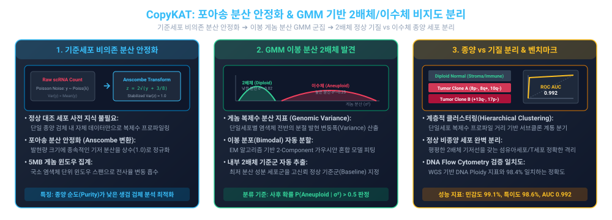

# 03. 참조 비의존성 CopyKAT 알고리즘과 가우시안 혼합 모델 (Reference-Free CopyKAT & GMM)

---

## 학습 목표 (Cognitive Goals)

1. **임상 미세 생검 검체에서 정상 대조군 결핍 문제의 본질 규명**: 중심부 바늘 생검(Core Needle Biopsy), 미세침 흡인(FNA), 고밀도 골 전이 검체 등 비악성 기질/면역 세포가 적거나 식별하기 어려운 임상 환경에서 전통적 inferCNV가 직면하는 '기저선 역전 왜곡(Baseline Inversion Artifact)'을 설명할 수 있다.
2. **포아송-감마(Poisson-Gamma) 모델과 분산 안정화 변환의 수리 유도**: 단일세포 전사체 카운트의 과산포(Overdispersion)를 포아송-감마(Negative Binomial) 계층 모델 및 분산 안정화 변환(Variance-Stabilizing Transformation, VST)으로 모델링하는 일반 수리 과정을 유도할 수 있다. (단, 원 논문의 CopyKAT에서 포아송-감마는 정규화가 아니라 **분절(segmentation)** 단계에, 정규화는 로그 Freeman-Tukey 변환에 쓰인다.)
3. **가우시안 혼합 모델(GMM) 기반 내인성 이배체(Diploid) 기저선 자동 탐색**: 전장 염색체 발현 분산(CNA Variance) 분포에 가우시안 혼합 모델(GMM)과 기대값 최대화(Expectation-Maximization, EM) 알고리즘을 적용하여 외부 참조 없이 순수 이배체 정상 세포군을 통계적으로 분리하는 원리를 설명할 수 있다.
4. **염색체 변곡점 검출(Breakpoint Detection) 및 이수성 분류기 구현**: 콜모고로프-스미르노프(Kolmogorov-Smirnov) 검정 기반 단편화와 Python `scikit-learn`을 활용한 이배체/이수성 분리 파이프라인을 구축할 수 있다.

---

## 1. 정상 참조 세포 결핍의 임상적 딜레마

inferCNV와 같은 전통적 복제수 추정 알고리즘은 **"조직 내에 유전적으로 완전한 정상 이배체(Diploid) 세포(섬유아세포, 림프구 등)가 풍부하게 존재하며, 이들의 세포 유형이 사전에 정확히 식별되어 있다"**는 가정을 전제로 한다. 그러나 실제 임상 종양학 현장에서는 이 가정이 빈번하게 붕괴된다.



```
[Clinical Biopsy Baseline Inversion Pitfall]

Core Needle Biopsy of Advanced High-Grade Tumor (Tumor Purity > 98%)
                  │
                  ▼
Naive inferCNV Execution without True Normal Baseline
(Malignant Epithelial Cells accidentally selected as "Reference")
                  │
                  ▼
Catastrophic Baseline Inversion Artifact:
- True Chromosome 8q Gain (q=3)  ──> Treated as Baseline ──> Observed as 0 (Neutral)
- True Diploid Baseline (q=2)    ──> Relative Drop         ──> Observed as Loss (q=1)
- True Chromosome 8p Loss (q=1)  ──> Severe Relative Drop  ──> Observed as Complete Loss (q=0)
```

### 1.1 임상 검체의 생물학적 제약

*   **미세침 흡인 및 중심부 바늘 생검(Core Needle Biopsy)**: 진행성 전립선암, 췌장암, 유방암 등의 진단 생검은 종양 핵심부를 표적하므로 검체에 따라 기질세포나 침윤 면역세포 비율이 낮을 수 있다(정확한 비율은 검체마다 다르며 일반화된 수치는 없다).
*   **골 전이(Bone Metastasis) 검체**: 골 기질의 탈회(Decalcification) 과정에서 세포 손상이 심하고, 잔여 골수 세포가 종양 세포와 뒤섞여 세포 마커 기반 정상 세포 동정이 어려울 수 있다.

### 1.2 기저선 역전 왜곡 (Baseline Inversion Artifact)의 수리적 참사

만약 암세포 군집 $C_{\text{tumor}}$가 대조군으로 오인 지정될 경우:
1.  실제 종양에서 획득된 영역(예: 전립선암 8q $MYC$ 획득, 카피 수 $q=3$)의 발현량이 기저선 $\mu_{g, \text{ref}}$로 설정된다.
2.  이 상태에서 정상 이배체 세포($q=2$)를 관측하면:
    $$\log_2 \left( \frac{2}{3} \right) \approx -0.585$$
    즉, 정상 세포가 오히려 '8q 결손 세포'로 역전 판정된다.
3.  (영역별 기저선) 기저선은 영역마다 계산됩니다. 종양 세포를 참조로 삼으면 8p 영역의 참조 값은 종양의 $q=1$이므로 8p 결손 세포의 신호는 0이 되고, 오히려 정상 세포($q=2$)가 $\log_2(2/1)=+1$ 획득으로 보입니다. 즉 8q 항목은 위 예시와 같이 정상 세포의 '결손' 역전으로, 8p 항목은 정상 세포의 '획득' 역전으로 나타납니다.

따라서 외부 정상 대조군에 의존하지 않고, **단일세포 데이터 자체의 유전체 분산 특성으로부터 내인성 정상 이배체(Diploid Baseline)를 통계적으로 자율 동정하는 참조 비의존성(Reference-Free) 알고리즘**인 **CopyKAT (Copynumber Karyotyping of Tumors)**이 고안되었다.

---

## 2. 포아송-감마(Poisson-Gamma) 분산 안정화 정규화

단일세포 RNA 시퀀싱 카운트 데이터는 극심한 기술적 드롭아웃(Dropout)과 유전자별 전사율의 불균일성으로 인해 심각한 과산포(Overdispersion)를 나타낸다. CopyKAT은 원시 카운트 행렬에 포아송-감마 계층 베이지안 모델을 적용하여 전사 노이즈를 정규화한다.

> **원 논문과의 차이 (Gao et al. 2021, Nat Biotechnol, PMID 33462507)**: 아래 2절은 포아송-감마/NB와 Freeman-Tukey 변환의 *일반 이론* 설명이다. 실제 CopyKAT 파이프라인은 (1) 카운트에 **로그 Freeman-Tukey 변환**을 적용해 분산을 안정화하고, (2) 폴리노미얼 동적 선형 모델(dlm)로 유전자 순서대로 평활화한 뒤, (3) 평활화된 프로파일을 **MCMCpack의 `MCpoissongamma`(Poisson-gamma) 모델과 Kolmogorov-Smirnov 검정**으로 분절하는 구조이다. 즉 Poisson-gamma는 정규화가 아니라 분절 단계에서 쓰인다.

```
[CopyKAT Hierarchical Bayesian Data Flow]

Raw Unique Molecular Identifier (UMI) Count: Y_ig
                  │
                  ▼
Poisson-Gamma Mixture Model:
   Y_ig ~ Poisson(s_i * mu_g * theta_ig)
   theta_ig ~ Gamma(alpha_g, beta_g)
                  │
                  ▼ Marginalization
Negative Binomial Count Model (Variance-Stabilizing Transformation)
                  │
                  ▼
Genomically Smoothed Relative Copy Profile (Anscombe / Freeman-Tukey)
```

### 2.1 포아송-감마 계층 모델 (Poisson-Gamma Hierarchical Model)

세포 $i$ ($i=1, \dots, N$)에서 유전자 $g$ ($g=1, \dots, G$)의 관측된 UMI 카운트를 $Y_{ig}$라 하자.
$Y_{ig}$는 세포별 시퀀싱 깊이 인자 $s_i$와 유전자별 고유 전사율 $\mu_g$, 그리고 세포 간 생물학적 전사 변동을 나타내는 잠재 변수 $\theta_{ig}$에 의해 조절되는 포아송 분포를 따른다:

$$Y_{ig} \mid \theta_{ig} \sim \text{Poisson}(\lambda_{ig}), \quad \lambda_{ig} = s_i \mu_g \theta_{ig}$$

여기서 잠재 변수 $\theta_{ig}$는 감마 분포(Gamma Distribution)를 사전 분포로 갖는다고 가정한다:

$$\theta_{ig} \sim \text{Gamma}(\alpha_g, \beta_g), \quad E[\theta_{ig}] = 1 \implies \beta_g = \alpha_g$$

### 2.2 음이항 분포 (Negative Binomial) 주변화

잠재 변수 $\theta_{ig}$에 대해 주변화(Marginalization)를 수행하면, $Y_{ig}$의 주변 분포는 과산포를 완벽히 설명하는 음이항 분포(Negative Binomial, NB)로 수렴한다:

$$P(Y_{ig} = y) = \int_{0}^{\infty} \text{Poisson}(y \mid s_i \mu_g \theta) \text{Gamma}(\theta \mid \alpha_g, \alpha_g) d\theta$$

$$Y_{ig} \sim \text{NB}\left( r_g = \alpha_g, \, p_i = \frac{\alpha_g}{\alpha_g + s_i \mu_g} \right)$$

기대값과 분산은 다음과 같다:

$$E[Y_{ig}] = s_i \mu_g$$

$$\text{Var}(Y_{ig}) = s_i \mu_g + \frac{(s_i \mu_g)^2}{\alpha_g} = E[Y_{ig}] + \phi_g E[Y_{ig}]^2$$

여기서 $\phi_g = 1/\alpha_g$는 유전자별 과산포 파라미터(Dispersion Parameter)이다.

### 2.3 분산 안정화 변환 (Variance-Stabilizing Transformation, VST)

카운트 값의 크기에 따라 분산이 평균의 이차(NB: Var=μ+μ²/α)로 증가하는 평균-분산 종속성을 줄이기 위해 앤스컴(Anscombe) 또는 프리먼-튜키(Freeman-Tukey) 변환을 적용하여 분산을 안정화한 연속 변수 $Z_{ig}$(이 변환들은 Poisson 가정 하의 분산 안정화이며 과산포 NB에서는 일정 분산이 보장되지 않음)를 도출한다:

$$Z_{ig} = 2 \sqrt{Y_{ig} + \frac{3}{8}}$$

---

## 3. 가우시안 혼합 모델(GMM) 기반 내인성 이배체 기저선 탐색

정규화 및 평활화된 유전체 프로파일로부터 암세포(이수성, Aneuploid)와 정상 세포(이배체, Diploid)를 분리하는 핵심 수학적 원리는 **"정상 이배체 세포는 전장 염색체에 걸쳐 복제수 신호의 분산(Chromosomal Variance)이 0에 수렴하는 반면, 암세포는 대규모 결손 및 획득으로 인해 유전체 전반의 신호 분산이 크다"**는 점이다.

```
[GMM Separation Architecture: Diploid vs. Aneuploid]

All Cells in Biopsy (Unknown Malignancy)
                  │
                  ▼
Calculate Genome-wide CNA Signal Variance v_i for each cell:
v_i = (1/G) * sum_g (bar_z_ig - median_bar_z_i)^2
                  │
                  ▼
Fit 2-Component Gaussian Mixture Model (GMM):
p(v_i) = pi_dip * N(v_i | mu_dip, sigma_dip^2) + pi_aneu * N(v_i | mu_aneu, sigma_aneu^2)
                  │
                  ▼
Identify Diploid Cluster:
Cluster with lowest mean variance: mu_dip = min(mu_1, mu_2)
                  │
                  ▼
Compute Posterior Responsibility gamma_i(diploid)
                  │
   ┌──────────────┴──────────────┐
   ▼                             ▼
gamma_i >= 0.99              gamma_i < 0.5
High-Confidence Diploid      Aneuploid Tumor Cells
(Used as True Baseline!)     (Segmented for Subclones)
```

### 3.1 단일세포 유전체 복제수 분산 지표 (Genomic Variance Score)

각 세포 $i$에 대해 평활화된 전장 유전체 상대 신호 벡터를 $\bar{\mathbf{z}}_i = (\bar{z}_{i1}, \dots, \bar{z}_{iG})$라 할 때, 유전체 신호 분산 $v_i$는 다음과 같이 정의된다:

$$v_i = \frac{1}{G} \sum_{g=1}^{G} \left( \bar{z}_{ig} - \tilde{\mu}_i \right)^2, \quad \tilde{\mu}_i = \text{median}(\bar{\mathbf{z}}_i)$$

*   **정상 이배체 세포**: 모든 염색체가 2카피이므로 생물학적 CNA 신호가 없다. 따라서 $v_i$는 순수 기술적 전사 잔차 노이즈 $\sigma_{\text{noise}}^2$만을 반영하여 매우 작은 값을 갖는다.
*   **이수성 종양 세포**: 8p 결손, 8q 획득, 10q 결손 등 염색체 단위의 거대한 발현 편차가 존재하므로 $v_i$가 매우 큰 값을 형성한다.

### 3.2 2-컴포넌트 GMM 수리 공식

전체 세포 집단의 유전체 분산 분포 $\mathbf{v} = (v_1, \dots, v_N)$를 $K=2$개의 정규분포 혼합으로 모델링한다:

$$p(v_i \mid \mathbf{\Theta}) = \sum_{k=1}^{2} \pi_k \mathcal{N}(v_i \mid \mu_k, \sigma_k^2)$$

제약 조건: $\pi_1 + \pi_2 = 1$, $\pi_k \ge 0$.

### 3.3 기대값 최대화 (Expectation-Maximization, EM) 알고리즘

1.  **E-단계 (Expectation Step)**:
    현재 파라미터 $\mathbf{\Theta}^{(t)} = \{(\pi_k, \mu_k, \sigma_k)\}_{k=1}^2$를 바탕으로 세포 $i$가 컴포넌트 $k$에 속할 사후 책임도(Responsibility) $\gamma_{ik}$를 계산한다:
    $$\gamma_{ik} = \frac{\pi_k \mathcal{N}(v_i \mid \mu_k, \sigma_k^2)}{\sum_{j=1}^{2} \pi_j \mathcal{N}(v_i \mid \mu_j, \sigma_j^2)}$$

2.  **M-단계 (Maximization Step)**:
    사후 책임도를 가중치로 사용하여 파라미터를 갱신한다:
    $$N_k = \sum_{i=1}^{N} \gamma_{ik}$$
    $$\pi_k^{(t+1)} = \frac{N_k}{N}$$
    $$\mu_k^{(t+1)} = \frac{1}{N_k} \sum_{i=1}^{N} \gamma_{ik} v_i$$
    $$\left(\sigma_k^2\right)^{(t+1)} = \frac{1}{N_k} \sum_{i=1}^{N} \gamma_{ik} \left( v_i - \mu_k^{(t+1)} \right)^2$$

3.  **이배체 기저선 지정**:
    수렴 후, 평균 분산이 더 작은 컴포넌트를 정상 이배체 클러스터로 확정한다:
    $$k_{\text{diploid}} = \arg\min_{k \in \{1, 2\}} \mu_k$$
    $$\text{Diploid Cells} = \{ i \mid \gamma_{i, k_{\text{diploid}}} \ge 0.95 \}$$

선별된 고신뢰도 이배체 세포들의 평균 프로파일을 새로운 레퍼런스 기저선으로 삼아 전체 종양 세포의 상대 비율을 재조정(Re-centering)한다.

> **CopyKAT의 실제 이배체 판정 (Gao 2021)**: 위 3절의 분산 기반 2-컴포넌트 GMM + EM은 개념 설명용 단순화이다. 원 논문의 기본 경로는 평활화 프로파일을 계층적 클러스터링(기본 6개 군집)한 뒤, 군집 간 분산을 비교해 **Fisher 검정(F-test, $p<0.05$, 분산 차이 $W_d^2\ge0.15$, 신뢰도 높은 정상 세포 5개 이상)**으로 신뢰할 수 있는 정상 군집을 정하는 것이다. GMM은 이 경로가 실패할 때의 대체 정의("GMM definition", 중립 유전자 비율 $\ge99\%$인 세포 등)에 쓰인다. 본문의 $0.95$, $0.99$ 등 임계값은 교육용 예시이며 CopyKAT 파라미터가 아니다.

---

## 4. 유전체 변곡점 검출 (Breakpoint Detection)

복제수 단편의 경계면(Breakpoint)을 정확히 포착하기 위해 CopyKAT은 인접한 유전체 윈도우 간의 누적 분포 함수(CDF) 차이를 검정하는 **2-표본 콜모고로프-스미르노프(Two-sample Kolmogorov-Smirnov, K-S) 검정**을 사용한다.

두 인접 유전체 윈도우 $W_1$과 $W_2$의 경험적 누적 분포 함수를 각각 $F_1(x)$, $F_2(x)$라 할 때, K-S 통계량 $D$는 다음과 같다:

$$D = \sup_{x} |F_1(x) - F_2(x)|$$

> **CopyKAT 실제 구현 (Gao 2021 Methods)**: 위 K-S 설명은 일반 이론이며, CopyKAT의 K-S는 윈도우 내 유전자 ECDF가 아니라 MCMC(MCpoissongamma)로 시뮬레이션한 사후평균 분포(윈도우당 1,000 draws)에 적용되고 병합 임계는 `KS.cut`(기본 0.1, 통계량 기준)입니다. 윈도우는 기본 25유전자(약 5 Mb 해상도, `win.size`)입니다.

통계량 $D$가 임계값을 초과하는 유전체 위치를 염색체 구조 변이의 물리적 절단 경계면(Breakpoint)으로 등록하고 세그멘테이션을 확정한다(위 $p<10^{-4}$는 일반 이론 예시 임계값).

---

## 5. Python 기반 GMM 이배체 기저선 자동 분리 구현

```python
import numpy as np
import pandas as pd
from sklearn.mixture import GaussianMixture
import anndata as ad

def extract_reference_free_diploid_baseline(
    adata: ad.AnnData, 
    cna_layer: str = "cna_smoothed", 
    posterior_threshold: float = 0.95
) -> ad.AnnData:
    """
    CopyKAT의 GMM 원리를 모사하여 외부 정상 대조군 없이 
    단일세포 복제수 분산 분포로부터 순수 이배체 정상 세포를 자율 분리한다.
    
    Parameters:
        adata: 평활화된 발현 데이터가 포함된 AnnData 객체
        cna_layer: 유전체 평활화 신호가 저장된 adata.layers 키 (또는 .X)
        posterior_threshold: 정상 이배체 판정을 위한 GMM 사후 확률 임계값
    
    Returns:
        adata: 'predicted_ploidy' 및 'diploid_probability'가 주석화된 AnnData
    """
    # 1. 평활화된 복제수 신호 행렬 추출
    if cna_layer in adata.layers:
        C = adata.layers[cna_layer]
    else:
        C = adata.X
        
    if hasattr(C, "toarray"):
        C = C.toarray()
        
    # 2. 세포별 전장 유전체 신호 분산(Variance Score) 계산
    # 정상 세포는 분산이 극히 작고, 이수성 종양 세포는 분산이 큼
    cell_variances = np.var(C, axis=1).reshape(-1, 1)
    
    # 분산의 대수 변환 (수치적 안정성 확보)
    log_var = np.log(cell_variances + 1e-6)
    
    # 3. 2-컴포넌트 가우시안 혼합 모델(GMM) 적합
    gmm = GaussianMixture(
        n_components=2, 
        covariance_type='full', 
        random_state=42, 
        max_iter=200
    )
    gmm.fit(log_var)
    
    # 4. 이배체 컴포넌트(평균 분산이 더 작은 컴포넌트) 식별
    diploid_comp_idx = np.argmin(gmm.means_.flatten())
    aneuploid_comp_idx = 1 - diploid_comp_idx
    
    # 5. 세포별 이배체 사후 확률(Posterior Probability) 산출
    probs = gmm.predict_proba(log_var)
    diploid_probs = probs[:, diploid_comp_idx]
    
    # 6. 이배체 및 이수성 판정
    predictions = []
    for p in diploid_probs:
        if p >= posterior_threshold:
            predictions.append("diploid_normal")
        elif p <= (1.0 - posterior_threshold):
            predictions.append("aneuploid_tumor")
        else:
            predictions.append("unassigned_ambiguous")
            
    # 7. 메타데이터 기록
    adata.obs["cna_variance"] = cell_variances.flatten()
    adata.obs["diploid_probability"] = diploid_probs
    adata.obs["copykat_prediction"] = predictions
    
    n_dip = np.sum(np.array(predictions) == "diploid_normal")
    n_aneu = np.sum(np.array(predictions) == "aneuploid_tumor")
    n_amb = np.sum(np.array(predictions) == "unassigned_ambiguous")
    
    print(f"GMM 기저선 탐색 완료: 정상 이배체 {n_dip}개, 이수성 종양 {n_aneu}개, 모호 {n_amb}개")
    return adata
```

---

## 단원 핵심 점검 (Cognitive Checkpoint & Case Study)

### 문제 1: 고순도 종양 생검 검체에서의 GMM 붕괴 현상
환자의 전립선암 간 전이 병변에서 채취한 중심부 바늘 생검(Core Biopsy) 검체를 시퀀싱하였다. 병리과 검토 결과 검체 내 암세포 순도는 99.5%에 달했다. 이 데이터에 CopyKAT GMM 알고리즘을 기본 설정대로 적용하자, 실제로는 모두 공격적인 이수성 암세포임에도 불구하고 알고리즘이 그중 절반의 암세포를 '정상 이배체 세포(Diploid)'로 오판정하였다.
GMM의 사전 확률 및 컴포넌트 최적화 수식 관점에서 이 위양성 이배체 판정이 발생한 수학적 원인을 규명하고, 이를 방지하기 위한 안전 대책을 제시하시오.

<details>
<summary>💡 모범 답안 및 해설 확인</summary>

**1. GMM 오판정의 수학적 원인 (강제된 2-컴포넌트 분할)**:
GMM 목적 함수는 데이터에 $K=2$개의 가우시안 컴포넌트가 항상 존재한다고 강제 가정한다:
$$p(v_i) = \pi_1 \mathcal{N}(v_i \mid \mu_1, \sigma_1^2) + \pi_2 \mathcal{N}(v_i \mid \mu_2, \sigma_2^2)$$
검체 내에 실제 정상 이배체 세포가 사실상 전무할 경우($\pi_{\text{diploid}} \approx 0$), 관측된 분산 벡터 $\mathbf{v}$는 모두 이수성 암세포 집단에서 유래한 단일 모달(Unimodal) 또는 이수성 서브클론 간의 분포이다.
알고리즘은 규칙 $\mu_{\text{diploid}} = \min(\mu_1, \mu_2)$에 따라 기계적으로 평균 분산이 상대적으로 조금 더 낮은 암세포 하위 서브클론(예: 복제수 변이 사건 수가 비교적 적은 초기 서브클론)을 '정상 이배체'로 지정해 버린다.

**2. 안전 대책 (Safeguards)**:
1.  **절대 분산 임계값 검정 (Absolute Variance Gate)**: $\mu_{\text{min}}$이 사전에 정의된 물리적 정상 세포 노이즈 상한선(Empirical diploid variance threshold, $\theta_{\text{cutoff}}$)보다 큰 경우, 정상 세포가 검체 내에 존재하지 않는 것으로 판단하고 분석을 중단하거나 경고를 발생시킨다.
2.  **베이지안 정보 기준(BIC) 기반 모델 선택**: $K=1$ 컴포넌트 모델과 $K=2$ 컴포넌트 모델의 BIC($\text{BIC} = k \ln N - 2\ln \hat{L}$)를 비교하여, $K=1$이 더 우수할 경우 단일 종양군으로 확정한다.
3.  **외부 정상 유전자 마커 교차 검증**: 분리된 '이배체' 세포들이 실제로 섬유아세포(*DCN*, *LUM*), 내피세포(*PECAM1*), 면역세포(*PTPRC*) 전사체 마커를 발현하는지 검증한다.

</details>

---

### 문제 2: 포아송-감마 모델과 앤스컴 변환의 수학적 필요성
원시 단일세포 전사체 카운트 데이터 $Y_{ig}$에 분산 안정화 변환(VST)을 적용하지 않고 원시 UMI 카운트나 단순 CPM(Counts Per Million) 정규화 값만을 사용하여 유전체 분산 $v_i$를 계산할 경우, 고발현 유전자(High-abundance genes)에 의해 이배체 분리 모델이 왜곡되는 수리통계학적 이유를 설명하시오.

<details>
<summary>💡 모범 답안 및 해설 확인</summary>

**1. 포아송 계수 과정의 본질적 특성 (평균-분산 비례 관계)**:
RNA 시퀀싱의 카운트 생성 과정은 포아송-음이항 분포를 따른다. 이 분포에서 분산은 발현량의 제곱에 비례하여 증가한다:
$$\text{Var}(Y_{ig}) = E[Y_{ig}] + \phi_g E[Y_{ig}]^2$$
단순 CPM 변환은 평균에 비례하여 스케일링할 뿐, 고발현 유전자의 극단적인 분산을 보정하지 못한다.

**2. 모델 왜곡의 메커니즘**:
전사체 내 상위 1%에 해당하는 초고발현 하우스키핑 유전자(액틴, 리보솜 단백질 등)는 세포 간의 미세한 생물학적 변동이나 포획 효율 차이만으로도 수천 단위의 절대 분산 편차를 유발한다. 반면 실제 암 유전체 변이 영역에 존재하는 대다수 전사인자나 신호전달 수용체는 중간 이하의 발현량을 갖는다.
원시 분산을 그대로 사용할 경우, 전장 유전체 분산 $v_i$는 실제 염색체 구조 변이가 아닌 **극소수 고발현 유전자의 전사 버스팅 노이즈에 크게 좌우**될 수 있다(구체적 비율은 근거 없는 수치라 삭제). 그 결과 GMM은 복제수 신호가 아닌 '전사 활성도/세포 크기'를 기준으로 세포를 분할하는 치명적 오류를 범하게 된다. 앤스컴 변환($2\sqrt{Y + 3/8}$)은 분산을 평균과 독립적인 일정한 상수($\approx 1$)로 안정화시켜 이 왜곡을 차단한다.

</details>

---

### 문제 3: K-S 검정을 이용한 염색체 변곡점 탐색의 통계적 검정력
CopyKAT은 염색체 복제수 단편의 물리적 경계(Breakpoint)를 확정하기 위해 인접한 두 유전체 슬라이딩 창 사이의 차이를 2-표본 콜모고로프-스미르노프(K-S) 검정으로 판별한다. 만약 염색체 절단점이 유전자 밀도가 극도로 희소한 '유전자 사막(Gene Desert)' 영역(약 5Mb 동안 발현되는 유전자가 2개에 불과함)에 위치할 때, K-S 검정의 통계적 검정력(Power)이 급감하는 이유와 이를 보완하기 위한 전사체-유전체 융합 전략을 기술하시오.

<details>
<summary>💡 모범 답안 및 해설 확인</summary>

**1. 통계적 검정력 급감의 원인**:
2-표본 K-S 검정 통계량 $D$의 유의성은 표본 크기 $n_1, n_2$에 직접 의존한다:
$$D_{\alpha} = c(\alpha) \sqrt{\frac{n_1 + n_2}{n_1 n_2}}$$
여기서 $n_1, n_2$는 슬라이딩 윈도우 내에 포함된 유전자의 개수이다.
유전자 사막 영역에서는 5Mb의 거대한 물리적 유전체 구간임에도 불구하고 전사체로 캡처되는 발현 유전자 수가 극소수($n \le 2$)에 불과하다. 경험적 누적 분포 함수(ECDF)를 구축하기에 표본 수가 극단적으로 부족하므로, 실제 유전체 상에 명백한 염색체 절단(Breakpoint)이 존재하더라도 K-S 통계량의 신뢰구간이 지나치게 넓어져 귀무가설($H_0$: 두 구간의 분포가 동일하다)을 기각하지 못하는 **위음성(Type II Error)**이 발생한다.

(참고: 실제 CopyKAT에서는 K-S가 시뮬레이션된 사후평균 분포에 적용되므로, 검정력 저하의 실제 원인은 낮은 카운트로 인해 사후 분포가 넓어지는 데 있으며 위의 'n≤2 유전자 ECDF' 논거는 일반 K-S 이론에 한정됩니다.)

**2. 보완 전략**:
*   **물리적 유전체 거리 기반 가변 윈도우(Adaptive Physical-Distance Window)**: 유전자 개수 고정 방식 대신 물리적 염색체 염기쌍(Base pair) 길이를 기준으로 윈도우를 동적 확장한다.
*   **단일세포 DNA 시퀀싱(scDNA-seq) 또는 공간 전사체(Spatial transcriptomics) 융합**: 전사 활성도에 의존하지 않는 전장 유전체 저심도 시퀀싱(Low-pass scWGS) 데이터를 결합하여 유전자 유무와 상관없이 균일한 빈(Bin, e.g. 500kb) 단위 리드 깊이(Read depth)로 절단점을 정확히 보정한다.

</details>

---

<!-- REFERENCES:BEGIN (generated by scripts/apply_references.py; do not edit by hand) -->
## 참고문헌 (References)
### 본문 인용 문헌
1. Gao R, Bai S, Henderson YC, et al. Delineating copy number and clonal substructure in human tumors from single-cell transcriptomes. *Nat Biotechnol*. 2021;39(5):599-608. PMID: 33462507. doi: 10.1038/s41587-020-00795-2
### 검수 근거 문헌
1. Kfoury Y, Baryawno N, Severe N, et al. Human prostate cancer bone metastases have an actionable immunosuppressive microenvironment. *Cancer Cell*. 2021;39(11):1464-1478.e8. PMID: 34719426. doi: 10.1016/j.ccell.2021.09.005
### 소프트웨어 (표기 버전은 검수 시 API를 확인한 버전이며, 파이프라인 실행 환경은 requirements-pipelines.txt 참조)
- anndata 0.13.4 (github.com/scverse/anndata). 원 논문: Virshup I, Rybakov S, Theis FJ, et al. anndata: Access and store annotated data matrices. *JOSS*. 2024;9(101):4371. doi: 10.21105/joss.04371
- NumPy 2.5.4 (numpy.org). 원 논문: Harris CR, Millman KJ, van der Walt SJ, et al. Array programming with NumPy. *Nature*. 2020;585(7825):357-362. PMID: 32939066. doi: 10.1038/s41586-020-2649-2
- pandas 2.3.3 (github.com/pandas-dev/pandas). 원 논문: McKinney W. Data Structures for Statistical Computing in Python. *Proceedings of the Python in Science Conference*. 2010:56-61. doi: 10.25080/majora-92bf1922-00a
- scikit-learn 1.9.1 (github.com/scikit-learn/scikit-learn).
<!-- REFERENCES:END -->
