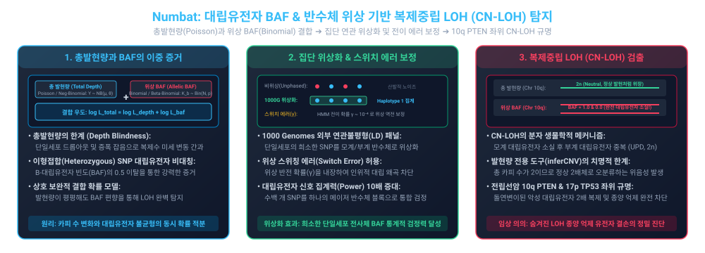

# 04. 대립유전자 불균형, BAF, 그리고 Numbat 알고리즘 (Allelic Imbalance, BAF & Numbat)

---

## 학습 목표 (Cognitive Goals)

1. **복제수 중립 이형접합성 상실(Copy-Neutral LOH)과 발현 평활화의 한계 규명**: 총 복제수($q=2$)가 보존되어 inferCNV나 CopyKAT 등 순수 발현량 평활화 도구로는 검출이 불가능한 복제수 중립 이형접합성 상실(CN-LOH / Uniparental Disomy)의 발암 유전학적 메커니즘을 설명할 수 있다.
2. **단일세포 B-대립유전자 빈도(B-Allele Frequency, BAF)의 이항 혼합 모델링**: 이형접합 생식세포 단일염기다형성(Heterozygous Germline SNPs) 좌위에서 관측되는 대립유전자 리드 카운트를 이항 분포($\text{Binomial}$) 및 베타-이항 분포($\text{Beta-Binomial}$)로 정식화할 수 있다.
3. **1000 Genomes 집단 유전체 패널을 이용한 하플로타입 위상 정렬(Haplotype Phasing)**: 단일세포 전사체의 극심한 희소성(Sparsity)과 대립유전자 드롭아웃을 극복하기 위해 SHAPEIT4/Eagle2 기반 집단 연관 불균형(Linkage Disequilibrium, LD)을 활용하여 모계/부계 하플로타입 블록을 위상 정렬하는 수리적 원리를 도출할 수 있다.
4. **결합 베이지안 HMM(Joint Bayesian HMM)과 Numbat 파이프라인 구현**: 발현 깊이(Expression Depth; Numbat은 Poisson-lognormal)와 위상 정렬된 BAF(Phased BAF; beta-binomial)를 결합한 통합 우도 함수를 설계하고, Python 및 CLI 기반 Numbat 분석 파이프라인을 구축할 수 있다.

---

## 1. 순수 발현 평활화의 사각지대: 복제수 중립 LOH (Copy-Neutral LOH)

inferCNV와 CopyKAT은 전사체 발현 깊이(Expression Depth / Gene Dosage)의 증감에 전적으로 의존한다. 그러나 암 유전체에는 **총 복제수는 정상 2카피($q=2$)를 유지하지만, 유전적으로 심각한 악성 변화가 일어난 상태**가 광범위하게 존재한다. 이를 **복제수 중립 이형접합성 상실(Copy-Neutral Loss of Heterozygosity, CN-LOH)** 또는 **체세포 편친 이체증(Somatic Uniparental Disomy, aUPD)**이라 한다.



```
[Mechanism of Copy-Neutral LOH (Knudson's Two-Hit Model)]

1. Normal Germline Heterozygote (Diploid 1:1)
   Maternal Chromosome: [ wild-type TP53 (+) ] ─── Total Copies: 2
   Paternal Chromosome: [ wild-type TP53 (+) ] ─── Total Expression: 1.0 (Neutral)

2. First Hit: Somatic Point Mutation
   Maternal Chromosome: [ mutated TP53 (*)   ] ─── Total Copies: 2
   Paternal Chromosome: [ wild-type TP53 (+) ] ─── Total Expression: 1.0 (Neutral)

3. Second Hit: Mitotic Homologous Recombination (CN-LOH: 2:0)
   Maternal Chromosome: [ mutated TP53 (*)   ] ─── Total Copies: 2 (Unchanged!)
   Duplicated Maternal: [ mutated TP53 (*)   ] ─── Total Expression: 1.0 (inferCNV BLIND!)
   Paternal Chromosome: [     LOST           ] ─── Allelic Ratio: 100% Mutant!
```

### 1.1 크누드슨의 2-히트 가설(Two-Hit Hypothesis)과 체세포 재조합

정상 이배체 세포는 모계와 부계로부터 각각 1카피씩의 염색체를 물려받는다 ($A/B$, 대립유전자 비율 $1:1$).
암 억제 유전자(Tumor Suppressor Genes, TSGs: *TP53* 17p, *PTEN* 10q, *RB1* 13q, *VHL* 3p, *APC* 5q 등)가 완전히 불활성화되기 위해서는 양측 대립유전자가 모두 무력화되어야 한다:
1.  **제1 타격 (First Hit)**: 한쪽 대립유전자(예: 모계)에 기능 상실 점돌연변이(Missense/Nonsense)가 발생한다.
2.  **제2 타격 (Second Hit via Mitotic Recombination)**: 유사분열 중 비정상적인 상동 재조합(Homologous Recombination)이나 염색체 비분리 후 중복(Nondisjunction followed by duplication)이 발생하여, 돌연변이를 가진 모계 염색체 팔이 복제되고 정상 야생형(Wild-type) 부계 염색체가 완전히 소실된다.

### 1.2 발현량 기반 알고리즘의 치명적 위음성

CN-LOH 상태에서 해당 염색체 영역의 물리적 복제수는 정확히 2카피($q=2$)이다. 따라서:
$$\log_2 \left( \frac{q_{\text{tumor}}}{q_{\text{normal}}} \right) = \log_2 \left( \frac{2}{2} \right) = 0.0$$
*   **inferCNV / CopyKAT의 한계**: 총 발현량이 정상 세포와 완전히 동일하므로, 알고리즘은 이 영역을 '정상 중립(Neutral)'으로 판정한다.
*   **실제 임상적 위험**: 암 억제 유전자의 야생형 대립유전자가 완전히 사라지고 돌연변이 단백질만 2배로 발현되어 가장 공격적인 암 클론으로 진화했음에도 불구하고, 유전체 분석에서 완전히 누락되는 **치명적 위음성(False Negative)**을 초래한다.

이 블라인드 스팟을 해결하기 위해서는 발현량이 아닌 **대립유전자 특이적 발현 비율(Allelic Imbalance / BAF)**을 동시에 추적해야 한다.

---

## 2. 단일세포 B-대립유전자 빈도 (BAF) 수리 모델

인간 유전체 전반에 이형접합 단일염기다형성(Heterozygous Germline SNPs)이 대략 수 kb(약 1~1.5 kb)당 1개 수준으로 존재한다(개인별 차이가 크며, 단일세포 RNA에서는 전사된 엑손/인트론 내 SNP만 관측된다).

```
[Single-Cell SNP Allele Counting]

Sequencing Reads covering SNP locus k:
Read 1: ... A C G [T] A C G ... (Alternative / B-allele)
Read 2: ... A C G [T] A C G ... (Alternative / B-allele)
Read 3: ... A C G [C] A C G ... (Reference / A-allele)

Total Reads N_k = 3, B-allele Reads Y_k = 2 ──> Raw BAF = 2/3 ≈ 0.67
```

### 2.1 단일 SNP 좌위의 이항 분포 모델

이형접합 SNP 좌위 $k$ ($k=1, \dots, K$)에서 매핑된 총 UMI 리드 수를 $N_k$, 그중 변이 대립유전자(Alternative or B-allele)를 지지하는 리드 수를 $Y_k$라 하자.
단일세포에서 리드 샘플링은 이항 분포(Binomial Distribution)를 따른다:

$$Y_k \sim \text{Binomial}(N_k, p_k)$$

$$P(Y_k = y \mid N_k, p_k) = \binom{N_k}{y} p_k^y (1 - p_k)^{N_k - y}$$

여기서 $p_k$는 세포 내 실제 유전체 카피 구성에 따른 B-대립유전자 이론적 비율(True BAF)이다:
*   **정상 이배체 ($A/B$, 1:1)**: $p_k = 0.5$
*   **단일 결손 Loss ($A/-$ 또는 $-/B$, 1:0 또는 0:1)**: $p_k \in \{0.0, 1.0\}$
*   **단일 획득 Gain ($A/A/B$ 또는 $A/B/B$, 2:1 또는 1:2)**: $p_k \in \{0.333, 0.667\}$
*   **복제수 중립 LOH ($A/A$ 또는 $B/B$, 2:0 또는 0:2)**: $p_k \in \{0.0, 1.0\}$

### 2.2 단일세포 RNA 시퀀싱에서의 기술적 극복 과제

단일세포 RNA 시퀀싱에서 개별 SNP를 직접 분석하는 것은 다음과 같은 이유로 극히 어렵다:
1.  **극심한 카운트 희소성 (Extreme Sparsity)**: 개별 세포의 특정 단일 SNP 좌위에 매핑되는 리드 수 $N_k$는 대부분 0, 1, 혹은 2에 불과하다. $N_k=1$일 때 관측 BAF는 0 또는 1로만 양극화되어 통계적 추론이 불가능하다.
2.  **대립유전자 드롭아웃 (Allelic Dropout)**: 전사 버스팅으로 인해 특정 순간에 한쪽 대립유전자만 전사될 수 있다.
3.  **위상 모호성 (Phase Ambiguity)**: 유전체 상에서 인접한 두 SNP 좌위 $k$와 $k+1$이 있을 때, 어떤 대립유전자가 동일한 염색체(Maternal vs. Paternal) 상에 연결되어 있는지 알지 못하면 신호를 집계(Aggregate)할 수 없다.

---

## 3. 1000 Genomes 참조 패널과 하플로타입 위상 정렬 (Haplotype Phasing)

개별 SNP의 극심한 노이즈를 극복하는 통계유전학적 해법은 **집단 유전체 연관 불균형(Linkage Disequilibrium, LD)을 활용하여 수백 개의 연속된 SNP를 단일 하플로타입(Haplotype Block)으로 묶는 위상 정렬(Phasing)**이다.

```
[Haplotype Phasing Amplifies Allelic Imbalance Signal]

Unphased Individual SNPs (Mirrored Random Noise):
SNP 1 (A/B): BAF = 0.8  (B is major)
SNP 2 (A/B): BAF = 0.2  (A is major) ──> Mean BAF across loci ≈ 0.5 (Signal Cancels Out!)
SNP 3 (A/B): BAF = 0.9  (B is major)

            │
            ▼ (Phase with 1000 Genomes Reference Panel: Eagle2, pileup_and_phase.R 내부 사용)
            ▼ Order along Maternal (H1) vs. Paternal (H2) Backbone

Phased Haplotype Blocks (Coherent Phase):
Haplotype 1 (Maternal): [ Allele B ] ─── [ Allele A ] ─── [ Allele B ]
Haplotype 2 (Paternal): [ Allele A ] ─── [ Allele B ] ─── [ Allele A ]

Pooled Haplotype 1 Count: Y_H1 = 250
Total Allelic Reads:      N_total = 300
Phased BAF = 250 / 300 = 0.833  ───> Statistically Definitive LOH! (p < 10^-15)
```

### 3.1 은닉 마르코프 모델 기반 통계적 위상 정렬 (Eagle2)

인구 집단 참조 패널(1000 Genomes Project, Haplotype Reference Consortium 등)의 수천 명의 완성된 하플로타입 시퀀스 풀을 $\mathcal{H} = \{h_1, \dots, h_M\}$이라 하자.
환자의 유전자형(Genotype) $G = (g_1, \dots, g_K)$가 주어졌을 때, 환자의 두 하플로타입 $H = (h^{(1)}, h^{(2)})$의 결합 조건부 사후 확률을 Li & Stephens 가도 모델(Hidden Markov Genealogy Model)로 계산한다:

$$P(H \mid G, \mathcal{H}) \propto \prod_{k=1}^{K} P(g_k \mid h_k^{(1)}, h_k^{(2)}) \cdot P(h_k^{(1)}, h_k^{(2)} \mid h_{k-1}^{(1)}, h_{k-1}^{(2)}, \mathcal{H})$$

전이 확률은 유전적 재조합 거리(Genetic Map Distance, cM)에 기반하여 연관 불균형이 강한 대립유전자 조합을 단일 위상 블록($H_1$ 대 $H_2$)으로 완벽히 재구성한다.

### 3.2 위상 정렬된 BAF의 신호 증폭

위상 정렬이 완료되면, 염색체 단편 내의 모든 이형접합 SNP 리드를 '모계 하플로타입($H_1$)' 지지 리드 $Y_{\text{phased}}$와 '부계 하플로타입($H_2$)' 지지 리드로 통합(Pooling)할 수 있다:

$$Y_{\text{phased}} = \sum_{k \in \text{Region}} Y_{k, H_1}, \quad N_{\text{total}} = \sum_{k \in \text{Region}} N_k$$

개별 SNP 단위에서는 리드 수가 1~2개에 불과했으나, 100개 SNP가 포함된 영역을 통합하면 $N_{\text{total}} \ge 100 \sim 500$에 도달하여 통계적 검정력이 극대화된다.

---

## 4. 결합 베이지안 HMM: 발현 깊이 + 위상 BAF (Numbat)

Harvard Medical School Kharchenko 랩(Gao 등)에서 개발한 **Numbat**은 단일세포 RNA 시퀀싱에서 **발현 깊이(Expression Depth, $D$)**와 **위상 BAF(Phased BAF, $B$)**를 동시에 모델링하는 결합 베이지안 은닉 마르코프 모델(Joint Bayesian HMM)을 구축하였다.

```
[Numbat Joint Likelihood Architecture]

Hidden Genomic State: S_t = (c_t, m_t)
   c_t in {0, 1, 2, 3, 4, ...} (Total Copy Number)
   m_t in {0, 1, 2, ...}       (Minor / Major Allelic Copy)
                 │
   ┌─────────────┴─────────────┐
   ▼                           ▼
Expression Depth Emission   Phased BAF Emission
P(D_t | c_t)                P(B_t | c_t, m_t, theta_t)
[Poisson-lognormal in Numbat] [Beta-Binomial]
   │                           │
   └─────────────┬─────────────┘
                 ▼ Joint Product
   P(Data_t | S_t) = P(D_t | c_t) * P(B_t | c_t, m_t, theta_t)
                 │
                 ▼
   Viterbi / Posterior Decoding ──> Complete Haplotype-resolved Karyotype
```

> **Numbat 실제 구현과의 차이 (Gao et al. 2023, 공식 코드/문서 기준)**: 아래 4절의 $(c, m)$ 상태표, NB 방출식, 베타-이항 혼합은 개념 이해를 위한 *일반화된 교육용 모형*이다. 실제 Numbat HMM은 **6개 상태(`neu`, `loh`, `del`, `amp`, `bamp`, `bdel`)**를 쓰며, 발현 깊이는 NB가 아니라 **Poisson-lognormal**(`dpoilog`), 대립유전자 계수는 **beta-binomial**(`dbbinom`, 과산포 `gamma=20`)로 모델링한다. 개별 CNV 호출은 HMM 디코딩 뒤 `min_LLR=5` 기준의 로그우도비(LLR) 검정으로 걸러지고, 이웃 연결(NJ)+NNI로 클론 트리를 만든 뒤 반복 정제한다. 입력은 `run_numbat(count_mat, lambdas_ref, df_allele, ...)`이며, 위상 BAF는 `pileup_and_phase.R`(cellsnp-lite 픽업 + Eagle2 위상 보정)로 만든다.

### 4.1 대립유전자 특이적 유전체 상태 공간 (Allelic State Space)

각 유전체 단편 $t$에서의 상태는 총 카피 수 $c_t$와 대립유전자 조합 $(c_{t, \text{maj}}, c_{t, \text{min}})$으로 정의된다:

| 상태 ID | 상태 기호 | 총 카피 수 ($c$) | 대립유전자 비율 | 이론적 발현 배율 | 이론적 위상 BAF ($p$) | 생물학적 분류 |
| :--- | :---: | :---: | :---: | :---: | :---: | :--- |
| **$S_{\text{neu}}$** | $(1, 1)$ | 2 | $1:1$ | $1.0$ | $0.5$ | 정상 중립 이배체 |
| **$S_{\text{del}}$** | $(1, 0)$ | 1 | $1:0$ | $0.5$ | $1.0$ 또는 $0.0$ | 단일 결손 (Hemizygous Loss) |
| **$S_{\text{cnloh}}$**| $(2, 0)$ | 2 | $2:0$ | **$1.0$ (동일!)** | **$1.0$ 또는 $0.0$** | **복제수 중립 LOH (CN-LOH)** |
| **$S_{\text{gain1}}$**| $(2, 1)$ | 3 | $2:1$ | $1.5$ | $0.667$ 또는 $0.333$| 단일 획득 (Gain) |
| **$S_{\text{gain2}}$**| $(3, 1)$ | 4 | $3:1$ | $2.0$ | $0.750$ 또는 $0.250$| 이중 획득 (Double Gain) |
| **$S_{\text{amp}}$** | $(n, 0)$ | $n$ | $n:0$ | $n/2$ | $1.0$ 또는 $0.0$ | LOH 동반 고도 증폭 |

### 4.2 결합 방출 확률 밀도 함수 (Joint Emission Probability)

단편 $t$에서 관측된 총 발현량 $D_t$와 위상 BAF 리드 카운트 $Y_t, N_t$가 주어졌을 때:

$$P(\text{Data}_t \mid S_t) = P(D_t \mid c_t) \times P(Y_t \mid N_t, S_t, \phi_t)$$

1.  **발현 깊이 방출 확률 (교육용 Negative Binomial 근사; 실제 Numbat은 Poisson-lognormal)**:
    $$P(D_t \mid c_t) = \text{NB}\left( D_t \mid \mu = s_i \cdot \frac{c_t}{2} \cdot \mu_{\text{ref}, t}, \, r_t \right)$$
2.  **위상 BAF 방출 확률 (베타-이항 모델)**:
    기술적 전사 편향(과산포)을 흡수하기 위해 베타-이항 분포(Beta-Binomial)를 적용한다(위상 반전 오차율 $\epsilon_{\text{switch}}$는 Numbat에서 HMM의 하플로타입 전이 확률 $\theta$로 명시적으로 모형화되며 베타-이항의 주된 역할이 아님):
    $$P(Y_t \mid N_t, S_t) = \int_{0}^{1} \text{Binomial}(Y_t \mid N_t, p) \text{Beta}(p \mid \alpha(S_t), \beta(S_t)) dp$$

### 4.3 CN-LOH 판별의 수리적 결론

$(1, 1)$ 정상 상태와 $(2, 0)$ CN-LOH 상태를 비교할 때:
*   발현 우도비:
    $$\frac{P(D_t \mid c=2)}{P(D_t \mid c=2)} = 1.0 \quad (\text{구별 불가능})$$
*   위상 BAF 우도비:
    $$\frac{P(Y_t \mid N_t, p=1.0)}{P(Y_t \mid N_t, p=0.5)} = \frac{\binom{N_t}{N_t} 1.0^{N_t}}{\binom{N_t}{N_t} (0.5)^{N_t}} = 2^{N_t} \gg 1$$
$N_t = 30$개의 리드만 확보되어도 BAF 우도는 정상 이배체 대비 $2^{30} \approx 10^9$배 급증하므로, Numbat은 완벽하게 CN-LOH 영역을 분리해 낸다.

---

## 5. Python 및 CLI 기반 Numbat 전처리 및 실행 파이프라인

Numbat 실행은 크게 (1) 단일세포 BAM 파일로부터의 이형접합 SNP 파일업 추출, (2) 1000 Genomes 기반 하플로타입 위상 정렬, (3) R/Python 베이지안 HMM 실행으로 구성된다.

```python
import subprocess
import os
import pandas as pd

def run_numbat_preprocessing_pipeline(
    bam_file: str,
    barcodes_file: str,
    out_dir: str,
    snp_vcf: str,
    panel_dir: str,
    gmap: str,
    sample_id: str = "Prostate_Cancer",
    n_threads: int = 8
):
    """
    단일세포 BAM 파일로부터 Numbat에 입력할 대립유전자 카운트 행렬을 생성하고 
    하플로타입 위상 정렬(Phasing)을 실행한다.
    (cellsnp-lite, eagle2, samtools가 PATH에 있어야 한다.)
    
    Parameters:
        bam_file: Cell Ranger 등으로 정렬된 scRNA-seq BAM 경로
        barcodes_file: 유효 세포 바코드 텍스트 파일
        out_dir: 결과 저장 디렉토리
        snp_vcf: pileup용 공통 SNP VCF (예: genome1K.phase3.SNP_AF5e2.chr1toX.hg38.vcf.gz)
        panel_dir: 위상 정렬용 1000G 참조 패널(BCF) 디렉토리 (예: 1000G_hg38)
        gmap: Eagle2 유전자 지도 (예: Eagle_v2.4.1/tables/genetic_map_hg38_withX.txt.gz)
        sample_id: 개체/샘플 라벨 (출력 파일명 {sample_id}_allele_counts.tsv.gz에 사용)
        n_threads: 병렬 연산 CPU 코어 수
    """
    os.makedirs(out_dir, exist_ok=True)
    
    # 1. pileup_and_phase 명령어를 통한 SNP 카운트 추출(cellsnp-lite) 및 Eagle2 위상 정렬
    #    필수 인자: --bams, --snpvcf, --outdir, --paneldir, --gmap
    pileup_cmd = [
        "pileup_and_phase.R",         # numbat/inst/bin/pileup_and_phase.R (PATH에 없으면 전체 경로 지정)
        "--label", sample_id,
        "--samples", sample_id,
        "--bams", bam_file,
        "--barcodes", barcodes_file,
        "--gmap", gmap,
        "--snpvcf", snp_vcf,
        "--paneldir", panel_dir,
        "--outdir", out_dir,
        "--ncores", str(n_threads)
    ]
    
    print("1단계: SNP 대립유전자 카운트 추출 및 집단 유전체 위상 정렬 시작...")
    subprocess.run(pileup_cmd, check=True)
    print("1단계 완료: Phased allele counts 생성됨.")

def generate_numbat_r_script(out_dir: str, sample_id: str = "Prostate_Cancer"):
    """
    추출된 파일업 카운트와 발현 행렬을 기반으로 Numbat을 구동하는 R 실행 스크립트를 작성한다.
    """
    r_script_content = f"""
    library(numbat)
    library(Matrix)
    
    # 1. 파일 경로 설정
    count_mat_path <- file.path("{out_dir}", "raw_counts.rds")
    allele_df_path <- file.path("{out_dir}", "{sample_id}_allele_counts.tsv.gz")
    
    # 2. 데이터 로드
    raw_counts <- readRDS(count_mat_path)
    df_allele <- read.table(allele_df_path, header = TRUE, sep = "\\t")
    
    # 3. Numbat 실행 (Joint HMM: Expression + Phased BAF)
    # lambdas_ref(참조 발현 프로파일)는 필수 인자: 패키지 내장 ref_hca 또는
    # aggregate_counts()로 만든 자체 참조(정상 기질/면역 세포 등)를 사용
    out <- run_numbat(
        count_mat = raw_counts,
        lambdas_ref = ref_hca,
        df_allele = df_allele,
        genome = "hg38",
        t = 1e-5,
        ncores = 8,
        plot = TRUE,
        out_dir = file.path("{out_dir}", "numbat_results")
    )
    
    message("Numbat 분석 및 서브클론 계통수 구축 완료.")
    """
    
    script_path = os.path.join(out_dir, "run_numbat.R")
    with open(script_path, "w") as f:
        f.write(r_script_content)
    print(f"Numbat R 실행 스크립트 작성 완료: {script_path}")
```

---

## 단원 핵심 점검 (Cognitive Checkpoint & Case Study)

### 문제 1: *TP53* 좌위의 Copy-Neutral LOH와 임상적 예후 추정 오류
원발성 전립선암 환자의 조직을 단일세포 전사체(inferCNV)로 분석한 결과, 17번 염색체(17p)의 복제수 배율이 정상 2카피(Neutral)로 보고되었다. 그러나 표적 차세대 염기서열 분석(Targeted NGS) 결과, 환자의 *TP53* 유전자 좌위(17p13.1)에서 병원성 핫스팟 변이(R248W)의 대립유전자 빈도(VAF)가 98%로 측정되었다.
1. inferCNV가 이 세포를 왜 정상 중립으로 판정했는지 수리적 원인을 밝히시오.
2. Numbat이 위상 BAF 모델을 통해 이 영역을 $(2, 0)$ CN-LOH로 성공적으로 검출할 수 있는 원리를 우도비(Likelihood Ratio) 관점에서 증명하시오.

<details>
<summary>💡 모범 답안 및 해설 확인</summary>

**1. inferCNV 오판정의 수리적 원인**:
inferCNV는 유전자 발현량의 이동평균 배율 $L_s = \log_2(q/2)$만을 관측한다. 체세포 재조합으로 인해 발생한 CN-LOH는 모계 대립유전자가 결실되면서 돌연변이를 가진 부계 대립유전자가 중복되어 총 복제수는 정확히 2카피($q=2$)를 유지한다. 따라서 $\log_2(2/2) = 0.0$이 되어 정상 중립($S_3: 2\times$)으로 잘못 수렴한다.

**2. Numbat의 우도비 기반 CN-LOH 증명**:
Numbat은 결합 우도 $P(\text{Data} \mid S) = P(D \mid c) \times P(Y \mid N, S)$를 평가한다.
17p 영역 내 $K$개의 이형접합 SNP 좌위에서 모계 하플로타입 지지 리드 수는 $Y \approx 0$, 부계 하플로타입 지지 리드 수는 $N$이 된다.
정상 중립 상태 $S_{\text{neu}} = (1, 1)$의 BAF 기대값은 $p=0.5$이고, CN-LOH 상태 $S_{\text{cnloh}} = (2, 0)$의 BAF 기대값은 $p=1.0$이다.
두 상태 간의 BAF 우도비(Likelihood Ratio)는 다음과 같다:
$$\Lambda = \frac{P(Y=N \mid N, p=1.0)}{P(Y=N \mid N, p=0.5)} = \frac{1.0^N}{(0.5)^N} = 2^N$$
17p 염색체 팔 전체에 걸친 위상 정렬된 누적 리드 수 $N$이 100개만 되어도 우도비는 $2^{100} \approx 1.26 \times 10^{30}$에 도달한다. 따라서 총 발현량이 동일하더라도 결합 사후 확률은 거의 100%의 신뢰도로 $(2, 0)$ CN-LOH 상태를 확정하게 된다.

</details>

---

### 문제 2: 집단 참조 패널 하플로타입 위상 정렬의 스위치 에러(Switch Error)와 베타-이항 분포
Numbat 파이프라인에서 Eagle2(SHAPEIT4가 아님)를 사용하여 1000 Genomes 데이터로부터 하플로타입을 위상 정렬할 때, 희귀 변이(Rare variants) 구간에서 모계와 부계 하플로타입이 뒤바뀌는 '스위치 에러(Switch Error)'가 발생할 수 있다.
단순 이항 분포($\text{Binomial}$) 대신 베타-이항 분포($\text{Beta-Binomial}$)를 BAF 방출 확률 모델로 사용하는 것이 어떻게 스위치 에러 및 기술적 노이즈에 대한 모델의 견고성(Robustness)을 향상시키는지 분산 구조 관점에서 논하시오.

<details>
<summary>💡 모범 답안 및 해설 확인</summary>

**1. 단순 이항 분포의 취약성 (과적합 및 우도 붕괴)**:
단순 이항 분포 $\text{Binomial}(N, p)$는 고정된 성공 확률 $p$를 가정한다. 만약 스위치 에러로 인해 국소적으로 하플로타입 위상이 반전되어 실제 $p=1.0$인 LOH 영역에서 단 1~2개의 대립유전자 리드가 반대편 하플로타입으로 집계될 경우:
$$P(Y = N-1 \mid N, p=1.0) = 0$$
우도가 즉각 0으로 붕괴되면서 HMM 알고리즘 전체가 중단되거나 비정상적으로 파편화된 다중 전이 오류를 일으킨다.

**2. 베타-이항 분포의 과산포(Overdispersion) 흡수 기전**:
베타-이항 분포는 성공 확률 $p$ 자체가 베타 분포 $\text{Beta}(\alpha, \beta)$를 따르는 확률 변수라고 모델링한다:
$$\text{Var}(Y) = N \mu (1 - \mu) \left[ 1 + (N - 1)\rho \right]$$
여기서 $\rho = 1 / (\alpha + \beta + 1)$는 대립유전자 간 상관도 및 노이즈 분산(과산포)을 흡수하는 파라미터이다.
베타-이항 모델은 스위치 에러, PCR 증폭 편향, RNA 편집(RNA editing)에 의해 발생하는 소수의 이상치 리드가 존재하더라도 우도가 0으로 붕괴되지 않고 적절한 분산 페널티만을 부과함으로써, 전장 염색체 단위의 LOH 신호를 안정적으로 보존하고 세그멘테이션의 연속성을 유지한다.

</details>

---

### 문제 3: 삼배체(Triploidy) 및 전장 유전체 배가(WGD) 후 대립유전자 균형 해석
세포질 분열 실패로 전장 유전체 배가(WGD)를 거쳐 $4n$이 된 전립선암 세포가 이후 8번 염색체 한쪽 팔을 소실하여 $3n$ (Triploid: 8p는 1카피 소실되어 $2:1$, 8q는 복제되어 $3:1$)이 되었다.
1. 이 세포의 8p 및 8q 영역에 대해 inferCNV식 발현 배율($\log_2 \text{Ratio}$)이 나타내는 값과, Numbat의 위상 대립유전자 비율($c_{\text{maj}} : c_{\text{min}}$)을 각각 수치로 제시하시오.
2. 왜 BAF 결합 분석이 암세포의 '단순 $2n$ 세포의 획득'과 'WGD 후 소실'을 정확히 구별할 수 있는지 유전체 진화적 관점에서 설명하시오.

<details>
<summary>💡 모범 답안 및 해설 확인</summary>

**1. 8p 및 8q 유전체 수치 비교**:
*   **8p 영역 (WGD 후 1카피 소실, 총 3카피: $2:1$ 구조)**:
    *   총 카피 수: $c = 3$ (정상 $2n=2$ 대비)
    *   inferCNV 발현 배율: $L_{\text{8p}} = \log_2(3/2) \approx +0.585$ (총 발현량만 보면 'Gain'으로 나타남!)
    *   Numbat 위상 대립유전자 상태: $(c_{\text{maj}}, c_{\text{min}}) = (2, 1)$, 이론적 $\text{BAF} \in \{2/3, 1/3\} \approx \{0.667, 0.333\}$
*   **8q 영역 (WGD 후 추가 획득, 총 4카피: $3:1$ 또는 5카피)**:
    *   $3:1$ 구조 가정 시: $c = 4$, inferCNV $L_{\text{8q}} = \log_2(4/2) = +1.0$
    *   Numbat 위상 대립유전자 상태: $(c_{\text{maj}}, c_{\text{min}}) = (3, 1)$, 이론적 $\text{BAF} \in \{3/4, 1/4\} = \{0.75, 0.25\}$

**2. 진화적 구별의 결정적 중요성**:
*   **inferCNV의 오류**: 단순 발현량만 보면 8p가 $+0.585$로 증가했으므로, 알고리즘은 8p 영역을 '획득(Gain)'으로 호출하며, 이를 총 복제수 증가만으로 '종양 억제 기능 보존'이라고 해석하면 오판이 된다. 이는 8p에 위치한 핵심 종양 억제 유전자 *NKX3-1*이 소실되었다는 생물학적 진실과 정반대의 결론이다.
*   **BAF 결합 분석의 해법**: Numbat은 BAF가 $0.667$로 불균형을 이루고 있음을 포착하여 대립유전자 구성이 $(2, 1)$임을 규명한다. 암세포가 먼저 WGD($2:2$, 4카피)를 겪은 후, 종양 억제 유전자가 위치한 한쪽 대립유전자를 제거($2:1$)하는 **진화적 후속 결손 사건(Post-WGD Loss)**이 일어났음을 재구성하는 가장 직접적인 단서가 BAF 분석이다(발현 배율은 이배체 참조 대비 상대값이므로 8p의 $+0.585$는 '이배체 대비 3카피'라는 올바른 값이며, 오류는 알고리즘이 아니라 '획득=종양유전자 활성화'로 해석하는 데 있다. 최종 확인은 WES/WGS 등 직교 검증이 필요하다).

</details>

---

<!-- REFERENCES:BEGIN (generated by scripts/apply_references.py; do not edit by hand) -->
## 참고문헌 (References)
### 본문 인용 문헌
1. Gao T, Soldatov R, Sarkar H, et al. Haplotype-aware analysis of somatic copy number variations from single-cell transcriptomes. *Nat Biotechnol*. 2023;41(3):417-426. PMID: 36163550. doi: 10.1038/s41587-022-01468-y
### 검수 근거 문헌
1. Kaufmann TL, Petkovic M, Watkins TBK, et al. MEDICC2: whole-genome doubling aware copy-number phylogenies for cancer evolution. *Genome Biol*. 2022;23(1):241. PMID: 36376909. doi: 10.1186/s13059-022-02794-9
### 소프트웨어 (표기 버전은 검수 시 API를 확인한 버전이며, 파이프라인 실행 환경은 requirements-pipelines.txt 참조)
- pandas 2.3.3 (github.com/pandas-dev/pandas). 원 논문: McKinney W. Data Structures for Statistical Computing in Python. *Proceedings of the Python in Science Conference*. 2010:56-61. doi: 10.25080/majora-92bf1922-00a
<!-- REFERENCES:END -->
