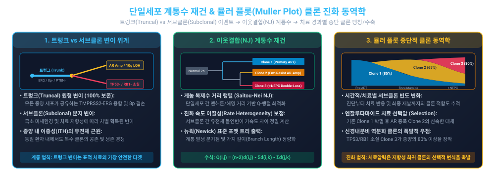

# Chapter 05. 서브클론 디컨볼루션 및 단일 세포 계통수 복원 (Subclonal Deconvolution & Single-Cell Phylogeny)

> **Cognitive Goal**: 단일 세포 전사체(snRNA-seq)로부터 추론된 대규모 카피수 변이(Copy Number Alteration, CNA) 프로파일을 기반으로 종양 내 서브클론(Subclones)을 식별(Deconvolution)하고, 세포 간 진화적 거리를 정량화하여 종양 계통수(Phylogenetic Tree)를 수학적으로 복원하는 방법론을 체득한다. 최소 진화(Minimum Evolution) 원리와 이웃 결합(Neighbor-Joining, NJ) 알고리즘의 유도 과정을 이해하고, 유한 상태 기계(Finite-State Machine) 기반의 `MEDICC2` 모델을 통해 대립유전자 특이적 복제수 진화 사건을 재구성한다. 나아가 전립선암의 분기 진화(Branching Evolution)에서 조상(Truncal) 변이와 가지(Branch) 변이를 분리하고, 시간 및 치료 경과에 따른 뮬러 플롯(Muller Plot) 클론 동역학을 시각화하는 능력을 배양한다.

---

## 1. 단일 세포 CNA 프로파일 기반 클론 이질성 및 거리 측정 행렬 (Distance Matrices on Single-Cell CNA Profiles)

단일 세포 전사체 분석(inferCNV, CopyKAT 등)을 통해 산출된 결과는 각 개별 세포 $i$ ($i = 1, \dots, n$)에 대해 정렬된 $m$개의 연속적인 게놈 유전자 윈도우 또는 분절(Segment) $k$ ($k = 1, \dots, m$)에서의 상대적 카피수 비율 또는 이산적 정수 복제수 상태 행렬 $C \in \mathbb{R}^{n \times m}$ (또는 $\mathbb{N}^{n \times m}$)로 표현됩니다.

```
┌────────────────────────────────────────────────────────────────────────────────────────┐
│                   단일 세포 CNA 프로파일로부터 계통수 복원까지의 워크플로우            │
│                                                                                        │
│   [단일 세포 CNA 행렬 C]                 [세포 간 거리 행렬 D]                          │
│   세포 1: [2, 2, 1, 1, 3, 3, 2, ...]       D_ij = dist(C_i, C_j)                       │
│   세포 2: [2, 2, 1, 1, 4, 4, 2, ...]  ──►  - Manhattan (L1)                            │
│   ...                                      - Euclidean (L2)                            │
│   세포 n: [2, 2, 2, 2, 3, 3, 2, ...]       - Breakpoint Distance (대칭 차집합)          │
│                                                          │                             │
│                                                          ▼                             │
│   [계통수 및 뮬러 플롯 복원]              [진화 알고리즘 적용]                          │
│   - Truncal: TMPRSS2-ERG, PTEN 손실  ◄──  - Neighbor-Joining (NJ: Q-matrix 최적화)      │
│   - Branch: TP53/RB1, AR 증폭              - MEDICC2 (FSM 기반 최소 사건 거리)         │
└────────────────────────────────────────────────────────────────────────────────────────┘
```

두 단일 세포 $u$와 $v$ 간의 유전체적 발산(Divergence)을 정량화하기 위해 상이한 생물학적 가정을 내포하는 세 가지 수학적 거리 척도가 활용됩니다.

### 1.1 맨해튼 거리 (Manhattan Distance, $L_1$ Norm)
맨해튼 거리는 각 게놈 유전자좌에서 발생하는 복제수 차이의 절대량 합으로 정의됩니다:

$$d_M(u, v) = \|C_u - C_v\|_1 = \sum_{k=1}^m |C_{u, k} - C_{v, k}|$$

- **생물학적 의미**: 복제수 획득(Duplication) 또는 결실(Deletion)이 점진적이고 선형적인 단일 단위 사건(Single-unit event)들의 누적으로 발생한다고 가정할 때, 두 세포가 공유하는 총 변이 크기의 차이를 직접적으로 측정합니다.

### 1.2 유클리드 거리 (Euclidean Distance, $L_2$ Norm)
연속적 신호(Log2 Ratio 또는 스무딩된 발현율)로 표현되는 CNA 프로파일에서 두 세포 간의 기하학적 직선 거리를 계산합니다:

$$d_E(u, v) = \|C_u - C_v\|_2 = \sqrt{\sum_{k=1}^m (C_{u, k} - C_{v, k})^2}$$

- **특징**: 특정 염색체 영역에서 발생하는 대규모 국소적 증폭(High-level Focal Amplification, 예: 전립선암의 *AR* 8-copy 증폭)과 같은 거대 편차에 더 큰 가중치를 부여합니다.

### 1.3 절단점 거리 (Breakpoint Distance)
단순한 복제수의 크기 차이보다 염색체 절단 및 재배열(Chromosomal Rearrangement) 사건 자체가 훨씬 더 드물고 비가역적인 진화적 사건이라는 점에 착안한 위상수학적 거리 척도입니다.

게놈 상에서 인접한 두 윈도우 간의 복제수 변화가 일어나는 위치를 절단점(Breakpoint)으로 정의합니다. 세포 $u$의 절단점 집합 $BP(u)$는 다음과 같습니다:

$$BP(u) = \left\{ k \in \{1, \dots, m-1\} \;\middle|\; C_{u, k} \neq C_{u, k+1} \right\}$$

두 세포 $u$와 $v$ 사이의 절단점 거리는 두 세포가 공유하지 않는 고유한 절단점들의 수, 즉 대칭 차집합(Symmetric Difference)의 크기로 정의됩니다:

$$d_{BP}(u, v) = |BP(u) \Delta BP(v)| = |(BP(u) \setminus BP(v)) \cup (BP(v) \setminus BP(u))|$$

- **장점/한계**: 복제수 추정치의 절대적 기저선(Baseline)이 드리프트(Drift)해도 절단점 위치는 상대적으로 덜 영향을 받을 수 있습니다. 다만 발현 기반 CNA의 절단점은 윈도우 해상도(CopyKAT 약 5Mb, inferCNV 100유전자 창)로만 결정되어 불확실하고, 대칭 차집합 거리는 1윈도우 어긋남도 2개 사건으로 계수해 지터에 취약하므로 경계 허용 오차나 세그먼트 기반 거리를 쓰는 것이 좋습니다. 정수 allele-specific 프로파일(예: Numbat)에서는 타당성이 높아집니다.

---

## 2. 최소 진화 원리 및 이웃 결합(Neighbor-Joining, NJ) 알고리즘의 수학적 유도

단일 세포 계통수 복원에서 가장 널리 사용되는 거리 기반 계통학적 접근법은 Saitou와 Nei(1987)가 제안한 **이웃 결합(Neighbor-Joining, NJ)** 알고리즘입니다. NJ 알고리즘은 **최소 진화(Minimum Evolution)** 원리를 기반으로 하며, 분기군(Star-decomposition) 트리에서 출발하여 전체 트리의 총 가지 길이(Total Branch Length, $S$)를 최소화하는 이웃 노드 쌍을 반복적으로 탐색하여 결합합니다.

### 2.1 $Q$-행렬의 수학적 유도
현재 $n$개의 말단 노드(Taxa / Single cells)가 존재하는 성상(Star) 트리에서 두 노드 $i$와 $j$를 새로운 가상 공통 조상 노드 $u$로 묶었을 때의 트리 총 길이 $S_{ij}$를 최소화해야 합니다.

노드 $i$에서 다른 모든 노드까지의 거리 합을 $R_i$라 정의합니다:

$$R_i = \sum_{k=1}^n d(i, k)$$

노드 $i$와 $j$를 결합하여 형성된 내부 노드 $u$와 다른 임의의 노드 $k$ ($k \neq i, j$) 사이의 거리는 가산성 트리(Additive Tree) 가정 하에 다음과 같이 주어집니다:

$$d(u, k) = \frac{1}{2} \big( d(i, k) + d(j, k) - d(i, j) \big)$$

새롭게 축소된 트리의 총 가지 길이 $S_{ij}$를 계산하면 다음과 같습니다:

$$S_{ij} = d(i, u) + d(j, u) + \sum_{k \neq i, j} d(u, k) + \text{(나머지 고정된 가지들의 길이)}$$

이를 정리하면 $S_{ij}$는 다음과 같은 수식에 비례하게 됩니다:

$$S_{ij} = \frac{1}{2(n - 2)} \left( \sum_{k=1}^n R_k - R_i - R_j \right) + \frac{1}{2} d(i, j)$$

모든 쌍 $(i, j)$에 대해 $\sum_{k=1}^n R_k$는 상수이므로, $S_{ij}$를 최소화하는 것은 아래의 $Q$-행렬 원소 $Q(i, j)$를 최소화하는 것과 동치입니다:

$$Q(i, j) = (n - 2) d(i, j) - \sum_{k=1}^n d(i, k) - \sum_{k=1}^n d(j, k) = (n - 2) d(i, j) - R_i - R_j$$

### 2.2 가지 길이(Branch Length) 계산
$Q(i, j)$가 최소인 노드 쌍 $(i^*, j^*)$가 선택되면, 이들을 병합하여 새로운 노드 $u$를 생성하고 각 노드에서 $u$까지의 가지 길이를 다음과 같이 계산합니다:

$$d(i^*, u) = \frac{1}{2} d(i^*, j^*) + \frac{1}{2(n - 2)} \big( R_{i^*} - R_{j^*} \big)$$

$$d(j^*, u) = d(i^*, j^*) - d(i^*, u)$$

### 2.3 거리 행렬 업데이트 및 반복
새로운 노드 $u$와 나머지 모든 노드 $k$ ($k \neq i^*, j^*$) 사이의 거리를 계산하여 거리 행렬 $D$를 $(n-1) \times (n-1)$ 크기로 갱신합니다:

$$d(u, k) = \frac{1}{2} \big( d(i^*, k) + d(j^*, k) - d(i^*, j^*) \big)$$

이 과정을 노드가 3개 남을 때까지 반복하여 루트가 없는(Unrooted) 이진 트리를 완성합니다. 정상 이배체 기준 세포(Diploid reference cells)를 외집단(Outgroup)으로 설정함으로써 루트(Root)를 결정할 수 있습니다.

- **계산 복잡도**: $n$개의 세포에 대해 $Q$-행렬 탐색 및 업데이트를 $n-3$회(3노드가 남을 때까지) 반복하므로 표준 NJ는 $O(n^3)$입니다. $O(n^2)$는 RapidNJ/FastME류 휴리스틱·ME 최적화 구현에서 보고된 복잡도이며, 이를 통해 수천 개 규모의 단일 세포 계통수를 구성할 수 있습니다.

---

## 3. `MEDICC2`: 유한 상태 기계(FSM) 기반 최소 사건 거리 모델링

기존의 $L_1$ 맨해튼 거리나 유클리드 거리는 중요한 진화생물학적 원리를 위배합니다. 예를 들어 염색체 한쪽 팔(Arm) 전체가 한 번에 결실되는 사건(A single large-scale deletion)은 수백 개의 유전자 복제수를 동시에 2에서 1로 떨어뜨리지만, 이는 "단 1회의 진화 사건"입니다. 그러나 $L_1$ 거리를 적용하면 수백 단위의 거리가 증가하여 작은 국소 증폭(Focal amplification) 수십 번보다 더 먼 거리로 과대평가됩니다.

Schwarz et al.의 MEDICC을 확장한 Kaufmann et al. (2022)의 **`MEDICC2`**는 이 한계를 극복하기 위해 **가중 유한 상태 변환기(Weighted Finite-State Transducer, FST)** 프레임워크를 사용합니다. 입력은 **하플로타입 특이적 정수 복제수 프로파일**(대립유전자별 0~8; 단일세포 또는 bulk)이며, 최소 사건 거리(MED)는 임의 길이의 이득·소실(및 WGD)의 **최소 개수**로 정의됩니다. 따라서 inferCNV/CopyKAT의 연속 상대 프로파일은 직접 입력할 수 없고 Numbat 등 allele-specific 정수 상태가 필요합니다.

```
┌────────────────────────────────────────────────────────────────────────────────────────┐
│                        MEDICC2 유한 상태 기계(FSM) 전이 다이어그램                     │
│                                                                                        │
│               [정상 대립유전자 상태 (1, 1)] ──(WGD 사건)──► [(2, 2)]      │
│                     │                   ▲                                 │            │
│       (결실 사건)   │                   │ (복제 사건)                     │            │
│       (소실 사건)   ▼                   │ (이득 사건)                     ▼            │
│               [(1, 0) LOH] ─────────────┴─────────────► [(2, 0) 복제된 LOH]            │
│                                                                                        │
│   * 핵심 원리: 연속된 게놈 구간에 걸친 복제수 전이를 단일 간선 사건(Single Edge)으로   │
│                압축 모델링하여, 최소 사건 비용(Minimum Event Cost) 기반 계통수를 복원함  │
└────────────────────────────────────────────────────────────────────────────────────────┘
```

### 3.1 최소 사건 거리(Minimum Event Distance)의 정의
염색체 상에서 대립유전자 특이적 복제수 프로파일이 주어졌을 때, 프로파일 $A$에서 프로파일 $B$로 변환하는 데 필요한 생물학적 사건(Event)들의 집합을 $\mathcal{E} = \{e_1, e_2, \dots, e_p\}$라 합니다. 가능한 사건 유형은 다음과 같습니다:
1. **단편적 증폭/결실 (Segmental / Focal CNAs)**: 임의 길이의 영역에 대한 복제수 증감 (사건 1회로 계수).
2. **염색체 암 수준 사건 (Arm-level events)**: 동원체(Centromere)를 기준으로 한쪽 팔 전체의 변화 (사건 1회로 계수).
3. **전장 유전체 중복 (Whole-Genome Duplication, WGD)**: 게놈 전체의 배수성 배가 ($2N \to 4N$, 별도 사건).

프로파일 $A$와 $B$ 사이의 최소 사건 거리 $d_{\text{MED}}(A, B)$는 $A$를 $B$로 변환하는 모든 유효한 진화 경로 중 사건 수의 최솟값으로 정의됩니다(사건당 단위 비용; 종류별 가중치 없음):

$$d_{\text{MED}}(A, B) = \min_{\mathcal{P}: A \to B} |\mathcal{P}|$$

### 3.2 FST를 이용한 최적 경로 탐색 및 조상 복원
`MEDICC2`는 대립유전자 프로파일을 유한 상태 수용기(FSA), 사건을 FST로 표현하고 FST 합성/최단 경로 탐색으로 두 프로파일 사이의 MED를 서열 길이에 대해 선형 시간으로 계산합니다. 쌍별 MED로 neighbor joining 트리를 만든 뒤, 분기 노드의 **가상 조상(Unobserved Ancestral Clone)의 복제수 상태를 대립유전자 해상도로 복원(Ancestral Reconstruction)**하고 전체 사건 수가 최소가 되도록 가지 길이를 정합니다.

---

## 4. 전립선암의 트렁컬(Truncal) vs 브랜치(Branch) 변이 구조 및 뮬러 플롯(Muller Plot)

전립선암(Prostate Cancer, PCa)은 고도의 다초점성(Multifocality)과 클론 이질성을 특징으로 합니다. 계통수를 복원하면 종양 발생의 최초 기원 세포로부터 유래된 **트렁컬(Truncal, 조상) 변이**와 약제 내성 및 전이 과정에서 분기된 **브랜치(Branch, 서브클론) 변이**가 명확히 분리됩니다.



### 4.1 전립선암의 분기 진화 유전체 구조
```
[정상 전립선 상피세포 (2N Diad)]
       │
       ▼ (Truncal 사건 1 [ERG+ 아형 한정]: 21q 결실 또는 전좌를 통한 TMPRSS2-ERG 융합; 사건 순서는 설명용 가설)
       ▼ (Truncal 사건 2: Chr 10q23 결실을 통한 PTEN 단일/양측 소실)
       ▼ (Truncal 사건 3: Chr 8p21 결실을 통한 NKX3-1 소실)
[공통 조상 클론 (MRCA: Most Recent Common Ancestor - Clone 0)]
       │
       ├───────────────────────────────────────────┐
       │ (Branch A: 호르몬 민감성 유지)            │ (Branch B: 호르몬 치료 저항성 및 악성화)
       │ - Chr 8q 증폭 (MYC 활성화)               │ - TP53 점돌연변이 (R273H) 및 Chr 17p 결실
       ▼                                           ▼ - RB1 양측 결실 (Chr 13q14)
  [Clone 1: AR+ 원발암 우세종]                [Clone 2: 치료 전 극소수 존재 잠복 클론]
                                                   │
                                                   ▼ [ADT / AR 신호 억제제(ARSI, 예: Enzalutamide) 치료 병목 압력]
                                                   ├──────────────────────────┐
                                                   │                          │
                                                   ▼ (Branch B-1)             ▼ (Branch B-2: t-NEPC 전이)
                                            [Clone 2A: AR 증폭]        [Clone 2B: AR 소실]
                                            - Chr Xq12 AR 과발현      - REST 소실, ASCL1/INSM1 발현
                                            - AR-LBD T878A 변이        - 소세포 신경내분비암 완전 전환
```

1. **트렁컬 변이 (Truncal / Founder Alterations)**:
   - 종양 계통수의 뿌리(Trunk)에 위치하며, 해당 환자의 모든 전립선암 세포가 공유하는 변이입니다. (아래 예시는 ERG 융합 양성 종양을 가정한 것이며, 융합은 서구 원발암의 약 45~50%에서만, PTEN 손실은 TCGA 원발의 약 32%에서만 관찰되므로 모든 환자에서 truncal인 것은 아닙니다.)
   - **TMPRSS2-ERG 융합**: Chr 21q22.2-3 영역의 약 3Mb 간질성 결실(Interstitial Deletion) 또는 전좌에 의해 안드로겐 조절 프로모터와 ETS 전사인자가 융합됨.
   - **PTEN 결실**: Chr 10q23 결손으로 인한 PI3K-AKT 경로의 항구적 탈억제.
   - **NKX3-1 결실**: Chr 8p21 결손.

2. **브랜치 변이 (Branch / Subclonal Alterations)**:
   - 계통수의 가지 끝에 위치하며, 특정 치료 압력(ADT, ARSI) 하에서 진화적 이점을 제공합니다.
   - **TP53 변이 및 Chr 17p 결실**: 세포 사멸 회피 및 유전체 불안정성 가속.
   - **RB1 양측 결손 (Chr 13q14)**: *TP53* 결손과 동시 발생하여 계통 가소성(Lineage Plasticity)의 문을 염.
   - **AR 증폭 (Chr Xq12)** 및 **AR 상류 인핸서 증폭**: 거세 저항성 전립선암(CRPC)에서 극소량의 안드로겐으로도 신호 전달을 유지하기 위한 적응.

### 4.2 뮬러 플롯(Muller Plot)을 통한 서브클론 동역학 시각화
뮬러 플롯은 X축에 시간(Time / 치료 단계), Y축에 총 종양 부피 또는 클론 빈도(Frequency, $0 \sim 100\%$)를 두고, 각 서브클론이 부모 클론의 내부로부터 싹을 틔워 분기하는 계통학적 포괄 관계(Ancestry)를 연속된 다각형 면적으로 표현합니다.

- **클론 스위핑(Clonal Sweeping)**: 치료 전에는 Clone 1이 종양의 95%를 차지하였으나, ARSI(엔잘루타마이드; ADT와 구분되는 AR 신호 억제제) 투여 후 Clone 1이 사멸하면서 극소수(0.1%) 존재하던 Clone 2(TP53/RB1 결손 클론)가 선택압을 이겨내고 전체 종양의 90% 이상으로 팽창하는 과정을 극적으로 가시화합니다.

---

## 5. Python 실습: 단일 세포 CNA 거리 계산 및 계통수 구축 파이프라인

단일 세포 전사체 데이터에서 추출된 유전자별 복제수 행렬로부터 세포 간 맨해튼 및 절단점 거리를 계산하고, `scikit-bio` 또는 이웃 결합(NJ) 알고리즘을 통해 계통수를 구축한 후 Newick 포맷으로 내보내는 완전한 파이프라인입니다.

```python
import numpy as np
import pandas as pd
import scipy.spatial.distance as pdist
from scipy.cluster.hierarchy import linkage, to_tree
import ete3

def calculate_cna_distance_matrix(cna_df: pd.DataFrame, metric: str = "manhattan") -> np.ndarray:
    """
    단일 세포 CNA 프로파일 데이터프레임(세포 x 게놈 윈도우)으로부터 거리 행렬을 계산합니다.
    
    Parameters:
    -----------
    cna_df : pd.DataFrame
        행: 단일 세포 바코드, 열: 연속된 염색체 유전자 윈도우의 카피수 비율
    metric : str
        'manhattan', 'euclidean', 또는 'breakpoint'
        
    Returns:
    --------
    dist_matrix : np.ndarray
        N x N 대칭 거리 행렬
    """
    X = cna_df.values
    n_cells, n_windows = X.shape
    
    if metric in ["manhattan", "euclidean"]:
        condensed_dist = pdist.pdist(X, metric=metric)
        dist_matrix = pdist.squareform(condensed_dist)
    elif metric == "breakpoint":
        # 1차 차분을 통해 절단점(Breakpoint) 이진 행렬 생성
        diff = np.abs(np.diff(X, axis=1))
        # 노이즈를 배제하기 위한 임계값 적용 (|C_{k+1} - C_k| > 0.2; 임의의 예시값)
        breakpoints = (diff > 0.2).astype(int)
        
        # 절단점 간 대칭 차집합 크기(맨해튼 거리와 동치) 계산
        condensed_dist = pdist.pdist(breakpoints, metric="cityblock")
        dist_matrix = pdist.squareform(condensed_dist)
    else:
        raise ValueError(f"지원하지 않는 거리 척도입니다: {metric}")
        
    return dist_matrix

def run_neighbor_joining(dist_matrix: np.ndarray, cell_names: list) -> str:
    """
    Saitou-Nei Neighbor-Joining 알고리즘을 수학적으로 직접 수행하여 Newick 문자열을 반환합니다.
    """
    n = dist_matrix.shape[0]
    nodes = [f"cell_{name}" for name in cell_names]
    D = dist_matrix.astype(float).copy()
    
    # 노드 매핑 딕셔너리
    tree_topology = {node: node for node in nodes}
    
    while n > 2:
        # 1. R_i 벡터 계산 (각 노드에서 다른 모든 노드까지의 거리 합)
        R = D.sum(axis=1)
        
        # 2. Q 행렬 계산: Q(i, j) = (n - 2)*D(i, j) - R_i - R_j
        Q = np.zeros((n, n))
        for i in range(n):
            for j in range(n):
                if i != j:
                    Q[i, j] = (n - 2) * D[i, j] - R[i] - R[j]
                else:
                    Q[i, j] = np.inf
                    
        # 3. Q 최솟값을 갖는 쌍 (i*, j*) 탐색
        min_idx = np.unravel_index(np.argmin(Q), Q.shape)
        i_star, j_star = min_idx[0], min_idx[1]
        if i_star > j_star:
            i_star, j_star = j_star, i_star
            
        # 4. 가지 길이 계산
        d_ij = D[i_star, j_star]
        branch_i = 0.5 * d_ij + (R[i_star] - R[j_star]) / (2 * (n - 2))
        branch_j = d_ij - branch_i
        
        # 가지 길이가 음수가 되지 않도록 경계 조건 보정
        branch_i = max(branch_i, 0.0)
        branch_j = max(branch_j, 0.0)
        
        # 5. 새로운 내부 노드 명명 및 Newick 서브트리 생성
        new_node_name = f"Node_{len(tree_topology)}"
        sub_newick = f"({tree_topology[nodes[i_star]]}:{branch_i:.4f},{tree_topology[nodes[j_star]]}:{branch_j:.4f})"
        tree_topology[new_node_name] = sub_newick
        
        # 6. 새 노드 u와 나머지 노드 k 간의 거리 계산
        d_u = []
        for k in range(n):
            if k != i_star and k != j_star:
                dist_uk = 0.5 * (D[i_star, k] + D[j_star, k] - d_ij)
                d_u.append(max(dist_uk, 0.0))
                
        # 7. 거리 행렬 축소
        remaining_indices = [k for k in range(n) if k != i_star and k != j_star]
        D_reduced = D[np.ix_(remaining_indices, remaining_indices)]
        
        # 새 행/열 추가
        d_u = np.array(d_u)
        D_new = np.zeros((n - 1, n - 1))
        D_new[:-1, :-1] = D_reduced
        D_new[-1, :-1] = d_u
        D_new[:-1, -1] = d_u
        
        # 리스트 갱신
        nodes = [nodes[k] for k in remaining_indices] + [new_node_name]
        D = D_new
        n -= 1
        
    # 마지막 두 노드 결합
    final_dist = D[0, 1]
    final_newick = f"({tree_topology[nodes[0]]}:{final_dist/2:.4f},{tree_topology[nodes[1]]}:{final_dist/2:.4f});"
    return final_newick

# --- 실행 시뮬레이션 ---
if __name__ == "__main__":
    np.random.seed(42)
    # 가상의 단일 세포 5개와 100개 게놈 윈도우 생성
    cells = ["CloneA_1", "CloneA_2", "CloneB_1", "CloneB_2", "Ref_Diploid"]
    
    # Clone A: 20~40 윈도우 결실 (PTEN 유사)
    # Clone B: 20~40 결실 + 60~80 윈도우 증폭 (AR 유사)
    data = np.ones((5, 100)) * 2.0
    data[0:2, 20:40] = 1.0  # Clone A
    data[2:4, 20:40] = 1.0  # Clone B
    data[2:4, 60:80] = 4.0  # Clone B
    data += np.random.normal(0, 0.05, data.shape)  # 측정 노이즈
    
    df_cna = pd.DataFrame(data, index=cells, columns=[f"win_{i}" for i in range(100)])
    
    # 1. 절단점 거리 행렬 산출
    D_bp = calculate_cna_distance_matrix(df_cna, metric="breakpoint")
    print("[Breakpoint Distance Matrix]\n", pd.DataFrame(D_bp, index=cells, columns=cells))
    
    # 2. NJ 계통수 복원
    newick_tree = run_neighbor_joining(D_bp, cells)
    print("\n[Restored Newick Tree]\n", newick_tree)
```

---

## 단원 핵심 점검 (Cognitive Checkpoint & Case Study)

### Q1. [능동 회상 (Active Recall)]
단일 세포 전사체 데이터에서 카피수 변이(CNA) 기반 계통수를 복원할 때, 단순 유클리드 거리($L_2$)나 맨해튼 거리($L_1$) 대신 절단점 거리(Breakpoint Distance) 또는 `MEDICC2`의 최소 사건 거리(Minimum Event Distance)를 사용해야 하는 진화생물학적 이유를 설명하시오.

<details>
<summary>💡 모범 답안 및 해설 확인</summary>

- **$L_1 / L_2$ 거리의 결정적 한계**:
  - $L_1$ 및 $L_2$ 거리는 게놈 윈도우별 복제수 차이의 수치적 합산에 의존합니다. 이로 인해 염색체 한쪽 팔(Arm-level) 전체가 단 1회의 유사분열 오류로 통째로 결실되는 사건(단일 진화 사건)이 발생할 경우, 수백 개의 연속된 유전자 윈도우가 모두 변하므로 거리가 수백 단위로 폭증하게 됩니다. 반면, 3~4회의 독립적인 점돌연변이나 국소적 증폭은 작은 유전자 수에 국한되므로 거리가 매우 작게 계산되어, 실제 진화적 사건의 횟수(Evolutionary Events)와 거리 척도 간에 심각한 왜곡이 발생합니다.
- **절단점 및 최소 사건 거리의 우수성**:
  - **절단점 거리(Breakpoint Distance)**는 복제수 크기 자체가 아니라 염색체 구조가 절단된 좌표(경계선)의 일치 여부만을 대칭 차집합으로 계산하므로 기저선 변동에는 덜 민감할 수 있습니다(단, 발현 기반 CNA에서는 절단점 위치 불확실성과 윈도우 어긋남에 취약하므로 허용 오차가 필요합니다).
  - **`MEDICC2`의 최소 사건 거리**는 유한 상태 기계(FSM)를 활용하여 임의 길이의 이득·소실(및 WGD)을 사건 1회로 계수하고 한 프로파일에서 다른 프로파일로 도달하는 최소 사건 수를 FST로 계산하므로, 팔 수준 사건이 거리를 과대평가하는 문제를 피하고 간명한(Parsimonious) 분기 진화 역사를 복원하는 데 유리합니다(단, allele-specific 정수 복제수 입력이 필요합니다).

</details>

---

### Q2. [수학적 원리 규명 (Mathematical Rigor)]
Neighbor-Joining(NJ) 알고리즘에서 두 노드 $i, j$를 결합할 때 단순 거리 $d(i, j)$의 최솟값을 선택하지 않고, $Q$-행렬 원소 $Q(i, j) = (n - 2) d(i, j) - \sum_{k=1}^n d(i, k) - \sum_{k=1}^n d(j, k)$를 최소화하는 노드 쌍을 선택해야 하는 수학적 필연성을 분기 속도(Rate of Evolution)의 비균일성 관점에서 증명하시오.

<details>
<summary>💡 모범 답안 및 해설 확인</summary>

- **단순 거리 $d(i, j)$ 최소화의 결함 (분자 시계 가설 파탄)**:
  - 단순 최소 거리 $\min d(i, j)$를 선택하는 방식(예: UPGMA)은 모든 계통의 진화 속도가 동일하다는 엄격한 울트라메트릭(Ultrametric / Molecular Clock) 가정을 전제합니다.
  - 그러나 종양 세포 클론은 *TP53* 변이나 상동 재조합 결핍(HRD) 등을 획득한 특정 서브클론에서 돌연변이 속도가 급격히 빨라지는 비균일 진화 속도(Heterogeneous Evolutionary Rates)를 나타냅니다(이로 인한 UPGMA류의 위상 오류를 가리키며, '장가지 유인'은 본래 파시모니/ML 계통수 방법의 아티팩트 용어입니다).
  - 만약 한 노드 $i$가 긴 가지(빠른 진화)를 갖고 노드 $j$와 $k$가 짧은 가지(느린 진화)를 가질 때, 비록 $i$와 $j$가 진정한 자매 노드(Sister Taxa)라 할지라도 $d(j, k) < d(i, j)$가 성립하여 엉뚱한 노드 $j$와 $k$가 먼저 결합되는 치명적인 위상학적 오류를 범하게 됩니다.
- **$Q$-행렬의 수학적 보정 원리**:
  - $Q(i, j)$ 수식에서 차감되는 항 $R_i = \sum_{k=1}^n d(i, k)$는 노드 $i$에서 트리 내의 다른 모든 노드들까지의 평균 거리, 즉 **노드 $i$의 순수한 개별 진화 속도(진화 거리의 팽창 정도)**를 나타냅니다.
  - 따라서 $(n - 2) d(i, j)$에서 각 노드의 총 진화량 $R_i$와 $R_j$를 빼주는 것은, 두 노드 간의 거리에서 "각자가 독자적으로 축적한 개별 진화 속도의 편향"을 정규화(Normalization)하여 차감하는 효과를 갖습니다.
  - NJ는 균형 최소진화(ME) 기준의 탐욕적 휴리스틱으로, 거리가 정확한 가산성 거리일 때 올바른 위상을 복원하는 일관성(consistency)이 있으며(속도 이질성에도 UPGMA와 달리 동작), 노이즈가 있는 CNA 거리에서는 근사일 뿐 전역 최적이나 항상 올바른 자매 계통을 보장하지는 않습니다.

</details>

---

### Q3. [임상 케이스 분석 (Clinical Problem Solving)]
호르몬 요법(LHRH 작용제 + Enzalutamide) 치료 중 PSA 수치가 다시 급상승하여 거세 저항성 전립선암(mCRPC)으로 진행된 환자의 전이 생검 검체에 대해 단일핵 전사체(snRNA-seq) 기반 클론 계통수를 분석하였다.
분석 결과, 전체 세포가 *TMPRSS2-ERG* 융합과 *PTEN* 결손을 공유하는 단일 트렁크(Trunk)에서 시작하였으나, 두 개의 뚜렷한 브랜치 클론(Clone $\alpha$, Clone $\beta$)으로 분기되어 있었다:
- Clone $\alpha$ (전체 종양의 70%): Chr Xq12 *AR* 좌위의 고도 증폭 및 *AR* mRNA의 폭발적 과발현, 관상세포(Luminal) 마커 유지.
- Clone $\beta$ (전체 종양의 30%): *AR* 증폭 없음, Chr 17p (*TP53*) 결실 및 Chr 13q (*RB1*) 양측 결손, *ASCL1* 및 *CHGA* 발현.

1) 이 종양의 뮬러 플롯 상에서 시간 경과에 따른 두 클론의 역동적 거동을 예측하시오.
2) 환자에게 차세대 안드로겐 차단 치료(예: Abiraterone)를 추가 투여했을 때 발생할 진화적 클론 선택(Clonal Selection)의 파동을 설명하고, 종양학자로서 이를 억제하기 위해 제안할 수 있는 분자 기전 기반의 병용 치료 전략을 제시하시오.

<details>
<summary>💡 모범 답안 및 해설 확인</summary>

- **1. 뮬러 플롯 상의 클론 동역학 예측**:
  - 치료 전 초기 단계에는 공통 조상(Truncal: *TMPRSS2-ERG*, *PTEN* loss) 클론에서 유래한 Clone $\alpha$의 선조가 대부분을 차지하고 있었을 것입니다.
  - Enzalutamide 투여로 인해 호르몬 차단 병목이 발생하자, *AR* 유전자를 거대 증폭시켜 극미량의 리간드로도 신호를 유지할 수 있게 진화한 Clone $\alpha$가 급격히 팽창(Clonal Expansion)하여 70%를 점유하게 되었습니다.
  - 한편, *TP53*과 *RB1*의 동시 결손을 획득한 Clone $\beta$는 안드로겐 신호에 대한 의존성을 완전히 탈피하여 신경내분비 계통 가소성(t-NEPC) 상태로 전분화하면서 독자적인 서브클론 가지를 형성하였습니다.
- **2. 추가 치료 시의 클론 선택 파동 및 병용 치료 전략**:
  - **진화적 클론 선택의 파동 (Clonal Selection Wave)**:
    - 여기에 또 다른 안드로겐 생합성 억제제인 아비라테론(Abiraterone)을 추가 투여하면, 여전히 AR 신호에 의존하는 Clone $\alpha$ (70%)는 강력한 치료 압력에 의해 일시적으로 퇴행할 것입니다.
    - 그러나 AR 비의존적이며 신경내분비 분화를 완료한 Clone $\beta$ (30%)는 아비라테론에 전혀 반응하지 않고 완전한 선택적 이점(Selective Advantage)을 얻게 되어, 뮬러 플롯 상에서 Clone $\alpha$의 빈 자리를 메우며 종양 전체를 100% 장악하는 **치명적인 t-NEPC 클론 스위핑(Clonal Sweeping)**이 일어납니다.
  - **병용 치료 전략 (탐색적 가설; 아래 약제들의 NEPC 근거는 초기 임상·전임상 단계)**:
    - Clone $\beta$의 독점을 막기 위해 AR 표적 약물 단독 증량이 아닌, **복합 병용 요법**을 고려할 수 있습니다:
    - 1) **백금계 기반 세포독성 항암화학요법(Cisplatin/Carboplatin + Etoposide)**: 소세포 신경내분비암(t-NEPC) 표현형을 보이는 Clone $\beta$의 신속한 DNA 손상 유도 및 사멸.
    - 2) **EZH2 후성유전학적 억제제(예: Tazemetostat)**: *TP53/RB1* 결손 하에서 계통 가소성에 관여하는 PRC2(EZH2) 활성을 억제하려는 접근(전임상·초기 임상 단계). 별개로 **Aurora Kinase A 저해제(예: Alisertib)**는 N-Myc 안정화 차단 논리에 기반한 접근이며 PRC2 억제와는 무관한 기전입니다.

</details>

---

<!-- REFERENCES:BEGIN (generated by scripts/apply_references.py; do not edit by hand) -->
## 참고문헌 (References)
### 본문 인용 문헌
1. Saitou N, Nei M. The neighbor-joining method: a new method for reconstructing phylogenetic trees. *Mol Biol Evol*. 1987;4(4):406-25. PMID: 3447015. doi: 10.1093/oxfordjournals.molbev.a040454
2. Schwarz RF, Trinh A, Sipos B, et al. Phylogenetic quantification of intra-tumour heterogeneity. *PLoS Comput Biol*. 2014;10(4):e1003535. PMID: 24743184. doi: 10.1371/journal.pcbi.1003535
3. Kaufmann TL, Petkovic M, Watkins TBK, et al. MEDICC2: whole-genome doubling aware copy-number phylogenies for cancer evolution. *Genome Biol*. 2022;23(1):241. PMID: 36376909. doi: 10.1186/s13059-022-02794-9
4. Cancer Genome Atlas Research Network. The Molecular Taxonomy of Primary Prostate Cancer. *Cell*. 2015;163(4):1011-25. PMID: 26544944. doi: 10.1016/j.cell.2015.10.025
### 소프트웨어 (표기 버전은 검수 시 API를 확인한 버전이며, 파이프라인 실행 환경은 requirements-pipelines.txt 참조)
- NumPy 2.5.4 (numpy.org). 원 논문: Harris CR, Millman KJ, van der Walt SJ, et al. Array programming with NumPy. *Nature*. 2020;585(7825):357-362. PMID: 32939066. doi: 10.1038/s41586-020-2649-2
- SciPy 1.16.3 (github.com/scipy/scipy). 원 논문: Virtanen P, Gommers R, Oliphant TE, et al. SciPy 1.0: fundamental algorithms for scientific computing in Python. *Nat Methods*. 2020;17(3):261-272. PMID: 32015543. doi: 10.1038/s41592-019-0686-2
- ETE 3 (github.com/etetoolkit/ete). 원 논문: Huerta-Cepas J, Serra F, Bork P. ETE 3: Reconstruction, Analysis, and Visualization of Phylogenomic Data. *Mol Biol Evol*. 2016;33(6):1635-8. PMID: 26921390. doi: 10.1093/molbev/msw046
- pandas 2.3.3 (github.com/pandas-dev/pandas). 원 논문: McKinney W. Data Structures for Statistical Computing in Python. *Proceedings of the Python in Science Conference*. 2010:56-61. doi: 10.25080/majora-92bf1922-00a
<!-- REFERENCES:END -->
