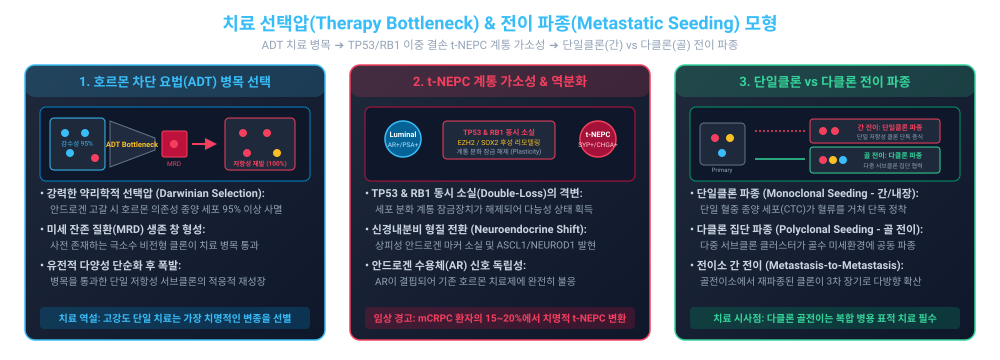

# Chapter 08. 전이 파종 모델 및 다클론성 전파 (Metastasis Seeding Models & Polyclonal Dissemination)

> **Cognitive Goal**: 원발성 전립선암(Primary Prostate Cancer)으로부터 뼈(Bone), 간(Liver), 원격 림프절(Distant Lymph Nodes) 등으로 암세포가 파종되는 파종 모델(Seeding Models)의 유전체 아키텍처를 규명한다. 단일 클론 전이(Monoclonal Seeding)와 순환 종양 세포 군집(CTC Clusters)을 통한 다클론 전이(Polyclonal Seeding)의 생체역학적 효율 차이를 수학적으로 유도한다. 고전적인 선형 진행(Linear Progression)과 조기 파종을 설명하는 평행 진행(Parallel Progression) 모델의 계통학적 발산(Genetic Divergence)을 비교 분석하고, 전이소 간 전이(Metastasis-to-Metastasis) 및 원발암 재파종(Self-Seeding)을 추적하는 클론 마이그레이션 그래프(Clonal Migration Graph)의 원리를 체득한다. 최종적으로 골 전이 미세환경에서 서로 다른 서브클론들이 공간적으로 상호작용하며 생존을 도모하는 비세포 자율적 클론 간 협력(Inter-clonal Cooperation) 기전을 이해한다.

---

## 1. 전이 파종의 유전체 모델: 단클론(Monoclonal) vs 다클론(Polyclonal) 파종

전이(Metastasis)는 원발 부위 이탈(Intravasation), 혈류 내 면역 감시 회피, 원격 장기 혈관벽 부착 및 혈관 외 유출(Extravasation), 휴면(Dormancy) 탈출, 그리고 최종적인 미세환경 군집화(Colonization)로 이어지는 극도로 가혹한 진화적 여정입니다. 이 과정에서 전이소를 형성하는 클론의 구성 방식은 크게 두 가지 모델로 나뉩니다.

```
┌────────────────────────────────────────────────────────────────────────────────────────┐
│                   단클론(Monoclonal) vs 다클론(Polyclonal) 전이 파종 메커니즘           │
│                                                                                        │
│   [단클론 파종 (Monoclonal Seeding)]                                                   │
│   원발암 (클론 A, B, C) ──► 단일 CTC (클론 B) 단독 침투 ──► 전이소 (100% 클론 B 균일종) │
│   * 특징: 전이소 내 유전적 다양성 극소, 병목(Bottleneck) 효과 극대화                  │
│                                                                                        │
│   [다클론 파종 (Polyclonal Seeding)]                                                   │
│   원발암 (클론 A, B, C) ──► 다세포 CTC 군집 (클론 A + B 복합체) ──► 다클론 전이소 형성  │
│   * 특징: 군집은 단일 세포보다 전이 효율이 높을 수 있음(Aceto 2014, 유방암 마우스 약 23~50배), 클론 간 협력 가능│
└────────────────────────────────────────────────────────────────────────────────────────┘
```

### 1.1 순환 종양 세포 군집(CTC Clusters)과 파종 성공 확률의 수학적 모델
혈류로 유출된 단일 암세포(Single CTC)의 전이 착상 성공률을 $P_{\text{single}} \ll 10^{-4}$라 합시다. 단일 세포는 혈류 내 전단 응력(Fluid Shear Stress), 자연살해(NK) 세포의 면역 공격, 그리고 부착 상실에 의한 세포사멸(Anoikis)에 의해 대부분 사멸합니다.

반면, $k$개의 세포가 결합된 **다세포 CTC 군집(CTC Cluster / Microemboli)**은 세포 간 카드헤린(CDH1) 결합, 혈소판(Platelet) 및 호중구(Neutrophil)의 외벽 차폐 효과, 그리고 클론 간 상호 방출하는 생존 신호에 의해 비약적인 생존 이득을 얻습니다.

세포 간 협력 효과(Cooperation / Chaperoning factor)를 나타내는 증폭 계수를 $\gamma > 0$라 할 때, 크기 $k$인 CTC 군집의 전이 착상 성공 확률 $P_{\text{cluster}}(k)$는 다음과 같이 비선형적으로 증가합니다:

$$P_{\text{cluster}}(k) = 1 - \big( 1 - P_{\text{single}} \big)^k \cdot \exp\big( -\gamma (k - 1) \big)$$

- $k=1$ (단일 세포): $P_{\text{cluster}}(1) = P_{\text{single}}$
- $k \ge 2$: $\exp(-\gamma(k-1)) < 1$이므로 사멸 확률 항 $\big( 1 - P_{\text{single}} \big)^k \exp\big( -\gamma (k - 1) \big)$이 지수함수적으로 급감하여, 군집 크기가 커질수록 전이 형성 확률이 상승합니다. 다만 이 식은 임의의 *가상 예시 모형*이며 $\gamma>0$이면 $k$가 커질수록 $P_{\text{cluster}}\to1$로 수렴하는 한계가 있습니다(예: $P_{\text{single}}=10^{-4}$, $\gamma=0.05\sim0.5$, $k=2\sim5$이면 배율이 약 490~8,600배로 위의 문헌 수치와 다름). 수십 배 이상의 효율 증가를 전립선암에 일반화할 근거는 없습니다(Aceto 2014는 유방암 마우스 결과).

---

## 2. 선형 진행(Linear Progression) vs 평행 진행(Parallel Progression) 모델

원발암과 원격 전이암 사이의 진화적 시간차와 유전적 거리(Genetic Divergence)를 설명하는 두 가지 핵심 패러다임이 존재합니다.

```
┌────────────────────────────────────────────────────────────────────────────────────────┐
│                 선형 진행(Linear) vs 평행 진행(Parallel) 진화 계통수 비교               │
│                                                                                        │
│   [선형 진행 모델 (Nowell)]                 [평행 진행 모델 (Klein)]                   │
│   원발암 (단계적 변이 축적)                 원발암                                     │
│      │                                         │ (조기 파종: DTC 골수 침투)            │
│      ▼ (말기 단계)                             ├──────────────────────────┐            │
│   [전이능 획득 클론]                            ▼                          ▼            │
│      │                                    [원발암 독립 진화]         [전이암 독립 진화] │
│      ▼                                         │                          │            │
│   전이소 (원발암과 유전적 유사도 높음)          ▼                          ▼            │
│                                            (원발암과 전이암 간 거대한 유전적 분기 발생)  │
└────────────────────────────────────────────────────────────────────────────────────────┘
```

### 2.1 선형 진행 모델 (Linear Progression Model)
- **개념**: 종양은 원발 부위에서 오랜 시간에 걸쳐 수많은 드라이버 변이를 순차적으로 축적하며, 종양 발생의 최말기(Late stage)에 이르러서야 비로소 전이 능력을 획득한 최상위 악성 클론이 원격 장기로 파종된다는 고전적 모델입니다.
- **계통수적 특징**: 원발암의 최외곽 가지(Branch tip)로부터 전이암의 가지가 직접 연장되어 형성됩니다. 원발암과 전이암의 유전적 거리 $d(\text{Primary}, \text{Met})$는 매우 가깝고, 전이암은 원발암의 거의 모든 변이를 선조 변이(Ancestral mutations)로서 공유합니다.

### 2.2 평행 진행 모델 (Parallel Progression Model)
- **개념**: 일부 암종에서는 침습성 클론이 종양이 임상적으로 발견되기 전의 초기 단계에 이미 원발 부위를 탈출하여 원격 장기(주로 골수)에 파종 종양 세포(Disseminated Tumor Cells, DTCs)로 안착한다는 가설이 제안되어 왔습니다(Klein 모델). 전립선암에서 이 모델이 얼마나 일반적인지는 환자별로 달라 일반화하기 어렵습니다.
- **계통수적 특징**: DTC는 골수 내에서 오랜 기간 휴면(Dormancy) 상태를 유지하거나, 원발암과는 다른 골 미세환경의 선택압 하에서 독자적으로 돌연변이를 축적할 수 있습니다(휴면 기간은 환자별로 다르며 일반 수치는 제시하지 않습니다).
- **유전적 발산 거리의 도출**:
  초기 분기 시점을 $t_{\text{split}}$, 전이암 임상 검출 시점을 $t_{\text{met}}$, 원발암 수술 시점을 $t_{\text{prim}}$이라 하고, 원발암과 전이암의 단위 시간당 돌연변이 축적 속도를 각각 $\mu_{\text{prim}}$, $\mu_{\text{met}}$이라 할 때, 두 병변 사이의 유전적 발산 거리 $d_{\text{parallel}}$은 다음과 같이 양측 가지 길이의 합으로 주어집니다:

$$d_{\text{parallel}} = \mu_{\text{prim}} (t_{\text{prim}} - t_{\text{split}}) + \mu_{\text{met}} (t_{\text{met}} - t_{\text{split}})$$

조기 분기($t_{\text{split}} \to 0$)일수록 $d_{\text{parallel}}$은 극대화되며, 이는 임상적으로 원발암 조직의 유전자 검사 결과만으로는 전이암의 약제 내성 돌연변이를 예측하기 어려운 이유 중 하나가 될 수 있습니다(위 식은 단순화한 개념 모형이며 실측 속도 $\mu$가 필요합니다).

---

## 3. 클론 마이그레이션 그래프 및 전이 간 전파 (Clonal Migration Graph & Metastasis-to-Metastasis)

Gundem et al. (Nature 2015)은 치명적인 전이성 전립선암 환자들의 전신 다발성 전이 병변을 전장 유전체 및 단일 세포 해상도로 추적하여, 암세포의 전파가 결코 원발암에서 전이소로 향하는 단순 단방향(Single-source) 경로에 그치지 않음을 밝혔습니다.



### 3.1 마이그레이션 그래프의 위상학적 분류
모든 종양 병변(원발암 $P$, 골 전이 $M_{\text{bone}}$, 간 전이 $M_{\text{liver}}$, 림프절 $M_{\text{LN}}$)을 정점(Vertices)으로 하고 클론의 이동 사건을 방향성 간선(Directed Edges)으로 갖는 유향 그래프 $G = (V, E)$를 구성합니다.

1. **원발암 중심 파종 (Single-Source Seeding)**:
   - 모든 간선이 원발암에서만 출발합니다: $E \subseteq \{(P, M_i) \mid M_i \in V \setminus \{P\}\}$.
2. **전이 간 전파 (Metastasis-to-Metastasis Seeding)**:
   - 이미 원격 장기에 안착한 전이소 $M_1$ (예: 골반 림프절 또는 늑골 전이)이 혈관 재침윤을 통해 또 다른 제2, 제3의 원격 장기 $M_2$ (예: 간, 척추, 뇌)로 암세포를 전파합니다: $(M_1, M_2) \in E$.
   - 부검 전체 게놈 시퀀싱 연구(Gundem et al., Nature 2015, PMID 25830880; 10명 51개 종양, 벌크 WGS)에서 전이소 간 전파(metastasis-to-metastasis spread)와 수렴적 *AR* 사건이 보고되었습니다. 다만 특정 장기(예: 간) 전이가 일반적으로 골 전이소에서 유래한다고 일반화할 근거는 아닙니다.
3. **원발암 재파종 (Self-Seeding)**:
   - 전이소에서 유리된 고악성도 순환 암세포가 다시 원래의 고향인 원발 전립선 조직으로 회귀하여 재안착합니다: $(M_i, P) \in E$. 이로 인해 원발암 조직 내에 후기 악성 변이가 역유입될 수 있다는 가설이며, 주로 실험 모델에서 제안된 개념으로 환자 데이터에서의 근거는 제한적입니다.

---

## 4. 골 전이 전선의 서브클론 간 협력(Inter-clonal Cooperation) 및 공간적 니치

전립선암은 뼈(Bone)로 전이되는 빈도가 80~90%에 달하는 극단적인 골 친화성(Bone Organotropism)을 나타냅니다. 골 기질은 단단한 석회화 구조물로서 암세포 단독의 힘으로는 물리적 공간을 확장할 수 없습니다.

```
┌────────────────────────────────────────────────────────────────────────────────────────┐
│                 골 전이 전선에서의 비세포 자율적 서브클론 간 협동 회로                │
│                                                                                        │
│   [Subclone A: 개척자 클론 (Pioneer)]       [Subclone B: 증식자 클론 (Proliferator)]   │
│   - RANKL, PTHrP, VEGF 대량 분비            - 고증식성 (AR 증폭, MYC 과발현)           │
│   - 골 흡수/신생 자극 및 기질 개방           - 개방된 공간에서 폭발적 콜로니 형성       │
│               │                                         ▲                              │
│               ▼                                         │                              │
│   [골 기질 용해 및 미세환경 개척] ──────────────────────┘                              │
│   - 파골세포 활성화 ──► 골 기질 용해 ──► 포획된 TGF-β, IGF1 대량 방출 ──► B 증식 촉진 │
└────────────────────────────────────────────────────────────────────────────────────────┘
```

### 4.1 비세포 자율적(Non-cell-autonomous) 상호작용
1. **개척자 클론 (Subclone A - The Pioneer)**:
   - 스스로의 증식 속도는 느리지만, 고농도의 **PTHrP (Parathyroid hormone-related protein)** 및 **RANKL**을 분비하여 파골세포(Osteoclast)를 자극합니다.
   - 파골세포가 뼈를 흡수하면서 단단한 뼈 기질 내에 갇혀 있던 고농도의 **TGF-$\beta$**와 **IGF-1** 성장인자가 주변 간질강으로 방출됩니다.
2. **증식자 클론 (Subclone B - The Proliferator)**:
   - *AR* 증폭 또는 *MYC* 과발현을 지닌 고적합도 클론입니다. 스스로는 뼈를 녹이지 못하지만, 클론 A가 유도한 풍부한 TGF-$\beta$와 IGF-1 니치 신호를 포획하여 폭발적인 군집 증식을 달성합니다.
3. **공간적 격리 및 경계 형성**:
   - 공간 전사체(Spatial Transcriptomics) 분석을 적용하면 *가설적으로* 다음과 같은 공간적 분업이 관찰될 수 있습니다(확립된 사실이 아니며, 전립선암 골전이는 주로 조골성/혼합 병변이어서 파골세포 'vicious cycle' 서사는 용해성 병변에 더 부합하는 면이 있고 Track 07·Track 00의 조골/Wnt/BMP 서술과도 다름): 골 흡수 전선(Resorption Front)에는 클론 A가 주로 배치되어 외벽을 개척하고, 그 내부의 공동(Cavity) 중심부에는 클론 B가 대규모 종양 둥지(Tumor Nest)를 이루는 정밀한 공간적 분업이 확인됩니다.

---

## 5. Python 실습: 전이 병변 간 유전적 거리 행렬 및 클론 마이그레이션 그래프 구축

다발성 전이 검체로부터 얻어진 서브클론별 대립유전자/복제수 빈도 데이터를 활용하여 병변 간 유전적 거리를 계산하고, 최소 마이그레이션 간선(Minimum Migration Edges)을 방향성 네트워크로 복원하는 파이프라인입니다.

```python
import numpy as np
import pandas as pd
import networkx as nx
import matplotlib.pyplot as plt

def build_metastatic_migration_graph(
    clonality_matrix: pd.DataFrame, 
    primary_label: str = "Primary_Prostate"
) -> nx.DiGraph:
    """
    각 병변별 서브클론 암세포 분율(Cancer Cell Fraction, CCF)로부터
    간명도(Parsimony) 기반 마이그레이션 방향성 그래프를 복원합니다.
    
    Parameters:
    -----------
    clonality_matrix : pd.DataFrame
        행: 병변 위치 (Primary, Bone, Liver, Lymph_Node 등)
        열: 환자 내 고유 서브클론 (Clone_1, Clone_2, ...)
        값: 해당 병변 내 각 서브클론의 CCF (0.0 ~ 1.0)
    primary_label : str
        원발암 병변 명칭
    """
    lesions = list(clonality_matrix.index)
    G = nx.DiGraph()
    
    # 1. 그래프 노드 추가
    for lesion in lesions:
        G.add_node(lesion, is_primary=(lesion == primary_label))
        
    # 2. 서브클론별 출현(Appearance) 및 이동 추적
    # CCF > 0.05인 클론을 양성으로 판정
    presence = (clonality_matrix > 0.05).astype(int)
    
    # 각 클론의 계통적 선후 관계를 기반으로 최소 간선 연결
    # 여기서는 각 전이소가 공유하는 클론의 중첩도와 고유 클론 수를 기반으로 방향성 추정
    for i, source in enumerate(lesions):
        for j, target in enumerate(lesions):
            if source == target:
                continue
                
            # Source가 가진 클론의 집합
            clones_src = set(clonality_matrix.columns[presence.loc[source] == 1])
            clones_tgt = set(clonality_matrix.columns[presence.loc[target] == 1])
            
            # Target이 Source의 서브클론을 진화적 조상으로 포함하고 있는가?
            shared_clones = clones_src.intersection(clones_tgt)
            unique_in_target = clones_tgt - clones_src
            
            # Source -> Target 이동 조건:
            # 1) 원발암 -> 전이소: 원발암에서 발견된 클론이 전이소에 존재할 때
            if source == primary_label and len(shared_clones) > 0:
                weight = 1.0 / (len(shared_clones) + 0.1)
                G.add_edge(source, target, weight=weight, type="Primary_Seeding")
            # 2) 전이소 -> 전이소: Source가 가진 모든 클론을 포함하면서 Target이 추가적인 진화 변이를 획득했을 때
            elif source != primary_label and target != primary_label:
                if len(shared_clones) >= 2 and len(unique_in_target) > 0:
                    weight = 0.5
                    G.add_edge(source, target, weight=weight, type="Met_to_Met")
                    
    return G

# --- 가상 데이터 시뮬레이션 ---
if __name__ == "__main__":
    # 병변: Primary, LN (림프절), Bone (골), Liver (간)
    # 클론: C0(Truncal), C1(AR-PC), C2(TP53 loss), C3(t-NEPC plastic)
    ccf_data = pd.DataFrame({
        "Clone_C0_Trunk": [1.0, 1.0, 1.0, 1.0],
        "Clone_C1_AR":    [0.8, 0.9, 0.3, 0.0],
        "Clone_C2_TP53":  [0.1, 0.0, 0.7, 0.95],
        "Clone_C3_NEPC":  [0.0, 0.0, 0.2, 0.90]
    }, index=["Primary_Prostate", "LN_Pelvic", "Bone_Spine", "Liver_Met"])
    
    print("[Lesion x Subclone CCF Matrix]")
    print(ccf_data)
    
    G_mig = build_metastatic_migration_graph(ccf_data, primary_label="Primary_Prostate")
    
    print("\n[Restored Directed Migration Edges]")
    for u, v, d in G_mig.edges(data=True):
        print(f"{u} ───({d['type']})───► {v}")
```

---

## 단원 핵심 점검 (Cognitive Checkpoint & Case Study)

### Q1. [능동 회상 (Active Recall)]
순환 종양 세포(CTC) 연구에서 단일 암세포(Single CTC)에 비해 다세포 CTC 군집(CTC Clusters)이 전이 형성 효율에서 20~50배 이상의 비약적인 우위를 점하는 생체역학적 및 면역학적 기전 3가지를 설명하시오.

<details>
<summary>💡 모범 답안 및 해설 확인</summary>

- **1. 부착 상실 세포사멸(Anoikis) 회피 및 세포 간 생존 신호 유지**:
  - 단일 암세포는 세포외 기질(ECM)과의 물리적 접촉이 단절되는 즉시 인테그린 매개 생존 신호가 차단되어 세포자멸사(Anoikis)에 들어갑니다.
  - 반면 CTC 군집은 세포 간에 E-cadherin 및 데스모좀(Desmosome)을 통한 세포-세포 간 연접(Intercellular Junctions)을 유지하고 있으므로, 혈류 내 부유 상태에서도 지속적인 세포 내 생존 및 항-아포토시스 신호(BCL2, AKT 활성화)를 교환하여 생존율을 극대화합니다.
- **2. 혈류 전단 응력(Shear Stress) 및 면역 공격으로부터의 물리적 차폐**:
  - 모세혈관 및 심장 박출에 따른 강력한 유체역학적 전단 응력에 노출될 때, 군집은 표면적 대 부피비가 작아 내부 세포들을 기계적 파괴로부터 보호합니다.
  - 또한 CTC 군집은 혈소판(Platelets) 및 종양 관련 호중구(Neutrophils)를 끌어들여 외벽에 두꺼운 세포성 외투(Microthrombus Shield)를 형성함으로써, 혈류를 순찰하는 자연살해(NK) 세포의 표면 수용체 인식을 물리적으로 차단합니다.
- **3. 미세혈관 포획(Mechanical Entrapment) 및 다클론 협력 착상**:
  - 단일 세포는 직경이 $10 \sim 15\mu\text{m}$로 좁은 모세혈관을 통과해 지나치기 쉽지만, 직경이 $50 \sim 100\mu\text{m}$에 달하는 거대 군집은 원격 장기(골수, 간 동양혈관 등)의 미세순환계에 물리적으로 즉각 걸려 포획(Mechanical Lodging)됩니다.
  - 포획된 직후 군집 내에 공존하는 상피성 증식 클론과 간엽성 기질 분해 클론이 협동하여 혈관 내피세포 간극을 뚫고 신속하게 혈관 외 유출(Extravasation)을 완료할 수 있습니다.

</details>

---

### Q2. [수학적 원리 규명 (Mathematical Rigor)]
원발암 $P$와 원격 전이암 $M$ 사이의 계통학적 분기 모델에서, 선형 진행 모델(Linear)과 평행 진행 모델(Parallel) 간의 유전적 발산 거리 $d(P, M)$의 기하학적 차이를 수식으로 유도하고, 원발암 세포의 분열 속도 $\lambda_P$와 전이암 세포의 분열 속도 $\lambda_M$이 동일한 일정 돌연변이 속도 $\mu$ 하에서 발생할 때, 초기 조기 파종 시점($t_{\text{split}} \to 0$)이 전체 종양 이질성(Inter-lesional Heterogeneity)을 왜곡시키는 한계치를 증명하시오.

<details>
<summary>💡 모범 답안 및 해설 확인</summary>

- **1. 두 모델의 유전적 발산 거리 $d(P, M)$ 수식 유도**:
  - 종양 발생 시점을 $t=0$, 조상 클론에서 원발암과 전이암의 계통이 분기된 시점을 $t_{\text{split}}$, 최종적으로 두 병변을 채취하여 염기서열을 분석한 시점을 각각 $t_P, t_M$이라 하자.
  - 단위 시간당 돌연변이 축적률을 $\mu_P = \mu \lambda_P$, $\mu_M = \mu \lambda_M$이라 할 때:
  - **선형 진행 모델**:
    전이가 원발암의 최종 진화 말기($t_{\text{split}} \approx t_P$)에 발생하므로:
    $$d_{\text{linear}}(P, M) = \mu_M (t_M - t_P)$$
    즉, 원발암과 전이암 사이의 유전적 차이는 원발암 진화가 끝난 후 전이암이 독자적으로 보낸 짧은 시간 $(t_M - t_P)$ 동안 축적된 소수의 돌연변이에 불과합니다.
  - **평행 진행 모델**:
    전이가 종양 발생 극초기($t_{\text{split}} \ll t_P$)에 발생하므로, 두 계통은 분기점 이후 각각 독자적인 가지를 뻗어나갑니다:
    $$d_{\text{parallel}}(P, M) = \mu_P (t_P - t_{\text{split}}) + \mu_M (t_M - t_{\text{split}})$$
- **2. 조기 파종($t_{\text{split}} \to 0$) 극한에서의 이질성 왜곡 한계치 증명**:
  - $\lambda_P = \lambda_M = \lambda$, $\mu_P = \mu_M = \mu_0 = \mu \lambda$이고, 거의 동시점에 채취($t_P \approx t_M = T$)되었다고 가정하자.
  - $t_{\text{split}} \to 0$일 때 평행 진행 거리의 극한값은:
    $$\lim_{t_{\text{split}} \to 0} d_{\text{parallel}}(P, M) = \mu_0 (T - 0) + \mu_0 (T - 0) = 2 \mu_0 T$$
  - 반면 공통 조상이 살아있던 시간 동안 축적된 트렁컬(Truncal) 변이의 거리는 $d_{\text{truncal}} = \mu_0 t_{\text{split}} \to 0$입니다.
  - 따라서 공유하는 공통 변이 대비 각 병변의 고유 변이 비율(Private Mutation Ratio) $R_{\text{private}}$는:
    $$R_{\text{private}} = \frac{d(P, M)}{d_{\text{truncal}} + d(P, M)} = \frac{2 \mu_0 T}{0 + 2 \mu_0 T} = 1.0 \quad (100\%)$$
  - (전제 한정: 여기서 $t_{\text{split}}=0$은 종양 개시 시점을 뜻하며, 개시 이후 축적된 founder 변이(TMPRSS2-ERG 등)와 생식세포 공유 변이는 무시한 이상화입니다. 선형·평행 모델은 동일한 거리식에서 $t_{\text{split}}$ 값만 다릅니다.)
  - **수학적 결론(이상화 극한)**: 조기 파종이 일어날 경우, 원발암과 전이암은 동일한 환자 내의 암세포임에도 불구하고 공유하는 유전적 변이가 거의 0에 수렴하여 마치 서로 다른 두 명의 환자에서 발생한 독립 암(Synchronous Independent Primaries)처럼 보이는 극단적인 유전적 분기를 초래합니다.

</details>

---

### Q3. [임상 케이스 분석 (Clinical Problem Solving)]
다발성 골 전이 및 간 전이를 동반한 68세 거세 저항성 전립선암(mCRPC) 환자의 부검(Autopsy) 검체로부터 원발 전립선암(Primary), 척추 골 전이(Bone-1), 대퇴골 골 전이(Bone-2), 그리고 간 전이(Liver) 병변을 채취하여 단일 세포 클론 계통도를 복원하였다.
분석 결과 다음과 같은 클론 분포가 관찰되었다:
- Primary: Clone A (Truncal: *TMPRSS2-ERG*, *PTEN* loss) 95%, Clone B (*TP53* mut) 5%.
- Bone-1 (척추): Clone B 80%, Clone C (*AR* amplification) 20%.
- Bone-2 (대퇴골): Clone B 10%, Clone C 90%.
- Liver (간): Clone D (Clone C의 유전체 배경 위에 Chr 13q *RB1* 결손 및 *ASCL1* 과발현 획득) 100%.

1) 이 환자에서 발생한 전이 파종 경로(Metastatic Migration Route)를 방향성 간선으로 기술하고, 간 전이(Liver) 병변이 원발암에서 직접 유래한 것인지 아니면 전이소 간 전이(Metastasis-to-Metastasis)인지 유전체적 근거를 들어 규명하시오.
2) Bone-1과 Bone-2에 공존하는 Clone B와 Clone C의 상호작용을 비세포 자율적 클론 간 협력(Inter-clonal Cooperation) 관점에서 분석하고, 왜 골 전이 병변에는 Clone C가 풍부한 반면 간 전이 병변은 Clone D가 독점하게 되었는지 미세환경 선택압 차이로 설명하시오.

<details>
<summary>💡 모범 답안 및 해설 확인</summary>

- **1. 전이 파종 경로 복원 및 유전체적 근거** (가상 시나리오이며 아래는 하나의 *가설적 해석*입니다):
  - **복원된 이동 경로**:
    $$\text{Primary (Clone B)} \longrightarrow \text{Bone-1} \longrightarrow \text{Bone-2 (Clone C)} \longrightarrow \text{Liver (Clone D)}$$
  - **간 전이의 기원 규명**:
    - 간 전이소(Liver)의 암세포는 100% Clone D로 구성되어 있으며, Clone D는 'Truncal(A) $\to$ *TP53*(B) $\to$ *AR* 증폭(C) $\to$ *RB1* 결손(D)'의 중첩된 유전체 진화 단계를 완벽히 내포하고 있습니다.
    - 그러나 원발암(Primary)에는 Clone C나 D의 핵심 표지인 *AR* 증폭이 전혀 존재하지 않습니다 ($0\%$).
    - 반면 Bone-1과 Bone-2에서 Clone C가 대량으로 번성하고 있었습니다.
    - 따라서 간 전이는 원발암에서 직접 파종된(Single-source) 것이 아니라, 골 전이소(Bone)에서 *AR* 증폭을 획득하며 번성하던 Clone C가 혈관으로 재침윤한 뒤 *RB1* 결손을 획득하여 간으로 원격 이차 파종된 **전이소 간 전이(Metastasis-to-Metastasis Seeding)**임을 가장 간결하게(parsimony) 설명합니다. 다만 벌크 클론 비율만으로는 방향성을 확정할 수 없고(원발 검체의 샘플링 한계로 *AR* 증폭 클론이 미검출되었을 가능성, Bone-1이 아닌 Bone-2가 공급원이라는 가정의 불확실성), 단일세포 계통수·위상 정보로 검증이 필요합니다.
- **2. 골 전이 내 클론 간 협력 및 장기 특이적 선택압 차이**:
  - **골 미세환경 내 Clone B와 C의 협력 (가설적 예시; 아래 인자/기전은 이 가상 케이스를 위한 설명이며 입증된 사실이 아닙니다)**:
    - Clone B(*TP53* 변이)는 골 기질을 파괴하는 파골세포 자극 인자(PTHrP, RANKL)를 분비하여 단단한 뼈 기질을 용해하는 개척자(Pioneer) 역할을 담당합니다.
    - Clone C는 *AR* 증폭을 통해 방출된 골 유래 성장인자(IGF-1, TGF-$\beta$)를 흡수하여 강력한 증식력을 발휘하는 정착자(Colonizer) 역할을 수행하여 두 클론이 공존하는 시너지를 형성합니다.
  - **장기 특이적 미세환경 선택압과 Clone D의 간 독점**:
    - 뼈는 안드로겐 농도가 비교적 유지되며 골 기질 지지 신호가 풍부하여 AR 증폭 클론(Clone C)이 생존하기에 최적의 환경입니다.
    - 반면 간(Liver)은 골과 다른 미세환경(면역 세포 구성, 성장 인자 환경 등)을 가지므로 서로 다른 선택압이 작용할 수 있다고 가정합니다(안드로겐 수준 등 구체적 차이는 이 사례에서 측정되지 않았습니다).
    - 이 환경에서는 AR 신호에 의존하는 Clone C는 생존하기 어려우며, *RB1* 결손을 추가하여 AR 경로를 완전히 탈피하고 극도의 증식 능력을 획득한 신경내분비 특성을 띠는 클론(Clone D)이 선택적 이점을 얻어 간 병변을 우세하게 차지했을 *가능성*이 있습니다(Clonal Sweeping 가설).

</details>

---

<!-- REFERENCES:BEGIN (generated by scripts/apply_references.py; do not edit by hand) -->
## 참고문헌 (References)
### 본문 인용 문헌
1. Aceto N, Bardia A, Miyamoto DT, et al. Circulating tumor cell clusters are oligoclonal precursors of breast cancer metastasis. *Cell*. 2014;158(5):1110-1122. PMID: 25171411. doi: 10.1016/j.cell.2014.07.013
2. Gundem G, Van Loo P, Kremeyer B, et al. The evolutionary history of lethal metastatic prostate cancer. *Nature*. 2015;520(7547):353-357. PMID: 25830880. doi: 10.1038/nature14347
### 소프트웨어 (표기 버전은 검수 시 API를 확인한 버전이며, 파이프라인 실행 환경은 requirements-pipelines.txt 참조)
- NumPy 2.5.4 (numpy.org). 원 논문: Harris CR, Millman KJ, van der Walt SJ, et al. Array programming with NumPy. *Nature*. 2020;585(7825):357-362. PMID: 32939066. doi: 10.1038/s41586-020-2649-2
- Matplotlib 3.11.2 (github.com/matplotlib/matplotlib). 원 논문: Hunter JD. Matplotlib: A 2D Graphics Environment. *Comput. Sci. Eng*. 2007;9(3):90-95. doi: 10.1109/mcse.2007.55
- NetworkX 3.7 (github.com/networkx/networkx).
- pandas 2.3.3 (github.com/pandas-dev/pandas). 원 논문: McKinney W. Data Structures for Statistical Computing in Python. *Proceedings of the Python in Science Conference*. 2010:56-61. doi: 10.25080/majora-92bf1922-00a
<!-- REFERENCES:END -->
