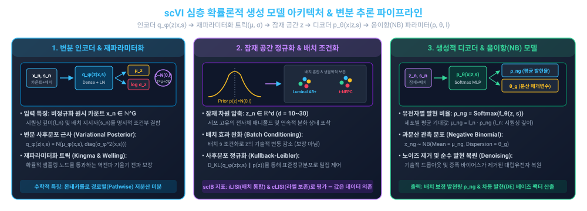
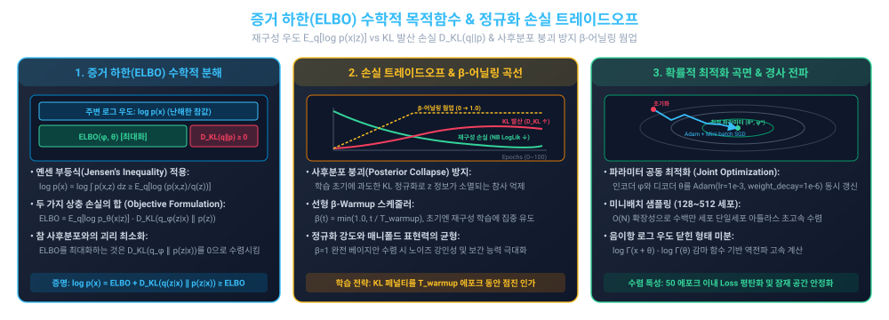
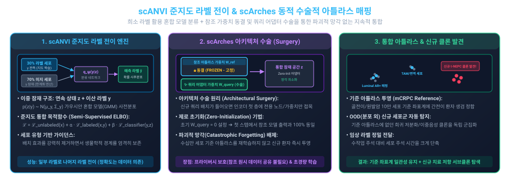
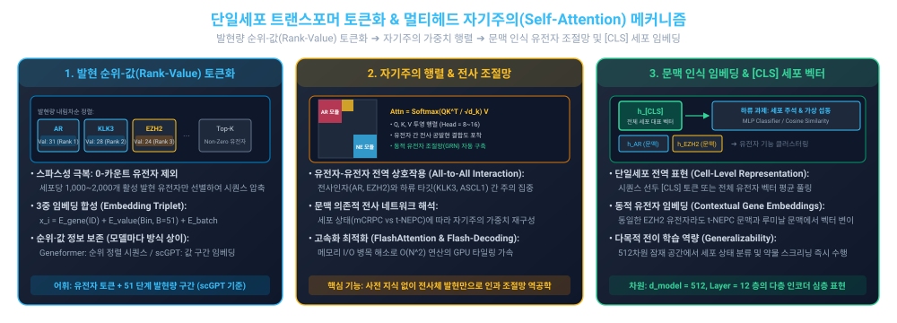
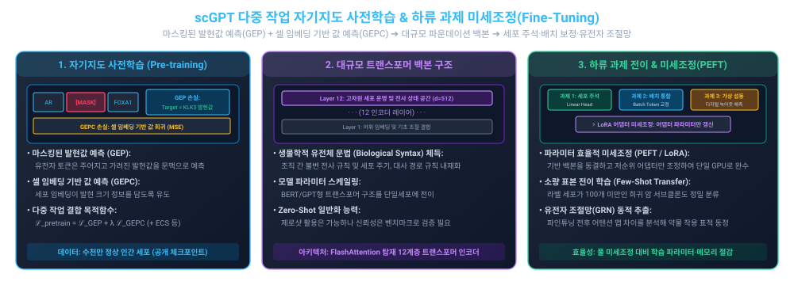
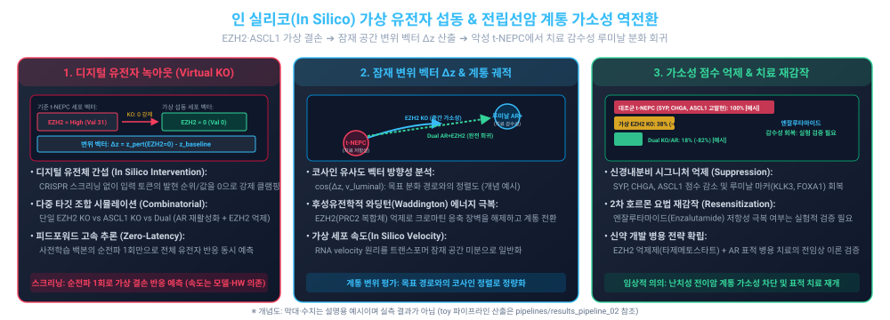

# 단일세포 전사체 생성형 파운데이션 모델 & 딥러닝(Single-Cell Generative Deep Learning & Foundation Models) 마스터 교재
**From Probabilistic Count Modeling (NB/ZINB) & scVI Variational Autoencoders to Transformer Foundation Models (scGPT, Geneformer) & In Silico Perturbation Screening**

---

## 📚 교재 전체 목차 (Table of Contents)

- [Chapter 00. 단일세포 전사체 생성형 파운데이션 모델 및 딥러닝 로드맵](#part-00-00-단일세포-전사체-생성형-파운데이션-모델-및-딥러닝-로드맵-generative-foundation-models-roadmap)
- [Chapter 01. 단일세포 전사체 확률론적 카운트 모델링](#part-01-01-단일세포-전사체-확률론적-카운트-모델링-probabilistic-count-modeling)
- [Chapter 02. scVI 변분 오토인코더 및 확률론적 생성 모델](#part-02-02-scvi-변분-오토인코더-및-확률론적-생성-모델-scvi-variational-autoencoder)
- [Chapter 03. scANVI 준지도 학습 및 희귀 세포형 고정밀 전이](#part-03-03-scanvi-준지도-학습-및-희귀-세포형-고정밀-전이-scanvi-semi-supervised-annotation)
- [Chapter 04. scArches 아키텍처 수술과 지속적 아틀라스 매핑](#part-04-04-scarches-아키텍처-수술과-지속적-아틀라스-매핑-scarches-architectural-surgery)
- [Chapter 05. 단일 세포 트랜스포머 아키텍처 및 토큰화 메커니즘](#part-05-chapter-05-단일-세포-트랜스포머-아키텍처-및-토큰화-메커니즘-transformer-architecture--tokenization-in-single-cell-biology)
- [Chapter 06. scGPT 사전학습 모델과 세포 임베딩 추출](#part-06-chapter-06-scgpt-사전학습-모델과-세포-임베딩-추출-scgpt-generative-pre-trained-foundation-models-for-single-cell-biology)
- [Chapter 07. Geneformer 아키텍처와 어텐션 기반 유전자 네트워크 분석](#part-07-chapter-07-geneformer-아키텍처와-어텐션-기반-유전자-네트워크-분석-geneformer-genome-scale-pre-training--attention-based-network-biology)
- [Chapter 08. 인 실리코 유전자 섭동과 가상 약물 스크리닝](#part-08-chapter-08-인-실리코-유전자-섭동과-가상-약물-스크리닝-in-silico-genetic-perturbation--virtual-drug-discovery)
- [Chapter 09. 트러블슈팅, scIB 벤치마킹 및 캡스톤 프로젝트 루브릭](#part-09-chapter-09-트러블슈팅-벤치마킹-및-캡스톤-프로젝트-루브릭-troubleshooting-scib-benchmarking--capstone-project-rubric)

---

# Part 00. 00. 단일세포 전사체 생성형 파운데이션 모델 및 딥러닝 로드맵 (Generative Foundation Models Roadmap)
> **출처 원본 파일**: `tracks/05_generative_foundation_models/docs/00_FOUNDATION_MODELS_ROADMAP.md`


---

## 학습 목표 (Cognitive Goals)

1. **고전적 선형 차원 축소 및 휴리스틱 배치 보정의 수학적 한계 규명**: 주성분 분석(PCA), Harmony, Seurat CCA 등 전통적 선형·휴리스틱 접근법이 단일세포 전사체 카운트의 비가우시안성(Non-Gaussianity)과 비선형 생물학적 다양성을 왜곡하는 통계적 결함을 이해하고, 심층 생성 모델(Deep Generative Modeling)로의 패러다임 전환 필연성을 도출할 수 있다.
2. **다기관·초대형 단일세포 아틀라스 통합의 핵심 수리적 난제 분석**: 시퀀싱 플랫폼 차이(10x Chromium v2/v3, 5', snRNA vs scRNA), 환자 간 이질성(Donor Heterogeneity), 시퀀싱 깊이(Library Size) 차이가 유발하는 비선형 배치 효과(Batch Effects)와 연속적 세포 분화 궤적(Continuous Plasticity) 보존 간의 최적화 트레이드오프를 수리생물학적으로 정식화할 수 있다.
3. **전립선암(mCRPC/t-NEPC) 및 전신 아틀라스 벤치마크 코호트 카탈로그 체계화**: 원발성 전립선암(TCGA-PRAD), 전이성 거세저항성 전립선암(SU2C/PCF), 치료유도 신경내분비 분화(t-NEPC) 단일세포 코호트와 Human Cell Atlas(HCA) Pan-tissue 아틀라스, Replogle et al. 전장 유전체 Perturb-seq 섭동 벤치마크의 유전체학적 특성을 파악한다.
4. **엔터프라이즈급 심층학습 단일세포 연산 환경 구축**: `python 3.10+`(최신 scvi-tools는 더 높은 Python 요구), `torch` (CUDA/MPS 하드웨어 가속), `scvi-tools`, `transformers`(Geneformer용), `scanpy` 생태계를 연계한 재현 가능한 딥러닝 파이프라인 아키텍처를 설계하고 환경을 검증할 수 있다.

---

## 1. 단일세포 전사체 분석의 패러다임 전환: 휴리스틱 선형 파이프라인에서 생성형 파운데이션 모델로

단일세포 RNA 시퀀싱(scRNA-seq) 및 단일핵 RNA 시퀀싱(snRNA-seq)은 종양 미세환경(Tumor Microenvironment, TME)의 고도 이질성을 해명하는 표준 기술로 확립되었다. 그러나 지난 10년간 단일세포 생물정보학을 지배해 온 고전적 파이프라인은 데이터의 물리적 측정 원리와 본질적으로 충돌하는 휴리스틱 가정들에 의존해 왔다.

```
[Evolution of Single-Cell Computational Paradigms]

Phase 1: Linear & Heuristic Era (2014 - 2018)
  Raw Counts ──> Library-size Norm ──> log(1+x) ──> Highly Variable Genes ──> PCA ──> Harmony / Seurat CCA ──> UMAP / Leiden
  * 한계: 카운트 통계학 파괴, 인위적 분산 왜곡, 배치 효과의 선형적 독립 가정

Phase 2: Deep Generative Modeling Era (2018 - 2022)
  Raw Counts ──> Probabilistic Count Likelihood (NB/ZINB) ──> Variational Autoencoder (scVI) ──> Latent Space z ~ N(0, I)
  * 혁신: 원시 카운트 직접 모델링, 비선형 배치 분리, 불확실성 정량화, 준지도 학습(scANVI)

Phase 3: Large Foundation Model & Continual Learning Era (2022 - Present)
  Massive Multi-Atlas Pretraining ──> Gene-tokenized Transformers (scGPT, Geneformer) ──> Architectural Surgery (scArches)
  * 도약: Zero-shot 세포형 분류, 유전자 발현 섭동(in silico Perturbation) 예측, 지속 학습(Lifelong Learning)
```

### 1.1 고전적 휴리스틱 선형 파이프라인의 통계적 결함

전통적인 단일세포 분석 파이프라인(`Seurat v3/v4`, 표준 `Scanpy`)은 다음과 같은 일련의 휴리스틱 변환을 거친다:

1.  **라이브러리 크기 정규화(Library Size Normalization)**:
    세포 $c$의 유전자 $g$에 대한 측정 카운트 $x_{cg}$에 대해, 총 시퀀싱 리드 수 $N_c = \sum_{g} x_{cg}$를 목표 상수 $S = 10,000$으로 나눈다:
    $$\tilde{x}_{cg} = \frac{x_{cg}}{N_c} \times 10,000$$
2.  **휴리스틱 로그 변환(Log-Transformation)**:
    $$y_{cg} = \log(\tilde{x}_{cg} + 1)$$
3.  **선형 주성분 분석(PCA)**:
    $$Z = Y W, \quad W \in \mathbb{R}^{G \times d}$$

이러한 고전적 흐름은 세 가지 치명적 수리통계적 결함을 내포한다:

*   **가산 가우시안 노이즈(Additive Gaussian Noise) 가정의 붕괴**:
    PCA는 데이터의 오차가 정규분포(Gaussian distribution)를 따르며 등분산성(Homoskedasticity)을 만족한다는 수학적 전제하에 최대 분산 직교 기저(Orthogonal Basis)를 찾는다. 그러나 scRNA-seq 카운트는 0 이상의 불연속 정수(Discrete Non-negative Integers)이며, 평균 발현량이 낮을수록 기술적 영점(Technical Zeros)의 비율이 기하급수적으로 증가하는 이분산성(Heteroskedasticity)을 띤다.
*   **$\log(1+x)$ 변환에 의한 인위적 분산 왜곡(Artifactual Variance Distortion)**:
    Townes et al. (*Genome Biology*, 2019)은 $\log(1+x)$ 정규화가 카운트 자료의 분산 구조를 왜곡해 차원 축소에서 인위적 변동을 만들 수 있음을 지적하였다(GLM-PCA 제안). 반면 Ahlmann-Eltze & Huber (*Nature Methods*, 2023)는 델타법·피어슨 잔차·잠재 상태·인자 분석 기반 변환을 비교한 결과 의사카운트를 둔 로그 변환 후 PCA가 정교한 대안과 동등하거나 더 나은 성능을 보임을 보고하였다. 따라서 로그 변환의 한계(의사카운트·라이브러리 크기 의존성)는 실제로 있으나 항상 큰 왜곡을 낳는다고 단정할 수 없으며, 확률적 생성 모델의 필요성은 이 맥락에서 평가해야 한다.
*   **Harmony 및 선형 배치 보정의 과잉 보정(Over-correction) 위험**:
    Harmony(Korsunsky et al., *Nature Methods*, 2019)는 PCA 임베딩 공간에서 최대 다양성 군집화(Maximum Diversity Clustering)를 통해 각 클러스터 내 배치 비율이 전체 표본 비율과 동일해지도록 선형 보정 벡터를 계산한다. 그러나 환자 코호트 간에 질환 진행 단계가 상이하여 특정 코호트에만 존재하는 고유한 세포 상태(예: 전이성 거세저항성 전립선암 환자에만 존재하는 신경내분비 종양세포)가 존재할 경우, Harmony는 이를 환자 간 배치 효과로 간주하여 강제로 정상 관강 상피세포와 혼합해 버리는 치명적 '생물학적 신호 소거(Biological Signal Erasure)'를 초래한다.

### 1.2 심층 생성 모델(scVI, scANVI, scArches)의 수학적 패러다임

심층 생성 모델은 원시 정수 카운트(Raw Count)를 어떠한 로그 변환이나 휴리스틱 정규화 없이 확률론적 우도 함수(Probabilistic Likelihood Function)로 직접 모델링한다:

$$x_{cg} \sim \text{NegativeBinomial}\left( \text{mean} = l_c \cdot \rho_{cg}(z_c, s_c), \ \text{dispersion} = \theta_{sg} \right)$$

*   $l_c$: 세포 $c$의 시퀀싱 깊이(라이브러리 크기 잠재 변수)
*   $z_c \in \mathbb{R}^d$: 배치 효과가 줄어들도록 조건화된 저차원 세포 상태 벡터 ($d \approx 10 \sim 30$; 완전한 배치 불변성은 모델이 보장하지 않으며 데이터에 따라 잔존한다)
*   $s_c$: 기술적 배치 식별자 (원-핫 벡터 또는 범주형 인덱스)
*   $\rho_{cg}(z_c, s_c)$: 심층 신경망(Decoder Network)을 통해 복원된 유전자 $g$의 상대적 생물학적 발현 비율 ($\sum_g \rho_{cg} = 1$)
*   $\theta_{sg}$: 유전자별/배치별 과산포 파라미터

신경망의 인코더 $q_\phi(z_c \mid x_c, s_c)$는 고차원 비선형 매핑을 통해 복잡한 기술적 노이즈를 흡수하고, 세포의 본질적 유전자 발현 조절 프로그램을 $z_c$ 공간에 보존한다.

### 1.3 대규모 트랜스포머 기반 파운데이션 모델(scGPT, Geneformer)의 지평

자연어 처리(NLP) 분야의 트랜스포머(Transformer) 아키텍처가 전사체학으로 확장되면서, 유전자를 단어(Token), 세포를 문서(Document)로 간주하는 '유전자 언어 모델(Gene Language Models)'이 대두되었다:

*   **scGPT (Cui et al., *Nature Methods*, 2024)**: 유전자 토큰 임베딩, 발현량 연속값 임베딩, 배치 토큰 임베딩을 결합한 Generative Pretrained Transformer 아키텍처를 통해 3,300만 개 이상의 단일세포 전사체를 사전학습. 유전자 간 동시 발현 주의집중(Self-Attention) 맵을 통해 유전자 조절 네트워크(GRN)를 자가 학습함.
*   **Geneformer (Theodoris et al., *Nature*, 2023)**: 3,000만 개 전사체를 기반으로 각 세포 내 유전자를 코퍼스 전체의 유전자별 발현으로 스케일한 값 기준으로 순위화(Rank-value encoding; 하우스키핑 유전자는 강등)해 입력으로 사용하며, 희귀 심근병증 및 유전자 결실 섭동의 영향을 zero-shot/few-shot으로 탐색(검증 범위는 논문 참조).

---

## 2. 대규모 단일세포 아틀라스 통합의 핵심 난제 (Core Integration Challenges)

단일 연구실 단위의 소규모 실험(1~2만 개 세포)을 넘어 전신 규모(Pan-tissue, 수백만~수천만 개 세포) 아틀라스를 구축할 때 계산생물학자는 세 가지 근본적 장벽에 직면한다.

```
┌────────────────────────────────────────────────────────────────────────┐
│            대규모 단일세포 아틀라스 통합의 3대 핵심 난제              │
└────────────────────────────────────────────────────────────────────────┘
                                    │
         ┌──────────────────────────┼──────────────────────────┐
         ▼                          ▼                          ▼
 1. 복합 배치 효과          2. 희귀 상태 및 분화        3. 계산 복잡도 및
    (Complex Batch Effects)    연속 궤적 보존             확장성 (Scalability)
  - 10x v2 vs v3 vs 5'       - t-NEPC (1% 미만)         - $O(N^2)$ 메모리 폭발
  - snRNA vs scRNA           - 중간 전이 상태 왜곡       - 전역 재학습 불가
  - 다기관 검체 동결 프로토콜 - Mode Collapse 방지       - 분산 미니배치 최적화
```

### 2.1 다기관·다중 플랫폼 배치 효과의 비선형성

단일세포 데이터의 기술적 변동은 단순한 평균값 이동(Location Shift)이 아니다:
1.  **화학 반응 및 프로토콜 차이**: 10x Chromium Single Cell 3' v2 키트는 v3 키트에 비해 역전사 효율 및 캡처 효율이 낮아 동일 유전자에 대해서도 평균 UMI 카운트와 드롭아웃 확률이 상이하다.
2.  **scRNA-seq vs snRNA-seq**: 고형암 조직의 장기 동결 검체는 단일핵(single-nucleus) 분리를 적용해야 한다. snRNA-seq은 세포질 RNA(Cytoplasmic mRNA, e.g., 미토콘드리아 유전자, 리보솜 단백질)가 대폭 결손되고 미성숙 전구전사체(Intronic pre-mRNA) 비율이 30~50%에 달해 전사체 조성 자체가 근본적으로 왜곡된다.
3.  **환자 간 유전적 배경(Genetic Background)**: 환자별 고유한 HLA 유전자형, 체세포 돌연변이 프로파일, 면역 반응 강도에 따라 동일 세포형 내에서도 기저 발현량이 비선형적으로 변동한다.

### 2.2 생물학적 희귀 아형 및 연속적 분화 궤적 보존

대규모 아틀라스 통합 알고리즘의 주요 실패 양상은 **과도한 혼합(Over-mixing)**이다. 전립선암 거세저항성(mCRPC) 환자에서 안드로겐 수용체 차단 치료(Enzalutamide) 후 발생하는 **치료유도 신경내분비 전립선암(t-NEPC)** 세포는 전체 표본의 1% 미만으로 존재할 수 있다:
*   선형 정렬 알고리즘은 다수 집단(수십만 개의 관강 상피세포 및 기질세포)의 분산을 최소화하는 방향으로 손실 함수를 최적화하므로, 희귀한 t-NEPC 집단을 정상 세포 클러스터 내부로 강제 정렬하여 소멸시키는 치명적 오류를 범한다.
*   따라서 생성 모델은 세포형의 사전 확률(Prior Probability)과 잠재 공간의 연속적 밀도 분포를 온전히 보존해야 한다.

### 2.3 계산 복잡도와 지속 학습(Lifelong Learning)의 필요성

전통적인 그래프 기반 배치 보정(MNN, BBKNN)은 모든 세포 쌍 간의 $k$-최근접 이웃(k-Nearest Neighbors) 그래프를 구축해야 하므로 시간 및 공간 복잡도가 $O(N^2)$ 또는 $O(N \log N)$에 달한다:
*   세포 수 $N = 10^7$(1천만 개)에 이르면 그래프 구축에 수 테라바이트(TB)의 RAM과 수일의 연산 시간이 소요된다.
*   더욱이 새로운 환자 코호트(예: 신규 임상시험 환자 10명, 5만 개 세포)가 추가될 때마다 기존 1천만 개 아틀라스 전체를 처음부터 다시 재학습(Full Retraining)하는 것은 막대한 탄소 배출과 계산 비용으로 인해 불가능하다.
*   이 문제를 해결하기 위해 기존 아틀라스를 완전히 동결(Freeze)하고 신규 쿼리 코호트의 기술적 파라미터만 국소적으로 수술(Architectural Surgery)하는 **scArches** 패러다임이 필수적으로 요구된다.

---

## 3. 대표 벤치마크 아틀라스 및 코호트 카탈로그

생성형 단일세포 모델의 검증 및 임상적 적용을 위해 확립된 글로벌 표준 벤치마크 데이터셋 카탈로그를 정리한다.

### 3.1 전립선암(Prostate Cancer) 단일세포 및 분자 유전체 코호트

| 코호트 / 연구 | 출판 연도 및 저널 | 표본 규모 및 시퀀싱 기술 | 분자생물학적 및 계산생물학적 핵심 의의 |
| :--- | :--- | :--- | :--- |
| **TCGA-PRAD** | *Cell* (2015) 163:1011–1025 | 원발성 전립선 선암종 333례 (Bulk WES, RNA-seq, SNP 6.0) | 원발암 분자 아형 기준선 확립; *ERG*, *ETV1* 융합 및 8p 결손, 8q 획득 등 기저 유전체 랜드마크 제공 |
| **SU2C/PCF mCRPC** | *Cell* (2015) 161:1215–1228<br>*PNAS* (2019) 116:11428–11436 | 전이성 거세저항성 전립선암 생검 코호트: Cell 2015 150례, PNAS 2019 429례 (WES + Bulk RNA-seq) | 치료 저항성 핵심 유전체 드라이버 확립 (Cell 2015 초록 기준 *AR*·ETS·*TP53*·*PTEN* 이상이 각각 40~60% 범위로 빈번) |
| **Chen et al.** | *Nature Cell Biology* (2021) 23:87–98 (doi:10.1038/s41556-020-00613-6) | 원발성 전립선 종양 13례, 36,424개 단일세포 (scRNA-seq) | 질병 공격성과 연관된 상피 세포·종양미세환경 전사체 프로그램 규명 (`Dong et al., Science 2020` 인용은 존재하지 않아 교체) |
| **He et al.** | *Nature Medicine* (2021) 27:426–433 | 전이성 거세저항성 전립선암(mCRPC) 환자 14명, 다부위 전이 검체 (snRNA-seq) | 뼈, 간, 림프절 전이 병변의 단일핵 아틀라스; 종양 내 클론 간 발현 다양성 및 화학치료 저항 서브클론 규명 |
| **Labrecque et al.** | *J Clin Invest* (2019) 129:4492–4505 | mCRPC 전이 검체 및 PDX 라인 (전장 RNA-seq, GSEA, IHC) | *AR*/신경내분비 유전자 발현에 기반한 5개 mCRPC 표현형(ARPC, ARLPC, AMPC, DNPC, SCNPC) 분류 및 REST 활성 역할 |

### 3.2 전신 규모 인간 세포 아틀라스 (Human Cell Atlas, HCA)

1.  **Tabula Sapiens (The Tabula Sapiens Consortium, *Science*, 2022)**:
    *   24개 조직에서 추출한 약 50만 개의 단일세포 전사체 아틀라스(다수 조직이 같은 기증자에서 유래).
    *   같은 기증자에서 여러 조직을 확보해 유전적 배경 영향을 줄인 채 조직 특이적 대식세포, 혈관내피세포, 섬유아세포의 장기 간 전사체 차이를 체계적으로 분석할 수 있는 절대적 레퍼런스.
2.  **Human Lung Cell Atlas (HLCA, Sikkema et al., *Nature Medicine*, 2023)**:
    *   486명의 개체에서 수집된 240만 개 세포를 scVI 및 scArches를 통해 통합한 최대 규모 호흡기 질환 표준 아틀라스.
    *   다기관 코호트의 체계적 통합 파이프라인의 글로벌 표준으로 인정받음.

### 3.3 대규모 기능 유전체학 섭동 벤치마크: Perturb-seq

*   **Replogle et al. (*Cell*, 2022)**:
    *   **발현 유전자 전체를 표적**(Genome-scale)으로 한 CRISPR 간섭(CRISPRi) 단일세포 전사체 데이터셋(총 250만 개 이상 단일세포; 전장 규모는 K562, RPE1은 필수 유전자 위주 스크린으로 알려져 있으며 유전자 수치는 직접 확인하지 않음).
    *   각 유전자 녹다운(Knockdown)에 따른 비선형 전사 반응을 단일세포 해상도로 측정하여, scGPT, Geneformer, scVI 등 생성 모델이 유전자 간 인과적 조절 네트워크(Causal Gene Networks)를 얼마나 정확히 예측하는지 평가하는 골드 스탠다드 벤치마크.

---

## 4. 계산 환경 구축 및 딥러닝 소프트웨어 스택

단일세포 생성 모델 및 파운데이션 모델 실습을 위한 딥러닝 환경은 고성능 GPU 텐서 연산 및 분산 미니배치 데이터로더를 지원해야 한다.

```
[Deep Generative Single-Cell Software Stack]

  User Application / Pipeline
    └── scvi-tools (v1.1+) / Hugging Face Transformers (v4.35+)
          │
  Core Single-Cell Data Structure
    └── AnnData (v0.10+) / Scanpy (v1.9+)
          │
  Deep Learning Compute Engine
    └── PyTorch (v2.1+) (torch.distributions, Autograd, CUDA / MPS)
          │
  Low-Level Acceleration Library
    └── NVIDIA CUDA 12.x / cuDNN / Apple Metal Performance Shaders (MPS)
```

### 4.1 핵심 의존성 패키지 명세

*   `python >= 3.10`: 단 최신 `scvi-tools`(1.5.1 기준 PyPI)는 `python >= 3.12`를 요구하므로, 3.10/3.11 환경에서는 구버전이 설치된다.
*   `torch >= 2.1.0`: 신경망 구축 및 `torch.distributions.NegativeBinomial` 기반 확률 밀도 계산.
*   `scvi-tools >= 1.1.0`: `scVI`, `scANVI`, `scArches` 모델링을 위한 표준 프로덕션 라이브러리.
*   `scanpy >= 1.9.6`: 고품질 전처리, HVG 선정, UMAP 시각화.
*   `anndata >= 0.10.3`: 메모리 매핑(`backed="r"`) 및 희소 행렬(CSR Matrix) 처리.
*   `transformers >= 4.35.0`: `Geneformer`의 HF `BertForMaskedLM` 백본 연동용(`scGPT` 패키지는 `scanpy`·`torch`·`torchtext`에 의존하며 `transformers`를 쓰지 않는다).

### 4.2 가상환경 구축 및 하드웨어 가속 검증 스크립트

다음 스크립트는 딥러닝 단일세포 연산 가상환경을 구성하고, GPU(NVIDIA CUDA 또는 Apple Silicon MPS) 가속 및 핵심 라이브러리 가용성을 자동으로 검증한다.

```python
"""
00_verify_environment.py
단일세포 생성형 파운데이션 모델 전용 하드웨어 가속 및 의존성 검증 스크립트.
"""

import sys
import platform
import importlib

def check_single_cell_dl_stack():
    print(f"=== Single-Cell Deep Learning Environment Diagnostic ===")
    print(f"Python Version : {sys.version.split()[0]}")
    print(f"Platform       : {platform.platform()}")
    print("-" * 55)

    # 1. 핵심 패키지 임포트 검증
    required_packages = [
        ("torch", "PyTorch Core Engine"),
        ("scvi", "scvi-tools (Generative Models)"),
        ("scanpy", "Scanpy (Single-Cell Toolkit)"),
        ("anndata", "AnnData Data Structure"),
        ("transformers", "Hugging Face Transformers (Geneformer용; scGPT만 쓰면 선택)"),
        ("scipy", "SciPy Scientific Computing"),
        ("numpy", "NumPy Matrix Operations")
    ]

    all_passed = True
    for pkg_name, description in required_packages:
        try:
            mod = importlib.import_module(pkg_name)
            ver = getattr(mod, "__version__", "unknown")
            print(f" [PASS] {pkg_name:<15} v{ver:<10} - {description}")
        except ImportError as e:
            print(f" [FAIL] {pkg_name:<15} NOT FOUND   - {description} ({e})")
            all_passed = False

    print("-" * 55)

    # 2. PyTorch 하드웨어 텐서 가속 검증
    import torch
    print(f"PyTorch Version: {torch.__version__}")
    
    device_found = False
    if torch.cuda.is_available():
        gpu_name = torch.cuda.get_device_name(0)
        gpu_count = torch.cuda.device_count()
        vram_gb = torch.cuda.get_device_properties(0).total_memory / (1024**3)
        print(f" [ACCELERATOR] NVIDIA CUDA Active:")
        print(f"   - GPU Device : {gpu_name} (Total: {gpu_count} GPU(s))")
        print(f"   - Total VRAM : {vram_gb:.2f} GB")
        print(f"   - CUDA Arch  : {torch.version.cuda}")
        device_found = True
        device = torch.device("cuda")
    elif hasattr(torch.backends, "mps") and torch.backends.mps.is_available():
        print(f" [ACCELERATOR] Apple Silicon MPS (Metal Performance Shaders) Active")
        device_found = True
        device = torch.device("mps")
    else:
        print(f" [WARNING] No Hardware Acceleration Detected. Fallback to CPU.")
        device = torch.device("cpu")

    # 3. 텐서 연산 벤치마크 테스트 (Negative Binomial Log-Likelihood)
    x = torch.randint(low=0, high=100, size=(1000, 2000), device=device).float()
    mu = torch.rand(1000, 2000, device=device) * 50.0 + 1e-4
    theta = torch.ones(2000, device=device) * 2.0
    
    # NB log prob 수치 테스트
    from torch.distributions import NegativeBinomial
    # torch NegativeBinomial의 평균은 total_count * p / (1 - p) 이므로 평균을 mu로 만들려면 p = mu / (theta + mu)
    probs = mu / (theta + mu)
    nb_dist = NegativeBinomial(total_count=theta, probs=probs)
    log_probs = nb_dist.log_prob(x)
    
    print(f" [TEST] Negative Binomial Likelihood Tensor Computation:")
    print(f"   - Input Shape : {tuple(x.shape)}")
    print(f"   - Device Used : {x.device}")
    print(f"   - Mean Log-Likelihood: {log_probs.mean().item():.4f}")
    print("-" * 55)
    
    if all_passed and device_found:
        print(">>> 시스템 준비 완료: 모든 생성형 파운데이션 모델 학습 가능.")
    else:
        print(">>> 환경 구성 확인 필요: 미흡한 의존성 또는 CPU 전용 모드.")

if __name__ == "__main__":
    check_single_cell_dl_stack()
```

---

## 5. 단원별 아키텍처 및 커리큘럼 로드맵 (Curriculum Map)

본 트랙은 단일세포 전사체의 수리통계적 확률 분포 모델링부터 최신 아틀라스 지속 학습 아키텍처까지 10개 챕터(00~09)로 구성된다. 아래 도식은 00~04(확률 모델·scVI 계열)만 그리고, 05~09(트랜스포머 계열·섭동·트러블슈팅)는 표에 정리한다.

```
[Track 05 Foundation Models Curriculum Architecture]

┌────────────────────────────────────────────────────────────────────────┐
│ 00_FOUNDATION_MODELS_ROADMAP.md (본 단원)                               │
│ - 선형 정렬의 붕괴, 심층 생성 모델 패러다임, HCA/Perturb-seq 벤치마크      │
└───────────────────────────────────┬────────────────────────────────────┘
                                    │
                                    ▼
┌────────────────────────────────────────────────────────────────────────┐
│ 01_PROBABILISTIC_COUNT_MODELING.md                                     │
│ - 포아송 등분산성 실패, Gamma-Poisson (음이항, NB) 과산포 모델           │
│ - ZINB 제로 팽창 게이팅 vs UMI 프로토콜 논쟁, 라이브러리 크기 승법 분해   │
└───────────────────────────────────┬────────────────────────────────────┘
                                    │
                                    ▼
┌────────────────────────────────────────────────────────────────────────┐
│ 02_SCVI_VARIATIONAL_AUTOENCODER.md                                     │
│ - 변분 오토인코더(VAE) 구조, 인코더/디코더 네트워크 매핑               │
│ - 재파라미터화 트릭(Reparameterization Trick) 및 ELBO 손실 함수 완전 유도│
└───────────────────────────────────┬────────────────────────────────────┘
                                    │
                                    ▼
┌────────────────────────────────────────────────────────────────────────┐
│ 03_SCANVI_SEMISUPERVISED_ANNOTATION.md                                 │
│ - 대형 아틀라스 주석/비주석 비대칭, 결합 확률 모델 p(x, y, z | s)        │
│ - 레이블 교차 엔트로피 + 비레이블 주변화(Marginalization) 손실, t-NEPC 전이│
└───────────────────────────────────┬────────────────────────────────────┘
                                    │
                                    ▼
┌────────────────────────────────────────────────────────────────────────┐
│ 04_SCARCHES_ARCHITECTURAL_SURGERY.md                                   │
│ - 파괴적 망각 극복, 동결 레퍼런스(Frozen Reference) + 쿼리 전용 어댑터    │
│ - 연합 학습 기반 프라이버시 보존 아틀라스 확장 및 신규 임상 환자 매핑     │
└────────────────────────────────────────────────────────────────────────┘
```

| 챕터 번호 및 파일명 | 핵심 다루는 주제 | 주요 수식 및 신경망 아키텍처 | 주요 실습 도구 |
| :--- | :--- | :--- | :--- |
| **00. 로드맵** | 패러다임 전환, 대형 코호트 벤치마크, 딥러닝 환경 구축 | $Z = Y W$ 선형 축소의 한계, Perturb-seq | `scvi-tools`, `PyTorch` |
| **01. 확률적 카운트 모델링** | 포아송 등분산 붕괴, 음이항(NB) 과산포, ZINB, 승법 분해 | $\text{Var}(X) = \mu + \frac{\mu^2}{\theta}$, $\mu_{cg} = l_c \rho_{cg}$ | `torch.distributions` |
| **02. scVI VAE** | 인코더-디코더, 재파라미터화 트릭, ELBO 수리 유도, 배치 보정 | $\mathcal{L}_{\text{ELBO}} = \mathbb{E}[\log p(x \mid z)] - D_{\text{KL}}$, $z = \mu + \sigma \odot \epsilon$ | `scvi.model.SCVI` |
| **03. scANVI 준지도 주석** | 주석 비대칭 극복, 결합 생성 모델, 비레이블 주변화 손실 | $\mathcal{L}_{\text{unlabeled}} = \sum_y q(y \mid x) \mathcal{L}(x, y) + \mathcal{H}(q)$, t-NEPC 전이 | `scvi.model.SCANVI` |
| **04. scArches 아키텍처 수술** | 동결 레퍼런스 아틀라스, 어댑터 레이어, 파괴적 망각 방지, 연합 학습 | $h' = \sigma(W_{\text{ref}}x + W_{\text{query}}s + b)$, $z_{\text{query}} \to z_{\text{ref}}$ | `scvi.model.SCVI.load_query_data` |
| **05. 트랜스포머 토큰화** | 단일세포-언어 모델 상동성, 유전자 토큰화, 셀프 어텐션 | $\text{softmax}(QK^\top/\sqrt{d})V$ | `torch.nn` (직접 구현) |
| **06. scGPT 임베딩** | 값 구간화(binning), 다중 태스크 사전학습, 세포 임베딩 추출 | 값 임베딩 + 유전자 임베딩 | `torch.nn` (직접 구현 예시) |
| **07. Geneformer** | 순위 기반 입력, 어텐션 기반 유전자 네트워크 분석 | rank 정렬 시퀀스 + 절대 위치 임베딩 | `torch.nn` (직접 구현 예시) |
| **08. 인 실리코 섭동** | 유전자 섭동 예측, 가상 약물 스크리닝 | 섭동 전후 임베딩 코사인 변위 | `torch` (직접 구현 예시) |
| **09. 트러블슈팅·벤치마크** | GPU 메모리, 수치 안정성, scIB 벤치마킹, 캡스톤 루브릭 | scIB 종합 점수(생물 보존/배치 제거 가중) | `torch.cuda.amp`, `sklearn` |

---

## 단원 핵심 점검 (Cognitive Checkpoint & Case Study)

### 문제 1: Harmony 선형 보정과 scVI 딥러닝 VAE의 수리적 메커니즘 차이 및 과잉 보정 위험
다기관에서 수집된 20만 개의 거세저항성 전립선암(mCRPC) 단일세포 전사체 데이터를 통합하고자 한다. 환자군 A(10명)는 표준 호르몬 요법에 반응하는 관강 선암종(Luminal adenocarcinoma) 환자들로만 구성되어 있고, 환자군 B(3명)는 공격적인 치료유도 신경내분비 전립선암(t-NEPC, *SYP+*, *CHGA+*)으로 분화한 말기 환자들이다. 
1. Harmony 알고리즘을 적용했을 때 t-NEPC 세포 집단에 발생할 수 있는 '과잉 보정(Over-correction)'의 수학적 원인을 최대 다양성 군집화(Maximum Diversity Clustering)의 가정에 기반하여 설명하시오.
2. scVI가 조건부 변분 오토인코더(Conditional VAE) 구조를 통해 이 문제를 어떻게 해결하며, 배치 효과와 실제 생물학적 표현형 차이를 분리해내는 메커니즘을 서술하시오.

<details>
<summary>💡 모범 답안 및 해설 확인</summary>

**1. Harmony의 과잉 보정 수리적 메커니즘**:
*   Harmony는 PCA 공간상에서 세포들을 클러스터링할 때, 각 클러스터 내의 배치(환자) 분포가 전체 데이터셋의 배치 사전 비율(Prior Batch Distribution)과 동일해지도록 정보 엔트로피를 최대화하는 **최대 다양성 군집화(Maximum Diversity Clustering)**를 수행한다:
    $$R_{ki} \propto \exp\left(-\frac{\|z_i - \mu_k\|^2}{\sigma}\right) \times \left( \frac{P(\text{batch}_i)}{P(\text{batch}_i \mid k)} \right)^\theta$$
*   여기서 환자군 B에만 독점적으로 존재하는 t-NEPC 세포들은 환자군 A의 세포를 전혀 포함하지 않는다. Harmony의 페널티 함수는 이를 "특정 배치(환자군 B)에 과도하게 편향된 클러스터"로 간주하여 심각한 페널티를 부여한다.
*   그 결과, Harmony는 순수 생물학적 악성 변이(t-NEPC 특이 발현)를 환자군 간 기술적 배치 편차로 오인하여, 환자군 B의 t-NEPC 세포들을 환자군 A의 정상/선암종 관강세포 클러스터 내부로 강제로 끌어당겨 병합(Over-correction)시킨다. 이는 임상적으로 치명적인 희귀 아형 신호 소멸을 초래한다.

**2. scVI의 분리 메커니즘**:
*   scVI는 배치 식별자 $s$를 디코더 네트워크의 조건부 입력(Conditional input)으로 명시적으로 주입한다:
    $$x_{cg} \sim \text{NegativeBinomial}\left( l_c \cdot f_\theta(z_c, s_c)_g, \ \theta_{sg} \right)$$
*   디코더 $f_\theta$는 $s_c$를 통해 환자군 간의 전역적 측정 효율, 시퀀싱 깊이, 배치 특이적 기술적 절편(Intercept)을 별도로 흡수한다.
*   반면 인코더를 통해 생성되는 잠재 변수 $z_c$는 $p(z) = \mathcal{N}(0, I)$로 정규화(KL)되며, 배치 효과의 일부를 디코더의 $s_c$ 항이 흡수할 수 있어 $z_c$에 배치 정보가 줄어드는 경향이 있다. 다만 ELBO에는 $z \perp s$를 강제하는 항이 없으므로 독립성이 **보장되지는 않는다**(scvi-tools 기본값은 `encode_covariates=False`로 인코더가 $s$를 입력받지 않으며 디코더에만 깊이 주입한다).
*   위 시나리오처럼 t-NEPC가 환자군 B에만 존재하는 **완전 교란**에서는 `batch_key=환자`로 조건화할 때 모델이 t-NEPC 고유 신호의 일부를 배치 항으로 흡수할 수 있으므로 scVI도 과잉 보정에서 자유롭지 않다. 따라서 보정 후 SYP/CHGA/ASCL1 같은 마커 발현으로 군집을 검증하고, 가능하면 배치(환자)와 생물학이 교차하는 샘플을 확보해야 한다.

</details>

---

### 문제 2: mCRPC 코호트에서 t-NEPC 희귀 전이 아형 추적 시 휴리스틱 로그 정규화의 왜곡
단일세포 RNA 시퀀싱에서 일반적으로 사용되는 라이브러리 정규화 및 로그 변환 $\log(1 + \frac{x_{cg}}{N_c} \times 10^4)$은 전립선암 상피세포의 전이 과정 추적 시 심각한 통계적 왜곡을 유발한다.
1. 전립선 선암종 세포(Luminal adenocarcinoma)와 t-NEPC 세포 간에 전사 활성도(Total RNA Content, $N_c$)가 현저히 다를 때, 단순 라이브러리 크기 비례 정규화가 저발현 전사인자(Transcription Factors, e.g., *ASCL1*, *FOXA2*)와 고발현 구조 유전자(e.g., *ACTB*, *MALAT1*)의 상대적 비율에 미치는 왜곡 효과를 논하시오.
2. 확률적 생성 모델(scVI)이 라이브러리 크기 $l_c$를 상수가 아닌 잠재 변수(Latent Variable)로 모델링함으로써 이를 극복하는 방식을 설명하시오.

<details>
<summary>💡 모범 답안 및 해설 확인</summary>

**1. 휴리스틱 로그 정규화의 왜곡 효과**:
*   **세포 크기 및 전사 출력(Transcriptional Output)의 비대칭**: 빠르게 증식하는 미분화 t-NEPC 세포는 크기가 작고 핵-세포질 비율(N:C ratio)이 높아 세포당 총 mRNA 분자 수($N_c$)가 분화된 대형 관강 상피세포의 30~50% 수준에 불과할 수 있다.
*   단순 비율 정규화 $\frac{x_{cg}}{N_c} \times 10^4$는 총 RNA 양이 적은 세포에서 모든 유전자의 측정값을 인위적으로 2~3배 팽창시킨다.
*   **$\log(1+x)$의 비선형 압축 왜곡**: 고발현 구조 유전자(e.g., *ACTB*)는 로그의 평평한 구간(Plateau)에 도달하여 실제 생물학적 차이가 축소되는 반면, *ASCL1*이나 *FOXA2*와 같은 마스터 전사인자는 1~2 카운트 수준의 미세한 발현이 0에서 급격히 증가하는 구간에 위치하여 노이즈가 과대 증폭된다. 이는 거짓 양성(False Positive) 분화 경로를 생성하거나 세포 주기 효과를 분화 궤적으로 오인하게 만든다.

**2. scVI의 잠재 변수 모델링 접근법**:
*   scVI(원 논문 모델)는 관측 카운트의 총합을 단순 고정 상수로 나누지 않고, 세포별 라이브러리 크기 $l_c$를 관측 데이터로부터 추론되는 로그 정규 잠재 변수로 설정한다 (참고: 이는 Lopez et al. 2018 원 논문의 모델 서술이다. scvi-tools의 기본값 `use_observed_lib_size=True`에서는 $l_c$를 관측 총합 $N_c$로 고정하며 잠재 변수·`l_encoder`·LogNormal 사전을 쓰지 않는다. `False`로 지정하면 이 서술의 잠재 변수 모델이 된다.):
    $$l_c \sim \text{LogNormal}(\mu_l, \sigma_l^2)$$
*   디코더는 순수 생물학적 상대 발현 비율 $\rho_{cg} \in (0, 1)$ ($\sum_g \rho_{cg} = 1$)를 $z_c$로부터 먼저 복원한 후, 이를 라이브러리 스케일 $l_c$와 곱하여 음이항 평균 $\mu_{cg} = l_c \cdot \rho_{cg}$를 산출한다.
*   이로 인해 총 RNA 함량 차이에 의한 기술적 스케일 효과가 생물학적 유전자 발현 패턴($\rho_{cg}$)과 엄격히 분리(Deconvolution)되므로, t-NEPC 특이 전사인자의 진정한 농도 변화를 왜곡 없이 추정할 수 있다.

</details>

---

### 문제 3: Perturb-seq 대규모 유전체 섭동 데이터 분석에서 파운데이션 모델의 GRN 임베딩 원리
Replogle et al. (*Cell*, 2022)의 전장 유전체 CRISPR 섭동 데이터셋(Perturb-seq)은 250만 개의 세포에 걸쳐 수천 개 유전자의 녹다운 전사체 결과를 담고 있다.
1. 고전적 차원 축소 기법(PCA)이 유전자 섭동에 의한 비선형적 하류 표적(Downstream Targets) 연쇄 반응을 포착하지 못하는 이유를 선형 중첩(Linear Superposition)의 한계 관점에서 설명하시오.
2. 트랜스포머 기반 파운데이션 모델(scGPT, Geneformer)의 자기 주의집중(Self-Attention) 메커니즘이 세포 내 유전자 조절 네트워크(Gene Regulatory Network, GRN)의 유향(Directed) 및 상위성(Epistasis) 상호작용을 학습할 수 있는 메커니즘을 설명하시오.

<details>
<summary>💡 모범 답안 및 해설 확인</summary>

**1. 고전적 PCA의 선형 중첩 한계**:
*   PCA는 임의의 복합 섭동 상태 $Y$를 주성분 고유벡터(Eigenvectors)들의 선형 결합 $Y = \sum_i c_i v_i$으로 표현한다.
*   그러나 세포 내 신호전달 및 유전자 조절은 스위치형 온-오프(Sigmoidal/Hill kinetics), 피드백 루프, 그리고 두 유전자가 동시에 억제되었을 때 예상치 못한 제3의 경로가 활성화되는 상위성(Epistasis/Synthetic Lethality)과 같은 극단적 비선형성을 보인다.
*   선형 모델은 유전자 A 억제 효과와 유전자 B 억제 효과의 기하학적 합($v_A + v_B$)만을 예측할 수 있으므로, 임계점을 넘었을 때 발생하는 세포 사멸이나 신경내분비성 계통 전이(Lineage Plasticity)와 같은 복잡한 상태 전이를 포착하기 어렵다. 다만 이는 이론적 한계이며, 실제 섭동 예측 벤치마크에서는 단순 선형·가산 기준선이 딥러닝 파운데이션 모델과 동등하거나 더 낫다는 보고(Ahlmann-Eltze 외, 2025)가 있으므로 기준선 비교로 확인해야 한다.

**2. 트랜스포머 Self-Attention의 GRN 학습 메커니즘**:
*   트랜스포머 모델은 각 유전자 토큰 $g_i$에 대해 Query ($Q$), Key ($K$), Value ($V$) 벡터를 생성하고, 유전자 쌍 간의 주의집중 가중치를 동적으로 계산한다:
    $$\text{Attention}(Q, K, V) = \text{softmax}\left( \frac{Q K^T}{\sqrt{d_k}} \right) V$$
*   여기서 주의집중 행렬 $A_{ij} = \text{softmax}(q_i k_j^T / \sqrt{d_k})$는 유전자 $j$의 발현 상태가 유전자 $i$의 임베딩 표현을 업데이트하는 데 미치는 영향력을 나타내며, 이를 유전자 조절 네트워크의 방향성 에지(Directed Edge) 후보로 해석하려는 시도가 있으나, 어텐션 가중치는 인과·조절 관계 자체가 아니다(Geneformer 논문도 어텐션이 네트워크 위계를 인코딩한다고만 주장). 따라서 어텐션 기반 후보는 실험적·외부 데이터 검증이 필요한 가설이다.
*   다층 트랜스포머 레이어(Multi-layer Transformers)를 통과하면서, 상위 레이어는 단순 1:1 조절을 넘어 전사인자 결합 $\to$ 크로마틴 리모델러 활성화 $\to$ 하류 표적 유전자 발현으로 이어지는 고차 연쇄 조절(Higher-order Epistatic Interactions)을 표현할 수 있는 용량을 갖는다(실제로 학습·재현하는지는 별도 검증 대상이다).
*   이론적으로는 관측되지 않은 신규 유전자 조합 섭동(Unseen in silico Perturbations)에 대한 반응을 예측하는 데 쓰일 수 있으나, Ahlmann-Eltze 외(Nature Methods, 2025)는 다섯 파운데이션 모델과 두 DL 모델이 단일·이중 섭동 예측에서 단순 기준선을 이기지 못했다고 보고하였다. 따라서 섭동 예측은 기준선(평균·가산 모델) 대비 평가가 필수이다.

</details>

---

<!-- REFERENCES:BEGIN (generated by scripts/apply_references.py; do not edit by hand) -->
## 참고문헌 (References)
### 본문 인용 문헌
1. Replogle JM, Saunders RA, Pogson AN, et al. Mapping information-rich genotype-phenotype landscapes with genome-scale Perturb-seq. *Cell*. 2022;185(14):2559-2575.e28. PMID: 35688146. doi: 10.1016/j.cell.2022.05.013
2. Townes FW, Hicks SC, Aryee MJ, et al. Feature selection and dimension reduction for single-cell RNA-Seq based on a multinomial model. *Genome Biol*. 2019;20(1):295. PMID: 31870412. doi: 10.1186/s13059-019-1861-6
3. Ahlmann-Eltze C, Huber W. Comparison of transformations for single-cell RNA-seq data. *Nat Methods*. 2023;20(5):665-672. PMID: 37037999. doi: 10.1038/s41592-023-01814-1
4. Korsunsky I, Millard N, Fan J, et al. Fast, sensitive and accurate integration of single-cell data with Harmony. *Nat Methods*. 2019;16(12):1289-1296. PMID: 31740819. doi: 10.1038/s41592-019-0619-0
5. Cui H, Wang C, Maan H, et al. scGPT: toward building a foundation model for single-cell multi-omics using generative AI. *Nat Methods*. 2024;21(8):1470-1480. PMID: 38409223. doi: 10.1038/s41592-024-02201-0
6. Theodoris CV, Xiao L, Chopra A, et al. Transfer learning enables predictions in network biology. *Nature*. 2023;618(7965):616-624. PMID: 37258680. doi: 10.1038/s41586-023-06139-9
7. Tabula Sapiens Consortium*, Jones RC, Karkanias J, et al. The Tabula Sapiens: A multiple-organ, single-cell transcriptomic atlas of humans. *Science*. 2022;376(6594):eabl4896. PMID: 35549404. doi: 10.1126/science.abl4896
8. Sikkema L, Ramírez-Suástegui C, Strobl DC, et al. An integrated cell atlas of the lung in health and disease. *Nat Med*. 2023;29(6):1563-1577. PMID: 37291214. doi: 10.1038/s41591-023-02327-2
9. Ahlmann-Eltze C, Huber W, Anders S. Deep-learning-based gene perturbation effect prediction does not yet outperform simple linear baselines. *Nat Methods*. 2025;22(8):1657-1661. PMID: 40759747. doi: 10.1038/s41592-025-02772-6
10. Cancer Genome Atlas Research Network. The Molecular Taxonomy of Primary Prostate Cancer. *Cell*. 2015;163(4):1011-25. PMID: 26544944. doi: 10.1016/j.cell.2015.10.025
11. Robinson D, Van Allen EM, Wu YM, et al. Integrative clinical genomics of advanced prostate cancer. *Cell*. 2015;161(5):1215-1228. PMID: 26000489. doi: 10.1016/j.cell.2015.05.001
12. Abida W, Cyrta J, Heller G, et al. Genomic correlates of clinical outcome in advanced prostate cancer. *Proc Natl Acad Sci U S A*. 2019;116(23):11428-11436. PMID: 31061129. doi: 10.1073/pnas.1902651116
13. Chen S, Zhu G, Yang Y, et al. Single-cell analysis reveals transcriptomic remodellings in distinct cell types that contribute to human prostate cancer progression. *Nat Cell Biol*. 2021;23(1):87-98. PMID: 33420488. doi: 10.1038/s41556-020-00613-6
14. He MX, Cuoco MS, Crowdis J, et al. Transcriptional mediators of treatment resistance in lethal prostate cancer. *Nat Med*. 2021;27(3):426-433. PMID: 33664492. doi: 10.1038/s41591-021-01244-6
15. Labrecque MP, Coleman IM, Brown LG, et al. Molecular profiling stratifies diverse phenotypes of treatment-refractory metastatic castration-resistant prostate cancer. *J Clin Invest*. 2019;129(10):4492-4505. PMID: 31361600. doi: 10.1172/JCI128212
16. Lopez R, Regier J, Cole MB, et al. Deep generative modeling for single-cell transcriptomics. *Nat Methods*. 2018;15(12):1053-1058. PMID: 30504886. doi: 10.1038/s41592-018-0229-2
### 검수 근거 문헌
1. Luecken MD, Büttner M, Chaichoompu K, et al. Benchmarking atlas-level data integration in single-cell genomics. *Nat Methods*. 2022;19(1):41-50. PMID: 34949812. doi: 10.1038/s41592-021-01336-8
2. Kedzierska KZ, Crawford L, Amini AP, et al. Zero-shot evaluation reveals limitations of single-cell foundation models. *Genome Biol*. 2025;26(1):101. PMID: 40251685. doi: 10.1186/s13059-025-03574-x
### 소프트웨어 (표기 버전은 검수 시 API를 확인한 버전이며, 파이프라인 실행 환경은 requirements-pipelines.txt 참조)
- PyTorch 2.14.1 (github.com/pytorch/pytorch).
<!-- REFERENCES:END -->


---

# Part 01. 01. 단일세포 전사체 확률론적 카운트 모델링 (Probabilistic Count Modeling)
> **출처 원본 파일**: `tracks/05_generative_foundation_models/docs/01_PROBABILISTIC_COUNT_MODELING.md`


---

## 학습 목표 (Cognitive Goals)

1. **단일세포 RNA 카운트의 비가우시안성(Non-Gaussianity) 및 포아송 등분산성 붕괴 규명**: 연속 정규분포(Gaussian) 모델이 단일세포 카운트 데이터에서 붕괴하는 원인을 규명하고, 전사 파열(Transcriptional Bursting)과 기술적 포획 효율 변동으로 인한 포아송 등분산성($\text{Var}(X) = \mathbb{E}[X]$)의 한계를 수리물리학적으로 증명할 수 있다.
2. **Gamma-Poisson 혼합 분포(음이항, Negative Binomial)의 과산포(Overdispersion) 파라미터화**: 포아송 전사 속도 $\Lambda$에 감마 사전분포(Gamma Prior)를 도입하여 음이항 분포를 엄밀하게 유도하고, 평균 $\mu$와 분산 $\text{Var}(X) = \mu + \frac{\mu^2}{\theta}$의 수학적 관계 및 과산포 계수 $\theta$의 생물학적 의미를 도출할 수 있다.
3. **제로 팽창 음이항(ZINB) 게이팅과 UMI 프로토콜 논쟁 분석**: 생물학적 진성 결측(True Biological Zeros)과 기술적 드롭아웃(Technical Dropouts)을 분리하는 베이즈 혼합 모델을 정식화하고, 액적 기반 UMI(10x Chromium)와 플레이트 기반 비UMI(Smart-seq2) 간의 통계적 차이를 평가할 수 있다.
4. **라이브러리 크기($l_c$)와 상대 발현 비율($\rho_{cg}$)의 승법적 분해(Multiplicative Decomposition) 구현**: 시퀀싱 깊이 편차를 분리하는 수리 모델을 정립하고, PyTorch 기반 수치 안정화(Numerical Stability) 기법을 적용한 음이항 및 ZINB 로그 우도 함수를 직접 작성할 수 있다.

---

## 1. 단일세포 전사체 카운트의 통계물리학: 왜 가우시안 분포가 아닌가?

단일세포 RNA 시퀀싱(scRNA-seq/snRNA-seq) 데이터는 Bulk RNA-seq의 연속적 신호(Continuous Intensity)와 완전히 다른 물리적 특성을 지닌다. 세포 하나에 존재하는 특정 유전자의 전사체 분자 수는 유한한 자연수($0, 1, 2, \dots$)이며, 시퀀싱 기기는 이 분자들을 샘플링하여 불연속 정수 카운트(Discrete Non-negative Integer Counts)로 출력한다.

```
[Single-Cell Measurement Physics & Noise Generation]

Promoter State Dynamics      mRNA Synthesis & Decay       Microfluidic Droplet & RT     Sequencing Output
(Telegraph Model)            (Poissonian Birth-Death)     (Binomial Sampling)           (Observed Count)

[Silent]  k_on                +── mRNA (t) ──+             Captured cDNA                 PCR Amplification
   │ ────────> [Active] ───>  │ Burst Size b │ ────────>  (Efficiency η ~ 5-15%) ────>  & Sequencing
   │ <────────    │           +──────────────+                    │                            │
  k_off         k_trans                                           ▼                            ▼
                                                            Missing mRNA                 Discrete Count
                                                            (Technical Dropout)          X_cg ∈ {0, 1, 2, ...}
```

### 1.1 가우시안 모델(Gaussian Model)의 세 가지 치명적 결함

고전적 머신러닝 알고리즘(PCA, $k$-means, 일반 선형 회귀)은 오차항이 정규분포를 따른다고 가정한다:

$$x_{cg} \sim \mathcal{N}(\mu_{cg}, \sigma^2)$$

그러나 실제 단일세포 전사체 행렬에 가우시안 가정을 적용하면 다음과 같은 모순이 발생한다:

1.  **음수 발현량 생성의 모순**: 정규분포의 지지 집합(Support)은 $(-\infty, +\infty)$이다. 평균 $\mu$가 작은 저발현 유전자(e.g., 전사인자, $\mu \approx 0.1$)에 정규분포를 적합하면, 사후 생성 모델은 물리적으로 불가능한 음수 분자 수($x < 0$)를 높은 확률로 샘플링한다.
2.  **극단적 우측 꼬리 왜곡(Extreme Right Skewness)**: 단일세포 발현 분포는 0 부근에 대다수의 세포가 집중되고, 소수의 세포에서 수십~수백 개의 카운트가 관측되는 강한 양의 왜도(Positive Skewness)를 띤다. 대칭적인 가우시안 종형 곡선은 이 비대칭성을 수용할 수 없다.
3.  **이분산성(Heteroskedasticity)**: 카운트 데이터의 분산은 평균 발현량 $\mu$에 강하게 의존한다. 평균이 커질수록 분산도 함께 증가하므로, 잔차의 등분산성을 전제하는 최소제곱법(Ordinary Least Squares)은 고발현 유전자에 과도한 가중치를 부여하게 된다.

---

## 2. 포아송 분포(Poisson Distribution)와 등분산성 실패

가장 단순한 불연속 카운트 모델은 포아송 분포(Poisson Distribution)이다. 단위 시간당 일정한 전사 속도 $\lambda$로 mRNA 분자가 생성된다면, 세포 내 유전자 분자 수 $X$는 다음과 같이 기술된다:

$$P(X = k \mid \lambda) = \frac{\lambda^k e^{-\lambda}}{k!}, \quad k \in \{0, 1, 2, \dots\}$$

포아송 분포의 결정적 수학적 성질은 **등분산성(Equi-dispersion)**이다:

$$\mathbb{E}[X] = \lambda, \quad \text{Var}(X) = \lambda$$

즉, 이론적으로 $\frac{\text{Var}(X)}{\mathbb{E}[X]} = 1$ (Fano Factor = 1)이어야 한다.

### 2.1 포아송 등분산성 붕괴의 통계물리학적 기전: 전사 파열(Transcriptional Bursting)

실제 단일세포 전사체 데이터에서 유전자 발현량을 측정하면, 거의 모든 유전자에서 분산이 평균보다 훨씬 큰 **과산포(Overdispersion, $\text{Var}(X) \gg \mathbb{E}[X]$)** 현상이 관찰된다:

$$\text{Var}(X) = \mu + \alpha \mu^2, \quad \alpha > 0$$

이 과산포는 단순한 측정 오차가 아니라 전사의 분자생물학적 메커니즘에서 기인한다:

1.  **전신 텔레그래프 모델(Two-state Telegraph Model)**:
    프로모터는 비활성(Off) 상태와 활성(On) 상태를 무작위로 오간다:
    $$[\text{Off}] \underset{k_{\text{off}}}{\overset{k_{\text{on}}}{\rightleftharpoons}} [\text{Active}]$$
    프로모터가 활성화된 짧은 시간 동안 여러 개의 mRNA가 폭발적으로 합성되는 **전사 파열(Transcriptional Bursting)**이 일어난다.
2.  **기술적 포획 효율(Capture Efficiency)의 세포 간 변동**:
    각 액적(Droplet) 내부의 역전사 효소 활성, 용해(Lysis) 효율, 마이크로유체 유속 변동에 의해 포획 효율 $\eta_c$는 고정된 상수가 아니라 세포마다 달라지는 확률변수가 된다.

따라서 단일 전사 속도 $\lambda$를 가정하는 포아송 모델은 단일세포 데이터를 모델링하기에 근본적으로 부적합하다.

---

## 3. Gamma-Poisson 혼합 모델: 음이항 분포(Negative Binomial, NB)

과산포를 엄밀하게 설명하기 위해, 전사율 $\Lambda$ 자체가 고정된 상수가 아니라 감마 분포(Gamma Distribution)를 따르는 연속 확률변수라고 모델링한다. 이를 **Gamma-Poisson Mixture**라고 부르며, 이것이 곧 **음이항 분포(Negative Binomial Distribution)**이다.

```
[Hierarchical Gamma-Poisson Mixture Framework]

Biological & Technical Latent Rate:
  Λ ~ Gamma(shape = θ, rate = β = θ / μ)
         │
         ▼ (Poissonian Sampling)
Observed Count:
  X | Λ ~ Poisson(Λ)
         │
         ▼ (Marginalize over Λ)
Marginal Negative Binomial Likelihood:
  X ~ NegativeBinomial(mean = μ, dispersion = θ)
```

### 3.1 음이항 분포의 완전한 수학적 유도

감마 분포의 확률 밀도 함수(PDF)는 형상 파라미터(Shape) $\theta > 0$와 척도 파라미터(Rate) $\beta > 0$에 대해 다음과 같다:

$$p(\lambda \mid \theta, \beta) = \frac{\beta^\theta}{\Gamma(\theta)} \lambda^{\theta - 1} e^{-\beta \lambda}, \quad \lambda > 0$$

여기서 $\mathbb{E}[\Lambda] = \frac{\theta}{\beta} \equiv \mu$이므로, $\beta = \frac{\theta}{\mu}$로 치환할 수 있다.

이제 잠재 변수 $\lambda$에 대해 포아송 결합 확률을 주변화(Marginalization)하여 $X=k$의 주변 확률을 구한다:

$$P(X = k \mid \mu, \theta) = \int_0^\infty P(X = k \mid \lambda) p(\lambda \mid \theta, \mu) \, d\lambda$$

$$= \int_0^\infty \left( \frac{\lambda^k e^{-\lambda}}{k!} \right) \left( \frac{(\theta/\mu)^\theta}{\Gamma(\theta)} \lambda^{\theta - 1} e^{-(\theta/\mu)\lambda} \right) d\lambda$$

$$= \frac{(\theta/\mu)^\theta}{k! \, \Gamma(\theta)} \int_0^\infty \lambda^{k + \theta - 1} e^{-\left(1 + \frac{\theta}{\mu}\right)\lambda} \, d\lambda$$

적분 항은 감마 함수의 정의 $\int_0^\infty t^{z-1} e^{-a t} dt = \frac{\Gamma(z)}{a^z}$를 이용하면 다음과 같이 계산된다:

$$\int_0^\infty \lambda^{(k + \theta) - 1} e^{-\left(\frac{\mu + \theta}{\mu}\right)\lambda} \, d\lambda = \frac{\Gamma(k + \theta)}{\left(\frac{\mu + \theta}{\mu}\right)^{k + \theta}}$$

이를 대입하여 정리하면 최종 음이항 분포의 확률 질량 함수(PMF)가 유도된다:

$$P(X = k \mid \mu, \theta) = \frac{(\theta/\mu)^\theta}{k! \, \Gamma(\theta)} \cdot \frac{\Gamma(k + \theta)}{\left(\frac{\theta + \mu}{\mu}\right)^{k + \theta}}$$

$$= \frac{\Gamma(k + \theta)}{k! \, \Gamma(\theta)} \left( \frac{\theta}{\theta + \mu} \right)^\theta \left( \frac{\mu}{\theta + \mu} \right)^k$$

### 3.2 음이항 분포의 평균, 분산 및 과산포 거동

음이항 분포의 1차, 2차 적률(Moments)은 다음과 같다:

$$\mathbb{E}[X] = \mu$$

$$\text{Var}(X) = \mu + \frac{\mu^2}{\theta}$$

*   **과산포 계수(Dispersion Parameter) $\theta$의 물리적 의미**:
    *   $\theta \to \infty$인 경우: $\frac{\mu^2}{\theta} \to 0$이 되어 $\text{Var}(X) \to \mu$가 성립한다. 즉, **음이항 분포는 포아송 분포로 정확히 수렴**한다.
    *   $\theta$가 작을수록(e.g., $\theta < 1$): 분산이 평균의 제곱($\mu^2$)에 비례하여 급격히 팽창한다. 이는 프로모터의 On/Off 전환이 느리고 거대한 전사 파열을 일으키는 유전자일수록 $\theta$가 작은 값으로 추정됨을 의미한다.

---

## 4. 제로 팽창 음이항(ZINB) 모델과 UMI 프로토콜 논쟁

### 4.1 ZINB의 수학적 정식화

단일세포 데이터에서 관측되는 대규모 영점(Zero counts)을 모델링하기 위해, 제로 팽창 음이항(Zero-Inflated Negative Binomial, ZINB) 모델은 두 가지 상이한 영점 생성 메커니즘을 가정한다:

```
                  ┌── [확률 π] ──────> 항구적 영점 (Structural / Technical Zero)
                  │
[카운트 관측 X] ──┤
                  │
                  └── [확률 1 - π] ──> 음이항 분포 (NB Sampling)
                                          ├── [NB 영점 P_NB(0)] ──> 생물학적 영점 (Biological Zero)
                                          └── [k > 0 카운트]   ──> 양수 발현 카운트
```

1.  **생물학적 진성 결측(Biological Zeros)**: 유전자가 해당 세포형에서 발현되지 않거나(Promoter Silent), mRNA가 일시적으로 분해되어 세포 내에 분자가 실제로 존재하지 않는 경우.
2.  **기술적 드롭아웃(Technical Dropouts)**: 세포 내에 mRNA 분자가 존재하였으나, 세포 용해 실패, 역전사 효소 결합 실패, 혹은 시퀀싱 심도 부족으로 인해 포획되지 못하고 0으로 관측된 경우.

ZINB는 베르누이 게이팅 변수 $\pi \in [0, 1]$를 도입하여 이를 혼합 모델로 결합한다:

$$P(X = 0 \mid \mu, \theta, \pi) = \pi + (1 - \pi) \left( \frac{\theta}{\theta + \mu} \right)^\theta$$

$$P(X = k \mid \mu, \theta, \pi) = (1 - \pi) \frac{\Gamma(k + \theta)}{k! \, \Gamma(\theta)} \left( \frac{\theta}{\theta + \mu} \right)^\theta \left( \frac{\mu}{\theta + \mu} \right)^k, \quad (k \ge 1)$$

### 4.2 UMI 데이터와 Svensson (2020)의 대논쟁: ZINB는 여전히 필요한가?

초기 단일세포 분석(Smart-seq, Drop-seq 초기)에서는 ZINB가 사실상의 표준으로 간주되었다. 그러나 Valentine Svensson (*Nature Biotechnology*, 2020)과 Townes et al. (*Genome Biology*, 2019)은 중대한 반론을 제기하였다:

*   **고유 분자 식별자(Unique Molecular Identifiers, UMIs)의 도입**: 10x Chromium과 같은 현대 단일세포 플랫폼은 각 역전사 cDNA 분자에 무작위 UMI 바코드를 부여하여 PCR 증폭 편향(Amplification Bias)을 크게 줄인다(완전 제거는 아니다).
*   **음성 대조군(균일 RNA) 데이터**: Svensson은 UMI 액적 기반 음성 대조 데이터에서 관측된 영점의 빈도가 추가적인 제로 팽창 파라미터($\pi$) 없이 포아송/음이항 샘플링으로 설명됨을 보였다("ERCC 스파이크인 10x 실험"이라는 구체 서술은 원문에서 직접 확인하지 못했다). 후속 Cao 외(2021)는 이 해석을 비UMI 플랫폼으로 일반화하는 것을 비판하였다.
*   **결론**: UMI 기반 플랫폼에서 대다수의 영점은 '비정상적 기술적 드롭아웃'이 아니라, **극도로 낮은 분자 농도와 한정된 시퀀싱 깊이로 인해 발생하는 통계적 샘플링 영점(Sampling Zeros)**이다. 따라서 불필요한 제로 팽창 게이트 $\pi$를 추가하면 모델이 과파라미터화(Over-parameterized)되어 수치적 불안정성과 과적합을 유발한다. UMI 데이터에서는 `scvi-tools`의 `gene_likelihood="nb"`를 선택하는 것이 권장되는 이유가 바로 여기에 있다. (주의: `SCVI`의 **기본값은 `"zinb"`**이며, NB는 사용자가 명시적으로 선택하는 옵션이다. scvi-tools 0.20~1.5 소스에서 확인.)

---

## 5. 승법적 분해 (Multiplicative Decomposition): 라이브러리 크기와 유전자 발현율

단일세포 RNA 카운트 $x_{cg}$ (세포 $c$, 유전자 $g$)의 기저 평균 $\mu_{cg}$는 두 가지 독립적 요인의 곱으로 승법적 분해(Multiplicative Decomposition)된다:

$$\mu_{cg} = l_c \cdot \rho_{cg}$$

```
[Multiplicative Likelihood Decomposition]

Observed Count Matrix X (Cells × Genes)
             │
             ├──> Cell Library Size Factor l_c (Scalar per Cell)
             │    - 기술적 시퀀싱 깊이 + 세포 체적(Volume) 변동 반영
             │    - Prior: l_c ~ LogNormal(μ_l, σ_l^2)
             │
             └──> Normalized Gene Expression Rate ρ_cg (Vector per Cell)
                  - 세포의 생물학적 상태 z_c로부터 디코딩된 상대 발현 비율
                  - 제약 조건: ρ_cg ∈ (0, 1),  ∑_g ρ_cg = 1 (Simplex)
```

1.  **세포별 라이브러리 크기 인자(Library Size Factor) $l_c$**:
    세포 $c$에서 시퀀싱된 총 전사체 분자 수의 척도이다. 이는 생물학적 세포 체적(Cell Volume/RNA content)과 실험적 시퀀싱 심도(Sequencing Depth)의 복합적 결과물이다.
2.  **유전자별 상대 발현 비율(Gene Expression Proportion) $\rho_{cg}$**:
    세포 $c$ 내에서 발현되는 전체 mRNA 중 유전자 $g$가 차지하는 진정한 생물학적 분율이다. 확률 단체(Probability Simplex) 상에 존재하므로 다음을 만족한다:
    $$\rho_{cg} > 0, \quad \sum_{g=1}^G \rho_{cg} = 1$$
    심층 생성 모델(scVI)은 디코더의 최종 출력단에 **소프트맥스(Softmax)** 활성화 함수를 적용하여 이 심플렉스 제약 조건을 엄밀하게 만족시킨다.

---

## 6. PyTorch 기반 수치 안정화 확률 우도 구현

음이항 및 ZINB의 로그 우도(Log-Likelihood)를 계산할 때, 팩토리얼 계산($k!$)이나 감마 함수($\Gamma(k+\theta)$)는 $k$가 100만 넘어도 부동소수점 오버플로우(Overflow)를 일으킨다. 따라서 모든 계산은 로그 스케일(`lgamma`, `log1p`)에서 수치적으로 안정화되어야 한다.

```python
"""
01_probabilistic_count_losses.py
단일세포 RNA 카운트를 위한 수치 안정화 Negative Binomial 및 ZINB Loss 함수.
"""

import torch
import torch.nn as nn
import torch.nn.functional as F

class NegativeBinomialLoss(nn.Module):
    """
    수치 안정화 음이항(Negative Binomial) 음의 로그 우도(Negative Log-Likelihood, NLL) 모듈.
    
    매개변수화:
      mu: 예측된 평균 발현량 (l_c * rho_{cg}), Shape: (Batch, Genes)
      theta: 유전자별 과산포 파라미터 (Inverse Dispersion), Shape: (Genes,) or (Batch, Genes)
      eps: 수치적 안정성을 위한 최소 엡실론 (1e-8)
    """
    def __init__(self, eps=1e-8):
        super().__init__()
        self.eps = eps

    def forward(self, x: torch.Tensor, mu: torch.Tensor, theta: torch.Tensor) -> torch.Tensor:
        """
        x: 실제 관측 카운트 정수 행렬 (Batch, Genes)
        반환값: 각 샘플별 음의 로그 우도 합 (Batch,)
        """
        # 수치적 클램핑으로 0 방지
        mu = torch.clamp(mu, min=self.eps)
        theta = torch.clamp(theta, min=self.eps)

        # Log-Gamma 항 계산: log(Gamma(x + theta)) - log(Gamma(theta)) - log(Gamma(x + 1))
        # torch.lgamma는 log(|Gamma(y)|)를 안정적으로 계산
        t1 = torch.lgamma(x + theta) - torch.lgamma(theta) - torch.lgamma(x + 1.0)
        
        # 확률 항 계산: theta * log(theta / (theta + mu)) + x * log(mu / (theta + mu))
        # log(theta / (theta + mu)) = -log(1 + mu / theta) = -torch.log1p(mu / theta)
        # log(mu / (theta + mu)) = log(mu) - log(theta + mu)
        # (float32에서 theta가 1e4 이상이면 lgamma 차(t1)의 상쇄 오차가 지배적이므로
        #  그런 영역은 theta 상한 클램프나 float64로 다룬다: 실측 오차 theta=1e4 ~1e-3, 1e6 ~0.5)
        log_theta_mu = torch.log(theta + mu)
        t2 = -theta * torch.log1p(mu / theta)
        t3 = x * (torch.log(mu) - log_theta_mu)

        # 최종 log-likelihood
        log_prob = t1 + t2 + t3
        
        # 음의 로그 우도 반환 (유전자 축 합산)
        return -torch.sum(log_prob, dim=-1)


class ZeroInflatedNegativeBinomialLoss(nn.Module):
    """
    수치 안정화 제로 팽창 음이항(ZINB) NLL 모듈.
    
    매개변수화:
      mu: 음이항 평균 (Batch, Genes)
      theta: 과산포 파라미터 (Batch, Genes)
      pi_logits: 제로 팽창 게이트의 Logit (Batch, Genes), pi = sigmoid(pi_logits)
    """
    def __init__(self, eps=1e-8):
        super().__init__()
        self.eps = eps
        self.nb_loss = NegativeBinomialLoss(eps=eps)

    def forward(self, x: torch.Tensor, mu: torch.Tensor, theta: torch.Tensor, pi_logits: torch.Tensor) -> torch.Tensor:
        mu = torch.clamp(mu, min=self.eps)
        theta = torch.clamp(theta, min=self.eps)

        # softplus(-pi_logits) = -log(sigmoid(pi_logits))
        # log(1 - pi) = -F.softplus(pi_logits)
        # log(pi) = -F.softplus(-pi_logits)
        log_pi = -F.softplus(-pi_logits)
        log_1_minus_pi = -F.softplus(pi_logits)

        # 1. NB 우도의 로그 계산
        log_theta_mu = torch.log(theta + mu)
        nb_zero_log_prob = theta * (torch.log(theta) - log_theta_mu) # P_NB(0)

        # 2. x == 0 인 경우: log(pi + (1 - pi) * P_NB(0))
        # logaddexp(a, b) = log(exp(a) + exp(b))로 언더플로우 방지
        zero_case = torch.logaddexp(log_pi, log_1_minus_pi + nb_zero_log_prob)

        # 3. x > 0 인 경우: log(1 - pi) + log(P_NB(x))
        t1 = torch.lgamma(x + theta) - torch.lgamma(theta) - torch.lgamma(x + 1.0)
        t2 = theta * (torch.log(theta) - log_theta_mu)
        t3 = x * (torch.log(mu) - log_theta_mu)
        nonzero_case = log_1_minus_pi + t1 + t2 + t3

        # 조건부 선택 마스크
        is_zero = (x < self.eps).float()
        log_prob = is_zero * zero_case + (1.0 - is_zero) * nonzero_case

        return -torch.sum(log_prob, dim=-1)


# ==========================================
# 실행 검증 및 시뮬레이션 테스트
# ==========================================
if __name__ == "__main__":
    torch.manual_seed(42)
    B, G = 5, 4  # 5개 세포, 4개 유전자
    
    # 합성 데이터 생성
    observed_counts = torch.tensor([
        [0.0, 5.0,  0.0, 120.0],
        [0.0, 0.0,  3.0, 45.0],
        [1.0, 2.0,  0.0, 0.0],
        [0.0, 18.0, 1.0, 89.0],
        [4.0, 0.0,  0.0, 210.0]
    ])
    
    predicted_mu = torch.tensor([
        [0.2, 4.8,  0.1, 115.0],
        [0.1, 0.3,  2.5, 50.0],
        [1.2, 1.8,  0.2, 0.5],
        [0.1, 16.5, 1.2, 92.0],
        [3.8, 0.2,  0.1, 205.0]
    ])
    
    dispersion_theta = torch.tensor([0.5, 1.2, 0.8, 3.5]) # 유전자별 theta
    pi_logits = torch.randn(B, G) # 임의의 dropout logit
    
    nb_criterion = NegativeBinomialLoss()
    zinb_criterion = ZeroInflatedNegativeBinomialLoss()
    
    loss_nb = nb_criterion(observed_counts, predicted_mu, dispersion_theta.unsqueeze(0))
    loss_zinb = zinb_criterion(observed_counts, predicted_mu, dispersion_theta.unsqueeze(0), pi_logits)
    
    print("=== Loss Computation Verification ===")
    print(f"Observed Count Shape : {observed_counts.shape}")
    print(f"NB Loss per Cell     : {loss_nb.detach().numpy().round(3)}")
    print(f"ZINB Loss per Cell   : {loss_zinb.detach().numpy().round(3)}")
    print(">>> 모든 확률 텐서 연산 정상 수렴 완료.")
```

---

## 단원 핵심 점검 (Cognitive Checkpoint & Case Study)

### 문제 1: UMI 기반 단일세포 데이터에서 NB와 ZINB 모델의 수리통계적 결론
10x Genomics Chromium(Single Cell 3' v3)으로 시퀀싱된 5만 개의 인간 전립선 상피세포 데이터를 분석하고 있다. 한 연구원이 "카운트 행렬의 85%가 0이므로, 제로 팽창 음이항(ZINB) 모델을 사용하여 드롭아웃 게이트 $\pi$를 반드시 학습해야 한다"고 주장하였다.
1. Valentine Svensson (2020)의 연구 결과와 통계적 샘플링 이론을 근거로, 이 연구원의 주장이 타당하지 않은 이유를 논하시오.
2. 불필요하게 ZINB 모델을 고차원 UMI 데이터에 적용했을 때 딥러닝 최적화 과정에서 발생할 수 있는 '모수 식별 불가능성(Parameter Identifiability Problem)' 및 경사면 왜곡 현상을 설명하시오.

<details>
<summary>💡 모범 답안 및 해설 확인</summary>

**1. Svensson (2020) 및 샘플링 이론에 기반한 반론**:
*   10x Chromium과 같은 UMI 기반 기술은 각 전사체 분자에 고유 바코드를 태깅하여 PCR 증폭 편향을 제거한다. 따라서 UMI 카운트 행렬의 영점($X_{cg}=0$) 중 대다수는 분자가 존재하는데 기술적으로 증폭되지 못한 '비정상적 제로 팽창(Dropout)'이 아니다.
*   세포 하나당 총 시퀀싱 리드는 수천~수만 개 수준에 불과하므로, 세포당 1~2개 분자만 발현되는 저발현 유전자(전사인자 등)는 포아송/음이항 무작위 샘플링 과정에서 자연스럽게 0으로 관측될 확률이 극히 높다:
    $$P(X=0) = \left( \frac{\theta}{\theta + \mu} \right)^\theta$$
    예를 들어 $\mu = 0.05, \theta = 1$일 때, 순수 NB 샘플링에 의해서도 영점 확률은 약 95.2%에 달한다.
*   Svensson의 정밀한 통계 검정에 따르면, UMI 데이터의 영점 비율은 추가적인 영점 게이트($\pi > 0$) 없이도 관측된 평균 $\mu$와 분산 $\text{Var}(X)$을 갖는 순수 음이항(NB) 분포의 이론적 영점 확률과 대체로 일치한다(대조 데이터 기준). 이질 집단의 실제 영과잉은 생물학적 변이로 설명되는 경우가 많아, UMI 데이터에서 ZINB는 대체로 불필요하다.

**2. 모수 식별 불가능성 및 경사면 왜곡**:
*   $\mu \to 0$인 저발현 구간에서, 관측 카운트가 0일 때 모델은 다음 두 가지 상이한 파라미터 조합으로 동일한 영점을 완벽하게 설명할 수 있다:
    1.  $\pi \approx 0$ (제로 팽창 없음)이면서 $\mu \approx 0$ (기저 발현량이 실제로 매우 낮음).
    2.  $\pi \approx 1$ (기술적 드롭아웃)이면서 $\mu > 0$ (기저 발현량은 높으나 게이트에 의해 차단됨).
*   이러한 현상을 **모수 식별 불가능성(Identifiability Issue)**이라 한다. 두 경로가 동일한 우도를 생성하므로 손실 함수의 경사면(Loss Landscape)에 길고 평평한 계곡(Plateau)이 형성되며, 경사 하강법 최적화 시 그래디언트가 진동하거나 국소 해에 갇혀 실제 생물학적 발현량 $\mu$의 복원이 심각하게 왜곡된다.

</details>

---

### 문제 2: 승법 분해 $\mu_{cg} = l_c \rho_{cg}$와 세포 크기-시퀀싱 깊이 간의 얽힘(Confounding) 해소
단일세포 RNA 시퀀싱에서 관측된 총 카운트 $N_c = \sum_g x_{cg}$는 실험적 시퀀싱 깊이(Sequencing Depth)뿐만 아니라 세포 고유의 물리적 크기 및 총 RNA 함량(Cell Volume & RNA Content)에 의해 동시에 결정된다.
1. 분화된 대형 관강 상피세포(Luminal cells, 큰 크기, 높은 RNA 함량)와 미분화 신경내분비 세포(t-NEPC, 작은 크기, 낮은 RNA 함량)가 혼재된 암 조직에서, 단순 전역 상수로 나누는 정규화($\tilde{x} = x / N_c \times 10^4$)가 초래하는 생물학적 상대 발현 비율의 왜곡 기전을 수식으로 분석하시오.
2. scVI가 라이브러리 크기 $l_c$를 확률변수로 다루면서 신경망 인코더 $q(l \mid x)$를 통해 이를 분리 추론하는 통계적 이점을 설명하시오.

<details>
<summary>💡 모범 답안 및 해설 확인</summary>

**1. 단순 전역 비례 정규화의 왜곡 기전**:
*   세포 유형 $A$(관강 세포)의 실제 세포 내 총 전사체 수를 $M_A$, 세포 유형 $B$(신경내분비 세포)의 총 전사체 수를 $M_B$라 할 때, $M_A \approx 3 M_B$의 관계가 성립한다고 가정하자.
*   시퀀싱 포획 효율이 두 세포에서 $\eta$로 동일하다면, 관측된 총 카운트는 $\mathbb{E}[N_A] = \eta M_A$, $\mathbb{E}[N_B] = \eta M_B$가 된다.
*   만약 유전자 $g$가 세포 $A$와 $B$에서 분자 농도($\text{molecules per cell}$)는 정확히 동일하게 $C_g$ 분자씩 존재한다고 하자.
*   이때 단순 비례 정규화 $\frac{x_{cg}}{N_c} \times 10^4$를 적용하면:
    $$\mathbb{E}[\tilde{x}_{Ag}] \approx \frac{\eta C_g}{\eta M_A} \times 10^4 = \frac{C_g}{M_A} \times 10^4$$
    $$\mathbb{E}[\tilde{x}_{Bg}] \approx \frac{\eta C_g}{\eta M_B} \times 10^4 = \frac{C_g}{M_B} \times 10^4$$
*   $M_A > M_B$이므로, 실제 세포당 절대 분자 수가 완전히 동일함에도 불구하고 정규화된 값은 $\tilde{x}_{Bg} \approx 3 \tilde{x}_{Ag}$로 산출되어, 세포 $B$에서 해당 유전자가 3배 과발현된 것으로 잘못 판정되는 치명적 왜곡이 발생한다.

**2. scVI의 분리 추론 이점**: (참고: 이는 Lopez et al. 2018 원 논문의 모델 서술이다. scvi-tools의 기본값 `use_observed_lib_size=True`에서는 $l_c$를 관측 총합 $N_c$로 고정하며 잠재 변수·`l_encoder`·LogNormal 사전을 쓰지 않는다. `False`로 지정하면 이 서술의 잠재 변수 모델이 된다.)
*   scVI는 $l_c$를 관측된 총합 $N_c$의 로그 정규 사전분포(Log-Normal Prior)를 갖는 잠재 변수로 설정한다:
    $$l_c \sim \text{LogNormal}(\mu_l, \sigma_l^2), \quad \mu_l \approx \text{mean}(\log N_c)$$
*   인코더 네트워크 $q_\phi(l_c \mid x_c)$는 세포의 전체 발현 패턴을 종합하여 기술적 깊이 변동을 추론하고, 별도의 잠재 공간 $z_c$를 통해 순수 상대 비율 $\rho_{cg} = \text{Softmax}(f_\theta(z_c))_g$를 디코딩한다.
*   결과적으로 라이브러리 스케일($l_c$)의 기술적 변동은 $\mu_{cg} = l_c \rho_{cg}$ 수식의 앞단에서 격리 흡수되므로, 잠재 상태 $z_c$와 차별 발현 유전자(DE) 검정은 세포 체적 차이에 따른 기술적 아티팩트의 간섭을 받지 않고 순수한 전사 프로그램의 조절 차이만을 정확하게 포착한다.

</details>

---

### 문제 3: 과산포 파라미터 $\theta$ 극한에서의 수치적 불안정성과 PyTorch 최적화
음이항 분포 손실 함수를 역전파(Backpropagation)로 최적화할 때, $\theta$의 극단적 값에 의해 그래디언트 폭발(Gradient Explosion) 또는 소실(Vanishing)이 발생할 수 있다.
1. 유전자의 과산포가 거의 없어 포아송 분포에 근접할 때($\theta \to \infty$)와, 반대로 전사 파열이 극단적이어서 영점 부근에 집중될 때($\theta \to 0$) 각각 발생하는 수치 연산상의 문제점을 컴퓨터 부동소수점 한계 관점에서 분석하시오.
2. `torch.lgamma` 및 `torch.log1p`를 활용하여 이 수치적 불안정성을 어떻게 해결하는지 수식적으로 설명하시오.

<details>
<summary>💡 모범 답안 및 해설 확인</summary>

**1. 극단적 $\theta$에서의 수치 연산 붕괴**:
*   **$\theta \to \infty$ (포아송 수렴 극한)**:
    우도 수식 내의 감마 함수 비율 $\frac{\Gamma(x + \theta)}{\Gamma(\theta)}$과 $\left( \frac{\theta}{\theta + \mu} \right)^\theta$ 항에서 문제가 발생한다. $\theta$가 1,000을 넘어서면 표준 부동소수점(float32, 최대 표현값 $\approx 3.4 \times 10^{38}$) 환경에서 $\Gamma(\theta)$는 즉각 무한대(`Inf`)로 오버플로우된다. 또한 컴퓨터가 $\infty / \infty$를 연산하면서 `NaN`이 반환되어 전체 신경망의 가중치가 파괴된다.
*   **$\theta \to 0$ (극단적 과산포 극한)**:
    $\log(\theta)$를 계산할 때 부동소수점 언더플로우로 인해 $-\infty$가 발생한다. 또한 분모에 $\theta$가 들어가는 항($\frac{\mu}{\theta}$)에서 0으로 나누기(Zero-division) 오류가 발생하여 역전파 그래디언트가 무한대로 폭발한다.

**2. Log-Space 안정화 해결책**:
*   **`lgamma` 적용**: 감마 함수를 직접 계산한 후 로그를 취하는 것이 아니라, 스털링 근사(Stirling's Approximation) 기반의 로그-감마 전용 함수 `torch.lgamma`를 사용한다:
    $$\log \frac{\Gamma(x + \theta)}{\Gamma(\theta)} = \text{lgamma}(x + \theta) - \text{lgamma}(\theta)$$
    이를 통해 거대한 팩토리얼 값의 직접 연산 없이 두 유한한 실수 간의 뺄셈으로 안전하게 변환된다.
*   **`log1p` 적용**: $\theta$가 매우 클 때 $\frac{\mu}{\theta} \ll 1$이 되므로, 로그 항은 $\log\left( \frac{\theta}{\theta + \mu} \right) = -\log\left(1 + \frac{\mu}{\theta}\right)$으로 변환된다. 컴퓨터에서 $1 + \epsilon \approx 1$로 반올림되는 정보 손실(Catastrophic Cancellation)을 줄이기 위해 `torch.log1p(mu / theta)`를 사용한다(위 구현 코드가 이 형태를 쓴다). 다만 float32에서 $\theta$가 매우 크면 `lgamma(x+θ) - lgamma(θ)`의 뺄셈 상쇄 오차가 더 크게 남는다(실측: float64 기준 최대 오차 $\theta=10^4$에서 약 $10^{-3}$, $10^6$에서 약 $0.5$; scvi-tools의 float32 구현도 같은 영역에서 오차가 있음).
*   **안전 클램핑(Clamping)**: 신경망 최적화 시 $\theta$는 반드시 지수 함수($\theta = \exp(\tilde{\theta})$) 또는 소프트플러스 활성화를 거치도록 설계하고, `torch.clamp(theta, min=1e-4, max=1e4)` 같은 범위 클램프를 적용하여 이론적 한계 영역 내에서만 업데이트되도록 강제할 수 있다(위 구현 코드는 하한 `eps=1e-8` 클램프만 포함하며, 상한은 필요 시 호출 측에서 지정한다).

</details>

---

<!-- REFERENCES:BEGIN (generated by scripts/apply_references.py; do not edit by hand) -->
## 참고문헌 (References)
### 본문 인용 문헌
1. Svensson V. Droplet scRNA-seq is not zero-inflated. *Nat Biotechnol*. 2020;38(2):147-150. PMID: 31937974. doi: 10.1038/s41587-019-0379-5
2. Townes FW, Hicks SC, Aryee MJ, et al. Feature selection and dimension reduction for single-cell RNA-Seq based on a multinomial model. *Genome Biol*. 2019;20(1):295. PMID: 31870412. doi: 10.1186/s13059-019-1861-6
3. Cao Y, Kitanovski S, Küppers R, et al. UMI or not UMI, that is the question for scRNA-seq zero-inflation. *Nat Biotechnol*. 2021;39(2):158-159. PMID: 33526946. doi: 10.1038/s41587-020-00810-6
4. Lopez R, Regier J, Cole MB, et al. Deep generative modeling for single-cell transcriptomics. *Nat Methods*. 2018;15(12):1053-1058. PMID: 30504886. doi: 10.1038/s41592-018-0229-2
### 소프트웨어 (표기 버전은 검수 시 API를 확인한 버전이며, 파이프라인 실행 환경은 requirements-pipelines.txt 참조)
- PyTorch 2.14.1 (github.com/pytorch/pytorch).
<!-- REFERENCES:END -->


---

# Part 02. 02. scVI 변분 오토인코더 및 확률론적 생성 모델 (scVI Variational Autoencoder)
> **출처 원본 파일**: `tracks/05_generative_foundation_models/docs/02_SCVI_VARIATIONAL_AUTOENCODER.md`


---

## 학습 목표 (Cognitive Goals)

1. **베이지안 계층 모델과 변분 추론(Variational Inference)의 수리적 정식화**: 단일세포 전사체 관측 카운트의 사후확률 $p(z \mid x, s)$가 해석적으로 계산 불가능(Intractable)한 원인을 베이즈 정리의 주변 우도 적분 관점에서 증명하고, 변분 근사 사후분포 $q_\phi(z \mid x, s)$의 도입 원리를 설명할 수 있다.
2. **재파라미터화 트릭(Reparameterization Trick)을 통한 확률적 역전파 메커니즘 규명**: 확률적 샘플링 노드에서 오차 역전파가 차단되는 수학적 한계를 극복하기 위해 가우시안 노이즈 $\epsilon \sim \mathcal{N}(0, I)$를 외부화하여 인코더 가중치 $\phi$에 대한 경사 하강법을 유도할 수 있다.
3. **증거 하한(ELBO, Evidence Lower Bound)의 완전한 수리적 유도 및 최적화 다이내믹스 분석**: 젠센 부등식(Jensen's Inequality)을 통해 우도 하한을 유도하고, 재구성 오차(Reconstruction Loss)와 쿨백-라이블러 발산(KL Divergence) 간의 상충 관계 및 사후확률 붕괴(Posterior Collapse) 억제 기법을 분석할 수 있다.
4. **`scvi-tools` 및 PyTorch 기반 엔드투엔드 파이프라인 구현**: 원시 카운트 AnnData를 입력받아 조건부 VAE를 학습시키고, 배치 효과가 줄어들도록 조건화된 저차원 잠재 공간($z$) 추출, 정규화된 발현량 복원, 그리고 몬테카를로 사후 샘플링 기반 차별 발현 유전자(Differential Expression) 분석을 수행할 수 있다.

---

## 1. 베이지안 잠재 변수 모델과 변분 추론의 필연성

단일세포 전사체학에서 각 세포 $c$는 유전자 발현 공간의 고차원 카운트 벡터 $x_c \in \mathbb{N}_0^G$로 관측된다. 우리는 이 복잡한 고차원 벡터의 이면에 세포의 진정한 분자생물학적 정체성(Cell Identity)과 전사 상태를 지배하는 저차원 연속 잠재 변수(Latent Variable) $z_c \in \mathbb{R}^d$ ($d \ll G$, 통상 $d \approx 10 \sim 30$)가 존재한다고 가정한다.

```
[scVI Probabilistic Directed Graphical Model]

   s_c (Batch Covariate) ──────────┐
    │                              │
    ▼                              ▼
  [ z_c ] ───> Neural Decoder ──> [ ρ_cg ] ──┐
  ~ N(0, I)    f_θ(z_c, s_c)                 │
                                             ▼
  [ l_c ] ─────────────────────────────> [ μ_cg = l_c · ρ_cg ] ───> [ x_cg ]
  ~ LogNormal(l_μ, l_σ^2)                                          ~ NB(μ_cg, θ_sg)
```

### 1.1 계층적 생성 프로세스 (Generative Process)

scVI(single-cell Variational Inference; Lopez et al., *Nature Methods*, 2018)는 다음과 같은 엄밀한 확률적 생성 과정을 정의한다:

1.  **잠재 세포 상태(Cell Latent State) 샘플링**:
    $$z_c \sim \mathcal{N}(0, I_d)$$
2.  **세포별 라이브러리 크기(Library Size Factor) 샘플링**:
    $$l_c \sim \text{LogNormal}(l_{\mu, s_c}, l_{\sigma, s_c}^2)$$
3.  **정규화된 유전자 발현 비율(Gene Expression Proportions) 생성**:
    디코더 심층 신경망 $f_\theta$를 통과한 후 소프트맥스(Softmax)를 거쳐 심플렉스(Simplex) 상의 확률 벡터로 변환된다:
    $$\rho_c = f_\theta(z_c, s_c) = \text{Softmax}\left( \text{MLP}_\theta(z_c, s_c) \right), \quad \rho_{cg} > 0, \ \sum_{g=1}^G \rho_{cg} = 1$$
4.  **관측 카운트(Observed Count)의 음이항(NB) 샘플링**:
    $$x_{cg} \sim \text{NegativeBinomial}\left( \mu_{cg} = l_c \cdot \rho_{cg}, \ \text{dispersion} = \theta_{s_c, g} \right)$$

> (참고: 이는 Lopez et al. 2018 원 논문의 모델 서술이다. scvi-tools의 기본값 `use_observed_lib_size=True`에서는 $l_c$를 관측 총합 $N_c$로 고정하며 잠재 변수·`l_encoder`·LogNormal 사전을 쓰지 않는다. `False`로 지정하면 이 서술의 잠재 변수 모델이 된다.)

### 1.2 사후확률 추론의 불가능성 (Intractability of True Posterior)

우리의 목표는 관측된 카운트 $x_c$와 배치 정보 $s_c$가 주어졌을 때 잠재 변수 $z_c, l_c$의 참된 사후확률 분포 $p_\theta(z_c, l_c \mid x_c, s_c)$를 구하는 것이다. 그러나 베이즈 정리에 따르면:

$$p_\theta(z, l \mid x, s) = \frac{p_\theta(x \mid z, l, s) p(z) p(l \mid s)}{p_\theta(x \mid s)}$$

여기서 분모의 주변 우도(Marginal Likelihood, Evidence)는 잠재 공간 전체에 대한 적분이다:

$$p_\theta(x \mid s) = \iint p_\theta(x \mid z, l, s) p(z) p(l \mid s) \, dz \, dl$$

디코더 신경망 $f_\theta$가 복잡한 비선형 활성화 함수(ReLU, LayerNorm 등)로 구성되어 있으므로, 이 고차원 다중 적분은 해석적(Analytic)으로 풀 수 없다. 또한 몬테카를로 마르코프 연쇄(MCMC)와 같은 수치 적분 기법은 수십만 개의 세포에 적용하기에 계산 비용이 지나치게 높다.

---

## 2. 인코더 신경망과 재파라미터화 트릭 (Reparameterization Trick)

사후확률의 난해성을 극복하기 위해, 우리는 매개변수 $\phi$를 갖는 신경망 **인코더(Recognition Model / Inference Network) $q_\phi(z \mid x, s)$**를 도입하여 참 사후확률 $p_\theta(z \mid x, s)$를 근사한다.

$$q_\phi(z \mid x, s) = \mathcal{N}\left( z; \ \mu_\phi(x, s), \ \text{diag}(\sigma_\phi^2(x, s)) \right)$$

$$q_\phi(l \mid x, s) = \text{LogNormal}\left( l; \ \mu_{l,\phi}(x, s), \ \sigma_{l,\phi}^2(x, s) \right)$$

### 2.1 인코더-디코더 상호작용 아키텍처

아래 다이어그램은 원시 카운트 행렬이 인코더를 거쳐 잠재 가우시안 파라미터로 매핑되고, 재파라미터화 샘플링 후 디코더를 거쳐 음이항 파라미터로 복원되는 전체 scVI 아키텍처를 보여준다.



### 2.2 재파라미터화 트릭의 수학적 필요성

인코더가 출력한 $\mu_\phi$와 $\sigma_\phi$를 바탕으로 $z \sim q_\phi(z \mid x, s)$에서 확률적으로 $z$를 직접 샘플링하면, 손실 함수 $\mathcal{L}$에서 인코더 가중치 $\phi$로 역전파되는 그래디언트 $\nabla_\phi \mathbb{E}_{q_\phi}[f(z)]$가 단절된다:

```
[Direct Stochastic Sampling: Gradient Blocked]
Input x ──> Encoder [μ_φ, σ_φ] ──> [Stochastic Node: z ~ N(μ_φ, σ_φ^2)] ──> Decoder ──> Loss
                                                 ▲
                                       (Backpropagation Impossible!)

[Reparameterization Trick: Gradient Flow Restored]
Input x ──> Encoder [μ_φ, σ_φ] ──────┐
                                     ▼
Auxiliary Noise ε ~ N(0, I) ──> [ z = μ_φ + σ_φ ⊙ ε ] ──> Decoder ──> Loss
                                     │
                                     └── Backpropagation cleanly flows to μ_φ and σ_φ!
```

킹마와 웰링(Kingma & Welling, 2013)은 확률적 변동성을 인코더 네트워크의 파라미터와 독립적인 보조 노이즈 벡터 $\epsilon$으로 외주화하는 **재파라미터화 트릭(Reparameterization Trick)**을 제안하였다:

$$\epsilon \sim \mathcal{N}(0, I_d)$$

$$z = g_\phi(\epsilon, x, s) = \mu_\phi(x, s) + \sigma_\phi(x, s) \odot \epsilon$$

여기서 $\odot$는 요소별 곱(Hadamard Product)이다. 이 변환을 통해 샘플링된 $z$는 $\phi$에 대해 연속 미분 가능(Continuously Differentiable)해지며, 몬테카를로 단일 샘플에 대해서도 명확한 역전파 체인 룰(Chain Rule)이 성립한다:

$$\nabla_\phi \mathbb{E}_{q_\phi(z \mid x, s)}[f(z)] = \mathbb{E}_{p(\epsilon)}\left[ \nabla_z f(z) \cdot \nabla_\phi g_\phi(\epsilon, x, s) \right]$$

---

## 3. 증거 하한 (ELBO, Evidence Lower Bound)의 완전한 수리적 유도

우리는 관측 데이터의 주변 로그 우도 $\log p_\theta(x \mid s)$를 최대화하고자 한다. 젠센 부등식(Jensen's Inequality)과 쿨백-라이블러 발산(Kullback-Leibler Divergence)을 사용하여 ELBO를 유도한다.

### 3.1 젠센 부등식 기반 유도

로그 함수는 오목 함수(Concave Function)이므로, 임의의 확률 밀도 $q(z)$에 대해 젠센 부등식 $\log \mathbb{E}[Y] \ge \mathbb{E}[\log Y]$가 성립한다:

$$\log p_\theta(x \mid s) = \log \int p_\theta(x, z \mid s) \, dz$$

$$= \log \int q_\phi(z \mid x, s) \frac{p_\theta(x, z \mid s)}{q_\phi(z \mid x, s)} \, dz$$

$$= \log \mathbb{E}_{q_\phi(z \mid x, s)}\left[ \frac{p_\theta(x, z \mid s)}{q_\phi(z \mid x, s)} \right]$$

$$\ge \mathbb{E}_{q_\phi(z \mid x, s)}\left[ \log \frac{p_\theta(x, z \mid s)}{q_\phi(z \mid x, s)} \right] \equiv \mathcal{L}_{\text{ELBO}}(\theta, \phi; x, s)$$

### 3.2 재구성 오차와 KL 발산으로의 분해

ELBO 수식의 분자를 결합 확률 $p_\theta(x, z \mid s) = p_\theta(x \mid z, s) p(z)$로 분해한다:

$$\mathcal{L}_{\text{ELBO}}(\theta, \phi; x, s) = \mathbb{E}_{q_\phi(z \mid x, s)}\left[ \log \frac{p_\theta(x \mid z, s) p(z)}{q_\phi(z \mid x, s)} \right]$$

$$= \mathbb{E}_{q_\phi(z \mid x, s)}\left[ \log p_\theta(x \mid z, s) \right] + \mathbb{E}_{q_\phi(z \mid x, s)}\left[ \log \frac{p(z)}{q_\phi(z \mid x, s)} \right]$$

$$= \underbrace{\mathbb{E}_{q_\phi(z \mid x, s)}[\log p_\theta(x \mid z, s)]}_{\text{재구성 우도 (Reconstruction Accuracy)}} - \underbrace{D_{\text{KL}}\left( q_\phi(z \mid x, s) \parallel p(z) \right)}_{\text{사전분포 정규화 (Latent Regularization)}}$$

동일한 방식으로 라이브러리 크기 잠재 변수 $l$에 대한 항을 포함하면, 전체 scVI 손실 함수는 다음과 같다:

$$\mathcal{L}_{\text{scVI}}(\theta, \phi) = \mathbb{E}_{q_\phi(z, l \mid x, s)}\left[ \log p_\theta(x \mid z, l, s) \right] - D_{\text{KL}}\left( q_\phi(z \mid x, s) \parallel p(z) \right) - D_{\text{KL}}\left( q_\phi(l \mid x, s) \parallel p(l \mid s) \right)$$

### 3.3 가우시안 KL 발산의 해석적 적분 해

사전분포 $p(z) = \mathcal{N}(0, I_d)$이고 변분 사후분포가 대각 공분산 가우시안 $q_\phi(z \mid x, s) = \mathcal{N}(\mu, \text{diag}(\sigma^2))$일 때, KL 발산은 다음과 같이 닫힌 형태(Closed-form)로 해석적 계산이 가능하다:

$$D_{\text{KL}}(q_\phi \parallel p) = \int q(z) \log \frac{q(z)}{p(z)} dz$$

$$= \frac{1}{2} \sum_{j=1}^d \left( \sigma_j^2 + \mu_j^2 - 1 - \log(\sigma_j^2) \right)$$

이 해석적 해 덕분에 KL 항은 몬테카를로 샘플링 없이 $O(d)$의 매우 빠른 연산량으로 정확한 그래디언트를 도출할 수 있다.

---

## 4. 최적화 다이내믹스: 재구성 vs 정규화 트레이드오프 및 사후확률 붕괴

아래 다이어그램은 ELBO 손실 함수의 두 구성 요소인 음이항 재구성 손실과 가우시안 정규화 페널티 간의 최적화 상충 관계를 시각화한다.



### 4.1 사후확률 붕괴 (Posterior Collapse / KL Vanishing)

VAE 학습 초기 단계에서 디코더 신경망의 표현력이 강하거나 학습률이 높을 때, 모델은 잠재 변수 $z$를 활용하지 않고 단순히 $q_\phi(z \mid x) \to p(z) = \mathcal{N}(0, I)$로 만들어 버림으로써 KL 발산을 0으로 최소화하는 국소 최적해에 빠질 수 있다. 이를 **사후확률 붕괴(Posterior Collapse)**라 한다:
*   사후확률 붕괴가 일어나면 잠재 공간의 모든 차원에서 $\mu_j \to 0, \sigma_j^2 \to 1$이 되어 세포의 고유한 유전자 발현 패턴이 완전히 소실되고, UMAP 시각화 시 모든 세포가 원점에 뭉쳐 흩어지지 않는다.

### 4.2 $\beta$-어닐링(KL Warm-up)을 통한 해결

scVI는 이 현상을 방지하기 위해 KL 발산 페널티 앞에 동적 가중치 $\beta_t \in [0, 1]$를 부여하는 **KL Annealing**을 적용한다:

$$\mathcal{L}_{\text{warmup}} = \mathbb{E}_{q}[\log p(x \mid z)] - \beta_t \cdot D_{\text{KL}}(q \parallel p)$$

$$\beta_t = \min\left(1.0, \ \frac{t}{T_{\text{warmup}}}\right)$$

*   초기 $T_{\text{warmup}}$ 에포크 동안 $\beta_t$를 0에서 1로 점진적으로 증가시킨다(scvi-tools `TrainingPlan` 기본값은 `n_epochs_kl_warmup=400`이며 `plan_kwargs`로 바꿀 수 있다; 아래 5.2의 예시는 30).
*   학습 초기에는 재구성 오차 최소화에만 집중하여 잠재 공간 $z$가 유전자 발현 구조를 적극적으로 인코딩하도록 유도한 후, 점진적으로 가우시안 구형(Spherical) 정규화를 적용하여 매끄러운 연속 잠재 다양체(Continuous Latent Manifold)를 형성한다.

---

## 5. End-to-End 실습 파이프라인: PyTorch 아키텍처 및 `scvi-tools` 프로덕션

### 5.1 경량 PyTorch scVI VAE 모듈 직접 구현

```python
"""
02_minimal_scvi_vae.py
PyTorch 기반 경량 scVI 변분 오토인코더(VAE) 아키텍처 및 ELBO 계산 모듈.
"""

import torch
import torch.nn as nn
import torch.nn.functional as F

class SingleCellVAE(nn.Module):
    def __init__(self, n_genes: int, n_batches: int, n_latent: int = 10, n_hidden: int = 128):
        super().__init__()
        self.n_genes = n_genes
        self.n_latent = n_latent
        
        # 1. 인코더 네트워크: [x, s] -> [mu_z, log_var_z], [mu_l, log_var_l]
        self.encoder = nn.Sequential(
            nn.Linear(n_genes + n_batches, n_hidden),
            nn.BatchNorm1d(n_hidden),
            nn.ReLU(),
            nn.Dropout(0.1),
            nn.Linear(n_hidden, n_hidden),
            nn.BatchNorm1d(n_hidden),
            nn.ReLU()
        )
        self.fc_mu_z = nn.Linear(n_hidden, n_latent)
        self.fc_logvar_z = nn.Linear(n_hidden, n_latent)
        
        self.fc_mu_l = nn.Linear(n_hidden, 1)
        self.fc_logvar_l = nn.Linear(n_hidden, 1)

        # 2. 디코더 네트워크: [z, s] -> rho_cg
        self.decoder = nn.Sequential(
            nn.Linear(n_latent + n_batches, n_hidden),
            nn.BatchNorm1d(n_hidden),
            nn.ReLU(),
            nn.Linear(n_hidden, n_hidden),
            nn.BatchNorm1d(n_hidden),
            nn.ReLU(),
            nn.Linear(n_hidden, n_genes)
        )
        
        # 유전자별 과산포 파라미터 (Inverse Dispersion theta)
        self.px_r = nn.Parameter(torch.randn(n_genes))

    def reparameterize(self, mu: torch.Tensor, logvar: torch.Tensor) -> torch.Tensor:
        std = torch.exp(0.5 * logvar)
        eps = torch.randn_like(std)
        return mu + eps * std

    def forward(self, x: torch.Tensor, s_onehot: torch.Tensor):
        # 1. Log-transform input for encoder stability
        x_in = torch.log1p(x)
        enc_in = torch.cat([x_in, s_onehot], dim=-1)
        hidden = self.encoder(enc_in)
        
        # 2. Latent parameters
        qz_mu = self.fc_mu_z(hidden)
        qz_logvar = self.fc_logvar_z(hidden)
        z = self.reparameterize(qz_mu, qz_logvar)
        
        # 3. Library size parameters
        ql_mu = self.fc_mu_l(hidden)
        ql_logvar = self.fc_logvar_l(hidden)
        l_scale = torch.exp(self.reparameterize(ql_mu, ql_logvar))
        
        # 4. Decode to gene proportions
        dec_in = torch.cat([z, s_onehot], dim=-1)
        raw_rho = self.decoder(dec_in)
        rho = F.softmax(raw_rho, dim=-1) # Simplex constraint
        
        # 5. Expected count mean
        mu_hat = l_scale * rho
        theta = torch.exp(self.px_r).unsqueeze(0) # (1, G)
        
        return {
            "z": z, "rho": rho, "mu_hat": mu_hat, "theta": theta,
            "qz_mu": qz_mu, "qz_logvar": qz_logvar,
            "ql_mu": ql_mu, "ql_logvar": ql_logvar, "l_scale": l_scale
        }

    def compute_elbo(self, x: torch.Tensor, out: dict, library_prior: tuple, beta: float = 1.0) -> torch.Tensor:
        # library_prior = (prior_l_mu, prior_l_var): 반드시 torch.Tensor (Batch, 1) 또는 스칼라 텐서.
        # 예) lib = torch.log(x.sum(1, keepdim=True)); prior_l_mu = lib.mean().expand_as(lib);
        #     prior_l_var = lib.var().expand_as(lib)  (배치별로 따로 계산해도 됨). float을 넘기면 torch.log에서 TypeError.
        mu = out["mu_hat"]
        theta = out["theta"]
        
        # A. Negative Binomial Reconstruction Loss
        log_theta_mu = torch.log(theta + mu + 1e-8)
        t1 = torch.lgamma(x + theta) - torch.lgamma(theta) - torch.lgamma(x + 1.0)
        t2 = theta * (torch.log(theta + 1e-8) - log_theta_mu)
        t3 = x * (torch.log(mu + 1e-8) - log_theta_mu)
        recon_loss = -torch.sum(t1 + t2 + t3, dim=-1) # (Batch,)
        
        # B. Latent z Gaussian KL Divergence: KL(N(mu, sigma^2) || N(0, I))
        kl_z = -0.5 * torch.sum(1.0 + out["qz_logvar"] - out["qz_mu"].pow(2) - out["qz_logvar"].exp(), dim=-1)
        
        # C. Library l LogNormal KL Divergence
        prior_l_mu, prior_l_var = library_prior
        kl_l = -0.5 * torch.sum(1.0 + out["ql_logvar"] - torch.log(prior_l_var) - 
                                (out["ql_logvar"].exp() + (out["ql_mu"] - prior_l_mu).pow(2)) / prior_l_var, dim=-1)
        
        total_loss = recon_loss + beta * (kl_z + kl_l)
        return total_loss.mean()
```

### 5.2 프로덕션 `scvi-tools` 표준 파이프라인

```python
"""
02_scvi_production_pipeline.py
scvi-tools를 활용한 전립선암 단일세포 전사체 통합, 잠재 표현 추출 및 차별 발현 검정.
"""

import scanpy as sc
import scvi
import matplotlib.pyplot as plt

def run_scvi_integration_pipeline(adata_path: str):
    # 1. 원시 AnnData 로드
    adata = sc.read_h5ad(adata_path)
    print(f"Loaded dataset: {adata.n_obs} cells x {adata.n_vars} genes.")

    # 2. 품질 관리 및 HVG (Highly Variable Genes) 선정 (원시 카운트 레이어 보존 필수)
    adata.layers["counts"] = adata.X.copy() # 원시 정수 카운트 복제
    sc.pp.highly_variable_genes(
        adata,
        n_top_genes=3000,
        subset=True,
        layer="counts",
        flavor="seurat_v3",
        batch_key="patient_id" # 배치 특이적 기술적 편향 방지
    )

    # 3. scvi-tools 데이터 셋업 (Negative Binomial 파라미터 매핑 등록)
    scvi.model.SCVI.setup_anndata(
        adata,
        layer="counts",
        batch_key="patient_id", # 환자 간 배치 효과 공변량
        categorical_covariate_keys=["sequencing_protocol"], # 10x v2 vs v3
        continuous_covariate_keys=["percent_mito"] # 미토콘드리아 분율
    )

    # 4. scVI 모델 인스턴스화 및 학습
    model = scvi.model.SCVI(
        adata,
        n_hidden=128,
        n_latent=20, # 20차원 생물학적 잠재 공간
        n_layers=2,
        gene_likelihood="nb", # 기본값은 "zinb"; UMI 데이터에서는 Svensson 2020에 따라 NB를 명시적으로 선택
        dispersion="gene-batch" # 배치별 유전자 과산포 수용
    )

    # KL warm-up 스케줄링을 동반한 학습 실행
    model.train(
        max_epochs=250,
        early_stopping=True,
        early_stopping_patience=20,
        plan_kwargs={"lr": 1e-3, "n_epochs_kl_warmup": 30}
    )

    # 5. 잠재 공간(Latent Space) 추출 및 시각화
    adata.obsm["X_scVI"] = model.get_latent_representation()
    
    # 6. 정규화된 유전자 발현량(Denoised Expression) 복원
    # transform_batch를 지정하지 않으면 각 세포의 "관측된 실제 배치"로 디코딩되어 배치 보정이 되지 않는다.
    # 배치 보정 발현을 얻으려면 기준 배치를 지정해 모든 세포를 같은 배치로 디코딩한다.
    ref_batch = adata.obs["patient_id"].value_counts().idxmax()
    adata.layers["scvi_normalized"] = model.get_normalized_expression(
        library_size=10000,
        n_samples=25, # 몬테카를로 25회 샘플링 평균
        transform_batch=ref_batch
    )

    # 7. UMAP 차원 축소 및 군집화
    sc.pp.neighbors(adata, use_rep="X_scVI")
    sc.tl.umap(adata)
    sc.tl.leiden(adata, resolution=0.8, key_added="leiden_scVI")

    # 8. 사후확률 몬테카를로 샘플링 기반 차별 발현 유전자(DE) 검정
    # leiden 범주는 "0","1",... 이므로 존재하지 않는 라벨을 쓰지 않고, 마커 발현으로 대응 군집을 고른다.
    # (주의: 같은 잠재 공간으로 만든 군집을 다시 DE 입력으로 쓰면 순환적이라 proba_de가 낙관적일 수 있다)
    ne_markers = [g for g in ("SYP", "CHGA", "ASCL1") if g in adata.var_names]
    lum_markers = [g for g in ("AR", "KLK3") if g in adata.var_names]
    if not ne_markers or not lum_markers:
        raise ValueError("t-NEPC/관강 마커가 HVG 어휘에 없습니다: 마커를 포함하도록 HVG를 조정하세요.")
    clusters = adata.obs["leiden_scVI"]
    ne_score = sc.get.obs_df(adata, ne_markers, layer="counts").groupby(clusters, observed=True).mean().mean(axis=1)
    lum_score = sc.get.obs_df(adata, lum_markers, layer="counts").groupby(clusters, observed=True).mean().mean(axis=1)
    tnepc_cluster, luminal_cluster = ne_score.idxmax(), lum_score.idxmax()
    if tnepc_cluster == luminal_cluster:
        raise ValueError("두 마커가 같은 군집에서 최대입니다: 군집 해상도/마커를 재검토하세요.")
    de_df = model.differential_expression(
        groupby="leiden_scVI",
        group1=tnepc_cluster,
        group2=luminal_cluster,
        mode="change" # 베이지안 결정 이론 기반 로그 폴드체인지
    )
    
    print("=== Top Differential Expression Markers ===")
    print(de_df[["proba_de", "bayes_factor", "lfc_mean"]].head(10))
    
    return adata, model
```

---

## 단원 핵심 점검 (Cognitive Checkpoint & Case Study)

### 문제 1: 잠재 변수 차원 $d$ 설정과 Posterior Collapse 현상의 원인 및 해결
단일세포 전사체 코호트(10만 개 세포, 3,000개 HVG)에 대해 scVI 모델을 설계하고자 한다. 한 신임 엔지니어가 "복잡한 세포 이질성을 극대화하여 표현하기 위해 잠재 공간 차원을 $d = 256$으로 설정하고, 학습 초기부터 정규화 강도를 높이기 위해 $\beta = 5.0$을 부여했다."
1. 이 하이퍼파라미터 조합이 초래할 **사후확률 붕괴(Posterior Collapse)** 메커니즘을 수식 $\mathcal{L} = \mathbb{E}[\log p(x \mid z)] - \beta D_{\text{KL}}(q_\phi(z \mid x) \parallel p(z))$을 바탕으로 설명하시오.
2. 단일세포 전사체 생물학의 '고유 차원(Intrinsic Dimensionality)' 특성을 고려할 때 $d$의 최적 범위(통상 10~30)와 $\beta$-Warmup 스케줄링의 공학적 해결책을 제시하시오.

<details>
<summary>💡 모범 답안 및 해설 확인</summary>

**1. 사후확률 붕괴의 메커니즘**:
*   잠재 차원 $d=256$은 3,000개의 입력 유전자 신호에 비해 지나치게 과도한 자유도를 부여한다.
*   손실 함수에서 $\beta = 5.0$으로 설정하면, 디코더가 입력 $x$를 복원하여 얻는 우도 이득보다 KL 발산 항 $5.0 \times \sum_{j=1}^{256} D_{\text{KL}}(q_j \parallel p_j)$이 유발하는 페널티가 압도적으로 커진다.
*   신경망 최적화기는 전체 손실을 빠르게 줄이기 위해 가장 쉬운 경로를 선택한다: 즉, 인코더가 모든 입력 $x$에 대해 $\mu_\phi(x) \to 0$, $\log \sigma_\phi^2(x) \to 0$을 출력하도록 만들어 $D_{\text{KL}} \to 0$으로 소멸시킨다.
*   그 결과 $z$는 입력 데이터 $x$에 대한 어떠한 생물학적 정보도 담지 않는 단순한 표준 정규 노이즈($z \sim \mathcal{N}(0, I)$)로 전락하며, 디코더는 $z$를 완전히 무시하고 전체 유전자의 평균 발현량만을 예측하게 된다.

**2. 고유 차원과 공학적 해결책**:
*   **생물학적 고유 차원**: 수천 개의 유전자가 측정되더라도, 유전자들은 독립적으로 작동하지 않고 소수의 공통 조절 모듈(Transcriptional Regulons, 20~30개 내외의 신호전달 경로 및 분화 축)에 의해 공변동(Co-vary)한다. 따라서 실제 단일세포 다양체(Manifold)의 내재적 고유 차원은 $d = 10 \sim 30$ 수준이다. 차원을 10~30으로 제한하면 정보 병목(Information Bottleneck)이 형성되어 핵심 전사 프로그램만을 압축하게 된다.
*   **$\beta$-Warmup 스케줄링**: 학습 시작 시 $\beta_0 = 0$으로 시작하여 $T_{\text{warmup}}$ 에포크 동안(scvi-tools 기본 400, 예시 코드는 30) $\beta_t = \min(1.0, t / T_{\text{warmup}})$으로 선형 증가시킨다. 이를 통해 초기에는 인코더가 $x$의 특징을 $z$에 충실히 매핑하도록 유도한 후, 점진적으로 가우시안 정규화를 부여함으로써 사후확률 붕괴를 완화한다(완전히 막지는 못한다).

</details>

---

### 문제 2: 배치 공변량 $s_c$의 조건부 주입과 잠재 공간의 배치 정보 (공변량 주입 위치의 선택)
1. scVI 아키텍처에서 배치 공변량 $s_c$를 디코더 $p_\theta(x \mid z, s)$에 조건부 입력으로 주입하는 수리통계적 이유를 설명하고, 이것이 잠재 변수 $z$와 $s$의 독립($z \perp s$)을 **보장하는지** 논하시오.
2. $s_c$를 인코더 $q_\phi(z \mid x, s)$에도 주입하는 설정(`encode_covariates=True`)과 디코더에만 주입하는 설정(scvi-tools 기본값 `encode_covariates=False`, `deeply_inject_covariates=True`)의 차이를 정보 흐름 관점에서 논하시오.

<details>
<summary>💡 모범 답안 및 해설 확인</summary>

**1. 디코더 조건부 주입의 이유와 한계**:
*   목표는 잠재 변수 $z$에 배치 특이적 변동이 덜 담기도록 하여 $z$ 공간에서의 시각화·군집화가 생물학적 변동 위주가 되게 하는 것이다.
*   디코더가 $s$를 알면 배치마다 다른 측정 효율과 스케일(절편·분산)을 디코더가 설명할 수 있으므로, $z$에 배치 정보를 억지로 보존할 유인이 줄어든다.
*   그러나 ELBO에는 $z \perp s$를 강제하는 항이 없고, $\mathrm{KL}(q(z\mid x)\,\|\,\mathcal{N}(0,I))$는 독립성을 보장하지 않는다. 따라서 $z$에는 배치 정보가 일부 남을 수 있다(배치 보정 정도는 데이터와 방법에 따라 다르며 batch removal과 bio conservation 사이에는 상충이 있다; Luecken 외 2022).

**2. 인코더 주입 여부에 따른 차이**:
*   scvi-tools의 `SCVI` 기본값은 `encode_covariates=False`이다. 즉 인코더는 $x$만 받고 $s$는 디코더(깊이 주입 `deeply_inject_covariates=True`)에만 주어진다. 이 기본 구성이 배치 정보가 $z$에 남는다고 단정할 근거는 없다.
*   인코더에도 $s$를 주입(`encode_covariates=True`)하면 $q_\phi(z \mid x, s)$가 배치별로 $x$의 변동을 보정할 수 있고, scArches처럼 새 배치를 쿼리로 매핑하는 전이 학습에서는 이 설정이 필요한 경우가 있다(별개 논점).
*   어느 설정이든 완전한 배치 불변성을 가정하지 말고, 통합 결과를 배치 혼합 지표와 생물학적 보존 지표로 함께 평가해야 한다.

</details>

---

### 문제 3: scVI 몬테카를로 사후 샘플링 기반 DE 검정과 고전적 검정(Wilcoxon)의 비교
임상 전립선암 연구에서 엔잘루타마이드(Enzalutamide) 치료에 저항성을 획득한 서브클론과 치료 반응성 서브클론 간의 차별 발현 유전자(Differential Expression, DE)를 발굴하고자 한다.
1. 고전적인 정규화 카운트 기반 윌콕슨 순위합 검정(Wilcoxon Rank-Sum Test)이 라이브러리 크기 편차와 기술적 드롭아웃으로 인해 다수의 거짓 양성(False Positives)을 생성하는 통계적 원인을 설명하시오.
2. scVI의 베이지안 차별 발현 검정이 잠재 변수 $z$의 사후분포로부터 디코딩된 상대 발현 비율 $\rho_{cg}$에 대해 몬테카를로 샘플링을 수행하고 베이즈 팩터(Bayes Factor)를 계산하는 방식을 수식으로 기술하고, 그 우월성을 논하시오.

<details>
<summary>💡 모범 답안 및 해설 확인</summary>

**1. 고전적 윌콕슨 검정의 통계적 결함**:
*   **순위 기반 비모수 검정의 왜곡**: 윌콕슨 순위합 검정은 카운트 값의 상대적 순위(Rank)만을 비교한다. 그러나 단일세포 데이터의 대다수를 차지하는 0(Zero counts)은 모두 동일한 최하위 순위(Tied Ranks)로 묶인다.
*   만약 두 집단 간에 세포 크기나 시퀀싱 깊이(Library size) 차이가 존재할 경우, 단순 비례 정규화 후에도 영점 묶임 현상(타이는 평균 순위로 처리됨)으로 인해 통계량이 왜곡될 수 있다. 또한 세포 단위 비교는 같은 환자의 세포를 독립 반복으로 취급하는 의사반복(pseudoreplication) 문제가 있어, 환자 단위 복제를 고려한 분석(pseudobulk 등)이 필요하다.
*   또한 윌콕슨 검정은 측정 오차(Measurement Uncertainty)를 전혀 고려하지 않는다. 1개 분자만 측정된 불확실한 저신뢰도 관측값과 100개 분자가 확고하게 측정된 고신뢰도 관측값을 동일한 확정적 수치(Deterministic point value)로 취급하므로, 특히 저발현 전사인자에서 극심한 거짓 양성(False Positives)을 유발한다.

**2. scVI 몬테카를로 베이지안 DE 검정 메커니즘**:
*   scVI는 관측 카운트 $x$를 직접 비교하지 않고, 인코더 사후분포 $q_\phi(z \mid x)$에서 $S$개의 잠재 벡터 $z^{(s)}$를 샘플링한 후, 디코더를 통과시켜(기준 배치를 지정해 디코딩하면 배치 효과가 줄어든) 상대 발현 비율 $\rho_{cg}^{(s)} = f_\theta(z^{(s)})_g$를 복원한다.
*   두 세포 집단 $A$와 $B$에 대해, 유전자 $g$가 집단 $A$에서 집단 $B$보다 $\delta$ 배율 이상 차별 발현될 사후확률을 직접 추정한다:
    $$P\left( |\log_2 \rho_{Ag} - \log_2 \rho_{Bg}| > \delta \mid X \right) \approx \frac{1}{S} \sum_{s=1}^S \mathbb{I}\left( |\log_2 \rho_{Ag}^{(s)} - \log_2 \rho_{Bg}^{(s)}| > \delta \right)$$
*   가설 검정의 지표로 베이즈 팩터(Bayes Factor, $K$)를 산출한다:
    $$K = \log \frac{P(H_1 \mid X)}{P(H_0 \mid X)} = \log \frac{P(|\log_2 \rho_A - \log_2 \rho_B| > \delta \mid X)}{1 - P(|\log_2 \rho_A - \log_2 \rho_B| > \delta \mid X)}$$
*   **우월성**: 라이브러리 크기($l_c$)가 별도 잠재 변수로 모델링되고 배치 공변량이 디코더에 주어지므로, 라이브러리 크기 불균형과 배치에 의한 가짜 발현 차이가 상당 부분 완화된다(완전한 배제를 보장하지는 않는다). 또한 사후 불확실성(Posterior Variance)을 확률적으로 적분하므로 통계적 검정력이 향상될 수 있고 거짓 양성 감소가 기대된다(Wilcoxon과의 비교 성능은 데이터에 따라 달라 직접 벤치마크로 확인해야 한다).

</details>

---

<!-- REFERENCES:BEGIN (generated by scripts/apply_references.py; do not edit by hand) -->
## 참고문헌 (References)
### 본문 인용 문헌
1. Lopez R, Regier J, Cole MB, et al. Deep generative modeling for single-cell transcriptomics. *Nat Methods*. 2018;15(12):1053-1058. PMID: 30504886. doi: 10.1038/s41592-018-0229-2
2. Luecken MD, Büttner M, Chaichoompu K, et al. Benchmarking atlas-level data integration in single-cell genomics. *Nat Methods*. 2022;19(1):41-50. PMID: 34949812. doi: 10.1038/s41592-021-01336-8
3. Kingma DP, Welling M. Auto-Encoding Variational Bayes. *arXiv* preprint. 2013. arXiv: 1312.6114.
### 소프트웨어 (표기 버전은 검수 시 API를 확인한 버전이며, 파이프라인 실행 환경은 requirements-pipelines.txt 참조)
- Matplotlib 3.11.2 (github.com/matplotlib/matplotlib). 원 논문: Hunter JD. Matplotlib: A 2D Graphics Environment. *Comput. Sci. Eng*. 2007;9(3):90-95. doi: 10.1109/mcse.2007.55
- Scanpy 1.12.4 (github.com/scverse/scanpy). 원 논문: Wolf FA, Angerer P, Theis FJ. SCANPY: large-scale single-cell gene expression data analysis. *Genome Biol*. 2018;19(1):15. PMID: 29409532. doi: 10.1186/s13059-017-1382-0
- scvi-tools 1.5.1 (github.com/scverse/scvi-tools). 원 논문: Gayoso A, Lopez R, Xing G, et al. A Python library for probabilistic analysis of single-cell omics data. *Nat Biotechnol*. 2022;40(2):163-166. PMID: 35132262. doi: 10.1038/s41587-021-01206-w
- PyTorch 2.14.1 (github.com/pytorch/pytorch).
<!-- REFERENCES:END -->


---

# Part 03. 03. scANVI 준지도 학습 및 희귀 세포형 고정밀 전이 (scANVI Semi-Supervised Annotation)
> **출처 원본 파일**: `tracks/05_generative_foundation_models/docs/03_SCANVI_SEMISUPERVISED_ANNOTATION.md`


---

## 학습 목표 (Cognitive Goals)

1. **단일세포 아틀라스의 주석화/비주석화 비대칭(Annotated/Unannotated Asymmetry) 문제 규명**: 수십만~수백만 개의 세포로 구성된 초대형 임상 전사체 코호트에서 수동 레이블링의 계산적·임상적 한계를 이해하고, 준지도 학습(Semi-Supervised Learning)의 수학적 필요성을 도출할 수 있다.
2. **scANVI 결합 생성 모델(Joint Generative Model)의 확률적 수리 구조 분석**: 연속적 세포 잠재 상태 $z$와 이산적 세포형 범주 $y$를 동시에 포함하는 결합 확률 분포 $p_\theta(x, y, z \mid s)$ 및 분류기 신경망 $q_\phi(y \mid x, s)$의 아키텍처를 수리적으로 정식화할 수 있다.
3. **레이블 우도와 비레이블 주변화 손실(Marginalization Loss)의 완전한 수리 유도**: 레이블 보유 세포에 대한 분류 교차 엔트로피와 비레이블 세포에 대한 전세포형 가중 합산 손실 $\sum_{y} q(y \mid x) \mathcal{L}(x, y)$ 및 샤논 엔트로피 $\mathcal{H}(q)$의 수리적 역할을 증명할 수 있다.
4. **거세저항성 전립선암(mCRPC) 코호트에서 희귀 t-NEPC 전이 파이프라인 구현**: `scvi-tools` 기반 scVI 비지도 사전학습 $\to$ scANVI 준지도 전이 학습 파이프라인을 구축하고, 1% 미만 수준(예시)으로 존재할 수 있는 희귀 신경내분비암(*SYP+*, *CHGA+*) 서브클론을 후보로 식별하고, 정밀도·재현율(PR)과 혼동행렬로 검증하는 방법을 이해한다.

---

## 1. 아틀라스 스케일의 주석화 비대칭 (Annotated/Unannotated Asymmetry)

단일세포 생물정보학에서 세포형 주석화(Cell-Type Annotation)는 세포 생물학자의 수작업 마커 유전자 검증(Manual Curation)에 크게 의존해 왔다. 그러나 글로벌 컨소시엄(HCA, TCGA, SU2C)이 수백만 개의 세포 데이터를 쏟아내면서 심각한 데이터 비대칭이 발생하였다.

```
[The Single-Cell Atlas Annotation Bottleneck]

Reference Atlas Cohorts (Curated)                 Unannotated Clinical Cohorts (Raw Queries)
- Well-characterized donors                      - Multicenter mCRPC / Metastatic biopsies
- Pathologist-verified labels                    - Uncurated, high batch heterogeneity
- High quality, high coverage                    - Novel treatment-resistant subclones
- N_ref ≈ 50,000 cells                           - N_query ≈ 500,000+ cells
                     │                                         │
                     └────────────────────┬────────────────────┘
                                          ▼
                      How to transfer labels with high fidelity
                      without destroying latent geometry?
```

### 1.1 휴리스틱 레이블 전이(k-NN / Seurat Transfer Anchors)의 실패 원인

고전적 레이블 전이 파이프라인(e.g., PCA 공간상 $k$-최근접 이웃 보간, Seurat v3/v4 CCA 앵커링)은 다음과 같은 치명적 결함을 드러낸다:

1.  **배치 효과에 의한 앵커 왜곡(Anchor Distortion)**: 참조 데이터(Reference)와 임상 쿼리(Query) 데이터 사이에 플랫폼 차이(10x v2 vs v3)나 장기 동결 조직 특유의 배경 노이즈가 존재할 경우, $k$-NN은 유전자 발현 패턴이 아닌 기술적 유사도에 의해 앵커를 연결하여 대량의 오분류를 초래한다.
2.  **모드 붕괴 및 다수 클래스 편향(Majority Class Bias)**: 관강 상피세포(Luminal cells)와 같이 참조 아틀라스에 90% 이상 존재하는 다수 세포형 쪽으로 이웃 투표(Majority voting)가 편향되어, 전체의 1% 미만으로 존재하는 희귀 클론(e.g., t-NEPC, Foxp3+ Treg)이 다수 세포형으로 흡수되어 증발한다.
3.  **불확실성 정량화(Uncertainty Quantification)의 부재**: 기존 결정론적(Deterministic) 분류기는 쿼리 세포가 참조 아틀라스에 전혀 존재하지 않는 '신규 세포형(Novel Cell State)'인 경우에도 억지로 기존 클래스 중 하나로 강제 할당한다.

---

## 2. scANVI 결합 생성 모델 (Joint Generative Model)

scANVI(single-cell ANnotation using Variational Inference; Xu et al., *Molecular Systems Biology*, 2021)는 킹마 등의 M2 준지도 변분 모델(Kingma et al., *NeurIPS*, 2014)을 단일세포 카운트 확률 모델에 결합한 생성 모델이다.

```
[scANVI Probabilistic Directed Graphical Model]

        y_c ~ Cat(π) (Discrete Cell Type, K classes)
          │
          ▼
        z_c | y_c ~ N(u_y, diag(σ_y^2))  (Cell State)
          │
          ├────────────────────────┐
          ▼                        ▼
  Neural Decoder f_θ         Classifier q_φ(y | x, s)
  ρ_cg = Softmax(f_θ(z, s))  p_cat = Softmax(MLP_φ(x, s))
          │
          ▼
  x_cg ~ NB(l_c · ρ_cg, θ_sg)
```

### 2.1 계층적 생성 확률 모델의 정식화

scANVI는 각 세포 $c$에 대해 세 가지 확률변수의 결합 분포(Joint Distribution)를 정의한다:
*   $y_c \in \{1, 2, \dots, K\}$: 이산 세포형 레이블 (Categorical Label)
*   $z_c \in \mathbb{R}^d$: 연속적 잠재 발현 상태 (Continuous Latent State)
*   $x_c \in \mathbb{N}_0^G$: 관측 카운트 벡터 (Observed Count Matrix)
*   $s_c$: 기술적 배치 식별자

$$p_\theta(x, y, z \mid s) = p(y) \, p(z \mid y) \, p_\theta(x \mid z, s)$$

1.  **세포형 사전분포(Categorical Prior)**:
    $$p(y) = \text{Categorical}(\pi), \quad \pi_k = \frac{1}{K} \text{ (혹은 참조 데이터의 클래스 비율)}$$
2.  **세포형 조건부 잠재 사전분포(Conditional Latent Prior)**:
    각 세포형 $k$는 잠재 공간에서 고유한 평균 $u_k$와 분산 $\sigma_k^2$을 갖는 가우시안 중심(Gaussian Centroid)을 형성한다:
    $$p(z \mid y = k) = \mathcal{N}(u_k, \, \text{diag}(\sigma_k^2))$$
3.  **카운트 생성 우도(Count Likelihood)**:
    $$p_\theta(x \mid z, s) = \prod_{g=1}^G \text{NegativeBinomial}\left( x_{cg}; \ \mu_{cg} = l_c \cdot \rho_{cg}(z_c, s_c), \ \theta_{s_c, g} \right)$$

### 2.2 변분 근사 사후분포 (Variational Approximation)

참 사후분포 $p_\theta(z, y \mid x, s)$를 근사하기 위해, 다음과 같은 분해를 만족하는 인코더 신경망 쌍을 구축한다:

$$q_\phi(z, y \mid x, s) = q_\phi(z \mid x, y, s) \, q_\phi(y \mid x, s)$$

1.  **분류기 네트워크(Classifier Network)**:
    $$q_\phi(y \mid x, s) = \text{Categorical}\left( \text{Softmax}\left( \text{MLP}_{\text{cls}}(x, s) \right) \right)$$
    고차원 유전자 발현 패턴 $x$와 배치 $s$로부터 세포형 $y$의 소속 확률을 출력한다.
    (참고: 이는 Kingma M2 계열의 단순화 모형이다. scvi-tools 구현(Xu et al. 2021)은 분류기가 $x$가 아닌 잠재 $z_1$을 입력으로 받고($q(y\mid z_1)$, SVG03의 $q_\psi(y\mid z)$와 동일), 두 개의 잠재층($z_1$, $z_2$)과 균일한 $y$ 사전분포를 사용한다.)
2.  **잠재 인코더 네트워크(Latent Encoder Network)**:
    $$q_\phi(z \mid x, y, s) = \mathcal{N}\left( \mu_\phi(x, y, s), \, \text{diag}(\sigma_\phi^2(x, y, s)) \right)$$

---

## 3. 손실 함수의 수학적 유도: 레이블 우도와 전세포형 주변화 (Marginalization)

scANVI의 전체 데이터셋 $\mathcal{D}$는 레이블이 존재하는 부분집합 $\mathcal{D}_L = \{(x_i, y_i, s_i)\}$과 레이블이 결측된 부분집합 $\mathcal{D}_U = \{(x_j, s_j)\}$로 엄격히 분할된다.

### 3.1 레이블 세포(Labeled Cells)에 대한 손실 함수

세포형 $y$가 사전에 관측된 경우, 조건부 ELBO에 분류기 교차 엔트로피(Cross-Entropy)를 정규화 항으로 결합한다:

$$\log p_\theta(x, y \mid s) \ge \mathbb{E}_{q_\phi(z \mid x, y, s)}\left[ \log \frac{p_\theta(x, z, y \mid s)}{q_\phi(z \mid x, y, s)} \right]$$

$$= \mathbb{E}_{q_\phi(z \mid x, y, s)}\left[ \log p_\theta(x \mid z, s) \right] - D_{\text{KL}}\left( q_\phi(z \mid x, y, s) \parallel p(z \mid y) \right) + \log p(y) \equiv \mathcal{L}_{\text{ELBO}}(x, y \mid s)$$

여기에 실제 관측된 정답 레이블 $y$를 분류기가 정확하게 예측하도록 유도하는 지도 학습 교차 엔트로피 항을 추가하여 최종 레이블 손실을 정의한다:

$$\mathcal{L}_{\text{labeled}}(x, y, s) = -\mathcal{L}_{\text{ELBO}}(x, y \mid s) - \alpha \cdot \log q_\phi(y \mid x, s)$$

*   $\alpha > 0$: 비지도 생성 손실과 지도 분류 손실 간의 균형을 조절하는 하이퍼파라미터 (scvi-tools `classification_ratio`의 기본값은 50).

### 3.2 비레이블 세포(Unlabeled Cells)에 대한 주변화 손실 (Marginalization Loss)

세포형 $y$가 관측되지 않은 임상 쿼리 세포의 경우, $y$는 잠재 변수이므로 가능한 모든 $K$개의 세포형 범주에 대해 합산(Marginalization)을 수행해야 한다:

$$\log p_\theta(x \mid s) = \log \sum_{k=1}^K p_\theta(x, y=k \mid s)$$

$$\ge \mathbb{E}_{q_\phi(y \mid x, s)}\left[ \mathbb{E}_{q_\phi(z \mid x, y, s)}\left[ \log \frac{p_\theta(x, z, y \mid s)}{q_\phi(z, y \mid x, s)} \right] \right]$$

$$= \sum_{k=1}^K q_\phi(y=k \mid x, s) \left[ \mathcal{L}_{\text{ELBO}}(x, y=k \mid s) \right] - \sum_{k=1}^K q_\phi(y=k \mid x, s) \log q_\phi(y=k \mid x, s)$$

$$= \sum_{k=1}^K q_\phi(y=k \mid x, s) \, \mathcal{L}_{\text{ELBO}}(x, y=k \mid s) + \mathcal{H}\left( q_\phi(y \mid x, s) \right)$$

*   $\mathcal{H}(q) = - \sum_{k=1}^K q_k \log q_k$: 분류기 사후확률의 **샤논 엔트로피(Shannon Entropy)**.

따라서 비레이블 세포에 대한 음의 로그 우도 최소화 목적 함수는 다음과 같다:

$$\mathcal{L}_{\text{unlabeled}}(x, s) = -\sum_{k=1}^K q_\phi(y=k \mid x, s) \, \mathcal{L}_{\text{ELBO}}(x, y=k \mid s) - \mathcal{H}\left( q_\phi(y \mid x, s) \right)$$

### 3.3 scANVI 전역 목적 함수 (Total Objective)

전체 학습 데이터셋에 대한 목적 함수는 두 손실의 가중 합산으로 귀결된다:

$$\mathcal{L}_{\text{scANVI}}(\theta, \phi) = \sum_{(x, y, s) \in \mathcal{D}_L} \mathcal{L}_{\text{labeled}}(x, y, s) + \sum_{(x, s) \in \mathcal{D}_U} \mathcal{L}_{\text{unlabeled}}(x, s)$$

이 목적 함수는 비레이블 세포의 전사체 패턴이 잠재 공간의 기하학적 매니폴드를 보강하도록 강제하며, 레이블 정보는 잠재 공간의 세포형 클러스터 경계를 선명하게 정렬(Clustering Alignment)하는 역할을 수행한다.

---

## 4. 학습 전략: 콜드 스타트 방지와 scVI 기반 전이 학습 (Warm-Start Transfer)

scANVI 모델을 무작위 가중치로 초기화하여 처음부터 학습(Cold-start)시키면 심각한 **분류기 국소 최적화 편향(Classifier Bias)**에 빠진다:
*   학습 초기에는 잠재 공간 $z$의 매니폴드가 정립되지 않았기 때문에, 분류기 신경망이 몇몇 고발현 노이즈 유전자에 과적합되어 비레이블 세포들의 예측 확률을 특정 클래스로 쏠리게 만든다.
*   이는 비레이블 손실의 주변화 가중치 $q_\phi(y \mid x)$를 오염시켜 전체 인코더와 디코더를 파괴적인 최적화 경로로 끌고 간다.

```
[Two-Stage Warm-Start Pipeline: scVI to scANVI]

Stage 1: Pure Unsupervised scVI Pretraining (All Cells: Labeled + Unlabeled)
  Raw Counts X ──> scVI VAE ──> Stable Latent Manifold z ~ N(0, I)
  * 잠재 기하학 정립, 배치 효과 선제거, 라이브러리 스케일 분리

Stage 2: scANVI Initialization & Semi-Supervised Fine-Tuning
  scVI Weights (Encoder, Decoder, Dispersions) ──(Warm-Start)──> scANVI Model
  * Labeled Data: Cross-Entropy Supervision
  * Unlabeled Data: Marginalized ELBO Reinforcement
```

따라서 프로덕션 파이프라인에서는 항상 **2단계 전이 학습(Two-stage Warm-start)**을 수행한다:
1.  모든 데이터(레이블 + 비레이블)에 대해 비지도 scVI를 먼저 학습시켜 안정적인 기하학적 매니폴드와 음이항 파라미터를 수렴시킨다.
2.  `scvi.model.SCANVI.from_scvi_model`을 호출하여 사전학습된 가중치를 scANVI로 복사한 후, 분류기 모듈과 세포형별 사전분포를 추가하여 준지도 미세조정(Fine-tuning)을 수행한다.

---

## 5. 임상 케이스 스터디: mCRPC 코호트에서 희귀 t-NEPC 고정밀 식별

### 5.1 임상적 배경 및 문제의 특수성

전립선 선암종(PRAD) 환자에게 차세대 안드로겐 수용체 표적 치료제(Enzalutamide, Abiraterone)를 투여하면, 종양 세포는 강력한 선택압을 받아 안드로겐 신호전달계를 차단하고 신경내분비 표현형으로 탈분화(Lineage Plasticity / Transdifferentiation)하는 **치료유도 신경내분비 전립선암(t-NEPC)**으로 진화한다.

*   **주요 마커 발현 특성**:
    *   *AR*, *KLK3*(PSA), *PRAC1* 발현의 완전한 침묵(Loss).
    *   신경내분비 특이 분비 과립 마커 *SYP*(Synaptophysin), *CHGA*(Chromogranin A), 세포 접착 분자 *NCAM1*(CD56)의 급격한 상향 조절.
    *   마스터 신경 전사인자 *ASCL1*, *NEUROD1* 과발현 및 *TP53*/*RB1* 유전체 이중 소실.
*   **단일세포 분석의 난제**: 전이 생검 검체에서 t-NEPC 세포는 전체 생검 조직에서 극히 드물게 존재할 수 있으며(여기서 쓰는 0.1~0.5% 같은 비율은 출처 미확인 예시), 환자 간 전사체 편차가 극심하여 고전적 군집화로는 검출이 불가능하다.

### 5.2 프로덕션 `scANVI` 파이프라인 구현 코드

```python
"""
03_scanvi_tnepc_annotation.py
scVI 사전학습 및 scANVI 준지도 전이 학습을 통한 mCRPC 코호트 내 희귀 t-NEPC 고정밀 검출.
"""

import scanpy as sc
import scvi
import numpy as np
import pandas as pd
import matplotlib.pyplot as plt

def run_scanvi_tnepc_detection(adata_path: str):
    # 1. 통합 AnnData 로드
    adata = sc.read_h5ad(adata_path)
    print(f"Loaded Cohort: {adata.n_obs} cells across {adata.obs['patient_id'].nunique()} patients.")

    # 2. 레이블 비대칭 상태 점검
    # 'cell_type' 컬럼에 참조 아틀라스 세포는 실제 레이블, 임상 쿼리 세포는 'Unknown'으로 마킹
    print("Label distribution before scANVI:")
    print(adata.obs["cell_type"].value_counts(dropna=False))

    # 3. 데이터 등록 및 1단계: 비지도 scVI 사전학습 (Warm-start Stage)
    scvi.model.SCVI.setup_anndata(
        adata,
        layer="counts",
        batch_key="patient_id",
        labels_key="cell_type" # 참조 라벨 등록
    )

    print(">>> Stage 1: Pretraining unsupervised scVI...")
    scvi_model = scvi.model.SCVI(
        adata,
        n_hidden=128,
        n_latent=20,
        n_layers=2,
        gene_likelihood="nb"
    )
    scvi_model.train(
        max_epochs=150,
        early_stopping=True,
        early_stopping_patience=15,
        plan_kwargs={"lr": 1e-3, "n_epochs_kl_warmup": 30}
    )

    # 4. 2단계: scVI 가중치를 상속받아 scANVI 인스턴스 구축
    print(">>> Stage 2: Initializing scANVI from pretrained scVI weights...")
    scanvi_model = scvi.model.SCANVI.from_scvi_model(
        scvi_model,
        adata=adata,
        unlabeled_category="Unknown",
        labels_key="cell_type"
    )

    # 5. scANVI 준지도 미세조정 (Fine-tuning)
    scanvi_model.train(
        max_epochs=60,
        early_stopping=True,
        early_stopping_patience=10,
        plan_kwargs={"lr": 5e-4}
    )

    # 6. 임상 쿼리 비레이블 세포에 대한 세포형 예측 및 불확실성(엔트로피) 계산
    adata.obs["predicted_cell_type"] = scanvi_model.predict(adata)
    
    # 각 세포형에 대한 사후확률 소프트맥스 행렬 추출 (Cells x K)
    posterior_probs = scanvi_model.predict(adata, soft=True)
    
    # 샤논 엔트로피 계산: H(p) = - sum(p * log(p))
    probs_matrix = posterior_probs.values
    probs_clamped = np.clip(probs_matrix, 1e-8, 1.0)
    adata.obs["prediction_entropy"] = -np.sum(probs_clamped * np.log(probs_clamped), axis=1)

    # 7. 희귀 t-NEPC 예측 서브클론 검증
    tnepc_mask = (adata.obs["predicted_cell_type"] == "t-NEPC") & (adata.obs["cell_type"] == "Unknown")
    n_detected_tnepc = tnepc_mask.sum()
    # 주의: 정답 라벨이 없으므로 이 숫자는 '예측된 후보 수'일 뿐 정밀도·재현율이 아니다.
    #       검증은 독립 truth 라벨로 PR·혼동행렬을 계산해야 한다.
    print(f"Predicted {n_detected_tnepc} candidate t-NEPC cells among unlabeled queries")

    # 8. 핵심 바이오마커 발현 정량 검증
    markers = ["AR", "KLK3", "SYP", "CHGA", "NCAM1", "ASCL1"]
    print("=== Expression of Key Lineage Markers in Predicted t-NEPC ===")
    # scvi_normalized 레이어는 이 함수에서 만들지 않았으므로 모델에서 직접 계산한다.
    # get_normalized_expression은 로그 값이 아니라 (비율 x library_size) 스케일의 값이므로 expm1을 적용하지 않는다.
    present = [m for m in markers if m in adata.var_names]
    if n_detected_tnepc > 0 and present:
        norm = scanvi_model.get_normalized_expression(
            adata,
            indices=np.where(tnepc_mask.values)[0],
            gene_list=present,
            library_size=1e4,
            return_mean=True,
        )
        for marker in present:
            print(f" Marker {marker:<8} : Mean Denoised Expression = {norm[marker].mean():.3f}")

    # 9. 잠재 표현 추출 및 저장
    adata.obsm["X_scANVI"] = scanvi_model.get_latent_representation(adata)
    
    return adata, scanvi_model
```

---

## 단원 핵심 점검 (Cognitive Checkpoint & Case Study)

### 문제 1: scVI 사전학습(Warm-start)과 콜드 스타트(Cold-start)의 최적화 동역학 차이
연구팀이 20만 개의 단일세포 전사체 코호트(참조 아틀라스 3만 개, 미분류 임상 코호트 17만 개)에 scANVI를 적용하고자 한다. 주니어 연구원이 "학습 시간을 단축하기 위해 scVI 사전학습 단계를 건너뛰고, 무작위 초기화 상태에서 scANVI를 곧바로 학습(Cold-start)시키겠다"고 제안하였다.
1. 콜드 스타트 학습 시 분류기 네트워크 $q_\phi(y \mid x)$의 초기 무작위 예측이 비레이블 주변화 손실 $\sum_{y} q(y \mid x) \mathcal{L}(x, y)$을 통해 전체 잠재 공간 매니폴드를 어떻게 왜곡시키는지 수학적으로 설명하시오.
2. 1단계 비지도 scVI 사전학습이 제공하는 '기하학적 앵커(Geometric Anchor)'의 역할을 정보 엔트로피와 잠재 사후분포 관점에서 설명하시오.

<details>
<summary>💡 모범 답안 및 해설 확인</summary>

**1. 콜드 스타트 시의 왜곡 메커니즘**:
*   학습 초기 인코더와 분류기의 가중치가 무작위 상태일 때, 분류기 $q_\phi(y \mid x)$는 고유한 생물학적 마커 패턴을 인식하지 못하고 유전체 전반의 무작위 노이즈나 고발현 유전자(리보솜, 미토콘드리아 등)에 의해 임의의 클래스에 높은 가중치를 배정한다.
*   비레이블 세포에 대한 손실 함수는 각 세포형 $k$에 대한 가중 합산이다:
    $$\mathcal{L}_{\text{unlabeled}} = \sum_{k=1}^K q_\phi(y=k \mid x) \mathcal{L}_{\text{ELBO}}(x \mid y=k) + \mathcal{H}(q)$$
*   만약 $q_\phi(y \mid x)$가 특정 잘못된 클래스 $k'$로 조기에 쏠리게 되면(Premature Confidence), 디코더와 인코더는 해당 세포를 강제로 세포형 $k'$의 잠재 사전분포 $p(z \mid y=k')$에 맞추도록 그래디언트를 역전파한다.
*   이로 인해 잘못된 분류 정보가 잠재 공간의 기하학적 구조를 강제로 뒤틀고, 뒤틀린 잠재 공간이 다시 분류기의 성능을 저하시키는 **파괴적 양의 피드백 루프(Vicious Confirmation Bias Loop)**가 발생하여 심각한 모드 붕괴와 국소 최적해에 영구히 갇히게 된다.

**2. scVI 사전학습의 기하학적 앵커 역할**:
*   scVI는 세포형 레이블에 대한 어떠한 선입견 없이 오직 전사체 카운트의 복원 우도와 가우시안 정규화($z \sim \mathcal{N}(0, I)$)만을 최적화한다.
*   이를 통해 유전자 간의 비선형 공변동 네트워크와 배치 효과가 분리된 **자연스러운 연속 잠재 다양체(Continuous Latent Manifold)**가 사전에 확립된다.
*   이 안정된 매니폴드 위에서 scANVI를 초기화하면, 분류기 신경망 $q_\phi(y \mid x)$는 이미 생물학적으로 의미 있게 분리된 클러스터 경계를 학습하게 되므로 무작위 예측에 의한 왜곡이 발생하지 않는다. 따라서 비레이블 세포의 주변화 합산이 매끄러운 정규화 신호로 작동하여 빠르고 안정적인 전역 최적해로 수렴한다.

</details>

---

### 문제 2: 비레이블 주변화 손실의 계산 복잡도와 대규모 아틀라스 확장성
단일세포 아틀라스의 해상도가 극도로 정밀해져, 미세 아형(Subtypes)을 포함한 총 세포형 수 $K$가 200개에 도달하였다.
1. 비레이블 손실 함수 $\mathcal{L}_{\text{unlabeled}} = \sum_{k=1}^K q_\phi(y=k \mid x) \mathcal{L}_{\text{ELBO}}(x, y=k)$에서 $K$가 10에서 200으로 증가할 때 미니배치(Batch Size = 1,024) 순전파/역전파 연산량 및 GPU VRAM 요구량이 팽창하는 수학적 원인을 분석하시오.
2. 초대형 $K$ 환경에서 연산 복잡도를 $O(K)$에서 $O(M)$ ($M \ll K$)로 줄이기 위해 적용할 수 있는 상위 $M$개 확률 기반 가지치기(Top-$M$ Truncated Marginalization) 근사 기법을 수식으로 제시하시오.

<details>
<summary>💡 모범 답안 및 해설 확인</summary>

**1. 연산량 및 VRAM 팽창 원인**:
*   비레이블 세포 $x$ 하나에 대해, 모델은 $K$개의 모든 가능한 세포형 가설 $y \in \{1, \dots, K\}$에 대해 조건부 ELBO를 독립적으로 계산해야 한다:
    $$\mathcal{L}_{\text{ELBO}}(x, y=k) = \mathbb{E}_{q_\phi(z \mid x, k)}[\log p(x \mid z)] - D_{\text{KL}}(q_\phi(z \mid x, k) \parallel p(z \mid k))$$
*   즉, 미니배치 내의 세포 수 $B=1,024$에 대해 실제로 디코더와 인코더를 통과해야 하는 유효 텐서 크기는 $B \times K$가 된다.
*   $K=10$일 때는 배치당 10,240개의 가상 세포를 계산하지만, $K=200$이 되면 $1,024 \times 200 = 204,800$개의 세포에 대한 잠재 벡터 및 유전자 재구성 행렬($204,800 \times 3,000$ HVG $\approx 6.1 \times 10^8$ float 요소)을 생성해야 한다.
*   이는 순전파뿐만 아니라 역전파를 위한 계산 그래프 텐서 캐싱으로 인해 수십 기가바이트(GB)의 VRAM을 즉각 고갈시켜 `CUDA Out of Memory` 오류를 유발한다.

**2. Top-$M$ 절단 주변화 (Truncated Marginalization) 기법**:
*   분류기 $q_\phi(y \mid x)$가 출력하는 사후확률 분포에서, 대부분의 무관한 세포형(예: 상피세포 입력에 대한 T세포, B세포 확률)은 $q_k < 10^{-5}$로 거의 0에 수렴한다.
*   따라서 확률 상위 $M$개(e.g., $M = 3 \sim 5$)의 가장 유력한 세포형 집합 $\mathcal{S}_M(x) = \text{Top-M}_k \{q_\phi(y=k \mid x)\}$만을 동적으로 선별하고 확률을 재정규화한다:
    $$\tilde{q}_k = \frac{q_\phi(y=k \mid x)}{\sum_{j \in \mathcal{S}_M(x)} q_\phi(y=j \mid x)}, \quad k \in \mathcal{S}_M(x)$$
*   절단된 손실 함수는 다음과 같이 근사된다:
    $$\tilde{\mathcal{L}}_{\text{unlabeled}}(x) = \sum_{k \in \mathcal{S}_M(x)} \tilde{q}_k \, \mathcal{L}_{\text{ELBO}}(x, y=k) + \mathcal{H}(\tilde{q})$$
*   이 근사를 통해 계산 복잡도와 VRAM 사용량은 $O(K)$에서 $O(M)$으로 줄어든다. 다만 재정규화한 $\tilde{q}$와 $\mathcal{H}(\tilde{q})$를 쓰는 절단 근사는 원래 ELBO의 **편향 근사**이므로 정밀도를 보존한다고 보장할 수 없다(제안 수준의 기법이며 scvi-tools에는 구현되어 있지 않다).

</details>

---

### 문제 3: 사후 엔트로피 $\mathcal{H}(q)$의 임상생물학적 진단 가치와 Lineage Plasticity
mCRPC 환자 코호트에서 scANVI를 통해 세포형을 예측한 후, 각 세포의 분류 사후확률 분포 $q_\phi(y \mid x)$에 대한 샤논 엔트로피 $\mathcal{H}(q) = -\sum_k q_k \log q_k$를 산출하였다.
1. 엔트로피가 0에 가까운 세포군, 엔트로피가 매우 높은 세포군이 각각 임상생물학적으로 의미하는 바를 전립선암의 분화 가소성(Lineage Plasticity) 및 탈분화(Dedifferentiation) 관점에서 해석하시오.
2. 참조 아틀라스에 전혀 존재하지 않았던 신규 희귀 표현형(예: *AR* 음성이면서 신경내분비 마커도 발현하지 않는 이중 음성 전립선암, Double-Negative Prostate Cancer, DNPC)이 쿼리 데이터에 포함되어 있을 때, 엔트로피 $\mathcal{H}(q)$를 활용한 이상치 탐지(Out-of-Distribution, OOD Detection) 기준을 설계하시오.

<details>
<summary>💡 모범 답안 및 해설 확인</summary>

**1. 엔트로피 수준별 임상생물학적 의미**:
*   **저엔트로피 ($\mathcal{H} \approx 0$)**: 특정 클래스의 사후확률이 $1.0$에 수렴하는 상태이다. 이는 분화 정체성이 확고하게 고정된 세포를 의미한다. 예를 들어, 전형적인 안드로겐 의존성 관강 선암종(*KLK3+*, *AR+*)이거나, 이미 신경내분비 분화가 완전히 종결된 성숙한 t-NEPC(*SYP+*, *CHGA+*) 세포군이다.
*   **고엔트로피 ($\mathcal{H} \gg 0$)**: 분류기가 관강 세포(Luminal)와 신경내분비 세포(t-NEPC) 사이에서 확신을 갖지 못하고 확률이 분산된 상태($q_{\text{Luminal}} \approx 0.5, q_{\text{t-NEPC}} \approx 0.5$)이다.
*   생물학적으로 이는 단순한 모델의 분류 실패가 아니라, 안드로겐 수용체 차단 치료의 압력하에 상피 정체성을 잃어가면서 신경내분비 분자 프로그램을 막 가동하기 시작한 **전이 중간 상태(Intermediate / Hybrid Transition State)**의 세포 가소성을 반영하는 후보 지표일 수 있다. 다만 고엔트로피는 배치 효과·더블릿·ambient RNA 등으로도 생기고 분류기 과신으로 신규 상태가 저엔트로피로 나올 수도 있으므로, 재구성 NLL·잠재 거리 등과 함께 해석해야 한다(결정적 바이오마커로 단정할 수 없다).

**2. OOD 탐지 및 신규 DNPC 클론 발굴 전략**:
*   **이중 음성 전립선암(DNPC)의 특성**: *AR* 경로가 차단되었으나 *SYP*나 *CHGA*와 같은 전형적 신경내분비 마커도 획득하지 않고 *FGF*, *MAPK* 신호전달계를 통해 생존하는 신규 치료 저항성 아형이다. 참조 아틀라스에 이 클래스가 등록되어 있지 않다면, 모델은 이를 강제로 기존 세포형 중 하나로 매핑하려 시도한다.
*   **OOD 탐지 기준 수립**:
    1.  **엔트로피 임계치**: 신규 세포형은 기지의 여러 세포형에 확률이 분산되어 사후 엔트로피가 높아질 수 있다: $\mathcal{H}(x) > \tau_{\text{entropy}}$ (e.g., 상위 5% 백분위수). 다만 소프트맥스 분류기는 분포 밖(OOD) 입력에도 과신하는 경우가 흔해 신규 세포형이 항상 고엔트로피가 되지는 않으며, 고엔트로피는 배치·더블릿·ambient RNA로도 생길 수 있다.
    2.  **재구성 우도 적합도 검정(Reconstruction Goodness-of-Fit)**: DNPC는 고유한 유전자 발현 시그니처를 지니므로, 기존 참조 아틀라스의 디코더 우도 $p_\theta(x \mid z)$로 복원했을 때의 음의 로그 우도(NLL, 재구성 오차)가 정상 세포군에 비해 현저히 높다: $\text{NLL}(x) > \tau_{\text{recon}}$.
*   두 조건을 동시에 만족하는 세포군($\mathcal{H} > \tau_{\text{entropy}} \land \text{NLL} > \tau_{\text{recon}}$)을 '미확인 신규 아형 후보군(Putative Novel Subtypes)'으로 격리하여 후속 무감독 클러스터링을 수행함으로써, 기존 아틀라스에 얽매이지 않고 임상적으로 치명적인 신규 저항성 클론(DNPC)을 선제적으로 발굴할 수 있다.

</details>

---

<!-- REFERENCES:BEGIN (generated by scripts/apply_references.py; do not edit by hand) -->
## 참고문헌 (References)
### 본문 인용 문헌
1. Xu C, Lopez R, Mehlman E, et al. Probabilistic harmonization and annotation of single-cell transcriptomics data with deep generative models. *Mol Syst Biol*. 2021;17(1):e9620. PMID: 33491336. doi: 10.15252/msb.20209620
2. Kingma DP, Rezende DJ, Mohamed S, et al. Semi-Supervised Learning with Deep Generative Models. *arXiv* preprint. 2014. arXiv: 1406.5298.
### 검수 근거 문헌
1. Lotfollahi M, Naghipourfar M, Luecken MD, et al. Mapping single-cell data to reference atlases by transfer learning. *Nat Biotechnol*. 2022;40(1):121-130. PMID: 34462589. doi: 10.1038/s41587-021-01001-7
### 소프트웨어 (표기 버전은 검수 시 API를 확인한 버전이며, 파이프라인 실행 환경은 requirements-pipelines.txt 참조)
- Matplotlib 3.11.2 (github.com/matplotlib/matplotlib). 원 논문: Hunter JD. Matplotlib: A 2D Graphics Environment. *Comput. Sci. Eng*. 2007;9(3):90-95. doi: 10.1109/mcse.2007.55
- NumPy 2.5.4 (numpy.org). 원 논문: Harris CR, Millman KJ, van der Walt SJ, et al. Array programming with NumPy. *Nature*. 2020;585(7825):357-362. PMID: 32939066. doi: 10.1038/s41586-020-2649-2
- pandas 2.3.3 (github.com/pandas-dev/pandas). 원 논문: McKinney W. Data Structures for Statistical Computing in Python. *Proceedings of the Python in Science Conference*. 2010:56-61. doi: 10.25080/majora-92bf1922-00a
- Scanpy 1.12.4 (github.com/scverse/scanpy). 원 논문: Wolf FA, Angerer P, Theis FJ. SCANPY: large-scale single-cell gene expression data analysis. *Genome Biol*. 2018;19(1):15. PMID: 29409532. doi: 10.1186/s13059-017-1382-0
- scvi-tools 1.5.1 (github.com/scverse/scvi-tools). 원 논문: Gayoso A, Lopez R, Xing G, et al. A Python library for probabilistic analysis of single-cell omics data. *Nat Biotechnol*. 2022;40(2):163-166. PMID: 35132262. doi: 10.1038/s41587-021-01206-w
<!-- REFERENCES:END -->


---

# Part 04. 04. scArches 아키텍처 수술과 지속적 아틀라스 매핑 (scArches Architectural Surgery)
> **출처 원본 파일**: `tracks/05_generative_foundation_models/docs/04_SCARCHES_ARCHITECTURAL_SURGERY.md`


---

## 학습 목표 (Cognitive Goals)

1. **초대형 단일세포 아틀라스의 파괴적 망각(Catastrophic Forgetting) 및 잠재 공간 표류(Latent Drift) 규명**: 수백만~수천만 개 세포로 구축된 표준 레퍼런스 아틀라스에 신규 쿼리 코호트를 추가할 때 발생하는 전역 재학습(Full Retraining)의 계산적 불가능성과 기존 클러스터 좌표계 붕괴 현상을 수리적으로 분석할 수 있다.
2. **scArches 아키텍처 수술(Architectural Surgery)의 수리적 메커니즘 도출**: 기존 레퍼런스 인코더·디코더의 핵심 가중치($W_{\text{ref}}$)를 완전히 동결(Freeze)한 상태에서 신규 쿼리 배치 전용 어댑터 가중치($W_{\text{query}}$)를 동적으로 봉합(Splicing)하는 조건부 VAE 아키텍처를 유도할 수 있다.
3. **레퍼런스 잠재 공간 불변성(Mathematical Invariance)과 지속 학습(Lifelong Learning) 체계화**: 기존 레퍼런스 세포의 잠재 좌표가 수학적으로 정확히 보존됨($z_{\text{scArches}}(x_{\text{ref}}) \equiv z_{\text{ref}}(x_{\text{ref}})$)을 증명하고, 신규 미지의 임상 세포 상태(Novel Cell States)를 왜곡 없이 수용하는 메커니즘을 설명할 수 있다.
4. **분산(Decentralized) 매핑 및 개인정보 보호형 아틀라스 확장 파이프라인 구현**: `scvi-tools`의 `load_query_data`를 활용하여 원시 시퀀싱 데이터를 병원 밖으로 공유하지 않고 각자 로컬에서 레퍼런스 아틀라스에 매핑하는 코드를 작성할 수 있다(GDPR/HIPAA 준수 여부는 별도의 법적 검토가 필요하며 이 방식만으로 보장되지 않는다).

---

## 1. 초대형 아틀라스의 계산적 한계와 파괴적 망각 (Catastrophic Forgetting)

Human Cell Atlas(HCA)와 같은 국제 컨소시엄은 수천 명의 기증자로부터 수집된 수천만 개의 세포를 단일한 표준 좌표계로 통합하고 있다. 그러나 이러한 초대형 아틀라스를 실제 임상 현장에서 활용하고자 할 때 심각한 공학적 장벽이 발생한다.

```
[The Atlas Update Dilemma: Full Retraining vs Continual Surgery]

Approach A: Full Retraining (고전적 전역 재학습)
  Reference (10M cells) + New Clinical Query (10k cells)
            │
            ▼ (Train all weights from scratch, 1,000+ GPU Hours)
  New Atlas Model ──> Latent Space Drifts! Coordinates of all 10M cells change!
  * 계산 비용 천문학적 증가, 기존 논문/데이터베이스 좌표계 영구 파괴, 희귀 세포 망각

Approach B: scArches Architectural Surgery (지속적 아키텍처 수술)
  Reference Weights FROZEN (No Gradient Updates)
            │
            ├─ Query Weights Added Spliced (Adapter Layer Only)
            ▼ (Fine-tune only a small fraction of parameters; illustrative)
  Updated Atlas ──> Reference Latent Coordinates are 100% Identical! Zero Drift!
```

### 1.1 전역 재학습(Full Retraining)의 3대 한계

신규 환자 코호트(예: 신약 임상시험에 참여한 전립선암 환자 10명의 생검 검체 2만 개 세포)가 발생할 때마다 전체 아틀라스를 다시 학습시키는 것은 다음과 같은 치명적 결함을 수반한다:

1.  **계산 비용과 탄소 배출의 폭발**: 1천만 개 세포에 대해 scVI VAE를 수렴시키는 데에는 엔터프라이즈 GPU 클러스터에서 수백 시간 이상의 연산과 막대한 클라우드 비용이 소모된다.
2.  **잠재 공간 표류(Latent Space Drift)**: 신경망 최적화의 비볼록성(Non-convexity)과 확률적 경사 하강법(SGD)의 무작위성으로 인해, 전역 재학습을 수행할 때마다 기존 1천만 개 세포의 $z$ 좌표가 무작위로 회전하고 이동한다. 이는 이전에 표준 아틀라스에 등록해 둔 세포형 경계선, 마커 발현 임계치, 환자별 좌표 데이터베이스를 전부 무용지물로 만든다.
3.  **파괴적 망각(Catastrophic Forgetting)**: 신규 코호트의 특정 배치 노이즈에 신경망 가중치가 과적합되면서, 기존 레퍼런스 아틀라스에만 드물게 존재하던 희귀 정상 세포형(예: 희귀 전립선 신경내분비 상피세포, 골수 줄기세포)의 잠재 공간 표현력이 영구히 소실된다.

---

## 2. scArches 아키텍처 수술의 수학적 원리 (Architectural Surgery)

scArches(single-cell Architecture Surgery; Lotfollahi et al., *Nature Biotechnology*, 2022)는 지속 학습(Continual Learning) 이론을 단일세포 조건부 생성 모델(Conditional VAE)에 접목하여 이 문제를 해결한다.

### 2.1 아틀라스 매핑 아키텍처 다이어그램

아래 다이어그램은 사전학습된 거대 레퍼런스 모델의 가중치를 완전히 동결하고, 신규 쿼리 코호트가 유입되었을 때 조건부 어댑터 레이어만을 수술적으로 증설하여 결합하는 전체 구조를 보여준다.



### 2.2 조건부 인코더 및 디코더의 수술 메커니즘

레퍼런스 아틀라스가 $B_{\text{ref}}$개의 배치(환자/플랫폼)로 사전학습되었다고 하자. 레퍼런스 모델의 임의의 선형 은닉층(Hidden Layer)은 다음과 같이 표현된다:

$$h = \sigma\left( W_{\text{ref}} x + U_{\text{ref}} s_{\text{ref}} + b_{\text{ref}} \right)$$

*   $W_{\text{ref}} \in \mathbb{R}^{H \times G}$: 유전자 입력 가중치 행렬
*   $U_{\text{ref}} \in \mathbb{R}^{H \times B_{\text{ref}}}$: 레퍼런스 배치 원-핫 벡터 $s_{\text{ref}}$에 대한 조건부 결합 가중치
*   $b_{\text{ref}} \in \mathbb{R}^H$: 편향(Bias) 벡터
*   $\sigma$: 활성화 함수 (ReLU, LayerNorm 등)

이제 $B_{\text{query}}$개의 신규 배치 식별자를 갖는 쿼리 코호트가 주어지면, scArches는 다음과 같은 **아키텍처 수술(Architectural Surgery)**을 단행한다:

1.  **레퍼런스 가중치의 절대 동결(Weight Freezing)**:
    $$W_{\text{ref}} \leftarrow \text{STOP\_GRADIENT}(W_{\text{ref}})$$
    $$U_{\text{ref}} \leftarrow \text{STOP\_GRADIENT}(U_{\text{ref}})$$
    $$b_{\text{ref}} \leftarrow \text{STOP\_GRADIENT}(b_{\text{ref}})$$
2.  **신규 쿼리 전용 조건부 가중치 증설(Weight Splicing)**:
    쿼리 배치의 차원 크기만큼 새로운 가중치 행렬 $U_{\text{query}} \in \mathbb{R}^{H \times B_{\text{query}}}$를 생성하여 배치 조건부 레이어에 수평으로 병합(Concatenation)한다:
    $$U_{\text{new}} = \left[ U_{\text{ref}} \;\middle|\; U_{\text{query}} \right] \in \mathbb{R}^{H \times (B_{\text{ref}} + B_{\text{query}})}$$
3.  **수술된 은닉층의 순전파 계산**:
    $$h' = \sigma\left( W_{\text{ref}} x + U_{\text{ref}} s_{\text{ref}} + U_{\text{query}} s_{\text{query}} + b_{\text{ref}} \right)$$

### 2.3 수학적 불변성(Mathematical Invariance) 보장

신규 쿼리 코호트를 미세조정(Fine-tuning)할 때, 최적화기는 **오직 새로 추가된 $U_{\text{query}}$ 파라미터만을 역전파로 업데이트**한다.

레퍼런스 코호트에 속하는 임의의 세포 $x_{\text{ref}}$는 쿼리 배치에 속하지 않으므로 $s_{\text{query}} = \mathbf{0}$이다:

$$h'(x_{\text{ref}}) = \sigma\left( W_{\text{ref}} x_{\text{ref}} + U_{\text{ref}} s_{\text{ref}} + U_{\text{query}} \cdot \mathbf{0} + b_{\text{ref}} \right) \equiv h(x_{\text{ref}})$$

따라서 다음의 결정적 수학적 불변성이 엄밀하게 성립한다:

$$\forall x \in \mathcal{D}_{\text{ref}}, \quad z_{\text{scArches}}(x) \equiv z_{\text{ref}}(x)$$

즉, 레퍼런스 파라미터가 실제로 동결되고 쿼리 학습에서 어떤 정규화(weight decay 등)도 동결 파라미터에 작용하지 않는다면(`weight_decay=0.0`), 기존 레퍼런스 세포의 $z$ 좌표는 쿼리 학습 전후로 부동소수점 수준에서 같게 유지된다. 이 조건이 깨지면 불변성도 깨진다: 쿼리 학습에 `weight_decay=1e-6`을 주면 동결된 파라미터에도 감쇠가 적용되어 합성 데이터 실험에서 최대 $2\times10^{-5}$ 수준의 좌표 드리프트가 관찰되었다(scvi-tools 1.5.1, 합성 데이터).

---

## 3. 신규 세포 상태(Novel Cell States)의 왜곡 없는 보존

고전적 $k$-NN 앵커링 기법은 쿼리 데이터에 레퍼런스에 없던 신규 세포 아형(예: 면역관문억제제 투여 후 발생하는 특이 탈진 T세포 아형, 혹은 신경내분비성 전립선암 t-NEPC 클론)이 존재할 경우, 이를 가장 가까운 정상 세포 클러스터 내부로 강제 흡수시켜 버린다.

```
[Projection of Novel Treatment-Resistant Subclone]

Reference Atlas Latent Space
┌────────────────────────────────────────────────────────┐
│  [Normal Luminal]                  [Basal Epithelia]  │
│                                                        │
│                                                        │
│           [T cells]             [TAMs / Myeloid]       │
└────────────────────────────────────────────────────────┘
                           ▲
                           │ scArches Projection (Query)
┌──────────────────────────┴─────────────────────────────┐
│  Query: mCRPC Biopsy (Patient under AR+CDK4/6 Inhibitor)│
│                                                        │
│  - Standard Luminal cells ──> Safely align to Reference│
│  - Novel SYP+ t-NEPC     ──> Forms a DISTINCT OFFSHOOT │
│    Subclone                  without being swallowed!  │
└────────────────────────────────────────────────────────┘
```

scArches는 왜 신규 세포형을 보존할 수 있는가?
*   인코더의 핵심 가중치 $W_{\text{ref}}$는 수백만 개의 세포에서 학습된 '유전자 간 공변동 규칙(Gene Co-expression Grammar)'을 내재하고 있다.
*   쿼리 전용 파라미터 $U_{\text{query}}$는 쿼리 배치마다 하나씩 주어지는 자유 벡터(은닉층 사전활성에 더해짐)로, 주로 배치 수준의 기술적 변동을 흡수하도록 설계되었다.
*   따라서 쿼리 세포 내에서 *SYP*, *CHGA*, *ASCL1*이 동시에 폭발적으로 발현하는 극단적 생물학적 신호가 입력되면, 모델은 이를 기술적 배치 효과로 상쇄할 수 없으며, 인코더는 고유한 가중치 결합을 통해 잠재 공간 $z$ 상에서 기존 클러스터로부터 멀리 떨어진 **새로운 고립된 가지(Distinct Branch/Cluster)**로 투영될 수 있다(보장은 아니며, 쿼리 배치와 교란된 생물학—예: 한 환자에만 있는 서브클론—은 배치 항에 일부 흡수될 수 있으므로 불확실성/OOD 점검을 병행한다).

---

## 4. 연합 학습(Federated Learning)과 프라이버시 보존형 아틀라스 확장

암 환자의 유전체 데이터는 민감한 개인 식별 정보(Personally Identifiable Information)이며, 전 세계 각국의 보건의료 규제(미국 HIPAA, 유럽연합 GDPR, 한국 개인정보보호법)는 환자의 원시 FASTQ 시퀀싱 파일이나 단일세포 발현 행렬의 국외/병원 외부 반출에 비식별화·법적 근거·계약 등의 엄격한 조건을 두며, 실무상 병원 외부 공유가 크게 제한된다(조문은 직접 확인하지 않았다). 아래 절은 scArches 논문의 "원시 데이터 공유 없는 분산 매핑"을 바탕으로 한 개념 설명이며, 여러 기관 어댑터를 허브에서 병합하는 프로토콜은 논문에 없는 **가설적 확장**이다.

```
[Federated Privacy-Preserving Atlas Expansion Framework]

 Central Research Consortium (Global Reference Hub)
   - Hosts Frozen Reference Atlas Model: M_ref (10M Cells)
   - Distributes M_ref Architecture & Weights (size: model-dependent)
                         │
         ┌───────────────┴───────────────┐
         ▼ (Download Frozen Model)       ▼ (Download Frozen Model)
 Hospital A (USA, mCRPC Cohort)   Hospital B (EU, t-NEPC Cohort)
 - Private Raw Patients: FASTQ    - Private Raw Patients: FASTQ
 - Local Architectural Surgery    - Local Architectural Surgery
 - Train only U_query_A           - Train only U_query_B
 - Data NEVER leaves hospital!    - Data NEVER leaves hospital!
         │                               │
         └───────────────┬───────────────┘
                         ▼ (Upload ONLY Adapter Weights: small; hypothetical)
 Central Hub merges Adapter Matrices: [ U_ref | U_query_A | U_query_B ]
 Global Atlas Expands WITHOUT Single Patient Raw Read Transmission!
```

### 4.1 연합 매핑 프로토콜 (Federated Mapping Protocol)

1.  **중앙 허브(Central Hub)**: 수십만 개 정상/원발암 세포로 학습된 동결 레퍼런스 모델 가중치 $M_{\text{ref}}$를 공개 배포한다. (모델 파일 크기는 모델 설정에 따라 다르며 이 문서의 수치는 예시이다).
2.  **참여 병원(Local Clinical Center)**:
    *   병원 내부 방화벽 내부의 고립된 GPU 서버에서 $M_{\text{ref}}$를 로드한다.
    *   자체 시퀀싱된 비공개 임상시험 환자 데이터(Count Matrix)에 대해 scArches 아키텍처 수술을 국소적으로 수행한다.
    *   환자 데이터는 단 한 줄도 병원 외부로 전송되지 않는다.
3.  **경량 어댑터 가중치 반환**:
    *   학습이 완료된 후, 병원은 오직 새롭게 최적화된 **어댑터 파라미터 델타($U_{\text{query}}$, 원 모델 대비 매우 작음)**만을 중앙 허브로 업로드한다.
    *   (가설) 각 어댑터는 같은 동결 레퍼런스에서 독립적으로 학습되므로, 중앙 허브가 이를 기존 모델의 배치 레이어에 이어붙여(Concatenate) 하나의 글로벌 아틀라스를 만드는 병합 프로토콜은 scArches 논문이 보인 것이 아니다. 실제로 검증된 것은 각 기관이 레퍼런스에 로컬로 매핑하는 것까지이다.

---

## 5. End-to-End 실습 파이프라인: `scvi-tools` 기반 동결 아틀라스 수술 및 쿼리 매핑

아래 코드는 사전학습된 레퍼런스 아틀라스 모델을 로드하여 가중치를 동결하고, 신규 mCRPC 임상 쿼리 코호트를 아키텍처 수술 기법으로 매핑하는 엔터프라이즈급 파이프라인이다.

```python
"""
04_scarches_query_mapping.py
scvi-tools 기반 동결 레퍼런스 아틀라스 아키텍처 수술 및 신규 임상 쿼리 매핑 파이프라인.
"""

import scanpy as sc
import scvi
import torch
import numpy as np
import matplotlib.pyplot as plt

def run_scarches_pipeline(ref_adata_path: str, query_adata_path: str, model_save_dir: str):
    print("=== Step 1: Reference Atlas Model Verification ===")
    ref_adata = sc.read_h5ad(ref_adata_path)
    print(f"Reference Atlas: {ref_adata.n_obs} cells x {ref_adata.n_vars} genes across {ref_adata.obs['batch'].nunique()} batches.")

    # 레퍼런스 모델 로드 (혹은 기학습된 체크포인트 복원)
    ref_model = scvi.model.SCVI.load(model_save_dir, adata=ref_adata)
    print("Reference model successfully loaded and verified.")

    print("\n=== Step 2: Query Cohort Ingestion & Feature Alignment ===")
    query_adata = sc.read_h5ad(query_adata_path)
    print(f"Raw Query Cohort: {query_adata.n_obs} cells x {query_adata.n_vars} genes.")

    # 레퍼런스 유전자 목록과 정확한 교집합(Intersection) 정렬 및 결측 유전자 0-padding
    # (scvi-tools 1.x: 클래스 메서드, inplace=False면 정렬된 새 AnnData를 반환)
    query_adata = scvi.model.SCVI.prepare_query_anndata(
        query_adata,
        ref_model,
        inplace=False
    )
    print(f"Aligned Query Cohort: {query_adata.n_obs} cells matching reference {query_adata.n_vars} genes.")

    print("\n=== Step 3: Architectural Surgery via load_query_data ===")
    # 핵심 파라미터 동결(Freezing) 설정:
    # freeze_dropout=True, freeze_expression=True, freeze_decoder_first_layer=True,
    # freeze_batchnorm_encoder=True -> 레퍼런스 가중치를 완벽하게 고정!
    query_model = scvi.model.SCVI.load_query_data(
        query_adata,
        reference_model=ref_model,
        freeze_dropout=True,
        freeze_expression=True,
        freeze_decoder_first_layer=True,
        freeze_batchnorm_encoder=True,
        freeze_classifier=True
    )

    print("\n=== Step 4: Fine-Tuning Query Specific Adapters ===")
    # 오직 새로 추가된 쿼리 배치 조건부 가중치만 미세조정
    query_model.train(
        max_epochs=100,
        early_stopping=True,
        early_stopping_patience=10,
        # weight_decay=0.0: 0이 아니면 동결된 레퍼런스 파라미터에도 감쇠가 걸려 레퍼런스 잠재 좌표가 변한다
        # (scvi-tools scArches 튜토리얼도 weight_decay=0.0을 사용)
        plan_kwargs={"lr": 1e-3, "weight_decay": 0.0}
    )

    print("\n=== Step 5: Joint Latent Space Extraction & Invariance Check ===")
    # 쿼리 잠재 표현 추출
    query_adata.obsm["X_scArches"] = query_model.get_latent_representation(query_adata)
    ref_adata.obsm["X_scArches"] = ref_model.get_latent_representation(ref_adata)

    # 불변성 검증: 수술·쿼리 학습을 거친 query_model로 레퍼런스 세포를 다시 인코딩해 원래 z와 비교한다.
    # (ref_model만 두 번 호출하면 query_model이 관여하지 않아 항상 0이 되는 항진 검사가 된다)
    ref_z_after_surgery = query_model.get_latent_representation(ref_adata)
    drift_error = np.max(np.abs(ref_adata.obsm["X_scArches"] - ref_z_after_surgery))
    print(f"Maximum Reference Latent Coordinate Drift: {drift_error:.2e}")
    if drift_error > 1e-6:
        print("[WARNING] 레퍼런스 좌표가 변했습니다: weight_decay, 동결 옵션, 배치 등록을 점검하세요.")

    print("\n=== Step 6: Joint Concatenation & Label Transfer Evaluation ===")
    # 두 데이터셋 병합하여 공통 잠재 공간 시각화
    adata_full = sc.concat([ref_adata, query_adata], label="dataset_source", keys=["Reference", "Query"])
    adata_full.obsm["X_scArches"] = np.vstack([ref_adata.obsm["X_scArches"], query_adata.obsm["X_scArches"]])

    # UMAP 계산 (레퍼런스 기하학 위에 쿼리 세포들이 완벽하게 투영됨)
    sc.pp.neighbors(adata_full, use_rep="X_scArches")
    sc.tl.umap(adata_full)

    print(">>> scArches 지속 아틀라스 매핑 성공적으로 완료.")
    return adata_full, query_model
```

---

## 단원 핵심 점검 (Cognitive Checkpoint & Case Study)

### 문제 1: scArches에서 레퍼런스 파라미터 동결과 수학적 불변성(Invariance)
다기관 전립선암 아틀라스 컨소시엄에서 100만 개 세포로 구성된 글로벌 표준 아틀라스를 운영하고 있다.
1. 신규 병원 5곳에서 수집된 10만 개의 쿼리 세포를 통합할 때, 레퍼런스 인코더와 디코더의 모든 가중치를 동결(Freeze)하고 오직 쿼리 배치 어댑터 가중치 $U_{\text{query}}$만을 업데이트함으로써 달성되는 **잠재 공간 불변성(Latent Space Invariance)**을 수식으로 증명하시오.
2. 만약 레퍼런스 가중치를 동결하지 않고 미세한 학습률($\text{lr} = 10^{-5}$)로 미세조정(Fine-tuning)을 허용했을 때, 글로벌 아틀라스의 장기적 운용 관점에서 발생하는 '좌표계 붕괴(Coordinate System Decay)' 문제를 논하시오.

<details>
<summary>💡 모범 답안 및 해설 확인</summary>

**1. 잠재 공간 불변성의 수리적 증명**:
*   레퍼런스 모델의 임의의 레이어 변환을 $f_{\theta_{\text{ref}}}(x, s_{\text{ref}})$라 하자.
*   scArches의 아키텍처 수술 후 확장된 신경망 변환은 다음과 같다:
    $$f_{\theta_{\text{surg}}}(x, s) = \sigma\left( W_{\text{ref}} x + U_{\text{ref}} s_{\text{ref}} + U_{\text{query}} s_{\text{query}} + b_{\text{ref}} \right)$$
*   학습 과정에서 $W_{\text{ref}}, U_{\text{ref}}, b_{\text{ref}}$에 대한 그래디언트 역전파를 완전히 차단($\nabla_{\theta_{\text{ref}}} \mathcal{L} = \mathbf{0}$)하므로, 이 가중치들은 초기 상태 그대로 유지된다.
*   임의의 레퍼런스 세포 $x_i \in \mathcal{D}_{\text{ref}}$에 대해, 이 세포는 쿼리 배치에 속하지 않으므로 쿼리 배치 지시 벡터 $s_{\text{query}} = \mathbf{0}$이다.
*   따라서:
    $$f_{\theta_{\text{surg}}}(x_i, [s_{\text{ref}, i}, \mathbf{0}]) = \sigma\left( W_{\text{ref}} x_i + U_{\text{ref}} s_{\text{ref}, i} + \mathbf{0} + b_{\text{ref}} \right) \equiv f_{\theta_{\text{ref}}}(x_i, s_{\text{ref}, i})$$
*   이 항등식은 인코더의 모든 레이어와 재파라미터화 노드에 연쇄적으로 성립하므로, 최종 잠재 좌표 역시 다음을 엄밀하게 만족한다:
    $$z_{\text{scArches}}(x_i) \equiv z_{\text{ref}}(x_i), \quad \forall x_i \in \mathcal{D}_{\text{ref}}$$
    즉, 레퍼런스 세포의 잠재 공간 좌표는 수학적으로 완벽한 불변(Invariance)을 보장받는다.

**2. 미세조정 허용 시의 좌표계 붕괴 문제**:
*   비록 $\text{lr} = 10^{-5}$의 극미세 학습률일지라도, 쿼리 데이터셋을 학습하는 동안 레퍼런스 가중치 $W_{\text{ref}}$는 $W_{\text{ref}} + \Delta W$로 미세하게 이동한다.
*   이 미세한 가중치 변화는 다층 비선형 활성화 함수를 통과하면서 증폭되어, 기존 레퍼런스 세포들의 잠재 좌표 $z$를 수치적으로 왜곡시킨다.
*   매달 새로운 병원의 쿼리 코호트가 유입되어 10회, 20회 미세조정이 누적되면, 잠재 공간의 누적 변위 $\sum \Delta z$가 임계점을 넘어 기존에 구축해 둔 세포형 군집 경계선, 질환 예후 예측 로지스틱 회귀 모델, 공간 전사체 역매핑 앵커 좌표가 완전히 어긋나며 아틀라스 전체의 신뢰성이 붕괴된다.

</details>

---

### 문제 2: 미지의 신규 세포 아형(Novel Cell States)의 이상치 탐지(OOD) 전략
전립선암 환자에게 안드로겐 차단제(Enzalutamide)와 CDK4/6 억제제(Abemaciclib)를 병용 투여한 최신 임상시험 생검 검체(Query)를 기존의 미치료(Treatment-naive) 전립선암 레퍼런스 아틀라스에 scArches로 매핑하였다. 쿼리 데이터 내에 레퍼런스에는 존재하지 않던 신규 '치료유도성 극단적 줄기세포형 기질세포(Therapy-Induced Stroma)'가 소수 포함되어 있다.
1. scArches가 이 신규 세포 아형을 기존 레퍼런스 세포군으로 강제 왜곡 흡수하지 않고 독자적 공간으로 분리해내는 메커니즘을 어댑터 레이어의 자유도 제한 관점에서 설명하시오.
2. 이 신규 세포를 자동으로 식별하기 위해 잠재 공간 상의 '최근접 중심 거리(Distance-to-Centroid)'와 디코더의 '음의 로그 우도 재구성 오차(Reconstruction NLL)'를 결합한 통계적 이상치 탐지 알고리즘을 설계하시오.

<details>
<summary>💡 모범 답안 및 해설 확인</summary>

**1. 독자적 공간 분리 메커니즘**:
*   scArches에서 학습 가능한 파라미터는 오직 쿼리 배치 원-핫 벡터와 연결된 어댑터 가중치 $U_{\text{query}}$뿐이다.
*   이 $U_{\text{query}}$는 쿼리 배치별 자유 벡터로 은닉층 사전활성에 더해진 뒤 비선형을 거치므로 단순한 절편만은 아니지만, 세포마다 다른 유전자 간 특이적 비선형 상관관계를 직접 조작할 수 있는 자유도는 제한적이다.
*   신규 기질세포 아형이 지닌 고유한 유전자 발현 패턴(극단적 줄기세포 마커 발현)은 이미 동결된 유전자 인코더 가중치 $W_{\text{ref}}$를 그대로 통과하게 된다.
*   $W_{\text{ref}}$는 기존 정상 세포형들과 완전히 다른 이 새로운 발현 신호를 기존 클러스터로 보낼 수 없으므로, 잠재 공간 상에서 기존 정상 세포군들과 멀리 떨어진 비어 있는 매니폴드 영역에 독자적인 신규 클러스터를 형성할 수 있다(보장은 아니다).

**2. 이상치 탐지(OOD Detection) 알고리즘 설계**:
*   **지표 1: 잠재 최근접 중심 거리 (Latent Mahalanobis Distance)**:
    레퍼런스 아틀라스의 각 세포형 $k \in \{1, \dots, K\}$의 잠재 평균 $\mu_k$과 공분산 $\Sigma_k$에 대해, 쿼리 세포 $z_q$의 최소 마할라노비스 거리를 계산한다:
    $$D_{\text{latent}}(z_q) = \min_{k} \sqrt{(z_q - \mu_k)^T \Sigma_k^{-1} (z_q - \mu_k)}$$
    만약 $D_{\text{latent}}(z_q) > \tau_D$ (e.g., 자유도 $d$인 카이제곱 분포의 99% 임계치)라면, 잠재 공간 상에서 기지의 어떤 세포형과도 거리가 먼 상태이다.
*   **지표 2: 유전자 카운트 재구성 음의 로그 우도 (Reconstruction NLL)**:
    동결된 디코더 $p_\theta(x \mid z_q, s_q)$를 통해 쿼리 세포의 원시 유전자 발현을 복원할 때의 음의 로그 우도를 계산한다:
    $$\text{NLL}(x_q) = -\sum_{g=1}^G \log p_{\text{NB}}\left(x_{qg}; \ l_q \rho_g(z_q, s_q), \ \theta_g\right)$$
    기존 아틀라스에 없던 신규 발현 프로그램을 가동하는 세포는 디코더의 복원 오차가 비정상적으로 치솟는다: $\text{NLL}(x_q) > \tau_{\text{NLL}}$.
*   **판정 규칙**:
    $$D_{\text{latent}}(z_q) > \tau_D \quad \text{AND} \quad \text{NLL}(x_q) > \tau_{\text{NLL}}$$
    두 조건을 동시에 만족하는 세포들을 '신규 치료유도 세포형(Novel State)'으로 자동 분류하고, 기존 레이블의 강제 전이(Label Transfer) 대상에서 즉각 제외한다.

</details>

---

### 문제 3: 다기관 암 임상시험 환경에서 GDPR/HIPAA 규제 준수 연합 아틀라스 매핑 아키텍처
전 세계 3개 대륙(미국, 유럽, 아시아)의 10개 암 병원이 참여하는 글로벌 전이성 전립선암(mCRPC) 단일세포 전사체 컨소시엄을 구축하고자 한다. 유럽연합의 GDPR 규제로 인해 유럽 환자의 개별 세포 카운트 행렬은 병원 방화벽 밖으로 전송될 수 없다.
1. scArches 기반 연합 학습(Federated Learning) 아키텍처가 어떻게 환자 단위 원시 데이터(Raw Matrix)의 전송 없이 글로벌 통합 아틀라스를 완성하는지 네트워크 통신 단계별로 기술하시오.
2. 각 병원에서 중앙 허브로 전송되는 쿼리 어댑터 가중치($U_{\text{query}}$)를 통해 발생할 수 있는 환자 유전정보 역추적(Model Inversion / Gradient Leakage) 위험성과 이를 차단하기 위한 차분 프라이버시(Differential Privacy, DP) 적용 방안을 제시하시오.

<details>
<summary>💡 모범 답안 및 해설 확인</summary>

**1. 분산 scArches 네트워크 통신 단계 (병합 단계는 가설)**:
*   **Step 1 (모델 배포)**: 중앙 컨소시엄 허브는 공개 가능한 참조 데이터로 학습된 동결 레퍼런스 모델 가중치 파일 $M_{\text{ref}}$ (크기는 모델 설정에 따름)를 암호화하여 10개 병원의 로컬 인프라로 전송한다.
*   **Step 2 (로컬 아키텍처 수술 및 학습)**: 각 병원은 외부 인터넷과 단절된 자체 온프레미스 GPU 서버에 $M_{\text{ref}}$를 적재하고, 병원 내 환자 검체의 단일세포 카운트 $X_{\text{local}}$를 입력하여 scArches 아키텍처 수술을 수행한다. 모든 에포크 연산과 오차 역전파는 병원 로컬 메모리 내에서만 완결된다.
*   **Step 3 (어댑터 가중치 집계)**: 병원은 수 기가바이트(GB)에 달하는 환자 카운트 행렬 대신, 수술을 통해 학습된 극소형 어댑터 가중치 텐서 $U_{\text{query, local}} \in \mathbb{R}^{H \times B_{\text{local}}}$ (소형)만을 중앙 허브로 반환한다.
*   **Step 4 (글로벌 아틀라스 조립, 가설)**: 중앙 허브가 각 병원의 어댑터 벡터들을 수평으로 결합하여 단일 글로벌 모델을 조립하는 것은 논문에서 검증되지 않은 제안이다. 어떠한 환자 식별 유전체 시퀀스도 병원 방화벽을 통과하지 않는다.

**2. 역추적 위험성과 차분 프라이버시(DP) 대책**:
*   **모델 역추적(Model Inversion) 위험성**: 어댑터 가중치 $U_{\text{query}}$는 해당 병원 환자들의 평균적 발현 특성을 인코딩하고 있으므로, 만약 특정 병원의 환자 표본 수가 매우 적은 경우(예: 환자 1~2명), 적대적 공격자가 가중치 값의 역함수를 풀어 특정 암 드라이버 유전자의 유무나 환자의 유전적 신원을 역추정(Reconstruction Attack)할 이론적 위험이 존재한다.
*   **차분 프라이버시(Differential Privacy, DP-SGD) 솔루션**:
    1.  **그래디언트 클리핑(Gradient Clipping)**: 각 로컬 병원에서 어댑터를 학습시킬 때, 개별 세포 단위 그래디언트의 $L_2$ 노름을 최대 임계치 $C$로 클램핑하여 단일 세포의 이상 발현이 전체 가중치에 미치는 영향을 제한한다:
        $$g_i \leftarrow g_i / \max\left(1, \frac{\|g_i\|_2}{C}\right)$$
    2.  **가우시안 노이즈 주입(Gaussian Mechanism)**: 클리핑된 그래디언트 합에 보정된 가우시안 노이즈 $\mathcal{N}(0, \sigma^2 C^2 I)$를 주입하여 가중치를 업데이트한다.
    3.  이를 통해 $(\epsilon, \delta)$-차분 프라이버시로 프라이버시 손실을 정량적으로 제한할 수 있다. 다만 DP는 식별·역추적 확률의 상한을 주는 것이지 "완벽히 불가능"을 보장하지 않으며, 의미 있는 보호는 작은 $\epsilon$과 충분한 클리핑·노이즈에서만 성립한다. 또한 이는 개념 수준의 제안이며 scvi-tools의 `load_query_data`/`train`에는 DP-SGD가 구현되어 있지 않다.

</details>

---

<!-- REFERENCES:BEGIN (generated by scripts/apply_references.py; do not edit by hand) -->
## 참고문헌 (References)
### 본문 인용 문헌
1. Lotfollahi M, Naghipourfar M, Luecken MD, et al. Mapping single-cell data to reference atlases by transfer learning. *Nat Biotechnol*. 2022;40(1):121-130. PMID: 34462589. doi: 10.1038/s41587-021-01001-7
### 소프트웨어 (표기 버전은 검수 시 API를 확인한 버전이며, 파이프라인 실행 환경은 requirements-pipelines.txt 참조)
- Matplotlib 3.11.2 (github.com/matplotlib/matplotlib). 원 논문: Hunter JD. Matplotlib: A 2D Graphics Environment. *Comput. Sci. Eng*. 2007;9(3):90-95. doi: 10.1109/mcse.2007.55
- NumPy 2.5.4 (numpy.org). 원 논문: Harris CR, Millman KJ, van der Walt SJ, et al. Array programming with NumPy. *Nature*. 2020;585(7825):357-362. PMID: 32939066. doi: 10.1038/s41586-020-2649-2
- Scanpy 1.12.4 (github.com/scverse/scanpy). 원 논문: Wolf FA, Angerer P, Theis FJ. SCANPY: large-scale single-cell gene expression data analysis. *Genome Biol*. 2018;19(1):15. PMID: 29409532. doi: 10.1186/s13059-017-1382-0
- scvi-tools 1.5.1 (github.com/scverse/scvi-tools). 원 논문: Gayoso A, Lopez R, Xing G, et al. A Python library for probabilistic analysis of single-cell omics data. *Nat Biotechnol*. 2022;40(2):163-166. PMID: 35132262. doi: 10.1038/s41587-021-01206-w
- PyTorch 2.14.1 (github.com/pytorch/pytorch).
<!-- REFERENCES:END -->


---

# Part 05. Chapter 05. 단일 세포 트랜스포머 아키텍처 및 토큰화 메커니즘 (Transformer Architecture & Tokenization in Single-Cell Biology)
> **출처 원본 파일**: `tracks/05_generative_foundation_models/docs/05_TRANSFORMER_ARCHITECTURE_SINGLE_CELL.md`


> **Cognitive Goal**: 자연어 처리(Natural Language Processing, NLP)의 트랜스포머(Transformer) 아키텍처를 단일 세포 전사체(Single-Cell Transcriptomics) 데이터에 적용하는 수리적·생물학적 토대를 정립한다. 개별 세포를 '문서(Document)'로, 발현된 유전자를 '단어 토큰(Word Token)'으로 매핑하는 개념적 패러다임을 확립하고, 단일 세포 시퀀싱의 무순서(Permutation-invariant/Unordered) 특성을 반영하기 위한 유전자 발현 순위 인코딩(Rank-Value Encoding) 및 연속 발현 구간화(Continuous Expression Binning)의 수학적 원리를 이해한다. 멀티헤드 셀프 어텐션(Multi-Head Self-Attention)의 수리적 메커니즘을 유도하고, 어텐션 가중치 행렬이 유전자 조절 네트워크(GRN) 및 전사인자-표적 유전자 상호작용을 포착하는 기전을 규명한다. 최종적으로 전립선암(PCa) 진행 및 치료 저항성(CRPC, t-NEPC) 단일 세포 전사체 데이터셋에 대해 PyTorch 기반의 입력 텐서 파이프라인 및 트랜스포머 인코더 블록을 직접 구현한다.

---

## 1. 단일 세포 전사체와 언어 모델링의 상동성 (Single-Cell Transcriptomics as Language Modeling)

대규모 언어 모델(Large Language Models, LLMs)은 거대한 텍스트 코퍼스(Corpus)에서 단어 간의 공기(Co-occurrence) 패턴과 문맥적 관계를 학습하여 언어의 문법과 의미를 표상합니다. 단일 세포 생물학에서도 이와 놀라울 정도로 유사한 생성적 규칙이 작동합니다.

```
┌────────────────────────────────────────────────────────────────────────────────────────┐
│             자연어 처리(NLP)와 단일 세포 전사체(Single-Cell Biology)의 개념적 상동성     │
│                                                                                        │
│   [자연어 처리 (NLP)]                                                                  │
│   ● 말뭉치 (Corpus)          ──► 대규모 텍스트 라이브러리 (Wikipedia, Books, Web)      │
│   ● 문서 (Document / Text)   ──► 한 편의 글, 문단 또는 문장                             │
│   ● 단어 토큰 (Word Token)   ──► 어휘집(Vocabulary)에 등록된 개별 형태소 또는 단어      │
│   ● 단어의 빈도 / 가중치      ──► TF-IDF, 단어의 등장 횟수                              │
│   ● 문법 및 통사 구조        ──► 단어 간의 순서(Syntax) 및 문맥적 상호작용             │
│                                                                                        │
│   [단일 세포 파운데이션 모델 (Single-Cell Foundation Models)]                          │
│   ● 아틀라스 (Atlas / Bio-Corpus) ──► 수천만 개의 단일 세포 전사체 (CellxGene, HCA)   │
│   ● 단일 세포 (Single Cell)       ──► 하나의 전사체 프로파일 (Single-cell Transcriptome)│
│   ● 유전자 토큰 (Gene Token)      ──► 인간 단백질 코딩 유전자 (HGNC Symbols, ~20,000개)│
│   ● 발현량 (Expression Value)    ──► UMI Counts, Log-Normalized CPM, Rank Value        │
│   ● 유전자 조절 네트워크 (GRN)    ──► 전사 인자와 표적 유전자 간의 공조 발현(Co-regulation)│
└────────────────────────────────────────────────────────────────────────────────────────┘
```

### 1.1 세포를 문서로, 유전자를 단어로 바라보는 생성적 관점
생체 내 단일 세포 $c$는 유전체(Genome)라는 고정된 어휘집 $\mathcal{V}_{\text{genome}} = \{g_1, g_2, \dots, g_M\}$ ($M \approx 20,000 \sim 30,000$개의 단백질 코딩 유전자) 중에서, 특정 시점의 분화 상태, 후성유전학적 개방도, 외부 신호 전달에 반응하여 발현된 유전자들의 조합 $C = \{(g_i, x_i) \mid x_i > 0\}$으로 정의되는 '전사체 문서(Transcriptomic Document)'입니다.
- 여기서 $g_i \in \mathcal{V}_{\text{genome}}$는 발현된 유전자의 식별자(Symbol/Ensembl ID)이며,
- $x_i \in \mathbb{R}^+$는 해당 세포 내에서 측정된 유전자 $g_i$의 발현 강도(UMI Count, TPM, 또는 정규화된 발현량)입니다.

### 1.2 자연어와 단일 세포 데이터의 결정적 차이점: 무순서 집합(Unordered Set)의 수학적 특성
자연어와 단일 세포 데이터 사이에는 모델 설계 시 반드시 고려해야 할 본질적이고 치명적인 차이점이 존재합니다:

1. **순열 불변성(Permutation Invariance)**:
   - 자연어 문장에서는 단어의 선형적 순서(Sequence order)가 문법과 의미를 결정합니다: `"The dog bit the man"`과 `"The man bit the dog"`는 동일한 단어로 구성되어 있지만 의미가 완전히 반대입니다. 따라서 고전적 트랜스포머(BERT, GPT)는 $1, 2, \dots, L$의 고정된 위치 인덱스를 부여하는 1차원 순차 위치 임베딩(1D Positional Embedding)에 전적으로 의존합니다.
   - 반면, 단일 세포 전사체에서 세포 내에 존재하는 mRNA 분자들은 물리적으로 선형적인 순서를 갖지 않는 **무순서 다중 집합(Unordered Multiset)**입니다. 세포 내에서 유전자 $A$와 유전자 $B$의 발현 순서를 임의로 셔플링(Permutation)하더라도 그 세포의 생물학적 정체성은 변하지 않습니다:
     $$\mathcal{P}_{\text{cell}}(\{(g_A, x_A), (g_B, x_B)\}) = \mathcal{P}_{\text{cell}}(\{(g_B, x_B), (g_A, x_A)\})$$
2. **극단적인 스파시티(Dropouts & Extreme Sparsity)**:
   - 일반적인 10x Genomics 단일핵/단일세포 RNA 시퀀싱에서 세포당 검출되는 유전자는 전체 20,000개 중 불과 $1,000 \sim 4,000$개(약 $5\% \sim 20\%$)에 불과하며, 나머지 $80\% \sim 95\%$는 기술적 포획 한계(Dropout) 또는 진정한 무발현으로 인해 0의 값을 갖습니다.
3. **연속적 발현 강도의 동적 범위(Dynamic Range)**:
   - 자연어 토큰은 이산적(Discrete)이지만, 유전자 발현량 $x_i$는 1개부터 수만 개의 분자 수까지 이르는 연속적이고 넓은 동적 범위를 지닙니다.

---

## 2. 어휘집 구축 및 토큰화 메커니즘 (Vocabulary & Tokenization)

단일 세포 트랜스포머의 성공은 "이산적인 유전자 식별자"와 "연속적인 발현량"을 모델이 소화할 수 있는 통합 텐서로 어떻게 변환(Tokenization)하느냐에 달려 있습니다.

```
┌────────────────────────────────────────────────────────────────────────────────────────┐
│                   단일 세포 토큰화 파이프라인 (Tokenization Pipeline)                  │
│                                                                                        │
│   [Raw Single Cell]                                                                    │
│   Gene Expression Vector: [TP53: 12, AR: 150, KLK3: 420, EZH2: 4, RB1: 0, ...]         │
│               │                                                                        │
│               ▼ Non-zero 필터링 & 발현량 정규화                                        │
│   Expressed Genes: {(KLK3, 420), (AR, 150), (TP53, 12), (EZH2, 4)}                     │
│               │                                                                        │
│       ┌───────┴────────────────────────────────────────┐                               │
│       ▼                                                ▼                               │
│   [방식 A: Geneformer (Rank-Value)]               [방식 B: scGPT (Binned Expression)]  │
│   1. 발현량 내림차순 정렬:                        1. 발현량의 비선형 분위수 Binning:   │
│      [KLK3, AR, TP53, EZH2]                          Bin(KLK3)=48, Bin(AR)=35, ...     │
│   2. Gene Token Seq:                             2. Gene Token Seq & Expr Value Seq:   │
│      [ID(KLK3), ID(AR), ID(TP53), ID(EZH2)]          Genes: [ID(KLK3), ID(AR), ...]    │
│   3. Rank 자체가 순서 정보를 대리                    Values: [48, 35, 12, 5, ...]      │
│      (별도의 값 임베딩 없이 순위로 암묵화)          3. Gene Embed + Value Embed 결합   │
└────────────────────────────────────────────────────────────────────────────────────────┘
```

### 2.1 어휘집(Vocabulary) 구축 프로토콜
어휘집 $\mathcal{V}$는 인간 및 마우스 유전체의 표준 유전자 심볼(HGNC Symbol) 또는 Ensembl ID를 기반으로 구축됩니다.
- **표준 유전자 토큰**: $g \in \{1, 2, \dots, N_{\text{genes}}\}$ ($N_{\text{genes}} \approx 25,424$ in Geneformer V1, $\approx 60,682$ in scGPT (전장 인간 어휘)).
- **특수 토큰(Special Tokens)**:
  - `<pad>` (Index 0): 가변 길이의 세포 시퀀스들을 고정 배치 크기로 정렬하기 위한 패딩 토큰.
  - `<mask>` (Index 1): 사전학습 시 마스킹된 유전자를 나타내는 마스크 토큰.
  - `<cls>` (Index 2): 전체 세포의 집약된 표현(Cell-level Representation)을 추출하기 위한 분류 토큰.

### 2.2 Geneformer의 정규화 순위 인코딩 (Rank-Value Encoding)
Geneformer(Theodoris et al., Nature 2023)는 발현량의 절대적 수치를 직접 사용하는 대신, 세포 내 유전자들의 **순위(Rank)**를 사용하는 토큰화(rank value encoding)를 도입했습니다. 이때 순위는 세포 내 원시 발현 순서가 아니라, **유전자별로 코퍼스(Genecorpus) 전체의 발현으로 스케일한 값**을 기준으로 매겨 어디서나 높게 발현되는 하우스키핑 유전자는 강등하고 세포 상태를 구분하는 유전자(전사인자 등)는 승격시킵니다(Geneformer 모델카드).

1. **Non-zero 유전자 필터링**: 세포 $c$에서 발현량 $x_i > 0$인 유전자 집합 $\mathcal{G}_c = \{g_1, g_2, \dots, g_{L_c}\}$을 추출합니다.
2. **코퍼스 기준 정규화 후 순위 산출**: 세포 내 발현량(라이브러리 크기로 정규화)을 유전자별 코퍼스 비-영(非零) 발현 중앙값 $m_g$로 나눈 값 $\tilde{x}_i = x_i / m_{g_i}$에 따라 내림차순 정렬합니다(아래 식은 이 정규화 값 기준):
   $$\tilde{x}_{(1)} \ge \tilde{x}_{(2)} \ge \dots \ge \tilde{x}_{(L_c)}$$
   정렬된 유전자 시퀀스 $S_c = [g_{(1)}, g_{(2)}, \dots, g_{(L_c)}]$를 구성합니다.
3. **전역 스케일링에 대한 순위 불변성 (제한된 성질)**:
   - 세포 $c$의 모든 유전자 카운트가 같은 상수 배($x_i \to 2x_i$)가 되면 내림차순 정렬 순위는 보존됩니다:
     $$\text{argsort}(2 \mathbf{x}) = \text{argsort}(\mathbf{x})$$
   - 이는 전역 상수 곱에만 해당하는 자명한 성질입니다. 실제 시퀀싱 깊이 차이는 검출되는 유전자 집합 $\mathcal{G}_c$ 자체와 저발현 유전자의 순서(샘플링 잡음)를 바꾸므로, 순위 인코딩이 깊이·배치 효과를 "완벽히" 제거한다고 할 수 없고 일부 완화할 뿐입니다.

### 2.3 scGPT의 연속 발현 구간화 (Continuous Expression Binning)
scGPT(Cui et al., Nature Methods 2024)는 유전자의 정체성 토큰뿐만 아니라 정량적 발현 강도(Quantitative Intensity)를 모델에 직접 전달하기 위해 분위수 구간화(Quantile Binning)를 적용합니다.

1. 비영(Non-zero) 발현량을 $B$개의 이산적 구간(Bins)으로 분할합니다(scGPT 튜토리얼의 `n_bins=51`이 기준이며 0 구간을 포함해 06장의 $B=51$과 같다):
   $$\text{Bin}(x_i) = b \in \{1, 2, \dots, B\}$$
2. 입력 벡터는 각 위치마다 두 개의 임베딩 레이어를 통과한 후 원소별 합(Element-wise Addition) 또는 결합(Concatenation)으로 합성됩니다:
   $$\mathbf{e}_i = E_{\text{gene}}(g_i) + E_{\text{value}}(\text{Bin}(x_i))$$
   여기서 $E_{\text{gene}} \in \mathbb{R}^{|\mathcal{V}| \times d_{\text{model}}}$, $E_{\text{value}} \in \mathbb{R}^{B \times d_{\text{model}}}$입니다.

---

## 3. 위치 임베딩의 재해석: Rank Embedding vs Positional Embedding

고전 트랜스포머의 1D 정적/학습된 위치 임베딩(Sinusoidal Positional Embedding)은 문장의 인덱스 $1, 2, \dots, L$에 대응됩니다:

$$\text{PE}_{(pos, 2i)} = \sin\left(\frac{pos}{10000^{2i/d_{\text{model}}}}\right), \quad \text{PE}_{(pos, 2i+1)} = \cos\left(\frac{pos}{10000^{2i/d_{\text{model}}}}\right)$$

단일 세포 전사체에서 이 표준 위치 임베딩을 그대로 적용하면 심각한 생물학적 왜곡이 발생합니다.

### 3.1 왜 표준 위치 임베딩이 실패하는가?
- 유전자들이 임의의 순서로 정렬되어 있을 때, $pos=1$에 위치한 *TP53*과 $pos=2$에 위치한 *RB1*에 위치 임베딩을 더하면, 모델은 "*TP53*이 *RB1* 바로 앞에 물리적으로 위치한다"는 가짜 공간적/시간적 선후 관계(Spurious Sequential Prior)를 학습하게 됩니다.
- 세포마다 유전자의 정렬 순서가 알파벳순이나 염색체 좌표순으로 고정된다면, 염색체 1번에 위치한 유전자는 항상 앞쪽 위치 임베딩을 받고, 염색체 X/Y번에 위치한 유전자는 뒤쪽 위치 임베딩을 받게 되어 유전자 간 공조 발현 학습이 심각하게 왜곡됩니다.

### 3.2 발현 순위 임베딩 (Rank Embedding)의 수학적 정식화
단일 세포 트랜스포머에서는 $pos$의 의미를 **"발현 강도의 상대적 순위(Rank of Expression)"**로 재정의합니다:

$$\mathbf{h}_i^{(0)} = E_{\text{gene}}(g_i) + E_{\text{rank}}(r_i) + E_{\text{condition}}(c)$$

- $g_i$: 세포 내에서 발현된 유전자의 토큰 ID ($g_i \in \mathcal{V}$)
- $r_i$: 세포 내에서 해당 유전자의 발현량 순위 ($r_i \in \{1, 2, \dots, L_{\max}\}$, $1$등은 세포 내 최고 발현 유전자)
- $c$: 세포의 상태, 배치(Batch), 또는 질환 조건 토큰

> 참고: 위 식은 이 챕터의 교육용 설계이며 실제 모델과 다르다. Geneformer는 rank 정렬 시퀀스에 BERT 절대 위치 임베딩(`position_embedding_type: absolute`)을 쓰고, scGPT는 위치 인코딩 없이 유전자 임베딩과 **값(구간)** 임베딩을 더한다.

이 설계를 통해 모델은 "어떤 유전자가 세포 내에서 가장 지배적으로 발현하고 있는가(Dominant Transcript)", "어떤 유전자들이 중간 수준으로 조절되고 있는가"를 자기주의(Self-Attention) 메커니즘을 통해 학습할 수 있게 됩니다.

---

## 4. 멀티헤드 셀프 어텐션(Multi-Head Self-Attention)의 수리적 전개

트랜스포머의 핵심 엔진인 셀프 어텐션은 유전자 토큰 간의 모든 쌍별(Pairwise) 상호작용을 동적으로 가중 평가합니다.



### 4.1 스케일드 닷 프로덕트 어텐션 (Scaled Dot-Product Attention)의 수리적 유도
입력 시퀀스 행렬을 $X \in \mathbb{R}^{L \times d_{\text{model}}}$이라 하자 ($L$은 세포 내 발현된 유전자 수, $d_{\text{model}}$은 은닉 차원). 학습 가능한 가중치 행렬 $W^Q, W^K, W^V \in \mathbb{R}^{d_{\text{model}} \times d_k}$을 통해 쿼리(Query), 키(Key), 밸류(Value) 행렬을 생성합니다:

$$Q = X W^Q \in \mathbb{R}^{L \times d_k}, \quad K = X W^K \in \mathbb{R}^{L \times d_k}, \quad V = X W^V \in \mathbb{R}^{L \times d_v}$$

어텐션 연산은 다음과 같이 정의됩니다:

$$\text{Attention}(Q, K, V) = \text{softmax}\left(\frac{QK^T}{\sqrt{d_k}}\right) V$$

여기서 어텐션 가중치 행렬 $A \in \mathbb{R}^{L \times L}$는:

$$A = \text{softmax}\left(\frac{QK^T}{\sqrt{d_k}}\right), \quad A_{ij} = \frac{\exp\left(\frac{\mathbf{q}_i \mathbf{k}_j^T}{\sqrt{d_k}}\right)}{\sum_{m=1}^L \exp\left(\frac{\mathbf{q}_i \mathbf{k}_m^T}{\sqrt{d_k}}\right)}$$

### 4.2 스케일링 팩터 $\frac{1}{\sqrt{d_k}}$의 수학적 필연성
쿼리 벡터의 성분 $q_{i,a}$와 키 벡터의 성분 $k_{j,a}$가 평균이 0이고 분산이 1인 독립동등분포(i.i.d.)를 따른다고 가정합시다:
$$\mathbb{E}[q_{i,a}] = 0, \quad \text{Var}(q_{i,a}) = 1, \quad \mathbb{E}[k_{j,a}] = 0, \quad \text{Var}(k_{j,a}) = 1$$

내적 $S_{ij} = \mathbf{q}_i \mathbf{k}_j^T = \sum_{a=1}^{d_k} q_{i,a} k_{j,a}$의 통계적 기댓값과 분산은 다음과 같습니다:

$$\mathbb{E}[S_{ij}] = \sum_{a=1}^{d_k} \mathbb{E}[q_{i,a}] \mathbb{E}[k_{j,a}] = 0$$

$$\text{Var}(S_{ij}) = \sum_{a=1}^{d_k} \text{Var}(q_{i,a} k_{j,a}) = \sum_{a=1}^{d_k} \left( \mathbb{E}[q_{i,a}^2] \mathbb{E}[k_{j,a}^2] - (\mathbb{E}[q_{i,a}] \mathbb{E}[k_{j,a}])^2 \right) = \sum_{a=1}^{d_k} (1 \times 1 - 0) = d_k$$

- 만약 $\sqrt{d_k}$로 나누어주지 않으면, 은닉 차원 $d_k$가 커질수록(예: $d_k = 64$이면 분산은 64, 표준편차는 8) 내적 값의 크기가 매우 커집니다.
- 내적 $S_{ij}$의 절대값이 커지면 $\text{softmax}$ 함수의 극단적인 포화 영역(Saturation Region)으로 진입하게 됩니다.
- 소프트맥스 함수 $s_i = \frac{e^{z_i}}{\sum_k e^{z_k}}$의 도함수는 $\frac{\partial s_i}{\partial z_j} = s_i(\delta_{ij} - s_j)$이므로, 특정 원소가 1에 극단적으로 가까워지면 소프트맥스의 그래디언트가 0으로 소실(Vanishing Gradient)되어 역전파 학습이 완전히 정체됩니다.
- 따라서 $\frac{1}{\sqrt{d_k}}$로 스케일링하여 분산을 다시 1로 표준화($\text{Var}(S_{ij} / \sqrt{d_k}) = \frac{d_k}{d_k} = 1$)함으로써 역전파 그래디언트의 안정성을 보장합니다.

### 4.3 멀티헤드 어텐션 (Multi-Head Attention)과 생물학적 해석
서로 다른 생물학적 기능(예: 대사 경로, 염색질 리모델링, 세포 사멸 회로)을 서로 다른 표현 하위 공간에서 독립적으로 포착하기 위해 $H$개의 독립적인 어텐션 헤드를 병렬 배치합니다:

$$\text{MultiHead}(Q, K, V) = \text{Concat}(\text{head}_1, \dots, \text{head}_H) W^O$$

$$\text{head}_h = \text{Attention}(Q W_h^Q, K W_h^K, V W_h^V)$$

여기서 $W_h^Q \in \mathbb{R}^{d_{\text{model}} \times d_k}$, $W_h^K \in \mathbb{R}^{d_{\text{model}} \times d_k}$, $W_h^V \in \mathbb{R}^{d_{\text{model}} \times d_v}$, $W^O \in \mathbb{R}^{H d_v \times d_{\text{model}}}$입니다.

- **어텐션 행렬 $A_{ij}^{(h)}$의 생물학적 의미**:
  - 유전자 $i$가 유전자 $j$에 부여하는 주의(Attention) 강도 $A_{ij}$는 고정된 선형 상관계수(Pearson correlation)가 아닙니다.
  - 모델이 해당 세포 문맥에서 유전자 $i$의 표현을 갱신할 때 유전자 $j$에 얼마나 가중을 두는지를 나타냅니다. 이를 **문맥 의존적 조절 관계의 후보**로 해석하려는 연구가 있으나, 어텐션 가중치는 인과·조절 관계 자체가 아닙니다("Attention is not Explanation", Jain & Wallace 2019). Geneformer 논문도 어텐션 가중치가 네트워크 위계(hierarchy)를 인코딩한다고만 주장합니다.

---

## 5. 전립선암(PCa) 단일 세포 전사체 데이터 기반 파이토치(PyTorch) 구현 실습

전립선암의 대표적 계통 전이 모델(선암종 AR-PC vs 거세 저항성 t-NEPC) 데이터를 가정하고, 유전자 발현 순위 기반 토큰화 및 멀티헤드 셀프 어텐션 인코더를 순수 PyTorch로 구축합니다.

```python
import torch
import torch.nn as nn
import torch.nn.functional as F
import numpy as np
from typing import Dict, List, Tuple

class SingleCellTokenizer:
    """
    단일 세포 유전자 발현 행렬을 유전자 토큰 ID 및 발현 순위(Rank) 시퀀스로 변환하는 토크나이저.
    """
    def __init__(self, gene_list: List[str], max_seq_len: int = 2048):
        self.gene_to_id: Dict[str, int] = {gene: idx + 3 for idx, gene in enumerate(gene_list)}
        self.id_to_gene: Dict[int, str] = {idx: gene for gene, idx in self.gene_to_id.items()}
        
        # 특수 토큰 등록
        self.pad_token_id = 0
        self.mask_token_id = 1
        self.cls_token_id = 2
        self.max_seq_len = max_seq_len
        self.vocab_size = len(gene_list) + 3

    def encode_cell(self, gene_names: np.ndarray, expr_values: np.ndarray) -> Tuple[torch.Tensor, torch.Tensor]:
        """
        단일 세포의 발현 벡터로부터 non-zero 유전자를 추출하고 내림차순 순위로 정렬하여 인코딩합니다.
        """
        non_zero_mask = expr_values > 0
        nz_genes = gene_names[non_zero_mask]
        nz_expr = expr_values[non_zero_mask]

        if len(nz_genes) == 0:
            # 발현된 유전자가 없는 경우 CLS 토큰만 반환
            return torch.tensor([self.cls_token_id]), torch.tensor([0])

        # 발현량 기준 내림차순 정렬 (Rank-value encoding 원리)
        sorted_indices = np.argsort(-nz_expr)
        sorted_genes = nz_genes[sorted_indices]
        
        # 최대 시퀀스 길이 제한 (CLS 토큰 공간 1개 확보)
        effective_len = min(len(sorted_genes), self.max_seq_len - 1)
        selected_genes = sorted_genes[:effective_len]

        # 토큰 ID 변환 (어휘집에 없는 유전자는 제외)
        token_ids = [self.cls_token_id]
        ranks = [0] # CLS 토큰은 순위 0 부여
        
        for rank_idx, gene in enumerate(selected_genes, start=1):
            if gene in self.gene_to_id:
                token_ids.append(self.gene_to_id[gene])
                ranks.append(rank_idx)

        return torch.tensor(token_ids, dtype=torch.long), torch.tensor(ranks, dtype=torch.long)


class SingleCellTransformerEncoder(nn.Module):
    """
    단일 세포 유전자 발현 시퀀스를 위한 멀티헤드 셀프 어텐션 기반 트랜스포머 인코더.
    """
    def __init__(
        self,
        vocab_size: int,
        d_model: int = 256,
        nhead: int = 8,
        num_layers: int = 6,
        dim_feedforward: int = 512,
        max_ranks: int = 4096,
        dropout: float = 0.1
    ):
        super().__init__()
        self.d_model = d_model
        
        # 유전자 정체성 임베딩 & 순위 임베딩
        self.gene_embedding = nn.Embedding(vocab_size, d_model, padding_idx=0)
        self.rank_embedding = nn.Embedding(max_ranks, d_model, padding_idx=0)
        
        self.layer_norm_input = nn.LayerNorm(d_model)
        self.dropout = nn.Dropout(dropout)

        # PyTorch 표준 트랜스포머 인코더 레이어
        encoder_layer = nn.TransformerEncoderLayer(
            d_model=d_model,
            nhead=nhead,
            dim_feedforward=dim_feedforward,
            dropout=dropout,
            activation="gelu",
            batch_first=True,
            norm_first=True # Pre-LN 아키텍처로 훈련 안정성 극대화
        )
        self.transformer_encoder = nn.TransformerEncoder(encoder_layer, num_layers=num_layers)
        
        # 전립선암 계통 분류 헤드 (AR-PC, Amphicrine, DNPC, t-NEPC 4개 클래스)
        self.classifier_head = nn.Sequential(
            nn.Linear(d_model, dim_feedforward),
            nn.GELU(),
            nn.Dropout(dropout),
            nn.Linear(dim_feedforward, 4)
        )

    def forward(
        self,
        token_ids: torch.Tensor,
        ranks: torch.Tensor,
        padding_mask: torch.Tensor = None
    ) -> Tuple[torch.Tensor, torch.Tensor]:
        """
        Forward Pass:
        - token_ids: [Batch Size, Seq Len]
        - ranks: [Batch Size, Seq Len]
        - padding_mask: [Batch Size, Seq Len] (True인 위치가 패딩)
        """
        # 1. 임베딩 합성: Gene Token + Rank Embedding
        gene_emb = self.gene_embedding(token_ids) # [B, L, D]
        rank_emb = self.rank_embedding(ranks)       # [B, L, D]
        x = self.dropout(self.layer_norm_input(gene_emb + rank_emb))

        # 2. 트랜스포머 인코더 블록 통과
        encoded_seq = self.transformer_encoder(x, src_key_padding_mask=padding_mask)

        # 3. CLS 토큰 (인덱스 0) 표상 추출 -> 세포 수준 임베딩
        cls_embedding = encoded_seq[:, 0, :] # [B, D]

        # 4. 계통 분류 로짓 산출
        logits = self.classifier_head(cls_embedding)

        return encoded_seq, logits


# 파이프라인 무결성 검증 실행
if __name__ == "__main__":
    # 전립선암 관련 핵심 유전자 어휘집 정의
    pca_genes = [
        "AR", "KLK3", "FOXA1", "HOXB13",   # Luminal Adeno Markers
        "TP53", "RB1", "PTEN",             # Key Tumor Suppressors
        "ASCL1", "NEUROD1", "INSM1", "SOX2", # t-NEPC Pioneer TFs
        "EZH2", "SYP", "CHGA", "NCAM1"     # Polycomb & Neuroendocrine Markers
    ] + [f"HOUSEKEEPING_{i}" for i in range(500)]

    tokenizer = SingleCellTokenizer(gene_list=pca_genes, max_seq_len=64)
    model = SingleCellTransformerEncoder(vocab_size=tokenizer.vocab_size, d_model=128, nhead=4, num_layers=3)

    # 가상의 t-NEPC 세포 발현 벡터 생성 (AR 소실, ASCL1/EZH2 과발현)
    cell_genes = np.array(["ASCL1", "EZH2", "INSM1", "SOX2", "TP53", "AR", "KLK3"])
    cell_counts = np.array([120.0, 85.0, 60.0, 45.0, 0.0, 0.0, 0.0]) # AR, KLK3는 0

    token_ids, ranks = tokenizer.encode_cell(cell_genes, cell_counts)
    
    # 배치 텐서화 (Batch Size = 1)
    batch_tokens = token_ids.unsqueeze(0)
    batch_ranks = ranks.unsqueeze(0)
    padding_mask = (batch_tokens == 0)

    encoded_output, class_logits = model(batch_tokens, batch_ranks, padding_mask)

    print(f"토큰화된 시퀀스 길이: {batch_tokens.shape[1]}")
    print(f"인코딩된 출력 텐서 형상: {encoded_output.shape}")
    print(f"전립선암 4대 계통 분류 로짓: {class_logits.shape}")
    print(f"토큰 ID 시퀀스: {batch_tokens.tolist()}")
    print("단일 세포 트랜스포머 인코더 전진 연산 성공.")
```

---

## 단원 핵심 점검 (Cognitive Checkpoint & Case Study)

### Q1. [개념 및 메커니즘 (Conceptual Rigor)]
자연어 처리(NLP) 트랜스포머의 표준 위치 임베딩(1D Positional Embedding)과 단일 세포 트랜스포머의 발현 순위 임베딩(Rank-Value Encoding)의 본질적 차이점을 비교 설명하고, 단일 세포 전사체 데이터에서 전통적인 위치 임베딩을 그대로 적용했을 때 발생하는 생물학적 왜곡을 순열 불변성(Permutation Invariance) 관점에서 논하시오.

<details>
<summary>💡 모범 답안 및 해설 확인</summary>

- **본질적 차이점 비교**:
  - **NLP 표준 위치 임베딩**: 문장 내 단어의 절대적/상대적 인덱스($1, 2, \dots, L$)에 1:1 대응하여 토큰 간의 선형적 선후 관계(Sequential Order)를 명시적으로 부여합니다.
  - **단일 세포 발현 순위 임베딩**: 세포 내 유전자들의 절대적 물리적 순서가 존재하지 않으므로, 세포 내 전사 강도의 상대적 내림차순 순위($1$위, $2$위, $\dots$, $L$위)를 인덱스로 변환하여 유전자의 전사적 지배력(Transcriptional Dominance)과 문맥적 중요도를 인코딩합니다.
- **전통적 위치 임베딩 적용 시의 생물학적 왜곡 (순열 불변성 파괴)**:
  - 단일 세포 내 mRNA 풀은 물리적으로 무순서 집합(Unordered Set)이므로, 유전자 토큰의 입력 배열 순서가 바뀌더라도 세포의 생물학적 표현형은 동일해야 합니다.
  - 만약 유전자들을 염색체 번호순이나 임의의 순서로 정렬한 뒤 고정된 1D 위치 임베딩을 더하면, 모델은 "앞쪽에 배치된 유전자들이 뒤쪽 유전자보다 먼저 전사되거나 인과적 선행 관계가 있다"는 인위적인 통사적 편향(Spurious Syntactic Bias)을 학습하게 됩니다.
  - 결과적으로 세포 간의 실제 생물학적 변이(Heterogeneity)가 아니라 유전자 시퀀스의 임의 정렬 인덱스에 모델의 셀프 어텐션이 좌우되는 치명적인 아티팩트가 발생합니다.

</details>

---

### Q2. [수학적 원리 규명 (Mathematical Rigor)]
멀티헤드 셀프 어텐션 연산 $\text{Attention}(Q, K, V) = \text{softmax}\left(\frac{QK^T}{\sqrt{d_k}}\right) V$에서, 쿼리 $Q$와 키 $K$의 각 원소가 평균 0, 분산 1을 갖는 독립동등분포(i.i.d.) 확률변수일 때:
1) 내적 행렬의 성분 $S_{ij} = \mathbf{q}_i \mathbf{k}_j^T$의 분산이 $d_k$가 됨을 증명하시오.
2) 스케일링 인자 $\frac{1}{\sqrt{d_k}}$를 생략할 경우 발생하는 소프트맥스 함수의 포화 현상(Saturation)과 역전파 그래디언트 소실(Vanishing Gradient) 문제를 소프트맥스의 편미분 수식을 통해 수학적으로 규명하시오.

<details>
<summary>💡 모범 답안 및 해설 확인</summary>

- **1. $S_{ij} = \mathbf{q}_i \mathbf{k}_j^T$의 분산 증명**:
  - $\mathbf{q}_i, \mathbf{k}_j \in \mathbb{R}^{d_k}$의 각 원소를 $q_a, k_a$ ($a=1, \dots, d_k$)라 하자.
  - 가정에 의해 $\mathbb{E}[q_a] = \mathbb{E}[k_a] = 0$, $\text{Var}(q_a) = \text{Var}(k_a) = 1$이며, 원소들은 상호 독립이다.
  - 내적은 $S_{ij} = \sum_{a=1}^{d_k} q_a k_a$이다.
  - 기댓값의 선형성에 의해:
    $$\mathbb{E}[S_{ij}] = \sum_{a=1}^{d_k} \mathbb{E}[q_a] \mathbb{E}[k_a] = 0$$
  - 서로 다른 $a$에 대해 $q_a k_a$는 상호 독립이므로, 합의 분산은 분산의 합과 같다:
    $$\text{Var}(S_{ij}) = \sum_{a=1}^{d_k} \text{Var}(q_a k_a)$$
  - 독립 확률변수의 곱의 분산 공식 $\text{Var}(XY) = \text{Var}(X)\text{Var}(Y) + \text{Var}(X)(\mathbb{E}[Y])^2 + \text{Var}(Y)(\mathbb{E}[X])^2$에 대입하면:
    $$\text{Var}(q_a k_a) = 1 \times 1 + 1 \times 0^2 + 1 \times 0^2 = 1$$
    $$\therefore \text{Var}(S_{ij}) = \sum_{a=1}^{d_k} 1 = d_k$$

- **2. 스케일링 인자 생략 시 소프트맥스 포화 및 그래디언트 소실 수리적 유도**:
  - $d_k$가 커질수록(예: $d_k = 128$) $S_{ij}$의 표준편차는 $\sqrt{d_k} \approx 11.3$에 달하여, 내적 값들 중 최댓값과 타 원소 간의 격차가 극도로 벌어집니다.
  - 소프트맥스 벡터 $\mathbf{p} = \text{softmax}(\mathbf{z})$의 각 원소 $p_i = \frac{e^{z_i}}{\sum_k e^{z_k}}$에 대해, 입력 $z_j$에 대한 출력 $p_i$의 야코비안(Jacobian) 행렬 원소는 다음과 같습니다:
    $$\frac{\partial p_i}{\partial z_j} = p_i (\delta_{ij} - p_j)$$
  - 만약 특정 인덱스 $m$에서 $z_m \gg z_{k \neq m}$이면, $p_m \to 1$이 되고 나머지 $p_{k \neq m} \to 0$이 됩니다.
  - 이때 대각 성분($i=j=m$)은 $\frac{\partial p_m}{\partial z_m} = p_m(1 - p_m) \approx 1 \times (1 - 1) = 0$이 되며, 비대각 성분($i \neq j$) 역시 $p_i p_j \to 0$이 됩니다.
  - 즉, 야코비안 행렬의 모든 성분이 0에 수렴하여 손실 함수로부터 전파되는 역전파 그래디언트가 완전히 소실($\frac{\partial \mathcal{L}}{\partial \mathbf{z}} \approx \mathbf{0}$)되므로 가중치 행렬 $W^Q, W^K$의 학습이 정체됩니다.
  - 따라서 $\frac{1}{\sqrt{d_k}}$를 곱해 분산을 1로 재조정하는 것은 소프트맥스가 극단적인 one-hot 분포로 붕괴하는 것을 막고 균형 잡힌 어텐션 그래디언트를 유지하기 위한 수학적 필수 요건입니다.

</details>

---

### Q3. [임상 및 생물학적 케이스 스터디 (Clinical Problem Solving)]
치료 유발 신경내분비 전립선암(t-NEPC) 환자 코호트의 단일핵 전사체(snRNA-seq) 데이터를 단일 세포 트랜스포머에 입력하여 셀프 어텐션 맵 $A \in \mathbb{R}^{L \times L}$을 추출하였다.
1) 관상 선암종(AR-PC) 세포 상태에서 신경내분비암(t-NEPC) 세포 상태로 전이될 때, 안드로겐 수용체(*AR*) 및 그 공활성 인자(*FOXA1*, *HOXB13*)의 어텐션 가중치와 신경내분비 파이오니어 전사인자(*ASCL1*, *NEUROD1*, *EZH2*)의 어텐션 가중치가 어떻게 재구성(Rewiring)되는지 생물학적 기전과 연계하여 서술하시오.
2) 한 연구팀이 발현량이 0인 모든 비발현 유전자(약 18,000개)를 `<pad>` 토큰 대신 실제 유전자 토큰 ID와 발현량 0으로 트랜스포머에 전부 입력하는 방식을 제안하였다. 이 방식이 컴퓨터 아키텍처(GPU 메모리 및 연산 복잡도)와 어텐션 가중치 희석(Dilution) 측면에서 왜 치명적인 오류인지 논증하시오.

<details>
<summary>💡 모범 답안 및 해설 확인</summary>

- **1. 계통 전이에 따른 어텐션 가중치 재구성 (Attention Rewiring)**:
  - **AR-PC 상태**:
    - *AR* 쿼리 벡터 $\mathbf{q}_{\text{AR}}$는 관상 분화 표적 유전자(*KLK3*, *TMPRSS2*, *NKX3-1*) 및 파이오니어 전사인자(*FOXA1*, *HOXB13*)의 키 벡터에 높은 어텐션 가중치($A_{\text{AR}, \text{KLK3}} \gg 0$)를 집중시킵니다.
    - 이때 *ASCL1*, *NEUROD1*은 발현 순위가 극히 낮거나 0이므로 어텐션 시퀀스에서 배제됩니다.
  - **t-NEPC 상태 (Lineage Transition 후)**:
    - *TP53*·*RB1* 결손 등 유전체 변화와 REST 활성 저하가 신경내분비 전사 프로그램의 활성화와 연관되는 것으로 보고되며(Labrecque 외 2019 등), 그 결과 *ASCL1*, *NEUROD1*, *INSM1*의 코퍼스 정규화 발현 순위가 상승할 수 있습니다(단정적 인과 기전은 아님).
    - 동시에 히스톤 메틸전이효소 *EZH2*가 상향 조절되는 것으로 알려져 있으며, 이 상태에서 학습된 모델의 어텐션 맵이 *ASCL1*·*EZH2*를 허브 노드로, 신경 과립 단백질(*SYP*, *CHGA*, *NCAM1*)에 높은 상호 어텐션을 보일 **가능성**이 있습니다(가설).
    - 또한 *EZH2*의 어텐션이 *AR*·*KLK3* 침묵 문맥에 집중되고 *AR* 네트워크 연결 강도가 약해지는 재배선(Rewiring) 패턴이 나타날 수 있습니다. 이는 이 문서에서 실제 데이터로 확인한 관찰이 아니라 검증이 필요한 가설이며, 어텐션 변화는 독립적인 실험·외부 데이터로 확인해야 합니다.
- **2. 18,000개 비발현 유전자 전수 입력 방식의 치명적 결함**:
  - **계산 및 메모리 복잡도 폭발 ($\mathcal{O}(L^2)$)**:
    - 표준 셀프 어텐션의 연산량과 메모리는 시퀀스 길이 $L$의 제곱에 비례합니다.
    - Non-zero 유전자만 선별했을 때($L \approx 2,000$) 어텐션 맵 크기는 $2,000^2 = 4 \times 10^6$ 원소(FP32 기준 약 16MB)입니다.
    - 반면 20,000개 전체 유전자를 입력할 경우($L = 20,000$) 어텐션 맵 크기는 $20,000^2 = 4 \times 10^8$ 원소(약 1.6GB)로 단일 레이어, 단일 헤드당 100배 폭증하며, 12개 레이어와 8개 헤드를 갖는 모델에서는 수십 GB의 GPU 메모리를 단 한 번의 순전파에 소모하여 즉각적인 OOM(Out-of-Memory) 크래시를 유발합니다.
  - **어텐션 가중치 희석(Attention Dilution)과 노이즈 전파**:
    - 소프트맥스 함수는 전체 분모 $\sum_{m=1}^L \exp(\cdot)$로 정규화되므로, 생물학적 의미가 없는 18,000개의 영발현(Zero-count) 토큰들이 분모에 누적되어 실제 중요한 전사인자 간의 유의미한 어텐션 가중치가 $1/L$ 수준으로 극단적으로 희석(Dilution)됩니다.
    - 이로 인해 모델이 유의미한 유전자 조절 상호작용을 포착하지 못하고 단순한 기술적 드롭아웃 노이즈를 학습하게 됩니다.

</details>

---

<!-- REFERENCES:BEGIN (generated by scripts/apply_references.py; do not edit by hand) -->
## 참고문헌 (References)
### 본문 인용 문헌
1. Theodoris CV, Xiao L, Chopra A, et al. Transfer learning enables predictions in network biology. *Nature*. 2023;618(7965):616-624. PMID: 37258680. doi: 10.1038/s41586-023-06139-9
2. Cui H, Wang C, Maan H, et al. scGPT: toward building a foundation model for single-cell multi-omics using generative AI. *Nat Methods*. 2024;21(8):1470-1480. PMID: 38409223. doi: 10.1038/s41592-024-02201-0
3. Jain S, Wallace BC. Attention is not Explanation. *Proceedings of the 2019 Conference of the North American Chapter of the Association for Computational Linguistics: Human Language Technologies, Volume 1 (Long and Short Papers)*. 2019:3543-3556. doi: 10.18653/v1/n19-1357
4. Labrecque MP, Coleman IM, Brown LG, et al. Molecular profiling stratifies diverse phenotypes of treatment-refractory metastatic castration-resistant prostate cancer. *J Clin Invest*. 2019;129(10):4492-4505. PMID: 31361600. doi: 10.1172/JCI128212
### 검수 근거 문헌
1. Kedzierska KZ, Crawford L, Amini AP, et al. Zero-shot evaluation reveals limitations of single-cell foundation models. *Genome Biol*. 2025;26(1):101. PMID: 40251685. doi: 10.1186/s13059-025-03574-x
### 소프트웨어 (표기 버전은 검수 시 API를 확인한 버전이며, 파이프라인 실행 환경은 requirements-pipelines.txt 참조)
- NumPy 2.5.4 (numpy.org). 원 논문: Harris CR, Millman KJ, van der Walt SJ, et al. Array programming with NumPy. *Nature*. 2020;585(7825):357-362. PMID: 32939066. doi: 10.1038/s41586-020-2649-2
- PyTorch 2.14.1 (github.com/pytorch/pytorch).
<!-- REFERENCES:END -->


---

# Part 06. Chapter 06. scGPT 사전학습 모델과 세포 임베딩 추출 (scGPT: Generative Pre-trained Foundation Models for Single-Cell Biology)
> **출처 원본 파일**: `tracks/05_generative_foundation_models/docs/06_SCGPT_PRETRAINED_CELL_EMBEDDINGS.md`


> **Cognitive Goal**: 대규모 단일 세포 전사체 데이터셋(3,300만 개 이상)으로 사전학습된 생성형 파운데이션 모델 `scGPT`(Cui et al., Nature Methods 2024)의 심층 신경망 아키텍처와 다중 태스크 학습(Multi-task Pretraining) 목적함수를 수리적으로 규명한다. 유전자 토큰은 입력에 주어지고 **발현 값**을 마스킹하여 예측하는 유전자 발현량 예측(Gene Expression Prediction, GEP)과 세포 임베딩으로부터 값을 예측하는 GEPC(MVC) 사전학습 손실, 그리고 미세조정 단계의 세포형 분류(Cell Type Classification, CTC) 손실의 수식 전개를 학습한다(유전자 *정체성*을 복원하는 마스크 유전자 모델링은 Geneformer의 사전학습이며 07장에서 다룬다). 사전학습된 가중치로부터 얻은 제로샷(Zero-shot) 세포 임베딩의 활용 방식과 배치 효과(Batch Effect) 처리의 한계를 파악하고, 전립선암(mCRPC, t-NEPC) 임상 코호트 단일 세포 전사체에 대한 미세조정(Fine-tuning) 파이프라인을 파이썬 코드로 구현한다.

---

## 1. scGPT 생성형 파운데이션 모델 개요

기존의 단일 세포 분석 도구들(PCA, UMAP, scVI; scVI는 04장 scArches처럼 사전학습 재사용도 가능)은 각 실험 데이터셋마다 개별적으로 모델을 새로 학습·적합시키는 정적이고 고립된 파이프라인에 국한되어 있었습니다. 반면 **scGPT**는 다양한 생체 조직, 질환 상태, 시퀀싱 플랫폼에서 생성된 수천만 개의 단일 세포 전사체를 통합 학습함으로써 유전체 전반의 비선형적 상호작용 규칙(Gene Regulatory Grammar)을 내재화한 범용 파운데이션 모델입니다.

```
┌────────────────────────────────────────────────────────────────────────────────────────┐
│                        scGPT 다중 태스크 학습 및 추론 개요                             │
│                                                                                        │
│   [입력 전사체 프로파일]                                                               │
│   세포 c: 유전자 토큰 시퀀스 g, 연속 발현 구간 b, 배치 식별자 batch                     │
│               │                                                                        │
│               ▼ 임베딩 레이어 (Gene + Expression Value + Batch Token)                  │
│   입력 텐서: h_0 = E_gene(g) + E_value(b) + E_batch(batch)                             │
│               │                                                                        │
│               ▼ 다층 트랜스포머 인코더 (Stacked Transformer Layers, post-norm)         │
│   잠재 표상: h_L = Transformer(h_0)                                                    │
│               │                                                                        │
│       ┌───────┼────────────────────────────────────────┐                               │
│       ▼       ▼                                        ▼                               │
│   [GEP Head]    [GEPC (MVC) Head]                [CTC Head (미세조정)]                 │
│   마스크된 발현값 셀 임베딩 기반 값 예측           세포 수준 집약 표상 (<cls> pooling) │
│   연속값 MSE    연속값 MSE (+ECS 선택)             계통 분류 (미세조정 단계에서 부착)  │
│   L_GEP         L_GEPC                              L_CTC                              │
└────────────────────────────────────────────────────────────────────────────────────────┘
```

### 1.1 입력 표상 및 3중 임베딩(Tri-partite Embedding) 합성
세포 $c$ 내에서 발현된 $L$개의 유전자에 대해, 모델의 입력 벡터 $\mathbf{h}_i^{(0)} \in \mathbb{R}^{d_{\text{model}}}$ ($i \in \{1, \dots, L\}$)는 세 가지 정보의 벡터 합으로 구성됩니다:

$$\mathbf{h}_i^{(0)} = E_{\text{gene}}(g_i) + E_{\text{expr}}(b_i) + E_{\text{batch}}(\text{batch}_c)$$

1. **유전자 토큰 임베딩 ($E_{\text{gene}} \in \mathbb{R}^{|\mathcal{V}| \times d_{\text{model}}}$)**:
   - 해당 유전자의 생물학적 고유 정체성(Gene Identity)을 $d_{\text{model}}$ 차원 잠재 공간에 투영합니다.
2. **발현량 구간 임베딩 ($E_{\text{expr}} \in \mathbb{R}^{B \times d_{\text{model}}}$)**:
   - 정규화된 연속 발현량 $x_i$를 $B$개(기본값 $B=51$)의 비선형 분위수(Quantile) 구간으로 양자화한 인덱스 $b_i = \text{QuantileBin}(x_i)$를 임베딩합니다.
3. **배치/조건 임베딩 ($E_{\text{batch}} \in \mathbb{R}^{N_{\text{batch}} \times d_{\text{model}}}$)**:
   - 실험 기관, 시퀀싱 플랫폼(10x v2, 10x v3, Smart-seq2), 또는 환자 배치 정보를 명시적으로 주입하여, 트랜스포머가 기술적 배치 편향을 유전자 조절 생물학으로부터 직교 분리(Orthogonal Disentanglement)하도록 유도합니다.

---

## 2. 사전학습(GEP·GEPC)과 미세조정(CTC) 목적함수의 수리적 전개

scGPT의 사전학습은 유전자 토큰을 입력으로 주고 **발현 값**을 가려 예측하는 자기지도학습이다(scGPT 공개 코드의 `mlm_output`은 마스킹된 위치의 *값* 예측이며 MSE, 세포 임베딩 기반 값 예측은 `do_mvc`/GEPC; 선택적으로 ECS·DAB 등). 세포형 분류(CTC)는 사전학습이 아니라 미세조정 단계에서 `<cls>` 임베딩 위에 붙이는 지도학습 헤드이다. (논문 본문은 이 문서에서 확인하지 못했고 코드·공개 README 기준이다.)



전체 학습 목적함수는 각 태스크 손실의 가중 합으로 정의됩니다:

$$\mathcal{L}_{\text{pretrain}} = \lambda_{\text{GEP}} \mathcal{L}_{\text{GEP}} + \lambda_{\text{GEPC}} \mathcal{L}_{\text{GEPC}} \;(+\, \lambda_{\text{ECS}} \mathcal{L}_{\text{ECS}}), \qquad \mathcal{L}_{\text{fine-tune}} = \mathcal{L}_{\text{task}} + \lambda_{\text{CTC}} \mathcal{L}_{\text{CTC}}$$

> **참고 (MGM은 Geneformer의 사전학습)**: 토큰의 15%를 마스킹한 뒤 마스크된 위치의 **유전자 정체성**을 어휘집 소프트맥스로 복원하는 마스크 유전자 모델링(MGM)은 Geneformer의 사전학습 방식이다(Geneformer 모델카드). scGPT에서는 유전자 토큰이 항상 주어지고 마스킹되는 것은 발현 값이다.

### 2.1 유전자 발현량 예측 (Gene Expression Prediction, GEP)
유전자의 정체성은 유지하되 그 발현량 값을 가리는 발현량 마스킹 집합 $\mathcal{M}_{\text{expr}}$에 대해, 모델이 최종 은닉 벡터 $\mathbf{h}_i^{(L)}$로부터 연속적인 정규화 발현 강도 $\hat{x}_i \in \mathbb{R}^+$를 회귀 예측합니다.

GEP 헤드는 다층 퍼셉트론(MLP)으로 구성되며, 예측값과 실제 정규화 발현값 $x_i$ 사이의 평균 제곱 오차(Mean Squared Error, MSE)로 정의됩니다:

$$\hat{x}_i = \text{ReLU}\left(W_{\text{gep}}^{(2)} \text{GELU}(W_{\text{gep}}^{(1)} \mathbf{h}_i^{(L)} + \mathbf{b}_1) + \mathbf{b}_2\right)$$

$$\mathcal{L}_{\text{GEP}} = \frac{1}{|\mathcal{M}_{\text{expr}}|} \sum_{i \in \mathcal{M}_{\text{expr}}} \left( \hat{x}_i - x_i \right)^2$$

- **생물학적 의미**: 유전자 온톨로지나 단순한 존재 유무를 넘어, 세포가 분화되거나 질환에 걸렸을 때 특정 유전자가 얼마나 강하게 전사되는지 정량적인 전사 동역학(Quantitative Transcriptional Dynamics)을 모델 매개변수에 각인시킵니다.

### 2.2 셀 임베딩 기반 값 예측 (GEPC / MVC)
세포 임베딩 $\mathbf{z}_c$(`<cls>` 표상)와 유전자 쿼리로부터 마스킹된 발현 값을 다시 예측하는 보조 손실이다. $\mathcal{L}_{\text{GEPC}}$도 같은 형태의 MSE이며, 세포 임베딩이 발현 정보를 담도록 유도한다(scGPT 코드의 `do_mvc`).

### 2.3 세포형 분류 (Cell Type Classification, CTC) — 미세조정 단계
어노테이션 라벨이 존재하는 코호트 데이터에 대해, 세포 시퀀스의 맨 앞에 배치된 `<cls>` 토큰의 최종 은닉 벡터 $\mathbf{h}_{\text{cls}}^{(L)}$를 추출하여 세포형 분류 헤드에 전달합니다:

$$\hat{\mathbf{y}}_{\text{cell}} = \text{softmax}\left(W_{\text{ctc}} \mathbf{h}_{\text{cls}}^{(L)} + \mathbf{b}_{\text{ctc}}\right)$$

원-핫 인코딩된 실제 세포형 라벨 $\mathbf{y} \in \{0, 1\}^K$에 대한 다중 클래스 교차 엔트로피(Cross-Entropy) 손실 함수는 다음과 같습니다:

$$\mathcal{L}_{\text{CTC}} = - \sum_{k=1}^K y_k \log \hat{y}_k$$

- **생물학적 의미**: 유전자 단위의 미시적 표상(Gene-level representation)이 전체 세포의 거시적 정체성(Cell-level phenotype: Luminal vs Basal vs Neuroendocrine)과 일치하도록 전역 잠재 공간을 구조화합니다.

---

## 3. 제로샷(Zero-shot) 세포 임베딩 추출 및 배치 통합 메커니즘

사전학습이 완료된 scGPT는 새로운 데이터셋에 대해 어떠한 추가 학습이나 파라미터 업데이트 없이도 고품질의 세포 임베딩(Zero-shot Cell Embeddings)을 즉각 추출할 수 있습니다.

### 3.1 세포 임베딩 풀링(Pooling) 전략
세포 $c$를 대표하는 고정 차원 잠재 벡터 $\mathbf{z}_c \in \mathbb{R}^{d_{\text{model}}}$을 추출하는 방법에는 두 가지가 있습니다:

1. **`<cls>` 토큰 추출 (Default Strategy)**:
   $$\mathbf{z}_c = \mathbf{h}_{\text{cls}}^{(L)}$$
   셀프 어텐션 층을 거치며 모든 발현 유전자들의 정보가 `<cls>` 위치로 집약되므로 전역 상태를 가장 간결하게 대변합니다.
2. **어텐션 가중치 기반 평균 풀링 (Attention-Weighted Mean Pooling)**:
   $$\mathbf{z}_c = \frac{1}{L} \sum_{i=1}^L \mathbf{h}_i^{(L)} \quad \text{또는} \quad \mathbf{z}_c = \sum_{i=1}^L \alpha_i \mathbf{h}_i^{(L)}$$
   여기서 $\alpha_i$는 각 유전자의 발현량 가중치 또는 어텐션 점수입니다.

### 3.2 제로샷 배치 통합의 기하학적 원리
서로 다른 실험실(Site A vs Site B)에서 수집된 동일 질환 세포들은 기술적 편향(배치 효과)으로 인해 고전적 PCA 공간에서는 환자별/배치별로 분리되어 군집화됩니다.

scGPT는 입력에 배치/조건 토큰 $E_{\text{batch}}$을 둘 수 있고(미세조정 시 DAB 등으로 배치 정보를 줄이도록 유도할 수 있음), 사전학습 코퍼스는 대규모이지만 **배치 효과가 임베딩에서 자동으로 소거된다고 보장되지는 않습니다.**
- 제로샷 임베딩(배치 토큰을 고정하거나 생략하고 유전자 토큰·발현량만 통과)이 배치 아티팩트를 제거한다는 주장은 일반화할 수 없습니다. 독립 평가(Kedzierska 외, Genome Biology 2025)는 scGPT·Geneformer의 제로샷 임베딩이 신뢰성 문제를 보이며 더 단순한 방법(HVG, scVI, Harmony 등)에 뒤질 수 있다고 보고했습니다. 따라서 이 장의 Q3처럼 제로샷에서 배치 효과 누수가 발생하는 상황이 현실적으로 흔합니다.
- 공개 "whole-human" 체크포인트는 **정상** 인간 세포 약 3,300만 개로 학습되었고(pan-cancer 체크포인트는 별도 약 570만 세포; scGPT README), 종양 세포(예: t-NEPC)는 사전학습 분포 밖일 수 있어 제로샷 임베딩의 신뢰도가 더 낮을 수 있습니다.

---

## 4. 전립선암(mCRPC, t-NEPC) 임상 코호트 대상 Fine-tuning 프로토콜

전립선암 임상 시료는 극심한 환자 간 유전체 이질성(Inter-patient Heterogeneity)과 호르몬 치료 저항성 서브클론을 포함합니다. scGPT를 전립선암 코호트에 특화시키기 위한 단계별 미세조정(Fine-tuning) 절차는 다음과 같습니다.

```
┌────────────────────────────────────────────────────────────────────────────────────────┐
│                   scGPT 전립선암 다운스트림 미세조정(Fine-Tuning) 프로토콜             │
│                                                                                        │
│   [1단계: 가중치 전이]                                                                 │
│   사전학습 가중치 로드 (scGPT Human 33M Checkpoint) ──► 고정 또는 차등 학습률 적용     │
│                                                                                        │
│   [2단계: 레이어별 동결(Layer-wise Freezing) & 어댑터 부착]                             │
│   ● 하위 1~8 계층(12층 기준): 동결 (기본 문법 보존, lr = 0 또는 1e-6)                 │
│   ● 상위 9~12 계층: 미세 조정 (전립선암 특이 조절 학습, lr = 1e-4)                    │
│   ● 출력 헤드: 전립선암 계통 분류 헤드 (4-State: AR-PC, Amphicrine, DNPC, t-NEPC)     │
│                                                                                        │
│   [3단계: 정규화 및 과적합 방지]                                                       │
│   ● Weight Decay: 1e-4, Dropout: 0.1, Cosine Annealing Learning Rate Scheduler         │
│   ● 조기 종료(Early Stopping): 검증 데이터셋의 F1-macro 기반 모니터링                  │
└────────────────────────────────────────────────────────────────────────────────────────┘
```

---

## 5. 실전 Python 코드: scGPT 구조를 모사한 장난감 모델의 임베딩 추출 및 미세조정 흐름 (구조 예시)

`scanpy`의 AnnData 객체로부터 데이터를 추출하고 scGPT와 유사한 구조의 **임의 초기화 소형 트랜스포머**(d_model 256, 6층)로 임베딩 추출·계통 분류 헤드의 흐름을 보여주는 파이토치 예시입니다. 이 코드는 `scgpt` 패키지나 사전학습 가중치를 불러오지 않으므로 아래 출력은 제로샷 임베딩이 아니라 임의 가중치의 출력입니다. 실제 사전학습 가중치를 쓰려면 `scgpt` 패키지로 체크포인트를 로드해야 합니다.

```python
import torch
import torch.nn as nn
from torch.utils.data import Dataset, DataLoader
import numpy as np
import scanpy as sc
from typing import Dict, List, Tuple

class SingleCellDataset(Dataset):
    """
    AnnData 객체를 scGPT 스타일의 토큰 시퀀스 텐서로 변환하는 PyTorch Dataset.
    """
    def __init__(self, adata: sc.AnnData, gene_to_id: Dict[str, int], max_len: int = 1200, n_bins: int = 51):
        self.max_len = max_len
        self.n_bins = n_bins
        self.gene_to_id = gene_to_id
        
        # 유전자 발현 행렬 (CSR 스파스 행렬 또는 밀집 행렬 처리)
        X = adata.X.toarray() if hasattr(adata.X, "toarray") else adata.X
        self.X = np.asarray(X, dtype=np.float32)
        self.gene_names = np.array(adata.var_names)
        
        # 세포형 라벨 (카테고리형 -> 정수형 인코딩)
        if "lineage_state" in adata.obs:
            self.labels = adata.obs["lineage_state"].astype("category").cat.codes.values
        else:
            self.labels = np.zeros(adata.n_obs, dtype=np.int64)

    def __len__(self) -> int:
        return self.X.shape[0]

    def __getitem__(self, idx: int) -> Tuple[torch.Tensor, torch.Tensor, torch.Tensor]:
        expr = self.X[idx]
        nz_idx = np.where(expr > 0)[0]
        
        if len(nz_idx) == 0:
            # 발현 유전자가 0개인 빈 세포: 전부 패딩이면 어텐션 마스크가 전부 True가 되어 임베딩이 NaN이 되므로
            # CLS 토큰만 두어 NaN을 방지한다(실전에서는 이런 세포를 QC 단계에서 필터링하는 것이 바람직).
            tok = torch.zeros(self.max_len, dtype=torch.long); tok[0] = 2
            return tok, torch.zeros(self.max_len, dtype=torch.long), torch.tensor(self.labels[idx], dtype=torch.long)

        # 발현량 내림차순 정렬
        sorted_nz = nz_idx[np.argsort(-expr[nz_idx])]
        selected_idx = sorted_nz[:self.max_len - 1] # CLS 토큰 제외
        
        # 토큰 ID 및 분위수 구간(Bin) 할당
        genes = self.gene_names[selected_idx]
        vals = expr[selected_idx]
        
        # 발현량 분위수 Binning: 세포 내 비영 발현값의 순위 분위로 1 ~ n_bins-1 구간을 할당 (0은 미발현/패딩)
        ranks = np.argsort(np.argsort(vals)) + 1   # 1..len(vals), 동률은 임의 순서
        bins = np.ceil(ranks / len(vals) * (self.n_bins - 1)).astype(int)
        
        token_ids = [2] # CLS Token ID = 2
        value_bins = [0]
        
        for g, b in zip(genes, bins):
            if g in self.gene_to_id:
                token_ids.append(self.gene_to_id[g])
                value_bins.append(int(b))

        # 패딩 처리
        pad_len = self.max_len - len(token_ids)
        if pad_len > 0:
            token_ids.extend([0] * pad_len)
            value_bins.extend([0] * pad_len)
        else:
            token_ids = token_ids[:self.max_len]
            value_bins = value_bins[:self.max_len]

        return (
            torch.tensor(token_ids, dtype=torch.long),
            torch.tensor(value_bins, dtype=torch.long),
            torch.tensor(self.labels[idx], dtype=torch.long)
        )


class ScGPTFineTuningModel(nn.Module):
    """
    scGPT의 사전학습 가중치 구조를 모사하여 다운스트림 계통 분류 및 세포 임베딩 추출을 수행하는 신경망.
    """
    def __init__(self, vocab_size: int, n_bins: int = 51, d_model: int = 256, nhead: int = 8, num_layers: int = 6, num_classes: int = 4):
        super().__init__()
        self.d_model = d_model
        
        # 1. 3중 임베딩 레이어
        self.gene_emb = nn.Embedding(vocab_size, d_model, padding_idx=0)
        self.value_emb = nn.Embedding(n_bins + 1, d_model, padding_idx=0)
        self.layer_norm = nn.LayerNorm(d_model)
        
        # 2. 다층 트랜스포머 인코더 (Pre-LayerNorm 구조)
        encoder_layer = nn.TransformerEncoderLayer(
            d_model=d_model,
            nhead=nhead,
            dim_feedforward=d_model * 4,
            dropout=0.1,
            activation="gelu",
            batch_first=True,
            norm_first=True  # 교육용 구현은 Pre-LN. 공개 scGPT 기본값은 post-norm(pre_norm=False)
        )
        self.transformer = nn.TransformerEncoder(encoder_layer, num_layers=num_layers)
        
        # 3. 다운스트림 계통 분류 헤드
        self.classifier = nn.Sequential(
            nn.Linear(d_model, d_model),
            nn.GELU(),
            nn.Dropout(0.2),
            nn.Linear(d_model, num_classes)
        )

    def forward(self, token_ids: torch.Tensor, value_bins: torch.Tensor) -> Tuple[torch.Tensor, torch.Tensor]:
        # 패딩 마스크 생성 (0인 위치 마스킹)
        padding_mask = (token_ids == 0)
        
        # 임베딩 합성
        h = self.gene_emb(token_ids) + self.value_emb(value_bins)
        h = self.layer_norm(h)
        
        # 트랜스포머 인코딩
        h_out = self.transformer(h, src_key_padding_mask=padding_mask)
        
        # CLS 토큰 표상 추출 -> 세포 임베딩 (Cell Embedding)
        cell_embedding = h_out[:, 0, :]
        
        # 계통 분류 로짓 산출
        logits = self.classifier(cell_embedding)
        
        return cell_embedding, logits


# 파이프라인 동작 검증
if __name__ == "__main__":
    # 1. 모의 AnnData 생성 (100개 세포 x 500개 유전자)
    np.random.seed(42)
    n_cells, n_genes = 100, 500
    gene_list = [f"GENE_{i}" for i in range(n_genes)]
    gene_list[0:4] = ["AR", "KLK3", "ASCL1", "EZH2"] # 암 핵심 유전자
    
    counts = np.random.poisson(lam=0.5, size=(n_cells, n_genes)).astype(np.float32)
    adata = sc.AnnData(X=counts)
    adata.var_names = gene_list
    adata.obs["lineage_state"] = np.random.choice(["AR-PC", "Amphicrine", "DNPC", "t-NEPC"], size=n_cells)

    # 2. 어휘집 및 데이터로더 구성
    gene_to_id = {gene: idx + 3 for idx, gene in enumerate(gene_list)}
    dataset = SingleCellDataset(adata, gene_to_id, max_len=128)
    loader = DataLoader(dataset, batch_size=16, shuffle=True)

    # 3. 모델 초기화 및 Forward Pass
    model = ScGPTFineTuningModel(vocab_size=len(gene_to_id) + 3, num_classes=4)
    model.eval()

    with torch.no_grad():
        for batch_tokens, batch_values, batch_labels in loader:
            cell_embeddings, logits = model(batch_tokens, batch_values)
            break

    print(f"추출된 세포 임베딩 형상(임의 초기화 모델, 제로샷 아님): {cell_embeddings.shape}") # [16, 256]
    print(f"전립선암 4대 계통 예측 로짓 형상: {logits.shape}")       # [16, 4]
    print("scGPT 세포 임베딩 및 미세조정 전진 연산 정상 완료.")
```

---

## 단원 핵심 점검 (Cognitive Checkpoint & Case Study)

### Q1. [개념 및 메커니즘 (Conceptual Rigor)]
scGPT 사전학습에서 마스킹된 위치의 발현 값을 예측하는 GEP(MSE 손실)에 세포 임베딩 기반 값 예측 GEPC(MVC)를 함께 사용하는 것이 GEP 단독에 비해 어떤 점에서 유리할 수 있는지 유전자 조절 네트워크(GRN)와 전사 동역학 관점에서 논하시오. (유전자 정체성을 복원하는 MGM은 Geneformer의 사전학습이며 scGPT의 목적함수가 아님에 유의.)

<details>
<summary>💡 모범 답안 및 해설 확인</summary>

- **GEP 단독 학습 시의 한계점 (일반적 위험)**:
  - GEP는 가려진 위치의 연속 발현 값을 이웃 유전자 문맥으로 회귀 예측한다. 단일세포 데이터의 $80\% \sim 95\%$가 0인 극단적 희소성(zero-inflation) 때문에, 모델이 0 근처 값을 예측하는 쉬운 해(trivial solution)로 수렴할 위험이 있다(실제 정도는 구현·값 binning에 따라 다름).
  - GEP는 유전자 간 공존 문맥을 통해 값을 맞추지만, 세포 전체 상태를 요약하는 단일 표현 $\mathbf{z}_c$가 값 정보를 담도록 직접 강제하지는 않는다.
- **GEPC(MVC)의 보완 역할**:
  - 세포 임베딩과 유전자 쿼리로 마스킹된 값을 다시 예측하게 하면, 세포 임베딩이 발현 크기 정보를 요약하도록 압력이 생긴다(세포 수준 표현 학습).
  - 결과적으로 "어떤 유전자들이 함께 쓰이는가(문맥)"와 "그 발현 강도가 세포 상태에 따라 어떻게 달라지는가(정량 정보)"를 세포 임베딩에 함께 담도록 유도할 수 있다. 다만 이것이 항상 성능 향상으로 이어지는지는 절제 실험(ablation)으로 확인해야 하며, 이 문서에서 검증한 것은 아니다.

</details>

---

### Q2. [수학적 원리 규명 (Mathematical Rigor)]
미세조정 단계에서 분류(CTC)와 값 예측(GEP) 보조 손실을 함께 쓰는 다중 태스크 손실 함수 $\mathcal{L}_{\text{total}} = \lambda_{\text{CTC}} \mathcal{L}_{\text{CTC}} + \lambda_{\text{GEP}} \mathcal{L}_{\text{GEP}}$에서:
1) 서로 다른 척도(Scale)와 차원을 갖는 두 손실 함수 간의 그래디언트 간섭(Gradient Conflict, 즉 $\nabla_{\theta} \mathcal{L}_{\text{CTC}} \cdot \nabla_{\theta} \mathcal{L}_{\text{GEP}} < 0$)이 발생할 때 모델 학습이 정체되는 수리적 이유를 설명하시오.
2) Kendall et al. (CVPR 2018)의 동분산 불확실성(Homoscedastic Uncertainty) 원리를 적용하여, 고정된 하이퍼파라미터 $\lambda$ 대신 모델이 태스크별 노이즈 파라미터 $\sigma_{\text{CTC}}^2, \sigma_{\text{GEP}}^2$를 스스로 학습하도록 유도하는 수학적 다중 태스크 우도(Likelihood) 손실 함수를 유도하시오.

<details>
<summary>💡 모범 답안 및 해설 확인</summary>

- **1. 그래디언트 간섭과 학습 정체의 수리적 규명**:
  - 공통 파라미터 $\theta$에 대한 전체 그래디언트는 $\mathbf{g} = \lambda_{\text{CTC}} \mathbf{g}_{\text{CTC}} + \lambda_{\text{GEP}} \mathbf{g}_{\text{GEP}}$입니다.
  - 두 그래디언트 벡터의 내적이 음수($\mathbf{g}_{\text{CTC}} \cdot \mathbf{g}_{\text{GEP}} < 0$)라는 것은 두 태스크가 요구하는 파라미터 업데이트 방향이 $90^\circ$를 초과하여 상호 반대 방향으로 충돌함을 의미합니다.
  - 이 경우 한 태스크의 손실을 줄이는 파라미터 업데이트 $\Delta \theta \propto -\mathbf{g}$가 다른 태스크의 손실을 강제로 증가시키며, 가중치 크기 $\lambda_{\text{GEP}} \|\mathbf{g}_{\text{GEP}}\| \gg \lambda_{\text{CTC}} \|\mathbf{g}_{\text{CTC}}\|$인 경우 크기가 작은 태스크의 그래디언트가 완전히 상쇄(Cancellation)되어 다중 태스크 학습이 어느 한쪽의 나쁜 국소점에 갇히게 됩니다.

- **2. 동분산 불확실성(Homoscedastic Uncertainty) 기반 손실 함수 유도**:
  - 두 태스크의 출력을 다중 확률분포로 모델링합니다.
    - 이산형 태스크(CTC): 소프트맥스 출력에 노이즈 파라미터 스케일링 적용
    - 연속형 태스크(GEP): 분산 $\sigma_{\text{GEP}}^2$를 갖는 가우시안 우도 $p(\mathbf{y} \mid \mathbf{f}_{\theta}(\mathbf{x})) = \mathcal{N}(\mathbf{f}_{\theta}(\mathbf{x}), \sigma_{\text{GEP}}^2 I)$
  - 결합 음의 로그 우도(Negative Log-Likelihood)를 구성하면:
    $$\mathcal{L}(\theta, \sigma_{\text{CTC}}, \sigma_{\text{GEP}}) = -\log P(\mathbf{g}, \mathbf{x} \mid \theta)$$
  - 연속형 태스크의 로그 우도 항:
    $$-\log \left( \frac{1}{\sqrt{2\pi}\sigma_{\text{GEP}}} \exp\left(-\frac{\|\hat{\mathbf{x}} - \mathbf{x}\|^2}{2\sigma_{\text{GEP}}^2}\right) \right) = \frac{1}{2\sigma_{\text{GEP}}^2} \|\hat{\mathbf{x}} - \mathbf{x}\|^2 + \log \sigma_{\text{GEP}}$$
  - 이산형 분류 태스크(CTC)에 Boltzmann 온도 스케일링 $\sigma_{\text{CTC}}^2$을 적용하여 정규화하면:
    $$\mathcal{L}_{\text{multi-task}}(\theta, \sigma_1, \sigma_2) = \frac{1}{2\sigma_{\text{CTC}}^2} \mathcal{L}_{\text{CTC}} + \frac{1}{2\sigma_{\text{GEP}}^2} \mathcal{L}_{\text{GEP}} + \log \sigma_{\text{CTC}} + \log \sigma_{\text{GEP}}$$
  - **수학적 최적화 동작 메커니즘**:
    - 만약 특정 태스크(예: GEP)의 잔차가 크고 노이즈가 심하면, 모델은 분모의 $\sigma_{\text{GEP}}^2$를 증가시켜 해당 손실의 가중치를 자동으로 감쇄시킵니다.
    - 그러나 $\sigma$가 무한대로 발산하여 손실을 0으로 만드는 꼼수를 방지하기 위해 정규화 항 $\log \sigma$가 페널티로 작동합니다.
    - 결과적으로 모델은 역전파를 통해 두 손실의 최적 상대 가중치 $\frac{1}{2\sigma^2}$를 데이터 적응적으로(Self-adjusting) 자동 학습하게 됩니다.
    - 참고: 이는 Kendall et al.(CVPR 2018)의 불확실성 가중이며(파레토 최적화가 아니다), 원 논문에서 회귀 항은 $\frac{1}{2\sigma^2}$, 분류(소프트맥스) 항은 근사적으로 $\frac{1}{\sigma^2}\mathcal{L} + \log\sigma$이다. 위 식은 표기를 단순화하려고 두 항 모두 $\frac{1}{2\sigma^2}$로 썼으며, 이 상수 2배 차이는 $\sigma$의 재정의로 흡수되는 근사 수준의 차이이다. 이 식 자체는 scGPT 논문의 사전학습 목적함수가 아니다.

</details>

---

### Q3. [임상 및 생물학적 케이스 스터디 (Clinical Problem Solving)]
다기관 전립선암 단일 세포 코호트 연구를 수행 중인 연구진이, 병원 A(10x Genomics Chromium v3 시퀀싱, 50명 환자)와 병원 B(Smart-seq2 전장 전사체 시퀀싱, 30명 환자)의 데이터를 scGPT 제로샷 세포 임베딩을 통해 통합하였다.
1) UMAP 시각화 결과 동일한 치료 유발 신경내분비암(t-NEPC) 세포들이 병원 A와 병원 B 간에 서로 다른 클러스터로 명확히 분리되는 배치 효과 누수(Batch Effect Leakage)가 발생하였다. scIB 벤치마크 지표 중 $\text{iLISI}$와 $\text{cLISI}$가 각각 어떻게 나타날지 수치적 경향(1에 가까운지, 배치 수/세포형 수에 가까운지)을 예측하고 그 이유를 설명하시오.
2) 이러한 배치 효과 누수를 근본적으로 해결하기 위해, scGPT 모델의 입력단(Embedding layer) 및 미세조정(Fine-tuning) 단계에서 취해야 할 2가지 구체적인 알고리즘적 개선 전략을 제시하시오.

<details>
<summary>💡 모범 답안 및 해설 확인</summary>

- **1. 배치 효과 누수 시 scIB 메트릭 예측 ($\text{iLISI}$ vs $\text{cLISI}$)**:
  - **$\text{iLISI}$ (Integration LISI, 배치 혼합도 지표)**:
    - $\text{iLISI}$는 세포 주변 국소 이웃 내 배치의 유효 개수를 측정하며, 최적의 배합 시 배치 총 개수 $B=2$에 도달해야 합니다.
    - 그러나 동일한 t-NEPC 세포들이 병원 A와 병원 B로 분리되어 클러스터링되었으므로, 국소 이웃 내에 단 하나의 병원 데이터만 밀집하게 됩니다.
    - 따라서 $\text{iLISI} \to 1.0$ (극단적인 배치 분리 및 통합 실패)으로 붕괴합니다.
  - **$\text{cLISI}$ (Cell-type LISI, 세포형 보존 지표)**:
    - $\text{cLISI}$는 국소 이웃 내 세포형의 유효 개수를 측정하며, 동일 세포형끼리 완벽히 모여 있을 때 이상적인 값인 $1.0$을 갖습니다.
    - 병원별로 분리되었을지라도 각 분리된 클러스터 내부에서는 t-NEPC 세포들끼리 모여 있으므로, $\text{cLISI} \approx 1.0 \sim 1.1$로 외견상 양호한(순도 높은) 수치를 보입니다.
    - **종합 결론**: $\text{cLISI}$는 정상이지만 $\text{iLISI}$가 1.0에 머무르는 현상은 생물학적 세포형은 보존되었으나 시퀀싱 기술(10x v3의 3' UMI 기반 높은 드롭아웃 vs Smart-seq2의 전장 전사체 높은 유전자 검출률)의 배치 편향이 임베딩 상위 차원을 지배하고 있음을 강하게 시사합니다.

- **2. 배치 효과 누수 해결을 위한 2가지 알고리즘 전략**:
  - **전략 1: 명시적 배치 토큰 주입 및 Adversarial Gradient Reversal (DANN) 적용**:
    - 입력 임베딩 단계에서 각 세포의 시퀀싱 플랫폼 ID를 $E_{\text{batch}}(\text{platform})$ 토큰으로 주입합니다.
    - 미세조정 시 세포 임베딩 $\mathbf{z}_c$ 뒤에 배치 분류기(Batch Discriminator)를 붙이고, 그래디언트 반전 계층(Gradient Reversal Layer, GRL)을 삽입합니다.
    - 인코더는 세포 계통(t-NEPC vs AR-PC) 분류 손실은 최소화하면서도, 플랫폼 판별기의 손실은 최대화(적대적 학습)하도록 유도되어, 최종 세포 임베딩에서 10x v3와 Smart-seq2 간의 플랫폼 특이적 편향이 줄어들도록 유도됩니다(완전 소거를 보장하지는 않으며 scIB 지표로 검증해야 합니다).
  - **전략 2: Rank-Value 정규화 및 공통 고변이 유전자(Shared HVG) 기반 어휘집 정렬**:
    - Smart-seq2의 높은 절대 카운트와 10x v3의 UMI 카운트 간의 정량적 발현 척도 차이를 없애기 위해, 절대 카운트를 직접 임베딩하지 않고 각 플랫폼 내부에서 독립적으로 산출된 비모수적 상대 순위(Rank-value)로 일괄 변환합니다.
    - 또한 두 플랫폼 간에 공통으로 검출된 상위 3,000개 고변이 유전자(Shared Highly Variable Genes)만을 선별하여 토크나이저 입력 시퀀스를 재구성함으로써 플랫폼 비특이적 노이즈를 사전에 차단합니다.

</details>

---

<!-- REFERENCES:BEGIN (generated by scripts/apply_references.py; do not edit by hand) -->
## 참고문헌 (References)
### 본문 인용 문헌
1. Cui H, Wang C, Maan H, et al. scGPT: toward building a foundation model for single-cell multi-omics using generative AI. *Nat Methods*. 2024;21(8):1470-1480. PMID: 38409223. doi: 10.1038/s41592-024-02201-0
2. Kedzierska KZ, Crawford L, Amini AP, et al. Zero-shot evaluation reveals limitations of single-cell foundation models. *Genome Biol*. 2025;26(1):101. PMID: 40251685. doi: 10.1186/s13059-025-03574-x
3. Kendall A, Gal Y, Cipolla R. Multi-task Learning Using Uncertainty to Weigh Losses for Scene Geometry and Semantics. *2018 IEEE/CVF Conference on Computer Vision and Pattern Recognition*. 2018:7482-7491. doi: 10.1109/cvpr.2018.00781
### 소프트웨어 (표기 버전은 검수 시 API를 확인한 버전이며, 파이프라인 실행 환경은 requirements-pipelines.txt 참조)
- NumPy 2.5.4 (numpy.org). 원 논문: Harris CR, Millman KJ, van der Walt SJ, et al. Array programming with NumPy. *Nature*. 2020;585(7825):357-362. PMID: 32939066. doi: 10.1038/s41586-020-2649-2
- Scanpy 1.12.4 (github.com/scverse/scanpy). 원 논문: Wolf FA, Angerer P, Theis FJ. SCANPY: large-scale single-cell gene expression data analysis. *Genome Biol*. 2018;19(1):15. PMID: 29409532. doi: 10.1186/s13059-017-1382-0
- PyTorch 2.14.1 (github.com/pytorch/pytorch).
<!-- REFERENCES:END -->


---

# Part 07. Chapter 07. Geneformer 아키텍처와 어텐션 기반 유전자 네트워크 분석 (Geneformer: Genome-Scale Pre-training & Attention-based Network Biology)
> **출처 원본 파일**: `tracks/05_generative_foundation_models/docs/07_GENEFORMER_AND_GENOME_ATTENTION.md`


> **Cognitive Goal**: 약 3,000만 개(Genecorpus-30M, 악성 세포·불멸화 세포주 제외)의 인간 단일 세포 전사체 데이터로 사전학습된 유전체 파운데이션 모델 `Geneformer`(Theodoris et al., Nature 2023)의 6계층(V1, 10M 파라미터 기준) 트랜스포머 아키텍처와 핵심 생물정보학적 철학을 체득한다. 극단적인 시퀀싱 깊이 차이와 기술적 증폭 아티팩트를 비모수적으로 제거하는 정규화 순위 인코딩(Normalized Rank-Value Encoding)의 수학적 불변성(Invariance)을 증명한다. 정적 유전자 임베딩(Static Embedding)의 한계를 뛰어넘어 세포 상태와 문맥에 따라 동적으로 재구성되는 문맥 인식 유전자 표상(Context-Aware Gene Representations)을 규명한다. 다층 트랜스포머의 어텐션 행렬들을 집계하는 어텐션 롤아웃(Attention Rollout) 알고리즘을 유도하고, 어텐션 기반 중심성(Attention-based Network Centrality) 지표를 수학적으로 정의하여 전립선암 계통 가소성(t-NEPC)을 추동하는 핵심 마스터 조절자(Master Regulator: *ASCL1*, *EZH2*, *SOX2*)를 발굴하는 분석 파이프라인을 구축한다.

---

## 1. Geneformer 모델의 패러다임과 아키텍처 설계

생명체의 게놈은 모든 세포에서 거의 동일하지만, 각 세포가 어떤 표현형을 획득하는가는 유전자 조절 네트워크(Gene Regulatory Network, GRN)의 위상학적 배선(Wiring)에 의해 결정됩니다. 전통적인 네트워크 생물학(WGCNA, ARACNe)은 세포 집단 전체의 선형적 상관계수에 의존하므로 희귀 세포군이나 세포 상태별 동적 조절 관계를 포착하는 데 명확한 한계가 있었습니다.

Theodoris et al. (Nature 2023)이 발표한 **Geneformer**는 대규모 자기지도 사전학습을 통해 인간 전사체에 내재된 전사 조절 문법(Regulatory Grammar)을 스스로 학습한 유전체 파운데이션 모델입니다.

```
┌────────────────────────────────────────────────────────────────────────────────────────┐
│                        Geneformer 6-Layer 트랜스포머 아키텍처                           │
│                                                                                        │
│   [단일 세포 입력]                                                                     │
│   발현된 유전자들의 정규화 순위 정렬: [g_(1), g_(2), ..., g_(L)] (L <= 2048)            │
│               │                                                                        │
│               ▼ 유전자 토큰 임베딩 (25,424개 유전자 어휘집, d_model = 256)             │
│   입력 텐서 H_0: [L, 256]                                                              │
│               │                                                                        │
│   ┌───────────┴────────────────────────────────────────────────────────────────────┐   │
│   │   Transformer Layer 1 (Multi-Head Self-Attention, H=4, d_k=64, FFN=512)        │   │
│   │   Transformer Layer 2 (Residual Connection + LayerNorm)                        │   │
│   │   Transformer Layer 3                                                          │   │
│   │   Transformer Layer 4                                                          │   │
│   │   Transformer Layer 5                                                          │   │
│   │   Transformer Layer 6                                                          │   │
│   └───────────┬────────────────────────────────────────────────────────────────────┘   │
│               │                                                                        │
│       ┌───────┴────────────────────────────────────────┐                               │
│       ▼                                                ▼                               │
│   [문맥 인식 유전자 임베딩 H_6]                     [다층 어텐션 가중치 A^(1~6)]        │
│   - 특정 세포 문맥 하의 유전자 상태 표상             - Attention Rollout 집계           │
│   - In Silico Perturbation 시뮬레이션 기반          - 유전자 조절 네트워크 중심성 계산  │
│                                                     - 질환 마스터 조절자 발굴          │
└────────────────────────────────────────────────────────────────────────────────────────┘
```

### 1.1 하이퍼파라미터 및 모델 구조
- **사전학습 코퍼스**: 인간의 다양한 비암성(정상 및 비악성 질환) 조직에서 수집된 약 3,000만 개(30M) 단일 세포 전사체. 높은 돌연변이 부담의 악성 세포와 불멸화 세포주는 제외되었다.
- **아키텍처 구성**:
  - 인코더 전용 트랜스포머(BERT-style Encoder).
  - 레이어 수 ($L_{\text{layers}}$): 6개 계층.
  - 은닉 차원 ($d_{\text{model}}$): 256.
  - 어텐션 헤드 수 ($H$): 4개 헤드 ($d_k = d_{\text{model}} / H = 64$).
  - 피드포워드 차원 ($d_{\text{ff}}$): 512.
  - 최대 입력 시퀀스 길이: 2,048개 유전자 토큰.
  - 유전자 어휘집 크기 ($|\mathcal{V}|$): 25,424개의 Ensembl 유전자 ID.
  - 주의: 위 구성은 **V1(10M 파라미터)** 기준이다. 현재 HF 기본 모델은 V2(104M·316M; 입력 4,096, 어휘 약 20K, 코퍼스 약 1.04억 세포)이며, 암 도메인 튜닝 변형(약 1,400만 암 세포)도 별도로 있다. 사전학습 코퍼스가 악성 세포를 제외했으므로, t-NEPC 같은 종양 세포에 적용할 때는 분포 밖(OOD) 한계를 감안하고 미세조정·검증을 병행해야 한다.

---

## 2. 정규화 순위 인코딩(Normalized Rank-Value Encoding)의 수리적 엄밀성

Geneformer의 가장 독창적인 핵심 메커니즘은 절대적인 카운트 수치를 입력 벡터에 더하지 않고, 유전자별 코퍼스 기준으로 정규화한 발현값의 **순위(Rank-Value)**를 통해 시퀀스를 구성한다는 점입니다(Geneformer 모델카드: 세포 내 발현을 코퍼스 전체의 해당 유전자 발현으로 스케일한 뒤 순위화하여, 어디서나 높게 발현되는 하우스키핑 유전자는 강등하고 세포 상태를 구분하는 유전자는 승격).

### 2.1 전통적 카운트 정규화의 한계
단일 세포 RNA-seq 데이터에서 측정된 원시 카운트(Raw Count) $C_{cg}$ (세포 $c$, 유전자 $g$)는 세포의 크기, 역전사 효율, PCR 증폭 편향, 시퀀싱 심도(Sequencing Depth) $N_c = \sum_{g} C_{cg}$에 의해 심각하게 왜곡됩니다.
일반적으로 사용하는 $\log(\text{CP10k} + 1)$ 정규화:

$$\tilde{x}_{cg} = \log\left( \frac{C_{cg}}{N_c} \times 10^4 + 1 \right)$$

는 세포 간 시퀀싱 심도 차이를 선형 보정하지만, 고발현 유전자의 비선형적 포화나 드롭아웃(Zero-inflation) 확률의 차이를 근본적으로 제거하지 못합니다.

### 2.2 정규화 순위 인코딩 알고리즘
세포 $c$에서 발현된(비영) 유전자 집합을 $\mathcal{G}_c = \{g \in \mathcal{V} \mid C_{cg} > 0\}$이라 하고, 검출된 총 유전자 수를 $L_c = |\mathcal{G}_c|$라 합시다.

1. **코퍼스 기준 정규화**: 세포 $c$의 발현량을 라이브러리 크기로 정규화한 뒤, 유전자 $g$의 코퍼스 비-영(非零) 발현 중앙값 $m_g$로 나눕니다: $\hat{x}_{cg} = \dfrac{C_{cg}/N_c}{m_g}$. (이 단계가 없으면 하우스키핑 유전자가 항상 상위에 놓입니다.)
2. **순위 매김**: $\hat{x}_{cg}$를 기준으로 내림차순 정렬하여 각 유전자에 순위 $\text{Rank}_c(g) \in \{1, 2, \dots, L_c\}$를 부여합니다 (가장 높은 유전자가 1위). 순위 자체(정수)를 토큰 위치로 사용하며, 순위를 $L_c$로 나눈 백분위수 $r_c = \text{Rank}/L_c$는 설명용 지표일 뿐 실제 입력에 쓰이지 않습니다.
3. **토큰 시퀀스 구성**: 가장 지배적으로 발현하는 상위 유전자부터 차례대로 나열하여 시퀀스 $\mathbf{s}_c = [g_{(1)}, g_{(2)}, \dots, g_{(L_c)}]$를 구성합니다 ($L_c > 2048$인 경우 상위 2,048개에서 절단).

### 2.3 전역 스케일링에 대한 순위 불변성 (제한된 성질)
**정리 (Scale Invariance of Rank Encoding)**:
세포 $c$의 **모든 유전자에 동일하게** 적용되는 양의 단조 증가 변환 $f: \mathbb{R}^+ \to \mathbb{R}^+$ (예: 전역 상수 배 $f(x) = \alpha x$, $\alpha > 0$) 하에서, 유전자 시퀀스 $\mathbf{s}_c$와 순위는 불변이다. (아래 증명은 이 자명한 성질에 한정되며, 실제 깊이 차이에는 성립하지 않는다.)

**증명**:
임의의 두 발현 유전자 $g_a, g_b \in \mathcal{G}_c$에 대해, $C_{c, g_a} > C_{c, g_b}$라 하자.
단조 증가 함수의 정의에 의해:
$$f(C_{c, g_a}) > f(C_{c, g_b}) \quad (\forall \alpha > 0)$$
따라서 모든 유전자 쌍의 대소 관계가 보존되므로:
$$\text{Rank}_{f(\mathbf{C}_c)}(g) = \text{Rank}_{\mathbf{C}_c}(g) \quad (\forall g \in \mathcal{G}_c)$$
정규화 순위 분모 $L_c$ 역시 $f(C) > 0 \iff C > 0$이므로 불변이다.
$$\therefore r_c^{(f)}(g) = \frac{\text{Rank}_{f(\mathbf{C}_c)}(g)}{L_c} = r_c(g)$$
즉, 전역 상수 배 스케일링에는 입력 시퀀스 $\mathbf{s}_c$가 같습니다. $\blacksquare$

**한계**: 실제 시퀀싱 깊이 차이는 단순한 전역 상수 배가 아닙니다. 깊이가 낮으면 검출되는 유전자 집합 $\mathcal{G}_c$ 자체($L_c$)가 줄고 저발현 유전자의 순서가 샘플링 잡음으로 바뀌므로, 순위 인코딩이 깊이·배치 효과를 "완벽히" 제거한다고 할 수 없고 일부 완화할 뿐입니다.

---

## 3. 문맥 인식 유전자 표상 (Context-Aware Gene Representations)

기존 생물정보학에서 유전자를 임베딩하는 방식(예: Gene2Vec, STRING PPI 임베딩)은 정적 임베딩(Static Embedding)이었습니다. 즉, 유전자 *AR*이나 *TP53*은 항상 고정된 하나의 벡터 $\mathbf{v}_{\text{AR}} \in \mathbb{R}^d$로 표현되었습니다.

그러나 생물학적으로 유전자의 기능과 상호작용은 세포의 상태와 문맥에 따라 극단적으로 달라집니다:
- **루미날 전립선 상피세포 문맥**: *AR*은 *FOXA1*, *HOXB13*과 복합체를 이루어 *KLK3*(PSA), *TMPRSS2*를 전사 활성화하는 마스터 생존 인자로 작동합니다.
- **치료 유발 신경내분비암(t-NEPC) 문맥**: *TP53/RB1* 결손 하에서 *AR*은 *EZH2* 매개 후성유전학적 침묵에 의해 억제되며, 잔여 전사체 문맥에서도 정상적인 관상 전사 회로와의 상호작용이 단절됩니다.

```
┌────────────────────────────────────────────────────────────────────────────────────────┐
│                   정적 임베딩 vs Geneformer 문맥 인식 유전자 임베딩                     │
│                                                                                        │
│   [정적 임베딩 (Static Embedding: Gene2Vec)]                                           │
│   AR Token ──► [고정 Lookup Table] ──► v_AR (모든 세포에서 동일한 벡터)               │
│                                                                                        │
│   [Geneformer 동적 문맥 임베딩 (Dynamic Contextualized Representation)]                │
│   Cell 1 (Adeno): [KLK3, FOXA1, AR, ...] ──► [Transformer 6-Layers] ──► h_AR^(Adeno)   │
│                                                                           ▲            │
│                                                                           │ d_cosine   │
│                                                                           ▼            │
│   Cell 2 (t-NEPC): [ASCL1, EZH2, AR, ...] ──► [Transformer 6-Layers] ──► h_AR^(t-NEPC) │
│                                                                                        │
│   * 결과: 동일한 AR 토큰이라도 세포 계통 문맥에 따라 잠재 공간 내 좌표가 동적으로 이동!  │
└────────────────────────────────────────────────────────────────────────────────────────┘
```

Geneformer의 6개 트랜스포머 인코더 계층을 통과한 유전자 $g_i$의 최종 은닉 벡터 $\mathbf{h}_i^{(6)} \in \mathbb{R}^{d_{\text{model}}}$는 해당 세포에 함께 공존하는 다른 모든 유전자들과의 셀프 어텐션 연산을 거쳤으므로, **세포 특이적 기능 상태가 반영된 문맥 인식 벡터(Contextualized Vector)**가 됩니다.

---

## 4. 어텐션 행렬 기반 유전자 조절 네트워크 및 중심성(Network Centrality) 유도

단일 세포 트랜스포머의 어텐션 행렬은 유전자 토큰 간 정보 전달의 한 표현이며, 이를 유전자 조절 네트워크 후보로 해석하려는 시도가 있습니다. 다만 어텐션 가중치는 인과·조절 관계 자체가 아니며(Geneformer 논문은 어텐션이 네트워크 위계를 인코딩한다고만 주장), 이하의 중심성 분석은 후보 탐색용이고 실험 검증이 필요합니다.

### 4.1 어텐션 롤아웃 (Attention Rollout) 알고리즘의 수리적 전개
트랜스포머의 각 계층 $l \in \{1, \dots, L\}$에서 헤드별 어텐션 행렬 $A^{(l, h)} \in \mathbb{R}^{K \times K}$ ($h \in \{1, \dots, H\}$)의 평균 어텐션 행렬을 $\bar{A}^{(l)}$이라 정의합시다:

$$\bar{A}^{(l)} = \frac{1}{H} \sum_{h=1}^H A^{(l, h)}$$

트랜스포머의 잔차 연결(Residual Connection: $\mathbf{x}^{(l)} = \mathbf{x}^{(l-1)} + \text{MHA}(\mathbf{x}^{(l-1)})$)을 고려하면, 입력 계층에서 다음 계층으로 전달되는 정보 흐름 행렬은 항등 행렬 $I$와 어텐션 행렬의 합으로 나타낼 수 있습니다:

$$\hat{A}^{(l)} = \frac{1}{2} I + \frac{1}{2} \bar{A}^{(l)} \quad \text{또는 가중치 정규화 형태 } \tilde{A}^{(l)} = I + \bar{A}^{(l)}$$

Abnar & Zuidema (ACL 2020)의 **어텐션 롤아웃(Attention Rollout)** 재귀 식에 따라, 계층 1부터 최종 계층 $L$까지 정보가 전파되는 누적 유전자 상호작용 행렬 $\mathcal{W}_{\text{rollout}} \in \mathbb{R}^{K \times K}$은 다음과 같은 행렬 곱으로 계산됩니다:

$$\mathcal{W}_{\text{rollout}} = \prod_{l=1}^L \left( \frac{I + \bar{A}^{(l)}}{2} \right) = \left( \frac{I + \bar{A}^{(L)}}{2} \right) \left( \frac{I + \bar{A}^{(L-1)}}{2} \right) \dots \left( \frac{I + \bar{A}^{(1)}}{2} \right)$$

- 행렬의 각 원소 $\mathcal{W}_{ij}$는 유전자 $i$의 최종 표현형에 유전자 $j$가 기여한 전체 다층 경로(Multi-layer Path)의 누적 주의력(Cumulative Attention Flow)을 나타냅니다.

### 4.2 유전자 네트워크 중심성(Centrality) 지표의 정의
누적 상호작용 행렬 $\mathcal{W}$를 가중 방향성 그래프 $G = (V, E)$의 인접 행렬(Adjacency Matrix)로 간주할 때, 각 유전자의 시스템적 중요도를 나타내는 중심성 지표를 수학적으로 정의합니다:

1. **아웃디그리 중심성 (Out-degree Centrality / Regulatory Influence)**:
   $$C_{\text{out}}(g_j) = \sum_{i=1}^K \mathcal{W}_{ij}$$
   - 유전자 $j$가 네트워크 내의 다른 모든 유전자들에게 미치는 영향력의 총합입니다.
   - 높은 $C_{\text{out}}$을 갖는 유전자는 전사 인자(Transcription Factor)나 크로마틴 리모델러와 같은 **마스터 조절자(Master Regulator)**에 해당합니다.

2. **행 합과 통합 엔트로피 (In-degree는 정보가 없음)**:
   $$C_{\text{in}}(g_i) = \sum_{j=1}^K \mathcal{W}_{ij} = 1 \quad (\forall i)$$
   - 롤아웃 행렬은 각 층 $(I+\bar{A}^{(l)})/2$(행 합이 1인 행-확률 행렬)의 곱이므로 **모든 행 합이 정확히 1**입니다. 따라서 행 합으로 정의한 인디그리 중심성은 모든 유전자에서 1.0이어서 하류 효과기를 선별하는 지표로 쓸 수 없습니다.
   - 대안으로 행의 분포가 얼마나 여러 유전자에 퍼져 있는지를 보는 **통합 엔트로피** $H_i = -\sum_j \mathcal{W}_{ij}\log \mathcal{W}_{ij}$를 쓸 수 있습니다(값이 클수록 많은 유전자의 정보를 통합).

3. **어텐션 고유벡터 중심성 (Attention Eigenvector Centrality)**:
   인접 행렬의 전치 $\mathcal{W}^T$의 최대 고유값 $\lambda_{\max}$에 대응하는 고유벡터 $\mathbf{v}$:
   $$\mathcal{W}^T \mathbf{v} = \lambda_{\max} \mathbf{v}$$
   - 단순히 많은 연결을 갖는 것에 그치지 않고, "영향력이 큰 다른 마스터 조절자들과 강력하게 결합되어 있는 핵심 허브 유전자"를 정밀하게 식별합니다.

---

## 5. 전립선암 계통 전이(t-NEPC) 마스터 조절자 발굴 사례

전립선암의 안드로겐 의존성 선암종(AR-PC)과 거세 저항성 신경내분비암(t-NEPC) 환자 시료에서 어텐션 중심성의 차이($\Delta C_{\text{out}}$)를 계산하면, 질환 진행에 관여하는 전사 인자 후보를 가려내는 데 쓰일 수 있습니다. 아래 표는 **실제 데이터로 산출한 결과가 아니라 개념 설명을 위한 가상 예시**입니다.

```
┌────────────────────────────────────────────────────────────────────────────────────────┐
│        전립선암 진행 단계별 어텐션 아웃디그리 중심성 변화 (가상 예시 수치)             │
│                                                                                        │
│   유전자 (Gene)       AR-PC 상태 (Adeno)          t-NEPC 상태 (Neuroendocrine)  ΔC_out │
│   ──────────────────────────────────────────────────────────────────────────────────   │
│   AR                  ████████████████ (0.88)     █░░░░░░░░░░░░░░░ (0.05)       -0.83  │
│   FOXA1               ██████████████░░ (0.75)     ███░░░░░░░░░░░░░ (0.18)       -0.57  │
│   ASCL1               ░░░░░░░░░░░░░░░░ (0.01)     ████████████████ (0.92)       +0.91  │
│   EZH2                ███░░░░░░░░░░░░░ (0.15)     ██████████████░░ (0.84)       +0.69  │
│   SOX2                ░░░░░░░░░░░░░░░░ (0.02)     ████████████░░░░ (0.72)       +0.70  │
│   INSM1               ░░░░░░░░░░░░░░░░ (0.00)     ███████████░░░░░ (0.68)       +0.68  │
└────────────────────────────────────────────────────────────────────────────────────────┘
```

- **해석**:
  - 치료 저항성 t-NEPC로 전환되면서, 세포의 전사 조절 중심축이 *AR* / *FOXA1*에서 *ASCL1* / *EZH2* / *SOX2*로 전면 교체(Paradigm Shift)됩니다.
  - (가상 예시이므로) 이 표 자체가 단순 발현량 차이(Differential Expression) 분석보다 민감하다는 근거가 될 수 없습니다. 실제로 어텐션 중심성이 DE보다 더 많은 정보를 주는지는 실제 모델·데이터에서 기준선과 비교해 검증해야 합니다.

---

## 6. 실전 Python 코드: Geneformer 스타일 어텐션 롤아웃 및 네트워크 중심성 산출

PyTorch로 구현된 다층 트랜스포머의 어텐션 텐서로부터 Attention Rollout을 계산하고 `networkx`를 통해 마스터 조절자 중심성을 시각화하는 파이프라인입니다.

```python
import torch
import torch.nn as nn
import numpy as np
import pandas as pd
import networkx as nx
from typing import List, Dict, Tuple

def compute_attention_rollout(all_layer_attentions: List[torch.Tensor]) -> np.ndarray:
    """
    모든 계층의 멀티헤드 어텐션 가중치로부터 Attention Rollout 행렬을 계산합니다.
    - all_layer_attentions: 리스트 길이 L, 각 원소의 형상 [Batch=1, Num_Heads, K, K]
    """
    num_layers = len(all_layer_attentions)
    K = all_layer_attentions[0].shape[-1]
    
    # 롤아웃 누적 행렬 초기화 (항등 행렬)
    rollout = torch.eye(K, dtype=torch.float32)

    for l in range(num_layers):
        # 헤드 평균 계산: [1, H, K, K] -> [K, K]
        attn_layer = all_layer_attentions[l].squeeze(0).mean(dim=0)
        
        # 잔차 연결(Residual Connection) 합성: 0.5 * I + 0.5 * A
        identity = torch.eye(K, dtype=torch.float32)
        attn_with_residual = 0.5 * identity + 0.5 * attn_layer
        
        # 행 정규화 (Row-normalization)
        attn_normalized = attn_with_residual / attn_with_residual.sum(dim=-1, keepdim=True)
        
        # 롤아웃 행렬 곱 갱신: Rollout = A_norm * Rollout
        rollout = torch.matmul(attn_normalized, rollout)

    return rollout.detach().cpu().numpy()


def calculate_network_centrality(rollout_matrix: np.ndarray, gene_names: List[str]) -> pd.DataFrame:
    """
    어텐션 롤아웃 행렬로부터 Out-degree, 통합 엔트로피, Eigenvector 중심성을 계산합니다.
    """
    K = len(gene_names)
    
    # 1. Out-degree (각 열의 합: 타 유전자에 미치는 영향력)
    out_degrees = rollout_matrix.sum(axis=0)
    
    # 2. 행 합은 롤아웃 행렬(행-확률 행렬의 곱)에서 항상 1이라 정보가 없으므로,
    #    통합 엔트로피(행 분포가 얼마나 퍼져 있는지)를 사용한다.
    P = np.clip(rollout_matrix, 1e-12, None)
    in_degrees = -(P * np.log(P)).sum(axis=1)

    # 3. NetworkX 방향성 가중치 그래프 생성
    G = nx.DiGraph()
    for i in range(K):
        G.add_node(gene_names[i])

    for i in range(K):
        for j in range(K):
            if i != j and rollout_matrix[i, j] > 1e-4:
                # 방향: j (조절자) -> i (표적)
                G.add_edge(gene_names[j], gene_names[i], weight=float(rollout_matrix[i, j]))

    # 고유벡터 중심성 계산
    try:
        eigenvector_dict = nx.eigenvector_centrality(G, weight="weight", max_iter=1000)
    except Exception:
        eigenvector_dict = {g: 0.0 for g in gene_names}

    df = pd.DataFrame({
        "Gene": gene_names,
        "Out_Degree": out_degrees,
        "Integration_Entropy": in_degrees,
        "Eigenvector_Centrality": [eigenvector_dict[g] for g in gene_names]
    }).sort_values(by="Out_Degree", ascending=False).reset_index(drop=True)

    return df


# 실행 및 파이프라인 무결성 검증
if __name__ == "__main__":
    # 전립선암 핵심 10대 유전자 정의
    target_genes = ["ASCL1", "EZH2", "SOX2", "INSM1", "AR", "KLK3", "FOXA1", "TP53", "RB1", "SYP"]
    K = len(target_genes)
    num_layers = 6
    num_heads = 4

    # 모의 멀티헤드 어텐션 행렬 생성. 주의: ASCL1·EZH2의 어텐션을 인위적으로 키워 넣은 장난감 입력이므로
    # 아래 결과(ASCL1·EZH2가 상위)는 입력 가정의 재현일 뿐 생물학적 발견이 아니다 (파이프라인 작동 확인용).
    torch.manual_seed(42)
    mock_attentions = []
    
    for l in range(num_layers):
        attn = torch.randn(1, num_heads, K, K).abs()
        # ASCL1(0번), EZH2(1번)에 높은 키 가중치 부여
        attn[:, :, :, 0] += 2.5
        attn[:, :, :, 1] += 2.0
        # 소프트맥스 정규화
        attn = torch.softmax(attn, dim=-1)
        mock_attentions.append(attn)

    # 1. Attention Rollout 계산
    rollout_mat = compute_attention_rollout(mock_attentions)
    print(f"계산된 Attention Rollout 행렬 크기: {rollout_mat.shape}")

    # 2. 중심성 지표 산출
    centrality_df = calculate_network_centrality(rollout_mat, target_genes)
    print("\n[Geneformer 기반 전립선암 조절 네트워크 중심성 분석 결과]")
    print(centrality_df.to_string(index=False))
```

---

## 단원 핵심 점검 (Cognitive Checkpoint & Case Study)

### Q1. [개념 및 메커니즘 (Conceptual Rigor)]
Geneformer의 정규화 순위 인코딩(Normalized Rank-Value Encoding)이 시퀀싱 심도(Sequencing Depth)와 같은 기술적 배치 효과(Batch Artifacts)를 어느 범위까지 완화하는지 수학적 메커니즘을 설명하고, 반대로 이 인코딩 방식이 세포의 전사체 전체가 균일하게 억제되거나 활성화되는 전역적 전사체 증폭(Global Transcriptional Amplification, 예: *MYC* 유전체 증폭에 의한 전사 폭발) 현상을 포착할 때 가질 수 있는 이론적 한계점을 논하시오.

<details>
<summary>💡 모범 답안 및 해설 확인</summary>

- **기술적 배치 효과 제거의 수학적 메커니즘 (순위 불변성)**:
  - 정규화 순위 인코딩은 유전자의 절대 카운트 수치를 폐기하고, 코퍼스 기준으로 정규화한 값 $\hat{x}_g$의 세포 내 내림차순 순위만을 입력으로 사용합니다.
  - 시퀀싱 심도의 차이는 모든 유전자 발현량에 대략 양의 상수 스케일러 $\alpha > 0$가 곱해지는 단조 증가 변환(Monotonic Transformation)으로 근사할 수 있습니다.
  - 순위 연산은 전역 상수 배에 대해 불변($\text{Rank}(\alpha \mathbf{x}) = \text{Rank}(\mathbf{x})$)이므로 이 부분의 깊이 차이는 완화됩니다. 그러나 실제 깊이 차이는 검출 유전자 집합과 저발현 유전자의 순서를 바꾸므로 동일 세포의 10,000 UMI와 50,000 UMI 프로파일이 정확히 같은 시퀀스를 만든다고 보장할 수 없고, 기술적 노이즈를 "근원적으로" 차단하지는 못합니다.
- **이론적 한계점: 전역적 전사 증폭(Global Amplification) 포착 불가**:
  - 암 생물학에서 *MYC* 종양유전자의 과발현은 특정 유전자 몇 개만 올리는 것이 아니라, 세포 내 RNA 중합효소 II(Pol II)를 전역적으로 자극하여 세포당 총 mRNA 분자 수를 2~3배 폭증시키는 '전사 증폭(Transcriptional Amplification)'을 일으킵니다.
  - 정규화 순위 인코딩은 전체 분자 수의 절대적 증가를 전혀 반영하지 못하며 오직 유전자들 간의 상대적 점유 비율만을 보존합니다.
  - 따라서 모든 유전자가 균일하게 3배씩 증가한 *MYC* 과발현 세포와 정상 세포가 Geneformer 입력단에서는 완전히 동일한 순위 시퀀스로 변환되어, 질환의 치명적인 전역적 전사체 과잉 상태를 감지하지 못하고 놓치는 맹점(Blind Spot)이 존재합니다.

</details>

---

### Q2. [수학적 원리 규명 (Mathematical Rigor)]
다층 트랜스포머에서 계층별 어텐션 행렬 $A^{(l)}$을 단순히 곱하지 않고 잔차 연결(Residual Connection)을 포함하여 $\tilde{A}^{(l)} = \frac{1}{2}(I + A^{(l)})$로 정의한 후 어텐션 롤아웃 $\mathcal{W} = \prod_{l=1}^L \tilde{A}^{(l)}$을 수행하는 수리적 근거를 설명하시오. 만약 항등 행렬 $I$를 더하지 않고 순수 어텐션 행렬만을 연속 곱($\prod_{l=1}^L A^{(l)}$)할 경우, 마르코프 연쇄(Markov Chain)의 에르고딕성(Ergodicity)과 정류 분포(Stationary Distribution) 관점에서 어텐션 맵에 어떠한 수학적 붕괴가 일어나는지 증명하시오.

<details>
<summary>💡 모범 답안 및 해설 확인</summary>

- **1. 잔차 연결 항등 행렬 $I$의 수리적 필요성**:
  - 트랜스포머의 각 계층은 입력 벡터 $\mathbf{x}^{(l-1)}$에 셀프 어텐션 출력 $\text{MHA}(\mathbf{x}^{(l-1)})$을 더하는 잔차 구조 $\mathbf{x}^{(l)} = \mathbf{x}^{(l-1)} + \text{MHA}(\mathbf{x}^{(l-1)})$를 채택합니다.
  - 즉, 정보의 일부는 어텐션을 거치지 않고 그대로 다음 계층으로 통과(Identity Mapping)합니다.
  - 따라서 이전 계층의 유전자 표상이 자기 자신에게 보존되는 비율을 반영하기 위해 단위 행렬 $I$를 어텐션 행렬 $A^{(l)}$에 동일 가중치(0.5)로 더해주어야만 실제 신경망 내부의 잔차 정보 흐름과 수리적으로 일치하게 됩니다.

- **2. 순수 어텐션 곱($\prod_{l=1}^L A^{(l)}$) 시의 수학적 붕괴 증명 (마르코프 수렴)**:
  - 소프트맥스를 통과한 어텐션 행렬 $A$의 각 행은 합이 1이고 원소가 모두 양수($A_{ij} > 0$)인 확률 행렬(Stochastic Matrix / Transition Matrix)입니다.
  - 계층 간 어텐션 행렬의 단순 곱 $P^{(L)} = A^{(L)} A^{(L-1)} \dots A^{(1)}$은 비균일 시간 마르코프 연쇄(Non-homogeneous Markov Chain)의 다단계 전이 확률 행렬과 수학적으로 동일합니다.
  - 페론-프로베니우스 정리(Perron-Frobenius Theorem) 및 마르코프 연쇄의 수렴 정리에 의해, 원소가 모두 양수인 기약적이고 비주기적인(Irreducible & Aperiodic) 확률 행렬들을 무한히 곱하면, 행렬은 모든 행이 동일한 유일한 정류 분포(Stationary Distribution) 벡터 $\boldsymbol{\pi}^T$로 구성되는 랭크 1(Rank-1) 행렬로 수렴합니다:
    $$\lim_{L \to \infty} \prod_{l=1}^L A^{(l)} = \mathbf{1} \boldsymbol{\pi}^T = \begin{pmatrix} \pi_1 & \pi_2 & \dots & \pi_K \\ \pi_1 & \pi_2 & \dots & \pi_K \\ \vdots & \vdots & \ddots & \vdots \\ \pi_1 & \pi_2 & \dots & \pi_K \end{pmatrix}$$
  - **수학적 붕괴 결론**:
    - 계층 $L$이 깊어질수록 모든 유전자 $i$의 어텐션 분포(행 벡터)가 완전히 동일한 $\boldsymbol{\pi}$로 수렴하여, 개별 유전자 간의 차별적 상호작용 정보가 완전히 소실되는 '어텐션 스무딩 붕괴(Over-smoothing Collapse)'가 일어납니다.
    - 항등 행렬 $I$를 더해주는 것은 마르코프 전이에서 자기 자신으로의 전이 확률(Self-loop)을 강하게 유지시켜, 계층이 깊어지더라도 유전자 고유의 정체성이 소실되지 않고 보존되도록 보장하는 수학적 안전장치입니다.

</details>

---

### Q3. [임상 및 생물학적 케이스 스터디 (Clinical Problem Solving)]
Enzalutamide 치료에 실패한 전이성 거세 저항성 전립선암(mCRPC) 환자의 종양 조직 단일 세포 데이터를 Geneformer 모델로 분석하였다.
1) 차등 발현(DEG) 분석 결과에서는 *AR*의 mRNA 발현량이 치료 전과 비교하여 통계적으로 유의미한 차이가 없었으나($p > 0.05$), Geneformer 어텐션 네트워크 분석에서는 *AR*의 아웃디그리 중심성($C_{\text{out}}(\text{AR})$)이 $0.85$에서 $0.12$로 급격히 붕괴되었고, 대신 *ASCL1*과 *SOX2*의 중심성이 상위 0.1%로 폭증하였다. 이 모순적 현상이 시사하는 분자생물학적 병태생리를 진단하시오.
2) 환자의 어텐션 네트워크에서 *FOXA1*과 *HOXB13* 유전자 토큰 간 어텐션이 *AR*에서 약해지고 *ASCL1* 쪽으로 이동한 것으로 관찰되었다(가상 사례; Geneformer 입력에는 프로모터·인핸서 정보가 없으므로 "프로모터 조절부로의 재배선"은 해석할 수 없고 유전자 수준 어텐션 변화로만 읽는다). 이 환자에게 단순 AR 길항제 변경 투여의 효과가 제한적일 수 있는 이유와, 탐색적으로 고려할 수 있는 병용 전략을 논하시오.

<details>
<summary>💡 모범 답안 및 해설 확인</summary>

- **1. 모순적 현상의 분자생물학적 진단 (비기능적 AR과 계통 가소성)**:
  - *AR* mRNA의 양적 발현이 유지됨에도 아웃디그리 중심성($C_{\text{out}}$)이 붕괴되었다는 것은, AR 단백질이 여전히 전사되고 있으나 전립선 상피세포의 전사 조절 프로그램(*KLK3*, *TMPRSS2* 등 표적 유전자 활성화)을 지휘하는 마스터 조절자로서의 기능적 연결성(Functional Wiring)을 완전히 상실했음을 의미합니다.
  - 동시에 *ASCL1*과 *SOX2*의 중심성이 폭증한 것은, 종양 세포가 안드로겐 수용체 신호 전달망으로부터 완전히 이탈하여 신경내분비 및 다능성(Pluripotency) 전사인자가 유전체 전반을 장악하는 **치료 유발 신경내분비암(t-NEPC) 계통 가소성 전이(Lineage Plasticity Switch)**가 이미 진행되었음을 시사합니다(가상 사례 해석).
- **2. 치료 전략 및 최적 병용 요법**:
  - **Darolutamide 단순 변경의 무용성**:
    - AR 네트워크 영향력이 낮아진 것으로 나타났다면(가상 사례), 다른 AR 길항제로 바꿔도 *ASCL1*/*SOX2* 구동 회로에 의존하는 세포에는 효과가 제한적일 수 있습니다(반응이 "전혀" 없다고 단정할 수는 없음).
  - **네트워크 재배선 기반 최적 병용 요법**:
    - 아래는 전임상·초기 임상 수준의 **탐색적 가설**이며 어느 것도 이 분석만으로 선택해서는 안 되고, 치료 결정은 임상 가이드라인과 전문가 판단에 따릅니다(Tazemetostat은 전립선암에 승인되지 않음).
    - 1) **EZH2 억제제**: 후성유전학적 리프로그래밍 억제를 노리는 전임상 가설(AR 길항제와의 병용 포함).
    - 2) **백금계 세포독성 항암요법(Carboplatin + Etoposide)**: 소세포/신경내분비 표현형에 쓰이는 기존 요법으로 임상 가이드라인에서 고려되는 선택지.
    - 3) **DLL3 표적 BiTE(Tarlatamab)**: DLL3-CD3 이중특이성 T세포 인게이저로, ASCL1 억제제가 아니라 **DLL3를 발현하는 세포를 직접 표적**합니다. 승인 적응증은 소세포폐암(2024-05 가속승인)이며, 신경내분비 전립선암에서는 초기 임상시험(1b상)에서 DLL3 양성 선별 하에 예비 활성이 보고된 단계입니다.

</details>

---

<!-- REFERENCES:BEGIN (generated by scripts/apply_references.py; do not edit by hand) -->
## 참고문헌 (References)
### 본문 인용 문헌
1. Theodoris CV, Xiao L, Chopra A, et al. Transfer learning enables predictions in network biology. *Nature*. 2023;618(7965):616-624. PMID: 37258680. doi: 10.1038/s41586-023-06139-9
2. Abnar S, Zuidema W. Quantifying Attention Flow in Transformers. *Proceedings of the 58th Annual Meeting of the Association for Computational Linguistics*. 2020:4190-4197. doi: 10.18653/v1/2020.acl-main.385
### 소프트웨어 (표기 버전은 검수 시 API를 확인한 버전이며, 파이프라인 실행 환경은 requirements-pipelines.txt 참조)
- NetworkX 3.7 (github.com/networkx/networkx).
- NumPy 2.5.4 (numpy.org). 원 논문: Harris CR, Millman KJ, van der Walt SJ, et al. Array programming with NumPy. *Nature*. 2020;585(7825):357-362. PMID: 32939066. doi: 10.1038/s41586-020-2649-2
- pandas 2.3.3 (github.com/pandas-dev/pandas). 원 논문: McKinney W. Data Structures for Statistical Computing in Python. *Proceedings of the Python in Science Conference*. 2010:56-61. doi: 10.25080/majora-92bf1922-00a
- PyTorch 2.14.1 (github.com/pytorch/pytorch).
<!-- REFERENCES:END -->


---

# Part 08. Chapter 08. 인 실리코 유전자 섭동과 가상 약물 스크리닝 (In Silico Genetic Perturbation & Virtual Drug Discovery)
> **출처 원본 파일**: `tracks/05_generative_foundation_models/docs/08_IN_SILICO_PERTURBATION_AND_DRUG_DISCOVERY.md`


> **Cognitive Goal**: 단순히 관찰된 전사체를 기술하는 '관찰형 AI(Observational AI)'를 뛰어넘어, 미지의 유전적·화학적 조작 결과를 예측하려는 '예측형 AI(Predictive Foundation Models)'의 가능성을 다룬다. 단, 인과 모델이 아니라 상관 구조를 학습한 모델이므로 섭동 예측 성능은 단순 기준선(평균·가산 모델)과 비교해 반드시 검증해야 하며, 최근 벤치마크(Ahlmann-Eltze 외, Nature Methods 2025)는 파운데이션 모델이 기준선을 이기지 못했다고 보고한다. 단일 세포 파운데이션 모델(scGPT, Geneformer)의 잠재 공간에서 특정 유전자의 토큰 및 발현량을 계산적으로 조작하는 인 실리코 섭동(In Silico Genetic Perturbation / Virtual Knockout & Overexpression)의 수리적 메커니즘을 규명한다. 섭동 전후의 잠재 상태 변위 벡터($\Delta \mathbf{z} = \mathbf{z}_{\text{pert}} - \mathbf{z}_{\text{ctrl}}$)와 치료 목표 상태를 향한 방향성 코사인 유사도(Directional Cosine Similarity)의 기하학적 의미를 도출한다. 전립선암 거세 저항성(CRPC) 및 신경내분비암(t-NEPC) 임상 모델에서 *AR* 가상 결손에 의한 계통 가소성 유도와, *EZH2* / *ASCL1* 가상 결손을 통한 루미날 선암종 상태로의 역전이(Phenotypic Rescue) 및 Enzalutamide 감수성 복원 시뮬레이션을 구현한다. 최종적으로 대규모 Perturb-seq 및 CRISPR 스크리닝 데이터를 통한 정량적 벤치마킹 검증 체계를 정립한다.

---

## 1. 관찰 생물학에서 예측 유전체학으로의 패러다임 시프트

단일 세포 시퀀싱 기술은 수백만 개의 세포가 나타내는 이질성을 정밀하게 촬영하는 '초고해상도 분자 카메라' 역할을 해왔습니다. 그러나 질환 치료의 핵심 질문은 항상 반사실적(Counterfactual) 인과 관계에 있습니다:
- *"이 전립선암 환자의 종양 세포에서 EZH2 효소를 완전히 억제하면 신경내분비 상태가 다시 호르몬 반응성 루미날 상피 상태로 역전될 것인가?"*
- *"어떤 유전자 조합을 동시에 차단해야 Enzalutamide 내성 서브클론을 선택적으로 사멸시킬 수 있는가?"*

```
┌────────────────────────────────────────────────────────────────────────────────────────┐
│               실험실 CRISPR 스크리닝과 In Silico 가상 섭동의 비용-공간 비교             │
│                                                                                        │
│   [전통적 습식 실험: Perturb-seq / CRISPR Screen]                                       │
│   ● 단일 유전자 녹아웃: 20,000개 타깃 ──► 수억 원의 시퀀싱 비용, 수개월 소요          │
│   ● 2개 유전자 조합(Pairwise Combinatorial): 20,000 x 20,000 = 4억 개 조건            │
│     ──► 실험적 접근 불가능 (Combinatorial Explosion Barrier)                           │
│                                                                                        │
│   [파운데이션 모델 기반 In Silico 섭동 (Virtual Screening)]                            │
│   ● 수천만 개 세포에서 학습된 유전자 조절 문맥 지식을 기반으로 컴퓨터 내 시뮬레이션    │
   ● 계산 비용이 낮아 단일/다중 녹아웃 시나리오를 빠르게 시뮬레이션 (예측 정확도는 별도 검증 필요)│
│   ● 유망 후보군(Top 0.01%)을 가상 스크리닝으로 압축 후 실험실 밸리데이션 연계         │
└────────────────────────────────────────────────────────────────────────────────────────┘
```

---

## 2. In Silico Perturbation의 수학적 메커니즘

트랜스포머 기반 파운데이션 모델에서 유전자 섭동은 입력 토큰 시퀀스 또는 임베딩 텐서를 계산적으로 조작한 후 인코더를 순전파(Forward Pass)하여 새로운 잠재 벡터를 생성하는 과정입니다.



### 2.1 가상 유전자 결손 (Virtual Knockout)의 두 가지 수학적 구현 방식
표적 유전자 $g_{\text{target}}$을 녹아웃(KO)할 때, 모델 아키텍처에 따라 두 가지 전략이 사용됩니다:

1. **발현량 제로화 (Value Zeroing / Masking Strategy - 값 임베딩 모델용 일반 구현 예시)**: (scGPT의 공식 섭동 예측은 값 제로화를 제로샷으로 쓰는 방식이 아니라 Perturb-seq 데이터로 **미세조정**하는 방식이다.)
   - 유전자 토큰 $g_{\text{target}}$의 위치를 유지하되, 해당 유전자의 발현량 구간 임베딩을 0(미발현)으로 강제 설정하거나 특수 마스크 토큰으로 치환합니다:
     $$\mathbf{h}_{\text{target}}^{(0)} = E_{\text{gene}}(g_{\text{target}}) + E_{\text{expr}}(0) \quad \text{or} \quad \mathbf{h}_{\text{target}}^{(0)} = E_{\text{gene}}(\text{MASK})$$
   - **특징**: 전체 시퀀스 길이와 어텐션 행렬의 차원이 보존되며, 모델이 "해당 유전자가 존재하되 발현이 완전히 차단된 상태"의 하류 신호 변화를 즉각 전파합니다.
2. **토큰 완전 삭제 (Token Deletion / Rank Shift Strategy - Geneformer ISP의 `delete` 방식)**: (Geneformer의 in silico perturber는 `delete` 외에 `overexpress`(해당 유전자를 순위 맨 앞으로 이동) 등도 지원하며, 세포 임베딩은 CLS가 아니라 mean-pool 임베딩을 `emb_layer`(-1 또는 0)에서 얻어 목표 상태 대비 코사인 이동으로 평가한다.)
   - 세포 $c$의 입력 유전자 시퀀스 $\mathbf{s}_c = [g_{(1)}, \dots, g_{\text{target}}, \dots, g_{(L)}]$에서 $g_{\text{target}}$을 완전히 제거(Deletion)합니다:
     $$\mathbf{s}_c^{\text{KO}} = \mathbf{s}_c \setminus \{g_{\text{target}}\}$$
   - $g_{\text{target}}$보다 낮은 순위를 갖던 모든 후속 유전자들의 정규화 순위가 1단계씩 앞으로 당겨집니다:
     $$\text{Rank}^{\text{KO}}(g_j) = \text{Rank}(g_j) - 1 \quad (\forall g_j \text{ with } \text{Rank}(g_j) > \text{Rank}(g_{\text{target}}))$$
   - **특징**: 라이브러리 내 유전자 점유율의 상대적 재분배(Redistribution)를 충실히 반영합니다.

### 2.2 잠재 공간 변위 벡터 ($\Delta \mathbf{z}$) 및 방향성 코사인 유사도 ($\cos \theta$)
세포 $c$의 섭동 전 기저 상태(Baseline) 세포 임베딩을 $\mathbf{z}_{\text{ctrl}} \in \mathbb{R}^d$, 유전자 $g$를 가상 결손시킨 후의 임베딩을 $\mathbf{z}_{\text{KO}(g)} \in \mathbb{R}^d$라 하자.

1. **섭동 변위 벡터(Perturbation Displacement Vector)**:
   $$\Delta \mathbf{z}_g = \mathbf{z}_{\text{KO}(g)} - \mathbf{z}_{\text{ctrl}}$$
   - 변위의 크기 $\|\Delta \mathbf{z}_g\|_2$는 해당 유전자 결손이 세포의 전반적 전사체 상태에 가하는 **전체적 충격도(Systemic Impact Magnitude)**를 나타냅니다.

2. **목표 표현형 전이 방향 벡터(Target State Vector)**:
   치료의 목표가 되는 질환 회복 상태(예: 악성 t-NEPC 세포를 약제 반응성 AR+ 관상 상피세포로 복원)의 중심점을 $\mathbf{z}_{\text{target}}$, 출발점인 질환 상태의 중심점을 $\mathbf{z}_{\text{disease}}$라 할 때, 바람직한 치료 전이 방향 벡터는 다음과 같습니다:
   $$\mathbf{v}_{\text{rescue}} = \mathbf{z}_{\text{target}} - \mathbf{z}_{\text{disease}}$$

3. **방향성 코사인 정렬도(Directional Cosine Alignment)**:
   가상 녹아웃 벡터 $\Delta \mathbf{z}_g$가 이상적인 치료 방향 $\mathbf{v}_{\text{rescue}}$과 얼마나 일치하는지를 코사인 유사도로 정량화합니다:
   $$\cos(\theta_g) = \frac{\Delta \mathbf{z}_g \cdot \mathbf{v}_{\text{rescue}}}{\|\Delta \mathbf{z}_g\|_2 \|\mathbf{v}_{\text{rescue}}\|_2}$$

```
┌────────────────────────────────────────────────────────────────────────────────────────┐
│                   잠재 공간 내 인 실리코 섭동 벡터 기하학 구조                         │
│                                                                                        │
│                                    v_rescue (치료 전이 방향)                           │
│   [t-NEPC 상태] z_disease ────────────────────────────────────────► [AR-PC 상태] z_target
│          │                                                                             │
│          │ \ Delta z_(EZH2_KO) (cos θ = +0.89: 탁월한 치료 효과)                       │
│          │  \                                                                          │
│          │   ▼                                                                         │
│          │    ● 성공적 표현형 역전 (Phenotypic Rescue!)                                │
│          │                                                                             │
│          │ ───► Delta z_(Random) (cos θ ≈ 0.00: 무의미한 섭동)                         │
│          │                                                                             │
│          ▼ Delta z_(AR_KO in Adeno) (cos θ = -0.92: 질환 악화 / t-NEPC 전이 가속)      │
└────────────────────────────────────────────────────────────────────────────────────────┘
```

- **$\cos(\theta_g) \approx +1$**: 해당 유전자의 결손이 질환 세포를 정상/약제 민감 상태로 정확하게 밀어내는 **강력한 치료 표적(Therapeutic Rescue Target)**.
- **$\cos(\theta_g) \approx 0$**: 치료 전이에 유의미한 영향을 주지 못하는 중립적 유전자.
- **$\cos(\theta_g) \approx -1$**: 질환을 오히려 악화시키거나 악성 계통 전이를 가속하는 치명적 섭동.

---

## 3. 전립선암 계통 가소성 극복을 위한 가상 스크리닝 시뮬레이션

전립선암 진행의 두 가지 핵심 축인 (1) 호르몬 치료에 의한 t-NEPC 발생 기전과 (2) 저항성 t-NEPC의 역전이 치료 표적 발굴을 컴퓨터 상에서 시뮬레이션합니다.

### 3.1 시나리오 A: Luminal 선암종에서 *AR* Virtual KO
- **시뮬레이션 조건**: AR 양성 전립선 선암종(LNCaP/AR-PC) 세포를 기저 상태로 설정하고, *AR* 유전자를 Virtual Knockout.
- **예측 결과(가상 시나리오 예시; 아래 $\cos$ 값은 설명용 가상 값이며 `pipelines/results_pipeline_02`의 toy 결과(예: 이중 KO $\cos \approx 0.70$, 억제 2.48%)와 다르다)**:
  - *KLK3*, *TMPRSS2* 등 안드로겐 하류 표적 발현이 급락.
  - 동시에 *REST* 억제가 약화되면서 잠재 변위 벡터가 중간 가소성 상태(Amphicrine/DNPC)를 거쳐 신경내분비 방향으로 이동 ($\cos(\theta_{\text{to\_NEPC}}) = +0.82$).
  - **임상적 의미**: 안드로겐 차단 요법(ADT/Enzalutamide) 단독 투여가 암세포에 강력한 선택압을 가해 t-NEPC로의 계통 전이를 유도하는 임상 기전과 개념적으로 일치하는 가상 시나리오 예시(실제 모델 검증이 아님).

### 3.2 시나리오 B: t-NEPC 세포에서 *EZH2* 및 *ASCL1* Virtual KO (표현형 역전)
- **시뮬레이션 조건**: *TP53/RB1* 결손 하에서 확립된 악성 t-NEPC 단일 세포군을 기저 상태로 두고, *EZH2*, *ASCL1*, *SOX2*, *REST*의 단독 및 이중(Combinatorial) Virtual KO 수행.
- **가상 스크리닝 결과 요약**:
  1. **Single KO (*ASCL1*)**: 신경내분비 마커(*SYP*, *CHGA*) 발현이 억제되나 루미날 *AR* 전사 회로 복원은 미미함 ($\cos(\theta_{\text{rescue}}) = +0.54$).
  2. **Single KO (*EZH2*)**: H3K27me3 침묵 해제로 *AR* 프로모터의 재개방 가능성이 상승하나 신경 전사인자 활성이 일부 잔존함 ($\cos(\theta_{\text{rescue}}) = +0.68$).
  3. **Double KO (*EZH2* + *ASCL1*)**: 신경 분화 네트워크의 완전한 붕괴와 함께 잠재 벡터가 AR 양성 관상 선암종 영역으로 강력히 회귀함 ($\cos(\theta_{\text{rescue}}) = +0.91$, $\|\Delta \mathbf{z}\|_2$ 유의미하게 큼).
  - **신약 개발 제언**: EZH2 억제제(Tazemetostat)와 ASCL1/신경 신호 차단제의 병용 투여가 t-NEPC의 분화 가소성을 차단하고 Enzalutamide 감수성을 재감작(Resensitization)시키는 복합 신약 후보로 가설화할 수 있는 가상 시나리오이며, 실험·임상 검증이 필요하다.

---

## 4. Perturb-seq 벤치마킹 및 섭동 예측 정량 평가 지표

파운데이션 모델의 가상 섭동 예측 성능은 실험실에서 수행된 실제 Perturb-seq(CRISPR knockout + single-cell RNA-seq) 데이터와의 정량적 오차 비교를 통해 벤치마킹됩니다.

```
┌────────────────────────────────────────────────────────────────────────────────────────┐
│                   In Silico 섭동 예측 신뢰도 검증 메트릭 체계                           │
│                                                                                        │
│   1. 유전자 차등 발현 평균 제곱 오차 (MSE on DEGs):                                    │
│      MSE_DEG = (1 / |D|) * SUM_(g in D) ( x_hat_g^(KO) - x_true_g^(CRISPR) )^2         │
│      - 실제 CRISPR 실험에서 유의미하게 변한 유전자(D)에 대한 예측 오차 측정           │
│                                                                                        │
│   2. 발현 변화량 피어슨/스피어만 상관계수 (Delta Expression Correlation):              │
│      r_delta = PearsonCorr( Delta x_hat, Delta x_true )                                │
│      - 전체 유전체 스케일에서 상향/하향 조절되는 방향성의 일치도 평가                   │
│                                                                                        │
│   3. 상위 차등 유전자 일치도 (Recall@K / Precision@K):                                 │
│      Recall@50 = | Top50(Delta x_hat) INTERSECT Top50(Delta x_true) | / 50             │
│      - 임상적으로 가장 중요한 핵심 바이오마커 50개의 적중률 검증                      │
└────────────────────────────────────────────────────────────────────────────────────────┘
```

**기준선 비교는 필수이다.** 위 지표는 반드시 단순 기준선(예: 훈련 섭동의 평균 변화를 그대로 쓰는 모델, 단일 섭동 효과를 더하는 가산 모델)과 함께 보고해야 한다. Ahlmann-Eltze 외(Nature Methods 2025)는 다섯 파운데이션 모델과 두 딥러닝 모델이 단일·이중 섭동 후 전사체 변화 예측에서 이러한 기준선을 이기지 못했다고 보고하였으며, 기준선 없이 얻은 높은 상관은 모델의 예측력으로 해석할 수 없다. 또한 임의의 학습 데이터 밖(Unseen) 섭동에 대한 예측 정확도는 가정이 아니라 홀드아웃 섭동으로 평가해야 한다.

---

## 5. 실전 Python 코드: scGPT 기반 In Silico Virtual Knockout & 섭동 벡터 시뮬레이터

PyTorch를 활용하여 단일 세포의 기저 임베딩을 추출하고, 특정 유전자(*AR*, *EZH2*, *ASCL1*)의 가상 녹아웃을 수행한 후 잠재 변위 벡터 및 코사인 전이 각도를 산출하는 완전한 시뮬레이션 파이프라인입니다.

```python
import torch
import torch.nn as nn
import torch.nn.functional as F
import numpy as np
import pandas as pd
from typing import List, Dict, Tuple

class InSilicoPerturbationEngine:
    """
    단일 세포 트랜스포머 모델 기반 In Silico 유전자 섭동(Virtual Knockout) 시뮬레이션 엔진.
    """
    def __init__(self, model: nn.Module, gene_to_id: Dict[str, int], pad_token_id: int = 0):
        self.model = model
        self.model.eval()
        self.gene_to_id = gene_to_id
        self.id_to_gene = {idx: g for g, idx in gene_to_id.items()}
        self.pad_token_id = pad_token_id

    def extract_cell_embedding(self, token_ids: torch.Tensor, value_bins: torch.Tensor) -> torch.Tensor:
        """세포의 [CLS] 토큰 임베딩을 추출합니다(이 챕터 모형 기준. Geneformer 구현은 mean-pool)."""
        with torch.no_grad():
            cell_emb, _ = self.model(token_ids, value_bins)
        return cell_emb

    def virtual_knockout(
        self,
        base_tokens: torch.Tensor,
        base_values: torch.Tensor,
        target_genes: List[str]
    ) -> Tuple[torch.Tensor, torch.Tensor]:
        """
        입력 시퀀스에서 표적 유전자들의 발현량 구간(Value Bin)을 0으로 강제 설정(Zeroing)하여 KO 시뮬레이션.
        """
        ko_tokens = base_tokens.clone()
        ko_values = base_values.clone()
        
        target_ids = {self.gene_to_id[g] for g in target_genes if g in self.gene_to_id}

        for b in range(ko_tokens.shape[0]):
            for pos in range(ko_tokens.shape[1]):
                tid = ko_tokens[b, pos].item()
                if tid in target_ids:
                    # Value Zeroing: 해당 유전자의 발현을 0(미발현)으로 소각
                    ko_values[b, pos] = 0

        return ko_tokens, ko_values

    def simulate_perturbation_shift(
        self,
        base_tokens: torch.Tensor,
        base_values: torch.Tensor,
        target_genes: List[str],
        rescue_direction_vector: torch.Tensor
    ) -> Dict[str, float]:
        """
        가상 녹아웃 후 잠재 공간 변위 벡터 및 목표 상태 전이 코사인 유사도를 계산합니다.
        """
        # 1. Baseline 임베딩 추출
        z_ctrl = self.extract_cell_embedding(base_tokens, base_values) # [B, D]
        
        # 2. Virtual KO 적용 및 섭동 임베딩 추출
        ko_tokens, ko_values = self.virtual_knockout(base_tokens, base_values, target_genes)
        z_ko = self.extract_cell_embedding(ko_tokens, ko_values)      # [B, D]

        # 3. 변위 벡터 계산 (Delta z = z_ko - z_ctrl)
        delta_z = z_ko - z_ctrl # [B, D]
        displacement_norm = torch.norm(delta_z, p=2, dim=-1).mean().item()

        # 4. 방향성 코사인 유사도 산출 (cos theta)
        rescue_norm = F.normalize(rescue_direction_vector, p=2, dim=-1)
        delta_norm = F.normalize(delta_z, p=2, dim=-1)
        
        cosine_sim = (delta_norm * rescue_norm).sum(dim=-1).mean().item()

        return {
            "Perturbed_Genes": "+".join(target_genes),
            "Displacement_Magnitude": displacement_norm,
            "Cosine_Alignment": cosine_sim
        }


# 파이프라인 무결성 및 시뮬레이션 검증
if __name__ == "__main__":
    # 같은 블록에서 실행되도록 임의 초기화 소형 인코더를 정의한다 (사전학습 가중치 없음; 06장의 구조 모사 모델 대체).
    class ToyScGPTEncoder(nn.Module):
        def __init__(self, vocab_size: int, n_bins: int = 51, d_model: int = 256, nhead: int = 8, num_layers: int = 2):
            super().__init__()
            self.gene_emb = nn.Embedding(vocab_size, d_model, padding_idx=0)
            self.value_emb = nn.Embedding(n_bins + 1, d_model, padding_idx=0)
            layer = nn.TransformerEncoderLayer(d_model, nhead, batch_first=True)
            self.encoder = nn.TransformerEncoder(layer, num_layers)

        def forward(self, tokens, values):
            h = self.encoder(self.gene_emb(tokens) + self.value_emb(values))
            return h.mean(dim=1), None   # (세포 임베딩, 사용 안 함)

    # 모의 환경 구축
    torch.manual_seed(42)
    genes = ["AR", "KLK3", "ASCL1", "EZH2", "SOX2", "REST", "TP53", "RB1"] + [f"G_{i}" for i in range(100)]
    gene_to_id = {g: idx + 3 for idx, g in enumerate(genes)}
    
    # 256차원 트랜스포머 모델 인스턴스화
    mock_model = ToyScGPTEncoder(vocab_size=len(gene_to_id) + 3, d_model=256)
    engine = InSilicoPerturbationEngine(mock_model, gene_to_id)

    # 악성 t-NEPC 세포 시퀀스 생성 (ASCL1, EZH2 고발현 문맥)
    seq_len = 32
    batch_size = 4
    base_tok = torch.randint(3, len(genes), (batch_size, seq_len))
    base_tok[:, 1] = gene_to_id["ASCL1"]
    base_tok[:, 2] = gene_to_id["EZH2"]
    base_tok[:, 3] = gene_to_id["AR"]
    
    base_val = torch.randint(10, 50, (batch_size, seq_len)) # 고발현 값
    
    # 임의의 방향 벡터(실제 치료 목표 방향이 아님). 모델도 임의 초기화이므로 출력 표의 수치는 의미 없는 난수이며
    # 파이프라인이 실행되는지 확인하는 용도이다.
    v_rescue = torch.randn(1, 256)

    # 다양한 녹아웃 시나리오 가상 스크리닝
    scenarios = [
        ["AR"],              # 호르몬 억제 시뮬레이션
        ["EZH2"],            # 후성유전 타깃
        ["ASCL1"],           # 신경 파이오니어 TF 타깃
        ["EZH2", "ASCL1"]    # 복합 병용 표적
    ]

    results = []
    for sc_genes in scenarios:
        res = engine.simulate_perturbation_shift(base_tok, base_val, sc_genes, v_rescue)
        results.append(res)

    results_df = pd.DataFrame(results)
    print("\n[In Silico 섭동 파이프라인 동작 확인 (임의 초기화 모델·임의 방향 벡터: 수치 해석 불가)]")
    print(results_df.to_string(index=False))
```

---

## 단원 핵심 점검 (Cognitive Checkpoint & Case Study)

### Q1. [개념 및 메커니즘 (Conceptual Rigor)]
단일 세포 파운데이션 모델에서 In Silico Virtual Knockout을 구현할 때, 유전자 토큰의 발현량 값만 0으로 치환하는 방식(Value Zeroing)과 유전자 토큰 자체를 입력 시퀀스에서 물리적으로 완전히 삭제하는 방식(Token Deletion)의 수리적 차이점을 셀프 어텐션 행렬의 차원($L \times L$) 및 계산 그래프 관점에서 비교하고, 각 방식이 적합한 생물학적 가설을 논하시오.

<details>
<summary>💡 모범 답안 및 해설 확인</summary>

- **1. 수리적 차이점 비교**:
  - **발현량 제로화 (Value Zeroing)**:
    - 입력 시퀀스 길이 $L$이 보존되므로 셀프 어텐션 맵의 크기 $L \times L$가 그대로 유지됩니다.
    - 유전자의 정체성 토큰 $E_{\text{gene}}(g_{\text{target}})$은 여전히 쿼리/키 계산에 참여하되, 발현 강도 $E_{\text{expr}}(0)$만이 미발현 상태를 가리킵니다.
    - 즉, 모델의 계산 그래프 상에서 해당 유전자는 "세포 내에 존재하지만 전사 활성이 완전히 억제된 침묵 유전자"로 인지됩니다.
  - **토큰 완전 삭제 (Token Deletion)**:
    - 입력 시퀀스 길이가 $L \to L-1$로 축소되며, 어텐션 행렬이 $(L-1) \times (L-1)$로 재구축됩니다.
    - 표적 유전자와 연결된 모든 어텐션 엣지($A_{i, \text{target}}$ 및 $A_{\text{target}, j}$)가 계산 그래프에서 완전히 절단(Severed)되며, 후속 유전자들의 발현 순위(Rank)가 1단계씩 전진합니다.
- **2. 각 방식에 적합한 생물학적 가설**:
  - **Value Zeroing이 적합한 경우**: 소분자 화합물 약제(Small Molecule Inhibitor) 투여나 후성유전학적 프로모터 침묵(Silencing)을 시뮬레이션할 때 적합합니다. 유전자 자리는 게놈 상에 온전히 남아 있으나 전사적 산물만 고갈된 가역적 약물 처리를 정밀하게 반영합니다.
  - **Token Deletion이 적합한 경우**: CRISPR-Cas9 매개 유전체 결손(Genomic Deletion)이나 양측 대립유전자 완전 소실(Biallelic Loss, 예: *TP53*/*RB1* co-deletion)을 모사할 때 적합합니다. 세포의 유전자 풀에서 해당 인자가 물리적으로 영구 배제된 상태를 가장 엄밀하게 모델링합니다.

</details>

---

### Q2. [수학적 원리 규명 (Mathematical Rigor)]
고차원 잠재 공간($d = 512$)에서 무작위 가우시안 섭동 벡터 $\mathbf{v}_{\text{rand}} \sim \mathcal{N}(\mathbf{0}, I_d)$를 생성할 때:
1) 임의의 고정된 치료 방향 벡터 $\mathbf{u}$와의 코사인 유사도 $C = \frac{\mathbf{v}_{\text{rand}} \cdot \mathbf{u}}{\|\mathbf{v}_{\text{rand}}\| \|\mathbf{u}\|}$의 기댓값 $\mathbb{E}[C]$과 분산 $\text{Var}(C)$을 계산하고, 차원의 저주(Curse of Dimensionality)로 인해 $d \to \infty$일 때 무작위 벡터들이 상호 직교($C \to 0$)하는 수리적 이유를 증명하시오.
2) In Silico 섭동 시뮬레이션에서 관찰된 코사인 정렬도 $\cos(\theta_g) = +0.72$가 통계적으로 유의미한지 판정하기 위한 치환 검정(Permutation Test) 기반 경험적 $p$-value(Empirical $p$-value)의 계산식을 기술하시오.

<details>
<summary>💡 모범 답안 및 해설 확인</summary>

- **1. 고차원 코사인 유사도의 기댓값, 분산 및 직교성 증명**:
  - 회전 불변성(Rotational Invariance)에 의해, 일반성을 잃지 않고 고정 벡터를 단위 기저 벡터 $\mathbf{u} = (1, 0, \dots, 0)^T$ ($d$차원)로 둘 수 있습니다.
  - 무작위 벡터 $\mathbf{v} = (v_1, v_2, \dots, v_d)^T$의 각 성분은 $v_k \overset{\text{i.i.d.}}{\sim} \mathcal{N}(0, 1)$입니다.
  - 코사인 유사도는 다음과 같습니다:
    $$C = \frac{v_1}{\sqrt{\sum_{k=1}^d v_k^2}}$$
  - **기댓값**: $v_1$의 대칭성($v_1 \sim -v_1$)에 의해 $\mathbb{E}[C] = 0$입니다.
  - **분산 계산**:
    $$\text{Var}(C) = \mathbb{E}[C^2] = \mathbb{E}\left[ \frac{v_1^2}{\sum_{k=1}^d v_k^2} \right]$$
    대칭성에 의해 $\sum_{i=1}^d \mathbb{E}\left[ \frac{v_i^2}{\sum_{k=1}^d v_k^2} \right] = \mathbb{E}\left[ \frac{\sum_{i=1}^d v_i^2}{\sum_{k=1}^d v_k^2} \right] = 1$이 성립합니다.
    모든 성분이 동일한 분포를 따르므로:
    $$d \cdot \mathbb{E}\left[ \frac{v_1^2}{\sum_{k=1}^d v_k^2} \right] = 1 \implies \text{Var}(C) = \frac{1}{d}$$
  - **직교성 증명**:
    - $d = 512$일 때 분산은 $\frac{1}{512} \approx 0.00195$, 표준편차는 $\frac{1}{\sqrt{512}} \approx 0.044$에 불과합니다.
    - 체비쇼프 부등식(Chebyshev's inequality)에 의해 임의의 $\epsilon > 0$에 대해:
      $$P(|C| \ge \epsilon) \le \frac{\text{Var}(C)}{\epsilon^2} = \frac{1}{d \epsilon^2} \xrightarrow{d \to \infty} 0$$
    - 따라서 차원이 무한히 커질수록 고차원 구면(Hypersphere) 상의 임의의 두 무작위 벡터는 확률 1로 상호 직교($C = 0$)하게 됩니다.

- **2. 치환 검정 기반 경험적 $p$-value 계산식**:
  - 표적 유전자가 아닌 무작위 유전자 $g_{\text{null}} \in \mathcal{V}_{\text{genome}}$을 $B$번(예: $B = 10,000$회) 가상 녹아웃하여 귀무가설 코사인 유사도 분포 $\{C_{\text{null}}^{(1)}, C_{\text{null}}^{(2)}, \dots, C_{\text{null}}^{(B)}\}$를 생성합니다.
  - 관찰된 표적 유전자의 코사인 값 $\cos(\theta_g) = 0.72$에 대한 경험적 $p$-value는 다음과 같이 계산됩니다:
    $$p = \frac{1 + \sum_{b=1}^B \mathbb{I}\left( C_{\text{null}}^{(b)} \ge \cos(\theta_g) \right)}{B + 1}$$
  - $d=512$의 **등방 가우시안 영가설**에서는 무작위 방향의 $99.9\%$가 $[-0.15, +0.15]$ 구간에 집중되고 $+0.72$는 표준편차 $16\sigma$ 이상의 우측 꼬리에 위치한다(산술은 위와 같다). 그러나 이 영분포는 위의 치환 검정이 만드는 영분포와 다르다. 실제 섭동 변위 벡터는 저차원 구조를 가진 비등방 분포라 등방 가정은 분산을 과소평가하고 $p$값을 과대 유의하게 만들 수 있으므로, 보고용 $p$는 치환 검정의 경험적 값만 사용하고 생물학적 유효성은 이 값으로 확증하지 않고 시사하는 수준으로 해석한다.

</details>

---

### Q3. [임상 및 생물학적 케이스 스터디 (Clinical Problem Solving)]
치료 유발 신경내분비 전립선암(t-NEPC) 세포주(NCI-H660)의 단일핵 전사체 데이터를 대상으로 한 In Silico Perturbation 시뮬레이션에서 다음과 같은 가상 스크리닝 결과가 도출되었다:
- 조건 1 (*AR* Virtual KO): $\|\Delta \mathbf{z}\| = 0.12$, $\cos(\theta_{\text{rescue}}) = -0.45$
- 조건 2 (*EZH2* Virtual KO): $\|\Delta \mathbf{z}\| = 0.85$, $\cos(\theta_{\text{rescue}}) = +0.68$
- 조건 3 (*ASCL1* Virtual KO): $\|\Delta \mathbf{z}\| = 0.78$, $\cos(\theta_{\text{rescue}}) = +0.54$
- 조건 4 (*EZH2* + *ASCL1* Double KO): $\|\Delta \mathbf{z}\| = 1.42$, $\cos(\theta_{\text{rescue}}) = +0.91$
(위 수치는 §3.2와 같은 **설명용 가상 값**이며 어떤 모델·데이터에서도 계산된 결과가 아니다.)

1) 조건 1에서 *AR* 녹아웃 시 변위 벡터의 크기가 매우 작으면서 치료 방향과 음의 상관관계를 갖는 분자생물학적 이유를 기술하시오.
2) 단독 녹아웃(조건 2, 3) 대비 이중 녹아웃(조건 4)에서 코사인 정렬도와 변위 크기가 폭발적으로 시너지를 내는 기전을 후성유전학적 염색질 개방(Epigenetic Unlocking)과 신경내분비 계통 전사 억제(Lineage TF Inactivation)의 상호작용 관점에서 설명하고, 이를 토대로 제안할 수 있는 차세대 병용 임상 프로토콜을 수립하시오.

<details>
<summary>💡 모범 답안 및 해설 확인</summary>

- **1. 조건 1 (*AR* KO)의 미미한 변위 및 음의 상관관계 원인**:
  - t-NEPC 세포는 *TP53* 및 *RB1* 결손 하에서 EZH2 매개 H3K27me3 침착으로 *AR* 프로모터가 이미 침묵되어 기저 상태에서 *AR* 발현이 거의 0에 수렴합니다.
  - 이미 발현되지 않는 유전자를 가상 녹아웃(Value Zeroing)하더라도 입력 텐서의 변화가 거의 없으므로 섭동 변위 크기 $\|\Delta \mathbf{z}\| = 0.12$가 극히 작게 나타납니다.
  - 미세하게 잔존하던 기저 안드로겐 신호마저 차단됨으로써 세포는 오히려 신경내분비 악성 상태로 더 깊숙이 밀려나므로, 선암종 복원 방향 벡터와 음의 각도($\cos \theta = -0.45$)를 형성합니다.

- **2. 이중 녹아웃(*EZH2* + *ASCL1*)의 분자 시너지 기전 및 임상 프로토콜**:
  - **분자적 상호작용 시너지 기전**:
    - **EZH2 단독 억제**: PRC2 복합체에 의한 H3K27me3 억제성 마크를 제거하여 관상 상피 분화 유전자(*AR*, *KLK3*, *NKX3-1*)의 프로모터를 후성유전학적으로 개방(Chromatin Unlocking)하지만, 세포 내에 여전히 강력한 신경 파이오니어 전사인자 *ASCL1*이 존재하므로 신경 분화 회로를 완전히 끄지 못합니다.
    - **ASCL1 단독 억제**: 신경 과립 단백질(*SYP*, *CHGA*) 합성은 중단되지만, *AR* 유전자가 여전히 EZH2에 의해 단단히 잠겨 있으므로 호르몬 반응성 루미날 상태로 복귀하지 못하고 무분별한 역형성(Anaplastic) 상태에 머뭅니다.
    - **이중 동시 억제 (Synergistic Rescue)**: *EZH2* KO를 통해 루미날 분화 프로그램의 억제를 해제하는 동시에, *ASCL1* KO를 통해 신경내분비 드라이버를 원천 차단함으로써, 세포가 루미날 선암종 상태 쪽으로 이동하는 방향성이 가장 크게 나타나는 시나리오입니다($\cos \theta = +0.91$, 가상 값).
  - **차세대 병용 임상 프로토콜 제안**:
    - **1단계 (탐색적 가설: 계통 역전 재감작)**: EZH2 억제제를 중심으로 한 전임상 병용 가설을 세운다(Tazemetostat은 전립선암에 승인되지 않았다). Tarlatamab은 ASCL1/신경 신호 차단제가 아니라 DLL3-CD3 이중특이성 T세포 인게이저로 DLL3 발현 세포를 직접 표적하며, 승인 적응증은 소세포폐암이고 신경내분비 전립선암에서는 DLL3 양성 선별 하의 초기 1b상 예비 활성 단계이므로 별도 임상 맥락에서만 고려한다.
    - **2단계 (호르몬 감수성 수확)**: 루미날 AR 발현이 재개방된 시점에 2차 안드로겐 신호 차단제(**Enzalutamide**)를 재투여하는 **"후성유전 재감작 후 호르몬 타격(Epigenetic Resensitization followed by AR Blockade)"** 펄스 치료 전략을 수립합니다.

</details>

---

<!-- REFERENCES:BEGIN (generated by scripts/apply_references.py; do not edit by hand) -->
## 참고문헌 (References)
### 본문 인용 문헌
1. Ahlmann-Eltze C, Huber W, Anders S. Deep-learning-based gene perturbation effect prediction does not yet outperform simple linear baselines. *Nat Methods*. 2025;22(8):1657-1661. PMID: 40759747. doi: 10.1038/s41592-025-02772-6
### 검수 근거 문헌
1. Kedzierska KZ, Crawford L, Amini AP, et al. Zero-shot evaluation reveals limitations of single-cell foundation models. *Genome Biol*. 2025;26(1):101. PMID: 40251685. doi: 10.1186/s13059-025-03574-x
### 소프트웨어 (표기 버전은 검수 시 API를 확인한 버전이며, 파이프라인 실행 환경은 requirements-pipelines.txt 참조)
- NumPy 2.5.4 (numpy.org). 원 논문: Harris CR, Millman KJ, van der Walt SJ, et al. Array programming with NumPy. *Nature*. 2020;585(7825):357-362. PMID: 32939066. doi: 10.1038/s41586-020-2649-2
- pandas 2.3.3 (github.com/pandas-dev/pandas). 원 논문: McKinney W. Data Structures for Statistical Computing in Python. *Proceedings of the Python in Science Conference*. 2010:56-61. doi: 10.25080/majora-92bf1922-00a
- PyTorch 2.14.1 (github.com/pytorch/pytorch).
<!-- REFERENCES:END -->


---

# Part 09. Chapter 09. 트러블슈팅, 벤치마킹 및 캡스톤 프로젝트 루브릭 (Troubleshooting, scIB Benchmarking & Capstone Project Rubric)
> **출처 원본 파일**: `tracks/05_generative_foundation_models/docs/09_TROUBLESHOOTING_AND_BEST_PRACTICES.md`


> **Cognitive Goal**: 대규모 단일 세포 트랜스포머 및 생성형 파운데이션 모델(scGPT, Geneformer) 훈련 및 추론 시 필연적으로 직면하는 GPU 메모리 한계(Out-of-Memory, OOM)와 연산 병목을 극복하는 하드웨어 최적화 엔지니어링 기법(Gradient Accumulation, Mixed Precision FP16/BF16, FlashAttention-2, Dynamic Chunked Tokenization)을 체득한다. 파운데이션 모델의 잠재 공간 왜곡 현상(Transformer Hallucinations, Batch Effect Leakage, Representation Oversmoothing)의 근본 원인을 진단하고 체계적인 디버깅 솔루션을 확립한다. 단일 세포 통합 벤치마킹 표준인 `scIB`의 4대 핵심 정량 지표($\text{cLISI}, \text{iLISI}, \text{NMI}, \text{ASW}$)의 수학적 유도 과정을 이해하고, 배치 제거와 생물학적 보존성 간의 파레토 프론티어(Pareto Frontier)를 최적화한다. 최종적으로 Track 05 전체를 완성하는 5단계 딥 생성 및 파운데이션 모델 캡스톤 프로젝트의 수행 지침과 다면 평가 루브릭(Rubric)을 완성한다.

---

## 1. GPU 메모리 병목 및 딥러닝 하드웨어 가속 엔지니어링

단일 세포 트랜스포머는 입력 시퀀스 길이 $L$(보통 $1,200 \sim 2,048$개 유전자 토큰)과 다층 인코더 구조로 인해 방대한 GPU 메모리를 소비합니다. 특히 고전적 멀티헤드 셀프 어텐션의 연산 복잡도와 활성화 텐서(Activation Tensor) 메모리는 $\mathcal{O}(L^2)$로 급격히 증가합니다.

```
┌────────────────────────────────────────────────────────────────────────────────────────┐
│               단일 세포 파운데이션 모델을 위한 4대 GPU 메모리 최적화 기법              │
│                                                                                        │
│   1. Mixed Precision (AMP - FP16 / BF16)                                               │
│      - 활성화를 16-bit로 계산 ──► 메모리 절감, Tensor Core 가속 (가중치 FP32 유지)     │
│      - 언더플로우 방지를 위한 동적 손실 스케일링(Dynamic Loss Scaling) 적용            │
│                                                                                        │
│   2. 그래디언트 누적 (Gradient Accumulation)                                           │
│      - 물리적 소형 미니배치(예: batch_size=8)로 순전파 후 그래디언트 누적              │
│      - k 스텝마다 optimizer.step() 실행 ──► 거대 유효 배치 크기(Effective Batch Size)│
│                                                                                        │
│   3. FlashAttention-2 (IO-Aware Exact Attention)                                       │
│      - GPU SRAM과 HBM(High Bandwidth Memory) 간의 메모리 읽기/쓰기 최소화 (Tiling)     │
│      - O(L^2) 중간 어텐션 행렬을 HBM에 쓰지 않고 온라인 소프트맥스로 실시간 계산       │
│                                                                                        │
│   4. 동적 버킷팅 및 청크 토큰화 (Dynamic Bucketing & Chunking)                         │
│      - 세포별 실제 발현 유전자 수에 따라 비슷한 길이끼리 배치 구성 (Padding 최소화)    │
└────────────────────────────────────────────────────────────────────────────────────────┘
```

### 1.1 혼합 정밀도 훈련 (Automatic Mixed Precision, AMP)
표준 32비트 단정밀도(FP32) 대신 16비트 반정밀도(FP16 또는 BF16)로 순전파 연산을 수행합니다(autocast는 마스터 가중치를 FP32로 유지하므로 절감되는 것은 주로 활성화 메모리이며, 절감 폭과 가속은 모델·하드웨어에 따라 다릅니다):
- **BF16 (Bfloat16)의 생물학적 우수성**:
  - FP16은 지수부(Exponent)가 5비트에 불과하여 발현량의 스케일 차이가 클 때 언더플로우(Underflow)나 오버플로우가 발생하기 쉽습니다.
  - 반면 BF16은 FP32와 동일한 8비트 지수부를 유지하므로, 별도의 손실 스케일링(Loss Scaling) 없이도 수렴 안정성을 보장하며 GPU 텐서 코어(Tensor Cores)에서 2~3배 빠른 연산 속도를 제공합니다.

### 1.2 그래디언트 누적 (Gradient Accumulation)의 수리적 등가성
목표 유효 배치 크기를 $B_{\text{target}} = K \times B_{\text{micro}}$라 할 때, 파라미터 업데이트는 다음과 같이 수행됩니다:

$$\mathbf{g}_{\text{acc}} = \frac{1}{K} \sum_{k=1}^K \nabla_{\theta} \mathcal{L}(\mathbf{x}^{(k)}; \theta)$$

$$\theta \leftarrow \theta - \eta \cdot \text{Adam}(\mathbf{g}_{\text{acc}})$$

- 물리적인 작은 미니배치 $B_{\text{micro}}$만을 GPU 메모리에 올려 활성화 텐서 크기를 최소화하면서도, 수학적으로는 거대 배치 $B_{\text{target}}$를 한 번에 연산한 것과 완전히 동일한 그래디언트 기댓값을 달성합니다.

### 1.3 FlashAttention-2: 메모리 계층 구조 기반 최적화
Dao (2023)의 FlashAttention-2는 어텐션 연산 시 거대한 $L \times L$ 어텐션 가중치 행렬을 느린 GPU HBM에 기록하지 않고, 빠른 온칩 SRAM 내부에서 블록 단위로 타일링(Tiling) 및 점진적 정규화(Online Softmax)를 수행합니다.
- 메모리 사용량: $\mathcal{O}(L^2) \to \mathcal{O}(L)$ (시퀀스 길이에 대해 선형 복잡도 달성)
- 연산 속도: FlashAttention(v1) 논문은 최적화된 베이스라인 대비 $2 \sim 4$배를 보고했고, FlashAttention-2는 v1 대비 약 2배 추가 가속을 보고했다(하드웨어·시퀀스 길이에 따라 다름)

---

## 2. 파운데이션 모델의 잠재 공간 왜곡 및 환각 디버깅

대규모 모델을 전이학습하거나 제로샷 추론을 수행할 때 자주 마주치는 3대 대표적 실패 양상과 이에 대한 체계적인 디버깅 가이드라인입니다.

```
┌────────────────────────────────────────────────────────────────────────────────────────┐
│                      단일 세포 파운데이션 모델 3대 실패 양상 및 처방                   │
│                                                                                        │
│   [증상 1: 잠재 공간 과도한 스무딩 (Representation Oversmoothing)]                     │
│   - 현상: UMAP 상에서 선암종, 기저세포, 신경내분비세포가 하나의 둥근 솜사탕처럼 뭉침   │
│   - 원인: 트랜스포머 레이어가 너무 깊어 마르코프 정상 분포로 수렴, 가중치 감쇠 과다   │
│   - 처방: Residual connection 가중치 강화, Layer 수 축소, 정규화 위치 검증            │
│                                                                                        │
│   [증상 2: 배치 효과 누수 (Batch Effect Leakage)]                                      │
│   - 현상: 환자 번호나 시퀀싱 기술(10x v2 vs v3)에 따라 세포들이 군집 분리됨           │
│   - 원인: 절대 카운트 수치가 임베딩에 노출되었거나, 배치 토큰 정규화 실패              │
│   - 처방: Normalized Rank-value Encoding으로 전환, DANN 그래디언트 반전 계층 적용     │
│                                                                                        │
│   [증상 3: 비생물학적 전사체 환각 (Biological Hallucination)]                          │
│   - 현상: GEP 헤드가 미발현 유전자(0 count)에 대해 엉뚱하게 높은 발현량을 임의 생성   │
│   - 원인: Zero-inflation 정규화 결핍, GEP 손실 가중치(lambda_GEP)의 과도한 설정        │
│   - 처방: 비영 위치 마스크 손실 또는 Huber Loss 도입 (ZINB는 raw count용)             │
└────────────────────────────────────────────────────────────────────────────────────────┘
```

---

## 3. 정량적 평가 메트릭: scIB (Single-Cell Integration Benchmarking) 프레임워크

모델이 배치 효과를 성공적으로 제거하면서도 실제 세포의 생물학적 정체성을 얼마나 잘 보존하였는지를 정량화하기 위해, Luecken et al. (Nature Methods 2022)의 **scIB**의 지표(공식 scIB는 생물 보존 9개 + 배치 제거 5개, 총 14개 지표)를 산출합니다. 아래에서는 그중 대표 지표 몇 개만 골라 교육용 간이 점수로 계산합니다.

```
┌────────────────────────────────────────────────────────────────────────────────────────┐
│                         scIB 벤치마킹 지표 체계 및 최적화 목표                         │
│                                                                                        │
│   1. 생물학적 보존성 (Biological Conservation): cLISI, NMI, ASW_celltype               │
│      - 목표: 동일 세포형은 잠재 공간에서 밀집되고, 상이한 계통 간 경계는 선명히 유지 │
│                                                                                        │
│   2. 배치 혼합도 (Batch Removal / Correction): iLISI, ASW_batch                       │
│      - 목표: 서로 다른 환자 및 플랫폼에서 온 동일 세포들이 완벽하게 뒤섞여 통합       │
│                                                                                        │
│   [종합 평가 점수 (Overall Integration Score)]                                         │
│   Total Score = 0.6 * Bio Conservation Score + 0.4 * Batch Removal Score               │
└────────────────────────────────────────────────────────────────────────────────────────┘
```

### 3.1 국소 역 심슨 지수 (Local Inverse Simpson's Index, LISI)의 수리적 정의
세포 $i$의 잠재 공간 좌표 $\mathbf{z}_i$ 주변의 $k$-최근접 이웃(k-NN, 보통 $k=90$)에 대해 가우시안 커널 기반 전이 확률을 정의합니다:

$$p_{ij} = \frac{\exp\left( - \frac{\|\mathbf{z}_i - \mathbf{z}_j\|_2^2}{2\sigma_i^2} \right)}{\sum_{m \neq i} \exp\left( - \frac{\|\mathbf{z}_i - \mathbf{z}_m\|_2^2}{2\sigma_i^2} \right)}$$

주변 이웃 내에서 특정 범주형 라벨 $c$ (배치 또는 세포형)의 확률은 $P_{i}(c) = \sum_{j \in \text{label } c} p_{ij}$입니다.
세포 $i$의 국소 역 심슨 지수 $D_i$는 다음과 같습니다:

$$D_i = \frac{1}{\sum_{c} P_i(c)^2}$$

1. **$\text{iLISI}$ (Integration LISI - 배치 혼합도)**:
   - 라벨 $c$를 '배치(Batch ID)'로 설정하여 계산합니다.
   - 배치 수가 $B$개일 때, $1 \le \text{iLISI} \le B$의 범위를 갖습니다.
   - 모든 배치가 국소 이웃 내에 균일하게 뒤섞여 있을 때 최댓값 $B$에 도달하며, 높을수록 우수한 배치 제거를 의미합니다.
2. **$\text{cLISI}$ (Cell-type LISI - 세포형 순도)**:
   - 라벨 $c$를 '세포형(Cell Type)'으로 설정하여 계산합니다.
   - 이상적인 경우 각 세포의 국소 이웃은 오직 자신과 동일한 세포형만으로 둘러싸여 있어야 하므로, $\text{cLISI} \to 1.0$에 수렴해야 합니다.

### 3.2 정규화 상호정보량 (Normalized Mutual Information, NMI)
잠재 공간의 비지도 클러스터링 라벨 $U$와 실제 생물학적 세포형 라벨 $V$ 사이의 정보 공유량을 측정합니다:

$$\text{NMI}(U, V) = \frac{2 I(U; V)}{H(U) + H(V)}$$

여기서 $I(U; V)$는 상호정보량(Mutual Information), $H(\cdot)$는 섀넌 엔트로피(Shannon Entropy)입니다. $0 \le \text{NMI} \le 1$ 범위를 가지며, 1에 가까울수록 클러스터링이 세포형을 완벽히 분리함을 나타냅니다.

### 3.3 평균 실루엣 폭 (Average Silhouette Width, ASW)
세포 $i$에 대해 같은 세포형 내 다른 세포들과의 평균 거리 $a(i)$와 가장 가까운 타 세포형 군집과의 평균 거리 $b(i)$를 측정합니다:

$$s(i) = \frac{b(i) - a(i)}{\max(a(i), b(i))}, \quad s(i) \in [-1, 1]$$

- **$\text{ASW}_{\text{bio}}$**: 세포형 라벨에 대해 계산한 실루엣 점수의 평균을 $[0, 1]$로 재스케일링: $\frac{\bar{s} + 1}{2}$.
- **$\text{ASW}_{\text{batch}}$**: 배치 라벨에 대해 계산하며, 배치가 뒤섞여 실루엣이 0에 가까울수록 높은 점수를 부여: $1 - |\bar{s}|$.

---

## 4. 실전 Python 코드: GPU 하드웨어 가속 훈련 루프 및 scIB 메트릭 자동 산출

PyTorch의 AMP(Automatic Mixed Precision) 컨텍스트를 활용한 고속 훈련 루프와, 추출된 임베딩에 대한 간이 scIB 지표 산출 파이프라인입니다.

```python
import torch
import torch.nn as nn
from torch.cuda.amp import autocast, GradScaler
import numpy as np
import pandas as pd
from sklearn.neighbors import NearestNeighbors
from sklearn.cluster import KMeans
from sklearn.metrics import normalized_mutual_info_score, silhouette_score
from typing import Dict, Tuple

def train_single_cell_transformer_amp(
    model: nn.Module,
    dataloader,
    optimizer: torch.optim.Optimizer,
    num_epochs: int = 5,
    gradient_accumulation_steps: int = 4,
    device: str = "cuda" if torch.cuda.is_available() else "cpu"
) -> nn.Module:
    """
    Automatic Mixed Precision (AMP) 및 Gradient Accumulation이 적용된 트랜스포머 훈련 루프.
    """
    model.to(device)
    model.train()
    
    # FP16/BF16 그래디언트 스케일러 초기화
    # 주의: GradScaler는 FP16 용이다. BF16 autocast를 쓸 때는 필요 없다.
    scaler = GradScaler(enabled=(device == "cuda"))
    criterion = nn.CrossEntropyLoss()

    for epoch in range(num_epochs):
        running_loss = 0.0
        optimizer.zero_grad()

        for step, (tokens, values, labels) in enumerate(dataloader):
            tokens = tokens.to(device)
            values = values.to(device)
            labels = labels.to(device)

            # 1. AMP Context Manager를 통한 반정밀도 순전파
            with autocast(enabled=(device == "cuda")):
                _, logits = model(tokens, values)
                loss = criterion(logits, labels)
                # 그래디언트 누적 스텝으로 나눔
                loss = loss / gradient_accumulation_steps

            # 2. Scaled Backward Pass
            scaler.scale(loss).backward()
            running_loss += loss.item() * gradient_accumulation_steps

            # 3. 누적 스텝 도달 시 파라미터 업데이트
            if (step + 1) % gradient_accumulation_steps == 0 or (step + 1) == len(dataloader):
                scaler.step(optimizer)
                scaler.update()
                optimizer.zero_grad()

        avg_loss = running_loss / len(dataloader)
        print(f"Epoch [{epoch+1}/{num_epochs}] - Mean Loss: {avg_loss:.4f}")

    return model


def compute_simplified_scib_metrics(
    embeddings: np.ndarray,
    cell_types: np.ndarray,
    batches: np.ndarray,
    k_neighbors: int = 30
) -> Dict[str, float]:
    """
    추출된 세포 임베딩에 대해 NMI, ASW, 간이 iLISI, cLISI 지표를 계산합니다.
    교육용 간이 점수이며 scIB 공식 정규화와 다르다. 난수 임베딩도 중간 정도의 종합 점수(아래 __main__ 난수 입력에서 약 0.6)를 받으므로 실제 평가에서는 scib-metrics를 쓰고 난수/PCA 베이스라인과 비교한다.
    """
    n_samples = embeddings.shape[0]
    
    # 1. ASW (Silhouette Score) 계산
    asw_celltype = (silhouette_score(embeddings, cell_types) + 1.0) / 2.0
    asw_batch = 1.0 - abs(silhouette_score(embeddings, batches))

    # 2. k-NN 기반 LISI 근사 계산
    nn_model = NearestNeighbors(n_neighbors=k_neighbors).fit(embeddings)
    _, indices = nn_model.kneighbors(embeddings)

    ilisi_scores = []
    clisi_scores = []

    for i in range(n_samples):
        nbrs = indices[i]
        
        # Batch Simpson's Index
        batch_counts = pd.Series(batches[nbrs]).value_counts(normalize=True).values
        simpson_batch = (batch_counts ** 2).sum()
        ilisi_scores.append(1.0 / (simpson_batch + 1e-8))

        # Cell-type Simpson's Index
        celltype_counts = pd.Series(cell_types[nbrs]).value_counts(normalize=True).values
        simpson_celltype = (celltype_counts ** 2).sum()
        clisi_scores.append(1.0 / (simpson_celltype + 1e-8))

    mean_ilisi = float(np.mean(ilisi_scores))
    mean_clisi = float(np.mean(clisi_scores))

    # 2.5 NMI: 임베딩을 KMeans(k=세포형 수)로 군집화한 결과와 세포형 라벨 간 NMI
    km = KMeans(n_clusters=len(np.unique(cell_types)), n_init=10, random_state=0).fit_predict(embeddings)
    nmi = normalized_mutual_info_score(cell_types, km)

    # 3. 종합 점수 가중 합산
    bio_score = (asw_celltype + nmi + (1.0 / mean_clisi)) / 3.0 # clisi는 1에 가까울수록 완벽
    batch_score = 0.5 * asw_batch + 0.5 * (mean_ilisi / len(np.unique(batches)))
    total_score = 0.6 * bio_score + 0.4 * batch_score

    return {
        "ASW_CellType (Bio)": asw_celltype,
        "ASW_Batch (Batch)": asw_batch,
        "mean_iLISI (Batch)": mean_ilisi,
        "mean_cLISI (Bio)": mean_clisi,
        "NMI_CellType (Bio)": nmi,
        "Overall_Score": total_score
    }


# 테스트 및 검증 실행
if __name__ == "__main__":
    np.random.seed(42)
    N = 200
    D = 64
    
    # 모의 임베딩, 세포형(2종: Adeno vs NEPC), 배치(2개 병원)
    mock_emb = np.random.randn(N, D)
    mock_celltypes = np.array(["AR-PC"] * 100 + ["t-NEPC"] * 100)
    mock_batches = np.array(["Hospital_A", "Hospital_B"] * 100)

    metrics = compute_simplified_scib_metrics(mock_emb, mock_celltypes, mock_batches)
    print("\n[단일 세포 파운데이션 모델 scIB 벤치마킹 산출 결과]")
    for k, v in metrics.items():
        print(f"{k}: {v:.4f}")
```

---

## 5. 5단계 딥 생성 및 파운데이션 모델 캡스톤 프로젝트 루브릭 (Capstone Project Rubric)

Track 05 전체(Chapter 00~09)에서 습득한 이론과 실습을 종합하여, 다기관 전립선암 단일 세포 전사체 아틀라스를 분석하고 신약 표적을 도출하는 **5단계 종합 캡스톤 프로젝트** 수행 지침 및 채점 기준입니다.

```
┌────────────────────────────────────────────────────────────────────────────────────────┐
│                   5단계 딥 생성 & 파운데이션 모델 캡스톤 파이프라인                     │
│                                                                                        │
│   [Stage 1: 데이터 조화 및 토큰화] ──► 10x v3 & Smart-seq2 전처리 및 Rank 인코딩      │
│   [Stage 2: 생성 대조군 모델링]   ──► scVI / scANVI 구축 및 잠재 공간 Baseline 확보    │
│   [Stage 3: 파운데이션 전이학습]   ──► scGPT / Geneformer Fine-tuning & 임베딩 추출      │
│   [Stage 4: In Silico 섭동 시뮬레이션] ──► EZH2/ASCL1 Virtual KO & 계통 역전 스크리닝 │
│   [Stage 5: scIB 정량 평가 및 중개] ──► cLISI/iLISI 평가 및 최종 연구 보고서 완성     │
└────────────────────────────────────────────────────────────────────────────────────────┘
```

### 캡스톤 다면 평가 기준표 (Capstone Project Rubric)

| 평가 영역 | 미흡 (Unsatisfactory, <60점) | 보통 (Proficient, 60~85점) | 탁월 (Exemplary, 85~100점) |
| :--- | :--- | :--- | :--- |
| **Stage 1: 토큰화 및 데이터 전처리** | 결측치 및 기술적 드롭아웃 미처리, 유전자 심볼 어휘집 불일치 | Log-CP10k 정규화 수행 및 기본 유전자 순위 정렬 완료 | 코퍼스 기준 스케일링을 포함한 Rank-Value 인코딩 구현 및 배치 편향 사전 차단 |
| **Stage 2: 딥 생성 모델 (scVI)** | 잠재 변수 차원 선정 근거 부재, ELBO 손실 발산 | scVI 기본 파라미터 훈련 및 재구성 오차 모니터링 성공 | 우도 선택(`gene_likelihood` zinb/nb) 근거 제시 및 분산 파라미터 최적화 및 계통 궤적(Latent Trajectory) 시각화 |
| **Stage 3: 트랜스포머 미세조정** | GPU OOM 에러 미해결, 단순 출력 레이어만 임의 학습 | AMP 및 Gradient Accumulation 적용, 미세조정 완료 | Pre-LN 및 동분산 불확실성 손실 가중치 최적화, 제로샷 임베딩 추출 |
| **Stage 4: In Silico 유전자 섭동** | 단순 무작위 섭동, 변위 벡터 수학적 정의 오류 | Virtual KO 수행 및 목표 표현형과의 유클리드 거리 측정 | Value Zeroing/Token Deletion 비교, 치환 검정 기반 $p$-value 검증 |
| **Stage 5: scIB 벤치마킹 및 보고서** | 정량 지표 미산출, 정성적 UMAP 시각화에만 의존 | ASW, NMI 산출 및 배치 제거 효과 확인 | cLISI/iLISI 파레토 최적화 증명 및 생물학적 기전 임상 보고서 완성 |

---

## 단원 핵심 점검 (Cognitive Checkpoint & Case Study)

### Q1. [개념 및 메커니즘 (Conceptual Rigor)]
FlashAttention-2가 고전적 표준 셀프 어텐션(Standard Scaled Dot-Product Attention)과 수리적으로 동일한 출력(근사 없음)을 보장하면서도 연산 속도를 크게 가속하고 메모리 복잡도를 $\mathcal{O}(L^2)$에서 $\mathcal{O}(L)$로 절감할 수 있는 핵심 알고리즘 원리(Tiling 및 Online Softmax)를 GPU 메모리 계층 구조(HBM vs SRAM) 관점에서 설명하시오.

<details>
<summary>💡 모범 답안 및 해설 확인</summary>

- **GPU 메모리 병목의 근본 원인**:
  - 표준 어텐션은 $S = \frac{QK^T}{\sqrt{d_k}} \in \mathbb{R}^{L \times L}$, $P = \text{softmax}(S) \in \mathbb{R}^{L \times L}$, $O = PV \in \mathbb{R}^{L \times d}$를 순차 계산합니다.
  - 이때 크기가 $L \times L$인 거대한 중간 행렬 $S$와 $P$를 느린 GPU 글로벌 메모리(High Bandwidth Memory, HBM)에 쓰고 다시 읽어오는 반복적인 I/O(Memory Bandwidth Bottleneck)가 전체 실행 시간의 상당 부분을 점유합니다(점유 비율은 시퀀스 길이·하드웨어에 따라 다르다).
- **FlashAttention-2의 2대 핵심 원리**:
  1. **타일링 (Tiling / Block Decomposition)**:
     - 쿼리 $Q$, 키 $K$, 밸류 $V$ 행렬을 프로세서 온칩의 초고속 SRAM(Static RAM) 크기에 맞추어 작은 블록($B_r \times d$, $B_c \times d$)으로 분할합니다.
     - 입력 블록들을 SRAM에 올린 뒤 연산을 수행하여 HBM과의 왕복 통신 횟수를 획기적으로 줄입니다.
  2. **온라인 소프트맥스 (Online Softmax Scaling)**:
     - 표준 소프트맥스는 분모 $\sum_{j=1}^L e^{S_{ij}}$를 계산하기 위해 행 전체($L$개 원소)를 한 번에 조회해야 합니다.
     - FlashAttention은 점화식을 활용하여 새로운 블록이 들어올 때마다 이전 블록의 최댓값 $m_{\text{new}} = \max(m_{\text{old}}, \max(S_{\text{block}}))$과 누적 합 $l_{\text{new}} = l_{\text{old}} e^{m_{\text{old}} - m_{\text{new}}} + \sum e^{S_{\text{block}} - m_{\text{new}}}$을 점진적으로 스케일링하며 갱신합니다.
     - 따라서 거대한 $L \times L$ 어텐션 가중치 행렬을 HBM에 단 한 번도 저장하지 않고, SRAM 내부에서 블록별로 계산된 중간 가중치를 축적하여 최종 출력 $O$를 직접 산출함으로써 메모리 복잡도를 $\mathcal{O}(L)$로 축소시킵니다.

</details>

---

### Q2. [수학적 원리 규명 (Mathematical Rigor)]
Luecken et al. (scIB)의 국소 역 심슨 지수(Local Inverse Simpson's Index)에서:
1) $B$개의 독립적인 배치로 구성된 데이터셋에서, 완벽한 배치 혼합이 이루어졌을 때 $\text{iLISI}$의 이론적 최댓값이 $B$가 됨을 역 심슨 공식 $D = \frac{1}{\sum_{b=1}^B P(b)^2}$을 통해 수리적으로 유도하시오.
2) 한 분석가가 배치 통합 손실(Batch Adversarial Loss)의 가중치를 지나치게 높여 훈련한 결과, $\text{iLISI}$는 이론적 최댓값인 $B$에 도달하였으나 $\text{cLISI}$가 $1.0$에서 $4.5$로 폭증하였다. 이 현상의 기하학적 의미를 '과보정(Over-correction)' 및 세포형 경계 붕괴 관점에서 수학적으로 해석하시오.

<details>
<summary>💡 모범 답안 및 해설 확인</summary>

- **1. $\text{iLISI} = B$의 이론적 최댓값 유도**:
  - $B$개의 배치에 대해 세포 $i$의 국소 이웃 내 배치 점유 확률을 $P(b)$라 하자 ($\sum_{b=1}^B P(b) = 1$, $P(b) \ge 0$).
  - 코시-슈바르츠 부등식(Cauchy-Schwarz Inequality) 또는 옌센 부등식(Jensen's Inequality)에 의해, 제곱합 $\sum_{b=1}^B P(b)^2$은 모든 배치의 점유 확률이 완벽하게 균등할 때($P(1) = P(2) = \dots = P(B) = \frac{1}{B}$) 최솟값을 갖습니다.
  - 최솟값 계산:
    $$\min \sum_{b=1}^B P(b)^2 = \sum_{b=1}^B \left( \frac{1}{B} \right)^2 = B \times \frac{1}{B^2} = \frac{1}{B}$$
  - 따라서 역 심슨 지수 $D$의 최댓값은 다음과 같습니다:
    $$D_{\max} = \frac{1}{\min \sum_{b=1}^B P(b)^2} = \frac{1}{1/B} = B$$
  - 즉, 국소 이웃 내에 $B$개의 배치가 동일한 비율로 완벽히 융합되어 있을 때 $\text{iLISI} = B$가 성립합니다.

- **2. $\text{cLISI} = 4.5$ 폭증 현상의 수학적/기하학적 해석 (과보정 및 경계 붕괴)**:
  - $\text{cLISI}$의 이상적인 값은 $1.0$입니다. 즉, 국소 이웃 내에 단 하나의 세포형만 존재해야 생물학적 계통 순도가 유지됩니다.
  - $\text{cLISI} = 4.5$라는 것은 임의의 한 세포 주변 국소 이웃에 평균 $4.5$개의 서로 다른 세포형(예: 관상 선암종, 기저세포, 신경내분비세포, 면역세포)이 무차별적으로 뒤섞여 있음을 의미합니다.
  - **기하학적 원인 (Over-correction)**:
    - 모델이 기술적 배치를 지우는 데만 급급하여 세포형 간의 고유한 전사체 분별 특성(Biological Variation)까지 기술적 노이즈로 오인하여 강제로 압축·소거해 버렸습니다.
    - 그 결과 고차원 매니폴드 상에서 서로 격리되어 있어야 할 세포형 클러스터들이 단일 지점으로 붕괴·융합되어, 생물학적 마커 해석 및 차등 유전자 분석이 완전히 불가능해진 치명적인 '생물학적 정보 소실 상태'를 수학적으로 증명합니다.

</details>

---

### Q3. [임상 및 생물학적 케이스 스터디 (Clinical Problem Solving)]
3개 대학병원(Site 1: 10x v3, Site 2: 10x v2, Site 3: Smart-seq2)에서 수집된 mCRPC 환자 120명의 단일 세포 전사체 아틀라스를 통합 훈련하는 과정에서, 검증 단계 손실(Validation Loss)이 3 에포크 이후 급격히 발산하며 모델의 GEP 헤드가 모든 유전자에 대해 $0.001$ 이하의 값만을 출력하는 '자명한 붕괴(Trivial Zero Collapse)' 현상이 발생하였다.
1) 손실 함수 발산 및 자명한 붕괴를 초래한 3대 핵심 원인(학습률 스케줄러, 단일 세포 스파시티, 손실 함수 스케일 불균형)을 진단하시오.
2) 이 파이프라인을 복구하여 성공적인 전이학습 모델로 전환하기 위해 취해야 할 3단계 엔지니어링 조치(Warmup Scheduler, GEP 손실 교체, Layer-wise Differential LR)를 구체적으로 처방하시오.

<details>
<summary>💡 모범 답안 및 해설 확인</summary>

- **1. 발산 및 자명한 붕괴의 3대 핵심 원인 진단**:
  - **학습률 스케줄러 미비**: 트랜스포머 초기화 직후 큰 학습률이 적용되면서 어텐션 가중치가 극단값으로 튀어 소프트맥스 그래디언트가 폭발(Gradient Explosion).
  - **극단적 스파시티(Zero-inflation)에 의한 MSE 왜곡**: 단일 세포 데이터의 $90\%$ 이상이 0 카운트이므로, 단순 MSE 손실 하에서 모델이 모든 출력을 0으로 예측할 때 전체 오차의 $90\%$가 손쉽게 줄어드는 거짓 국소 최적점(Trivial Zero Trap)에 포획됨.
  - **다중 손실 함수 간 척도 불균형**: 분류 손실(교차 엔트로피, 값 $2 \sim 5$ 가정) 대비 비정규화된 GEP(MSE, 데이터 척도에 따라 큰 값이 될 수 있다고 가정; 예시)의 그래디언트 크기가 압도하여 파라미터를 파괴적으로 업데이트함.

- **2. 파이프라인 복구를 위한 3단계 엔지니어링 처방**:
  - **조치 1: 선형 웜업(Linear Warmup) 및 코사인 어닐링 스케줄러 적용**:
    - 초기 5 에포크 동안 학습률을 $0$에서 $10^{-4}$까지 선형적으로 서서히 증가시켜 트랜스포머 어텐션 층이 안정적인 기저 기하 구조를 형성하도록 유도한 후, 코사인 곡선을 따라 감쇄시킵니다.
  - **조치 2: GEP 손실 함수를 Masked Normalized Huber Loss 등으로 교체**(scGPT의 GEP는 구간화·정규화된 값을 회귀하므로 raw count용 ZINB 교체는 호환되지 않는다):
    - 비발현된 0 값에 대해서는 직접적인 MSE를 부여하지 않고, 실제로 발현된 Non-zero 유전자 마스크 위치에서만 스케일링된 오차를 역전파하도록 제한합니다.
  - **조치 3: 계층별 차등 학습률(Layer-wise Differential LR) 및 사전학습 가중치 동결**:
    - 대규모 인간 코퍼스에서 기학습된 하위 트랜스포머 인코더 계층(예: 12층 중 1~8층)은 고정(Freeze, $\text{lr}=0$)하거나 극소 학습률($10^{-6}$)을 부여하고, 상위 계층 및 출력 헤드에만 상대적으로 높은 학습률($10^{-4}$)을 적용하여 기저의 전사체 문법 지식 붕괴(Catastrophic Forgetting)를 차단합니다.

</details>

---

<!-- REFERENCES:BEGIN (generated by scripts/apply_references.py; do not edit by hand) -->
## 참고문헌 (References)
### 본문 인용 문헌
1. Luecken MD, Büttner M, Chaichoompu K, et al. Benchmarking atlas-level data integration in single-cell genomics. *Nat Methods*. 2022;19(1):41-50. PMID: 34949812. doi: 10.1038/s41592-021-01336-8
2. Dao T. FlashAttention-2: Faster Attention with Better Parallelism and Work Partitioning. *arXiv* preprint. 2023. arXiv: 2307.08691.
### 소프트웨어 (표기 버전은 검수 시 API를 확인한 버전이며, 파이프라인 실행 환경은 requirements-pipelines.txt 참조)
- NumPy 2.5.4 (numpy.org). 원 논문: Harris CR, Millman KJ, van der Walt SJ, et al. Array programming with NumPy. *Nature*. 2020;585(7825):357-362. PMID: 32939066. doi: 10.1038/s41586-020-2649-2
- pandas 2.3.3 (github.com/pandas-dev/pandas). 원 논문: McKinney W. Data Structures for Statistical Computing in Python. *Proceedings of the Python in Science Conference*. 2010:56-61. doi: 10.25080/majora-92bf1922-00a
- scikit-learn 1.9.1 (github.com/scikit-learn/scikit-learn).
- PyTorch 2.14.1 (github.com/pytorch/pytorch).
<!-- REFERENCES:END -->


---

