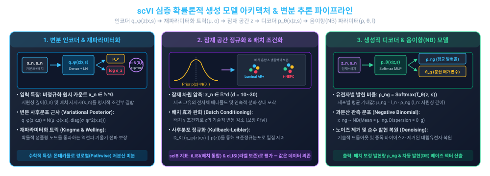
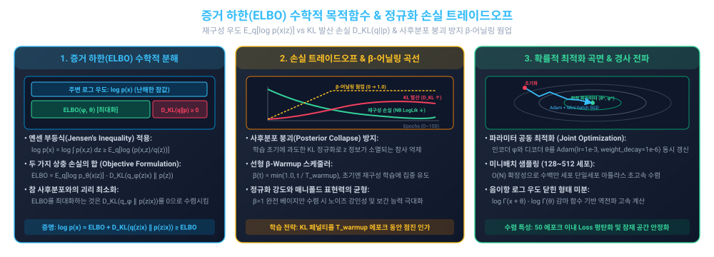

# 02. scVI 변분 오토인코더 및 확률론적 생성 모델 (scVI Variational Autoencoder)

---

## 학습 목표 (Cognitive Goals)

1. **베이지안 계층 모델과 변분 추론(Variational Inference)의 수리적 정식화**: 단일세포 전사체 관측 카운트의 사후확률 $p(z \mid x, s)$가 해석적으로 계산 불가능(Intractable)한 원인을 베이즈 정리의 주변 우도 적분 관점에서 증명하고, 변분 근사 사후분포 $q_\phi(z \mid x, s)$의 도입 원리를 설명할 수 있다.
2. **재파라미터화 트릭(Reparameterization Trick)을 통한 확률적 역전파 메커니즘 규명**: 확률적 샘플링 노드에서 오차 역전파가 차단되는 수학적 한계를 극복하기 위해 가우시안 노이즈 $\epsilon \sim \mathcal{N}(0, I)$를 외부화하여 인코더 가중치 $\phi$에 대한 경사 하강법을 유도할 수 있다.
3. **증거 하한(ELBO, Evidence Lower Bound)의 완전한 수리적 유도 및 최적화 다이내믹스 분석**: 젠센 부등식(Jensen's Inequality)을 통해 우도 하한을 유도하고, 재구성 오차(Reconstruction Loss)와 쿨백-라이블러 발산(KL Divergence) 간의 상충 관계 및 사후확률 붕괴(Posterior Collapse) 억제 기법을 분석할 수 있다.
4. **`scvi-tools` 및 PyTorch 기반 엔드투엔드 파이프라인 구현**: 원시 카운트 AnnData를 입력받아 조건부 VAE를 학습시키고, 배치 효과가 줄어들도록 조건화된 저차원 잠재 공간($z$) 추출, 정규화된 발현량 복원, 그리고 몬테카를로 사후 샘플링 기반 차별 발현 유전자(Differential Expression) 분석을 수행할 수 있다.

---

## 1. 베이지안 잠재 변수 모델과 변분 추론의 필연성

단일세포 전사체학에서 각 세포 $c$는 유전자 발현 공간의 고차원 카운트 벡터 $x_c \in \mathbb{N}_0^G$로 관측된다. 우리는 이 복잡한 고차원 벡터의 이면에 세포의 진정한 분자생물학적 정체성(Cell Identity)과 전사 상태를 지배하는 저차원 연속 잠재 변수(Latent Variable) $z_c \in \mathbb{R}^d$ ($d \ll G$, 통상 $d \approx 10 \sim 30$)가 존재한다고 가정한다.

```
[scVI Probabilistic Directed Graphical Model]

   s_c (Batch Covariate) ──────────┐
    │                              │
    ▼                              ▼
  [ z_c ] ───> Neural Decoder ──> [ ρ_cg ] ──┐
  ~ N(0, I)    f_θ(z_c, s_c)                 │
                                             ▼
  [ l_c ] ─────────────────────────────> [ μ_cg = l_c · ρ_cg ] ───> [ x_cg ]
  ~ LogNormal(l_μ, l_σ^2)                                          ~ NB(μ_cg, θ_sg)
```

### 1.1 계층적 생성 프로세스 (Generative Process)

scVI(single-cell Variational Inference; Lopez et al., *Nature Methods*, 2018)는 다음과 같은 엄밀한 확률적 생성 과정을 정의한다:

1.  **잠재 세포 상태(Cell Latent State) 샘플링**:
    $$z_c \sim \mathcal{N}(0, I_d)$$
2.  **세포별 라이브러리 크기(Library Size Factor) 샘플링**:
    $$l_c \sim \text{LogNormal}(l_{\mu, s_c}, l_{\sigma, s_c}^2)$$
3.  **정규화된 유전자 발현 비율(Gene Expression Proportions) 생성**:
    디코더 심층 신경망 $f_\theta$를 통과한 후 소프트맥스(Softmax)를 거쳐 심플렉스(Simplex) 상의 확률 벡터로 변환된다:
    $$\rho_c = f_\theta(z_c, s_c) = \text{Softmax}\left( \text{MLP}_\theta(z_c, s_c) \right), \quad \rho_{cg} > 0, \ \sum_{g=1}^G \rho_{cg} = 1$$
4.  **관측 카운트(Observed Count)의 음이항(NB) 샘플링**:
    $$x_{cg} \sim \text{NegativeBinomial}\left( \mu_{cg} = l_c \cdot \rho_{cg}, \ \text{dispersion} = \theta_{s_c, g} \right)$$

> (참고: 이는 Lopez et al. 2018 원 논문의 모델 서술이다. scvi-tools의 기본값 `use_observed_lib_size=True`에서는 $l_c$를 관측 총합 $N_c$로 고정하며 잠재 변수·`l_encoder`·LogNormal 사전을 쓰지 않는다. `False`로 지정하면 이 서술의 잠재 변수 모델이 된다.)

### 1.2 사후확률 추론의 불가능성 (Intractability of True Posterior)

우리의 목표는 관측된 카운트 $x_c$와 배치 정보 $s_c$가 주어졌을 때 잠재 변수 $z_c, l_c$의 참된 사후확률 분포 $p_\theta(z_c, l_c \mid x_c, s_c)$를 구하는 것이다. 그러나 베이즈 정리에 따르면:

$$p_\theta(z, l \mid x, s) = \frac{p_\theta(x \mid z, l, s) p(z) p(l \mid s)}{p_\theta(x \mid s)}$$

여기서 분모의 주변 우도(Marginal Likelihood, Evidence)는 잠재 공간 전체에 대한 적분이다:

$$p_\theta(x \mid s) = \iint p_\theta(x \mid z, l, s) p(z) p(l \mid s) \, dz \, dl$$

디코더 신경망 $f_\theta$가 복잡한 비선형 활성화 함수(ReLU, LayerNorm 등)로 구성되어 있으므로, 이 고차원 다중 적분은 해석적(Analytic)으로 풀 수 없다. 또한 몬테카를로 마르코프 연쇄(MCMC)와 같은 수치 적분 기법은 수십만 개의 세포에 적용하기에 계산 비용이 지나치게 높다.

---

## 2. 인코더 신경망과 재파라미터화 트릭 (Reparameterization Trick)

사후확률의 난해성을 극복하기 위해, 우리는 매개변수 $\phi$를 갖는 신경망 **인코더(Recognition Model / Inference Network) $q_\phi(z \mid x, s)$**를 도입하여 참 사후확률 $p_\theta(z \mid x, s)$를 근사한다.

$$q_\phi(z \mid x, s) = \mathcal{N}\left( z; \ \mu_\phi(x, s), \ \text{diag}(\sigma_\phi^2(x, s)) \right)$$

$$q_\phi(l \mid x, s) = \text{LogNormal}\left( l; \ \mu_{l,\phi}(x, s), \ \sigma_{l,\phi}^2(x, s) \right)$$

### 2.1 인코더-디코더 상호작용 아키텍처

아래 다이어그램은 원시 카운트 행렬이 인코더를 거쳐 잠재 가우시안 파라미터로 매핑되고, 재파라미터화 샘플링 후 디코더를 거쳐 음이항 파라미터로 복원되는 전체 scVI 아키텍처를 보여준다.



### 2.2 재파라미터화 트릭의 수학적 필요성

인코더가 출력한 $\mu_\phi$와 $\sigma_\phi$를 바탕으로 $z \sim q_\phi(z \mid x, s)$에서 확률적으로 $z$를 직접 샘플링하면, 손실 함수 $\mathcal{L}$에서 인코더 가중치 $\phi$로 역전파되는 그래디언트 $\nabla_\phi \mathbb{E}_{q_\phi}[f(z)]$가 단절된다:

```
[Direct Stochastic Sampling: Gradient Blocked]
Input x ──> Encoder [μ_φ, σ_φ] ──> [Stochastic Node: z ~ N(μ_φ, σ_φ^2)] ──> Decoder ──> Loss
                                                 ▲
                                       (Backpropagation Impossible!)

[Reparameterization Trick: Gradient Flow Restored]
Input x ──> Encoder [μ_φ, σ_φ] ──────┐
                                     ▼
Auxiliary Noise ε ~ N(0, I) ──> [ z = μ_φ + σ_φ ⊙ ε ] ──> Decoder ──> Loss
                                     │
                                     └── Backpropagation cleanly flows to μ_φ and σ_φ!
```

킹마와 웰링(Kingma & Welling, 2013)은 확률적 변동성을 인코더 네트워크의 파라미터와 독립적인 보조 노이즈 벡터 $\epsilon$으로 외주화하는 **재파라미터화 트릭(Reparameterization Trick)**을 제안하였다:

$$\epsilon \sim \mathcal{N}(0, I_d)$$

$$z = g_\phi(\epsilon, x, s) = \mu_\phi(x, s) + \sigma_\phi(x, s) \odot \epsilon$$

여기서 $\odot$는 요소별 곱(Hadamard Product)이다. 이 변환을 통해 샘플링된 $z$는 $\phi$에 대해 연속 미분 가능(Continuously Differentiable)해지며, 몬테카를로 단일 샘플에 대해서도 명확한 역전파 체인 룰(Chain Rule)이 성립한다:

$$\nabla_\phi \mathbb{E}_{q_\phi(z \mid x, s)}[f(z)] = \mathbb{E}_{p(\epsilon)}\left[ \nabla_z f(z) \cdot \nabla_\phi g_\phi(\epsilon, x, s) \right]$$

---

## 3. 증거 하한 (ELBO, Evidence Lower Bound)의 완전한 수리적 유도

우리는 관측 데이터의 주변 로그 우도 $\log p_\theta(x \mid s)$를 최대화하고자 한다. 젠센 부등식(Jensen's Inequality)과 쿨백-라이블러 발산(Kullback-Leibler Divergence)을 사용하여 ELBO를 유도한다.

### 3.1 젠센 부등식 기반 유도

로그 함수는 오목 함수(Concave Function)이므로, 임의의 확률 밀도 $q(z)$에 대해 젠센 부등식 $\log \mathbb{E}[Y] \ge \mathbb{E}[\log Y]$가 성립한다:

$$\log p_\theta(x \mid s) = \log \int p_\theta(x, z \mid s) \, dz$$

$$= \log \int q_\phi(z \mid x, s) \frac{p_\theta(x, z \mid s)}{q_\phi(z \mid x, s)} \, dz$$

$$= \log \mathbb{E}_{q_\phi(z \mid x, s)}\left[ \frac{p_\theta(x, z \mid s)}{q_\phi(z \mid x, s)} \right]$$

$$\ge \mathbb{E}_{q_\phi(z \mid x, s)}\left[ \log \frac{p_\theta(x, z \mid s)}{q_\phi(z \mid x, s)} \right] \equiv \mathcal{L}_{\text{ELBO}}(\theta, \phi; x, s)$$

### 3.2 재구성 오차와 KL 발산으로의 분해

ELBO 수식의 분자를 결합 확률 $p_\theta(x, z \mid s) = p_\theta(x \mid z, s) p(z)$로 분해한다:

$$\mathcal{L}_{\text{ELBO}}(\theta, \phi; x, s) = \mathbb{E}_{q_\phi(z \mid x, s)}\left[ \log \frac{p_\theta(x \mid z, s) p(z)}{q_\phi(z \mid x, s)} \right]$$

$$= \mathbb{E}_{q_\phi(z \mid x, s)}\left[ \log p_\theta(x \mid z, s) \right] + \mathbb{E}_{q_\phi(z \mid x, s)}\left[ \log \frac{p(z)}{q_\phi(z \mid x, s)} \right]$$

$$= \underbrace{\mathbb{E}_{q_\phi(z \mid x, s)}[\log p_\theta(x \mid z, s)]}_{\text{재구성 우도 (Reconstruction Accuracy)}} - \underbrace{D_{\text{KL}}\left( q_\phi(z \mid x, s) \parallel p(z) \right)}_{\text{사전분포 정규화 (Latent Regularization)}}$$

동일한 방식으로 라이브러리 크기 잠재 변수 $l$에 대한 항을 포함하면, 전체 scVI 손실 함수는 다음과 같다:

$$\mathcal{L}_{\text{scVI}}(\theta, \phi) = \mathbb{E}_{q_\phi(z, l \mid x, s)}\left[ \log p_\theta(x \mid z, l, s) \right] - D_{\text{KL}}\left( q_\phi(z \mid x, s) \parallel p(z) \right) - D_{\text{KL}}\left( q_\phi(l \mid x, s) \parallel p(l \mid s) \right)$$

### 3.3 가우시안 KL 발산의 해석적 적분 해

사전분포 $p(z) = \mathcal{N}(0, I_d)$이고 변분 사후분포가 대각 공분산 가우시안 $q_\phi(z \mid x, s) = \mathcal{N}(\mu, \text{diag}(\sigma^2))$일 때, KL 발산은 다음과 같이 닫힌 형태(Closed-form)로 해석적 계산이 가능하다:

$$D_{\text{KL}}(q_\phi \parallel p) = \int q(z) \log \frac{q(z)}{p(z)} dz$$

$$= \frac{1}{2} \sum_{j=1}^d \left( \sigma_j^2 + \mu_j^2 - 1 - \log(\sigma_j^2) \right)$$

이 해석적 해 덕분에 KL 항은 몬테카를로 샘플링 없이 $O(d)$의 매우 빠른 연산량으로 정확한 그래디언트를 도출할 수 있다.

---

## 4. 최적화 다이내믹스: 재구성 vs 정규화 트레이드오프 및 사후확률 붕괴

아래 다이어그램은 ELBO 손실 함수의 두 구성 요소인 음이항 재구성 손실과 가우시안 정규화 페널티 간의 최적화 상충 관계를 시각화한다.



### 4.1 사후확률 붕괴 (Posterior Collapse / KL Vanishing)

VAE 학습 초기 단계에서 디코더 신경망의 표현력이 강하거나 학습률이 높을 때, 모델은 잠재 변수 $z$를 활용하지 않고 단순히 $q_\phi(z \mid x) \to p(z) = \mathcal{N}(0, I)$로 만들어 버림으로써 KL 발산을 0으로 최소화하는 국소 최적해에 빠질 수 있다. 이를 **사후확률 붕괴(Posterior Collapse)**라 한다:
*   사후확률 붕괴가 일어나면 잠재 공간의 모든 차원에서 $\mu_j \to 0, \sigma_j^2 \to 1$이 되어 세포의 고유한 유전자 발현 패턴이 완전히 소실되고, UMAP 시각화 시 모든 세포가 원점에 뭉쳐 흩어지지 않는다.

### 4.2 $\beta$-어닐링(KL Warm-up)을 통한 해결

scVI는 이 현상을 방지하기 위해 KL 발산 페널티 앞에 동적 가중치 $\beta_t \in [0, 1]$를 부여하는 **KL Annealing**을 적용한다:

$$\mathcal{L}_{\text{warmup}} = \mathbb{E}_{q}[\log p(x \mid z)] - \beta_t \cdot D_{\text{KL}}(q \parallel p)$$

$$\beta_t = \min\left(1.0, \ \frac{t}{T_{\text{warmup}}}\right)$$

*   초기 $T_{\text{warmup}}$ 에포크 동안 $\beta_t$를 0에서 1로 점진적으로 증가시킨다(scvi-tools `TrainingPlan` 기본값은 `n_epochs_kl_warmup=400`이며 `plan_kwargs`로 바꿀 수 있다; 아래 5.2의 예시는 30).
*   학습 초기에는 재구성 오차 최소화에만 집중하여 잠재 공간 $z$가 유전자 발현 구조를 적극적으로 인코딩하도록 유도한 후, 점진적으로 가우시안 구형(Spherical) 정규화를 적용하여 매끄러운 연속 잠재 다양체(Continuous Latent Manifold)를 형성한다.

---

## 5. End-to-End 실습 파이프라인: PyTorch 아키텍처 및 `scvi-tools` 프로덕션

### 5.1 경량 PyTorch scVI VAE 모듈 직접 구현

```python
"""
02_minimal_scvi_vae.py
PyTorch 기반 경량 scVI 변분 오토인코더(VAE) 아키텍처 및 ELBO 계산 모듈.
"""

import torch
import torch.nn as nn
import torch.nn.functional as F

class SingleCellVAE(nn.Module):
    def __init__(self, n_genes: int, n_batches: int, n_latent: int = 10, n_hidden: int = 128):
        super().__init__()
        self.n_genes = n_genes
        self.n_latent = n_latent
        
        # 1. 인코더 네트워크: [x, s] -> [mu_z, log_var_z], [mu_l, log_var_l]
        self.encoder = nn.Sequential(
            nn.Linear(n_genes + n_batches, n_hidden),
            nn.BatchNorm1d(n_hidden),
            nn.ReLU(),
            nn.Dropout(0.1),
            nn.Linear(n_hidden, n_hidden),
            nn.BatchNorm1d(n_hidden),
            nn.ReLU()
        )
        self.fc_mu_z = nn.Linear(n_hidden, n_latent)
        self.fc_logvar_z = nn.Linear(n_hidden, n_latent)
        
        self.fc_mu_l = nn.Linear(n_hidden, 1)
        self.fc_logvar_l = nn.Linear(n_hidden, 1)

        # 2. 디코더 네트워크: [z, s] -> rho_cg
        self.decoder = nn.Sequential(
            nn.Linear(n_latent + n_batches, n_hidden),
            nn.BatchNorm1d(n_hidden),
            nn.ReLU(),
            nn.Linear(n_hidden, n_hidden),
            nn.BatchNorm1d(n_hidden),
            nn.ReLU(),
            nn.Linear(n_hidden, n_genes)
        )
        
        # 유전자별 과산포 파라미터 (Inverse Dispersion theta)
        self.px_r = nn.Parameter(torch.randn(n_genes))

    def reparameterize(self, mu: torch.Tensor, logvar: torch.Tensor) -> torch.Tensor:
        std = torch.exp(0.5 * logvar)
        eps = torch.randn_like(std)
        return mu + eps * std

    def forward(self, x: torch.Tensor, s_onehot: torch.Tensor):
        # 1. Log-transform input for encoder stability
        x_in = torch.log1p(x)
        enc_in = torch.cat([x_in, s_onehot], dim=-1)
        hidden = self.encoder(enc_in)
        
        # 2. Latent parameters
        qz_mu = self.fc_mu_z(hidden)
        qz_logvar = self.fc_logvar_z(hidden)
        z = self.reparameterize(qz_mu, qz_logvar)
        
        # 3. Library size parameters
        ql_mu = self.fc_mu_l(hidden)
        ql_logvar = self.fc_logvar_l(hidden)
        l_scale = torch.exp(self.reparameterize(ql_mu, ql_logvar))
        
        # 4. Decode to gene proportions
        dec_in = torch.cat([z, s_onehot], dim=-1)
        raw_rho = self.decoder(dec_in)
        rho = F.softmax(raw_rho, dim=-1) # Simplex constraint
        
        # 5. Expected count mean
        mu_hat = l_scale * rho
        theta = torch.exp(self.px_r).unsqueeze(0) # (1, G)
        
        return {
            "z": z, "rho": rho, "mu_hat": mu_hat, "theta": theta,
            "qz_mu": qz_mu, "qz_logvar": qz_logvar,
            "ql_mu": ql_mu, "ql_logvar": ql_logvar, "l_scale": l_scale
        }

    def compute_elbo(self, x: torch.Tensor, out: dict, library_prior: tuple, beta: float = 1.0) -> torch.Tensor:
        # library_prior = (prior_l_mu, prior_l_var): 반드시 torch.Tensor (Batch, 1) 또는 스칼라 텐서.
        # 예) lib = torch.log(x.sum(1, keepdim=True)); prior_l_mu = lib.mean().expand_as(lib);
        #     prior_l_var = lib.var().expand_as(lib)  (배치별로 따로 계산해도 됨). float을 넘기면 torch.log에서 TypeError.
        mu = out["mu_hat"]
        theta = out["theta"]
        
        # A. Negative Binomial Reconstruction Loss
        log_theta_mu = torch.log(theta + mu + 1e-8)
        t1 = torch.lgamma(x + theta) - torch.lgamma(theta) - torch.lgamma(x + 1.0)
        t2 = theta * (torch.log(theta + 1e-8) - log_theta_mu)
        t3 = x * (torch.log(mu + 1e-8) - log_theta_mu)
        recon_loss = -torch.sum(t1 + t2 + t3, dim=-1) # (Batch,)
        
        # B. Latent z Gaussian KL Divergence: KL(N(mu, sigma^2) || N(0, I))
        kl_z = -0.5 * torch.sum(1.0 + out["qz_logvar"] - out["qz_mu"].pow(2) - out["qz_logvar"].exp(), dim=-1)
        
        # C. Library l LogNormal KL Divergence
        prior_l_mu, prior_l_var = library_prior
        kl_l = -0.5 * torch.sum(1.0 + out["ql_logvar"] - torch.log(prior_l_var) - 
                                (out["ql_logvar"].exp() + (out["ql_mu"] - prior_l_mu).pow(2)) / prior_l_var, dim=-1)
        
        total_loss = recon_loss + beta * (kl_z + kl_l)
        return total_loss.mean()
```

### 5.2 프로덕션 `scvi-tools` 표준 파이프라인

```python
"""
02_scvi_production_pipeline.py
scvi-tools를 활용한 전립선암 단일세포 전사체 통합, 잠재 표현 추출 및 차별 발현 검정.
"""

import scanpy as sc
import scvi
import matplotlib.pyplot as plt

def run_scvi_integration_pipeline(adata_path: str):
    # 1. 원시 AnnData 로드
    adata = sc.read_h5ad(adata_path)
    print(f"Loaded dataset: {adata.n_obs} cells x {adata.n_vars} genes.")

    # 2. 품질 관리 및 HVG (Highly Variable Genes) 선정 (원시 카운트 레이어 보존 필수)
    adata.layers["counts"] = adata.X.copy() # 원시 정수 카운트 복제
    sc.pp.highly_variable_genes(
        adata,
        n_top_genes=3000,
        subset=True,
        layer="counts",
        flavor="seurat_v3",
        batch_key="patient_id" # 배치 특이적 기술적 편향 방지
    )

    # 3. scvi-tools 데이터 셋업 (Negative Binomial 파라미터 매핑 등록)
    scvi.model.SCVI.setup_anndata(
        adata,
        layer="counts",
        batch_key="patient_id", # 환자 간 배치 효과 공변량
        categorical_covariate_keys=["sequencing_protocol"], # 10x v2 vs v3
        continuous_covariate_keys=["percent_mito"] # 미토콘드리아 분율
    )

    # 4. scVI 모델 인스턴스화 및 학습
    model = scvi.model.SCVI(
        adata,
        n_hidden=128,
        n_latent=20, # 20차원 생물학적 잠재 공간
        n_layers=2,
        gene_likelihood="nb", # 기본값은 "zinb"; UMI 데이터에서는 Svensson 2020에 따라 NB를 명시적으로 선택
        dispersion="gene-batch" # 배치별 유전자 과산포 수용
    )

    # KL warm-up 스케줄링을 동반한 학습 실행
    model.train(
        max_epochs=250,
        early_stopping=True,
        early_stopping_patience=20,
        plan_kwargs={"lr": 1e-3, "n_epochs_kl_warmup": 30}
    )

    # 5. 잠재 공간(Latent Space) 추출 및 시각화
    adata.obsm["X_scVI"] = model.get_latent_representation()
    
    # 6. 정규화된 유전자 발현량(Denoised Expression) 복원
    # transform_batch를 지정하지 않으면 각 세포의 "관측된 실제 배치"로 디코딩되어 배치 보정이 되지 않는다.
    # 배치 보정 발현을 얻으려면 기준 배치를 지정해 모든 세포를 같은 배치로 디코딩한다.
    ref_batch = adata.obs["patient_id"].value_counts().idxmax()
    adata.layers["scvi_normalized"] = model.get_normalized_expression(
        library_size=10000,
        n_samples=25, # 몬테카를로 25회 샘플링 평균
        transform_batch=ref_batch
    )

    # 7. UMAP 차원 축소 및 군집화
    sc.pp.neighbors(adata, use_rep="X_scVI")
    sc.tl.umap(adata)
    sc.tl.leiden(adata, resolution=0.8, key_added="leiden_scVI")

    # 8. 사후확률 몬테카를로 샘플링 기반 차별 발현 유전자(DE) 검정
    # leiden 범주는 "0","1",... 이므로 존재하지 않는 라벨을 쓰지 않고, 마커 발현으로 대응 군집을 고른다.
    # (주의: 같은 잠재 공간으로 만든 군집을 다시 DE 입력으로 쓰면 순환적이라 proba_de가 낙관적일 수 있다)
    ne_markers = [g for g in ("SYP", "CHGA", "ASCL1") if g in adata.var_names]
    lum_markers = [g for g in ("AR", "KLK3") if g in adata.var_names]
    if not ne_markers or not lum_markers:
        raise ValueError("t-NEPC/관강 마커가 HVG 어휘에 없습니다: 마커를 포함하도록 HVG를 조정하세요.")
    clusters = adata.obs["leiden_scVI"]
    ne_score = sc.get.obs_df(adata, ne_markers, layer="counts").groupby(clusters, observed=True).mean().mean(axis=1)
    lum_score = sc.get.obs_df(adata, lum_markers, layer="counts").groupby(clusters, observed=True).mean().mean(axis=1)
    tnepc_cluster, luminal_cluster = ne_score.idxmax(), lum_score.idxmax()
    if tnepc_cluster == luminal_cluster:
        raise ValueError("두 마커가 같은 군집에서 최대입니다: 군집 해상도/마커를 재검토하세요.")
    de_df = model.differential_expression(
        groupby="leiden_scVI",
        group1=tnepc_cluster,
        group2=luminal_cluster,
        mode="change" # 베이지안 결정 이론 기반 로그 폴드체인지
    )
    
    print("=== Top Differential Expression Markers ===")
    print(de_df[["proba_de", "bayes_factor", "lfc_mean"]].head(10))
    
    return adata, model
```

---

## 단원 핵심 점검 (Cognitive Checkpoint & Case Study)

### 문제 1: 잠재 변수 차원 $d$ 설정과 Posterior Collapse 현상의 원인 및 해결
단일세포 전사체 코호트(10만 개 세포, 3,000개 HVG)에 대해 scVI 모델을 설계하고자 한다. 한 신임 엔지니어가 "복잡한 세포 이질성을 극대화하여 표현하기 위해 잠재 공간 차원을 $d = 256$으로 설정하고, 학습 초기부터 정규화 강도를 높이기 위해 $\beta = 5.0$을 부여했다."
1. 이 하이퍼파라미터 조합이 초래할 **사후확률 붕괴(Posterior Collapse)** 메커니즘을 수식 $\mathcal{L} = \mathbb{E}[\log p(x \mid z)] - \beta D_{\text{KL}}(q_\phi(z \mid x) \parallel p(z))$을 바탕으로 설명하시오.
2. 단일세포 전사체 생물학의 '고유 차원(Intrinsic Dimensionality)' 특성을 고려할 때 $d$의 최적 범위(통상 10~30)와 $\beta$-Warmup 스케줄링의 공학적 해결책을 제시하시오.

<details>
<summary>💡 모범 답안 및 해설 확인</summary>

**1. 사후확률 붕괴의 메커니즘**:
*   잠재 차원 $d=256$은 3,000개의 입력 유전자 신호에 비해 지나치게 과도한 자유도를 부여한다.
*   손실 함수에서 $\beta = 5.0$으로 설정하면, 디코더가 입력 $x$를 복원하여 얻는 우도 이득보다 KL 발산 항 $5.0 \times \sum_{j=1}^{256} D_{\text{KL}}(q_j \parallel p_j)$이 유발하는 페널티가 압도적으로 커진다.
*   신경망 최적화기는 전체 손실을 빠르게 줄이기 위해 가장 쉬운 경로를 선택한다: 즉, 인코더가 모든 입력 $x$에 대해 $\mu_\phi(x) \to 0$, $\log \sigma_\phi^2(x) \to 0$을 출력하도록 만들어 $D_{\text{KL}} \to 0$으로 소멸시킨다.
*   그 결과 $z$는 입력 데이터 $x$에 대한 어떠한 생물학적 정보도 담지 않는 단순한 표준 정규 노이즈($z \sim \mathcal{N}(0, I)$)로 전락하며, 디코더는 $z$를 완전히 무시하고 전체 유전자의 평균 발현량만을 예측하게 된다.

**2. 고유 차원과 공학적 해결책**:
*   **생물학적 고유 차원**: 수천 개의 유전자가 측정되더라도, 유전자들은 독립적으로 작동하지 않고 소수의 공통 조절 모듈(Transcriptional Regulons, 20~30개 내외의 신호전달 경로 및 분화 축)에 의해 공변동(Co-vary)한다. 따라서 실제 단일세포 다양체(Manifold)의 내재적 고유 차원은 $d = 10 \sim 30$ 수준이다. 차원을 10~30으로 제한하면 정보 병목(Information Bottleneck)이 형성되어 핵심 전사 프로그램만을 압축하게 된다.
*   **$\beta$-Warmup 스케줄링**: 학습 시작 시 $\beta_0 = 0$으로 시작하여 $T_{\text{warmup}}$ 에포크 동안(scvi-tools 기본 400, 예시 코드는 30) $\beta_t = \min(1.0, t / T_{\text{warmup}})$으로 선형 증가시킨다. 이를 통해 초기에는 인코더가 $x$의 특징을 $z$에 충실히 매핑하도록 유도한 후, 점진적으로 가우시안 정규화를 부여함으로써 사후확률 붕괴를 완화한다(완전히 막지는 못한다).

</details>

---

### 문제 2: 배치 공변량 $s_c$의 조건부 주입과 잠재 공간의 배치 정보 (공변량 주입 위치의 선택)
1. scVI 아키텍처에서 배치 공변량 $s_c$를 디코더 $p_\theta(x \mid z, s)$에 조건부 입력으로 주입하는 수리통계적 이유를 설명하고, 이것이 잠재 변수 $z$와 $s$의 독립($z \perp s$)을 **보장하는지** 논하시오.
2. $s_c$를 인코더 $q_\phi(z \mid x, s)$에도 주입하는 설정(`encode_covariates=True`)과 디코더에만 주입하는 설정(scvi-tools 기본값 `encode_covariates=False`, `deeply_inject_covariates=True`)의 차이를 정보 흐름 관점에서 논하시오.

<details>
<summary>💡 모범 답안 및 해설 확인</summary>

**1. 디코더 조건부 주입의 이유와 한계**:
*   목표는 잠재 변수 $z$에 배치 특이적 변동이 덜 담기도록 하여 $z$ 공간에서의 시각화·군집화가 생물학적 변동 위주가 되게 하는 것이다.
*   디코더가 $s$를 알면 배치마다 다른 측정 효율과 스케일(절편·분산)을 디코더가 설명할 수 있으므로, $z$에 배치 정보를 억지로 보존할 유인이 줄어든다.
*   그러나 ELBO에는 $z \perp s$를 강제하는 항이 없고, $\mathrm{KL}(q(z\mid x)\,\|\,\mathcal{N}(0,I))$는 독립성을 보장하지 않는다. 따라서 $z$에는 배치 정보가 일부 남을 수 있다(배치 보정 정도는 데이터와 방법에 따라 다르며 batch removal과 bio conservation 사이에는 상충이 있다; Luecken 외 2022).

**2. 인코더 주입 여부에 따른 차이**:
*   scvi-tools의 `SCVI` 기본값은 `encode_covariates=False`이다. 즉 인코더는 $x$만 받고 $s$는 디코더(깊이 주입 `deeply_inject_covariates=True`)에만 주어진다. 이 기본 구성이 배치 정보가 $z$에 남는다고 단정할 근거는 없다.
*   인코더에도 $s$를 주입(`encode_covariates=True`)하면 $q_\phi(z \mid x, s)$가 배치별로 $x$의 변동을 보정할 수 있고, scArches처럼 새 배치를 쿼리로 매핑하는 전이 학습에서는 이 설정이 필요한 경우가 있다(별개 논점).
*   어느 설정이든 완전한 배치 불변성을 가정하지 말고, 통합 결과를 배치 혼합 지표와 생물학적 보존 지표로 함께 평가해야 한다.

</details>

---

### 문제 3: scVI 몬테카를로 사후 샘플링 기반 DE 검정과 고전적 검정(Wilcoxon)의 비교
임상 전립선암 연구에서 엔잘루타마이드(Enzalutamide) 치료에 저항성을 획득한 서브클론과 치료 반응성 서브클론 간의 차별 발현 유전자(Differential Expression, DE)를 발굴하고자 한다.
1. 고전적인 정규화 카운트 기반 윌콕슨 순위합 검정(Wilcoxon Rank-Sum Test)이 라이브러리 크기 편차와 기술적 드롭아웃으로 인해 다수의 거짓 양성(False Positives)을 생성하는 통계적 원인을 설명하시오.
2. scVI의 베이지안 차별 발현 검정이 잠재 변수 $z$의 사후분포로부터 디코딩된 상대 발현 비율 $\rho_{cg}$에 대해 몬테카를로 샘플링을 수행하고 베이즈 팩터(Bayes Factor)를 계산하는 방식을 수식으로 기술하고, 그 우월성을 논하시오.

<details>
<summary>💡 모범 답안 및 해설 확인</summary>

**1. 고전적 윌콕슨 검정의 통계적 결함**:
*   **순위 기반 비모수 검정의 왜곡**: 윌콕슨 순위합 검정은 카운트 값의 상대적 순위(Rank)만을 비교한다. 그러나 단일세포 데이터의 대다수를 차지하는 0(Zero counts)은 모두 동일한 최하위 순위(Tied Ranks)로 묶인다.
*   만약 두 집단 간에 세포 크기나 시퀀싱 깊이(Library size) 차이가 존재할 경우, 단순 비례 정규화 후에도 영점 묶임 현상(타이는 평균 순위로 처리됨)으로 인해 통계량이 왜곡될 수 있다. 또한 세포 단위 비교는 같은 환자의 세포를 독립 반복으로 취급하는 의사반복(pseudoreplication) 문제가 있어, 환자 단위 복제를 고려한 분석(pseudobulk 등)이 필요하다.
*   또한 윌콕슨 검정은 측정 오차(Measurement Uncertainty)를 전혀 고려하지 않는다. 1개 분자만 측정된 불확실한 저신뢰도 관측값과 100개 분자가 확고하게 측정된 고신뢰도 관측값을 동일한 확정적 수치(Deterministic point value)로 취급하므로, 특히 저발현 전사인자에서 극심한 거짓 양성(False Positives)을 유발한다.

**2. scVI 몬테카를로 베이지안 DE 검정 메커니즘**:
*   scVI는 관측 카운트 $x$를 직접 비교하지 않고, 인코더 사후분포 $q_\phi(z \mid x)$에서 $S$개의 잠재 벡터 $z^{(s)}$를 샘플링한 후, 디코더를 통과시켜(기준 배치를 지정해 디코딩하면 배치 효과가 줄어든) 상대 발현 비율 $\rho_{cg}^{(s)} = f_\theta(z^{(s)})_g$를 복원한다.
*   두 세포 집단 $A$와 $B$에 대해, 유전자 $g$가 집단 $A$에서 집단 $B$보다 $\delta$ 배율 이상 차별 발현될 사후확률을 직접 추정한다:
    $$P\left( |\log_2 \rho_{Ag} - \log_2 \rho_{Bg}| > \delta \mid X \right) \approx \frac{1}{S} \sum_{s=1}^S \mathbb{I}\left( |\log_2 \rho_{Ag}^{(s)} - \log_2 \rho_{Bg}^{(s)}| > \delta \right)$$
*   가설 검정의 지표로 베이즈 팩터(Bayes Factor, $K$)를 산출한다:
    $$K = \log \frac{P(H_1 \mid X)}{P(H_0 \mid X)} = \log \frac{P(|\log_2 \rho_A - \log_2 \rho_B| > \delta \mid X)}{1 - P(|\log_2 \rho_A - \log_2 \rho_B| > \delta \mid X)}$$
*   **우월성**: 라이브러리 크기($l_c$)가 별도 잠재 변수로 모델링되고 배치 공변량이 디코더에 주어지므로, 라이브러리 크기 불균형과 배치에 의한 가짜 발현 차이가 상당 부분 완화된다(완전한 배제를 보장하지는 않는다). 또한 사후 불확실성(Posterior Variance)을 확률적으로 적분하므로 통계적 검정력이 향상될 수 있고 거짓 양성 감소가 기대된다(Wilcoxon과의 비교 성능은 데이터에 따라 달라 직접 벤치마크로 확인해야 한다).

</details>

---

<!-- REFERENCES:BEGIN (generated by scripts/apply_references.py; do not edit by hand) -->
## 참고문헌 (References)
### 본문 인용 문헌
1. Lopez R, Regier J, Cole MB, et al. Deep generative modeling for single-cell transcriptomics. *Nat Methods*. 2018;15(12):1053-1058. PMID: 30504886. doi: 10.1038/s41592-018-0229-2
2. Luecken MD, Büttner M, Chaichoompu K, et al. Benchmarking atlas-level data integration in single-cell genomics. *Nat Methods*. 2022;19(1):41-50. PMID: 34949812. doi: 10.1038/s41592-021-01336-8
3. Kingma DP, Welling M. Auto-Encoding Variational Bayes. *arXiv* preprint. 2013. arXiv: 1312.6114.
### 소프트웨어 (표기 버전은 검수 시 API를 확인한 버전이며, 파이프라인 실행 환경은 requirements-pipelines.txt 참조)
- Matplotlib 3.11.2 (github.com/matplotlib/matplotlib). 원 논문: Hunter JD. Matplotlib: A 2D Graphics Environment. *Comput. Sci. Eng*. 2007;9(3):90-95. doi: 10.1109/mcse.2007.55
- Scanpy 1.12.4 (github.com/scverse/scanpy). 원 논문: Wolf FA, Angerer P, Theis FJ. SCANPY: large-scale single-cell gene expression data analysis. *Genome Biol*. 2018;19(1):15. PMID: 29409532. doi: 10.1186/s13059-017-1382-0
- scvi-tools 1.5.1 (github.com/scverse/scvi-tools). 원 논문: Gayoso A, Lopez R, Xing G, et al. A Python library for probabilistic analysis of single-cell omics data. *Nat Biotechnol*. 2022;40(2):163-166. PMID: 35132262. doi: 10.1038/s41587-021-01206-w
- PyTorch 2.14.1 (github.com/pytorch/pytorch).
<!-- REFERENCES:END -->
