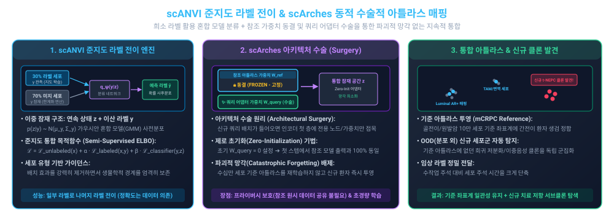

# 04. scArches 아키텍처 수술과 지속적 아틀라스 매핑 (scArches Architectural Surgery)

---

## 학습 목표 (Cognitive Goals)

1. **초대형 단일세포 아틀라스의 파괴적 망각(Catastrophic Forgetting) 및 잠재 공간 표류(Latent Drift) 규명**: 수백만~수천만 개 세포로 구축된 표준 레퍼런스 아틀라스에 신규 쿼리 코호트를 추가할 때 발생하는 전역 재학습(Full Retraining)의 계산적 불가능성과 기존 클러스터 좌표계 붕괴 현상을 수리적으로 분석할 수 있다.
2. **scArches 아키텍처 수술(Architectural Surgery)의 수리적 메커니즘 도출**: 기존 레퍼런스 인코더·디코더의 핵심 가중치($W_{\text{ref}}$)를 완전히 동결(Freeze)한 상태에서 신규 쿼리 배치 전용 어댑터 가중치($W_{\text{query}}$)를 동적으로 봉합(Splicing)하는 조건부 VAE 아키텍처를 유도할 수 있다.
3. **레퍼런스 잠재 공간 불변성(Mathematical Invariance)과 지속 학습(Lifelong Learning) 체계화**: 기존 레퍼런스 세포의 잠재 좌표가 수학적으로 정확히 보존됨($z_{\text{scArches}}(x_{\text{ref}}) \equiv z_{\text{ref}}(x_{\text{ref}})$)을 증명하고, 신규 미지의 임상 세포 상태(Novel Cell States)를 왜곡 없이 수용하는 메커니즘을 설명할 수 있다.
4. **분산(Decentralized) 매핑 및 개인정보 보호형 아틀라스 확장 파이프라인 구현**: `scvi-tools`의 `load_query_data`를 활용하여 원시 시퀀싱 데이터를 병원 밖으로 공유하지 않고 각자 로컬에서 레퍼런스 아틀라스에 매핑하는 코드를 작성할 수 있다(GDPR/HIPAA 준수 여부는 별도의 법적 검토가 필요하며 이 방식만으로 보장되지 않는다).

---

## 1. 초대형 아틀라스의 계산적 한계와 파괴적 망각 (Catastrophic Forgetting)

Human Cell Atlas(HCA)와 같은 국제 컨소시엄은 수천 명의 기증자로부터 수집된 수천만 개의 세포를 단일한 표준 좌표계로 통합하고 있다. 그러나 이러한 초대형 아틀라스를 실제 임상 현장에서 활용하고자 할 때 심각한 공학적 장벽이 발생한다.

```
[The Atlas Update Dilemma: Full Retraining vs Continual Surgery]

Approach A: Full Retraining (고전적 전역 재학습)
  Reference (10M cells) + New Clinical Query (10k cells)
            │
            ▼ (Train all weights from scratch, 1,000+ GPU Hours)
  New Atlas Model ──> Latent Space Drifts! Coordinates of all 10M cells change!
  * 계산 비용 천문학적 증가, 기존 논문/데이터베이스 좌표계 영구 파괴, 희귀 세포 망각

Approach B: scArches Architectural Surgery (지속적 아키텍처 수술)
  Reference Weights FROZEN (No Gradient Updates)
            │
            ├─ Query Weights Added Spliced (Adapter Layer Only)
            ▼ (Fine-tune only a small fraction of parameters; illustrative)
  Updated Atlas ──> Reference Latent Coordinates are 100% Identical! Zero Drift!
```

### 1.1 전역 재학습(Full Retraining)의 3대 한계

신규 환자 코호트(예: 신약 임상시험에 참여한 전립선암 환자 10명의 생검 검체 2만 개 세포)가 발생할 때마다 전체 아틀라스를 다시 학습시키는 것은 다음과 같은 치명적 결함을 수반한다:

1.  **계산 비용과 탄소 배출의 폭발**: 1천만 개 세포에 대해 scVI VAE를 수렴시키는 데에는 엔터프라이즈 GPU 클러스터에서 수백 시간 이상의 연산과 막대한 클라우드 비용이 소모된다.
2.  **잠재 공간 표류(Latent Space Drift)**: 신경망 최적화의 비볼록성(Non-convexity)과 확률적 경사 하강법(SGD)의 무작위성으로 인해, 전역 재학습을 수행할 때마다 기존 1천만 개 세포의 $z$ 좌표가 무작위로 회전하고 이동한다. 이는 이전에 표준 아틀라스에 등록해 둔 세포형 경계선, 마커 발현 임계치, 환자별 좌표 데이터베이스를 전부 무용지물로 만든다.
3.  **파괴적 망각(Catastrophic Forgetting)**: 신규 코호트의 특정 배치 노이즈에 신경망 가중치가 과적합되면서, 기존 레퍼런스 아틀라스에만 드물게 존재하던 희귀 정상 세포형(예: 희귀 전립선 신경내분비 상피세포, 골수 줄기세포)의 잠재 공간 표현력이 영구히 소실된다.

---

## 2. scArches 아키텍처 수술의 수학적 원리 (Architectural Surgery)

scArches(single-cell Architecture Surgery; Lotfollahi et al., *Nature Biotechnology*, 2022)는 지속 학습(Continual Learning) 이론을 단일세포 조건부 생성 모델(Conditional VAE)에 접목하여 이 문제를 해결한다.

### 2.1 아틀라스 매핑 아키텍처 다이어그램

아래 다이어그램은 사전학습된 거대 레퍼런스 모델의 가중치를 완전히 동결하고, 신규 쿼리 코호트가 유입되었을 때 조건부 어댑터 레이어만을 수술적으로 증설하여 결합하는 전체 구조를 보여준다.



### 2.2 조건부 인코더 및 디코더의 수술 메커니즘

레퍼런스 아틀라스가 $B_{\text{ref}}$개의 배치(환자/플랫폼)로 사전학습되었다고 하자. 레퍼런스 모델의 임의의 선형 은닉층(Hidden Layer)은 다음과 같이 표현된다:

$$h = \sigma\left( W_{\text{ref}} x + U_{\text{ref}} s_{\text{ref}} + b_{\text{ref}} \right)$$

*   $W_{\text{ref}} \in \mathbb{R}^{H \times G}$: 유전자 입력 가중치 행렬
*   $U_{\text{ref}} \in \mathbb{R}^{H \times B_{\text{ref}}}$: 레퍼런스 배치 원-핫 벡터 $s_{\text{ref}}$에 대한 조건부 결합 가중치
*   $b_{\text{ref}} \in \mathbb{R}^H$: 편향(Bias) 벡터
*   $\sigma$: 활성화 함수 (ReLU, LayerNorm 등)

이제 $B_{\text{query}}$개의 신규 배치 식별자를 갖는 쿼리 코호트가 주어지면, scArches는 다음과 같은 **아키텍처 수술(Architectural Surgery)**을 단행한다:

1.  **레퍼런스 가중치의 절대 동결(Weight Freezing)**:
    $$W_{\text{ref}} \leftarrow \text{STOP\_GRADIENT}(W_{\text{ref}})$$
    $$U_{\text{ref}} \leftarrow \text{STOP\_GRADIENT}(U_{\text{ref}})$$
    $$b_{\text{ref}} \leftarrow \text{STOP\_GRADIENT}(b_{\text{ref}})$$
2.  **신규 쿼리 전용 조건부 가중치 증설(Weight Splicing)**:
    쿼리 배치의 차원 크기만큼 새로운 가중치 행렬 $U_{\text{query}} \in \mathbb{R}^{H \times B_{\text{query}}}$를 생성하여 배치 조건부 레이어에 수평으로 병합(Concatenation)한다:
    $$U_{\text{new}} = \left[ U_{\text{ref}} \;\middle|\; U_{\text{query}} \right] \in \mathbb{R}^{H \times (B_{\text{ref}} + B_{\text{query}})}$$
3.  **수술된 은닉층의 순전파 계산**:
    $$h' = \sigma\left( W_{\text{ref}} x + U_{\text{ref}} s_{\text{ref}} + U_{\text{query}} s_{\text{query}} + b_{\text{ref}} \right)$$

### 2.3 수학적 불변성(Mathematical Invariance) 보장

신규 쿼리 코호트를 미세조정(Fine-tuning)할 때, 최적화기는 **오직 새로 추가된 $U_{\text{query}}$ 파라미터만을 역전파로 업데이트**한다.

레퍼런스 코호트에 속하는 임의의 세포 $x_{\text{ref}}$는 쿼리 배치에 속하지 않으므로 $s_{\text{query}} = \mathbf{0}$이다:

$$h'(x_{\text{ref}}) = \sigma\left( W_{\text{ref}} x_{\text{ref}} + U_{\text{ref}} s_{\text{ref}} + U_{\text{query}} \cdot \mathbf{0} + b_{\text{ref}} \right) \equiv h(x_{\text{ref}})$$

따라서 다음의 결정적 수학적 불변성이 엄밀하게 성립한다:

$$\forall x \in \mathcal{D}_{\text{ref}}, \quad z_{\text{scArches}}(x) \equiv z_{\text{ref}}(x)$$

즉, 레퍼런스 파라미터가 실제로 동결되고 쿼리 학습에서 어떤 정규화(weight decay 등)도 동결 파라미터에 작용하지 않는다면(`weight_decay=0.0`), 기존 레퍼런스 세포의 $z$ 좌표는 쿼리 학습 전후로 부동소수점 수준에서 같게 유지된다. 이 조건이 깨지면 불변성도 깨진다: 쿼리 학습에 `weight_decay=1e-6`을 주면 동결된 파라미터에도 감쇠가 적용되어 합성 데이터 실험에서 최대 $2\times10^{-5}$ 수준의 좌표 드리프트가 관찰되었다(scvi-tools 1.5.1, 합성 데이터).

---

## 3. 신규 세포 상태(Novel Cell States)의 왜곡 없는 보존

고전적 $k$-NN 앵커링 기법은 쿼리 데이터에 레퍼런스에 없던 신규 세포 아형(예: 면역관문억제제 투여 후 발생하는 특이 탈진 T세포 아형, 혹은 신경내분비성 전립선암 t-NEPC 클론)이 존재할 경우, 이를 가장 가까운 정상 세포 클러스터 내부로 강제 흡수시켜 버린다.

```
[Projection of Novel Treatment-Resistant Subclone]

Reference Atlas Latent Space
┌────────────────────────────────────────────────────────┐
│  [Normal Luminal]                  [Basal Epithelia]  │
│                                                        │
│                                                        │
│           [T cells]             [TAMs / Myeloid]       │
└────────────────────────────────────────────────────────┘
                           ▲
                           │ scArches Projection (Query)
┌──────────────────────────┴─────────────────────────────┐
│  Query: mCRPC Biopsy (Patient under AR+CDK4/6 Inhibitor)│
│                                                        │
│  - Standard Luminal cells ──> Safely align to Reference│
│  - Novel SYP+ t-NEPC     ──> Forms a DISTINCT OFFSHOOT │
│    Subclone                  without being swallowed!  │
└────────────────────────────────────────────────────────┘
```

scArches는 왜 신규 세포형을 보존할 수 있는가?
*   인코더의 핵심 가중치 $W_{\text{ref}}$는 수백만 개의 세포에서 학습된 '유전자 간 공변동 규칙(Gene Co-expression Grammar)'을 내재하고 있다.
*   쿼리 전용 파라미터 $U_{\text{query}}$는 쿼리 배치마다 하나씩 주어지는 자유 벡터(은닉층 사전활성에 더해짐)로, 주로 배치 수준의 기술적 변동을 흡수하도록 설계되었다.
*   따라서 쿼리 세포 내에서 *SYP*, *CHGA*, *ASCL1*이 동시에 폭발적으로 발현하는 극단적 생물학적 신호가 입력되면, 모델은 이를 기술적 배치 효과로 상쇄할 수 없으며, 인코더는 고유한 가중치 결합을 통해 잠재 공간 $z$ 상에서 기존 클러스터로부터 멀리 떨어진 **새로운 고립된 가지(Distinct Branch/Cluster)**로 투영될 수 있다(보장은 아니며, 쿼리 배치와 교란된 생물학—예: 한 환자에만 있는 서브클론—은 배치 항에 일부 흡수될 수 있으므로 불확실성/OOD 점검을 병행한다).

---

## 4. 연합 학습(Federated Learning)과 프라이버시 보존형 아틀라스 확장

암 환자의 유전체 데이터는 민감한 개인 식별 정보(Personally Identifiable Information)이며, 전 세계 각국의 보건의료 규제(미국 HIPAA, 유럽연합 GDPR, 한국 개인정보보호법)는 환자의 원시 FASTQ 시퀀싱 파일이나 단일세포 발현 행렬의 국외/병원 외부 반출에 비식별화·법적 근거·계약 등의 엄격한 조건을 두며, 실무상 병원 외부 공유가 크게 제한된다(조문은 직접 확인하지 않았다). 아래 절은 scArches 논문의 "원시 데이터 공유 없는 분산 매핑"을 바탕으로 한 개념 설명이며, 여러 기관 어댑터를 허브에서 병합하는 프로토콜은 논문에 없는 **가설적 확장**이다.

```
[Federated Privacy-Preserving Atlas Expansion Framework]

 Central Research Consortium (Global Reference Hub)
   - Hosts Frozen Reference Atlas Model: M_ref (10M Cells)
   - Distributes M_ref Architecture & Weights (size: model-dependent)
                         │
         ┌───────────────┴───────────────┐
         ▼ (Download Frozen Model)       ▼ (Download Frozen Model)
 Hospital A (USA, mCRPC Cohort)   Hospital B (EU, t-NEPC Cohort)
 - Private Raw Patients: FASTQ    - Private Raw Patients: FASTQ
 - Local Architectural Surgery    - Local Architectural Surgery
 - Train only U_query_A           - Train only U_query_B
 - Data NEVER leaves hospital!    - Data NEVER leaves hospital!
         │                               │
         └───────────────┬───────────────┘
                         ▼ (Upload ONLY Adapter Weights: small; hypothetical)
 Central Hub merges Adapter Matrices: [ U_ref | U_query_A | U_query_B ]
 Global Atlas Expands WITHOUT Single Patient Raw Read Transmission!
```

### 4.1 연합 매핑 프로토콜 (Federated Mapping Protocol)

1.  **중앙 허브(Central Hub)**: 수십만 개 정상/원발암 세포로 학습된 동결 레퍼런스 모델 가중치 $M_{\text{ref}}$를 공개 배포한다. (모델 파일 크기는 모델 설정에 따라 다르며 이 문서의 수치는 예시이다).
2.  **참여 병원(Local Clinical Center)**:
    *   병원 내부 방화벽 내부의 고립된 GPU 서버에서 $M_{\text{ref}}$를 로드한다.
    *   자체 시퀀싱된 비공개 임상시험 환자 데이터(Count Matrix)에 대해 scArches 아키텍처 수술을 국소적으로 수행한다.
    *   환자 데이터는 단 한 줄도 병원 외부로 전송되지 않는다.
3.  **경량 어댑터 가중치 반환**:
    *   학습이 완료된 후, 병원은 오직 새롭게 최적화된 **어댑터 파라미터 델타($U_{\text{query}}$, 원 모델 대비 매우 작음)**만을 중앙 허브로 업로드한다.
    *   (가설) 각 어댑터는 같은 동결 레퍼런스에서 독립적으로 학습되므로, 중앙 허브가 이를 기존 모델의 배치 레이어에 이어붙여(Concatenate) 하나의 글로벌 아틀라스를 만드는 병합 프로토콜은 scArches 논문이 보인 것이 아니다. 실제로 검증된 것은 각 기관이 레퍼런스에 로컬로 매핑하는 것까지이다.

---

## 5. End-to-End 실습 파이프라인: `scvi-tools` 기반 동결 아틀라스 수술 및 쿼리 매핑

아래 코드는 사전학습된 레퍼런스 아틀라스 모델을 로드하여 가중치를 동결하고, 신규 mCRPC 임상 쿼리 코호트를 아키텍처 수술 기법으로 매핑하는 엔터프라이즈급 파이프라인이다.

```python
"""
04_scarches_query_mapping.py
scvi-tools 기반 동결 레퍼런스 아틀라스 아키텍처 수술 및 신규 임상 쿼리 매핑 파이프라인.
"""

import scanpy as sc
import scvi
import torch
import numpy as np
import matplotlib.pyplot as plt

def run_scarches_pipeline(ref_adata_path: str, query_adata_path: str, model_save_dir: str):
    print("=== Step 1: Reference Atlas Model Verification ===")
    ref_adata = sc.read_h5ad(ref_adata_path)
    print(f"Reference Atlas: {ref_adata.n_obs} cells x {ref_adata.n_vars} genes across {ref_adata.obs['batch'].nunique()} batches.")

    # 레퍼런스 모델 로드 (혹은 기학습된 체크포인트 복원)
    ref_model = scvi.model.SCVI.load(model_save_dir, adata=ref_adata)
    print("Reference model successfully loaded and verified.")

    print("\n=== Step 2: Query Cohort Ingestion & Feature Alignment ===")
    query_adata = sc.read_h5ad(query_adata_path)
    print(f"Raw Query Cohort: {query_adata.n_obs} cells x {query_adata.n_vars} genes.")

    # 레퍼런스 유전자 목록과 정확한 교집합(Intersection) 정렬 및 결측 유전자 0-padding
    # (scvi-tools 1.x: 클래스 메서드, inplace=False면 정렬된 새 AnnData를 반환)
    query_adata = scvi.model.SCVI.prepare_query_anndata(
        query_adata,
        ref_model,
        inplace=False
    )
    print(f"Aligned Query Cohort: {query_adata.n_obs} cells matching reference {query_adata.n_vars} genes.")

    print("\n=== Step 3: Architectural Surgery via load_query_data ===")
    # 핵심 파라미터 동결(Freezing) 설정:
    # freeze_dropout=True, freeze_expression=True, freeze_decoder_first_layer=True,
    # freeze_batchnorm_encoder=True -> 레퍼런스 가중치를 완벽하게 고정!
    query_model = scvi.model.SCVI.load_query_data(
        query_adata,
        reference_model=ref_model,
        freeze_dropout=True,
        freeze_expression=True,
        freeze_decoder_first_layer=True,
        freeze_batchnorm_encoder=True,
        freeze_classifier=True
    )

    print("\n=== Step 4: Fine-Tuning Query Specific Adapters ===")
    # 오직 새로 추가된 쿼리 배치 조건부 가중치만 미세조정
    query_model.train(
        max_epochs=100,
        early_stopping=True,
        early_stopping_patience=10,
        # weight_decay=0.0: 0이 아니면 동결된 레퍼런스 파라미터에도 감쇠가 걸려 레퍼런스 잠재 좌표가 변한다
        # (scvi-tools scArches 튜토리얼도 weight_decay=0.0을 사용)
        plan_kwargs={"lr": 1e-3, "weight_decay": 0.0}
    )

    print("\n=== Step 5: Joint Latent Space Extraction & Invariance Check ===")
    # 쿼리 잠재 표현 추출
    query_adata.obsm["X_scArches"] = query_model.get_latent_representation(query_adata)
    ref_adata.obsm["X_scArches"] = ref_model.get_latent_representation(ref_adata)

    # 불변성 검증: 수술·쿼리 학습을 거친 query_model로 레퍼런스 세포를 다시 인코딩해 원래 z와 비교한다.
    # (ref_model만 두 번 호출하면 query_model이 관여하지 않아 항상 0이 되는 항진 검사가 된다)
    ref_z_after_surgery = query_model.get_latent_representation(ref_adata)
    drift_error = np.max(np.abs(ref_adata.obsm["X_scArches"] - ref_z_after_surgery))
    print(f"Maximum Reference Latent Coordinate Drift: {drift_error:.2e}")
    if drift_error > 1e-6:
        print("[WARNING] 레퍼런스 좌표가 변했습니다: weight_decay, 동결 옵션, 배치 등록을 점검하세요.")

    print("\n=== Step 6: Joint Concatenation & Label Transfer Evaluation ===")
    # 두 데이터셋 병합하여 공통 잠재 공간 시각화
    adata_full = sc.concat([ref_adata, query_adata], label="dataset_source", keys=["Reference", "Query"])
    adata_full.obsm["X_scArches"] = np.vstack([ref_adata.obsm["X_scArches"], query_adata.obsm["X_scArches"]])

    # UMAP 계산 (레퍼런스 기하학 위에 쿼리 세포들이 완벽하게 투영됨)
    sc.pp.neighbors(adata_full, use_rep="X_scArches")
    sc.tl.umap(adata_full)

    print(">>> scArches 지속 아틀라스 매핑 성공적으로 완료.")
    return adata_full, query_model
```

---

## 단원 핵심 점검 (Cognitive Checkpoint & Case Study)

### 문제 1: scArches에서 레퍼런스 파라미터 동결과 수학적 불변성(Invariance)
다기관 전립선암 아틀라스 컨소시엄에서 100만 개 세포로 구성된 글로벌 표준 아틀라스를 운영하고 있다.
1. 신규 병원 5곳에서 수집된 10만 개의 쿼리 세포를 통합할 때, 레퍼런스 인코더와 디코더의 모든 가중치를 동결(Freeze)하고 오직 쿼리 배치 어댑터 가중치 $U_{\text{query}}$만을 업데이트함으로써 달성되는 **잠재 공간 불변성(Latent Space Invariance)**을 수식으로 증명하시오.
2. 만약 레퍼런스 가중치를 동결하지 않고 미세한 학습률($\text{lr} = 10^{-5}$)로 미세조정(Fine-tuning)을 허용했을 때, 글로벌 아틀라스의 장기적 운용 관점에서 발생하는 '좌표계 붕괴(Coordinate System Decay)' 문제를 논하시오.

<details>
<summary>💡 모범 답안 및 해설 확인</summary>

**1. 잠재 공간 불변성의 수리적 증명**:
*   레퍼런스 모델의 임의의 레이어 변환을 $f_{\theta_{\text{ref}}}(x, s_{\text{ref}})$라 하자.
*   scArches의 아키텍처 수술 후 확장된 신경망 변환은 다음과 같다:
    $$f_{\theta_{\text{surg}}}(x, s) = \sigma\left( W_{\text{ref}} x + U_{\text{ref}} s_{\text{ref}} + U_{\text{query}} s_{\text{query}} + b_{\text{ref}} \right)$$
*   학습 과정에서 $W_{\text{ref}}, U_{\text{ref}}, b_{\text{ref}}$에 대한 그래디언트 역전파를 완전히 차단($\nabla_{\theta_{\text{ref}}} \mathcal{L} = \mathbf{0}$)하므로, 이 가중치들은 초기 상태 그대로 유지된다.
*   임의의 레퍼런스 세포 $x_i \in \mathcal{D}_{\text{ref}}$에 대해, 이 세포는 쿼리 배치에 속하지 않으므로 쿼리 배치 지시 벡터 $s_{\text{query}} = \mathbf{0}$이다.
*   따라서:
    $$f_{\theta_{\text{surg}}}(x_i, [s_{\text{ref}, i}, \mathbf{0}]) = \sigma\left( W_{\text{ref}} x_i + U_{\text{ref}} s_{\text{ref}, i} + \mathbf{0} + b_{\text{ref}} \right) \equiv f_{\theta_{\text{ref}}}(x_i, s_{\text{ref}, i})$$
*   이 항등식은 인코더의 모든 레이어와 재파라미터화 노드에 연쇄적으로 성립하므로, 최종 잠재 좌표 역시 다음을 엄밀하게 만족한다:
    $$z_{\text{scArches}}(x_i) \equiv z_{\text{ref}}(x_i), \quad \forall x_i \in \mathcal{D}_{\text{ref}}$$
    즉, 레퍼런스 세포의 잠재 공간 좌표는 수학적으로 완벽한 불변(Invariance)을 보장받는다.

**2. 미세조정 허용 시의 좌표계 붕괴 문제**:
*   비록 $\text{lr} = 10^{-5}$의 극미세 학습률일지라도, 쿼리 데이터셋을 학습하는 동안 레퍼런스 가중치 $W_{\text{ref}}$는 $W_{\text{ref}} + \Delta W$로 미세하게 이동한다.
*   이 미세한 가중치 변화는 다층 비선형 활성화 함수를 통과하면서 증폭되어, 기존 레퍼런스 세포들의 잠재 좌표 $z$를 수치적으로 왜곡시킨다.
*   매달 새로운 병원의 쿼리 코호트가 유입되어 10회, 20회 미세조정이 누적되면, 잠재 공간의 누적 변위 $\sum \Delta z$가 임계점을 넘어 기존에 구축해 둔 세포형 군집 경계선, 질환 예후 예측 로지스틱 회귀 모델, 공간 전사체 역매핑 앵커 좌표가 완전히 어긋나며 아틀라스 전체의 신뢰성이 붕괴된다.

</details>

---

### 문제 2: 미지의 신규 세포 아형(Novel Cell States)의 이상치 탐지(OOD) 전략
전립선암 환자에게 안드로겐 차단제(Enzalutamide)와 CDK4/6 억제제(Abemaciclib)를 병용 투여한 최신 임상시험 생검 검체(Query)를 기존의 미치료(Treatment-naive) 전립선암 레퍼런스 아틀라스에 scArches로 매핑하였다. 쿼리 데이터 내에 레퍼런스에는 존재하지 않던 신규 '치료유도성 극단적 줄기세포형 기질세포(Therapy-Induced Stroma)'가 소수 포함되어 있다.
1. scArches가 이 신규 세포 아형을 기존 레퍼런스 세포군으로 강제 왜곡 흡수하지 않고 독자적 공간으로 분리해내는 메커니즘을 어댑터 레이어의 자유도 제한 관점에서 설명하시오.
2. 이 신규 세포를 자동으로 식별하기 위해 잠재 공간 상의 '최근접 중심 거리(Distance-to-Centroid)'와 디코더의 '음의 로그 우도 재구성 오차(Reconstruction NLL)'를 결합한 통계적 이상치 탐지 알고리즘을 설계하시오.

<details>
<summary>💡 모범 답안 및 해설 확인</summary>

**1. 독자적 공간 분리 메커니즘**:
*   scArches에서 학습 가능한 파라미터는 오직 쿼리 배치 원-핫 벡터와 연결된 어댑터 가중치 $U_{\text{query}}$뿐이다.
*   이 $U_{\text{query}}$는 쿼리 배치별 자유 벡터로 은닉층 사전활성에 더해진 뒤 비선형을 거치므로 단순한 절편만은 아니지만, 세포마다 다른 유전자 간 특이적 비선형 상관관계를 직접 조작할 수 있는 자유도는 제한적이다.
*   신규 기질세포 아형이 지닌 고유한 유전자 발현 패턴(극단적 줄기세포 마커 발현)은 이미 동결된 유전자 인코더 가중치 $W_{\text{ref}}$를 그대로 통과하게 된다.
*   $W_{\text{ref}}$는 기존 정상 세포형들과 완전히 다른 이 새로운 발현 신호를 기존 클러스터로 보낼 수 없으므로, 잠재 공간 상에서 기존 정상 세포군들과 멀리 떨어진 비어 있는 매니폴드 영역에 독자적인 신규 클러스터를 형성할 수 있다(보장은 아니다).

**2. 이상치 탐지(OOD Detection) 알고리즘 설계**:
*   **지표 1: 잠재 최근접 중심 거리 (Latent Mahalanobis Distance)**:
    레퍼런스 아틀라스의 각 세포형 $k \in \{1, \dots, K\}$의 잠재 평균 $\mu_k$과 공분산 $\Sigma_k$에 대해, 쿼리 세포 $z_q$의 최소 마할라노비스 거리를 계산한다:
    $$D_{\text{latent}}(z_q) = \min_{k} \sqrt{(z_q - \mu_k)^T \Sigma_k^{-1} (z_q - \mu_k)}$$
    만약 $D_{\text{latent}}(z_q) > \tau_D$ (e.g., 자유도 $d$인 카이제곱 분포의 99% 임계치)라면, 잠재 공간 상에서 기지의 어떤 세포형과도 거리가 먼 상태이다.
*   **지표 2: 유전자 카운트 재구성 음의 로그 우도 (Reconstruction NLL)**:
    동결된 디코더 $p_\theta(x \mid z_q, s_q)$를 통해 쿼리 세포의 원시 유전자 발현을 복원할 때의 음의 로그 우도를 계산한다:
    $$\text{NLL}(x_q) = -\sum_{g=1}^G \log p_{\text{NB}}\left(x_{qg}; \ l_q \rho_g(z_q, s_q), \ \theta_g\right)$$
    기존 아틀라스에 없던 신규 발현 프로그램을 가동하는 세포는 디코더의 복원 오차가 비정상적으로 치솟는다: $\text{NLL}(x_q) > \tau_{\text{NLL}}$.
*   **판정 규칙**:
    $$D_{\text{latent}}(z_q) > \tau_D \quad \text{AND} \quad \text{NLL}(x_q) > \tau_{\text{NLL}}$$
    두 조건을 동시에 만족하는 세포들을 '신규 치료유도 세포형(Novel State)'으로 자동 분류하고, 기존 레이블의 강제 전이(Label Transfer) 대상에서 즉각 제외한다.

</details>

---

### 문제 3: 다기관 암 임상시험 환경에서 GDPR/HIPAA 규제 준수 연합 아틀라스 매핑 아키텍처
전 세계 3개 대륙(미국, 유럽, 아시아)의 10개 암 병원이 참여하는 글로벌 전이성 전립선암(mCRPC) 단일세포 전사체 컨소시엄을 구축하고자 한다. 유럽연합의 GDPR 규제로 인해 유럽 환자의 개별 세포 카운트 행렬은 병원 방화벽 밖으로 전송될 수 없다.
1. scArches 기반 연합 학습(Federated Learning) 아키텍처가 어떻게 환자 단위 원시 데이터(Raw Matrix)의 전송 없이 글로벌 통합 아틀라스를 완성하는지 네트워크 통신 단계별로 기술하시오.
2. 각 병원에서 중앙 허브로 전송되는 쿼리 어댑터 가중치($U_{\text{query}}$)를 통해 발생할 수 있는 환자 유전정보 역추적(Model Inversion / Gradient Leakage) 위험성과 이를 차단하기 위한 차분 프라이버시(Differential Privacy, DP) 적용 방안을 제시하시오.

<details>
<summary>💡 모범 답안 및 해설 확인</summary>

**1. 분산 scArches 네트워크 통신 단계 (병합 단계는 가설)**:
*   **Step 1 (모델 배포)**: 중앙 컨소시엄 허브는 공개 가능한 참조 데이터로 학습된 동결 레퍼런스 모델 가중치 파일 $M_{\text{ref}}$ (크기는 모델 설정에 따름)를 암호화하여 10개 병원의 로컬 인프라로 전송한다.
*   **Step 2 (로컬 아키텍처 수술 및 학습)**: 각 병원은 외부 인터넷과 단절된 자체 온프레미스 GPU 서버에 $M_{\text{ref}}$를 적재하고, 병원 내 환자 검체의 단일세포 카운트 $X_{\text{local}}$를 입력하여 scArches 아키텍처 수술을 수행한다. 모든 에포크 연산과 오차 역전파는 병원 로컬 메모리 내에서만 완결된다.
*   **Step 3 (어댑터 가중치 집계)**: 병원은 수 기가바이트(GB)에 달하는 환자 카운트 행렬 대신, 수술을 통해 학습된 극소형 어댑터 가중치 텐서 $U_{\text{query, local}} \in \mathbb{R}^{H \times B_{\text{local}}}$ (소형)만을 중앙 허브로 반환한다.
*   **Step 4 (글로벌 아틀라스 조립, 가설)**: 중앙 허브가 각 병원의 어댑터 벡터들을 수평으로 결합하여 단일 글로벌 모델을 조립하는 것은 논문에서 검증되지 않은 제안이다. 어떠한 환자 식별 유전체 시퀀스도 병원 방화벽을 통과하지 않는다.

**2. 역추적 위험성과 차분 프라이버시(DP) 대책**:
*   **모델 역추적(Model Inversion) 위험성**: 어댑터 가중치 $U_{\text{query}}$는 해당 병원 환자들의 평균적 발현 특성을 인코딩하고 있으므로, 만약 특정 병원의 환자 표본 수가 매우 적은 경우(예: 환자 1~2명), 적대적 공격자가 가중치 값의 역함수를 풀어 특정 암 드라이버 유전자의 유무나 환자의 유전적 신원을 역추정(Reconstruction Attack)할 이론적 위험이 존재한다.
*   **차분 프라이버시(Differential Privacy, DP-SGD) 솔루션**:
    1.  **그래디언트 클리핑(Gradient Clipping)**: 각 로컬 병원에서 어댑터를 학습시킬 때, 개별 세포 단위 그래디언트의 $L_2$ 노름을 최대 임계치 $C$로 클램핑하여 단일 세포의 이상 발현이 전체 가중치에 미치는 영향을 제한한다:
        $$g_i \leftarrow g_i / \max\left(1, \frac{\|g_i\|_2}{C}\right)$$
    2.  **가우시안 노이즈 주입(Gaussian Mechanism)**: 클리핑된 그래디언트 합에 보정된 가우시안 노이즈 $\mathcal{N}(0, \sigma^2 C^2 I)$를 주입하여 가중치를 업데이트한다.
    3.  이를 통해 $(\epsilon, \delta)$-차분 프라이버시로 프라이버시 손실을 정량적으로 제한할 수 있다. 다만 DP는 식별·역추적 확률의 상한을 주는 것이지 "완벽히 불가능"을 보장하지 않으며, 의미 있는 보호는 작은 $\epsilon$과 충분한 클리핑·노이즈에서만 성립한다. 또한 이는 개념 수준의 제안이며 scvi-tools의 `load_query_data`/`train`에는 DP-SGD가 구현되어 있지 않다.

</details>

---

<!-- REFERENCES:BEGIN (generated by scripts/apply_references.py; do not edit by hand) -->
## 참고문헌 (References)
### 본문 인용 문헌
1. Lotfollahi M, Naghipourfar M, Luecken MD, et al. Mapping single-cell data to reference atlases by transfer learning. *Nat Biotechnol*. 2022;40(1):121-130. PMID: 34462589. doi: 10.1038/s41587-021-01001-7
### 소프트웨어 (표기 버전은 검수 시 API를 확인한 버전이며, 파이프라인 실행 환경은 requirements-pipelines.txt 참조)
- Matplotlib 3.11.2 (github.com/matplotlib/matplotlib). 원 논문: Hunter JD. Matplotlib: A 2D Graphics Environment. *Comput. Sci. Eng*. 2007;9(3):90-95. doi: 10.1109/mcse.2007.55
- NumPy 2.5.4 (numpy.org). 원 논문: Harris CR, Millman KJ, van der Walt SJ, et al. Array programming with NumPy. *Nature*. 2020;585(7825):357-362. PMID: 32939066. doi: 10.1038/s41586-020-2649-2
- Scanpy 1.12.4 (github.com/scverse/scanpy). 원 논문: Wolf FA, Angerer P, Theis FJ. SCANPY: large-scale single-cell gene expression data analysis. *Genome Biol*. 2018;19(1):15. PMID: 29409532. doi: 10.1186/s13059-017-1382-0
- scvi-tools 1.5.1 (github.com/scverse/scvi-tools). 원 논문: Gayoso A, Lopez R, Xing G, et al. A Python library for probabilistic analysis of single-cell omics data. *Nat Biotechnol*. 2022;40(2):163-166. PMID: 35132262. doi: 10.1038/s41587-021-01206-w
- PyTorch 2.14.1 (github.com/pytorch/pytorch).
<!-- REFERENCES:END -->
