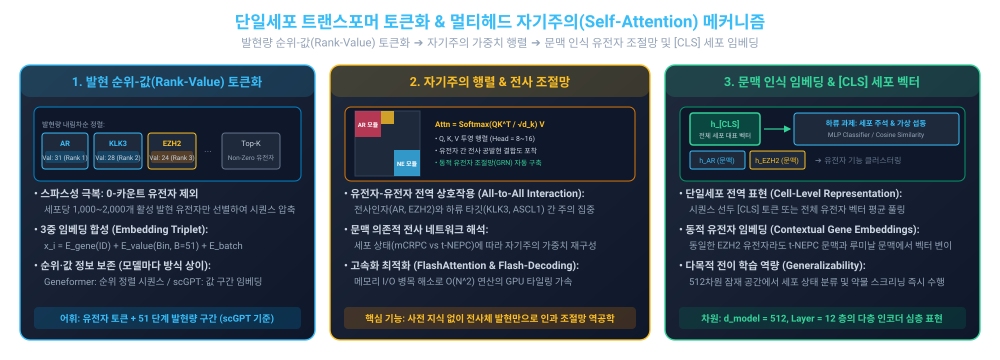

# Chapter 05. 단일 세포 트랜스포머 아키텍처 및 토큰화 메커니즘 (Transformer Architecture & Tokenization in Single-Cell Biology)

> **Cognitive Goal**: 자연어 처리(Natural Language Processing, NLP)의 트랜스포머(Transformer) 아키텍처를 단일 세포 전사체(Single-Cell Transcriptomics) 데이터에 적용하는 수리적·생물학적 토대를 정립한다. 개별 세포를 '문서(Document)'로, 발현된 유전자를 '단어 토큰(Word Token)'으로 매핑하는 개념적 패러다임을 확립하고, 단일 세포 시퀀싱의 무순서(Permutation-invariant/Unordered) 특성을 반영하기 위한 유전자 발현 순위 인코딩(Rank-Value Encoding) 및 연속 발현 구간화(Continuous Expression Binning)의 수학적 원리를 이해한다. 멀티헤드 셀프 어텐션(Multi-Head Self-Attention)의 수리적 메커니즘을 유도하고, 어텐션 가중치 행렬이 유전자 조절 네트워크(GRN) 및 전사인자-표적 유전자 상호작용을 포착하는 기전을 규명한다. 최종적으로 전립선암(PCa) 진행 및 치료 저항성(CRPC, t-NEPC) 단일 세포 전사체 데이터셋에 대해 PyTorch 기반의 입력 텐서 파이프라인 및 트랜스포머 인코더 블록을 직접 구현한다.

---

## 1. 단일 세포 전사체와 언어 모델링의 상동성 (Single-Cell Transcriptomics as Language Modeling)

대규모 언어 모델(Large Language Models, LLMs)은 거대한 텍스트 코퍼스(Corpus)에서 단어 간의 공기(Co-occurrence) 패턴과 문맥적 관계를 학습하여 언어의 문법과 의미를 표상합니다. 단일 세포 생물학에서도 이와 놀라울 정도로 유사한 생성적 규칙이 작동합니다.

```
┌────────────────────────────────────────────────────────────────────────────────────────┐
│             자연어 처리(NLP)와 단일 세포 전사체(Single-Cell Biology)의 개념적 상동성     │
│                                                                                        │
│   [자연어 처리 (NLP)]                                                                  │
│   ● 말뭉치 (Corpus)          ──► 대규모 텍스트 라이브러리 (Wikipedia, Books, Web)      │
│   ● 문서 (Document / Text)   ──► 한 편의 글, 문단 또는 문장                             │
│   ● 단어 토큰 (Word Token)   ──► 어휘집(Vocabulary)에 등록된 개별 형태소 또는 단어      │
│   ● 단어의 빈도 / 가중치      ──► TF-IDF, 단어의 등장 횟수                              │
│   ● 문법 및 통사 구조        ──► 단어 간의 순서(Syntax) 및 문맥적 상호작용             │
│                                                                                        │
│   [단일 세포 파운데이션 모델 (Single-Cell Foundation Models)]                          │
│   ● 아틀라스 (Atlas / Bio-Corpus) ──► 수천만 개의 단일 세포 전사체 (CellxGene, HCA)   │
│   ● 단일 세포 (Single Cell)       ──► 하나의 전사체 프로파일 (Single-cell Transcriptome)│
│   ● 유전자 토큰 (Gene Token)      ──► 인간 단백질 코딩 유전자 (HGNC Symbols, ~20,000개)│
│   ● 발현량 (Expression Value)    ──► UMI Counts, Log-Normalized CPM, Rank Value        │
│   ● 유전자 조절 네트워크 (GRN)    ──► 전사 인자와 표적 유전자 간의 공조 발현(Co-regulation)│
└────────────────────────────────────────────────────────────────────────────────────────┘
```

### 1.1 세포를 문서로, 유전자를 단어로 바라보는 생성적 관점
생체 내 단일 세포 $c$는 유전체(Genome)라는 고정된 어휘집 $\mathcal{V}_{\text{genome}} = \{g_1, g_2, \dots, g_M\}$ ($M \approx 20,000 \sim 30,000$개의 단백질 코딩 유전자) 중에서, 특정 시점의 분화 상태, 후성유전학적 개방도, 외부 신호 전달에 반응하여 발현된 유전자들의 조합 $C = \{(g_i, x_i) \mid x_i > 0\}$으로 정의되는 '전사체 문서(Transcriptomic Document)'입니다.
- 여기서 $g_i \in \mathcal{V}_{\text{genome}}$는 발현된 유전자의 식별자(Symbol/Ensembl ID)이며,
- $x_i \in \mathbb{R}^+$는 해당 세포 내에서 측정된 유전자 $g_i$의 발현 강도(UMI Count, TPM, 또는 정규화된 발현량)입니다.

### 1.2 자연어와 단일 세포 데이터의 결정적 차이점: 무순서 집합(Unordered Set)의 수학적 특성
자연어와 단일 세포 데이터 사이에는 모델 설계 시 반드시 고려해야 할 본질적이고 치명적인 차이점이 존재합니다:

1. **순열 불변성(Permutation Invariance)**:
   - 자연어 문장에서는 단어의 선형적 순서(Sequence order)가 문법과 의미를 결정합니다: `"The dog bit the man"`과 `"The man bit the dog"`는 동일한 단어로 구성되어 있지만 의미가 완전히 반대입니다. 따라서 고전적 트랜스포머(BERT, GPT)는 $1, 2, \dots, L$의 고정된 위치 인덱스를 부여하는 1차원 순차 위치 임베딩(1D Positional Embedding)에 전적으로 의존합니다.
   - 반면, 단일 세포 전사체에서 세포 내에 존재하는 mRNA 분자들은 물리적으로 선형적인 순서를 갖지 않는 **무순서 다중 집합(Unordered Multiset)**입니다. 세포 내에서 유전자 $A$와 유전자 $B$의 발현 순서를 임의로 셔플링(Permutation)하더라도 그 세포의 생물학적 정체성은 변하지 않습니다:
     $$\mathcal{P}_{\text{cell}}(\{(g_A, x_A), (g_B, x_B)\}) = \mathcal{P}_{\text{cell}}(\{(g_B, x_B), (g_A, x_A)\})$$
2. **극단적인 스파시티(Dropouts & Extreme Sparsity)**:
   - 일반적인 10x Genomics 단일핵/단일세포 RNA 시퀀싱에서 세포당 검출되는 유전자는 전체 20,000개 중 불과 $1,000 \sim 4,000$개(약 $5\% \sim 20\%$)에 불과하며, 나머지 $80\% \sim 95\%$는 기술적 포획 한계(Dropout) 또는 진정한 무발현으로 인해 0의 값을 갖습니다.
3. **연속적 발현 강도의 동적 범위(Dynamic Range)**:
   - 자연어 토큰은 이산적(Discrete)이지만, 유전자 발현량 $x_i$는 1개부터 수만 개의 분자 수까지 이르는 연속적이고 넓은 동적 범위를 지닙니다.

---

## 2. 어휘집 구축 및 토큰화 메커니즘 (Vocabulary & Tokenization)

단일 세포 트랜스포머의 성공은 "이산적인 유전자 식별자"와 "연속적인 발현량"을 모델이 소화할 수 있는 통합 텐서로 어떻게 변환(Tokenization)하느냐에 달려 있습니다.

```
┌────────────────────────────────────────────────────────────────────────────────────────┐
│                   단일 세포 토큰화 파이프라인 (Tokenization Pipeline)                  │
│                                                                                        │
│   [Raw Single Cell]                                                                    │
│   Gene Expression Vector: [TP53: 12, AR: 150, KLK3: 420, EZH2: 4, RB1: 0, ...]         │
│               │                                                                        │
│               ▼ Non-zero 필터링 & 발현량 정규화                                        │
│   Expressed Genes: {(KLK3, 420), (AR, 150), (TP53, 12), (EZH2, 4)}                     │
│               │                                                                        │
│       ┌───────┴────────────────────────────────────────┐                               │
│       ▼                                                ▼                               │
│   [방식 A: Geneformer (Rank-Value)]               [방식 B: scGPT (Binned Expression)]  │
│   1. 발현량 내림차순 정렬:                        1. 발현량의 비선형 분위수 Binning:   │
│      [KLK3, AR, TP53, EZH2]                          Bin(KLK3)=48, Bin(AR)=35, ...     │
│   2. Gene Token Seq:                             2. Gene Token Seq & Expr Value Seq:   │
│      [ID(KLK3), ID(AR), ID(TP53), ID(EZH2)]          Genes: [ID(KLK3), ID(AR), ...]    │
│   3. Rank 자체가 순서 정보를 대리                    Values: [48, 35, 12, 5, ...]      │
│      (별도의 값 임베딩 없이 순위로 암묵화)          3. Gene Embed + Value Embed 결합   │
└────────────────────────────────────────────────────────────────────────────────────────┘
```

### 2.1 어휘집(Vocabulary) 구축 프로토콜
어휘집 $\mathcal{V}$는 인간 및 마우스 유전체의 표준 유전자 심볼(HGNC Symbol) 또는 Ensembl ID를 기반으로 구축됩니다.
- **표준 유전자 토큰**: $g \in \{1, 2, \dots, N_{\text{genes}}\}$ ($N_{\text{genes}} \approx 25,424$ in Geneformer V1, $\approx 60,682$ in scGPT (전장 인간 어휘)).
- **특수 토큰(Special Tokens)**:
  - `<pad>` (Index 0): 가변 길이의 세포 시퀀스들을 고정 배치 크기로 정렬하기 위한 패딩 토큰.
  - `<mask>` (Index 1): 사전학습 시 마스킹된 유전자를 나타내는 마스크 토큰.
  - `<cls>` (Index 2): 전체 세포의 집약된 표현(Cell-level Representation)을 추출하기 위한 분류 토큰.

### 2.2 Geneformer의 정규화 순위 인코딩 (Rank-Value Encoding)
Geneformer(Theodoris et al., Nature 2023)는 발현량의 절대적 수치를 직접 사용하는 대신, 세포 내 유전자들의 **순위(Rank)**를 사용하는 토큰화(rank value encoding)를 도입했습니다. 이때 순위는 세포 내 원시 발현 순서가 아니라, **유전자별로 코퍼스(Genecorpus) 전체의 발현으로 스케일한 값**을 기준으로 매겨 어디서나 높게 발현되는 하우스키핑 유전자는 강등하고 세포 상태를 구분하는 유전자(전사인자 등)는 승격시킵니다(Geneformer 모델카드).

1. **Non-zero 유전자 필터링**: 세포 $c$에서 발현량 $x_i > 0$인 유전자 집합 $\mathcal{G}_c = \{g_1, g_2, \dots, g_{L_c}\}$을 추출합니다.
2. **코퍼스 기준 정규화 후 순위 산출**: 세포 내 발현량(라이브러리 크기로 정규화)을 유전자별 코퍼스 비-영(非零) 발현 중앙값 $m_g$로 나눈 값 $\tilde{x}_i = x_i / m_{g_i}$에 따라 내림차순 정렬합니다(아래 식은 이 정규화 값 기준):
   $$\tilde{x}_{(1)} \ge \tilde{x}_{(2)} \ge \dots \ge \tilde{x}_{(L_c)}$$
   정렬된 유전자 시퀀스 $S_c = [g_{(1)}, g_{(2)}, \dots, g_{(L_c)}]$를 구성합니다.
3. **전역 스케일링에 대한 순위 불변성 (제한된 성질)**:
   - 세포 $c$의 모든 유전자 카운트가 같은 상수 배($x_i \to 2x_i$)가 되면 내림차순 정렬 순위는 보존됩니다:
     $$\text{argsort}(2 \mathbf{x}) = \text{argsort}(\mathbf{x})$$
   - 이는 전역 상수 곱에만 해당하는 자명한 성질입니다. 실제 시퀀싱 깊이 차이는 검출되는 유전자 집합 $\mathcal{G}_c$ 자체와 저발현 유전자의 순서(샘플링 잡음)를 바꾸므로, 순위 인코딩이 깊이·배치 효과를 "완벽히" 제거한다고 할 수 없고 일부 완화할 뿐입니다.

### 2.3 scGPT의 연속 발현 구간화 (Continuous Expression Binning)
scGPT(Cui et al., Nature Methods 2024)는 유전자의 정체성 토큰뿐만 아니라 정량적 발현 강도(Quantitative Intensity)를 모델에 직접 전달하기 위해 분위수 구간화(Quantile Binning)를 적용합니다.

1. 비영(Non-zero) 발현량을 $B$개의 이산적 구간(Bins)으로 분할합니다(scGPT 튜토리얼의 `n_bins=51`이 기준이며 0 구간을 포함해 06장의 $B=51$과 같다):
   $$\text{Bin}(x_i) = b \in \{1, 2, \dots, B\}$$
2. 입력 벡터는 각 위치마다 두 개의 임베딩 레이어를 통과한 후 원소별 합(Element-wise Addition) 또는 결합(Concatenation)으로 합성됩니다:
   $$\mathbf{e}_i = E_{\text{gene}}(g_i) + E_{\text{value}}(\text{Bin}(x_i))$$
   여기서 $E_{\text{gene}} \in \mathbb{R}^{|\mathcal{V}| \times d_{\text{model}}}$, $E_{\text{value}} \in \mathbb{R}^{B \times d_{\text{model}}}$입니다.

---

## 3. 위치 임베딩의 재해석: Rank Embedding vs Positional Embedding

고전 트랜스포머의 1D 정적/학습된 위치 임베딩(Sinusoidal Positional Embedding)은 문장의 인덱스 $1, 2, \dots, L$에 대응됩니다:

$$\text{PE}_{(pos, 2i)} = \sin\left(\frac{pos}{10000^{2i/d_{\text{model}}}}\right), \quad \text{PE}_{(pos, 2i+1)} = \cos\left(\frac{pos}{10000^{2i/d_{\text{model}}}}\right)$$

단일 세포 전사체에서 이 표준 위치 임베딩을 그대로 적용하면 심각한 생물학적 왜곡이 발생합니다.

### 3.1 왜 표준 위치 임베딩이 실패하는가?
- 유전자들이 임의의 순서로 정렬되어 있을 때, $pos=1$에 위치한 *TP53*과 $pos=2$에 위치한 *RB1*에 위치 임베딩을 더하면, 모델은 "*TP53*이 *RB1* 바로 앞에 물리적으로 위치한다"는 가짜 공간적/시간적 선후 관계(Spurious Sequential Prior)를 학습하게 됩니다.
- 세포마다 유전자의 정렬 순서가 알파벳순이나 염색체 좌표순으로 고정된다면, 염색체 1번에 위치한 유전자는 항상 앞쪽 위치 임베딩을 받고, 염색체 X/Y번에 위치한 유전자는 뒤쪽 위치 임베딩을 받게 되어 유전자 간 공조 발현 학습이 심각하게 왜곡됩니다.

### 3.2 발현 순위 임베딩 (Rank Embedding)의 수학적 정식화
단일 세포 트랜스포머에서는 $pos$의 의미를 **"발현 강도의 상대적 순위(Rank of Expression)"**로 재정의합니다:

$$\mathbf{h}_i^{(0)} = E_{\text{gene}}(g_i) + E_{\text{rank}}(r_i) + E_{\text{condition}}(c)$$

- $g_i$: 세포 내에서 발현된 유전자의 토큰 ID ($g_i \in \mathcal{V}$)
- $r_i$: 세포 내에서 해당 유전자의 발현량 순위 ($r_i \in \{1, 2, \dots, L_{\max}\}$, $1$등은 세포 내 최고 발현 유전자)
- $c$: 세포의 상태, 배치(Batch), 또는 질환 조건 토큰

> 참고: 위 식은 이 챕터의 교육용 설계이며 실제 모델과 다르다. Geneformer는 rank 정렬 시퀀스에 BERT 절대 위치 임베딩(`position_embedding_type: absolute`)을 쓰고, scGPT는 위치 인코딩 없이 유전자 임베딩과 **값(구간)** 임베딩을 더한다.

이 설계를 통해 모델은 "어떤 유전자가 세포 내에서 가장 지배적으로 발현하고 있는가(Dominant Transcript)", "어떤 유전자들이 중간 수준으로 조절되고 있는가"를 자기주의(Self-Attention) 메커니즘을 통해 학습할 수 있게 됩니다.

---

## 4. 멀티헤드 셀프 어텐션(Multi-Head Self-Attention)의 수리적 전개

트랜스포머의 핵심 엔진인 셀프 어텐션은 유전자 토큰 간의 모든 쌍별(Pairwise) 상호작용을 동적으로 가중 평가합니다.



### 4.1 스케일드 닷 프로덕트 어텐션 (Scaled Dot-Product Attention)의 수리적 유도
입력 시퀀스 행렬을 $X \in \mathbb{R}^{L \times d_{\text{model}}}$이라 하자 ($L$은 세포 내 발현된 유전자 수, $d_{\text{model}}$은 은닉 차원). 학습 가능한 가중치 행렬 $W^Q, W^K, W^V \in \mathbb{R}^{d_{\text{model}} \times d_k}$을 통해 쿼리(Query), 키(Key), 밸류(Value) 행렬을 생성합니다:

$$Q = X W^Q \in \mathbb{R}^{L \times d_k}, \quad K = X W^K \in \mathbb{R}^{L \times d_k}, \quad V = X W^V \in \mathbb{R}^{L \times d_v}$$

어텐션 연산은 다음과 같이 정의됩니다:

$$\text{Attention}(Q, K, V) = \text{softmax}\left(\frac{QK^T}{\sqrt{d_k}}\right) V$$

여기서 어텐션 가중치 행렬 $A \in \mathbb{R}^{L \times L}$는:

$$A = \text{softmax}\left(\frac{QK^T}{\sqrt{d_k}}\right), \quad A_{ij} = \frac{\exp\left(\frac{\mathbf{q}_i \mathbf{k}_j^T}{\sqrt{d_k}}\right)}{\sum_{m=1}^L \exp\left(\frac{\mathbf{q}_i \mathbf{k}_m^T}{\sqrt{d_k}}\right)}$$

### 4.2 스케일링 팩터 $\frac{1}{\sqrt{d_k}}$의 수학적 필연성
쿼리 벡터의 성분 $q_{i,a}$와 키 벡터의 성분 $k_{j,a}$가 평균이 0이고 분산이 1인 독립동등분포(i.i.d.)를 따른다고 가정합시다:
$$\mathbb{E}[q_{i,a}] = 0, \quad \text{Var}(q_{i,a}) = 1, \quad \mathbb{E}[k_{j,a}] = 0, \quad \text{Var}(k_{j,a}) = 1$$

내적 $S_{ij} = \mathbf{q}_i \mathbf{k}_j^T = \sum_{a=1}^{d_k} q_{i,a} k_{j,a}$의 통계적 기댓값과 분산은 다음과 같습니다:

$$\mathbb{E}[S_{ij}] = \sum_{a=1}^{d_k} \mathbb{E}[q_{i,a}] \mathbb{E}[k_{j,a}] = 0$$

$$\text{Var}(S_{ij}) = \sum_{a=1}^{d_k} \text{Var}(q_{i,a} k_{j,a}) = \sum_{a=1}^{d_k} \left( \mathbb{E}[q_{i,a}^2] \mathbb{E}[k_{j,a}^2] - (\mathbb{E}[q_{i,a}] \mathbb{E}[k_{j,a}])^2 \right) = \sum_{a=1}^{d_k} (1 \times 1 - 0) = d_k$$

- 만약 $\sqrt{d_k}$로 나누어주지 않으면, 은닉 차원 $d_k$가 커질수록(예: $d_k = 64$이면 분산은 64, 표준편차는 8) 내적 값의 크기가 매우 커집니다.
- 내적 $S_{ij}$의 절대값이 커지면 $\text{softmax}$ 함수의 극단적인 포화 영역(Saturation Region)으로 진입하게 됩니다.
- 소프트맥스 함수 $s_i = \frac{e^{z_i}}{\sum_k e^{z_k}}$의 도함수는 $\frac{\partial s_i}{\partial z_j} = s_i(\delta_{ij} - s_j)$이므로, 특정 원소가 1에 극단적으로 가까워지면 소프트맥스의 그래디언트가 0으로 소실(Vanishing Gradient)되어 역전파 학습이 완전히 정체됩니다.
- 따라서 $\frac{1}{\sqrt{d_k}}$로 스케일링하여 분산을 다시 1로 표준화($\text{Var}(S_{ij} / \sqrt{d_k}) = \frac{d_k}{d_k} = 1$)함으로써 역전파 그래디언트의 안정성을 보장합니다.

### 4.3 멀티헤드 어텐션 (Multi-Head Attention)과 생물학적 해석
서로 다른 생물학적 기능(예: 대사 경로, 염색질 리모델링, 세포 사멸 회로)을 서로 다른 표현 하위 공간에서 독립적으로 포착하기 위해 $H$개의 독립적인 어텐션 헤드를 병렬 배치합니다:

$$\text{MultiHead}(Q, K, V) = \text{Concat}(\text{head}_1, \dots, \text{head}_H) W^O$$

$$\text{head}_h = \text{Attention}(Q W_h^Q, K W_h^K, V W_h^V)$$

여기서 $W_h^Q \in \mathbb{R}^{d_{\text{model}} \times d_k}$, $W_h^K \in \mathbb{R}^{d_{\text{model}} \times d_k}$, $W_h^V \in \mathbb{R}^{d_{\text{model}} \times d_v}$, $W^O \in \mathbb{R}^{H d_v \times d_{\text{model}}}$입니다.

- **어텐션 행렬 $A_{ij}^{(h)}$의 생물학적 의미**:
  - 유전자 $i$가 유전자 $j$에 부여하는 주의(Attention) 강도 $A_{ij}$는 고정된 선형 상관계수(Pearson correlation)가 아닙니다.
  - 모델이 해당 세포 문맥에서 유전자 $i$의 표현을 갱신할 때 유전자 $j$에 얼마나 가중을 두는지를 나타냅니다. 이를 **문맥 의존적 조절 관계의 후보**로 해석하려는 연구가 있으나, 어텐션 가중치는 인과·조절 관계 자체가 아닙니다("Attention is not Explanation", Jain & Wallace 2019). Geneformer 논문도 어텐션 가중치가 네트워크 위계(hierarchy)를 인코딩한다고만 주장합니다.

---

## 5. 전립선암(PCa) 단일 세포 전사체 데이터 기반 파이토치(PyTorch) 구현 실습

전립선암의 대표적 계통 전이 모델(선암종 AR-PC vs 거세 저항성 t-NEPC) 데이터를 가정하고, 유전자 발현 순위 기반 토큰화 및 멀티헤드 셀프 어텐션 인코더를 순수 PyTorch로 구축합니다.

```python
import torch
import torch.nn as nn
import torch.nn.functional as F
import numpy as np
from typing import Dict, List, Tuple

class SingleCellTokenizer:
    """
    단일 세포 유전자 발현 행렬을 유전자 토큰 ID 및 발현 순위(Rank) 시퀀스로 변환하는 토크나이저.
    """
    def __init__(self, gene_list: List[str], max_seq_len: int = 2048):
        self.gene_to_id: Dict[str, int] = {gene: idx + 3 for idx, gene in enumerate(gene_list)}
        self.id_to_gene: Dict[int, str] = {idx: gene for gene, idx in self.gene_to_id.items()}
        
        # 특수 토큰 등록
        self.pad_token_id = 0
        self.mask_token_id = 1
        self.cls_token_id = 2
        self.max_seq_len = max_seq_len
        self.vocab_size = len(gene_list) + 3

    def encode_cell(self, gene_names: np.ndarray, expr_values: np.ndarray) -> Tuple[torch.Tensor, torch.Tensor]:
        """
        단일 세포의 발현 벡터로부터 non-zero 유전자를 추출하고 내림차순 순위로 정렬하여 인코딩합니다.
        """
        non_zero_mask = expr_values > 0
        nz_genes = gene_names[non_zero_mask]
        nz_expr = expr_values[non_zero_mask]

        if len(nz_genes) == 0:
            # 발현된 유전자가 없는 경우 CLS 토큰만 반환
            return torch.tensor([self.cls_token_id]), torch.tensor([0])

        # 발현량 기준 내림차순 정렬 (Rank-value encoding 원리)
        sorted_indices = np.argsort(-nz_expr)
        sorted_genes = nz_genes[sorted_indices]
        
        # 최대 시퀀스 길이 제한 (CLS 토큰 공간 1개 확보)
        effective_len = min(len(sorted_genes), self.max_seq_len - 1)
        selected_genes = sorted_genes[:effective_len]

        # 토큰 ID 변환 (어휘집에 없는 유전자는 제외)
        token_ids = [self.cls_token_id]
        ranks = [0] # CLS 토큰은 순위 0 부여
        
        for rank_idx, gene in enumerate(selected_genes, start=1):
            if gene in self.gene_to_id:
                token_ids.append(self.gene_to_id[gene])
                ranks.append(rank_idx)

        return torch.tensor(token_ids, dtype=torch.long), torch.tensor(ranks, dtype=torch.long)


class SingleCellTransformerEncoder(nn.Module):
    """
    단일 세포 유전자 발현 시퀀스를 위한 멀티헤드 셀프 어텐션 기반 트랜스포머 인코더.
    """
    def __init__(
        self,
        vocab_size: int,
        d_model: int = 256,
        nhead: int = 8,
        num_layers: int = 6,
        dim_feedforward: int = 512,
        max_ranks: int = 4096,
        dropout: float = 0.1
    ):
        super().__init__()
        self.d_model = d_model
        
        # 유전자 정체성 임베딩 & 순위 임베딩
        self.gene_embedding = nn.Embedding(vocab_size, d_model, padding_idx=0)
        self.rank_embedding = nn.Embedding(max_ranks, d_model, padding_idx=0)
        
        self.layer_norm_input = nn.LayerNorm(d_model)
        self.dropout = nn.Dropout(dropout)

        # PyTorch 표준 트랜스포머 인코더 레이어
        encoder_layer = nn.TransformerEncoderLayer(
            d_model=d_model,
            nhead=nhead,
            dim_feedforward=dim_feedforward,
            dropout=dropout,
            activation="gelu",
            batch_first=True,
            norm_first=True # Pre-LN 아키텍처로 훈련 안정성 극대화
        )
        self.transformer_encoder = nn.TransformerEncoder(encoder_layer, num_layers=num_layers)
        
        # 전립선암 계통 분류 헤드 (AR-PC, Amphicrine, DNPC, t-NEPC 4개 클래스)
        self.classifier_head = nn.Sequential(
            nn.Linear(d_model, dim_feedforward),
            nn.GELU(),
            nn.Dropout(dropout),
            nn.Linear(dim_feedforward, 4)
        )

    def forward(
        self,
        token_ids: torch.Tensor,
        ranks: torch.Tensor,
        padding_mask: torch.Tensor = None
    ) -> Tuple[torch.Tensor, torch.Tensor]:
        """
        Forward Pass:
        - token_ids: [Batch Size, Seq Len]
        - ranks: [Batch Size, Seq Len]
        - padding_mask: [Batch Size, Seq Len] (True인 위치가 패딩)
        """
        # 1. 임베딩 합성: Gene Token + Rank Embedding
        gene_emb = self.gene_embedding(token_ids) # [B, L, D]
        rank_emb = self.rank_embedding(ranks)       # [B, L, D]
        x = self.dropout(self.layer_norm_input(gene_emb + rank_emb))

        # 2. 트랜스포머 인코더 블록 통과
        encoded_seq = self.transformer_encoder(x, src_key_padding_mask=padding_mask)

        # 3. CLS 토큰 (인덱스 0) 표상 추출 -> 세포 수준 임베딩
        cls_embedding = encoded_seq[:, 0, :] # [B, D]

        # 4. 계통 분류 로짓 산출
        logits = self.classifier_head(cls_embedding)

        return encoded_seq, logits


# 파이프라인 무결성 검증 실행
if __name__ == "__main__":
    # 전립선암 관련 핵심 유전자 어휘집 정의
    pca_genes = [
        "AR", "KLK3", "FOXA1", "HOXB13",   # Luminal Adeno Markers
        "TP53", "RB1", "PTEN",             # Key Tumor Suppressors
        "ASCL1", "NEUROD1", "INSM1", "SOX2", # t-NEPC Pioneer TFs
        "EZH2", "SYP", "CHGA", "NCAM1"     # Polycomb & Neuroendocrine Markers
    ] + [f"HOUSEKEEPING_{i}" for i in range(500)]

    tokenizer = SingleCellTokenizer(gene_list=pca_genes, max_seq_len=64)
    model = SingleCellTransformerEncoder(vocab_size=tokenizer.vocab_size, d_model=128, nhead=4, num_layers=3)

    # 가상의 t-NEPC 세포 발현 벡터 생성 (AR 소실, ASCL1/EZH2 과발현)
    cell_genes = np.array(["ASCL1", "EZH2", "INSM1", "SOX2", "TP53", "AR", "KLK3"])
    cell_counts = np.array([120.0, 85.0, 60.0, 45.0, 0.0, 0.0, 0.0]) # AR, KLK3는 0

    token_ids, ranks = tokenizer.encode_cell(cell_genes, cell_counts)
    
    # 배치 텐서화 (Batch Size = 1)
    batch_tokens = token_ids.unsqueeze(0)
    batch_ranks = ranks.unsqueeze(0)
    padding_mask = (batch_tokens == 0)

    encoded_output, class_logits = model(batch_tokens, batch_ranks, padding_mask)

    print(f"토큰화된 시퀀스 길이: {batch_tokens.shape[1]}")
    print(f"인코딩된 출력 텐서 형상: {encoded_output.shape}")
    print(f"전립선암 4대 계통 분류 로짓: {class_logits.shape}")
    print(f"토큰 ID 시퀀스: {batch_tokens.tolist()}")
    print("단일 세포 트랜스포머 인코더 전진 연산 성공.")
```

---

## 단원 핵심 점검 (Cognitive Checkpoint & Case Study)

### Q1. [개념 및 메커니즘 (Conceptual Rigor)]
자연어 처리(NLP) 트랜스포머의 표준 위치 임베딩(1D Positional Embedding)과 단일 세포 트랜스포머의 발현 순위 임베딩(Rank-Value Encoding)의 본질적 차이점을 비교 설명하고, 단일 세포 전사체 데이터에서 전통적인 위치 임베딩을 그대로 적용했을 때 발생하는 생물학적 왜곡을 순열 불변성(Permutation Invariance) 관점에서 논하시오.

<details>
<summary>💡 모범 답안 및 해설 확인</summary>

- **본질적 차이점 비교**:
  - **NLP 표준 위치 임베딩**: 문장 내 단어의 절대적/상대적 인덱스($1, 2, \dots, L$)에 1:1 대응하여 토큰 간의 선형적 선후 관계(Sequential Order)를 명시적으로 부여합니다.
  - **단일 세포 발현 순위 임베딩**: 세포 내 유전자들의 절대적 물리적 순서가 존재하지 않으므로, 세포 내 전사 강도의 상대적 내림차순 순위($1$위, $2$위, $\dots$, $L$위)를 인덱스로 변환하여 유전자의 전사적 지배력(Transcriptional Dominance)과 문맥적 중요도를 인코딩합니다.
- **전통적 위치 임베딩 적용 시의 생물학적 왜곡 (순열 불변성 파괴)**:
  - 단일 세포 내 mRNA 풀은 물리적으로 무순서 집합(Unordered Set)이므로, 유전자 토큰의 입력 배열 순서가 바뀌더라도 세포의 생물학적 표현형은 동일해야 합니다.
  - 만약 유전자들을 염색체 번호순이나 임의의 순서로 정렬한 뒤 고정된 1D 위치 임베딩을 더하면, 모델은 "앞쪽에 배치된 유전자들이 뒤쪽 유전자보다 먼저 전사되거나 인과적 선행 관계가 있다"는 인위적인 통사적 편향(Spurious Syntactic Bias)을 학습하게 됩니다.
  - 결과적으로 세포 간의 실제 생물학적 변이(Heterogeneity)가 아니라 유전자 시퀀스의 임의 정렬 인덱스에 모델의 셀프 어텐션이 좌우되는 치명적인 아티팩트가 발생합니다.

</details>

---

### Q2. [수학적 원리 규명 (Mathematical Rigor)]
멀티헤드 셀프 어텐션 연산 $\text{Attention}(Q, K, V) = \text{softmax}\left(\frac{QK^T}{\sqrt{d_k}}\right) V$에서, 쿼리 $Q$와 키 $K$의 각 원소가 평균 0, 분산 1을 갖는 독립동등분포(i.i.d.) 확률변수일 때:
1) 내적 행렬의 성분 $S_{ij} = \mathbf{q}_i \mathbf{k}_j^T$의 분산이 $d_k$가 됨을 증명하시오.
2) 스케일링 인자 $\frac{1}{\sqrt{d_k}}$를 생략할 경우 발생하는 소프트맥스 함수의 포화 현상(Saturation)과 역전파 그래디언트 소실(Vanishing Gradient) 문제를 소프트맥스의 편미분 수식을 통해 수학적으로 규명하시오.

<details>
<summary>💡 모범 답안 및 해설 확인</summary>

- **1. $S_{ij} = \mathbf{q}_i \mathbf{k}_j^T$의 분산 증명**:
  - $\mathbf{q}_i, \mathbf{k}_j \in \mathbb{R}^{d_k}$의 각 원소를 $q_a, k_a$ ($a=1, \dots, d_k$)라 하자.
  - 가정에 의해 $\mathbb{E}[q_a] = \mathbb{E}[k_a] = 0$, $\text{Var}(q_a) = \text{Var}(k_a) = 1$이며, 원소들은 상호 독립이다.
  - 내적은 $S_{ij} = \sum_{a=1}^{d_k} q_a k_a$이다.
  - 기댓값의 선형성에 의해:
    $$\mathbb{E}[S_{ij}] = \sum_{a=1}^{d_k} \mathbb{E}[q_a] \mathbb{E}[k_a] = 0$$
  - 서로 다른 $a$에 대해 $q_a k_a$는 상호 독립이므로, 합의 분산은 분산의 합과 같다:
    $$\text{Var}(S_{ij}) = \sum_{a=1}^{d_k} \text{Var}(q_a k_a)$$
  - 독립 확률변수의 곱의 분산 공식 $\text{Var}(XY) = \text{Var}(X)\text{Var}(Y) + \text{Var}(X)(\mathbb{E}[Y])^2 + \text{Var}(Y)(\mathbb{E}[X])^2$에 대입하면:
    $$\text{Var}(q_a k_a) = 1 \times 1 + 1 \times 0^2 + 1 \times 0^2 = 1$$
    $$\therefore \text{Var}(S_{ij}) = \sum_{a=1}^{d_k} 1 = d_k$$

- **2. 스케일링 인자 생략 시 소프트맥스 포화 및 그래디언트 소실 수리적 유도**:
  - $d_k$가 커질수록(예: $d_k = 128$) $S_{ij}$의 표준편차는 $\sqrt{d_k} \approx 11.3$에 달하여, 내적 값들 중 최댓값과 타 원소 간의 격차가 극도로 벌어집니다.
  - 소프트맥스 벡터 $\mathbf{p} = \text{softmax}(\mathbf{z})$의 각 원소 $p_i = \frac{e^{z_i}}{\sum_k e^{z_k}}$에 대해, 입력 $z_j$에 대한 출력 $p_i$의 야코비안(Jacobian) 행렬 원소는 다음과 같습니다:
    $$\frac{\partial p_i}{\partial z_j} = p_i (\delta_{ij} - p_j)$$
  - 만약 특정 인덱스 $m$에서 $z_m \gg z_{k \neq m}$이면, $p_m \to 1$이 되고 나머지 $p_{k \neq m} \to 0$이 됩니다.
  - 이때 대각 성분($i=j=m$)은 $\frac{\partial p_m}{\partial z_m} = p_m(1 - p_m) \approx 1 \times (1 - 1) = 0$이 되며, 비대각 성분($i \neq j$) 역시 $p_i p_j \to 0$이 됩니다.
  - 즉, 야코비안 행렬의 모든 성분이 0에 수렴하여 손실 함수로부터 전파되는 역전파 그래디언트가 완전히 소실($\frac{\partial \mathcal{L}}{\partial \mathbf{z}} \approx \mathbf{0}$)되므로 가중치 행렬 $W^Q, W^K$의 학습이 정체됩니다.
  - 따라서 $\frac{1}{\sqrt{d_k}}$를 곱해 분산을 1로 재조정하는 것은 소프트맥스가 극단적인 one-hot 분포로 붕괴하는 것을 막고 균형 잡힌 어텐션 그래디언트를 유지하기 위한 수학적 필수 요건입니다.

</details>

---

### Q3. [임상 및 생물학적 케이스 스터디 (Clinical Problem Solving)]
치료 유발 신경내분비 전립선암(t-NEPC) 환자 코호트의 단일핵 전사체(snRNA-seq) 데이터를 단일 세포 트랜스포머에 입력하여 셀프 어텐션 맵 $A \in \mathbb{R}^{L \times L}$을 추출하였다.
1) 관상 선암종(AR-PC) 세포 상태에서 신경내분비암(t-NEPC) 세포 상태로 전이될 때, 안드로겐 수용체(*AR*) 및 그 공활성 인자(*FOXA1*, *HOXB13*)의 어텐션 가중치와 신경내분비 파이오니어 전사인자(*ASCL1*, *NEUROD1*, *EZH2*)의 어텐션 가중치가 어떻게 재구성(Rewiring)되는지 생물학적 기전과 연계하여 서술하시오.
2) 한 연구팀이 발현량이 0인 모든 비발현 유전자(약 18,000개)를 `<pad>` 토큰 대신 실제 유전자 토큰 ID와 발현량 0으로 트랜스포머에 전부 입력하는 방식을 제안하였다. 이 방식이 컴퓨터 아키텍처(GPU 메모리 및 연산 복잡도)와 어텐션 가중치 희석(Dilution) 측면에서 왜 치명적인 오류인지 논증하시오.

<details>
<summary>💡 모범 답안 및 해설 확인</summary>

- **1. 계통 전이에 따른 어텐션 가중치 재구성 (Attention Rewiring)**:
  - **AR-PC 상태**:
    - *AR* 쿼리 벡터 $\mathbf{q}_{\text{AR}}$는 관상 분화 표적 유전자(*KLK3*, *TMPRSS2*, *NKX3-1*) 및 파이오니어 전사인자(*FOXA1*, *HOXB13*)의 키 벡터에 높은 어텐션 가중치($A_{\text{AR}, \text{KLK3}} \gg 0$)를 집중시킵니다.
    - 이때 *ASCL1*, *NEUROD1*은 발현 순위가 극히 낮거나 0이므로 어텐션 시퀀스에서 배제됩니다.
  - **t-NEPC 상태 (Lineage Transition 후)**:
    - *TP53*·*RB1* 결손 등 유전체 변화와 REST 활성 저하가 신경내분비 전사 프로그램의 활성화와 연관되는 것으로 보고되며(Labrecque 외 2019 등), 그 결과 *ASCL1*, *NEUROD1*, *INSM1*의 코퍼스 정규화 발현 순위가 상승할 수 있습니다(단정적 인과 기전은 아님).
    - 동시에 히스톤 메틸전이효소 *EZH2*가 상향 조절되는 것으로 알려져 있으며, 이 상태에서 학습된 모델의 어텐션 맵이 *ASCL1*·*EZH2*를 허브 노드로, 신경 과립 단백질(*SYP*, *CHGA*, *NCAM1*)에 높은 상호 어텐션을 보일 **가능성**이 있습니다(가설).
    - 또한 *EZH2*의 어텐션이 *AR*·*KLK3* 침묵 문맥에 집중되고 *AR* 네트워크 연결 강도가 약해지는 재배선(Rewiring) 패턴이 나타날 수 있습니다. 이는 이 문서에서 실제 데이터로 확인한 관찰이 아니라 검증이 필요한 가설이며, 어텐션 변화는 독립적인 실험·외부 데이터로 확인해야 합니다.
- **2. 18,000개 비발현 유전자 전수 입력 방식의 치명적 결함**:
  - **계산 및 메모리 복잡도 폭발 ($\mathcal{O}(L^2)$)**:
    - 표준 셀프 어텐션의 연산량과 메모리는 시퀀스 길이 $L$의 제곱에 비례합니다.
    - Non-zero 유전자만 선별했을 때($L \approx 2,000$) 어텐션 맵 크기는 $2,000^2 = 4 \times 10^6$ 원소(FP32 기준 약 16MB)입니다.
    - 반면 20,000개 전체 유전자를 입력할 경우($L = 20,000$) 어텐션 맵 크기는 $20,000^2 = 4 \times 10^8$ 원소(약 1.6GB)로 단일 레이어, 단일 헤드당 100배 폭증하며, 12개 레이어와 8개 헤드를 갖는 모델에서는 수십 GB의 GPU 메모리를 단 한 번의 순전파에 소모하여 즉각적인 OOM(Out-of-Memory) 크래시를 유발합니다.
  - **어텐션 가중치 희석(Attention Dilution)과 노이즈 전파**:
    - 소프트맥스 함수는 전체 분모 $\sum_{m=1}^L \exp(\cdot)$로 정규화되므로, 생물학적 의미가 없는 18,000개의 영발현(Zero-count) 토큰들이 분모에 누적되어 실제 중요한 전사인자 간의 유의미한 어텐션 가중치가 $1/L$ 수준으로 극단적으로 희석(Dilution)됩니다.
    - 이로 인해 모델이 유의미한 유전자 조절 상호작용을 포착하지 못하고 단순한 기술적 드롭아웃 노이즈를 학습하게 됩니다.

</details>

---

<!-- REFERENCES:BEGIN (generated by scripts/apply_references.py; do not edit by hand) -->
## 참고문헌 (References)
### 본문 인용 문헌
1. Theodoris CV, Xiao L, Chopra A, et al. Transfer learning enables predictions in network biology. *Nature*. 2023;618(7965):616-624. PMID: 37258680. doi: 10.1038/s41586-023-06139-9
2. Cui H, Wang C, Maan H, et al. scGPT: toward building a foundation model for single-cell multi-omics using generative AI. *Nat Methods*. 2024;21(8):1470-1480. PMID: 38409223. doi: 10.1038/s41592-024-02201-0
3. Jain S, Wallace BC. Attention is not Explanation. *Proceedings of the 2019 Conference of the North American Chapter of the Association for Computational Linguistics: Human Language Technologies, Volume 1 (Long and Short Papers)*. 2019:3543-3556. doi: 10.18653/v1/n19-1357
4. Labrecque MP, Coleman IM, Brown LG, et al. Molecular profiling stratifies diverse phenotypes of treatment-refractory metastatic castration-resistant prostate cancer. *J Clin Invest*. 2019;129(10):4492-4505. PMID: 31361600. doi: 10.1172/JCI128212
### 검수 근거 문헌
1. Kedzierska KZ, Crawford L, Amini AP, et al. Zero-shot evaluation reveals limitations of single-cell foundation models. *Genome Biol*. 2025;26(1):101. PMID: 40251685. doi: 10.1186/s13059-025-03574-x
### 소프트웨어 (표기 버전은 검수 시 API를 확인한 버전이며, 파이프라인 실행 환경은 requirements-pipelines.txt 참조)
- NumPy 2.5.4 (numpy.org). 원 논문: Harris CR, Millman KJ, van der Walt SJ, et al. Array programming with NumPy. *Nature*. 2020;585(7825):357-362. PMID: 32939066. doi: 10.1038/s41586-020-2649-2
- PyTorch 2.14.1 (github.com/pytorch/pytorch).
<!-- REFERENCES:END -->
