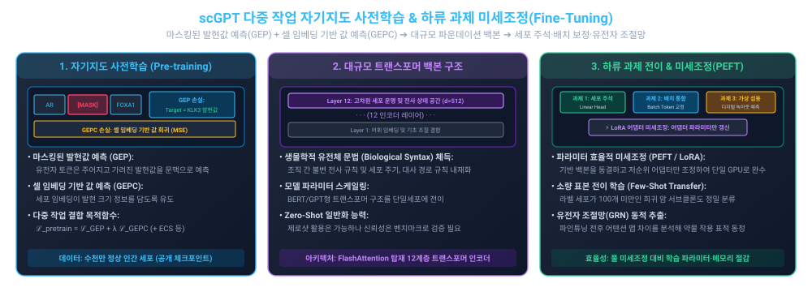

# Chapter 06. scGPT 사전학습 모델과 세포 임베딩 추출 (scGPT: Generative Pre-trained Foundation Models for Single-Cell Biology)

> **Cognitive Goal**: 대규모 단일 세포 전사체 데이터셋(3,300만 개 이상)으로 사전학습된 생성형 파운데이션 모델 `scGPT`(Cui et al., Nature Methods 2024)의 심층 신경망 아키텍처와 다중 태스크 학습(Multi-task Pretraining) 목적함수를 수리적으로 규명한다. 유전자 토큰은 입력에 주어지고 **발현 값**을 마스킹하여 예측하는 유전자 발현량 예측(Gene Expression Prediction, GEP)과 세포 임베딩으로부터 값을 예측하는 GEPC(MVC) 사전학습 손실, 그리고 미세조정 단계의 세포형 분류(Cell Type Classification, CTC) 손실의 수식 전개를 학습한다(유전자 *정체성*을 복원하는 마스크 유전자 모델링은 Geneformer의 사전학습이며 07장에서 다룬다). 사전학습된 가중치로부터 얻은 제로샷(Zero-shot) 세포 임베딩의 활용 방식과 배치 효과(Batch Effect) 처리의 한계를 파악하고, 전립선암(mCRPC, t-NEPC) 임상 코호트 단일 세포 전사체에 대한 미세조정(Fine-tuning) 파이프라인을 파이썬 코드로 구현한다.

---

## 1. scGPT 생성형 파운데이션 모델 개요

기존의 단일 세포 분석 도구들(PCA, UMAP, scVI; scVI는 04장 scArches처럼 사전학습 재사용도 가능)은 각 실험 데이터셋마다 개별적으로 모델을 새로 학습·적합시키는 정적이고 고립된 파이프라인에 국한되어 있었습니다. 반면 **scGPT**는 다양한 생체 조직, 질환 상태, 시퀀싱 플랫폼에서 생성된 수천만 개의 단일 세포 전사체를 통합 학습함으로써 유전체 전반의 비선형적 상호작용 규칙(Gene Regulatory Grammar)을 내재화한 범용 파운데이션 모델입니다.

```
┌────────────────────────────────────────────────────────────────────────────────────────┐
│                        scGPT 다중 태스크 학습 및 추론 개요                             │
│                                                                                        │
│   [입력 전사체 프로파일]                                                               │
│   세포 c: 유전자 토큰 시퀀스 g, 연속 발현 구간 b, 배치 식별자 batch                     │
│               │                                                                        │
│               ▼ 임베딩 레이어 (Gene + Expression Value + Batch Token)                  │
│   입력 텐서: h_0 = E_gene(g) + E_value(b) + E_batch(batch)                             │
│               │                                                                        │
│               ▼ 다층 트랜스포머 인코더 (Stacked Transformer Layers, post-norm)         │
│   잠재 표상: h_L = Transformer(h_0)                                                    │
│               │                                                                        │
│       ┌───────┼────────────────────────────────────────┐                               │
│       ▼       ▼                                        ▼                               │
│   [GEP Head]    [GEPC (MVC) Head]                [CTC Head (미세조정)]                 │
│   마스크된 발현값 셀 임베딩 기반 값 예측           세포 수준 집약 표상 (<cls> pooling) │
│   연속값 MSE    연속값 MSE (+ECS 선택)             계통 분류 (미세조정 단계에서 부착)  │
│   L_GEP         L_GEPC                              L_CTC                              │
└────────────────────────────────────────────────────────────────────────────────────────┘
```

### 1.1 입력 표상 및 3중 임베딩(Tri-partite Embedding) 합성
세포 $c$ 내에서 발현된 $L$개의 유전자에 대해, 모델의 입력 벡터 $\mathbf{h}_i^{(0)} \in \mathbb{R}^{d_{\text{model}}}$ ($i \in \{1, \dots, L\}$)는 세 가지 정보의 벡터 합으로 구성됩니다:

$$\mathbf{h}_i^{(0)} = E_{\text{gene}}(g_i) + E_{\text{expr}}(b_i) + E_{\text{batch}}(\text{batch}_c)$$

1. **유전자 토큰 임베딩 ($E_{\text{gene}} \in \mathbb{R}^{|\mathcal{V}| \times d_{\text{model}}}$)**:
   - 해당 유전자의 생물학적 고유 정체성(Gene Identity)을 $d_{\text{model}}$ 차원 잠재 공간에 투영합니다.
2. **발현량 구간 임베딩 ($E_{\text{expr}} \in \mathbb{R}^{B \times d_{\text{model}}}$)**:
   - 정규화된 연속 발현량 $x_i$를 $B$개(기본값 $B=51$)의 비선형 분위수(Quantile) 구간으로 양자화한 인덱스 $b_i = \text{QuantileBin}(x_i)$를 임베딩합니다.
3. **배치/조건 임베딩 ($E_{\text{batch}} \in \mathbb{R}^{N_{\text{batch}} \times d_{\text{model}}}$)**:
   - 실험 기관, 시퀀싱 플랫폼(10x v2, 10x v3, Smart-seq2), 또는 환자 배치 정보를 명시적으로 주입하여, 트랜스포머가 기술적 배치 편향을 유전자 조절 생물학으로부터 직교 분리(Orthogonal Disentanglement)하도록 유도합니다.

---

## 2. 사전학습(GEP·GEPC)과 미세조정(CTC) 목적함수의 수리적 전개

scGPT의 사전학습은 유전자 토큰을 입력으로 주고 **발현 값**을 가려 예측하는 자기지도학습이다(scGPT 공개 코드의 `mlm_output`은 마스킹된 위치의 *값* 예측이며 MSE, 세포 임베딩 기반 값 예측은 `do_mvc`/GEPC; 선택적으로 ECS·DAB 등). 세포형 분류(CTC)는 사전학습이 아니라 미세조정 단계에서 `<cls>` 임베딩 위에 붙이는 지도학습 헤드이다. (논문 본문은 이 문서에서 확인하지 못했고 코드·공개 README 기준이다.)



전체 학습 목적함수는 각 태스크 손실의 가중 합으로 정의됩니다:

$$\mathcal{L}_{\text{pretrain}} = \lambda_{\text{GEP}} \mathcal{L}_{\text{GEP}} + \lambda_{\text{GEPC}} \mathcal{L}_{\text{GEPC}} \;(+\, \lambda_{\text{ECS}} \mathcal{L}_{\text{ECS}}), \qquad \mathcal{L}_{\text{fine-tune}} = \mathcal{L}_{\text{task}} + \lambda_{\text{CTC}} \mathcal{L}_{\text{CTC}}$$

> **참고 (MGM은 Geneformer의 사전학습)**: 토큰의 15%를 마스킹한 뒤 마스크된 위치의 **유전자 정체성**을 어휘집 소프트맥스로 복원하는 마스크 유전자 모델링(MGM)은 Geneformer의 사전학습 방식이다(Geneformer 모델카드). scGPT에서는 유전자 토큰이 항상 주어지고 마스킹되는 것은 발현 값이다.

### 2.1 유전자 발현량 예측 (Gene Expression Prediction, GEP)
유전자의 정체성은 유지하되 그 발현량 값을 가리는 발현량 마스킹 집합 $\mathcal{M}_{\text{expr}}$에 대해, 모델이 최종 은닉 벡터 $\mathbf{h}_i^{(L)}$로부터 연속적인 정규화 발현 강도 $\hat{x}_i \in \mathbb{R}^+$를 회귀 예측합니다.

GEP 헤드는 다층 퍼셉트론(MLP)으로 구성되며, 예측값과 실제 정규화 발현값 $x_i$ 사이의 평균 제곱 오차(Mean Squared Error, MSE)로 정의됩니다:

$$\hat{x}_i = \text{ReLU}\left(W_{\text{gep}}^{(2)} \text{GELU}(W_{\text{gep}}^{(1)} \mathbf{h}_i^{(L)} + \mathbf{b}_1) + \mathbf{b}_2\right)$$

$$\mathcal{L}_{\text{GEP}} = \frac{1}{|\mathcal{M}_{\text{expr}}|} \sum_{i \in \mathcal{M}_{\text{expr}}} \left( \hat{x}_i - x_i \right)^2$$

- **생물학적 의미**: 유전자 온톨로지나 단순한 존재 유무를 넘어, 세포가 분화되거나 질환에 걸렸을 때 특정 유전자가 얼마나 강하게 전사되는지 정량적인 전사 동역학(Quantitative Transcriptional Dynamics)을 모델 매개변수에 각인시킵니다.

### 2.2 셀 임베딩 기반 값 예측 (GEPC / MVC)
세포 임베딩 $\mathbf{z}_c$(`<cls>` 표상)와 유전자 쿼리로부터 마스킹된 발현 값을 다시 예측하는 보조 손실이다. $\mathcal{L}_{\text{GEPC}}$도 같은 형태의 MSE이며, 세포 임베딩이 발현 정보를 담도록 유도한다(scGPT 코드의 `do_mvc`).

### 2.3 세포형 분류 (Cell Type Classification, CTC) — 미세조정 단계
어노테이션 라벨이 존재하는 코호트 데이터에 대해, 세포 시퀀스의 맨 앞에 배치된 `<cls>` 토큰의 최종 은닉 벡터 $\mathbf{h}_{\text{cls}}^{(L)}$를 추출하여 세포형 분류 헤드에 전달합니다:

$$\hat{\mathbf{y}}_{\text{cell}} = \text{softmax}\left(W_{\text{ctc}} \mathbf{h}_{\text{cls}}^{(L)} + \mathbf{b}_{\text{ctc}}\right)$$

원-핫 인코딩된 실제 세포형 라벨 $\mathbf{y} \in \{0, 1\}^K$에 대한 다중 클래스 교차 엔트로피(Cross-Entropy) 손실 함수는 다음과 같습니다:

$$\mathcal{L}_{\text{CTC}} = - \sum_{k=1}^K y_k \log \hat{y}_k$$

- **생물학적 의미**: 유전자 단위의 미시적 표상(Gene-level representation)이 전체 세포의 거시적 정체성(Cell-level phenotype: Luminal vs Basal vs Neuroendocrine)과 일치하도록 전역 잠재 공간을 구조화합니다.

---

## 3. 제로샷(Zero-shot) 세포 임베딩 추출 및 배치 통합 메커니즘

사전학습이 완료된 scGPT는 새로운 데이터셋에 대해 어떠한 추가 학습이나 파라미터 업데이트 없이도 고품질의 세포 임베딩(Zero-shot Cell Embeddings)을 즉각 추출할 수 있습니다.

### 3.1 세포 임베딩 풀링(Pooling) 전략
세포 $c$를 대표하는 고정 차원 잠재 벡터 $\mathbf{z}_c \in \mathbb{R}^{d_{\text{model}}}$을 추출하는 방법에는 두 가지가 있습니다:

1. **`<cls>` 토큰 추출 (Default Strategy)**:
   $$\mathbf{z}_c = \mathbf{h}_{\text{cls}}^{(L)}$$
   셀프 어텐션 층을 거치며 모든 발현 유전자들의 정보가 `<cls>` 위치로 집약되므로 전역 상태를 가장 간결하게 대변합니다.
2. **어텐션 가중치 기반 평균 풀링 (Attention-Weighted Mean Pooling)**:
   $$\mathbf{z}_c = \frac{1}{L} \sum_{i=1}^L \mathbf{h}_i^{(L)} \quad \text{또는} \quad \mathbf{z}_c = \sum_{i=1}^L \alpha_i \mathbf{h}_i^{(L)}$$
   여기서 $\alpha_i$는 각 유전자의 발현량 가중치 또는 어텐션 점수입니다.

### 3.2 제로샷 배치 통합의 기하학적 원리
서로 다른 실험실(Site A vs Site B)에서 수집된 동일 질환 세포들은 기술적 편향(배치 효과)으로 인해 고전적 PCA 공간에서는 환자별/배치별로 분리되어 군집화됩니다.

scGPT는 입력에 배치/조건 토큰 $E_{\text{batch}}$을 둘 수 있고(미세조정 시 DAB 등으로 배치 정보를 줄이도록 유도할 수 있음), 사전학습 코퍼스는 대규모이지만 **배치 효과가 임베딩에서 자동으로 소거된다고 보장되지는 않습니다.**
- 제로샷 임베딩(배치 토큰을 고정하거나 생략하고 유전자 토큰·발현량만 통과)이 배치 아티팩트를 제거한다는 주장은 일반화할 수 없습니다. 독립 평가(Kedzierska 외, Genome Biology 2025)는 scGPT·Geneformer의 제로샷 임베딩이 신뢰성 문제를 보이며 더 단순한 방법(HVG, scVI, Harmony 등)에 뒤질 수 있다고 보고했습니다. 따라서 이 장의 Q3처럼 제로샷에서 배치 효과 누수가 발생하는 상황이 현실적으로 흔합니다.
- 공개 "whole-human" 체크포인트는 **정상** 인간 세포 약 3,300만 개로 학습되었고(pan-cancer 체크포인트는 별도 약 570만 세포; scGPT README), 종양 세포(예: t-NEPC)는 사전학습 분포 밖일 수 있어 제로샷 임베딩의 신뢰도가 더 낮을 수 있습니다.

---

## 4. 전립선암(mCRPC, t-NEPC) 임상 코호트 대상 Fine-tuning 프로토콜

전립선암 임상 시료는 극심한 환자 간 유전체 이질성(Inter-patient Heterogeneity)과 호르몬 치료 저항성 서브클론을 포함합니다. scGPT를 전립선암 코호트에 특화시키기 위한 단계별 미세조정(Fine-tuning) 절차는 다음과 같습니다.

```
┌────────────────────────────────────────────────────────────────────────────────────────┐
│                   scGPT 전립선암 다운스트림 미세조정(Fine-Tuning) 프로토콜             │
│                                                                                        │
│   [1단계: 가중치 전이]                                                                 │
│   사전학습 가중치 로드 (scGPT Human 33M Checkpoint) ──► 고정 또는 차등 학습률 적용     │
│                                                                                        │
│   [2단계: 레이어별 동결(Layer-wise Freezing) & 어댑터 부착]                             │
│   ● 하위 1~8 계층(12층 기준): 동결 (기본 문법 보존, lr = 0 또는 1e-6)                 │
│   ● 상위 9~12 계층: 미세 조정 (전립선암 특이 조절 학습, lr = 1e-4)                    │
│   ● 출력 헤드: 전립선암 계통 분류 헤드 (4-State: AR-PC, Amphicrine, DNPC, t-NEPC)     │
│                                                                                        │
│   [3단계: 정규화 및 과적합 방지]                                                       │
│   ● Weight Decay: 1e-4, Dropout: 0.1, Cosine Annealing Learning Rate Scheduler         │
│   ● 조기 종료(Early Stopping): 검증 데이터셋의 F1-macro 기반 모니터링                  │
└────────────────────────────────────────────────────────────────────────────────────────┘
```

---

## 5. 실전 Python 코드: scGPT 구조를 모사한 장난감 모델의 임베딩 추출 및 미세조정 흐름 (구조 예시)

`scanpy`의 AnnData 객체로부터 데이터를 추출하고 scGPT와 유사한 구조의 **임의 초기화 소형 트랜스포머**(d_model 256, 6층)로 임베딩 추출·계통 분류 헤드의 흐름을 보여주는 파이토치 예시입니다. 이 코드는 `scgpt` 패키지나 사전학습 가중치를 불러오지 않으므로 아래 출력은 제로샷 임베딩이 아니라 임의 가중치의 출력입니다. 실제 사전학습 가중치를 쓰려면 `scgpt` 패키지로 체크포인트를 로드해야 합니다.

```python
import torch
import torch.nn as nn
from torch.utils.data import Dataset, DataLoader
import numpy as np
import scanpy as sc
from typing import Dict, List, Tuple

class SingleCellDataset(Dataset):
    """
    AnnData 객체를 scGPT 스타일의 토큰 시퀀스 텐서로 변환하는 PyTorch Dataset.
    """
    def __init__(self, adata: sc.AnnData, gene_to_id: Dict[str, int], max_len: int = 1200, n_bins: int = 51):
        self.max_len = max_len
        self.n_bins = n_bins
        self.gene_to_id = gene_to_id
        
        # 유전자 발현 행렬 (CSR 스파스 행렬 또는 밀집 행렬 처리)
        X = adata.X.toarray() if hasattr(adata.X, "toarray") else adata.X
        self.X = np.asarray(X, dtype=np.float32)
        self.gene_names = np.array(adata.var_names)
        
        # 세포형 라벨 (카테고리형 -> 정수형 인코딩)
        if "lineage_state" in adata.obs:
            self.labels = adata.obs["lineage_state"].astype("category").cat.codes.values
        else:
            self.labels = np.zeros(adata.n_obs, dtype=np.int64)

    def __len__(self) -> int:
        return self.X.shape[0]

    def __getitem__(self, idx: int) -> Tuple[torch.Tensor, torch.Tensor, torch.Tensor]:
        expr = self.X[idx]
        nz_idx = np.where(expr > 0)[0]
        
        if len(nz_idx) == 0:
            # 발현 유전자가 0개인 빈 세포: 전부 패딩이면 어텐션 마스크가 전부 True가 되어 임베딩이 NaN이 되므로
            # CLS 토큰만 두어 NaN을 방지한다(실전에서는 이런 세포를 QC 단계에서 필터링하는 것이 바람직).
            tok = torch.zeros(self.max_len, dtype=torch.long); tok[0] = 2
            return tok, torch.zeros(self.max_len, dtype=torch.long), torch.tensor(self.labels[idx], dtype=torch.long)

        # 발현량 내림차순 정렬
        sorted_nz = nz_idx[np.argsort(-expr[nz_idx])]
        selected_idx = sorted_nz[:self.max_len - 1] # CLS 토큰 제외
        
        # 토큰 ID 및 분위수 구간(Bin) 할당
        genes = self.gene_names[selected_idx]
        vals = expr[selected_idx]
        
        # 발현량 분위수 Binning: 세포 내 비영 발현값의 순위 분위로 1 ~ n_bins-1 구간을 할당 (0은 미발현/패딩)
        ranks = np.argsort(np.argsort(vals)) + 1   # 1..len(vals), 동률은 임의 순서
        bins = np.ceil(ranks / len(vals) * (self.n_bins - 1)).astype(int)
        
        token_ids = [2] # CLS Token ID = 2
        value_bins = [0]
        
        for g, b in zip(genes, bins):
            if g in self.gene_to_id:
                token_ids.append(self.gene_to_id[g])
                value_bins.append(int(b))

        # 패딩 처리
        pad_len = self.max_len - len(token_ids)
        if pad_len > 0:
            token_ids.extend([0] * pad_len)
            value_bins.extend([0] * pad_len)
        else:
            token_ids = token_ids[:self.max_len]
            value_bins = value_bins[:self.max_len]

        return (
            torch.tensor(token_ids, dtype=torch.long),
            torch.tensor(value_bins, dtype=torch.long),
            torch.tensor(self.labels[idx], dtype=torch.long)
        )


class ScGPTFineTuningModel(nn.Module):
    """
    scGPT의 사전학습 가중치 구조를 모사하여 다운스트림 계통 분류 및 세포 임베딩 추출을 수행하는 신경망.
    """
    def __init__(self, vocab_size: int, n_bins: int = 51, d_model: int = 256, nhead: int = 8, num_layers: int = 6, num_classes: int = 4):
        super().__init__()
        self.d_model = d_model
        
        # 1. 3중 임베딩 레이어
        self.gene_emb = nn.Embedding(vocab_size, d_model, padding_idx=0)
        self.value_emb = nn.Embedding(n_bins + 1, d_model, padding_idx=0)
        self.layer_norm = nn.LayerNorm(d_model)
        
        # 2. 다층 트랜스포머 인코더 (Pre-LayerNorm 구조)
        encoder_layer = nn.TransformerEncoderLayer(
            d_model=d_model,
            nhead=nhead,
            dim_feedforward=d_model * 4,
            dropout=0.1,
            activation="gelu",
            batch_first=True,
            norm_first=True  # 교육용 구현은 Pre-LN. 공개 scGPT 기본값은 post-norm(pre_norm=False)
        )
        self.transformer = nn.TransformerEncoder(encoder_layer, num_layers=num_layers)
        
        # 3. 다운스트림 계통 분류 헤드
        self.classifier = nn.Sequential(
            nn.Linear(d_model, d_model),
            nn.GELU(),
            nn.Dropout(0.2),
            nn.Linear(d_model, num_classes)
        )

    def forward(self, token_ids: torch.Tensor, value_bins: torch.Tensor) -> Tuple[torch.Tensor, torch.Tensor]:
        # 패딩 마스크 생성 (0인 위치 마스킹)
        padding_mask = (token_ids == 0)
        
        # 임베딩 합성
        h = self.gene_emb(token_ids) + self.value_emb(value_bins)
        h = self.layer_norm(h)
        
        # 트랜스포머 인코딩
        h_out = self.transformer(h, src_key_padding_mask=padding_mask)
        
        # CLS 토큰 표상 추출 -> 세포 임베딩 (Cell Embedding)
        cell_embedding = h_out[:, 0, :]
        
        # 계통 분류 로짓 산출
        logits = self.classifier(cell_embedding)
        
        return cell_embedding, logits


# 파이프라인 동작 검증
if __name__ == "__main__":
    # 1. 모의 AnnData 생성 (100개 세포 x 500개 유전자)
    np.random.seed(42)
    n_cells, n_genes = 100, 500
    gene_list = [f"GENE_{i}" for i in range(n_genes)]
    gene_list[0:4] = ["AR", "KLK3", "ASCL1", "EZH2"] # 암 핵심 유전자
    
    counts = np.random.poisson(lam=0.5, size=(n_cells, n_genes)).astype(np.float32)
    adata = sc.AnnData(X=counts)
    adata.var_names = gene_list
    adata.obs["lineage_state"] = np.random.choice(["AR-PC", "Amphicrine", "DNPC", "t-NEPC"], size=n_cells)

    # 2. 어휘집 및 데이터로더 구성
    gene_to_id = {gene: idx + 3 for idx, gene in enumerate(gene_list)}
    dataset = SingleCellDataset(adata, gene_to_id, max_len=128)
    loader = DataLoader(dataset, batch_size=16, shuffle=True)

    # 3. 모델 초기화 및 Forward Pass
    model = ScGPTFineTuningModel(vocab_size=len(gene_to_id) + 3, num_classes=4)
    model.eval()

    with torch.no_grad():
        for batch_tokens, batch_values, batch_labels in loader:
            cell_embeddings, logits = model(batch_tokens, batch_values)
            break

    print(f"추출된 세포 임베딩 형상(임의 초기화 모델, 제로샷 아님): {cell_embeddings.shape}") # [16, 256]
    print(f"전립선암 4대 계통 예측 로짓 형상: {logits.shape}")       # [16, 4]
    print("scGPT 세포 임베딩 및 미세조정 전진 연산 정상 완료.")
```

---

## 단원 핵심 점검 (Cognitive Checkpoint & Case Study)

### Q1. [개념 및 메커니즘 (Conceptual Rigor)]
scGPT 사전학습에서 마스킹된 위치의 발현 값을 예측하는 GEP(MSE 손실)에 세포 임베딩 기반 값 예측 GEPC(MVC)를 함께 사용하는 것이 GEP 단독에 비해 어떤 점에서 유리할 수 있는지 유전자 조절 네트워크(GRN)와 전사 동역학 관점에서 논하시오. (유전자 정체성을 복원하는 MGM은 Geneformer의 사전학습이며 scGPT의 목적함수가 아님에 유의.)

<details>
<summary>💡 모범 답안 및 해설 확인</summary>

- **GEP 단독 학습 시의 한계점 (일반적 위험)**:
  - GEP는 가려진 위치의 연속 발현 값을 이웃 유전자 문맥으로 회귀 예측한다. 단일세포 데이터의 $80\% \sim 95\%$가 0인 극단적 희소성(zero-inflation) 때문에, 모델이 0 근처 값을 예측하는 쉬운 해(trivial solution)로 수렴할 위험이 있다(실제 정도는 구현·값 binning에 따라 다름).
  - GEP는 유전자 간 공존 문맥을 통해 값을 맞추지만, 세포 전체 상태를 요약하는 단일 표현 $\mathbf{z}_c$가 값 정보를 담도록 직접 강제하지는 않는다.
- **GEPC(MVC)의 보완 역할**:
  - 세포 임베딩과 유전자 쿼리로 마스킹된 값을 다시 예측하게 하면, 세포 임베딩이 발현 크기 정보를 요약하도록 압력이 생긴다(세포 수준 표현 학습).
  - 결과적으로 "어떤 유전자들이 함께 쓰이는가(문맥)"와 "그 발현 강도가 세포 상태에 따라 어떻게 달라지는가(정량 정보)"를 세포 임베딩에 함께 담도록 유도할 수 있다. 다만 이것이 항상 성능 향상으로 이어지는지는 절제 실험(ablation)으로 확인해야 하며, 이 문서에서 검증한 것은 아니다.

</details>

---

### Q2. [수학적 원리 규명 (Mathematical Rigor)]
미세조정 단계에서 분류(CTC)와 값 예측(GEP) 보조 손실을 함께 쓰는 다중 태스크 손실 함수 $\mathcal{L}_{\text{total}} = \lambda_{\text{CTC}} \mathcal{L}_{\text{CTC}} + \lambda_{\text{GEP}} \mathcal{L}_{\text{GEP}}$에서:
1) 서로 다른 척도(Scale)와 차원을 갖는 두 손실 함수 간의 그래디언트 간섭(Gradient Conflict, 즉 $\nabla_{\theta} \mathcal{L}_{\text{CTC}} \cdot \nabla_{\theta} \mathcal{L}_{\text{GEP}} < 0$)이 발생할 때 모델 학습이 정체되는 수리적 이유를 설명하시오.
2) Kendall et al. (CVPR 2018)의 동분산 불확실성(Homoscedastic Uncertainty) 원리를 적용하여, 고정된 하이퍼파라미터 $\lambda$ 대신 모델이 태스크별 노이즈 파라미터 $\sigma_{\text{CTC}}^2, \sigma_{\text{GEP}}^2$를 스스로 학습하도록 유도하는 수학적 다중 태스크 우도(Likelihood) 손실 함수를 유도하시오.

<details>
<summary>💡 모범 답안 및 해설 확인</summary>

- **1. 그래디언트 간섭과 학습 정체의 수리적 규명**:
  - 공통 파라미터 $\theta$에 대한 전체 그래디언트는 $\mathbf{g} = \lambda_{\text{CTC}} \mathbf{g}_{\text{CTC}} + \lambda_{\text{GEP}} \mathbf{g}_{\text{GEP}}$입니다.
  - 두 그래디언트 벡터의 내적이 음수($\mathbf{g}_{\text{CTC}} \cdot \mathbf{g}_{\text{GEP}} < 0$)라는 것은 두 태스크가 요구하는 파라미터 업데이트 방향이 $90^\circ$를 초과하여 상호 반대 방향으로 충돌함을 의미합니다.
  - 이 경우 한 태스크의 손실을 줄이는 파라미터 업데이트 $\Delta \theta \propto -\mathbf{g}$가 다른 태스크의 손실을 강제로 증가시키며, 가중치 크기 $\lambda_{\text{GEP}} \|\mathbf{g}_{\text{GEP}}\| \gg \lambda_{\text{CTC}} \|\mathbf{g}_{\text{CTC}}\|$인 경우 크기가 작은 태스크의 그래디언트가 완전히 상쇄(Cancellation)되어 다중 태스크 학습이 어느 한쪽의 나쁜 국소점에 갇히게 됩니다.

- **2. 동분산 불확실성(Homoscedastic Uncertainty) 기반 손실 함수 유도**:
  - 두 태스크의 출력을 다중 확률분포로 모델링합니다.
    - 이산형 태스크(CTC): 소프트맥스 출력에 노이즈 파라미터 스케일링 적용
    - 연속형 태스크(GEP): 분산 $\sigma_{\text{GEP}}^2$를 갖는 가우시안 우도 $p(\mathbf{y} \mid \mathbf{f}_{\theta}(\mathbf{x})) = \mathcal{N}(\mathbf{f}_{\theta}(\mathbf{x}), \sigma_{\text{GEP}}^2 I)$
  - 결합 음의 로그 우도(Negative Log-Likelihood)를 구성하면:
    $$\mathcal{L}(\theta, \sigma_{\text{CTC}}, \sigma_{\text{GEP}}) = -\log P(\mathbf{g}, \mathbf{x} \mid \theta)$$
  - 연속형 태스크의 로그 우도 항:
    $$-\log \left( \frac{1}{\sqrt{2\pi}\sigma_{\text{GEP}}} \exp\left(-\frac{\|\hat{\mathbf{x}} - \mathbf{x}\|^2}{2\sigma_{\text{GEP}}^2}\right) \right) = \frac{1}{2\sigma_{\text{GEP}}^2} \|\hat{\mathbf{x}} - \mathbf{x}\|^2 + \log \sigma_{\text{GEP}}$$
  - 이산형 분류 태스크(CTC)에 Boltzmann 온도 스케일링 $\sigma_{\text{CTC}}^2$을 적용하여 정규화하면:
    $$\mathcal{L}_{\text{multi-task}}(\theta, \sigma_1, \sigma_2) = \frac{1}{2\sigma_{\text{CTC}}^2} \mathcal{L}_{\text{CTC}} + \frac{1}{2\sigma_{\text{GEP}}^2} \mathcal{L}_{\text{GEP}} + \log \sigma_{\text{CTC}} + \log \sigma_{\text{GEP}}$$
  - **수학적 최적화 동작 메커니즘**:
    - 만약 특정 태스크(예: GEP)의 잔차가 크고 노이즈가 심하면, 모델은 분모의 $\sigma_{\text{GEP}}^2$를 증가시켜 해당 손실의 가중치를 자동으로 감쇄시킵니다.
    - 그러나 $\sigma$가 무한대로 발산하여 손실을 0으로 만드는 꼼수를 방지하기 위해 정규화 항 $\log \sigma$가 페널티로 작동합니다.
    - 결과적으로 모델은 역전파를 통해 두 손실의 최적 상대 가중치 $\frac{1}{2\sigma^2}$를 데이터 적응적으로(Self-adjusting) 자동 학습하게 됩니다.
    - 참고: 이는 Kendall et al.(CVPR 2018)의 불확실성 가중이며(파레토 최적화가 아니다), 원 논문에서 회귀 항은 $\frac{1}{2\sigma^2}$, 분류(소프트맥스) 항은 근사적으로 $\frac{1}{\sigma^2}\mathcal{L} + \log\sigma$이다. 위 식은 표기를 단순화하려고 두 항 모두 $\frac{1}{2\sigma^2}$로 썼으며, 이 상수 2배 차이는 $\sigma$의 재정의로 흡수되는 근사 수준의 차이이다. 이 식 자체는 scGPT 논문의 사전학습 목적함수가 아니다.

</details>

---

### Q3. [임상 및 생물학적 케이스 스터디 (Clinical Problem Solving)]
다기관 전립선암 단일 세포 코호트 연구를 수행 중인 연구진이, 병원 A(10x Genomics Chromium v3 시퀀싱, 50명 환자)와 병원 B(Smart-seq2 전장 전사체 시퀀싱, 30명 환자)의 데이터를 scGPT 제로샷 세포 임베딩을 통해 통합하였다.
1) UMAP 시각화 결과 동일한 치료 유발 신경내분비암(t-NEPC) 세포들이 병원 A와 병원 B 간에 서로 다른 클러스터로 명확히 분리되는 배치 효과 누수(Batch Effect Leakage)가 발생하였다. scIB 벤치마크 지표 중 $\text{iLISI}$와 $\text{cLISI}$가 각각 어떻게 나타날지 수치적 경향(1에 가까운지, 배치 수/세포형 수에 가까운지)을 예측하고 그 이유를 설명하시오.
2) 이러한 배치 효과 누수를 근본적으로 해결하기 위해, scGPT 모델의 입력단(Embedding layer) 및 미세조정(Fine-tuning) 단계에서 취해야 할 2가지 구체적인 알고리즘적 개선 전략을 제시하시오.

<details>
<summary>💡 모범 답안 및 해설 확인</summary>

- **1. 배치 효과 누수 시 scIB 메트릭 예측 ($\text{iLISI}$ vs $\text{cLISI}$)**:
  - **$\text{iLISI}$ (Integration LISI, 배치 혼합도 지표)**:
    - $\text{iLISI}$는 세포 주변 국소 이웃 내 배치의 유효 개수를 측정하며, 최적의 배합 시 배치 총 개수 $B=2$에 도달해야 합니다.
    - 그러나 동일한 t-NEPC 세포들이 병원 A와 병원 B로 분리되어 클러스터링되었으므로, 국소 이웃 내에 단 하나의 병원 데이터만 밀집하게 됩니다.
    - 따라서 $\text{iLISI} \to 1.0$ (극단적인 배치 분리 및 통합 실패)으로 붕괴합니다.
  - **$\text{cLISI}$ (Cell-type LISI, 세포형 보존 지표)**:
    - $\text{cLISI}$는 국소 이웃 내 세포형의 유효 개수를 측정하며, 동일 세포형끼리 완벽히 모여 있을 때 이상적인 값인 $1.0$을 갖습니다.
    - 병원별로 분리되었을지라도 각 분리된 클러스터 내부에서는 t-NEPC 세포들끼리 모여 있으므로, $\text{cLISI} \approx 1.0 \sim 1.1$로 외견상 양호한(순도 높은) 수치를 보입니다.
    - **종합 결론**: $\text{cLISI}$는 정상이지만 $\text{iLISI}$가 1.0에 머무르는 현상은 생물학적 세포형은 보존되었으나 시퀀싱 기술(10x v3의 3' UMI 기반 높은 드롭아웃 vs Smart-seq2의 전장 전사체 높은 유전자 검출률)의 배치 편향이 임베딩 상위 차원을 지배하고 있음을 강하게 시사합니다.

- **2. 배치 효과 누수 해결을 위한 2가지 알고리즘 전략**:
  - **전략 1: 명시적 배치 토큰 주입 및 Adversarial Gradient Reversal (DANN) 적용**:
    - 입력 임베딩 단계에서 각 세포의 시퀀싱 플랫폼 ID를 $E_{\text{batch}}(\text{platform})$ 토큰으로 주입합니다.
    - 미세조정 시 세포 임베딩 $\mathbf{z}_c$ 뒤에 배치 분류기(Batch Discriminator)를 붙이고, 그래디언트 반전 계층(Gradient Reversal Layer, GRL)을 삽입합니다.
    - 인코더는 세포 계통(t-NEPC vs AR-PC) 분류 손실은 최소화하면서도, 플랫폼 판별기의 손실은 최대화(적대적 학습)하도록 유도되어, 최종 세포 임베딩에서 10x v3와 Smart-seq2 간의 플랫폼 특이적 편향이 줄어들도록 유도됩니다(완전 소거를 보장하지는 않으며 scIB 지표로 검증해야 합니다).
  - **전략 2: Rank-Value 정규화 및 공통 고변이 유전자(Shared HVG) 기반 어휘집 정렬**:
    - Smart-seq2의 높은 절대 카운트와 10x v3의 UMI 카운트 간의 정량적 발현 척도 차이를 없애기 위해, 절대 카운트를 직접 임베딩하지 않고 각 플랫폼 내부에서 독립적으로 산출된 비모수적 상대 순위(Rank-value)로 일괄 변환합니다.
    - 또한 두 플랫폼 간에 공통으로 검출된 상위 3,000개 고변이 유전자(Shared Highly Variable Genes)만을 선별하여 토크나이저 입력 시퀀스를 재구성함으로써 플랫폼 비특이적 노이즈를 사전에 차단합니다.

</details>

---

<!-- REFERENCES:BEGIN (generated by scripts/apply_references.py; do not edit by hand) -->
## 참고문헌 (References)
### 본문 인용 문헌
1. Cui H, Wang C, Maan H, et al. scGPT: toward building a foundation model for single-cell multi-omics using generative AI. *Nat Methods*. 2024;21(8):1470-1480. PMID: 38409223. doi: 10.1038/s41592-024-02201-0
2. Kedzierska KZ, Crawford L, Amini AP, et al. Zero-shot evaluation reveals limitations of single-cell foundation models. *Genome Biol*. 2025;26(1):101. PMID: 40251685. doi: 10.1186/s13059-025-03574-x
3. Kendall A, Gal Y, Cipolla R. Multi-task Learning Using Uncertainty to Weigh Losses for Scene Geometry and Semantics. *2018 IEEE/CVF Conference on Computer Vision and Pattern Recognition*. 2018:7482-7491. doi: 10.1109/cvpr.2018.00781
### 소프트웨어 (표기 버전은 검수 시 API를 확인한 버전이며, 파이프라인 실행 환경은 requirements-pipelines.txt 참조)
- NumPy 2.5.4 (numpy.org). 원 논문: Harris CR, Millman KJ, van der Walt SJ, et al. Array programming with NumPy. *Nature*. 2020;585(7825):357-362. PMID: 32939066. doi: 10.1038/s41586-020-2649-2
- Scanpy 1.12.4 (github.com/scverse/scanpy). 원 논문: Wolf FA, Angerer P, Theis FJ. SCANPY: large-scale single-cell gene expression data analysis. *Genome Biol*. 2018;19(1):15. PMID: 29409532. doi: 10.1186/s13059-017-1382-0
- PyTorch 2.14.1 (github.com/pytorch/pytorch).
<!-- REFERENCES:END -->
