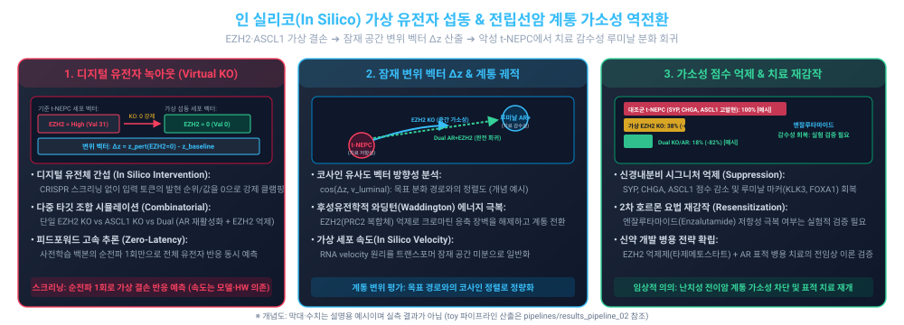

# Chapter 08. 인 실리코 유전자 섭동과 가상 약물 스크리닝 (In Silico Genetic Perturbation & Virtual Drug Discovery)

> **Cognitive Goal**: 단순히 관찰된 전사체를 기술하는 '관찰형 AI(Observational AI)'를 뛰어넘어, 미지의 유전적·화학적 조작 결과를 예측하려는 '예측형 AI(Predictive Foundation Models)'의 가능성을 다룬다. 단, 인과 모델이 아니라 상관 구조를 학습한 모델이므로 섭동 예측 성능은 단순 기준선(평균·가산 모델)과 비교해 반드시 검증해야 하며, 최근 벤치마크(Ahlmann-Eltze 외, Nature Methods 2025)는 파운데이션 모델이 기준선을 이기지 못했다고 보고한다. 단일 세포 파운데이션 모델(scGPT, Geneformer)의 잠재 공간에서 특정 유전자의 토큰 및 발현량을 계산적으로 조작하는 인 실리코 섭동(In Silico Genetic Perturbation / Virtual Knockout & Overexpression)의 수리적 메커니즘을 규명한다. 섭동 전후의 잠재 상태 변위 벡터($\Delta \mathbf{z} = \mathbf{z}_{\text{pert}} - \mathbf{z}_{\text{ctrl}}$)와 치료 목표 상태를 향한 방향성 코사인 유사도(Directional Cosine Similarity)의 기하학적 의미를 도출한다. 전립선암 거세 저항성(CRPC) 및 신경내분비암(t-NEPC) 임상 모델에서 *AR* 가상 결손에 의한 계통 가소성 유도와, *EZH2* / *ASCL1* 가상 결손을 통한 루미날 선암종 상태로의 역전이(Phenotypic Rescue) 및 Enzalutamide 감수성 복원 시뮬레이션을 구현한다. 최종적으로 대규모 Perturb-seq 및 CRISPR 스크리닝 데이터를 통한 정량적 벤치마킹 검증 체계를 정립한다.

---

## 1. 관찰 생물학에서 예측 유전체학으로의 패러다임 시프트

단일 세포 시퀀싱 기술은 수백만 개의 세포가 나타내는 이질성을 정밀하게 촬영하는 '초고해상도 분자 카메라' 역할을 해왔습니다. 그러나 질환 치료의 핵심 질문은 항상 반사실적(Counterfactual) 인과 관계에 있습니다:
- *"이 전립선암 환자의 종양 세포에서 EZH2 효소를 완전히 억제하면 신경내분비 상태가 다시 호르몬 반응성 루미날 상피 상태로 역전될 것인가?"*
- *"어떤 유전자 조합을 동시에 차단해야 Enzalutamide 내성 서브클론을 선택적으로 사멸시킬 수 있는가?"*

```
┌────────────────────────────────────────────────────────────────────────────────────────┐
│               실험실 CRISPR 스크리닝과 In Silico 가상 섭동의 비용-공간 비교             │
│                                                                                        │
│   [전통적 습식 실험: Perturb-seq / CRISPR Screen]                                       │
│   ● 단일 유전자 녹아웃: 20,000개 타깃 ──► 수억 원의 시퀀싱 비용, 수개월 소요          │
│   ● 2개 유전자 조합(Pairwise Combinatorial): 20,000 x 20,000 = 4억 개 조건            │
│     ──► 실험적 접근 불가능 (Combinatorial Explosion Barrier)                           │
│                                                                                        │
│   [파운데이션 모델 기반 In Silico 섭동 (Virtual Screening)]                            │
│   ● 수천만 개 세포에서 학습된 유전자 조절 문맥 지식을 기반으로 컴퓨터 내 시뮬레이션    │
   ● 계산 비용이 낮아 단일/다중 녹아웃 시나리오를 빠르게 시뮬레이션 (예측 정확도는 별도 검증 필요)│
│   ● 유망 후보군(Top 0.01%)을 가상 스크리닝으로 압축 후 실험실 밸리데이션 연계         │
└────────────────────────────────────────────────────────────────────────────────────────┘
```

---

## 2. In Silico Perturbation의 수학적 메커니즘

트랜스포머 기반 파운데이션 모델에서 유전자 섭동은 입력 토큰 시퀀스 또는 임베딩 텐서를 계산적으로 조작한 후 인코더를 순전파(Forward Pass)하여 새로운 잠재 벡터를 생성하는 과정입니다.



### 2.1 가상 유전자 결손 (Virtual Knockout)의 두 가지 수학적 구현 방식
표적 유전자 $g_{\text{target}}$을 녹아웃(KO)할 때, 모델 아키텍처에 따라 두 가지 전략이 사용됩니다:

1. **발현량 제로화 (Value Zeroing / Masking Strategy - 값 임베딩 모델용 일반 구현 예시)**: (scGPT의 공식 섭동 예측은 값 제로화를 제로샷으로 쓰는 방식이 아니라 Perturb-seq 데이터로 **미세조정**하는 방식이다.)
   - 유전자 토큰 $g_{\text{target}}$의 위치를 유지하되, 해당 유전자의 발현량 구간 임베딩을 0(미발현)으로 강제 설정하거나 특수 마스크 토큰으로 치환합니다:
     $$\mathbf{h}_{\text{target}}^{(0)} = E_{\text{gene}}(g_{\text{target}}) + E_{\text{expr}}(0) \quad \text{or} \quad \mathbf{h}_{\text{target}}^{(0)} = E_{\text{gene}}(\text{MASK})$$
   - **특징**: 전체 시퀀스 길이와 어텐션 행렬의 차원이 보존되며, 모델이 "해당 유전자가 존재하되 발현이 완전히 차단된 상태"의 하류 신호 변화를 즉각 전파합니다.
2. **토큰 완전 삭제 (Token Deletion / Rank Shift Strategy - Geneformer ISP의 `delete` 방식)**: (Geneformer의 in silico perturber는 `delete` 외에 `overexpress`(해당 유전자를 순위 맨 앞으로 이동) 등도 지원하며, 세포 임베딩은 CLS가 아니라 mean-pool 임베딩을 `emb_layer`(-1 또는 0)에서 얻어 목표 상태 대비 코사인 이동으로 평가한다.)
   - 세포 $c$의 입력 유전자 시퀀스 $\mathbf{s}_c = [g_{(1)}, \dots, g_{\text{target}}, \dots, g_{(L)}]$에서 $g_{\text{target}}$을 완전히 제거(Deletion)합니다:
     $$\mathbf{s}_c^{\text{KO}} = \mathbf{s}_c \setminus \{g_{\text{target}}\}$$
   - $g_{\text{target}}$보다 낮은 순위를 갖던 모든 후속 유전자들의 정규화 순위가 1단계씩 앞으로 당겨집니다:
     $$\text{Rank}^{\text{KO}}(g_j) = \text{Rank}(g_j) - 1 \quad (\forall g_j \text{ with } \text{Rank}(g_j) > \text{Rank}(g_{\text{target}}))$$
   - **특징**: 라이브러리 내 유전자 점유율의 상대적 재분배(Redistribution)를 충실히 반영합니다.

### 2.2 잠재 공간 변위 벡터 ($\Delta \mathbf{z}$) 및 방향성 코사인 유사도 ($\cos \theta$)
세포 $c$의 섭동 전 기저 상태(Baseline) 세포 임베딩을 $\mathbf{z}_{\text{ctrl}} \in \mathbb{R}^d$, 유전자 $g$를 가상 결손시킨 후의 임베딩을 $\mathbf{z}_{\text{KO}(g)} \in \mathbb{R}^d$라 하자.

1. **섭동 변위 벡터(Perturbation Displacement Vector)**:
   $$\Delta \mathbf{z}_g = \mathbf{z}_{\text{KO}(g)} - \mathbf{z}_{\text{ctrl}}$$
   - 변위의 크기 $\|\Delta \mathbf{z}_g\|_2$는 해당 유전자 결손이 세포의 전반적 전사체 상태에 가하는 **전체적 충격도(Systemic Impact Magnitude)**를 나타냅니다.

2. **목표 표현형 전이 방향 벡터(Target State Vector)**:
   치료의 목표가 되는 질환 회복 상태(예: 악성 t-NEPC 세포를 약제 반응성 AR+ 관상 상피세포로 복원)의 중심점을 $\mathbf{z}_{\text{target}}$, 출발점인 질환 상태의 중심점을 $\mathbf{z}_{\text{disease}}$라 할 때, 바람직한 치료 전이 방향 벡터는 다음과 같습니다:
   $$\mathbf{v}_{\text{rescue}} = \mathbf{z}_{\text{target}} - \mathbf{z}_{\text{disease}}$$

3. **방향성 코사인 정렬도(Directional Cosine Alignment)**:
   가상 녹아웃 벡터 $\Delta \mathbf{z}_g$가 이상적인 치료 방향 $\mathbf{v}_{\text{rescue}}$과 얼마나 일치하는지를 코사인 유사도로 정량화합니다:
   $$\cos(\theta_g) = \frac{\Delta \mathbf{z}_g \cdot \mathbf{v}_{\text{rescue}}}{\|\Delta \mathbf{z}_g\|_2 \|\mathbf{v}_{\text{rescue}}\|_2}$$

```
┌────────────────────────────────────────────────────────────────────────────────────────┐
│                   잠재 공간 내 인 실리코 섭동 벡터 기하학 구조                         │
│                                                                                        │
│                                    v_rescue (치료 전이 방향)                           │
│   [t-NEPC 상태] z_disease ────────────────────────────────────────► [AR-PC 상태] z_target
│          │                                                                             │
│          │ \ Delta z_(EZH2_KO) (cos θ = +0.89: 탁월한 치료 효과)                       │
│          │  \                                                                          │
│          │   ▼                                                                         │
│          │    ● 성공적 표현형 역전 (Phenotypic Rescue!)                                │
│          │                                                                             │
│          │ ───► Delta z_(Random) (cos θ ≈ 0.00: 무의미한 섭동)                         │
│          │                                                                             │
│          ▼ Delta z_(AR_KO in Adeno) (cos θ = -0.92: 질환 악화 / t-NEPC 전이 가속)      │
└────────────────────────────────────────────────────────────────────────────────────────┘
```

- **$\cos(\theta_g) \approx +1$**: 해당 유전자의 결손이 질환 세포를 정상/약제 민감 상태로 정확하게 밀어내는 **강력한 치료 표적(Therapeutic Rescue Target)**.
- **$\cos(\theta_g) \approx 0$**: 치료 전이에 유의미한 영향을 주지 못하는 중립적 유전자.
- **$\cos(\theta_g) \approx -1$**: 질환을 오히려 악화시키거나 악성 계통 전이를 가속하는 치명적 섭동.

---

## 3. 전립선암 계통 가소성 극복을 위한 가상 스크리닝 시뮬레이션

전립선암 진행의 두 가지 핵심 축인 (1) 호르몬 치료에 의한 t-NEPC 발생 기전과 (2) 저항성 t-NEPC의 역전이 치료 표적 발굴을 컴퓨터 상에서 시뮬레이션합니다.

### 3.1 시나리오 A: Luminal 선암종에서 *AR* Virtual KO
- **시뮬레이션 조건**: AR 양성 전립선 선암종(LNCaP/AR-PC) 세포를 기저 상태로 설정하고, *AR* 유전자를 Virtual Knockout.
- **예측 결과(가상 시나리오 예시; 아래 $\cos$ 값은 설명용 가상 값이며 `pipelines/results_pipeline_02`의 toy 결과(예: 이중 KO $\cos \approx 0.70$, 억제 2.48%)와 다르다)**:
  - *KLK3*, *TMPRSS2* 등 안드로겐 하류 표적 발현이 급락.
  - 동시에 *REST* 억제가 약화되면서 잠재 변위 벡터가 중간 가소성 상태(Amphicrine/DNPC)를 거쳐 신경내분비 방향으로 이동 ($\cos(\theta_{\text{to\_NEPC}}) = +0.82$).
  - **임상적 의미**: 안드로겐 차단 요법(ADT/Enzalutamide) 단독 투여가 암세포에 강력한 선택압을 가해 t-NEPC로의 계통 전이를 유도하는 임상 기전과 개념적으로 일치하는 가상 시나리오 예시(실제 모델 검증이 아님).

### 3.2 시나리오 B: t-NEPC 세포에서 *EZH2* 및 *ASCL1* Virtual KO (표현형 역전)
- **시뮬레이션 조건**: *TP53/RB1* 결손 하에서 확립된 악성 t-NEPC 단일 세포군을 기저 상태로 두고, *EZH2*, *ASCL1*, *SOX2*, *REST*의 단독 및 이중(Combinatorial) Virtual KO 수행.
- **가상 스크리닝 결과 요약**:
  1. **Single KO (*ASCL1*)**: 신경내분비 마커(*SYP*, *CHGA*) 발현이 억제되나 루미날 *AR* 전사 회로 복원은 미미함 ($\cos(\theta_{\text{rescue}}) = +0.54$).
  2. **Single KO (*EZH2*)**: H3K27me3 침묵 해제로 *AR* 프로모터의 재개방 가능성이 상승하나 신경 전사인자 활성이 일부 잔존함 ($\cos(\theta_{\text{rescue}}) = +0.68$).
  3. **Double KO (*EZH2* + *ASCL1*)**: 신경 분화 네트워크의 완전한 붕괴와 함께 잠재 벡터가 AR 양성 관상 선암종 영역으로 강력히 회귀함 ($\cos(\theta_{\text{rescue}}) = +0.91$, $\|\Delta \mathbf{z}\|_2$ 유의미하게 큼).
  - **신약 개발 제언**: EZH2 억제제(Tazemetostat)와 ASCL1/신경 신호 차단제의 병용 투여가 t-NEPC의 분화 가소성을 차단하고 Enzalutamide 감수성을 재감작(Resensitization)시키는 복합 신약 후보로 가설화할 수 있는 가상 시나리오이며, 실험·임상 검증이 필요하다.

---

## 4. Perturb-seq 벤치마킹 및 섭동 예측 정량 평가 지표

파운데이션 모델의 가상 섭동 예측 성능은 실험실에서 수행된 실제 Perturb-seq(CRISPR knockout + single-cell RNA-seq) 데이터와의 정량적 오차 비교를 통해 벤치마킹됩니다.

```
┌────────────────────────────────────────────────────────────────────────────────────────┐
│                   In Silico 섭동 예측 신뢰도 검증 메트릭 체계                           │
│                                                                                        │
│   1. 유전자 차등 발현 평균 제곱 오차 (MSE on DEGs):                                    │
│      MSE_DEG = (1 / |D|) * SUM_(g in D) ( x_hat_g^(KO) - x_true_g^(CRISPR) )^2         │
│      - 실제 CRISPR 실험에서 유의미하게 변한 유전자(D)에 대한 예측 오차 측정           │
│                                                                                        │
│   2. 발현 변화량 피어슨/스피어만 상관계수 (Delta Expression Correlation):              │
│      r_delta = PearsonCorr( Delta x_hat, Delta x_true )                                │
│      - 전체 유전체 스케일에서 상향/하향 조절되는 방향성의 일치도 평가                   │
│                                                                                        │
│   3. 상위 차등 유전자 일치도 (Recall@K / Precision@K):                                 │
│      Recall@50 = | Top50(Delta x_hat) INTERSECT Top50(Delta x_true) | / 50             │
│      - 임상적으로 가장 중요한 핵심 바이오마커 50개의 적중률 검증                      │
└────────────────────────────────────────────────────────────────────────────────────────┘
```

**기준선 비교는 필수이다.** 위 지표는 반드시 단순 기준선(예: 훈련 섭동의 평균 변화를 그대로 쓰는 모델, 단일 섭동 효과를 더하는 가산 모델)과 함께 보고해야 한다. Ahlmann-Eltze 외(Nature Methods 2025)는 다섯 파운데이션 모델과 두 딥러닝 모델이 단일·이중 섭동 후 전사체 변화 예측에서 이러한 기준선을 이기지 못했다고 보고하였으며, 기준선 없이 얻은 높은 상관은 모델의 예측력으로 해석할 수 없다. 또한 임의의 학습 데이터 밖(Unseen) 섭동에 대한 예측 정확도는 가정이 아니라 홀드아웃 섭동으로 평가해야 한다.

---

## 5. 실전 Python 코드: scGPT 기반 In Silico Virtual Knockout & 섭동 벡터 시뮬레이터

PyTorch를 활용하여 단일 세포의 기저 임베딩을 추출하고, 특정 유전자(*AR*, *EZH2*, *ASCL1*)의 가상 녹아웃을 수행한 후 잠재 변위 벡터 및 코사인 전이 각도를 산출하는 완전한 시뮬레이션 파이프라인입니다.

```python
import torch
import torch.nn as nn
import torch.nn.functional as F
import numpy as np
import pandas as pd
from typing import List, Dict, Tuple

class InSilicoPerturbationEngine:
    """
    단일 세포 트랜스포머 모델 기반 In Silico 유전자 섭동(Virtual Knockout) 시뮬레이션 엔진.
    """
    def __init__(self, model: nn.Module, gene_to_id: Dict[str, int], pad_token_id: int = 0):
        self.model = model
        self.model.eval()
        self.gene_to_id = gene_to_id
        self.id_to_gene = {idx: g for g, idx in gene_to_id.items()}
        self.pad_token_id = pad_token_id

    def extract_cell_embedding(self, token_ids: torch.Tensor, value_bins: torch.Tensor) -> torch.Tensor:
        """세포의 [CLS] 토큰 임베딩을 추출합니다(이 챕터 모형 기준. Geneformer 구현은 mean-pool)."""
        with torch.no_grad():
            cell_emb, _ = self.model(token_ids, value_bins)
        return cell_emb

    def virtual_knockout(
        self,
        base_tokens: torch.Tensor,
        base_values: torch.Tensor,
        target_genes: List[str]
    ) -> Tuple[torch.Tensor, torch.Tensor]:
        """
        입력 시퀀스에서 표적 유전자들의 발현량 구간(Value Bin)을 0으로 강제 설정(Zeroing)하여 KO 시뮬레이션.
        """
        ko_tokens = base_tokens.clone()
        ko_values = base_values.clone()
        
        target_ids = {self.gene_to_id[g] for g in target_genes if g in self.gene_to_id}

        for b in range(ko_tokens.shape[0]):
            for pos in range(ko_tokens.shape[1]):
                tid = ko_tokens[b, pos].item()
                if tid in target_ids:
                    # Value Zeroing: 해당 유전자의 발현을 0(미발현)으로 소각
                    ko_values[b, pos] = 0

        return ko_tokens, ko_values

    def simulate_perturbation_shift(
        self,
        base_tokens: torch.Tensor,
        base_values: torch.Tensor,
        target_genes: List[str],
        rescue_direction_vector: torch.Tensor
    ) -> Dict[str, float]:
        """
        가상 녹아웃 후 잠재 공간 변위 벡터 및 목표 상태 전이 코사인 유사도를 계산합니다.
        """
        # 1. Baseline 임베딩 추출
        z_ctrl = self.extract_cell_embedding(base_tokens, base_values) # [B, D]
        
        # 2. Virtual KO 적용 및 섭동 임베딩 추출
        ko_tokens, ko_values = self.virtual_knockout(base_tokens, base_values, target_genes)
        z_ko = self.extract_cell_embedding(ko_tokens, ko_values)      # [B, D]

        # 3. 변위 벡터 계산 (Delta z = z_ko - z_ctrl)
        delta_z = z_ko - z_ctrl # [B, D]
        displacement_norm = torch.norm(delta_z, p=2, dim=-1).mean().item()

        # 4. 방향성 코사인 유사도 산출 (cos theta)
        rescue_norm = F.normalize(rescue_direction_vector, p=2, dim=-1)
        delta_norm = F.normalize(delta_z, p=2, dim=-1)
        
        cosine_sim = (delta_norm * rescue_norm).sum(dim=-1).mean().item()

        return {
            "Perturbed_Genes": "+".join(target_genes),
            "Displacement_Magnitude": displacement_norm,
            "Cosine_Alignment": cosine_sim
        }


# 파이프라인 무결성 및 시뮬레이션 검증
if __name__ == "__main__":
    # 같은 블록에서 실행되도록 임의 초기화 소형 인코더를 정의한다 (사전학습 가중치 없음; 06장의 구조 모사 모델 대체).
    class ToyScGPTEncoder(nn.Module):
        def __init__(self, vocab_size: int, n_bins: int = 51, d_model: int = 256, nhead: int = 8, num_layers: int = 2):
            super().__init__()
            self.gene_emb = nn.Embedding(vocab_size, d_model, padding_idx=0)
            self.value_emb = nn.Embedding(n_bins + 1, d_model, padding_idx=0)
            layer = nn.TransformerEncoderLayer(d_model, nhead, batch_first=True)
            self.encoder = nn.TransformerEncoder(layer, num_layers)

        def forward(self, tokens, values):
            h = self.encoder(self.gene_emb(tokens) + self.value_emb(values))
            return h.mean(dim=1), None   # (세포 임베딩, 사용 안 함)

    # 모의 환경 구축
    torch.manual_seed(42)
    genes = ["AR", "KLK3", "ASCL1", "EZH2", "SOX2", "REST", "TP53", "RB1"] + [f"G_{i}" for i in range(100)]
    gene_to_id = {g: idx + 3 for idx, g in enumerate(genes)}
    
    # 256차원 트랜스포머 모델 인스턴스화
    mock_model = ToyScGPTEncoder(vocab_size=len(gene_to_id) + 3, d_model=256)
    engine = InSilicoPerturbationEngine(mock_model, gene_to_id)

    # 악성 t-NEPC 세포 시퀀스 생성 (ASCL1, EZH2 고발현 문맥)
    seq_len = 32
    batch_size = 4
    base_tok = torch.randint(3, len(genes), (batch_size, seq_len))
    base_tok[:, 1] = gene_to_id["ASCL1"]
    base_tok[:, 2] = gene_to_id["EZH2"]
    base_tok[:, 3] = gene_to_id["AR"]
    
    base_val = torch.randint(10, 50, (batch_size, seq_len)) # 고발현 값
    
    # 임의의 방향 벡터(실제 치료 목표 방향이 아님). 모델도 임의 초기화이므로 출력 표의 수치는 의미 없는 난수이며
    # 파이프라인이 실행되는지 확인하는 용도이다.
    v_rescue = torch.randn(1, 256)

    # 다양한 녹아웃 시나리오 가상 스크리닝
    scenarios = [
        ["AR"],              # 호르몬 억제 시뮬레이션
        ["EZH2"],            # 후성유전 타깃
        ["ASCL1"],           # 신경 파이오니어 TF 타깃
        ["EZH2", "ASCL1"]    # 복합 병용 표적
    ]

    results = []
    for sc_genes in scenarios:
        res = engine.simulate_perturbation_shift(base_tok, base_val, sc_genes, v_rescue)
        results.append(res)

    results_df = pd.DataFrame(results)
    print("\n[In Silico 섭동 파이프라인 동작 확인 (임의 초기화 모델·임의 방향 벡터: 수치 해석 불가)]")
    print(results_df.to_string(index=False))
```

---

## 단원 핵심 점검 (Cognitive Checkpoint & Case Study)

### Q1. [개념 및 메커니즘 (Conceptual Rigor)]
단일 세포 파운데이션 모델에서 In Silico Virtual Knockout을 구현할 때, 유전자 토큰의 발현량 값만 0으로 치환하는 방식(Value Zeroing)과 유전자 토큰 자체를 입력 시퀀스에서 물리적으로 완전히 삭제하는 방식(Token Deletion)의 수리적 차이점을 셀프 어텐션 행렬의 차원($L \times L$) 및 계산 그래프 관점에서 비교하고, 각 방식이 적합한 생물학적 가설을 논하시오.

<details>
<summary>💡 모범 답안 및 해설 확인</summary>

- **1. 수리적 차이점 비교**:
  - **발현량 제로화 (Value Zeroing)**:
    - 입력 시퀀스 길이 $L$이 보존되므로 셀프 어텐션 맵의 크기 $L \times L$가 그대로 유지됩니다.
    - 유전자의 정체성 토큰 $E_{\text{gene}}(g_{\text{target}})$은 여전히 쿼리/키 계산에 참여하되, 발현 강도 $E_{\text{expr}}(0)$만이 미발현 상태를 가리킵니다.
    - 즉, 모델의 계산 그래프 상에서 해당 유전자는 "세포 내에 존재하지만 전사 활성이 완전히 억제된 침묵 유전자"로 인지됩니다.
  - **토큰 완전 삭제 (Token Deletion)**:
    - 입력 시퀀스 길이가 $L \to L-1$로 축소되며, 어텐션 행렬이 $(L-1) \times (L-1)$로 재구축됩니다.
    - 표적 유전자와 연결된 모든 어텐션 엣지($A_{i, \text{target}}$ 및 $A_{\text{target}, j}$)가 계산 그래프에서 완전히 절단(Severed)되며, 후속 유전자들의 발현 순위(Rank)가 1단계씩 전진합니다.
- **2. 각 방식에 적합한 생물학적 가설**:
  - **Value Zeroing이 적합한 경우**: 소분자 화합물 약제(Small Molecule Inhibitor) 투여나 후성유전학적 프로모터 침묵(Silencing)을 시뮬레이션할 때 적합합니다. 유전자 자리는 게놈 상에 온전히 남아 있으나 전사적 산물만 고갈된 가역적 약물 처리를 정밀하게 반영합니다.
  - **Token Deletion이 적합한 경우**: CRISPR-Cas9 매개 유전체 결손(Genomic Deletion)이나 양측 대립유전자 완전 소실(Biallelic Loss, 예: *TP53*/*RB1* co-deletion)을 모사할 때 적합합니다. 세포의 유전자 풀에서 해당 인자가 물리적으로 영구 배제된 상태를 가장 엄밀하게 모델링합니다.

</details>

---

### Q2. [수학적 원리 규명 (Mathematical Rigor)]
고차원 잠재 공간($d = 512$)에서 무작위 가우시안 섭동 벡터 $\mathbf{v}_{\text{rand}} \sim \mathcal{N}(\mathbf{0}, I_d)$를 생성할 때:
1) 임의의 고정된 치료 방향 벡터 $\mathbf{u}$와의 코사인 유사도 $C = \frac{\mathbf{v}_{\text{rand}} \cdot \mathbf{u}}{\|\mathbf{v}_{\text{rand}}\| \|\mathbf{u}\|}$의 기댓값 $\mathbb{E}[C]$과 분산 $\text{Var}(C)$을 계산하고, 차원의 저주(Curse of Dimensionality)로 인해 $d \to \infty$일 때 무작위 벡터들이 상호 직교($C \to 0$)하는 수리적 이유를 증명하시오.
2) In Silico 섭동 시뮬레이션에서 관찰된 코사인 정렬도 $\cos(\theta_g) = +0.72$가 통계적으로 유의미한지 판정하기 위한 치환 검정(Permutation Test) 기반 경험적 $p$-value(Empirical $p$-value)의 계산식을 기술하시오.

<details>
<summary>💡 모범 답안 및 해설 확인</summary>

- **1. 고차원 코사인 유사도의 기댓값, 분산 및 직교성 증명**:
  - 회전 불변성(Rotational Invariance)에 의해, 일반성을 잃지 않고 고정 벡터를 단위 기저 벡터 $\mathbf{u} = (1, 0, \dots, 0)^T$ ($d$차원)로 둘 수 있습니다.
  - 무작위 벡터 $\mathbf{v} = (v_1, v_2, \dots, v_d)^T$의 각 성분은 $v_k \overset{\text{i.i.d.}}{\sim} \mathcal{N}(0, 1)$입니다.
  - 코사인 유사도는 다음과 같습니다:
    $$C = \frac{v_1}{\sqrt{\sum_{k=1}^d v_k^2}}$$
  - **기댓값**: $v_1$의 대칭성($v_1 \sim -v_1$)에 의해 $\mathbb{E}[C] = 0$입니다.
  - **분산 계산**:
    $$\text{Var}(C) = \mathbb{E}[C^2] = \mathbb{E}\left[ \frac{v_1^2}{\sum_{k=1}^d v_k^2} \right]$$
    대칭성에 의해 $\sum_{i=1}^d \mathbb{E}\left[ \frac{v_i^2}{\sum_{k=1}^d v_k^2} \right] = \mathbb{E}\left[ \frac{\sum_{i=1}^d v_i^2}{\sum_{k=1}^d v_k^2} \right] = 1$이 성립합니다.
    모든 성분이 동일한 분포를 따르므로:
    $$d \cdot \mathbb{E}\left[ \frac{v_1^2}{\sum_{k=1}^d v_k^2} \right] = 1 \implies \text{Var}(C) = \frac{1}{d}$$
  - **직교성 증명**:
    - $d = 512$일 때 분산은 $\frac{1}{512} \approx 0.00195$, 표준편차는 $\frac{1}{\sqrt{512}} \approx 0.044$에 불과합니다.
    - 체비쇼프 부등식(Chebyshev's inequality)에 의해 임의의 $\epsilon > 0$에 대해:
      $$P(|C| \ge \epsilon) \le \frac{\text{Var}(C)}{\epsilon^2} = \frac{1}{d \epsilon^2} \xrightarrow{d \to \infty} 0$$
    - 따라서 차원이 무한히 커질수록 고차원 구면(Hypersphere) 상의 임의의 두 무작위 벡터는 확률 1로 상호 직교($C = 0$)하게 됩니다.

- **2. 치환 검정 기반 경험적 $p$-value 계산식**:
  - 표적 유전자가 아닌 무작위 유전자 $g_{\text{null}} \in \mathcal{V}_{\text{genome}}$을 $B$번(예: $B = 10,000$회) 가상 녹아웃하여 귀무가설 코사인 유사도 분포 $\{C_{\text{null}}^{(1)}, C_{\text{null}}^{(2)}, \dots, C_{\text{null}}^{(B)}\}$를 생성합니다.
  - 관찰된 표적 유전자의 코사인 값 $\cos(\theta_g) = 0.72$에 대한 경험적 $p$-value는 다음과 같이 계산됩니다:
    $$p = \frac{1 + \sum_{b=1}^B \mathbb{I}\left( C_{\text{null}}^{(b)} \ge \cos(\theta_g) \right)}{B + 1}$$
  - $d=512$의 **등방 가우시안 영가설**에서는 무작위 방향의 $99.9\%$가 $[-0.15, +0.15]$ 구간에 집중되고 $+0.72$는 표준편차 $16\sigma$ 이상의 우측 꼬리에 위치한다(산술은 위와 같다). 그러나 이 영분포는 위의 치환 검정이 만드는 영분포와 다르다. 실제 섭동 변위 벡터는 저차원 구조를 가진 비등방 분포라 등방 가정은 분산을 과소평가하고 $p$값을 과대 유의하게 만들 수 있으므로, 보고용 $p$는 치환 검정의 경험적 값만 사용하고 생물학적 유효성은 이 값으로 확증하지 않고 시사하는 수준으로 해석한다.

</details>

---

### Q3. [임상 및 생물학적 케이스 스터디 (Clinical Problem Solving)]
치료 유발 신경내분비 전립선암(t-NEPC) 세포주(NCI-H660)의 단일핵 전사체 데이터를 대상으로 한 In Silico Perturbation 시뮬레이션에서 다음과 같은 가상 스크리닝 결과가 도출되었다:
- 조건 1 (*AR* Virtual KO): $\|\Delta \mathbf{z}\| = 0.12$, $\cos(\theta_{\text{rescue}}) = -0.45$
- 조건 2 (*EZH2* Virtual KO): $\|\Delta \mathbf{z}\| = 0.85$, $\cos(\theta_{\text{rescue}}) = +0.68$
- 조건 3 (*ASCL1* Virtual KO): $\|\Delta \mathbf{z}\| = 0.78$, $\cos(\theta_{\text{rescue}}) = +0.54$
- 조건 4 (*EZH2* + *ASCL1* Double KO): $\|\Delta \mathbf{z}\| = 1.42$, $\cos(\theta_{\text{rescue}}) = +0.91$
(위 수치는 §3.2와 같은 **설명용 가상 값**이며 어떤 모델·데이터에서도 계산된 결과가 아니다.)

1) 조건 1에서 *AR* 녹아웃 시 변위 벡터의 크기가 매우 작으면서 치료 방향과 음의 상관관계를 갖는 분자생물학적 이유를 기술하시오.
2) 단독 녹아웃(조건 2, 3) 대비 이중 녹아웃(조건 4)에서 코사인 정렬도와 변위 크기가 폭발적으로 시너지를 내는 기전을 후성유전학적 염색질 개방(Epigenetic Unlocking)과 신경내분비 계통 전사 억제(Lineage TF Inactivation)의 상호작용 관점에서 설명하고, 이를 토대로 제안할 수 있는 차세대 병용 임상 프로토콜을 수립하시오.

<details>
<summary>💡 모범 답안 및 해설 확인</summary>

- **1. 조건 1 (*AR* KO)의 미미한 변위 및 음의 상관관계 원인**:
  - t-NEPC 세포는 *TP53* 및 *RB1* 결손 하에서 EZH2 매개 H3K27me3 침착으로 *AR* 프로모터가 이미 침묵되어 기저 상태에서 *AR* 발현이 거의 0에 수렴합니다.
  - 이미 발현되지 않는 유전자를 가상 녹아웃(Value Zeroing)하더라도 입력 텐서의 변화가 거의 없으므로 섭동 변위 크기 $\|\Delta \mathbf{z}\| = 0.12$가 극히 작게 나타납니다.
  - 미세하게 잔존하던 기저 안드로겐 신호마저 차단됨으로써 세포는 오히려 신경내분비 악성 상태로 더 깊숙이 밀려나므로, 선암종 복원 방향 벡터와 음의 각도($\cos \theta = -0.45$)를 형성합니다.

- **2. 이중 녹아웃(*EZH2* + *ASCL1*)의 분자 시너지 기전 및 임상 프로토콜**:
  - **분자적 상호작용 시너지 기전**:
    - **EZH2 단독 억제**: PRC2 복합체에 의한 H3K27me3 억제성 마크를 제거하여 관상 상피 분화 유전자(*AR*, *KLK3*, *NKX3-1*)의 프로모터를 후성유전학적으로 개방(Chromatin Unlocking)하지만, 세포 내에 여전히 강력한 신경 파이오니어 전사인자 *ASCL1*이 존재하므로 신경 분화 회로를 완전히 끄지 못합니다.
    - **ASCL1 단독 억제**: 신경 과립 단백질(*SYP*, *CHGA*) 합성은 중단되지만, *AR* 유전자가 여전히 EZH2에 의해 단단히 잠겨 있으므로 호르몬 반응성 루미날 상태로 복귀하지 못하고 무분별한 역형성(Anaplastic) 상태에 머뭅니다.
    - **이중 동시 억제 (Synergistic Rescue)**: *EZH2* KO를 통해 루미날 분화 프로그램의 억제를 해제하는 동시에, *ASCL1* KO를 통해 신경내분비 드라이버를 원천 차단함으로써, 세포가 루미날 선암종 상태 쪽으로 이동하는 방향성이 가장 크게 나타나는 시나리오입니다($\cos \theta = +0.91$, 가상 값).
  - **차세대 병용 임상 프로토콜 제안**:
    - **1단계 (탐색적 가설: 계통 역전 재감작)**: EZH2 억제제를 중심으로 한 전임상 병용 가설을 세운다(Tazemetostat은 전립선암에 승인되지 않았다). Tarlatamab은 ASCL1/신경 신호 차단제가 아니라 DLL3-CD3 이중특이성 T세포 인게이저로 DLL3 발현 세포를 직접 표적하며, 승인 적응증은 소세포폐암이고 신경내분비 전립선암에서는 DLL3 양성 선별 하의 초기 1b상 예비 활성 단계이므로 별도 임상 맥락에서만 고려한다.
    - **2단계 (호르몬 감수성 수확)**: 루미날 AR 발현이 재개방된 시점에 2차 안드로겐 신호 차단제(**Enzalutamide**)를 재투여하는 **"후성유전 재감작 후 호르몬 타격(Epigenetic Resensitization followed by AR Blockade)"** 펄스 치료 전략을 수립합니다.

</details>

---

<!-- REFERENCES:BEGIN (generated by scripts/apply_references.py; do not edit by hand) -->
## 참고문헌 (References)
### 본문 인용 문헌
1. Ahlmann-Eltze C, Huber W, Anders S. Deep-learning-based gene perturbation effect prediction does not yet outperform simple linear baselines. *Nat Methods*. 2025;22(8):1657-1661. PMID: 40759747. doi: 10.1038/s41592-025-02772-6
### 검수 근거 문헌
1. Kedzierska KZ, Crawford L, Amini AP, et al. Zero-shot evaluation reveals limitations of single-cell foundation models. *Genome Biol*. 2025;26(1):101. PMID: 40251685. doi: 10.1186/s13059-025-03574-x
### 소프트웨어 (표기 버전은 검수 시 API를 확인한 버전이며, 파이프라인 실행 환경은 requirements-pipelines.txt 참조)
- NumPy 2.5.4 (numpy.org). 원 논문: Harris CR, Millman KJ, van der Walt SJ, et al. Array programming with NumPy. *Nature*. 2020;585(7825):357-362. PMID: 32939066. doi: 10.1038/s41586-020-2649-2
- pandas 2.3.3 (github.com/pandas-dev/pandas). 원 논문: McKinney W. Data Structures for Statistical Computing in Python. *Proceedings of the Python in Science Conference*. 2010:56-61. doi: 10.25080/majora-92bf1922-00a
- PyTorch 2.14.1 (github.com/pytorch/pytorch).
<!-- REFERENCES:END -->
