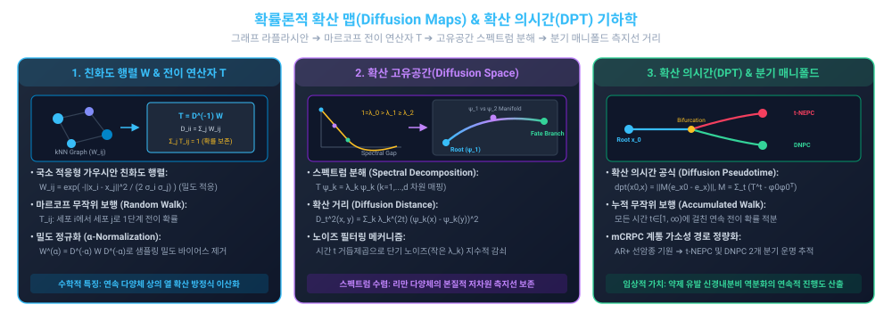
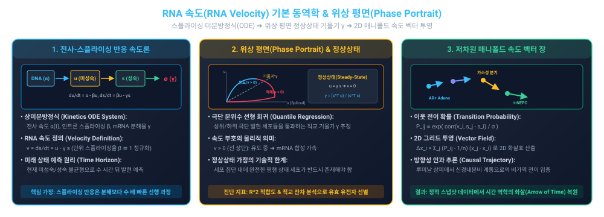
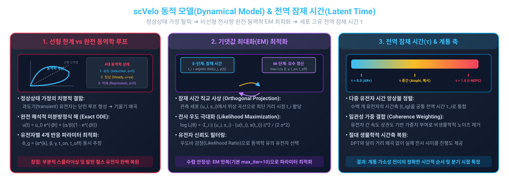
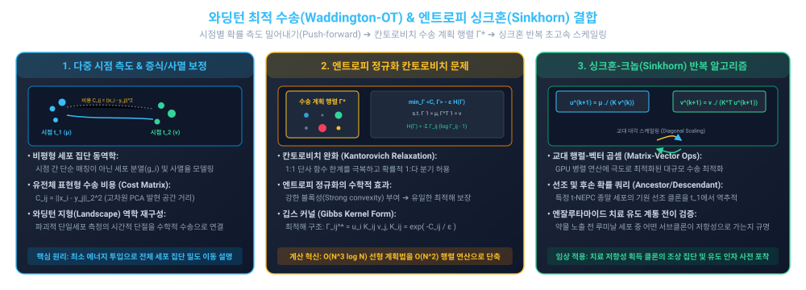
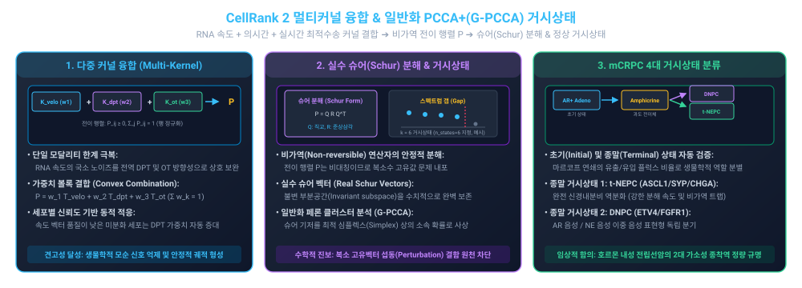
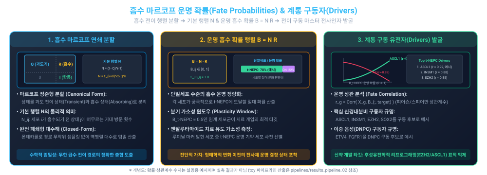

# 단일세포 매니폴드 기하학 & 동역학 궤적 추론 (Single-Cell Manifold Geometry & Dynamic Trajectory Inference) 마스터 교재
**From Diffusion Maps & Splicing Kinetics (scVelo) to Entropic Optimal Transport (Waddington-OT) & CellRank 2 Multi-Kernel Lineage Fate Mapping**

---

## 📚 교재 전체 목차 (Table of Contents)

- [Chapter 00. 단일세포 매니폴드 궤적 분석 및 동역학 로드맵](#part-00-00-단일세포-매니폴드-궤적-분석-및-동역학-로드맵-trajectory-roadmap)
- [Chapter 01. 매니폴드 기하학과 확산 유사시간](#part-01-01-매니폴드-기하학과-확산-유사시간-manifold-geometry--diffusion-pseudotime)
- [Chapter 02. RNA 벨로시티와 스플라이싱 반응속도론](#part-02-02-rna-벨로시티와-스플라이싱-반응속도론-rna-velocity--splicing-kinetics)
- [Chapter 03. 동역학 모델과 보편 잠재 시간](#part-03-03-동역학-모델과-보편-잠재-시간-dynamical-velocity--latent-time)
- [Chapter 04. 최적 수송 이론과 Waddington-OT](#part-04-04-최적-수송-이론과-waddington-ot-optimal-transport--waddington-ot)
- [Chapter 05. CellRank 2 다중 커널 융합 프레임워크](#part-05-chapter-05-cellrank-2-다중-커널-융합-프레임워크-cellrank-2-multi-kernel-integration-framework)
- [Chapter 06. 마르코프 연쇄와 거시상태의 분해](#part-06-chapter-06-마르코프-연쇄와-거시상태의-분해-markov-chains--g-pcca-macrostates)
- [Chapter 07. 흡수 마르코프 연쇄와 계통 운명 흡수 확률](#part-07-chapter-07-흡수-마르코프-연쇄와-계통-운명-흡수-확률-absorbing-markov-chains--fate-absorption-probabilities)
- [Chapter 08. 계통 운명 구동 전사인자 및 동역학 드라이버 발굴](#part-08-chapter-08-계통-운명-구동-전사인자-및-동역학-드라이버-발굴-lineage-fate-drivers--dynamic-gene-discovery)
- [Chapter 09. 궤적 분석 문제 해결, 품질 진단 및 캡스톤 루브릭](#part-09-chapter-09-궤적-분석-문제-해결-품질-진단-및-캡스톤-루브릭-trajectory-troubleshooting-diagnostics--capstone-rubric)

---

# Part 00. 00. 단일세포 매니폴드 궤적 분석 및 동역학 로드맵 (Trajectory Roadmap)
> **출처 원본 파일**: `tracks/06_manifold_trajectory/docs/00_TRAJECTORY_ROADMAP.md`


---

## 학습 목표 (Cognitive Goals)

1. **와딩턴 후성유전학적 풍경(Waddington's Epigenetic Landscape)과 '시간의 화살' 패러독스 규명**: 파괴적 측정(Destructive Measurement)이라는 단일세포 시퀀싱의 물리적 한계 하에서 정적 스냅샷(Static Snapshot)들로부터 시간의 연속성과 비가역적 방향성(Arrow of Time)을 복원하는 계산생물학적 정식화 원리를 이해한다.
2. **정적 그래프 유사시간(Static Graph Pseudotime)의 근본적 결함 분석**: 유클리드/그래프 최단 거리 기반 알고리즘(Monocle, DPT)이 가역적 상태 전이, 탈분화(Dedifferentiation), 교차분화(Transdifferentiation) 및 암 세포 계통 가소성(Lineage Plasticity)을 왜곡하는 수학적 기전을 증명한다.
3. **단일세포 동역학 4대 계산 패러다임의 유기적 연계성 정립**:
   - 매니폴드 확산 기하학(Diffusion Geometry & DPT)
   - 전사체 스플라이싱 반응속도론(RNA Velocity Splicing Kinetics)
   - 완전 동역학 EM 최적화 및 보편 잠재 시간(Dynamical scVelo & Latent Time)
   - 엔트로피 정규화 최적 수송 모델(Waddington-OT)
   위 방법론들의 수학적 가정, 적용 한계 및 상호보완적 역할을 체계화한다.
4. **전립선암 계통 가소성 벤치마크 및 분석 환경 구축**: Karthaus et al. (Science 2020)의 안드로겐 결핍/재생 시계열 모델 및 Replogle et al. (Cell 2022)의 Perturb-seq 섭동 모델을 통한 궤적 분석 실습을 준비하고, 전용 파이썬 환경(`scvelo`, `cellrank`, `wot`, `scanpy`)을 구성한다.

---

## 1. 와딩턴 후성유전학적 풍경과 '시간의 화살' (Arrow of Time)

### 1.1 파괴적 측정(Destructive Measurement)과 단일세포 스냅샷의 한계

단일세포 RNA 시퀀싱(scRNA-seq/snRNA-seq)은 세포를 화학적으로 용해(Lysis)하여 전사체를 포획하므로, **동일한 세포를 시간에 따라 연속적으로 추적하는 것이 물리적으로 불가능**하다. 우리가 획득하는 데이터 행렬 $X \in \mathbb{R}^{N \times G}$는 특정 시점에 정지된 개별 세포들의 정적 스냅샷(Static Snapshot)들의 집합에 불과하다.

```
[The Destructive Measurement Paradox in Single-Cell Biology]

True Continuous Biological Time (t):
t_0 ──────────────────> t_1 ──────────────────> t_2 ──────────────────> t_final
[Cell A] ──(Differentiates)──> [Cell A'] ──(Transdifferentiates)──> [Cell A'']

Observed High-Throughput scRNA-seq:
t_0: {Cell 1, Cell 2, ...} (Cells Destroyed by Lysis!)
t_1: {Cell 101, Cell 102, ...} (Completely Different Individual Cells!)
t_2: {Cell 201, Cell 202, ...} (No Direct Ancestor-Descendant Tracking!)
```

이러한 물리적 제약은 통계역학과 동역학계 이론(Dynamical Systems Theory)에서 다루는 **시간의 화살(Arrow of Time)** 문제를 야기한다:
- 불연속적인 세포 집단 사이에서 어느 세포가 '조상(Ancestor)'이고 어느 세포가 '후손(Descendant)'인가?
- 세포의 상태 전이는 엔트로피가 증가하는 방향으로만 진행하는 비가역적 과정인가, 아니면 병리적 미세환경에서 역류(Reverse Flow)할 수 있는가?

### 1.2 콘래드 와딩턴의 고전적 풍경(Waddington's Landscape)과 현대적 재해석

1957년 발생생물학자 콘래드 와딩턴(Conrad Waddington)은 세포 분화 과정을 높은 고도에서 깊은 골짜기로 굴러떨어지는 구슬에 비유하였다.

```
[Classical Waddington Landscape]         [Modern Cancer Plasticity Landscape]

         Stem/Progenitor                             Stem/Progenitor
             (High PE)                                  (Unstable)
               ○                                          ○   ▲
              / \                                        / \  │ (Dedifferentiation:
             /   \                                      /   \ │  e.g., Castration,
            /     \                                    /     \│  TP53/RB1 Loss)
           /   │   \                                  /       \
          ▼    │    ▼                                ▼         ▼
      Branch 1 │ Branch 2                        Basal/     Luminal
       (Valley)│  (Valley)                      Neuroendo   (Reversible)
               ▼                                     ▲─────────┘
        Terminally Differentiated                    (Transdifferentiation)
           (Global Minimum)
```

1. **고전적 발생학 모델(Classical Development)**:
   - 에너지 지형(Potential Energy Surface $U(x)$)은 정상 세포에서 엄격한 단조 감소(Monotonically Decreasing) 함수로 취급된다:
     $$\frac{dx}{dt} = -\nabla U(x) + \xi(t)$$
   - 여기서 $\xi(t)$는 백색 소음(White Noise) 형태의 전사 파열 요동이며, 구슬은 국소 최소점(Local Minima, 분화 종착점)에 도달하면 외부의 극단적인 자극 없이는 계곡을 거슬러 올라갈 수 없다.
2. **현대 종양생물학 및 계통 가소성(Cancer Lineage Plasticity)**:
   - 유전적 결함(e.g., $TP53, RB1$ 결손) 또는 치료적 스트레스(e.g., 항호르몬 치료, 면역항암제) 하에서 세포는 골짜기 사이의 능선(Barrier)을 넘는 **교차분화(Transdifferentiation)**를 일으키거나, 계곡 바닥에서 다시 상류로 거슬러 올라가는 **탈분화(Dedifferentiation)**를 감행한다.
   - 따라서 정적인 포텐셜 경사만으로는 암 조직 내의 비평형(Non-equilibrium) 동역학을 포착할 수 없다.

---

## 2. 정적 그래프 유사시간(Static Graph Pseudotime)의 붕괴

초기 궤적 추정 알고리즘들(Wanderlust, Monocle 1/2, Diffusion Pseudotime)은 세포 간의 발현 프로파일 유사도를 바탕으로 $k$-최근접 이웃 그래프(k-NN Graph)를 구축한 뒤, 그래프 상의 최단 경로(Shortest Geodesic Path)를 유사시간(Pseudotime, $t_{\text{pseudo}}$)으로 환산하였다.

### 2.1 정적 알고리즘의 네 가지 구조적 한계

```
[Pitfalls of Distance-Based Static Pseudotime]

1. Boundary Condition Artifact:
   Selected Root (User) ───[Shortest Path Distance]───> Artifact Endpoints
   (Misidentification of root inverts biological time entirely!)

2. Irreversibility Assumption:
   A (Luminal) ───────────────> B (Basal)  [Assumed One-way]
   Real Biology: A <──────────> B (Plasticity & Oscillation)

3. Density & Sampling Bias:
   High Cell Density Region ===> Graph distance artificially compressed!
   Low Cell Density Region  ===> Bridge edges span spurious transitions!

4. Rate Distortion (Pseudotime ≠ Physical Time):
   Linear Pseudotime Δτ = 1 does NOT mean Δt = 1 hour.
   Cells can arrest in quiescent states for weeks without gene changes.
```

1. **방향성의 부재(Lack of Intrinsic Directionality)**:
   그래프 상의 최단 경로는 대칭적($d(u, v) = d(v, u)$)이다. 분석가가 사전에 시작 세포(Root cell)를 수동으로 지정하지 않으면, 시스템은 탈분화인지 정상 분화인지 자체적으로 판단할 수 없다.
2. **비가역성 공리의 오류(Violation of Irreversibility)**:
   정적 그래프는 순환 고리(Cycle)나 궤적 역행을 다룰 수 없으며, 강제적으로 최소 신장 트리(Minimum Spanning Tree, MST)나 단방향 유향 비순환 그래프(DAG)로 매니폴드를 투영한다.
3. **세포 밀도 불균일성에 따른 거리 왜곡**:
   세포 증식 속도와 생존율 차이로 인해 중간 상태의 세포 밀도가 극히 낮을 경우, 그래프는 연결성이 끊어지거나 잘못된 지름길(Short-circuit Bridge)을 생성한다.
4. **물리적 시간과의 괴리**:
   유사시간은 유전자 발현 공간의 '거리'일 뿐이며, 세포 주기 정지(Quiescence)나 휴지기 동안의 물리적 절대 시간($t$)의 흐름을 반영하지 못한다.

---

## 3. 단일세포 동역학 4대 계산 패러다임

단일세포 연구는 정적 그래프 거리를 탈피하여, 세포 내부의 물리적/통계적 원리를 이용해 내재적 방향성 벡터를 복원하는 동역학 패러다임으로 진화하였다.

```
[Evolution of Single-Cell Dynamical Trajectory Inference]

+───────────────────────────────────────────────────────────────────────────+
| 1. Manifold Diffusion Geometry (Haghverdi et al., Nature Methods 2016)   |
|    Graph Laplacian & Diffusion Random Walk:                               |
|    D^2(x, y) = Σ [T^t(x, ·) - T^t(y, ·)]^2                               |
|    - Random-walk transition noise filtering, multi-scale geodesics        |
+───────────────────────────────────────────────────────────────────────────+
                                    │
                                    ▼
+───────────────────────────────────────────────────────────────────────────+
| 2. RNA Velocity Splicing Kinetics (La Manno et al., Nature 2018)          |
|    Biophysical pre-mRNA ODEs:                                             |
|    du/dt = α - β*u,   ds/dt = β*u - γ*s                                   |
|    - First intrinsic "Arrow of Time" using splicing displacement          |
+───────────────────────────────────────────────────────────────────────────+
                                    │
                                    ▼
+───────────────────────────────────────────────────────────────────────────+
| 3. Dynamical scVelo & Latent Time (Bergen et al., Nature Biotech 2020)    |
|    Full Kinetic EM Optimization:                                          |
|    Optimizes (α, β, γ, t) without steady-state equilibrium assumption     |
|    - Reconstructs universal latent time (τ) resolving transient regimes   |
+───────────────────────────────────────────────────────────────────────────+
                                    │
                                    ▼
+───────────────────────────────────────────────────────────────────────────+
| 4. Entropic Optimal Transport: Waddington-OT (Schiebinger et al., 2019)  |
|    Coupling discrete longitudinal populations:                            |
|    min <C, Γ> - ε H(Γ), with proliferation/death growth rates g(x)        |
|    - Rigorous mathematical push-forward across experimental timepoints    |
+───────────────────────────────────────────────────────────────────────────+
```

### 3.1 방법론별 수리물리학적 핵심 비교

| 패러다임 | 핵심 수리 도구 | 방향성 정보원 | 주요 강점 | 적용 시 주의점 |
| :--- | :--- | :--- | :--- | :--- |
| **Diffusion Pseudotime (DPT)** | 그래프 라플라시안 스펙트럼 분해, 마르코프 무작위 보행 | 외부 지정 (Root Cell 필요) | 노이즈 강건성, 다분기(Multibranching) 기하 구조 보존 | 역행/순환 궤적 불가능, 분기 방향 지정 오류 위험 |
| **RNA Velocity (Steady-state)** | 1차 선형 상미분방정식(ODE) 극단 위상 회귀 | 스플라이스되지 않은 pre-mRNA 잔차 ($u - \tilde{\gamma}s$) | 단일 시점 스냅샷에서 세포별 순간 속도 벡터 도출 | 전사 정상상태(Equilibrium) 가정 붕괴 시 왜곡 |
| **Dynamical scVelo** | 완전 동역학 우도 기반 EM 알고리즘 | 유전자별 위상 궤도 최적화 및 보편 잠재 시간 ($\tau$) | 비평형 전사 유도/억제 구간 모델링, 다중 반응속도 복원 | 계산 비용 큼, 스플라이싱이 적은 저발현 유전자 피팅 불안정 |
| **Waddington-OT** | 엔트로피 정규화 최적 수송, 싱크혼-크놉(Sinkhorn-Knopp) 알고리즘 | 실제 실험적 시계열 ($t_1 < t_2 < \dots < t_k$) | 세포 증식/사멸($g(x)$) 통합, 대규모 섭동 계통 추적 | 시계열 데이터 필수, 극단적 배치 효과 존재 시 수송 왜곡 |

---

## 4. 종양 생물학 벤치마크: 전립선암 계통 가소성

본 매니폴드 궤적 분석 트랙의 모든 방법론은 전립선암(Prostate Cancer)의 대표적 난제인 **계통 가소성(Lineage Plasticity) 및 거세 저항성 신경내분비 분화(t-NEPC)** 벤치마크 데이터를 관통하여 검증된다.

### 4.1 Karthaus et al. (Science 2020) 거세/재생 시계열 벤치마크
- **실험 디자인(교육용 요약)**: 마우스 전립선에서 거세(Castration)와 재생(Regeneration) 과정을 단일세포 전사체로 분석한 연구입니다(Karthaus et al., Science 2020). 아래 날짜별 샘플링 일정(Day 0/1/3/7/14/28)은 원 논문에서 확인한 것이 아니라 이 트랙의 *교육용 예시 일정*입니다(본 트랙 모의 데이터는 Day 0/1/3/7/14).
- **핵심 생물학적 발견**:
  - 논문 초록은 마우스와 인간의 관강 세포(Luminal cells)가 재생에 기여하며, 희귀한 줄기세포 유사 관강 세포와 분화된 관강 세포가 모두 재생에 기여함을 보고합니다(PMID 32355025). 즉 '분화 관강세포도 재생에 기여' 수준이 원 논문에서 확인된 내용입니다.
  - 이 시계열에 RNA 벨로시티나 Waddington-OT를 적용해 '탈분화 벡터'를 증명했다는 서술은 원 논문의 주장이 아니라, 이 트랙에서 방법론을 설명하기 위한 *가상의 적용 시나리오*입니다. 정적 유사시간이 방향성을 모호하게 만든다는 점은 일반론입니다.

### 4.2 Replogle et al. (Cell 2022) 게놈 규모 Perturb-seq 벤치마크
- **실험 디자인**: 인간 세포주를 대상으로 genome-scale CRISPRi Perturb-seq(250만 세포 이상)를 수행한 데이터셋입니다(Replogle et al., Cell 2022, PMID 35688146). 전립선 조직이나 신경내분비 전이를 분석한 연구가 아닙니다.
- **본 트랙에서의 위치**: 섭동 데이터에서 상태 이동을 정량하는 *방법론 사례*로만 인용합니다. 아래 '전사인자 결손(AR, FOXA1, TP53, RB1)이 선암 매니폴드에서 신경내분비 상태로 도약하는 전이 확률' 분석은 원 논문의 결과가 아니라 *가상 시나리오*입니다.

---

## 5. 계산 환경 구축 (Python Setup)

궤적 분석 및 동역학 추론을 위해 고성능 파이썬 단일세포 라이브러리 스택을 구성한다.

```bash
#!/usr/bin/env bash
# ==============================================================================
# Single-Cell Manifold Trajectory & Dynamics Environment Setup Script
# ==============================================================================
set -euo pipefail

ENV_NAME="sc_trajectory"
PYTHON_VERSION="3.10"

echo "[1/4] Conda/Mamba 환경 생성: ${ENV_NAME} (Python ${PYTHON_VERSION})"
conda create -y -n "${ENV_NAME}" python="${PYTHON_VERSION}"
source "$(conda info --base)/etc/profile.d/conda.sh"
conda activate "${ENV_NAME}"

echo "[2/4] 핵심 바이오인포매틱스 및 그래프 라이브러리 설치"
conda install -y -c conda-forge -c bioconda \
    scanpy \
    python-igraph \
    leidenalg \
    louvain \
    scikit-learn \
    scipy \
    pandas \
    matplotlib \
    seaborn

echo "[3/4] RNA 벨로시티 및 동역학 전용 패키지 설치"
pip install --no-cache-dir \
    scvelo>=0.3.1 \
    cellrank>=2.0.0 \
    wot>=1.0.8 \
    anndata>=0.9.0

echo "[4/4] 환경 검증 및 버전 출력"
python -c "
import scanpy as sc
import scvelo as scv
import cellrank as cr
import wot

print(f'Scanpy Version:   {sc.__version__}')
print(f'scVelo Version:   {scv.__version__}')
print(f'CellRank Version: {cr.__version__}')
print('Trajectory analysis environment configured successfully!')
"
```

---

## 단원 핵심 점검 (Cognitive Checkpoint & Case Study)

### 문제 1: 시간의 화살과 파괴적 측정(Destructive Measurement)의 수학적 정식화
단일세포 RNA 시퀀싱 데이터셋에서 $K$개의 실험 시점 $t_1 < t_2 < \dots < t_K$에서 세포 군집 $P(t_k)$를 각각 샘플링하였다.
1. 왜 임의의 세포 $i \in P(t_k)$와 세포 $j \in P(t_{k+1})$ 사이의 유클리드 거리 $\|x_i - x_j\|_2$를 최소화하는 최근접 이웃 연결이 실제 조상-후손 계통(Lineage) 관계를 보장하지 못하는지 고차원 측도 집중(Concentration of Measure) 및 세포 사멸/증식 관점에서 수식적으로 논증하시오.
2. Waddington-OT가 이 문제를 해결하기 위해 도입한 통계역학적 결합 확률 분포(Coupling Distribution $\Gamma$)의 수학적 정의를 기술하시오.

<details>
<summary>💡 모범 답안 및 해설 확인</summary>

**1. 유클리드 최근접 이웃 연결의 계통 보장 실패 기전**:
- **고차원 측도 집중 현상 (Concentration of Measure)**:
  유전자 발현 공간의 차원 $G \sim 20,000$ (고가변 유전자 사용 시에도 $G \sim 2,000$)에서, 무작위로 분포하는 점들 간의 거리 비율은 $\lim_{G \to \infty} \frac{D_{\max} - D_{\min}}{D_{\min}} \to 0$으로 수렴한다. 따라서 고차원 유클리드 거리는 생물학적 조상 관계에 의한 유사성과 단순한 기술적 드롭아웃/시퀀싱 노이즈에 의한 유사성을 통계적으로 유의미하게 구분하지 못한다.
- **세포 증식 및 사멸에 따른 질량 비보존(Non-conservation of Mass)**:
  유클리드 최근접 이웃(1-NN)은 $t_k$의 모든 세포가 $t_{k+1}$로 반드시 일대일 생존 전이한다고 암묵적으로 가정한다. 그러나 실제 생체 조직에서는 세포 자멸사(Apoptosis)로 인해 후손 없이 소멸하는 세포가 존재하며, 특정 클론의 폭발적 증식(Clonal Expansion)으로 인해 하나의 조상 세포가 수십 개의 후손 세포를 생성한다. 따라서 거리 기반의 결정론적 매칭은 사멸하는 세포에 엉뚱한 후손을 강제 할당하는 치명적 위양성(False Positive) 궤적을 생성한다.

**2. Waddington-OT의 결합 확률 분포 $\Gamma$ 정식화**:
Waddington-OT는 개별 세포 간의 점대점 매칭 대신, 두 시점의 확률 측도 $\mu \in \mathcal{P}(X_{t_k})$와 $\nu \in \mathcal{P}(X_{t_{k+1}})$ 사이의 결합 측도(Joint Coupling Distribution) $\Gamma \in \mathbb{R}_{+}^{N_1 \times N_2}$를 최적화한다:
$$\Gamma_{ij} = P\left(\text{Cell } i \text{ at } t_k \text{ transitions to Cell } j \text{ at } t_{k+1}\right)$$
이때 질량 보존 법칙은 세포의 분열/사멸 증식률 $g(x_i)$를 반영한 주변부 제약 조건(Marginal Constraints)으로 일반화된다:
$$\sum_{j=1}^{N_2} \Gamma_{ij} = g(x_i) \mu_i, \quad \sum_{i=1}^{N_1} \Gamma_{ij} = \nu_j$$
이를 통해 증식하는 세포와 사멸하는 세포의 질량 변화를 엄밀하게 보정하며 거시적 전이 확률을 복원한다.

</details>

---

### 문제 2: 정적 그래프 유사시간의 탈분화(Dedifferentiation) 판별 실패
전립선암 환자 유래 조직에서 안드로겐 수용체 양성($AR^+$) 관강 상피세포(Luminal)가 호르몬 결핍 치료 후 줄기세포 유사 상태(Stem-like) 및 기저 상피세포(Basal) 표현형을 획득하는 탈분화 과정이 발생하였다.
1. Monocle이나 일반 DPT와 같은 정적 그래프 알고리즘을 적용할 때, 분석가가 발생학적 상식에 따라 '줄기세포 유사 세포'를 시작 세포(Root)로 지정할 경우 도출되는 치명적인 생물학적 결론 왜곡을 설명하시오.
2. 이러한 왜곡을 극복하기 위해 왜 RNA 스플라이싱 반응속도론(RNA Velocity) 또는 종단적 최적 수송(OT)이 필수적인지 설명하시오.

<details>
<summary>💡 모범 답안 및 해설 확인</summary>

**1. 시작 세포 수동 지정에 따른 생물학적 결론 왜곡**:
- 정적 그래프 알고리즘은 대칭적 거리 행렬을 기반으로 하므로, 방향성의 원천이 알고리즘 내부에 존재하지 않고 전적으로 분석가가 지정하는 시작점(Root Cell)에 종속된다.
- 일반적인 발생학적 편향(Developmental Bias)에 따라 줄기세포 유사 세포(Stem-like)를 Root로 지정하면, 알고리즘은 자동으로:
  $$\text{Stem-like} \longrightarrow \text{Luminal}$$
  방향으로 유사시간 화살표를 강제 부여한다.
- 그 결과, 실제로는 호르몬 치료 저항성 획득을 위해 성숙 관강 세포가 탈분화($\text{Luminal} \to \text{Stem-like}$)하는 병리적 역행 프로세스가 발생했음에도 불구하고, 분석 결과는 "줄기세포가 정상적으로 관강 세포로 분화하고 있으며 치료에 잘 반응하고 있다"는 정반대의 치명적인 임상적 오판을 초래하게 된다.

**2. 동역학적 방법론(RNA Velocity / OT)의 필수성**:
- **RNA Velocity**: 세포 내부에서 새로 합성 중인 미성숙 pre-mRNA($u$)와 성숙 mRNA($s$)의 비율 편차를 측정하므로, 외부의 Root 지정 없이도 세포 내부의 유전자 전사 가속도($v = \frac{ds}{dt}$)를 통해 세포가 현재 어느 상태를 향해 이동하고 있는지 고유한 시간의 화살을 직접 계산한다. 따라서 $\text{Luminal} \to \text{Stem-like}$로 향하는 역류 벡터를 자율적으로 검출한다.
- **Waddington-OT**: 치료 전($t_0$)과 치료 후($t_1$)의 실제 물리적 시간 정보를 이용하여, $t_0$의 관강 세포 집단이 $t_1$의 줄기세포 유사 집단으로 수송되는 확률 질량($\Gamma_{\text{Luminal} \to \text{Stem-like}} > 0$)을 객관적으로 입증한다.

</details>

---

### 문제 3: 암 계통 가소성 추론에서 세포 주기(Cell Cycle)와 정지 상태(Quiescence)의 시간 왜곡
Karthaus et al. 거세 시계열 데이터에서, 거세 직후 잔존하는 관강 상피세포(Castration-tolerant Luminal Cells)는 장기간 세포 분열을 멈추고 $G_0$ 정지 상태(Quiescence)에 머무른다.
1. 그래프 상의 유사시간 거리 $\Delta \tau$와 실제 생체 물리적 시간 $\Delta t$ 사이의 불일치가 발생하는 근본 기전을 설명하시오.
2. 세포 주기 유전자 발현 변동이 매니폴드 기하학에 미치는 순환적 교란(Periodic Confounding)을 제어하기 위한 계산적 전처리 기법을 제시하시오.

<details>
<summary>💡 모범 답안 및 해설 확인</summary>

**1. $\Delta \tau$와 $\Delta t$ 불일치의 근본 기전**:
- **유사시간($\tau$)의 정의**: 전사체 매니폴드 상에서 세포 간의 누적된 전사체 변화량(Transcriptional Distance)의 적분값이다:
  $$\tau(x) \propto \int_{\gamma} \|\nabla X\| ds$$
- **정지 상태에서의 시간 왜곡**:
  세포가 $G_0$ 휴지기(Quiescence)에 진입하면, 물리적 시간 $t$는 수주~수개월 동안 지속적으로 경과($\Delta t \gg 0$)함에도 불구하고 대사 활동 저하 및 전사 억제로 인해 전사체 프로파일의 변화는 거의 0에 수렴한다($\Delta X \approx 0$).
- 따라서 정적 유사시간 상에서는 이 세포들이 단 몇 분 만에 통과한 극히 짧은 궤적으로 압축 표현되어, 휴지기 세포의 실제 생체 내 생존 시간과 치료 저항성 기여도가 과소평가된다.

**2. 세포 주기 순환 교란 제어 기법**:
- **세포 주기 점수화(Cell Cycle Scoring)**:
  Tirosh et al.의 $S$기 및 $G_2/M$기 특이적 마커 유전자 세트(e.g., $MKI67, TOP2A, PCNA, MCM6$)를 이용하여 각 세포의 $S$-Score 및 $G_2/M$-Score를 산출한다.
- **선형 회귀 제거(Regression out of Cell Cycle)**:
  스케일링 전 단계에서 일반 선형 모델(GLM)을 통해 세포 주기 점수를 독립변수로 설정하고, 이에 기인한 발현량 변동 잔차를 제거한다:
  $$x_{cg} = \beta_0 + \beta_1 S_c + \beta_2 G2M_c + \epsilon_{cg} \implies \tilde{x}_{cg} = \epsilon_{cg}$$
- **분화 특이적 분산 보존 주의점**:
  단, 줄기세포-전구세포 증식 과정 자체가 계통 분화와 불가분하게 얽혀 있는 경우, 무차별적인 세포 주기 제거는 분화 궤적 신호 자체를 파괴할 수 있다. 따라서 분화와 관련된 전사인자 네트워크와 순수 유사분열(Mitotic) 사이클 유전자를 분리하여 선택적으로 교란 요인을 제거해야 한다.

</details>

---

<!-- REFERENCES:BEGIN (generated by scripts/apply_references.py; do not edit by hand) -->
## 참고문헌 (References)
### 본문 인용 문헌
1. Karthaus WR, Hofree M, Choi D, et al. Regenerative potential of prostate luminal cells revealed by single-cell analysis. *Science*. 2020;368(6490):497-505. PMID: 32355025. doi: 10.1126/science.aay0267
2. Replogle JM, Saunders RA, Pogson AN, et al. Mapping information-rich genotype-phenotype landscapes with genome-scale Perturb-seq. *Cell*. 2022;185(14):2559-2575.e28. PMID: 35688146. doi: 10.1016/j.cell.2022.05.013
3. Tirosh I, Izar B, Prakadan SM, et al. Dissecting the multicellular ecosystem of metastatic melanoma by single-cell RNA-seq. *Science*. 2016;352(6282):189-96. PMID: 27124452. doi: 10.1126/science.aad0501
4. Haghverdi L, Büttner M, Wolf FA, et al. Diffusion pseudotime robustly reconstructs lineage branching. *Nat Methods*. 2016;13(10):845-8. PMID: 27571553. doi: 10.1038/nmeth.3971
5. La Manno G, Soldatov R, Zeisel A, et al. RNA velocity of single cells. *Nature*. 2018;560(7719):494-498. PMID: 30089906. doi: 10.1038/s41586-018-0414-6
6. Bergen V, Lange M, Peidli S, et al. Generalizing RNA velocity to transient cell states through dynamical modeling. *Nat Biotechnol*. 2020;38(12):1408-1414. PMID: 32747759. doi: 10.1038/s41587-020-0591-3
7. Schiebinger G, Shu J, Tabaka M, et al. Optimal-Transport Analysis of Single-Cell Gene Expression Identifies Developmental Trajectories in Reprogramming. *Cell*. 2019;176(4):928-943.e22. PMID: 30712874. doi: 10.1016/j.cell.2019.01.006
### 소프트웨어 (표기 버전은 검수 시 API를 확인한 버전이며, 파이프라인 실행 환경은 requirements-pipelines.txt 참조)
- conda (docs.conda.io).
<!-- REFERENCES:END -->


---

# Part 01. 01. 매니폴드 기하학과 확산 유사시간 (Manifold Geometry & Diffusion Pseudotime)
> **출처 원본 파일**: `tracks/06_manifold_trajectory/docs/01_MANIFOLD_GEOMETRY_AND_DIFFUSION.md`


---

## 학습 목표 (Cognitive Goals)

1. **단일세포 고차원 공간의 비선형 매니폴드 구조와 친화도 커널(Affinity Kernel) 정식화**: 유클리드 공간의 한계를 극복하고, 국소 적응형 대역폭(Adaptive Bandwidth)을 갖는 지수 커널을 통해 세포 간 국소적 연결성을 보존하는 인접 행렬 $W$를 구성할 수 있다.
2. **그래프 라플라시안(Graph Laplacian)과 마르코프 확산 연산자($T$)의 스펙트럼 분해**: 차수 행렬 $D$를 이용한 전이 확률 행렬 $T = D^{-1} W$의 수학적 성질을 유도하고, 고유값 스펙트럼 $1 = \lambda_0 > \lambda_1 \ge \lambda_2 \ge \dots$과 고유벡터 $\psi_j$가 형성하는 조화 좌표계(Harmonic Coordinates)를 이해한다.
3. **확산 유사시간(Diffusion Pseudotime, DPT) 수식의 엄밀한 수학적 유도**: 유한 시간 확산 거리 $D_t(x, y)$를 전 시간 스케일($t \in [1, \infty)$)로 적분하여 다음의 닫힌 형태(Closed-form) 공식을 도출할 수 있다:
   $$D^2(x, y) = \left\| \sum_{t=1}^\infty \left( T^t(x, \cdot) - T^t(y, \cdot) \right) \right\|^2_{1/\phi_0} = \sum_{j \ge 1} \left( \frac{\lambda_j}{1 - \lambda_j} \right)^2 (\psi_j(x) - \psi_j(y))^2$$
4. **다중 스케일 무작위 보행에 기반한 노이즈 필터링 및 분기점(Branch Point) 검출**: 단일 최단 경로 알고리즘의 노이즈 취약성을 극복하고, 매니폴드 위 다중 경로 간섭(Constructive Interference)을 통해 세포 운명 결정 분기점을 수학적으로 식별할 수 있다.

---

## 1. 단일세포 전사체 공간의 비선형 매니폴드 가설

단일세포 RNA 시퀀싱 데이터에서 각 세포는 수천~수만 개의 유전자 발현량으로 정의되는 초고차원 벡터 $x_i \in \mathbb{R}^G$로 표현된다. 그러나 생물학적으로 유전자 발현은 무작위로 독립적이지 않으며, 상호 작용하는 유전자 조절 네트워크(Gene Regulatory Network, GRN)의 구속(Constraint)을 받는다.

```
[The Non-linear Manifold Hypothesis in Single-Cell Biology]

  High-Dimensional Space (R^G, G ~ 20,000)
       ┌────────────────────────────────────────────────────────┐
       │                                                        │
       │     x_1               (Ambient Space: Empty)           │
       │      \                                                 │
       │       \   Curved Low-Dimensional                       │
       │        \  Manifold M (Intrinsic Dim d << G)            │
       │   x_3 ──○────────○──────○──────○                       │
       │        /        x_2    x_4    x_5 \                    │
       │       /                            \                   │
       │      /                              ○ x_6              │
       │                                                        │
       │  Euclidean Distance ||x_1 - x_6|| cuts through        │
       │  biologically impossible non-manifold space!           │
       └────────────────────────────────────────────────────────┘
```

- **매니폴드 가설(Manifold Hypothesis)**: 관측된 세포들은 고차원 공간 전체에 균일하게 분포하는 것이 아니라, 훨씬 낮은 고유 차원(Intrinsic Dimension $d \ll G$)을 갖는 매끄러운 부분다양체(Submanifold $\mathcal{M}$) 위에 밀집되어 있다.
- **유클리드 거리의 붕괴**: 두 세포 사이의 단순 유클리드 직선 거리 $\|x_i - x_j\|_2$는 매니폴드의 곡률을 무시하고 생물학적으로 존재할 수 없는 '빈 공간(Unphysical Void)'을 가로지른다.
- **측지선 거리(Geodesic Distance)**: 올바른 세포 상태 전이 궤적을 측정하기 위해서는 매니폴드의 표면 곡면을 따라 이동하는 측지선 경로 적분 $\int_{\gamma} ds$을 계산해야 한다.

---

## 2. 친화도 커널(Affinity Kernel)과 국소 기하 구조 복원

매니폴드 $\mathcal{M}$의 국소 기하 구조를 복원하기 위해, 근접한 세포 간에는 높은 가중치를 부여하고 멀리 떨어진 세포 간에는 0에 가까운 가중치를 부여하는 친화도 커널(Affinity Kernel)을 정의한다.

### 2.1 가우시안 커널과 국소 적응형 대역폭(Adaptive Bandwidth)

전통적인 가우시안 커널은 모든 세포에 동일한 대역폭 $\sigma$를 적용한다:

$$W_{ij} = \exp\left( -\frac{\|x_i - x_j\|^2}{2\sigma^2} \right)$$

그러나 단일세포 데이터는 세포 상태별로 샘플링 밀도가 극심하게 다르다(e.g., 분화 말기의 성숙 세포는 고밀도, 과도기적 전구세포는 저밀도). 전역 $\sigma$를 사용하면 고밀도 영역은 과도하게 연결되어 차원이 붕괴되고, 저밀도 영역은 그래프가 단절된다.

이를 해결하기 위해 각 세포 $i$의 $k$번째 최근접 이웃(k-NN)까지의 거리 $\sigma_i$를 사용하는 **국소 적응형 커널(Locally Adaptive Kernel)**을 구성한다:

$$W_{ij} = \frac{1}{2} \left[ \exp\left( -\frac{\|x_i - x_j\|^2}{2\sigma_i^2} \right) + \exp\left( -\frac{\|x_i - x_j\|^2}{2\sigma_j^2} \right) \right]$$

### 2.2 밀도 정규화(Density Normalization, Coifman & Lafon)

샘플링 밀도 $q(x)$의 불균일성이 확산 기하학에 미치는 인위적 왜곡을 제거하기 위해, 2단계 밀도 정규화를 적용한다:

1. 각 노드의 국소 밀도 추정:
   $$Z_i = \sum_{j=1}^N W_{ij}$$
2. 커널 재정규화:
   $$\widetilde{W}_{ij} = \frac{W_{ij}}{Z_i^\alpha Z_j^\alpha}$$
   - $\alpha = 0$: 고전적 그래프 라플라시안 (밀도 편향 보정 없음).
   - $\alpha = 1$: 라플라스-벨트라미 연산자(Laplace-Beltrami Operator $\Delta_{\mathcal{M}}$) 수렴. 세포의 샘플링 밀도 변동에 완전히 불변(Invariant)하며 순수한 기하학적 매니폴드 구조만을 추출한다. 단일세포 궤적 분석에서는 $\alpha = 1$이 표준적으로 적용된다.

---

## 3. 그래프 라플라시안과 마르코프 확산 연산자

밀도 보정된 인접 행렬 $\widetilde{W}$로부터 대각 차수 행렬(Degree Matrix) $D$를 정의한다:

$$D_{ii} = \sum_{j=1}^N \widetilde{W}_{ij}, \quad D_{ij} = 0 \; (i \ne j)$$

```
[Graph Operators & Markov Random Walk Setup]

   Affinity Matrix W (Local Affinities)
          │
          ▼ (Density Normalization α=1)
   Normalized Matrix W~ ───> Degree Matrix D_ii = Σ_j W~_ij
          │
          ├───────────────────────────────────┐
          ▼                                   ▼
   Normalized Graph Laplacian          Markov Transition Matrix
   L_sym = I - D^(-1/2) W~ D^(-1/2)     T = D^(-1) W~
   (Symmetric, Energy Minimization)    (Stochastic, Random Walk Probabilities)
```

### 3.1 비정규화 및 정규화 라플라시안

- **비정규화 라플라시안(Unnormalized Graph Laplacian)**:
  $$L = D - \widetilde{W}$$
- **대칭 정규화 라플라시안(Symmetric Normalized Graph Laplacian)**:
  $$L_{\text{sym}} = D^{-1/2} L D^{-1/2} = I - D^{-1/2} \widetilde{W} D^{-1/2}$$

### 3.2 무작위 보행 전이 행렬 (Markov Transition Matrix $T$)

그래프 위에서 임의의 세포 $i$에서 이웃 세포 $j$로 1단계 확률적으로 도약할 확률을 나타내는 행렬 $T$를 정의한다:

$$T = D^{-1} \widetilde{W}$$

$$T_{ij} = \frac{\widetilde{W}_{ij}}{\sum_{k=1}^N \widetilde{W}_{ik}} = P(X_{t+1} = j \mid X_t = i)$$

행렬 $T$는 모든 행의 합이 1인 확률 행렬(Row-stochastic Matrix)이다:
$$\sum_{j=1}^N T_{ij} = 1, \quad \forall i$$

---

## 4. 확산 연산자의 스펙트럼 분해와 확산 맵 (Diffusion Maps)

확률 행렬 $T$는 일반적으로 대칭 행렬이 아니지만, 대칭 유사 행렬(Similar Symmetric Matrix) $A$와 켤레(Conjugate) 관계를 갖는다:

$$A = D^{1/2} T D^{-1/2} = D^{-1/2} \widetilde{W} D^{-1/2}$$

스펙트럼 정리(Spectral Theorem)에 따라 $A$는 직교 고유벡터 기저를 가지므로, $T$ 역시 실수 고유값과 완전한 좌/우 고유벡터 세트를 갖는다:

$$T \psi_j = \lambda_j \psi_j \quad \text{(우측 고유벡터)}$$

$$\phi_j^T T = \lambda_j \phi_j^T \quad \text{(좌측 고유벡터)}$$

고유값들은 내림차순으로 정렬된다:
$$1 = \lambda_0 > \lambda_1 \ge \lambda_2 \ge \dots \ge \lambda_{N-1} \ge -1$$

1. $\lambda_0 = 1$에 대응하는 우측 고유벡터는 $\psi_0 = \mathbf{1} = (1, 1, \dots, 1)^T$이다.
2. $\lambda_0 = 1$에 대응하는 좌측 고유벡터 $\phi_0$는 마르코프 연쇄의 **정상 상태 분포(Stationary Distribution)**를 정의한다:
   $$\phi_0(i) = \frac{D_{ii}}{\sum_k D_{kk}}$$
3. 우측 고유벡터와 좌측 고유벡터는 다음의 쌍직교성(Biorthogonality)을 만족한다:
   $$\langle \phi_i, \psi_j \rangle = \delta_{ij}$$
   $$\phi_j(x) = \psi_j(x) \phi_0(x)$$

### 4.1 $t$단계 전이 확률의 스펙트럼 표현

무작위 보행이 시간 $t$단계 진행되었을 때, 세포 $x$에서 세포 $y$로 도약할 전이 확률 $T^t(x, y)$는 고유값과 고유벡터의 선형 결합으로 정확하게 전개된다:

$$T^t(x, y) = \sum_{j=0}^{N-1} \lambda_j^t \psi_j(x) \phi_j(y) = \phi_0(y) \left[ 1 + \sum_{j=1}^{N-1} \lambda_j^t \psi_j(x) \psi_j(y) \right]$$

```
[Spectral Filtering Effect over Diffusion Time t]

Small t (t = 1, 2):
  High-frequency noise modes (|λ_j| close to 0) still active.
  Reflects very local, noisy transcriptomic fluctuations.

Moderate t (t ~ 10 - 50):
  λ_j^t for small λ_j vanishes exponentially!
  Only dominant geometric modes (λ_1, λ_2, λ_3) survive.
  Reveals global developmental backbone and branching topology.

Large t (t -> inf):
  All λ_j^t -> 0 for j >= 1.
  T^t(x, y) -> φ_0(y) (Convergence to stationary equilibrium).
```

---

## 5. 확산 유사시간(Diffusion Pseudotime, DPT)의 완전한 수학적 유도

### 5.1 고정된 시간 $t$에서의 확산 거리(Diffusion Distance)

시간 $t$에서 두 세포 $x$와 $y$로부터 출발한 확률 분포 벡터 $T^t(x, \cdot)$와 $T^t(y, \cdot)$ 사이의 가중 $L_2$ 거리를 정의한다:

$$D_t^2(x, y) = \left\| T^t(x, \cdot) - T^t(y, \cdot) \right\|^2_{1/\phi_0} = \sum_{z=1}^N \frac{\left( T^t(x, z) - T^t(y, z) \right)^2}{\phi_0(z)}$$

스펙트럼 전개식 $T^t(x, z) = \phi_0(z) \sum_{j=0}^{N-1} \lambda_j^t \psi_j(x) \psi_j(z)$를 대입하면:

$$T^t(x, z) - T^t(y, z) = \phi_0(z) \sum_{j=1}^{N-1} \lambda_j^t \left( \psi_j(x) - \psi_j(y) \right) \psi_j(z)$$

이를 거리 공식에 대입하고 우측 고유벡터의 가중 직교성 $\sum_z \psi_j(z) \psi_k(z) \phi_0(z) = \delta_{jk}$를 적용하면:

$$D_t^2(x, y) = \sum_{z=1}^N \frac{1}{\phi_0(z)} \left[ \phi_0(z) \sum_{j=1}^{N-1} \lambda_j^t (\psi_j(x) - \psi_j(y)) \psi_j(z) \right]^2$$

$$= \sum_{j=1}^{N-1} \lambda_j^{2t} \left( \psi_j(x) - \psi_j(y) \right)^2$$

### 5.2 전 시간 스케일 누적 합과 DPT 공식 도출

고정된 $t$를 사용하는 것은 분석가가 임의로 시간 스케일을 선택해야 하는 문제를 야기한다. $t$가 너무 작으면 국소적 노이즈에 왜곡되고, 너무 크면 전역적 위상 정보가 평탄화된다.

Haghverdi et al. (2016)은 $t=1$부터 무한대까지의 모든 확산 시간 스케일에 대해 **전이 확률 차이를 누적**(시간에 대해 합/적분)한 뒤 그 노름을 취하는 **확산 유사시간(Diffusion Pseudotime, DPT)** 척도를 제안하였다. 즉 시간별 거리 $D_t^2$의 합이 아니라, 누적된 확률 차이 벡터의 노름이다. 5.1의 고유 전개를 시간에 대해 합하면:

$$\sum_{t=1}^\infty \left( T^t(x, z) - T^t(y, z) \right) = \phi_0(z) \sum_{j=1}^{N-1} \left( \sum_{t=1}^\infty \lambda_j^t \right) \left( \psi_j(x) - \psi_j(y) \right) \psi_j(z)$$

여기서 $|\lambda_j| < 1 \; (j \ge 1)$이므로, 무한 등비급수 공식 $\sum_{t=1}^\infty r^t = \frac{r}{1 - r}$을 적용할 수 있다:

$$\sum_{t=1}^\infty \lambda_j^t = \frac{\lambda_j}{1 - \lambda_j}$$

가중 직교성을 적용해 노름을 취하면 최종 DPT 거리 공식이 얻어진다(scanpy 구현의 가중치도 $(\lambda_j/(1-\lambda_j))^2$):

$$\boxed{D^2(x, y) = \sum_{j=1}^{N-1} \left( \frac{\lambda_j}{1 - \lambda_j} \right)^2 \left( \psi_j(x) - \psi_j(y) \right)^2}$$

- **가중 계수 $\left(\frac{\lambda_j}{1 - \lambda_j}\right)^2$의 물리적 의미**:
  - 주 성분 고유값($\lambda_j \approx 1$)에 해당하는 전역적 거시 경로에는 매우 큰 가중치($\frac{1}{(1 - \lambda_j)^2} \to \infty$)가 부여된다.
  - 고주파 노이즈 성분($\lambda_j \ll 1$)은 계수가 급격히 작아져 자동으로 소멸된다.
  - 즉, 별도의 임의적 매개변수 튜닝 없이도 매니폴드의 다중 스케일 측지선 거리가 수학적으로 최적 보존된다.

---

## 6. 매니폴드 기하학 및 DPT 다이어그램

확산 맵 좌표계와 무작위 보행의 다중 경로 누적, 그리고 DPT 측지선 거리의 기하학적 메커니즘을 아래 다이어그램에서 확인할 수 있다.



---

## 7. 자동 분기점(Branch Point) 및 팁(Tip) 검출 알고리즘

DPT는 시작점(Root cell $x_0$)이 지정되었을 때 매니폴드의 끝점(Tips)과 운명 결정 분기점(Branching Points)을 수학적으로 판정한다.

```
[DPT Branch Point Detection Topology]

                 Branch 1 (Tip 1, e.g., Luminal)
                  /
                 /  dpt(x, Tip 1) + dpt(x, Tip 2) = constant
   Root (x_0) ──●── Branch Point (x_b)
                 \
                  \
                 Branch 2 (Tip 2, e.g., Basal/NE)
```

1. **팁 세포(Extremity Tips) 식별**:
   - 루트 세포 $x_0$로부터 DPT 거리 $dpt(x_0, x)$가 최대가 되는 세포를 첫 번째 팁 $Tip_1$으로 설정한다:
     $$Tip_1 = \arg\max_x D(x_0, x)$$
   - $Tip_1$으로부터 DPT 거리가 최대가 되는 세포를 두 번째 팁 $Tip_2$로 지정한다.
2. **분기점 판정 조건**:
   - 임의의 중간 세포 $x$가 두 분기 경로 $Tip_1$과 $Tip_2$로 갈라지기 직전의 공통 조상 줄기(Trunk)에 위치한다면, 두 팁으로부터 측정한 거리의 합이 경로 분기 직전까지 일정한 상관관계를 유지한다.
   - 분기점 $x_b$를 통과하여 특정 계통으로 커밋(Commit)되는 순간, 다른 계통의 팁과의 확산 거리는 급격히 증가한다.
   - DPT는 상관관계 계수 $r(dpt_1, dpt_2)$가 임계값 이하로 역전되는 지점을 자동 분기점으로 선별한다.

---

## 8. Scanpy 기반 확산 맵 및 DPT 파이썬 구현

```python
import scanpy as sc
import numpy as np
import matplotlib.pyplot as plt

def run_diffusion_pseudotime_analysis(
    adata: sc.AnnData,
    root_cell_idx: int = None,
    n_dcs: int = 15,
    n_neighbors: int = 30
) -> sc.AnnData:
    """
    Scanpy를 사용한 고성능 확산 맵 및 DPT 궤적 추정 파이프라인.
    """
    print("[1/5] k-NN 친화도 그래프 구축 (UMAP fuzzy-simplicial 연결성)")
    # 주의: method='umap'(기본)은 본문 2.1의 σ_iσ_j 가우시안 커널이 아니라 UMAP 방식의 연결성 가중을 사용한다.
    #       본문의 가우시안 커널에 가깝게 하려면 method='gauss'를 쓴다.
    sc.pp.neighbors(adata, n_neighbors=n_neighbors, use_rep='X_pca', method='umap')

    print("[2/5] 밀도 정규화 확산 맵 (Diffusion Maps) 계산")
    # n_dcs: 보존할 고유벡터 개수
    sc.tl.diffmap(adata, n_comps=n_dcs)

    print("[3/5] Root 세포 자동 판별 또는 사용자 지정")
    if root_cell_idx is None:
        # DC1의 최소값을 갖는 세포를 잠재적 미분화 Root로 자동 탐색
        root_cell_idx = int(np.argmin(adata.obsm['X_diffmap'][:, 1]))
    
    adata.uns['iroot'] = root_cell_idx
    print(f"  -> Selected Root Cell Index: {root_cell_idx} ({adata.obs_names[root_cell_idx]})")

    print("[4/5] Diffusion Pseudotime (DPT) 계산")
    # n_branchings 기본값은 0(분기 검출 없음). 1로 두면 분기를 1회만 검출하며 실험적 기능이므로
    # 다중 분기 구조는 PAGA 등으로 확인하는 것을 권장한다.
    sc.tl.dpt(adata, n_dcs=n_dcs, n_branchings=1)

    print("[5/5] 결과 검증 및 메트릭 출력")
    dpt_values = adata.obs['dpt_pseudotime'].values
    print(f"  -> DPT Range: [{np.nanmin(dpt_values):.4f}, {np.nanmax(dpt_values):.4f}]")
    print(f"  -> Detected Groups/Branches: {adata.obs['dpt_groups'].unique().tolist()}")

    return adata

# 예제 실행 스니펫 (가상 데이터 적용)
if __name__ == "__main__":
    # 1000 cells x 2000 genes AnnData 로드
    adata_test = sc.datasets.paul15()
    sc.pp.recipe_zheng17(adata_test)
    sc.tl.pca(adata_test, svd_solver='arpack')
    
    adata_result = run_diffusion_pseudotime_analysis(adata_test)
```

---

## 단원 핵심 점검 (Cognitive Checkpoint & Case Study)

### 문제 1: 다중 스케일 확산 기하학 vs 단일 최단 경로(Shortest Path) 알고리즘 비교
Monocle 2와 같은 고전 알고리즘은 $k$-최근접 이웃 그래프 상에서 다익스트라(Dijkstra) 알고리즘으로 최단 거리를 계산한다. 반면 DPT는 마르코프 무작위 보행의 전 시간 누적 합을 사용한다.
1. 단일세포 전사체 데이터에서 전사 파열(Transcriptional Bursting)이나 기술적 드롭아웃에 의해 우발적으로 형성된 '가짜 지름길 간선(Spurious Shortcut Edge)'이 존재할 때, 최단 경로 알고리즘과 DPT가 각각 어떻게 반응하는지 수학적으로 비교 분석하시오.
2. DPT의 무한 등비급수 가중치 $\left(\frac{\lambda_j}{1 - \lambda_j}\right)^2$가 어떻게 국소 노이즈를 억제하고 전역 위상을 보존하는지 설명하시오.

<details>
<summary>💡 모범 답안 및 해설 확인</summary>

**1. 가짜 지름길 간선(Spurious Shortcut)에 대한 반응 차이**:
- **최단 경로 알고리즘 (Dijkstra / Monocle 2)**:
  최단 경로는 $\min \sum_{(u, v) \in \text{path}} w_{uv}$ 형태의 극값(Extremum) 연산이다. 만약 노이즈나 드롭아웃으로 인해 매니폴드의 서로 다른 두 분기 사이에 단 하나의 잘못된 간선(Spurious Edge)이 연결되면, 최단 경로 알고리즘은 즉시 그 지름길을 채택한다. 이로 인해 실제로는 수십 단계의 발생 과정을 거쳐야 하는 두 세포 집단 간의 거리가 0에 가깝게 단축되는 **단락 왜곡(Short-circuiting Catastrophe)**이 발생하며, 전체 궤적 트리가 붕괴된다.
- **확산 유사시간 (DPT)**:
  DPT는 단일 경로가 아닌 두 세포 사이를 연결하는 **모든 가능한 무작위 보행 경로의 확률 질량의 보강 간섭(Constructive Interference)**을 측정한다:
  $$T^t(x, y) = \sum_{p \in \text{all paths of length } t} P(p)$$
  단 하나의 고립된 지름길 간선이 존재하더라도, 그 간선을 통과하는 무작위 보행 경로의 확률 질량은 극히 미미하다($T_{ij} \approx \epsilon$). 반면 실제 생물학적 매니폴드를 따라 형성된 고밀도 경로 띠(Thick corridor of paths)는 수많은 대체 경로를 통해 거대한 전이 확률 질량을 형성한다. 따라서 DPT는 우발적 간선 노이즈를 완벽하게 통계적으로 여과한다.

**2. 가중치 $\left(\frac{\lambda_j}{1 - \lambda_j}\right)^2$의 스펙트럼 필터링 기전**:
- 고유값 $\lambda_j$는 그래프 라플라시안의 진동 주파수와 반비례한다. 전역적 분화 줄기를 나타내는 완만한 거시 구조는 $\lambda_j \approx 1$에 해당하며, 국소적 노이즈나 개별 세포의 요동은 $\lambda_j \approx 0$인 고주파 모드에 해당한다.
- 가중 함수 $f(\lambda) = \left(\frac{\lambda}{1 - \lambda}\right)^2$는 $\lambda \to 1$일 때 무한대로 발산하며, $\lambda \to 0$일 때 0으로 급격히 수렴한다.
- 따라서 수식 전개 과정에서 노이즈에 해당하는 수백~수천 개의 미세 고유벡터들은 가중치가 0에 수렴하여 제거되고, 오직 상위 몇 개의 거시적 분화 축($\lambda_1, \lambda_2, \dots$)만이 압도적인 기여를 하여 노이즈 없는 매끄러운 측지선 거리를 형성한다.

</details>

---

### 문제 2: Coifman & Lafon의 밀도 정규화 파라미터 $\alpha=1$의 수학적 필연성
1. 세포 증식(Proliferation) 속도가 빠른 클론 영역에서는 세포 밀도가 매우 높게 관측되고, 빠르게 소멸하거나 분열을 멈춘 중간 분화 영역에서는 세포 밀도가 극도로 낮게 관측된다. $\alpha=0$(표준 그래프 라플라시안)을 사용할 경우 확산 연산자 $T$가 매니폴드 기하학 대신 세포 밀도 구배(Density Gradient)에 지배당하는 수리적 이유를 설명하시오.
2. $\alpha=1$을 적용했을 때 정규화된 행렬 $\widetilde{W}_{ij} = \frac{W_{ij}}{Z_i Z_j}$가 연속 극한($N \to \infty$)에서 순수 라플라스-벨트라미 연산자($\Delta_{\mathcal{M}}$)로 수렴함을 설명하시오.

<details>
<summary>💡 모범 답안 및 해설 확인</summary>

**1. $\alpha=0$에서 밀도 구배에 의한 지배 기전**:
- 친화도 행렬 $W_{ij}$를 단순 행 정규화 $T = D^{-1}W$로 변환하면, 표본 밀도 $q(x)$가 높은 영역에서는 이웃 노드의 수(Degree $D_{ii}$)가 거대해지므로, 무작위 보행자가 고밀도 영역 내부로 쉽게 빨려 들어가 갇히는 **밀도 우물(Density Well)** 현상이 발생한다.
- 연속 극한($N \to \infty, \sigma \to 0$)에서 $\alpha=0$인 확산 연산자의 생성자(Infinitesimal Generator)는 다음과 같다:
  $$\mathcal{L}_0 f = \Delta_{\mathcal{M}} f + 2 \frac{\nabla q}{q} \cdot \nabla f$$
- 여기서 $\Delta_{\mathcal{M}} f$는 순수한 다양체 표면 라플라시안이지만, 우측의 드리프트 항 $2 \frac{\nabla q}{q} \cdot \nabla f$는 표본 밀도 $q(x)$의 기울기 방향으로 세포를 강제로 끌어당긴다. 즉, 실제 발생학적 분화 경로가 아니라 단순한 시퀀싱 포획량이나 세포 증식률 차이에 의해 형성된 밀도 언덕으로 궤적이 인위적으로 휘어지게 된다.

**2. $\alpha=1$에서의 순수 라플라스-벨트라미 수렴**:
- $Z_i = \sum_j W_{ij} \approx q(x_i)$는 해당 세포 주변의 표본 확률 밀도에 비례한다.
- 커널을 $\widetilde{W}_{ij} = \frac{W_{ij}}{q(x_i) q(x_j)}$로 나누어주면, 고밀도 영역 간의 연결 강도는 분모의 $q(x_i)q(x_j)$에 의해 약화되고, 희소 영역 간의 연결 강도는 상대적으로 보강된다.
- Coifman & Lafon (2006)의 정리에 따르면, $\alpha=1$로 1차 정규화된 행렬에 대해 차수 행렬 $\widetilde{D}_{ii} = \sum_j \widetilde{W}_{ij}$를 재계산하여 전이 행렬 $\widetilde{T} = \widetilde{D}^{-1} \widetilde{W}$를 구성하면, 드리프트 항의 계수가 완전히 소거된다:
  $$\lim_{N \to \infty, \sigma \to 0} \frac{I - \widetilde{T}}{\sigma^2} f = \Delta_{\mathcal{M}} f$$
- 따라서 샘플링 밀도의 인위적 불균일성이 수학적으로 완벽하게 상쇄되며, 오직 세포 상태가 존재하는 기하학적 매니폴드 $\mathcal{M}$ 고유의 곡률과 측지선 거리만이 보존된다.

</details>

---

### 문제 3: 암 계통 전이 매니폴드에서 고유값 간격(Eigengap) 붕괴와 매니폴드 단절(Disconnection)
전립선암 환자의 종양 샘플을 시퀀싱한 결과, 주요 선암종(Adenocarcinoma) 세포군과 거세 저항성 소세포 신경내분비암(Small Cell Neuroendocrine Carcinoma, SCNPC) 세포군이 관측되었다.
1. 두 세포군 사이에 전이 중간 상태(Intermediate Transition States)가 시퀀싱에서 포획되지 않아 그래프가 사실상 단절되었을 때, 전이 행렬 $T$의 고유값 스펙트럼에서 $\lambda_1$의 값이 어떻게 변화하는지 기술하시오.
2. 이러한 상황에서 DPT 거리 공식의 가중치 $\left(\frac{\lambda_1}{1 - \lambda_1}\right)^2$에서 발생하는 수치적 특이성(Singularity)과 그에 따른 궤적 추정 실패를 진단하고 대안을 제시하시오.

<details>
<summary>💡 모범 답안 및 해설 확인</summary>

**1. 그래프 단절 시 $\lambda_1$의 거동**:
- 그래프 이론의 페론-프로베니우스 정리(Perron-Frobenius Theorem) 및 스펙트럴 그래프 이론에 따르면, 연결 성분(Connected Component)이 1개인 이상적인 그래프에서 최대 고유값은 유일하게 $\lambda_0 = 1$이고, 두 번째 고유값은 반드시 $\lambda_1 < 1$을 만족한다.
- 그러나 전이 중간 세포의 부재로 인해 그래프가 선암종과 신경내분비암이라는 2개의 완전히 분리된 연결 성분으로 쪼개질 경우, 각 부분 그래프마다 독립적인 정상 상태 분포를 가지므로 고유값 1이 중근(Multiplicity = 2)을 형성한다:
  $$\lambda_0 = 1, \quad \lambda_1 \to 1$$
- 즉, 고유값 간격(Eigengap $\gamma = \lambda_0 - \lambda_1$)이 0으로 붕괴한다.

**2. 수치적 특이성과 대안**:
- **수치적 특이성 붕괴**:
  DPT 거리 공식의 첫 번째 항은 다음과 같다:
  $$\left(\frac{\lambda_1}{1 - \lambda_1}\right)^2 (\psi_1(x) - \psi_1(y))^2$$
  $\lambda_1 \to 1$로 근접함에 따라 분모 $(1 - \lambda_1)^2 \to 0$이 되어 가중치가 무한대($\infty$)로 폭발한다. 이로 인해 컴퓨터 부동소수점 연산에서 `Overflow` 또는 비정상적인 극단값이 발생하며, 선암종 내부의 세밀한 미세 분화 거리는 0으로 뭉개지고 오직 두 군집 간의 단절 신호만이 전체 거리를 왜곡한다.
- **해결 대안**:
  1. **고유값 클리핑(Spectral Truncation/Regularization)**: $\lambda_j$의 최대값을 $1 - \epsilon$ (e.g., $0.999$)으로 제한하거나 수렴 역치를 보정한다.
  2. **연결 성분 분리 분석**: 전체 데이터를 강제로 하나의 단일 궤적으로 피팅하지 않고, $k$-NN 그래프의 연결 성분을 분리하여 각각의 부분 매니폴드 내에서 DPT를 개별 계산한다.
  3. **시간적 섭동 데이터 통합**: 정적 스냅샷 대신 종단적 시계열 데이터(Longitudinal Timecourse)를 확보하여 최적 수송(Optimal Transport)으로 두 군집 간의 소실된 질량 전이 경로를 보완한다.

</details>

---

<!-- REFERENCES:BEGIN (generated by scripts/apply_references.py; do not edit by hand) -->
## 참고문헌 (References)
### 본문 인용 문헌
1. Haghverdi L, Büttner M, Wolf FA, et al. Diffusion pseudotime robustly reconstructs lineage branching. *Nat Methods*. 2016;13(10):845-8. PMID: 27571553. doi: 10.1038/nmeth.3971
2. Coifman RR, Lafon S. Diffusion maps. *Applied and Computational Harmonic Analysis*. 2006;21(1):5-30. doi: 10.1016/j.acha.2006.04.006
### 소프트웨어 (표기 버전은 검수 시 API를 확인한 버전이며, 파이프라인 실행 환경은 requirements-pipelines.txt 참조)
- Matplotlib 3.11.2 (github.com/matplotlib/matplotlib). 원 논문: Hunter JD. Matplotlib: A 2D Graphics Environment. *Comput. Sci. Eng*. 2007;9(3):90-95. doi: 10.1109/mcse.2007.55
- NumPy 2.5.4 (numpy.org). 원 논문: Harris CR, Millman KJ, van der Walt SJ, et al. Array programming with NumPy. *Nature*. 2020;585(7825):357-362. PMID: 32939066. doi: 10.1038/s41586-020-2649-2
- Scanpy 1.12.4 (github.com/scverse/scanpy). 원 논문: Wolf FA, Angerer P, Theis FJ. SCANPY: large-scale single-cell gene expression data analysis. *Genome Biol*. 2018;19(1):15. PMID: 29409532. doi: 10.1186/s13059-017-1382-0
<!-- REFERENCES:END -->


---

# Part 02. 02. RNA 벨로시티와 스플라이싱 반응속도론 (RNA Velocity & Splicing Kinetics)
> **출처 원본 파일**: `tracks/06_manifold_trajectory/docs/02_RNA_VELOCITY_SPLICING_KINETICS.md`


---

## 학습 목표 (Cognitive Goals)

1. **단일세포 리드로부터 미성숙 pre-mRNA(Unspliced)와 성숙 mRNA(Spliced)의 생물물리학적 생성 기전 이해**: 3' 말단 농축 scRNA-seq 및 snRNA-seq 프로토콜에서 인트론(Intronic) 리드가 포획되는 분자적 원리를 규명하고 카운트 행렬 $U, S \in \mathbb{R}^{N \times G}$의 통계적 성질을 정립할 수 있다.
2. **전사-스플라이싱-분해 연립 상미분방정식(Kinetic ODEs)의 해석적 유도**: 전사율 $\alpha$, 스플라이싱율 $\beta$, 분해율 $\gamma$로 구성된 선형 미분방정식계를 정식화하고, 전사 유도기(Induction)와 억제기(Repression)에서의 $(u(t), s(t))$ 해석적 위상 궤적을 도출할 수 있다.
3. **정상상태(Steady-state) 가설과 위상 평면(Phase Portrait) 선형 회귀의 한계 규명**: 평형 조건($du/dt = ds/dt = 0$)에 기반한 극단 세포 회귀 분석(Extreme Quantiles Regression)을 통해 기저 기울기 $\tilde{\gamma} = \gamma/\beta$를 추정하고 잔차 벨로시티 $v = u - \tilde{\gamma}s$를 계산할 수 있다.
4. **고차원 속도 벡터의 저차원 매니폴드 투영 및 마르코프 전이 확률 행렬 구축**: 개별 유전자 잔차 벨로시티 벡터를 코사인 유사도 기반 전이 커널로 변환하여 2D 임베딩(UMAP) 상의 유선형 벡터장(Stream Plot)으로 시각화할 수 있다.

---

## 1. 단일세포 스플라이싱 리드의 분자생물학적 기원

표준 액적 기반 단일세포 전사체 시퀀싱(10x Chromium 3' v2/v3)은 성숙 mRNA의 poly-A 꼬리를 올리고-dT(Oligo-dT) 프라이머로 포획하도록 설계되었다. 그러나 실제 원천 시퀀싱 BAM 파일을 전사체 어노테이션(GTF)과 대조하면 약 15%~25%(단일핵 snRNA-seq의 경우 최대 40%~60%)의 리드가 **엑손-인트론 접합부(Exon-Intron Junctions) 또는 순수 인트론 영역**에 매핑된다.

```
[Biophysical Origin of Unspliced vs. Spliced Reads]

Nascent Pre-mRNA (In Nucleus):
   5' ──[Exon 1]───/──[Intron 1]───/──[Exon 2]───[Exon 3]──AAAAA... 3'
                     ▲
                     │ (Internal Poly-A priming or Co-transcriptional capture)
   Unspliced Read (u) captures intron-exon junction or intronic sequence.

Mature mRNA (In Cytoplasm):
   5' ──[Exon 1]───────[Exon 2]───────[Exon 3]──AAAAA... 3' (Poly-A Tail)
             ▲               ▲
             │ (Exon-Exon junction only)
   Spliced Read (s) aligns strictly to mature exons.
```

- **미스플라이스 전사체(Unspliced pre-mRNA, $u$)**: 인트론 서열을 포함하며, 세포 핵 내에서 방금 합성되었거나 스플라이싱 과정 중에 있는 **현재 진행형 전사(Nascent Transcription)** 상태를 직접 대변한다.
- **스플라이스 전사체(Spliced mRNA, $s$)**: 인트론이 완전히 제거된 성숙 전사체로, 세포질로 수송되어 번역 대기 중이거나 분해 중인 **과거 누적된 전사체 풀(Accumulated Pool)**을 반영한다.
- **핵심 통찰 (La Manno et al., Nature 2018)**:
  미성숙 $u$와 성숙 $s$ 사이의 비율 불균형은 특정 유전자의 전사가 가속화되고 있는지(Induction: $u$가 상대적으로 과잉), 아니면 억제되어 소멸하고 있는지(Repression: $u$가 급감하고 $s$만 잔존)를 가리키는 **세포 내부의 고유한 미분 시계(Derivative Clock)** 역할을 수행한다.

---

## 2. 전사-스플라이싱-분해 연립 상미분방정식 (ODE System)

단일 유전자 $g$에 대해, 전사 활성화율 $\alpha(t)$, 스플라이싱 반응속도 상수 $\beta$, mRNA 분해 반응속도 상수 $\gamma$에 의해 지배되는 1차 선형 동역학계는 다음과 같다:

$$\frac{du(t)}{dt} = \alpha(t) - \beta u(t)$$

$$\frac{ds(t)}{dt} = \beta u(t) - \gamma s(t)$$

```
[Biophysical ODE Reaction Cascade]

      α(t)                 β                  γ
 DNA ──────> Unspliced (u) ────> Spliced (s) ────> Degraded (Ø)
(Transcription)         (Splicing)          (Degradation)
```

- $\alpha(t)$: 프로모터 상태에 따른 시간 의존적 전사 속도 ($\text{molecules} \cdot \text{time}^{-1}$).
- $\beta$: 인트론 제거 및 스플라이싱 효소 반응 속도 상수 ($\text{time}^{-1}$).
- $\gamma$: 리보뉴클레이스(RNase)에 의한 성숙 전사체 분해 속도 상수 ($\text{time}^{-1}$).

단일세포 시퀀싱은 절대적 물리 시간(초, 분) 단위를 제공하지 않으므로, 일반성을 잃지 않고 **스플라이싱 속도 상수를 기준 척도 $\beta \equiv 1$로 정규화**한다. 따라서 관측 가능한 핵심 상대 파라미터는 분해율과 스플라이싱율의 비인 $\tilde{\gamma} = \frac{\gamma}{\beta}$이다.

### 2.1 해석적 궤적 (Analytical Trajectories)

프로모터가 On 상태($\alpha = \alpha_{\text{on}}$)로 전환되는 **유도기(Induction)**와 Off 상태($\alpha = 0$)로 꺼지는 **억제기(Repression)**에 대해 위 미분방정식계는 다음과 같은 닫힌 형태의 해석적 해를 갖는다 ($t=0$에서 초기 조건 $u(0)=u_0, s(0)=s_0$):

1. **미스플라이스 전사체 $u(t)$의 해**:
   $$u(t) = u_0 e^{-\beta t} + \frac{\alpha}{\beta} \left( 1 - e^{-\beta t} \right)$$
2. **성숙 전사체 $s(t)$의 해 ($\beta \ne \gamma$ 가정)**:
   $$s(t) = s_0 e^{-\gamma t} + \frac{\alpha}{\gamma} \left( 1 - e^{-\gamma t} \right) + \frac{\beta u_0 - \alpha}{\gamma - \beta} \left( e^{-\beta t} - e^{-\gamma t} \right)$$
   (검산: $\alpha = 0$, $u_0 = 1$, $s_0 = 0$, $\beta = 1$, $\gamma = 2$이면 $s(t) = e^{-t} - e^{-2t} \ge 0$로 물리적으로 타당한 비음(Non-negative) 궤적을 얻는다.)

---

## 3. 정상상태(Steady-state) 가설과 위상 평면(Phase Portrait)

La Manno et al.의 고전적 결정론적 RNA 벨로시티 모델은 세포 집단 내에 전사적으로 안정화된 평형 상태(Steady-state Equilibrium)에 도달한 세포들이 충분히 존재한다고 가정한다.

$$\frac{du}{dt} = 0 \implies u^* = \frac{\alpha}{\beta}$$

$$\frac{ds}{dt} = 0 \implies \beta u^* - \gamma s^* = 0 \implies u^* = \left( \frac{\gamma}{\beta} \right) s^*$$

```
[Phase Portrait (s vs. u) Geometry & Kinetic Regimes]

   Unspliced (u)
        ▲
        │                 ● Steady-state ON (u_max, s_max)
        │                /
        │    Induction  /
        │   (u > γ·s)  /   Repression
        │     ┌───────/    (u < γ·s)
        │    /       / \
        │   /       /   \
        │  /       /     \
        │ /       /       ▼
        │/───────/─────────●
        ● Steady-state OFF (0, 0)
        └───────────────────────────────► Spliced (s)
                 Slope = γ/β
```

### 3.1 위상 평면 상의 4가지 동역학 구간

$(s, u)$ 직교 평면에서 세포들은 시계 반대 방향의 닫힌 루프 형태를 그리며 순환한다:
1. **유도기 (Induction Phase, $v > 0$)**:
   전사가 시작되면 $u$가 즉각 폭발적으로 증가하지만, $s$는 스플라이싱 지연으로 인해 서서히 증가한다. 데이터 포인트들은 정상상태 기준선($u = \gamma s$)의 **상단(Upper Arc)**에 위치한다.
2. **정상상태 활성 (Steady-state ON)**:
   전사, 스플라이싱, 분해의 평형이 달성되어 궤적이 우측 상단 정점($\alpha_{\text{on}}/\gamma$)에 머무른다.
3. **억제기 (Repression Phase, $v < 0$)**:
   전사가 중단되면 $u$가 급격히 0으로 추락하지만, 기존에 축적된 성숙 전사체 $s$는 상대적으로 천천히 분해된다. 데이터 포인트들은 기준선의 **하단(Lower Arc)**에 위치한다.
4. **정상상태 비활성 (Steady-state OFF)**:
   유전자가 발현되지 않는 기저 상태($(u, s) \approx (0, 0)$)에 수렴한다.

### 3.2 극단 사분위수 선형 회귀(Extreme Quantiles Regression)에 의한 $\tilde{\gamma}$ 추정

정상상태 모델은 세포들이 루프의 양 끝점(ON 상태와 OFF 상태)에서 평형을 이루고 있다고 가정한다. 따라서 양 끝단의 극단 세포(Upper/Lower Extreme Quantiles)들을 선별하여 절편이 0인 선형 회귀를 수행한다:

$$\tilde{\gamma}_g = \arg\min_{\gamma} \sum_{i \in \text{Extremes}} \left( u_{ig} - \gamma s_{ig} \right)^2 = \frac{\sum_{i} s_{ig} u_{ig}}{\sum_i s_{ig}^2}$$

### 3.3 잔차 벨로시티(Residual Velocity) 산출

추정된 기울기 $\tilde{\gamma}_g$에 대해, 각 세포 $i$의 성숙 전사체 발현 변화율인 RNA 벨로시티 $v_{ig} \equiv \frac{ds_{ig}}{dt}$는 회귀선의 수직 잔차(Vertical Residual)로 계산된다:

$$\boxed{v_{ig} = u_{ig} - \tilde{\gamma}_g s_{ig}}$$

- $v_{ig} > 0$: 해당 유전자의 전사가 상향 조절(Upregulating / Induction) 중임.
- $v_{ig} < 0$: 해당 유전자의 전사가 하향 조절(Downregulating / Repression) 중임.
- $v_{ig} \approx 0$: 유전자가 정적인 평형(Steady-state) 상태에 있음.

---

## 4. RNA 벨로시티 스플라이싱 반응속도론 다이어그램

미성숙 전사체와 성숙 전사체의 위상 평면 궤적과 잔차 벨로시티의 기하학적 정의를 아래 다이어그램에서 확인할 수 있다.



---

## 5. 고차원 벨로시티의 매니폴드 투영 (Velocity Graph)

각 세포 $i$는 수천 개 유전자의 벨로시티 값을 모은 고차원 속도 벡터 $v_i \in \mathbb{R}^G$를 갖는다. 그러나 단일세포 전사체 데이터는 희소성(Sparsity)과 잡음이 심하므로, 이를 직접 2차원 공간으로 미분 투영할 수 없다.

대신 주변 세포 $j$들의 발현 변화 방향 벡터 $(s_j - s_i)$와 속도 벡터 $v_i$ 사이의 코사인 유사도를 기반으로 **마르코프 전이 확률 행렬(Velocity Graph)**을 구축한다.

```
[Velocity Graph Projection Principle]

                   s_k (Negative Correlation: cos θ < 0)
                  ▲
                 /
                /  Displacement: s_k - s_i
               /
     Cell i  ●═════════════════════════════► Velocity Vector v_i
               \
                \  Displacement: s_j - s_i
                 \
                  ▼
                   s_j (Positive Correlation: cos θ > 0) -> HIGH Transition Prob!
```

### 5.1 코사인 상관계수 기반 전이 확률 정식화

세포 $i$에서 이웃 세포 $j$로의 발현 차이 벡터 $d_{ij} = s_j - s_i$와 벨로시티 벡터 $v_i$ 사이의 피어슨/코사인 상관계수를 계산한다:

$$r_{ij} = \frac{\sum_{g \in G_{\text{velo}}} (v_{ig} - \bar{v}_i)(s_{jg} - s_{ig} - \bar{d}_{ij})}{\sqrt{\sum_g (v_{ig} - \bar{v}_i)^2} \sqrt{\sum_g (s_{jg} - s_{ig} - \bar{d}_{ij})^2}}$$

이 상관계수 $r_{ij}$에 지수(Softmax-like) 커널을 적용하여 행 정규화된 마르코프 전이 행렬 $\Pi$를 도출한다:

$$\Pi_{ij} = \frac{\exp(r_{ij} / \sigma)}{\sum_{k \in \mathcal{N}(i)} \exp(r_{ik} / \sigma)}$$

여기서 $\mathcal{N}(i)$는 $k$-NN 이웃 집합이며, $\sigma$는 전이 불확실성을 조절하는 온도(Temperature) 파라미터이다.

### 5.2 저차원 임베딩 공간(UMAP) 상의 유선형 벡터장 투영

2차원 임베딩 좌표 $y_i \in \mathbb{R}^2$ 상에서 세포 $i$의 기대 이동 방향 $\Delta y_i$는 주변 이웃 세포들과의 상대 위치 차이를 전이 확률로 가중 평균하여 계산된다:

$$\Delta y_i = \sum_{j \in \mathcal{N}(i)} \left( \Pi_{ij} - \frac{1}{|\mathcal{N}(i)|} \right) (y_j - y_i)$$

균일 무작위 전이 확률 $\frac{1}{|\mathcal{N}(i)|}$를 차감함으로써, 국소 세포 밀도 차이에 의한 인위적 편향을 제거하고 순수한 생물학적 속도 구배만을 보존한다.

---

## 6. scVelo 파이프라인 파이썬 구현 실습

```python
import scvelo as scv
import scanpy as sc
import numpy as np

def run_steady_state_velocity_pipeline(
    adata: sc.AnnData,
    min_shared_counts: int = 20,
    n_top_genes: int = 2000
) -> sc.AnnData:
    """
    scVelo를 이용한 결정론적(Deterministic) 정상상태 RNA 벨로시티 파이프라인.
    """
    print("[1/6] Unspliced / Spliced 카운트 품질 관리 및 유전자 필터링")
    # (scvelo 0.3.4: filter_and_normalize는 n_top_genes를 받지 않아 TypeError → HVG는 scanpy로 별도 선택)
    scv.pp.filter_and_normalize(adata, min_shared_counts=min_shared_counts)
    sc.pp.highly_variable_genes(adata, n_top_genes=n_top_genes, subset=True)

    print("[2/6] PCA 및 k-NN 그래프 구축")
    sc.tl.pca(adata, svd_solver='arpack')
    sc.pp.neighbors(adata, n_neighbors=30, n_pcs=30)

    print("[3/6] k-NN 이웃 평균 모멘트 (First-order Moments) 계산")
    # 드롭아웃 노이즈 완화를 위해 이웃 세포들의 u와 s 평균을 도출: Ms, Mu
    scv.pp.moments(adata, n_pcs=30, n_neighbors=30)

    print("[4/6] 정상상태(Deterministic) 벨로시티 및 감마 추정")
    scv.tl.velocity(adata, mode='deterministic')

    print("[5/6] Velocity Graph (마르코프 전이 확률) 생성")
    scv.tl.velocity_graph(adata, n_jobs=4)

    print("[6/6] UMAP 상의 유선형 벡터장(Stream Plot) 투영")
    sc.tl.umap(adata)
    
    return adata

# 예제 실행 스니펫
if __name__ == "__main__":
    # scVelo 내장 췌장 내분비 분화 데이터셋 로드
    adata_pancreas = scv.datasets.pancreas()
    adata_pancreas = run_steady_state_velocity_pipeline(adata_pancreas)
    
    print("\n추정된 전역 파라미터:")
    print(f"Number of velocity genes: {np.sum(adata_pancreas.var['velocity_genes'])}")
```

---

## 단원 핵심 점검 (Cognitive Checkpoint & Case Study)

### 문제 1: 정상상태 가설(Steady-state Assumption)의 성립 조건과 위상 평면 왜곡
1. La Manno et al.의 결정론적 벨로시티 모델에서 회귀 기울기 $\tilde{\gamma} = \gamma/\beta$를 신뢰할 수 있게 추정하기 위해 데이터셋이 반드시 만족해야 하는 전사 동역학적 전제 조건을 위상 평면의 세포 분포 관점에서 기술하시오.
2. 만약 특정 세포 유형이 매우 빠르게 분열하거나, 특정 운명으로 전이되는 과도기적(Transient) 상태만 존재하여 ON/OFF 평형 상태에 도달한 세포가 전무할 경우, 추정된 $\tilde{\gamma}$와 잔차 벨로시티 $v$에 어떠한 왜곡이 발생하는지 설명하시오.

<details>
<summary>💡 모범 답안 및 해설 확인</summary>

**1. 정상상태 벨로시티의 필수 전제 조건**:
- 유전자의 전사 사이클 전체 과정에서, 세포 집단이 **충분한 시간 동안 유도(Induction), 정상상태 활성(Steady-state ON), 억제(Repression), 기저 상태(Steady-state OFF)의 전체 위상 루프를 완벽하게 통과**해야 한다.
- 특히 회귀선 $u = \tilde{\gamma}s$의 기준축을 확정하기 위해서는, 유전자 발현이 극대화되어 더 이상 $u$와 $s$가 증가하지 않는 상위 극단 세포 군집($\frac{du}{dt} \approx 0, \frac{ds}{dt} \approx 0$)과 발현이 꺼진 하위 극단 세포 군집이 데이터셋 내에 실제로 충분한 빈도로 포획되어 있어야 한다.

**2. 과도기적 상태만 존재할 때 발생하는 치명적 왜곡**:
- **기울기 과소/과대 추정**:
  만약 종양의 급격한 전이 과정처럼 유도기(Induction)에 속한 세포들만 대다수 포획되고 아직 평형 ON 상태에 도달한 세포가 없다면, 데이터 포인트들은 $(s, u)$ 평면의 상단 곡선에만 집중된다.
- 이 상태에서 단순 선형 회귀를 강제하면, 회귀선은 평형 상태의 기울기 $\gamma/\beta$보다 훨씬 가파른 기울기($\tilde{\gamma}_{\text{est}} \gg \gamma/\beta$)로 상향 편향된다.
- **가짜 억제(Spurious Repression) 벡터 생성**:
  기울기 $\tilde{\gamma}$가 비정상적으로 과대 추정되면, 실제로는 여전히 전사가 상향 조절($v_{\text{true}} > 0$)되고 있는 세포들조차 과도하게 높아진 회귀선보다 아래에 놓이게 된다($u < \tilde{\gamma}_{\text{est}} s$).
- 결과적으로 알고리즘은 실제 전진 분화하고 있는 세포에 대해 정반대의 음수 속도($v < 0$)를 부여하여, **생물학적 시간의 화살이 180도 역전되는 가짜 탈분화 아티팩트**를 생성한다.

</details>

---

### 문제 2: 1차 모멘트 평활화(Moments Smoothing)의 수학적 필요성과 부작용
scVelo 파이프라인에서는 원천 카운트 $u, s$를 직접 사용하지 않고, $k$-NN 그래프 상에서 이웃 세포들의 가중 평균인 1차 모멘트 $Mu, Ms$를 계산하여 모델을 적합한다.
1. 포아송/음이항 드롭아웃 노이즈 관점에서 왜 개별 세포의 $u, s$ 원천 카운트로는 안정적인 위상 평면 곡선을 얻을 수 없는지 수식적으로 설명하시오.
2. 과도한 이웃 수($k \gg 50$)를 적용하거나 서로 다른 계통이 교차하는 복잡한 매니폴드에서 모멘트 평활화가 유발하는 '다양체 간 인위적 혼합(Cross-branch Blurring)' 위험성을 설명하시오.

<details>
<summary>💡 모범 답안 및 해설 확인</summary>

**1. 모멘트 평활화의 수학적 필연성**:
- 미성숙 pre-mRNA($u$)는 세포당 분자 수가 극도로 적다(세포당 0~2 카운트 수준). 따라서 관측 카운트는 거대한 기술적 샘플링 드롭아웃과 포아송 산탄 잡음(Shot Noise)에 지배된다:
  $$u_{\text{obs}} \sim \text{Poisson}(\eta u_{\text{true}})$$
- 이로 인해 원천 카운트 $(s_i, u_i)$ 평면을 시각화하면 불연속 정수 격자점($(0, 0), (1, 0), (0, 1), \dots$)에 점들이 산란되어, 이론적인 매끄러운 바나나 모양의 타원 루프가 완전히 가려진다.
- $k$-NN 그래프 상의 이웃 평활화는 다음과 같이 정의된다:
  $$Ms_i = \sum_{j \in \mathcal{N}(i)} W_{ij} s_j, \quad Mu_i = \sum_{j \in \mathcal{N}(i)} W_{ij} u_j$$
  이 연산은 동일한 매니폴드 국소 영역에 속한 세포들의 조건부 기댓값 $\mathbb{E}[u \mid x_i], \mathbb{E}[s \mid x_i]$을 비모수적으로 추정하여 분산을 $\frac{1}{k}$ 수준으로 극적으로 감소시킴으로써 기저의 연속적인 ODE 위상 궤적을 복원한다.

**2. 교차 분지 혼합(Cross-branch Blurring) 부작용**:
- $k$가 지나치게 크거나 두 개의 서로 다른 분화 계통(e.g., 관강 상피세포와 기저 세포)이 유전자 공간에서 근접해 있을 때, $k$-NN 그래프는 두 계통의 세포들을 동일한 이웃 클러스터로 묶어버린다.
- 이 경우 계통 A(전사 촉진 중)와 계통 B(전사 억제 중)의 $u, s$ 값이 산술적으로 평균화되면서, 실제로는 존재하지 않는 가상의 중간 상태(Averaged Chimeric State)가 생성된다.
- 이로 인해 위상 평면의 고유한 곡률이 붕괴되어 평평한 선형 타원으로 변질되고, 분기점(Branching Point) 주변에서 속도 벡터가 상호 간섭하여 0으로 상쇄(Vanishing Velocity)되는 현상이 발생한다.

</details>

---

### 문제 3: 단일핵 RNA 시퀀싱(snRNA-seq) vs 단일세포(scRNA-seq)에서의 $\gamma/\beta$ 스케일 편차
동일한 전립선암 환자 조직을 전세포(Whole-cell scRNA-seq)와 단일핵(Single-nucleus snRNA-seq) 두 가지 플랫폼으로 각각 프로파일링하여 RNA 벨로시티를 분석하였다.
1. 단일핵 시퀀싱(snRNA-seq) 환경에서 세포질(Cytoplasm)이 소실됨에 따라 성숙 전사체 $s$의 포획 비율이 급감하고 상대적으로 $u$의 분율이 40~60%까지 급증한다. 이 물리적 변화가 회귀 기울기 $\tilde{\gamma} = \gamma/\beta$에 미치는 수학적 영향을 기술하시오.
2. 두 데이터셋을 통합(Batch Integration)하여 하나의 단일 벨로시티 모델로 피팅할 때 발생하는 치명적 오류를 진단하고 해결책을 제시하시오.

<details>
<summary>💡 모범 답안 및 해설 확인</summary>

**1. snRNA-seq에서의 기울기 $\tilde{\gamma}$ 수학적 변화**:
- 전세포(scRNA-seq)는 성숙 전사체가 축적되는 거대한 세포질 풀을 포함하므로 통상 $s \gg u$이며, 위상 평면의 기울기는 $\tilde{\gamma}_{\text{sc}} = \frac{\gamma}{\beta} \approx 0.05 \sim 0.2$ 수준으로 완만한 형태를 띤다.
- 반면 단일핵(snRNA-seq)은 세포질이 물리적으로 제거되고 핵 내부의 전사체만 포획한다. 핵 내부에서는 성숙 전사체가 생성 즉시 핵공(Nuclear Pore)을 통해 세포질로 수출(Export)되므로, 핵 내부의 '유효 분해율' $\gamma_{\text{eff}}$는 실제 화학적 분해뿐만 아니라 핵외 수출 속도($k_{\text{export}}$)를 포함하게 된다:
  $$\gamma_{\text{eff}} = \gamma_{\text{degradation}} + k_{\text{export}}$$
- 이로 인해 핵 내부의 성숙 전사체 정상상태 농도 $s^*$는 급감하고, 상대적 비율 $u/s$는 전세포 대비 3배~5배 이상 치솟는다.
- 결과적으로 snRNA-seq의 위상 평면 기울기는 $\tilde{\gamma}_{\text{sn}} \gg \tilde{\gamma}_{\text{sc}}$로 수직에 가깝게 가파르게 형성된다.

**2. 단순 통합 피팅 시의 오류 및 해결책**:
- **통합 피팅 시의 치명적 오류**:
  두 플랫폼 데이터를 단순히 합쳐 전역 단일 $\tilde{\gamma}$로 회귀하면, 동일한 생물학적 상태의 세포라 할지라도 플랫폼 차이에 의해 scRNA-seq 세포는 회귀선 아래($v < 0$, 억제)로 몰리고, snRNA-seq 세포는 회귀선 위($v > 0$, 유도)로 강제 분리된다. 이로 인해 생물학적 분화 궤적이 아닌 단순한 실험적 배치(Batch) 사이의 인위적 순환 벡터가 도출된다.
- **해결 방안**:
  1. **플랫폼별 독립적 $\gamma$ 추정**: 동일 유전자라 하더라도 scRNA-seq과 snRNA-seq 데이터셋에 대해 별도의 감마 파라미터 $\tilde{\gamma}_{\text{sc}}$와 $\tilde{\gamma}_{\text{sn}}$을 독립적으로 추정한 후 속도 벡터를 계산해야 한다.
  2. **핵외 수출 동역학을 고려한 3-구획 ODE 모델(Three-compartment Model)** 도입: $u \xrightarrow{\beta} s_{\text{nuc}} \xrightarrow{k_{\text{export}}} s_{\text{cyto}} \xrightarrow{\gamma} \emptyset$ 형태의 확장된 동역학계를 적용하여 핵 전용 데이터를 적합한다.

</details>

---

<!-- REFERENCES:BEGIN (generated by scripts/apply_references.py; do not edit by hand) -->
## 참고문헌 (References)
### 본문 인용 문헌
1. La Manno G, Soldatov R, Zeisel A, et al. RNA velocity of single cells. *Nature*. 2018;560(7719):494-498. PMID: 30089906. doi: 10.1038/s41586-018-0414-6
### 소프트웨어 (표기 버전은 검수 시 API를 확인한 버전이며, 파이프라인 실행 환경은 requirements-pipelines.txt 참조)
- NumPy 2.5.4 (numpy.org). 원 논문: Harris CR, Millman KJ, van der Walt SJ, et al. Array programming with NumPy. *Nature*. 2020;585(7825):357-362. PMID: 32939066. doi: 10.1038/s41586-020-2649-2
- Scanpy 1.12.4 (github.com/scverse/scanpy). 원 논문: Wolf FA, Angerer P, Theis FJ. SCANPY: large-scale single-cell gene expression data analysis. *Genome Biol*. 2018;19(1):15. PMID: 29409532. doi: 10.1186/s13059-017-1382-0
- scVelo 0.3.4 (github.com/theislab/scvelo). 원 논문: Bergen V, Lange M, Peidli S, et al. Generalizing RNA velocity to transient cell states through dynamical modeling. *Nat Biotechnol*. 2020;38(12):1408-1414. PMID: 32747759. doi: 10.1038/s41587-020-0591-3
<!-- REFERENCES:END -->


---

# Part 03. 03. 동역학 모델과 보편 잠재 시간 (Dynamical Velocity & Latent Time)
> **출처 원본 파일**: `tracks/06_manifold_trajectory/docs/03_DYNAMICAL_VELOCITY_AND_LATENT_TIME.md`


---

## 학습 목표 (Cognitive Goals)

1. **정상상태 벨로시티 가설의 구조적 한계와 비평형 실패 모드 규명**: 급격한 종양 전이, 약물 유도 탈분화 및 계통 가소성 시스템에서 평형 상태(Steady-state)의 부재, 다중 반응속도(Multiple Kinetics), 절단된 위상 궤적이 초래하는 수학적 왜곡 기전을 진단할 수 있다.
2. **scVelo 완전 동역학 모델(Dynamical Model)의 확률론적 우도 정식화**: 전사 유도-억제 스위칭 시간($t_{\text{sw}}$)을 포함하는 비선형 ODE 시스템을 매개변수화하고, 가우시안 관측 오차 모델에 기반한 유전자별 완전 로그 우도 함수를 정식화할 수 있다.
3. **기댓값-최대화(Expectation-Maximization, EM) 알고리즘의 수렴 메커니즘 도출**: 위상 곡선으로의 직교 투영(Orthogonal Projection)을 통해 개별 세포의 잠재 시간 $t_i$를 추정하는 E-step과, 반응속도 파라미터 벡터 $\theta = (\alpha, \beta, \gamma, t_{\text{sw}})$를 갱신하는 M-step의 수리물리학적 반복 과정을 해석할 수 있다.
4. **보편 잠재 시간(Universal Latent Time, $\tau$)의 다중 유전자 결합 합성**: 개별 유전자 고유의 시간 축 $t^g$를 유전자 조절 네트워크의 방향성 일치도(Directional Coherence)와 우도 가중치로 결합하여, 외부 사전 지식 없이 전조직 차원의 전사체 진화 시계를 단일 공통 척도로 재구성할 수 있다.

---

## 1. 정상상태 벨로시티 모델의 치명적 결함과 동역학적 필요성

La Manno et al.의 고전적 결정론적 모델은 "세포들이 발현의 최고점(ON)과 최저점(OFF)에서 정상상태 평형에 도달한다"는 가설에 전적으로 의존한다. 그러나 종양 미세환경이나 계통 가소성(Lineage Plasticity) 모델에서는 이 가설이 심각하게 붕괴된다.

```
[Three Failure Modes of the Steady-State Model]

Mode 1: Truncated Phase Loop       Mode 2: Multiple Kinetics        Mode 3: Non-equilibrium Jumps
  Unspliced (u)                     Unspliced (u)                     Unspliced (u)
  ▲                                 ▲                                 ▲
  │     /── Induction               │      Branch A (Slow γ)          │     Rapid Perturbation
  │    /                            │      /                          │     (CRISPR / Drug)
  │   ● Truncated!                  │     /  ●                        │   ●────────►●
  │  (Never reaches ON)             │    /  /   Branch B (Fast γ)     │   │        /
  │                                 │   /  /   /                      │   │       /
  │                                 │  /  /   /  ●                    │   ▼      ▼
  └──────────────► Spliced (s)      └──────────────► Spliced (s)      └──────────────► Spliced (s)
   Slope fitted to transient arc     Two distinct slopes mixed         No continuous trajectory
   causes REVERSED velocity!         into a single bogus regression!   breaks differential assumption!
```

### 1.1 절단된 위상 루프 (Truncated Phase Trajectories)
- **현상**: 세포가 평형에 도달하기 전에 다른 세포 운명으로 조기 전환되거나 자멸사(Apoptosis)하는 경우, 위상 평면에는 오직 유도기(Induction)의 상향 곡선만 존재한다.
- **오류 기전**: 절단된 상향 호(Arc)에 강제로 선형 회귀를 적합하면, 기울기 $\tilde{\gamma}$가 실제 분해율보다 극단적으로 가파르게 추정된다. 그 결과 실제 전사가 활발히 유도되는 세포들의 $u$ 카운트가 회귀선 아래로 떨어져 **음수 벨로시티($v < 0$, 가짜 탈분화 또는 역류)**를 산출하게 된다.

### 1.2 다중 반응속도론 (Multiple Kinetics)
- **현상**: 동일한 유전자라 할지라도 기저 세포(Basal)와 관강 세포(Luminal), 또는 암 줄기세포와 분화 세포 간에 RNA 결합 단백질이나 마이크로RNA의 조절 차이로 인해 분해 속도 $\gamma$ 또는 스플라이싱 속도 $\beta$가 상이할 수 있다.
- **오류 기전**: 단일 직선 회귀는 두 개 이상의 상이한 반응속도 타원을 하나의 왜곡된 직선으로 뭉개버려, 두 계통 모두에서 방향성 예측을 완전히 실패하게 만든다.

---

## 2. scVelo 완전 동역학 모델(Dynamical Model)의 수리물리학적 정식화

Bergen et al. (Nature Biotechnology 2020)은 정상상태 가정을 완전히 폐기하고, 연속 시간 미분방정식계의 완전한 해석적 궤적을 데이터 포인트에 직접 피팅하는 **완전 동역학 모델(Dynamical Model)**을 수립하였다.

```
[Dynamical Phase Trajectory with Switch Time t_sw]

   Unspliced (u)
        ▲
        │                    Switch Time (t = t_sw)
        │                         ● (u_max, s_max)
        │                        / \
        │    Induction Phase    /   \   Repression Phase
        │    α = α_on          /     \  α = 0
        │    0 <= t <= t_sw   /       \ t_sw < t <= t_total
        │                    /         \
        │                   /           \
        │                  /             ▼
        ●─────────────────●───────────────●
        t = 0                               t = t_total
        (u_0, s_0)                          (u_0, s_0)
        └────────────────────────────────────────► Spliced (s)
```

### 2.1 매개변수화 및 2단계 전사 궤적

단일 유전자에 대한 파라미터 벡터를 다음과 같이 정의한다:

$$\theta = \left\{ \alpha, \beta, \gamma, t_{\text{sw}}, u_0, s_0, \sigma_u, \sigma_s \right\}$$

시스템은 스위칭 시간 $t_{\text{sw}}$를 기준으로 유도기와 억제기로 나뉜다:

$$\alpha(t) = \begin{cases} \alpha_{\text{on}}, & 0 \le t \le t_{\text{sw}} \quad \text{(Induction Phase)} \\ 0, & t_{\text{sw}} < t \le t_{\text{total}} \quad \text{(Repression Phase)} \end{cases}$$

1. **유도기 궤적 ($0 \le t \le t_{\text{sw}}$)**:
   $$\hat{u}_{\text{ind}}(t) = u_0 e^{-\beta t} + \frac{\alpha}{\beta} \left( 1 - e^{-\beta t} \right)$$
   $$\hat{s}_{\text{ind}}(t) = s_0 e^{-\gamma t} + \frac{\alpha}{\gamma} \left( 1 - e^{-\gamma t} \right) + \frac{\beta u_0 - \alpha}{\gamma - \beta} \left( e^{-\beta t} - e^{-\gamma t} \right)$$
2. **억제기 궤적 ($t > t_{\text{sw}}$)**:
   스위칭 시점에서의 상태를 $u_1 = \hat{u}_{\text{ind}}(t_{\text{sw}})$, $s_1 = \hat{s}_{\text{ind}}(t_{\text{sw}})$라 할 때, 경과 시간 $\tau = t - t_{\text{sw}}$에 대한 억제기 궤적은:
   $$\hat{u}_{\text{rep}}(\tau) = u_1 e^{-\beta \tau}$$
   $$\hat{s}_{\text{rep}}(\tau) = s_1 e^{-\gamma \tau} + \frac{\beta u_1}{\gamma - \beta} \left( e^{-\beta \tau} - e^{-\gamma \tau} \right)$$

이 두 곡선은 $(s, u)$ 평면에서 완전히 매끄럽게 연결되는 닫힌 폐곡선(Closed Continuous Trajectory $\hat{\gamma}(t) = (\hat{s}(t), \hat{u}(t))$)을 형성한다.

### 2.2 가우시안 관측 오차 모델 및 완전 우도(Likelihood)

각 세포 $i$의 관측값 $(u_i, s_i)$가 이론적 궤적 $\hat{\gamma}(t_i)$를 평균으로 하고 표준편차 $(\sigma_u, \sigma_s)$를 갖는 2차원 독립 정규분포를 따른다고 가정한다:

$$p(u_i, s_i \mid t_i, \theta) = \frac{1}{2\pi \sigma_u \sigma_s} \exp\left( -\frac{(u_i - \hat{u}(t_i))^2}{2\sigma_u^2} - \frac{(s_i - \hat{s}(t_i))^2}{2\sigma_s^2} \right)$$

모든 $N$개 세포에 대한 총 로그 우도(Log-Likelihood) 함수는 다음과 같다:

$$\log \mathcal{L}(\theta; U, S, \{t_i\}_{i=1}^N) = -\frac{N}{2} \log(2\pi \sigma_u^2 \sigma_s^2) - \sum_{i=1}^N \left[ \frac{(u_i - \hat{u}(t_i))^2}{2\sigma_u^2} + \frac{(s_i - \hat{s}(t_i))^2}{2\sigma_s^2} \right]$$

---

## 3. 기댓값-최대화(EM) 알고리즘을 통한 파라미터 최적화

우도 함수를 직접 최적화할 수 없는 이유는 개별 세포의 발생 시간 $t_i$가 관측되지 않은 **잠재 변수(Latent Variable)**이기 때문이다. 따라서 scVelo는 잠재 시간을 추정하는 E-step과 동역학 상수를 갱신하는 M-step을 번갈아 수행하는 EM 알고리즘을 적용한다.

```
[Expectation-Maximization Optimization Cycle]

        Initialize Parameters θ^(0) = {α, β, γ, t_sw}
                         │
                         ▼
        ┌───────────────────────────────────────────────┐
        │ E-step: Latent Time Assignment                │
        │ Project each (u_i, s_i) orthogonally onto     │
        │ trajectory curve to find optimal t_i^(k):     │
        │ t_i^(k) = argmin ||(u_i, s_i) - γ(t)||_Σ^2   │
        └──────────────────────┬────────────────────────┘
                               │
                               ▼
        ┌───────────────────────────────────────────────┐
        │ M-step: Parameter Maximization                │
        │ Update kinetic parameters θ^(k+1) via         │
        │ Nelder-Mead / Coordinate Descent:             │
        │ θ^(k+1) = argmax Log-Likelihood(θ | t^(k))    │
        └──────────────────────┬────────────────────────┘
                               │
                     [Converged? |ΔL| < ε]
                     ├── No ───► Return to E-step
                     └── Yes ──► Universal Latent Time Fusion
```

### 3.1 E-step: 잠재 시간 추정 (Orthogonal Projection)

현재 반복 단계 $k$에서 고정된 파라미터 $\theta^{(k)}$에 대해, 각 세포 $i$의 잠재 시간 $t_i^{(k)}$는 데이터 포인트 $(u_i, s_i)$와 궤적 $\hat{\gamma}(t)$ 사이의 마할라노비스 거리를 최소화하는 시간 매개변수로 결정된다:

$$t_i^{(k)} = \arg\min_{t \in [0, t_{\text{total}}]} d^2\left( (u_i, s_i), \hat{\gamma}(t; \theta^{(k)}) \right)$$

$$= \arg\min_{t} \left[ \frac{(u_i - \hat{u}(t))^2}{\sigma_u^2} + \frac{(s_i - \hat{s}(t))^2}{\sigma_s^2} \right]$$

수치적으로는 유도기 궤적과 억제기 궤적을 시간 격자(scVelo 소스 `assign_tau`: 격자 점 수는 세포 수/5를 200~500으로 clip)로 이산화한 뒤, 각 관측점에 대해 가장 가까운 격자 점을 고르는 **격자 탐색(argmin)**으로 투영 시점을 할당한다(Brent 등 1차원 볼록 탐색이 아니며, 세포마다 독립적으로 할당된다).

### 3.2 M-step: 반응속도 파라미터 최적화

고정된 잠재 시간 벡터 $\{t_i^{(k)}\}_{i=1}^N$ 하에서, 로그 우도를 최대화(잔차 제곱합 최소화)하도록 파라미터 벡터를 갱신한다:

$$\theta^{(k+1)} = \arg\min_{\alpha, \beta, \gamma, t_{\text{sw}}} \sum_{i=1}^N \left[ \frac{(u_i - \hat{u}(t_i^{(k)}; \theta))^2}{\sigma_u^2} + \frac{(s_i - \hat{s}(t_i^{(k)}; \theta))^2}{\sigma_s^2} \right]$$

이 최적화 문제는 유도기와 억제기의 결합 비선형 최소제곱 문제이므로, 좌표 하강법(Coordinate Descent) 및 넬더-미드(Nelder-Mead Simplex) 알고리즘을 결합하여 전역 수렴을 달성한다.

---

## 4. 보편 잠재 시간 (Universal Latent Time, $\tau$)의 수학적 합성

EM 알고리즘이 수렴하면 각 유전자 $g$마다 독립적인 세포별 시간 척도 $t_i^g \in [0, t_{\text{total}}^g]$가 획득된다. 그러나 유전자마다 전사가 켜지는 생체 발생 시점이 상이하므로(e.g., 조기 반응 전사인자는 초기에 켜지고 성숙 마커는 후기에 켜짐), 개별 유전자의 시간을 그대로 합산할 수 없다.

```
[Universal Latent Time (τ) Fusion Pipeline]

Gene 1 (Early TF):      [Induction 0 ───●─── t_sw] ─────────────────> t^1_i
Gene 2 (Intermediate):  ──────── [Induction 0 ───●─── t_sw] ────────> t^2_i
Gene 3 (Late Luminal):  ────────────────────── [Induction 0 ───●───]> t^3_i
                                      │
                                      ▼
                        Weighting & Alignment:
                        w_g = Likelihood(g) * Consistency(g)
                                      │
                                      ▼
Universal Latent Time:  [τ = 0 (Stem/Progenitor) ──────────────► τ = 1 (Differentiated)]
```

### 4.1 유전자별 시간의 정규화 및 정렬

1. 각 유전자의 시간을 $[0, 1]$ 구간으로 민맥스(Min-Max) 스케일링한다:
   $$\tilde{t}_i^g = \frac{t_i^g - \min_j t_j^g}{\max_j t_j^g - \min_j t_j^g}$$
2. 전사 궤적의 방향성이 거꾸로 뒤집힌(Inverted) 유전자를 식별하기 위해, 그래프 상의 벨로시티 전이 벡터와의 방향 일치도(Velocity Coherence)를 측정하여 일치하지 않는 유전자는 시간을 반전($1 - \tilde{t}_i^g$)하거나 제거한다.

### 4.2 우도 가중 결합 공식 (개념적 설명)

> **scVelo 실제 구현 (`latent_time`, `compute_shared_time` 소스 확인)**: 아래 $w_g=\log\mathcal{L}_g\times C_g$ 가중식은 개념 설명용이며 구현에 없습니다. 실제로는 (1) `fit_likelihood` $\ge$ `min_likelihood`(기본 0.1)인 유전자만 사용하고, (2) 뿌리 세포는 `root_key`로 지정하거나 지정하지 않으면 속도 그래프에서 추정한 시작 상태를 사용하며(속도 추정에 의존하므로 수동 지정이 안전), (3) `compute_shared_time`이 유전자 시간의 백분위수(15–35%) 후보 중 균등 분포에 가장 가까운(선형성 최적) 2개를 골라 합산해 공유 시간을 만들고, (4) 최대 4개 뿌리의 결과를 평균·정규화합니다.

최종적으로 모든 동역학 유전자 $g \in G_{\text{dyn}}$의 정보를 통합한 세포 $i$의 **보편 잠재 시간(Universal Latent Time, $\tau_i$)**은 유전자별 우도 점수 $L_g$와 방향 일치도 $C_g$를 가중치로 하는 볼록 결합(Convex Combination)으로 도출된다:

$$\boxed{\tau_i = \frac{\sum_{g \in G_{\text{dyn}}} w_g \tilde{t}_i^g}{\sum_{g \in G_{\text{dyn}}} w_g}}$$

$$w_g = \log \mathcal{L}_g \times C_g, \quad C_g = \frac{1}{N} \sum_{i=1}^N \cos\left( v_i^g, \mathbb{E}_{\mathcal{N}(i)}[\Delta s^g] \right)$$

- $\tau_i \in [0, 1]$는 유전자 전사 프로그램의 전개 순서를 대변하는 보편적 시계 역할을 합니다. 시작 세포(Root)를 지정하지 않으면 속도 그래프로 자동 추정하지만 이는 속도 추정의 질에 의존하므로 완전 자율적이라 할 수 없습니다.

---

## 5. 동역학 모델 최적화 및 보편 잠재 시간 다이어그램

EM 투영 최적화 과정과 다중 유전자 시간 융합 기하학을 아래 다이어그램에서 확인할 수 있다.



---

## 6. scVelo 동역학 모델 및 잠재 시간 파이썬 구현

```python
import scvelo as scv
import scanpy as sc
import matplotlib.pyplot as plt

def run_dynamical_velocity_and_latent_time(
    adata: sc.AnnData,
    n_top_genes: int = 1500,
    n_jobs: int = 8
) -> sc.AnnData:
    """
    scVelo 완전 동역학 모델(EM 알고리즘) 및 보편 잠재 시간(Latent Time) 추정 파이프라인.
    """
    print("[1/5] 데이터 정규화 및 모멘트 행렬 연산")
    # (scvelo 0.3.4: n_top_genes 인자는 TypeError → HVG는 scanpy로 별도 선택)
    scv.pp.filter_and_normalize(adata, min_shared_counts=30)
    sc.pp.highly_variable_genes(adata, n_top_genes=n_top_genes, subset=True)
    sc.tl.pca(adata, svd_solver='arpack')
    sc.pp.neighbors(adata, n_neighbors=30, n_pcs=30)
    scv.pp.moments(adata, n_pcs=30, n_neighbors=30)

    print("[2/5] EM 알고리즘 기반 완전 동역학 파라미터 복원 (recover_dynamics)")
    # 각 유전자별로 alpha, beta, gamma, t_sw 및 관측 우도 L_g 최적화
    scv.tl.recover_dynamics(adata, n_jobs=n_jobs)

    print("[3/5] 동역학 벨로시티 벡터 연산 (mode='dynamical')")
    scv.tl.velocity(adata, mode='dynamical')

    print("[4/5] 동역학 기반 Velocity Graph 생성")
    scv.tl.velocity_graph(adata, n_jobs=n_jobs)

    print("[5/5] 보편 잠재 시간 (Universal Latent Time) 합성")
    scv.tl.latent_time(adata)

    print("\n최적화 결과 요약:")
    print(f"  -> Processed Cells: {adata.n_obs}")
    print(f"  -> Highly Dynamic Genes: {adata.var['fit_likelihood'].dropna().count()}")
    print(f"  -> Latent Time Range: [{adata.obs['latent_time'].min():.3f}, {adata.obs['latent_time'].max():.3f}]")

    return adata

# 실행 예제
if __name__ == "__main__":
    adata_pancreas = scv.datasets.pancreas()
    adata_dyn = run_dynamical_velocity_and_latent_time(adata_pancreas, n_top_genes=500, n_jobs=4)
```

---

## 단원 핵심 점검 (Cognitive Checkpoint & Case Study)

### 문제 1: EM 알고리즘의 E-step 직교 투영(Orthogonal Projection) 시 다중 국소 최적점(Local Minima) 문제
1. $(s, u)$ 위상 평면에서 특정 세포의 발현 데이터 포인트 $(s_i, u_i)$가 유도기 곡선(Induction Arc)과 억제기 곡선(Repression Arc) 사이의 폐곡선 내부 중앙에 위치할 때, E-step의 최소 거리 목적 함수가 가질 수 있는 수학적 모순을 설명하시오.
2. scVelo의 실제 구현에서 이러한 모수 식별 모호성이 어떻게 처리되는지(세포별 시간 할당 방식)와 남는 한계, 그리고 분석가가 취할 수 있는 대책을 설명하시오.

<details>
<summary>💡 모범 답안 및 해설 확인</summary>

**1. 위상 곡선 내부 점의 다중 국소 최적점 모순**:
- 유도기 곡선 $\hat{\gamma}_{\text{ind}}(t)$와 억제기 곡선 $\hat{\gamma}_{\text{rep}}(t)$는 평면 상에서 타원형 닫힌 루프를 이룬다.
- 만약 어떤 세포의 관측치 $(s_i, u_i)$가 루프의 한가운데(Interior Void)에 위치한다면, 목적 함수 $d^2(t) = \frac{(u_i - \hat{u}(t))^2}{\sigma_u^2} + \frac{(s_i - \hat{s}(t))^2}{\sigma_s^2}$는 위쪽 유도기 곡선으로의 국소 최소점 $t_{\text{ind}}^*$와 아래쪽 억제기 곡선으로의 국소 최소점 $t_{\text{rep}}^*$라는 **최소 2개의 상이한 극소값(Bimodal Local Minima)**을 동시에 갖게 된다.
- 순수 기하학적 최소 거리 기준만 적용할 경우, 미세한 측정 노이즈 하나로 인해 시간 $t_i$가 초기 유도 단계($t \approx 0.1$)와 말기 억제 단계($t \approx 0.9$) 사이를 극단적으로 요동치게 되는 **위상 시간 도약(Phase-time Jump Catastrophe)**이 발생한다.

**2. scVelo의 시간 할당 방식과 한계 (그래프 사전분포는 없음)**:
- scVelo의 E-step 격자는 유전자별로 유도/억제 궤적 위의 이산 시간 점을 만들고, 각 세포는 가장 가까운 격자 점에 **독립적으로** 할당됩니다(`assign_tau`의 argmin). 이웃 세포의 시간을 사전분포로 쓰는 그래프 정규화 항은 구현되어 있지 않습니다.
- 따라서 폐곡선 내부 점은 가까운 쪽 곡선으로 할당되며 잡음에 따라 유도/억제 단계가 뒤바뀔 수 있습니다. 완화책은 유전자 수준에서 `fit_likelihood`가 낮은 유전자를 제외하고, 유전자 간 시간을 `latent_time`에서 결합할 때 평균·공유 시간 선택으로 개별 잡음을 줄이며, 스위칭 시점 초기화/여러 초기값으로 국소 최적점을 점검하는 것입니다.
- 근본적 모호성은 데이터 한계이므로 root·terminal 지식으로 검증해야 합니다.
</details>

---

### 문제 2: 안드로겐 수용체($AR$) 억제 시 발생하는 다중 반응속도(Multiple Kinetics)의 생물학적 해석
전립선암 오가노이드 실험에서 엔잘루타마이드(Enzalutamide)를 처리한 결과, 일부 세포는 성숙 관강 세포의 표지 유전자 발현을 서서히 낮추는 일반적 억제 반응을 보인 반면, 상피-간엽 전이(EMT) 경로를 획득한 침습적 저항성 세포 클론은 동일 유전자의 mRNA 분해율($\gamma$)이 5배 이상 급증하는 다중 반응속도 현상을 나타내었다.
1. 정상상태 선형 회귀 모델이 이 두 클론이 혼재된 데이터에서 하나의 전역 $\gamma$를 추정할 때, 저항성 EMT 클론의 벨로시티 벡터가 왜곡되는 방향성을 설명하시오.
2. scVelo 동역학 모델에서 유전자별 적합 우도 점수(Fit Likelihood $L_g$)가 극단적으로 낮게 산출될 때, 분석가가 이를 진단하고 대처할 수 있는 전략을 제시하시오.

<details>
<summary>💡 모범 답안 및 해설 확인</summary>

**1. 전역 $\gamma$ 추정 시 EMT 클론의 벨로시티 왜곡**:
- 일반 억제 반응 클론의 정상상태 기울기를 $\gamma_{\text{slow}}$, 저항성 EMT 클론의 분해 기울기를 $\gamma_{\text{fast}}$ ($\gamma_{\text{fast}} \gg \gamma_{\text{slow}}$)라 하자.
- 두 세포 집단이 섞인 상태에서 전역 단순 회귀를 수행하면, 추정된 기울기는 두 값의 어중간한 가중 평균인 $\bar{\gamma}$ ($\gamma_{\text{slow}} < \bar{\gamma} < \gamma_{\text{fast}}$)로 결정된다.
- EMT 저항성 세포(분해가 빠른 $\gamma_{\text{fast}}$)의 정상상태는 $u = \gamma_{\text{fast}} s$이므로, 평균 회귀선 $\bar{\gamma}$ ($<\gamma_{\text{fast}}$)보다 위에 놓인다($u_i > \bar{\gamma} s_i$).
- 정상상태 모델의 벨로시티는 $v = u - \bar{\gamma} s = (\gamma_{\text{fast}} - \bar{\gamma}) s > 0$이므로, 빠른 분해 클론은 실제로 정상상태에 있는데도 **거짓 양의 벨로시티**(발현 증가로 오인)를 받고, 반대로 $\gamma_{\text{slow}}$ 클론은 $v<0$(거짓 억제)을 받아 궤적 방향이 왜곡되고 저항성 획득 메커니즘이 오해석될 수 있다.

**2. 낮은 우도 점수 $L_g$의 진단 및 대처 전략**:
- **진단**: $L_g \approx 0$ 또는 음의 우도 점수는 해당 유전자의 전사 양상이 단일 $u \to s \to \emptyset$ 선형 ODE 시스템으로 설명될 수 없음을 의미한다(다중 동역학, 대체 스플라이싱, 또는 전사 파열의 극단적 비가우시안성).
- **대처 전략**:
  1. **CellRank 계통별 분리 모델링**: 단일 전역 동역학 모델 대신, CellRank의 다중 커널(Multi-kernel) 프레임워크를 적용하여 매니폴드의 부분 클러스터별로 상이한 반응속도 상수를 국소 피팅한다.
  2. **동역학 유전자 필터링(Gene Filtering)**: $\text{fit\_likelihood} < \text{threshold}$ (e.g., 상위 1,000개 유전자 외 제거) 기준을 적용하여, ODE 적합도가 불량한 유전자를 보편 잠재 시간 $\tau$ 합성 및 벨로시티 그래프 계산에서 제외함으로써 전체 시스템의 신호 대 잡음비(SNR)를 극대화한다.

</details>

---

### 문제 3: 보편 잠재 시간($\tau$)과 유사시간($t_{\text{pseudo}}$)의 결정적 차이: 왜 $\tau$는 시간의 화살을 내재화하는가?
1. DPT의 유사시간 $t_{\text{pseudo}}$는 사용자가 시작 세포(Root)를 지정하지 않으면 방향성을 결정할 수 없다. 반면 scVelo의 보편 잠재 시간 $\tau$가 사용자의 인위적 루트 세포 지정 없이도 분화의 절대적 시작점과 끝점을 스스로 찾아낼 수 있는 수리물리학적 메커니즘을 설명하시오.
2. 만약 특정 종양 시스템에서 대규모 게놈 결실로 인해 전반적인 스플라이싱 메커니즘이 비활성화되었을 때, $\tau$ 시계가 붕괴되는 원인을 설명하시오.

<details>
<summary>💡 모범 답안 및 해설 확인</summary>

**1. 보편 잠재 시간 $\tau$의 내재적 방향성 결정 메커니즘**:
- **DPT의 기하학적 대칭성**:
  DPT는 세포 간 발현 프로파일의 정적 거리($D^2(x, y)$)를 적분한 것이므로, 수학적으로 $D(x, y) = D(y, x)$ 대칭성을 띤다. 따라서 어느 쪽이 과거이고 어느 쪽이 미래인지 판단하는 시간의 화살(Arrow of Time)이 알고리즘 내부에 존재하지 않는다.
- **$\tau$의 비대칭 물리 법칙 내재화**:
  반면 scVelo의 잠재 시간은 **스플라이싱의 비가역적 시간 지연(Splicing Delay)**이라는 인과율(Causality)에 기반한다. 전사가 활성화될 때 미성숙 pre-mRNA($u$)가 먼저 급증하고, 뒤이어 물리적 시간차를 두고 성숙 mRNA($s$)가 증가한다는 생물물리학적 법칙은 시간의 방향이 역전될 수 없다:
  $$\frac{du}{dt} > 0 \implies \text{Future will have higher } s$$
- 수백 개 유전자의 위상 곡선에서 유도기($0 \le t \le t_{\text{sw}}$)와 억제기($t > t_{\text{sw}}$)의 시간 진행 방향이 일치하는 벡터장을 종합(Vector Field Consensus)함으로써, 시스템은 외부의 Root 세포 지정 없이도 세포들이 모여드는 근원점(Source)을 시작점으로, 소멸점(Sink)을 종착점으로 자율 인식한다.

**2. 스플라이싱 결함 시 $\tau$ 시계의 붕괴 원인**:
- 스플라이소좀(Spliceosome) 유전자(e.g., $SF3B1, U2AF1$)의 기능 상실성 변이가 발생하거나 게놈 결손으로 인해 인트론 제거 효소 반응 속도 $\beta \to 0$으로 추락하면, 미스플라이스 전사체가 정상적으로 성숙 전사체로 전환되지 못하고 핵 내에 비정상적으로 누적(Intron Retention)된다.
- 이 경우 $u$와 $s$ 사이의 상호 연계 ODE 동역학이 완전히 단절되어 위상 곡선이 타원형 폐곡선을 그리지 못하고 임의의 노이즈 구름으로 산란된다.
- 인과율의 기초가 되는 전사-스플라이싱 시간 지연 신호가 파괴되므로, EM 알고리즘은 수렴하지 못하고 보편 잠재 시간 $\tau$는 생물학적 의미를 상실한 무작위 값으로 붕괴한다.

</details>

---

<!-- REFERENCES:BEGIN (generated by scripts/apply_references.py; do not edit by hand) -->
## 참고문헌 (References)
### 본문 인용 문헌
1. La Manno G, Soldatov R, Zeisel A, et al. RNA velocity of single cells. *Nature*. 2018;560(7719):494-498. PMID: 30089906. doi: 10.1038/s41586-018-0414-6
2. Bergen V, Lange M, Peidli S, et al. Generalizing RNA velocity to transient cell states through dynamical modeling. *Nat Biotechnol*. 2020;38(12):1408-1414. PMID: 32747759. doi: 10.1038/s41587-020-0591-3
### 소프트웨어 (표기 버전은 검수 시 API를 확인한 버전이며, 파이프라인 실행 환경은 requirements-pipelines.txt 참조)
- Matplotlib 3.11.2 (github.com/matplotlib/matplotlib). 원 논문: Hunter JD. Matplotlib: A 2D Graphics Environment. *Comput. Sci. Eng*. 2007;9(3):90-95. doi: 10.1109/mcse.2007.55
- Scanpy 1.12.4 (github.com/scverse/scanpy). 원 논문: Wolf FA, Angerer P, Theis FJ. SCANPY: large-scale single-cell gene expression data analysis. *Genome Biol*. 2018;19(1):15. PMID: 29409532. doi: 10.1186/s13059-017-1382-0
- scVelo 0.3.4 (github.com/theislab/scvelo). 원 논문: Bergen V, Lange M, Peidli S, et al. Generalizing RNA velocity to transient cell states through dynamical modeling. *Nat Biotechnol*. 2020;38(12):1408-1414. PMID: 32747759. doi: 10.1038/s41587-020-0591-3
<!-- REFERENCES:END -->


---

# Part 04. 04. 최적 수송 이론과 Waddington-OT (Optimal Transport & Waddington-OT)
> **출처 원본 파일**: `tracks/06_manifold_trajectory/docs/04_OPTIMAL_TRANSPORT_WADDINGTON_OT.md`


---

## 학습 목표 (Cognitive Goals)

1. **단일세포 시계열 데이터의 몽주-칸토로비치(Monge-Kantorovich) 최적 수송 정식화**: 파괴적 측정으로 인해 개별 세포의 연속 추적이 불가능한 불연속 시계열 집단($t_1 \to t_2 \to \dots$) 사이에서, 유전자 발현 공간의 최소 이동 비용을 갖는 결합 확률 측도 $\Gamma$를 수학적으로 정의할 수 있다.
2. **엔트로피 정규화(Entropic Regularization)와 싱크혼-크놉(Sinkhorn-Knopp) 알고리즘의 유도**: $O(N^3 \log N)$의 고전적 선형 계획법 병목을 극복하고, 깁스 커널(Gibbs Kernel $K$)과 대각 스케일링 벡터 $(u, v)$를 이용한 $O(N^2)$ 복잡도의 초고속 행렬 균형화(Matrix Balancing) 반복 수렴식을 유도할 수 있다.
3. **세포 증식/사멸 성장률($g(x)$)과 불균형 최적 수송(Unbalanced Optimal Transport)**: 세포 주기 및 자멸사 마커 시그니처로부터 세포별 증식 계수 $g(x_i)$를 추정하고, 쿨백-라이블러(KL) 발산 페널티를 통해 질량 비보존계를 모델링하는 완화된 최적 수송계를 정립할 수 있다.
4. **조상 추적(Ancestry Pull-back) 및 후손 예측(Descendant Push-forward) 파이프라인 구현**: 다중 시점 간의 전이 행렬들을 연쇄 결합($\Gamma_{t_1 \to t_K} = \prod_k \Gamma_{t_k \to t_{k+1}}$)하여 특정 암 세포 표현형의 과거 기원과 미래 운명 궤적을 `wot` 파이이썬 패키지로 복원할 수 있다.

---

## 1. 종단적 단일세포 시계열과 최적 수송의 수학적 구조

단일세포 RNA 시퀀싱 실험이 여러 시점 $t_1 < t_2 < \dots < t_K$에 걸쳐 수행되었을 때, 각 시점 $t_k$에서 측정된 세포 집단은 발현 공간 $\mathbb{R}^G$ 상의 경험적 확률 측도(Empirical Probability Measure)로 표현된다:

$$\mu = \sum_{i=1}^{N_1} p_i \delta_{x_i}, \quad \nu = \sum_{j=1}^{N_2} q_j \delta_{y_j}$$

여기서 $x_i \in \mathbb{R}^G$는 $t_1$의 세포 발현 프로파일, $y_j \in \mathbb{R}^G$는 $t_2$의 세포 발현 프로파일이며, $p_i = \frac{1}{N_1}, q_j = \frac{1}{N_2}$는 균일 가중치이다.

```
[The Destructive Longitudinal Sampling Challenge]

Time t_1: Cell Distribution μ            Time t_2: Cell Distribution ν
       ┌────────────────────────┐               ┌────────────────────────┐
       │   x_1        x_3       │               │       y_2              │
       │        x_2             │ ──[Destroy]─> │   y_1                  │
       │              x_4       │ ───[Lysis]──> │             y_3        │
       │   x_5                  │               │        y_4             │
       └────────────────────────┘               └────────────────────────┘
          (All cells destroyed!)                   (Brand new set of cells!)

Question: Which cell x_i at t_1 gave rise to which cell y_j at t_2?
```

### 1.1 칸토로비치 완화 (Kantorovich Relaxation)

1781년 가스파르 몽주(Gaspard Monge)의 결정론적 사상 $T: X \to Y$은 세포의 분열(하나의 세포가 여러 세포로 분화)이나 확률적 운명 결정을 수용하지 못한다. 1942년 레오니트 칸토로비치(Leonid Kantorovich)는 이를 결합 확률 분포 $\Gamma \in \mathbb{R}_{+}^{N_1 \times N_2}$로 완화하였다:

$$\Gamma_{ij} = P\left( \text{Cell } x_i \text{ transitions to Cell } y_j \right)$$

비용 행렬 $C \in \mathbb{R}_{+}^{N_1 \times N_2}$를 두 세포 사이의 전사체 유클리드 제곱 거리(통상 주성분 공간 PCA 상의 거리)로 정의한다:

$$C_{ij} = \|x_i - y_j\|_2^2$$

고전적 최적 수송 문제는 다음의 수송 비용 기댓값을 최소화하는 행렬 $\Gamma$를 찾는 선형 계획법(Linear Programming) 문제이다:

$$\min_{\Gamma \in \Pi(\mu, \nu)} \langle C, \Gamma \rangle = \min_{\Gamma \in \Pi(\mu, \nu)} \sum_{i=1}^{N_1} \sum_{j=1}^{N_2} C_{ij} \Gamma_{ij}$$

$$\Pi(\mu, \nu) = \left\{ \Gamma \in \mathbb{R}_{+}^{N_1 \times N_2} \;\middle|\; \sum_{j=1}^{N_2} \Gamma_{ij} = p_i, \; \sum_{i=1}^{N_1} \Gamma_{ij} = q_j \right\}$$

그러나 이 선형 계획법은 세포 수 $N \sim 10^4$ 수준에서 계산 복잡도가 $O(N^3 \log N)$에 달하여 단일세포 빅데이터에 적용하는 것이 불가능하다.

---

## 2. 엔트로피 정규화와 싱크혼-크놉(Sinkhorn-Knopp) 알고리즘

### 2.1 엔트로피 정규화 (Entropic Regularization, Cuturi 2013)

Marco Cuturi는 결합 행렬의 음의 엔트로피(Negative Shannon Entropy)를 목적 함수에 페널티 항으로 추가하는 획기적인 정규화를 도입하였다:

$$\min_{\Gamma \in \Pi(\mu, \nu)} \left[ \langle C, \Gamma \rangle - \epsilon \mathcal{H}(\Gamma) \right]$$

$$\mathcal{H}(\Gamma) = -\sum_{i=1}^{N_1} \sum_{j=1}^{N_2} \Gamma_{ij} \left( \log \Gamma_{ij} - 1 \right)$$

여기서 $\epsilon > 0$은 엔트로피 정규화 매개변수이다:
- $\epsilon \to 0$: 고전적 결정론적 희소 최적 수송으로 수렴.
- $\epsilon \to \infty$: 비용을 무시하고 주변부 확률의 독립 곱($\Gamma_{ij} \to p_i q_j$)으로 수렴.
- 적정 $\epsilon$: 물리적 브라운 운동(Brownian Diffusion)과 표동(Drift)이 결합된 통계역학적 전이를 완벽하게 근사.

```
[Entropic Optimal Transport & Matrix Balancing Geometry]

       Cost Matrix C_ij = ||x_i - y_j||^2
                       │
                       ▼ (Gibbs Kernel Transform)
       K_ij = exp( - C_ij / ε )  (Element-wise Gaussian-like Affinities)
                       │
                       ▼ (Matrix Balancing via Diagonal Scaling)
       Γ = diag(u) · K · diag(v)
                       │
       Sinkhorn Iterations (Alternating Projections):
       u^(k+1) = p / (K · v^(k))
       v^(k+1) = q / (K^T · u^(k+1))
                       │
                       ▼ (Convergence in O(N^2) GPU-Accelerated BLAS!)
       Optimal Regularized Coupling Matrix Γ*
```

### 2.2 라그랑주 쌍대성(Lagrange Duality)과 깁스 커널(Gibbs Kernel) 도출

주변부 제약 조건 $\Gamma \mathbf{1}_{N_2} = p$와 $\Gamma^T \mathbf{1}_{N_1} = q$에 대해 라그랑주 승수 벡터 $\alpha \in \mathbb{R}^{N_1}, \beta \in \mathbb{R}^{N_2}$를 도입하여 라그랑지안을 구성한다:

$$\mathcal{L}(\Gamma, \alpha, \beta) = \sum_{i, j} C_{ij} \Gamma_{ij} + \epsilon \sum_{i, j} \Gamma_{ij} (\log \Gamma_{ij} - 1) - \sum_i \alpha_i \left( \sum_j \Gamma_{ij} - p_i \right) - \sum_j \beta_j \left( \sum_i \Gamma_{ij} - q_j \right)$$

$\Gamma_{ij}$에 대해 편미분하여 0으로 놓는다:

$$\frac{\partial \mathcal{L}}{\partial \Gamma_{ij}} = C_{ij} + \epsilon \log \Gamma_{ij} - \alpha_i - \beta_j = 0$$

$$\log \Gamma_{ij} = \frac{\alpha_i + \beta_j - C_{ij}}{\epsilon}$$

$$\Gamma_{ij}^* = \exp\left( \frac{\alpha_i}{\epsilon} \right) \exp\left( -\frac{C_{ij}}{\epsilon} \right) \exp\left( \frac{\beta_j}{\epsilon} \right)$$

여기서 **깁스 커널(Gibbs Kernel $K$)**과 스케일링 벡터 $u, v$를 다음과 같이 치환한다:

$$K_{ij} = \exp\left( -\frac{C_{ij}}{\epsilon} \right), \quad u_i = \exp\left( \frac{\alpha_i}{\epsilon} \right), \quad v_j = \exp\left( \frac{\beta_j}{\epsilon} \right)$$

$$\boxed{\Gamma^* = \text{diag}(u) \, K \, \text{diag}(v)}$$

### 2.3 싱크혼-크놉(Sinkhorn-Knopp) 행렬 균형화 반복식

주변부 제약 조건에 대입하면:

1. 행 합 제약: $\Gamma \mathbf{1} = \text{diag}(u) K v = u \odot (K v) = p \implies u = \frac{p}{K v}$
2. 열 합 제약: $\Gamma^T \mathbf{1} = \text{diag}(v) K^T u = v \odot (K^T u) = q \implies v = \frac{q}{K^T u}$

여기서 $\odot$과 분수 기호는 원소별(Element-wise) 연산이다. 이 연립 비선형 방정식은 다음의 단순한 교대 곱셈 반복을 통해 기하급수적(Linear Convergence in Log-scale)으로 수렴한다:

$$u^{(k+1)} = \frac{p}{K v^{(k)}}, \quad v^{(k+1)} = \frac{q}{K^T u^{(k+1)}}$$

- 반복당 연산은 단순 행렬-벡터 곱($K v, K^T u$)에 불과하므로, 복잡도는 $O(N_1 N_2)$로 급감하며 GPU 텐서 코어를 통해 수초 만에 수만 개 세포의 최적 커플링이 계산된다.

---

## 3. 세포 성장률 $g(x)$와 불균형 최적 수송 (Unbalanced OT)

실제 생체 시스템에서 세포들은 균일하게 1:1로 전이하지 않는다. 일부 세포는 활발히 유사분열(Mitosis)을 거쳐 팽창하고, 다른 세포는 노화하거나 세포 자멸사(Apoptosis)로 소멸한다.

```
[Cell Growth Multiplier and Mass Non-conservation]

Cell x_1: High Proliferation Score (g(x_1) = 3.2) ──► Generates 3.2x Descendant Mass!
Cell x_2: High Apoptosis Score     (g(x_2) = 0.1) ──► 90% of Mass Lost by Apoptosis!
```

### 3.1 유전자 시그니처 기반 세포 성장률 $g(x_i)$ 모델링

Schiebinger et al. (Cell 2019)은 세포 주기 마커($S, G_2/M$)와 세포 자멸사 마커 유전자 세트의 발현량을 기반으로 개별 세포 $i$의 증식·자멸 시그니처 점수를 로지스틱 함수로 출생률·사멸률에 대응시켜 성장률 $g(x_i)$를 구성하였다. 아래 식은 이를 선형 점수의 지수식으로 단순화한 교육용 예시이며 원 논문의 식이 아니다:

$$g(x_i) = \exp\left( \frac{\Delta t}{\tau_{\text{cycle}}} \cdot \frac{s_{\text{prolif}}(x_i) - s_{\text{apopt}}(x_i)}{\sigma_{\text{norm}}} \right)$$

- $\Delta t = t_2 - t_1$: 실제 두 샘플링 사이의 물리적 경과 시간 (Days).
- $\tau_{\text{cycle}}$: 세포 분열 1주기에 소요되는 물리적 기준 시간 (e.g., 약 24시간).

### 3.2 불균형 최적 수송의 수식화

세포 증식률 $g(x_i)$가 반영되면, $t_1$의 세포가 $t_2$로 전달하는 총 질량은 $p_i$가 아니라 $g(x_i) p_i$가 되어야 한다. 그러나 잡음과 측정 편향으로 인해 엄격한 등식 제약을 걸면 해가 존재하지 않을 수 있다.

따라서 주변부 제약 조건을 쿨백-라이블러(KL) 발산 페널티로 완화한 **불균형 엔트로피 최적 수송(Unbalanced Optimal Transport)**을 정식화한다:

$$\min_{\Gamma \ge 0} \left[ \langle C, \Gamma \rangle - \epsilon \mathcal{H}(\Gamma) + \lambda_1 D_{\text{KL}}(\Gamma \mathbf{1} \| g \odot p) + \lambda_2 D_{\text{KL}}(\Gamma^T \mathbf{1} \| q) \right]$$

$$D_{\text{KL}}(a \| b) = \sum_i \left( a_i \log \frac{a_i}{b_i} - a_i + b_i \right)$$

완화 파라미터 $\lambda_1, \lambda_2$는 싱크혼 알고리즘의 스케일링 업데이트 단계에서 지수 보정항($u \leftarrow (p / Kv)^{\frac{\lambda_1}{\lambda_1 + \epsilon}}$)으로 자연스럽게 흡수되어 안정적인 수렴을 보장한다.

---

## 4. Waddington-OT 싱크혼 수송 커플링 다이어그램

비용 행렬 계산, 깁스 커널 변환, 싱크혼 반복 및 조상-후손 수송 메커니즘을 아래 다이어그램에서 확인할 수 있다.



---

## 5. 조상 추적(Ancestry Pull-back) 및 후손 예측(Descendant Push-forward)

최적화된 결합 행렬 $\Gamma \in \mathbb{R}_{+}^{N_1 \times N_2}$는 시간 $t_1$과 $t_2$를 잇는 통계적 전이 사상(Transition Map)이다.

```
[Push-forward vs. Pull-back Transport Geometry]

Push-forward (Forward in Time):
  Mass at t_1: δ_S (Source Population S)
  Descendants at t_2 = δ_S · Γ  (Which cell fates does S become?)

Pull-back (Backward in Time):
  Mass at t_2: δ_F (Terminal Fate F, e.g., t-NEPC)
  Ancestors at t_1 = Γ · δ_F    (Where did fate F originate from?)
```

### 5.1 후손 예측 연산자 (Push-forward)

시점 $t_1$의 특정 세포 하위군 $S \subset X_{t_1}$이 시간 경과 후 $t_2$ 시점에서 어떤 표현형 상태로 진화할 것인가를 예측하는 확률 질량 분포 $D_S \in \mathbb{R}^{N_2}$는 결합 행렬의 좌측 곱으로 계산된다:

$$D_S(j) = \frac{\sum_{i \in S} \Gamma_{ij}}{\sum_{i \in S} \sum_{k=1}^{N_2} \Gamma_{ik}}$$

### 5.2 조상 추적 연산자 (Pull-back)

시점 $t_2$에서 관측된 특정 말기 표현형(e.g., 거세 저항성 신경내분비암 세포군 $F \subset X_{t_2}$)의 기원이 된 $t_1$ 시점의 조상 확률 질량 분포 $A_F \in \mathbb{R}^{N_1}$는 결합 행렬의 우측 곱으로 계산된다:

$$A_F(i) = \frac{\sum_{j \in F} \Gamma_{ij}}{\sum_{k=1}^{N_1} \sum_{j \in F} \Gamma_{kj}}$$

### 5.3 다중 시계열 연쇄 수송 행렬 (Chained Transport Matrix)

시계열 샘플링이 $K$개 시점($t_1, t_2, \dots, t_K$)에 걸쳐 존재할 때, 초기 시점 $t_1$에서 최종 시점 $t_K$까지의 거시적 전이 확률 행렬은 인접 시점 간의 최적 수송 행렬들의 연쇄 행렬 곱(Markovian Chain Multiplication)으로 완벽하게 보간된다:

$$\Gamma_{t_1 \to t_K} = \Gamma_{t_1 \to t_2} \times \Gamma_{t_2 \to t_3} \times \dots \times \Gamma_{t_{K-1} \to t_K}$$

이를 통해 수 주~수 개월에 걸친 암 세포의 단계적 계통 역전 및 약물 저항성 획득 궤적이 끊김 없이 연속적으로 재구성된다.

---

## 6. WOT (`wot`) 라이브러리 파이썬 구현 실습

```python
import wot
import pandas as pd
import numpy as np
import scanpy as sc

def run_waddington_optimal_transport_pipeline(
    adata: sc.AnnData,
    time_col: str = 'timepoint',
    epsilon: float = 0.05,
    lambda1: float = 1.0,
    lambda2: float = 50.0
) -> wot.ot.OTModel:
    """
    Waddington-OT 패키지를 이용한 시계열 단일세포 전이 행렬 최적화 파이프라인.
    """
    print("[1/5] AnnData로부터 WOT 입력 AnnData(PCA 특징 공간 + day 메타데이터) 생성")
    # PCA 좌표계(30 components)를 수송 비용 행렬의 특징 공간으로 사용
    # (wot 1.0.x: wot.Dataset은 없으며, OTModel이 AnnData(.X = 특징, .obs['day'] = 시점)를 직접 받는다)
    wot_adata = sc.AnnData(X=adata.obsm['X_pca'][:, :30].copy(), obs=adata.obs.copy())
    wot_adata.obs['day'] = wot_adata.obs[time_col].astype(float)

    print("[2/5] 세포 주기 및 사멸 유전자 기반 세포 증식률 g(x) 계산")
    # (실무에서는 검증된 S/G2M 및 Apoptosis 유전자 세트를 적용)
    # 여기서는 obs['cell_growth_rate']에 사전 계산된 증식률을 사용 (없으면 교육용 모의 값 할당, 평균 ~1.0)
    if 'cell_growth_rate' not in wot_adata.obs:
        wot_adata.obs['cell_growth_rate'] = np.exp(np.random.normal(0, 0.1, size=wot_adata.n_obs))

    print("[3/5] Waddington-OT 최적 수송 모델 (OTModel) 초기화")
    ot_model = wot.ot.OTModel(
        wot_adata,
        day_field='day',
        growth_rate_field='cell_growth_rate',
        epsilon=epsilon,
        lambda1=lambda1,
        lambda2=lambda2
    )

    print("[4/5] 인접 시점 간 엔트로피 정규화 싱크혼 커플링 행렬 계산")
    # timepoints 정렬: e.g., [0, 3, 7, 14, 28]
    unique_days = sorted(wot_adata.obs['day'].unique())
    print(f"  -> Discovered Longitudinal Timepoints: {unique_days}")
    
    for i in range(len(unique_days) - 1):
        t1, t2 = unique_days[i], unique_days[i+1]
        print(f"  -> Computing transport map: Day {t1} -> Day {t2}...")
        tmap = ot_model.compute_transport_map(t1, t2)   # AnnData (t1 세포 x t2 세포)
        print(f"     Transport matrix shape: {tmap.shape}, Sparsity: {(tmap.X == 0).mean():.2%}")

    print("[5/5] WOT 최적화 완료")
    return ot_model

# 예제 파이프라인 호출 스크립트
if __name__ == "__main__":
    # 5개 시점(Day 0, 1, 3, 7, 14)을 갖는 모의 AnnData 생성
    adata_dummy = sc.datasets.blobs(n_variables=100, n_centers=3, n_observations=1500)
    adata_dummy.obs['timepoint'] = np.random.choice([0, 1, 3, 7, 14], size=1500)
    sc.tl.pca(adata_dummy)
    
    model = run_waddington_optimal_transport_pipeline(adata_dummy, time_col='timepoint')
```

---

## 단원 핵심 점검 (Cognitive Checkpoint & Case Study)

### 문제 1: 엔트로피 파라미터 $\epsilon$의 극단적 거동과 수송 행렬의 물리적 의미
엔트로피 정규화 최적 수송에서 파라미터 $\epsilon$은 최적화 수렴 속도와 생물학적 사실성 간의 균형을 결정한다.
1. $\epsilon \to 0$인 극한과 $\epsilon \to \infty$인 극한에서 싱크혼 알고리즘이 도출하는 최적 결합 행렬 $\Gamma^*$의 형태와 생물학적 한계를 각각 수학적으로 논증하시오.
2. 실제 단일세포 전사체 시계열 데이터셋에서 최적의 $\epsilon$을 선정하기 위해 사용하는 교차 검증(Cross-validation) 기법(e.g., 보류 시점 전사체 분포 예측 정확도)을 설명하시오.

<details>
<summary>💡 모범 답안 및 해설 확인</summary>

**1. $\epsilon$ 극단값에서의 수동적/통계적 거동**:
- **$\epsilon \to 0$ (영 엔트로피 극한)**:
  정규화 항 $-\epsilon \mathcal{H}(\Gamma)$이 소멸하여 고전적 선형 계획법(Kantorovich LP)으로 복귀한다.
  - 수학적 결과: 최적 결합 $\Gamma^*$는 극도로 희소(Extremely Sparse)해지며, 버코프-폰 노이만 정리에 의해 대부분의 질량이 몇 개의 극단 꼭짓점(Deterministic Extreme Points)에만 일대일로 집중된다.
  - 생물학적 한계: 실제 세포 분화 및 전사체 변화는 무작위 열역학적 요동과 전사 파열을 수반하는 확률론적 확산(Stochastic Diffusion) 과정이다. 결정론적 극단 해는 세포 상태의 자연스러운 분산과 다중 운명 선택 가능성을 완전히 배제하는 과적합(Overfitting)을 초래한다.
- **$\epsilon \to \infty$ (무한 엔트로피 극한)**:
  수송 비용 $C_{ij}$의 영향력이 0으로 수렴하고 순수 엔트로피 최대화 문제만 남는다.
  - 수학적 결과: 깁스 커널 $K_{ij} = \exp(-C_{ij}/\epsilon) \to 1$이 되므로, 최적 결합은 거리와 무관하게 두 주변부 분포의 단순 독립 곱 $\Gamma_{ij}^* \to p_i q_j$으로 균일화된다.
  - 생물학적 한계: 발현 공간 상의 기하학적 유사도가 완전히 무시되어, $t_1$의 세포가 $t_2$의 아무 세포로나 동일한 확률로 도약할 수 있다는 물리적으로 불가능한 무작위 셔플링 상태가 된다.

**2. 보류 시점(Hold-out Timepoint) 교차 검증을 통한 $\epsilon$ 최적화**:
- 3개 이상의 연속 시점(e.g., $t_1, t_2, t_3$)이 주어졌을 때, 중간 시점 $t_2$ 데이터를 의도적으로 분석에서 제외(Hold-out)한다.
- 시점 $t_1$에서 $t_3$로 직접 수송하는 모델 $\Gamma_{t_1 \to t_3}^{(\epsilon)}$을 다양한 $\epsilon$ 후보군에 대해 적합한 후, 물리적 중간 시간 비율 $\alpha = \frac{t_2 - t_1}{t_3 - t_1}$에 따라 측지선 보간 분포(Geodesic Interpolation Measure $\hat{\mu}_{t_2}^{(\epsilon)}$)를 생성한다.
- 보간된 예측 분포 $\hat{\mu}_{t_2}^{(\epsilon)}$와 실제로 측정되었던 보류 샘플 $\mu_{t_2}$ 사이의 1-와서스타인 거리(Wasserstein Distance) 또는 에너지 거리(Energy Distance)를 측정한다:
  $$\epsilon^* = \arg\min_\epsilon \mathcal{W}_1\left( \hat{\mu}_{t_2}^{(\epsilon)}, \mu_{t_2} \right)$$
- 이 오차를 최소화하는 $\epsilon^*$이 실제 세포 전사체 확산 계수를 가장 완벽하게 반영하는 최적의 정규화 상수가 된다.

</details>

---

### 문제 2: 안드로겐 차단 치료(ADT) 시계열에서 신경내분비암(t-NEPC) 조상 세포의 기원 추적
(가상 시나리오: 특정 문헌·임상 데이터에서 관찰된 결과가 아니며, 본 장 모의 데이터의 시점(Day 0~14)과 달리 설명을 위해 Day 28을 가정합니다.) 호르몬 결핍 치료 전(Day 0)에는 전형적인 $AR^+$ 관강 상피세포(Luminal)만 관측되었으나, 치료 28일차(Day 28)에 치명적인 신경내분비암($SYP^+, CHGA^+, AR^-$) 세포 집단이 출현하였다.
1. Day 28의 신경내분비암 세포군을 타깃 집단 $F \subset X_{\text{Day 28}}$로 지정했을 때, WOT의 Pull-back 조상 연산자를 통해 Day 0의 개별 세포 $i$가 신경내분비암의 기원 세포일 사후 확률 $P(\text{Ancestor of } F \mid x_i)$을 수식으로 유도하시오.
2. 세포 증식률 $g(x)$를 보정하지 않고 단순 최적 수송($g(x) \equiv 1$)을 적용할 경우, Day 28에 도달한 소수의 고증식성 저항 클론의 조상이 어떻게 왜곡 판정되는지 설명하시오.

<details>
<summary>💡 모범 답안 및 해설 확인</summary>

**1. 조상 확률 $P(\text{Ancestor of } F \mid x_i)$의 수식 유도**:
- Day 0부터 Day 28까지의 시점들을 $t_0, t_1, \dots, t_K$라 할 때, 전체 연쇄 최적 수송 결합 행렬을 도출한다:
  $$\Gamma_{\text{total}} = \Gamma_{t_0 \to t_1} \times \Gamma_{t_1 \to t_2} \times \dots \times \Gamma_{t_{K-1} \to t_K} \in \mathbb{R}_{+}^{N_0 \times N_K}$$
- Day 28의 신경내분비암 세포 집합 $F \subset \{1, \dots, N_K\}$를 지시하는 지시 벡터 $\mathbf{1}_F \in \{0, 1\}^{N_K}$를 정의한다.
- 조상 분포(Pull-back measure) 벡터 $A_F \in \mathbb{R}^{N_0}$는 다음과 같다:
  $$A_F(i) = \sum_{j \in F} (\Gamma_{\text{total}})_{ij}$$
- 전체 조상 확률 질량의 총합이 1이 되도록 정규화하면, Day 0의 특정 세포 $i$가 t-NEPC의 조상일 확률은 다음과 같이 엄밀하게 유도된다:
  $$\boxed{P(\text{Ancestor of } F \mid x_i) = \frac{\sum_{j \in F} (\Gamma_{\text{total}})_{ij}}{\sum_{k=1}^{N_0} \sum_{j \in F} (\Gamma_{\text{total}})_{kj}}}$$

**2. $g(x)$ 미보정 시의 치명적 왜곡 기전**:
- **상황**: Day 28의 t-NEPC 세포 군집 중 대다수는 Day 0의 극소수 저항성 세포($x_{\text{res}}$)가 폭발적으로 분열($g(x_{\text{res}}) \gg 1$)하여 형성된 클론이고, 나머지 대다수 정상 관강 세포는 사멸($g(x_{\text{norm}}) \ll 1$)하였다.
- **$g(x) \equiv 1$ (질량 보존 강제) 적용 시의 왜곡**:
  단순 OT는 모든 세포가 동일한 비율로 후손을 남긴다고 강제 가정한다. 따라서 Day 28의 방대한 t-NEPC 세포 질량을 설명하기 위해, 실제로는 사멸하여 후손을 남기지 못한 수많은 무고한 Day 0 관강 세포들로부터 질량을 억지로 끌어오게 된다.
- 그 결과, 실제 기원인 희귀 전구세포뿐만 아니라 전혀 엉뚱한 일반 관강 세포들까지 t-NEPC의 조상 세포로 지목되는 **가짜 조상 다형성(Spurious Ancestor Plurality)** 왜곡이 발생하여, 신약 표적이 되어야 할 진성 조상 클론의 분자 시그니처가 완전히 희석된다.

</details>

---

### 문제 3: 최적 수송과 RNA 벨로시티의 시너지: 왜 두 방법론을 상호 보완해야 하는가?
1. RNA 벨로시티(scVelo)는 단일 시점 스냅샷에서 세포의 순간 미분 벡터($ds/dt$)를 제공하지만 거시적 시간대($\Delta t \sim \text{weeks}$)의 누적 궤적 추정에서는 오차가 누적된다. 반면 Waddington-OT는 거시적 시계열을 정확히 연결하지만 시점 사이의 초미세 과도기적 동역학을 직접 관측할 수 없다. 두 방법론의 한계가 어떻게 상호 보완되는지 논하시오.
2. CellRank와 같은 최신 프레임워크가 WOT의 수송 행렬 $\Gamma$와 scVelo의 전이 확률 행렬 $\Pi_{\text{velo}}$를 결합하는 마르코프 커널 융합 수식을 제시하시오.

<details>
<summary>💡 모범 답안 및 해설 확인</summary>

**1. 두 패러다임의 상호보완적 수리물리학적 본질**:
- **RNA Velocity의 강점과 약점**:
  - 강점: 단 하나의 정적 시점 스냅샷만으로도 세포 내부의 스플라이싱 지연 인과율을 통해 현재 시점의 순간 가속도 방향($v = ds/dt$)을 즉각 도출한다.
  - 약점: 미분 신호의 유효 시간 윈도우는 전사체 반감기 수준인 수 시간(Hours) 이내이다. 수 주(Weeks)에 걸친 장기 치료 반응을 추정할 때 벨로시티 벡터를 단순 외삽(Euler Integration)하면 수치적 오차가 기하급수적으로 누적되어 발산한다.
- **Waddington-OT의 강점과 약점**:
  - 강점: 실제 실험적으로 경과된 거시적 물리 시간($\Delta t \sim 7, 14, 28\text{ days}$) 동안 집단이 겪은 대규모 세포 상태 전이와 증식/사멸을 대역폭 보존 법칙 하에서 전역적으로 최적화한다.
  - 약점: 시점 $t_1$과 $t_2$ 사이의 시간 간격 동안 일어난 미세한 중간 동역학(예: 일시적 탈분화 후 재분화)은 비용 행렬의 직선 경로로 단순화되어 포착되지 못한다.
- **상호보완성**: WOT가 장기적 거시 경로의 앵커(Global Backbone Anchor)를 제공하고, RNA 벨로시티가 각 국소 시간대 내에서 세포가 이동하는 미시적 순간 방향타(Local Steering Vector)를 제공함으로써 다중 시간 스케일의 완전한 시공간 동역학이 완성된다.

**2. CellRank의 커널 융합 정식화**:
CellRank는 최적 수송 커널 $T_{\text{OT}}$와 벨로시티 커널 $T_{\text{velo}}$를 선형 결합하여 단일 통합 전이 마르코프 행렬 $T_{\text{combined}}$를 구성한다:
$$T_{\text{combined}} = \lambda \, T_{\text{OT}} + (1 - \lambda) \, T_{\text{velo}}, \quad \lambda \in [0, 1]$$
여기서:
- $T_{\text{OT}}(i, j) = \frac{\Gamma_{ij}}{\sum_k \Gamma_{ik}}$: WOT로 계산된 거시적 종단 전이 확률.
- $T_{\text{velo}}(i, j) \propto \exp\left( \frac{\cos(v_i, s_j - s_i)}{\sigma} \right)$: 미시적 스플라이싱 반응속도론 기반 전이 확률.
- 이 결합 행렬에 슈어 분해(Schur Decomposition)와 대규모 마르코프 연쇄 분석(GPCCA)을 적용하면, 장기적 거시 계통 운명과 미시적 전이 전사 조절인자가 완벽하게 통합된 계통 운명 결정 확률(Fate Probabilities)이 도출된다.

</details>

---

<!-- REFERENCES:BEGIN (generated by scripts/apply_references.py; do not edit by hand) -->
## 참고문헌 (References)
### 본문 인용 문헌
1. Schiebinger G, Shu J, Tabaka M, et al. Optimal-Transport Analysis of Single-Cell Gene Expression Identifies Developmental Trajectories in Reprogramming. *Cell*. 2019;176(4):928-943.e22. PMID: 30712874. doi: 10.1016/j.cell.2019.01.006
2. Cuturi M. Sinkhorn Distances: Lightspeed Computation of Optimal Transportation Distances. *arXiv* preprint. 2013. arXiv: 1306.0895.
### 소프트웨어 (표기 버전은 검수 시 API를 확인한 버전이며, 파이프라인 실행 환경은 requirements-pipelines.txt 참조)
- NumPy 2.5.4 (numpy.org). 원 논문: Harris CR, Millman KJ, van der Walt SJ, et al. Array programming with NumPy. *Nature*. 2020;585(7825):357-362. PMID: 32939066. doi: 10.1038/s41586-020-2649-2
- pandas 2.3.3 (github.com/pandas-dev/pandas). 원 논문: McKinney W. Data Structures for Statistical Computing in Python. *Proceedings of the Python in Science Conference*. 2010:56-61. doi: 10.25080/majora-92bf1922-00a
- Scanpy 1.12.4 (github.com/scverse/scanpy). 원 논문: Wolf FA, Angerer P, Theis FJ. SCANPY: large-scale single-cell gene expression data analysis. *Genome Biol*. 2018;19(1):15. PMID: 29409532. doi: 10.1186/s13059-017-1382-0
- Waddington-OT (wot) 1.0.8.post2 (github.com/broadinstitute/wot). 원 논문: Schiebinger G, Shu J, Tabaka M, et al. Optimal-Transport Analysis of Single-Cell Gene Expression Identifies Developmental Trajectories in Reprogramming. *Cell*. 2019;176(4):928-943.e22. PMID: 30712874. doi: 10.1016/j.cell.2019.01.006
<!-- REFERENCES:END -->


---

# Part 05. Chapter 05. CellRank 2 다중 커널 융합 프레임워크 (CellRank 2 Multi-Kernel Integration Framework)
> **출처 원본 파일**: `tracks/06_manifold_trajectory/docs/05_CELLRANK2_MULTIKERNEL_INTEGRATION.md`


> **Cognitive Goal**:
> - 단일 양식(RNA velocity)의 노이즈, 전사 버스팅(Transcriptional bursting), 유전자별 상이한 스플라이싱 동역학(Multiple kinetics)으로 인한 궤적 추론 오류를 극복하기 위해 다중 오믹스 및 방향성 정보를 통합하는 `CellRank 2` 다중 커널(Multi-kernel) 프레임워크의 수학적 원리를 정립한다.
> - 속도 커널(Velocity Kernel), 의사시간/CytoTRACE 커널(Pseudotime & CytoTRACE Kernel), 실시간 최적 수송 커널(Real-time / Waddington-OT Kernel), 공간 커널(Spatial Kernel)의 커널 유사도 함수 $T(i, j)$ 수식을 엄밀히 유도하고 행-확률적(Row-stochastic) 정규화 기전을 체득한다.
> - 커널의 볼록 결합(Convex combination) $\mathbf{P} = \sum_m w_m \mathbf{P}_m$을 통해 마르코프 전이 확률 행렬을 구성하고, 행-확률성(Row-stochasticity) 보존 조건을 수학적으로 증명한다.
> - 전이성 거세 저항성 전립선암(mCRPC)에서 차세대 안드로겐 수용체 저해제(Enzalutamide) 치료 선택압 하의 계통 가소성(Lineage Plasticity: AR+ 선암종 $\to$ 양방향 가소성 중간체 $\to$ t-NEPC / DNPC) 궤적을 복원할 때, RNA velocity와 CytoTRACE 커널의 상호 보완적 융합이 필수적인 분자생물학적 당위성을 분석한다.

---

## 1. 단일 양식 전이 추론의 한계와 다중 커널 통합의 필연성

단일 세포 전사체(scRNA-seq/snRNA-seq) 데이터에서 세포의 분화 및 가소성 궤적(Trajectory)을 추론하는 고전적 방법론은 단일 양식의 정보에만 의존해 왔습니다. 그러나 생물학적 시스템의 시공간적 복잡성은 단일 양식 분석 시 심각한 해석 왜곡을 초래합니다.

```
┌────────────────────────────────────────────────────────────────────────────────────────┐
│                   단일 양식 전이 추론의 한계와 CellRank 2 다중 커널 융합               │
│                                                                                        │
│   [단일 양식 1: RNA Velocity 단독]                                                      │
│   ● 유전자별 상이한 스플라이싱 반응속도 (Multiple Kinetics)                             │
│   ● 치료제(Enzalutamide) 투여 시 전사 급감 ──► 속도 벡터 왜곡 및 인위적 역류          │
│                                                                                        │
│   [단일 양식 2: Pseudotime / CytoTRACE 단독]                                           │
│   ● 국소적 세포 이동 방향(Local directionality) 결여, 전역적(Global) 순서만 제시       │
│                                                                                        │
│   [단일 양식 3: Real-time (WOT) 단독]                                                  │
│   ● 시계열 샘플 간 불연속성(Time-gap), 세포 주기 및 사멸 편향 발생                     │
│                                                                                        │
│                            ▼ [CellRank 2 다중 커널 융합]                               │
│   ┌────────────────────────────────────────────────────────────────────────────────┐   │
│   │   P_comb = w_vel * P_vel + w_cyto * P_cyto + w_ot * P_ot + w_sp * P_sp         │   │
│   │   (단일 행-확률적 마르코프 전이 행렬 구성: ∑ w_m = 1, w_m ≥ 0)                 │   │
│   └────────────────────────────────────────────────────────────────────────────────┘   │
│                            ▼                                                           │
│   [G-PCCA 거시상태 분해 및 흡수 마르코프 체인을 통한 정확한 계통 운명 확률 도출]        │
└────────────────────────────────────────────────────────────────────────────────────────┘
```

### 1.1 RNA Velocity의 생물학적 및 기술적 한계
1. **전사 버스팅 및 비정상 상태(Non-steady-state)**:
   - 고전적 RNA velocity(La Manno et al., 2018)는 스플라이싱 이전의 미성숙 RNA($u$)와 성숙 RNA($s$)의 비율이 단일 반응속도 파라미터($\alpha, \beta, \gamma$) 하에서 정상 상태에 도달한다고 가정합니다.
   - 그러나 치료제 투여 등 급격한 외부 자극이 가해질 때, 전사 유도 속도 $\alpha(t)$가 시변(Time-varying)하며 세포 집단은 상평형(Phase plane) 상에서 비틀린 궤적을 그리게 됩니다.
2. **다중 동역학 체계(Multiple Kinetic Regimes)**:
   - 서로 다른 분화 계통(예: AR+ 선암종 vs t-NEPC 신경내분비암종)에서 동일 유전자의 전사 개시율 또는 분해율이 다를 수 있습니다. 단일 타원 곡선을 강제 적합(Single phase portrait fit)할 경우 속도 벡터가 실제 생물학적 진행 방향과 180도 반대로 뒤집히는 '역류 현상(Reverse flow artifact)'이 발생합니다.
3. **단백질 축적 지연(Velocity-Protein Discordance)**:
   - mRNA의 양적 변화가 실제 표현형 전환을 주도하는 단백질 및 전사인자 결합으로 이어지기까지 상당한 시간 지연(Post-transcriptional & translational delay)이 존재합니다.

### 1.2 CellRank 2 다중 커널 아키텍처의 혁신
CellRank 2(Weiler et al., Nature Methods 2024, PMID 38871986)는 방향성 정보를 제공하는 다양한 생물학적 프록시(RNA velocity, 발달 잠재력, 실험 시점, 전이 엔트로피, 공간적 이웃)를 독립적인 수학적 **커널(Kernel)**로 추상화한 뒤, 이를 단일 행-확률적(Row-stochastic) 전이 행렬로 결합하는 일반화된 마르코프 연쇄 프레임워크를 제공합니다.

---

## 2. 개별 커널(Kernel)의 수리적 정의 및 정규화

단일 세포 집합을 $\mathcal{C} = \{1, 2, \dots, N\}$이라 하고, 유전자 발현 공간의 좌표를 $\mathbf{x}_i \in \mathbb{R}^G$, 국소 속도 벡터를 $\mathbf{v}_i \in \mathbb{R}^G$라 합니다. 세포 간의 유사도 그래프는 $k$-최근접 이웃(kNN) 그래프 $\mathcal{G} = (\mathcal{V}, \mathcal{E})$로 표현되며, 세포 $i$의 이웃 집합은 $\mathcal{N}(i) = \{j \mid (i, j) \in \mathcal{E}\}$입니다.

### 2.1 속도 커널 (Velocity Kernel: $\mathbf{P}_{\text{vel}}$)
속도 커널은 세포 $i$의 RNA velocity 벡터 $\mathbf{v}_i$와 세포 $i$에서 이웃 세포 $j$로 향하는 상태 변위 벡터 $\mathbf{x}_j - \mathbf{x}_i$ 간의 방향적 일치도를 측정합니다.

1. **상관관계 기반 전이 점수(Pearson Correlation Score)**:
   $$r_{ij} = \frac{\sum_{g=1}^G (v_{ig} - \bar{v}_i) ((x_{jg} - x_{ig}) - \overline{\Delta x_{ij}})}{\sqrt{\sum_{g=1}^G (v_{ig} - \bar{v}_i)^2} \sqrt{\sum_{g=1}^G ((x_{jg} - x_{ig}) - \overline{\Delta x_{ij}})^2}}$$
2. **지수 변환 및 스케일링**:
   $$T_{\text{vel}}(i, j) = \exp\left( \frac{r_{ij}}{\sigma_i} \right), \quad \forall j \in \mathcal{N}(i)$$
   여기서 $\sigma_i$는 국소 이웃 간 속도 분산을 제어하는 온도 파라미터(Temperature hyperparameter)입니다.
3. **행 정규화(Row Normalization)**:
   $$P_{\text{vel}}(i, j) = \begin{cases} \frac{T_{\text{vel}}(i, j)}{\sum_{k \in \mathcal{N}(i)} T_{\text{vel}}(i, k)}, & j \in \mathcal{N}(i) \\ 0, & j \notin \mathcal{N}(i) \end{cases}$$
   이로써 $\sum_{j=1}^N P_{\text{vel}}(i, j) = 1$ 및 $P_{\text{vel}}(i, j) \ge 0$이 성립합니다.

### 2.2 의사시간 및 발달 잠재력 커널 (Pseudotime & CytoTRACE Kernel: $\mathbf{P}_{\text{pt}}$)
세포 분화는 비가역적인 엔트로피 감소 또는 후성유전학적 전위의 하강 과정으로 볼 수 있습니다. CytoTRACE(Gulati et al., Science 2020)는 미분화 줄기세포일수록 발현되는 고유 유전자 수(Gene counts/diversity)가 많다는 전사체 원리를 기반으로 0(완전 분화)에서 1(원시 줄기세포) 사이의 발달 잠재력 점수 $C(i)$를 부여합니다.

1. **방향성 편향(Directional Bias Function)**:
   세포 $i$에서 $j$로의 의사시간 진행 차이를 $\Delta t_{ij} = t(j) - t(i)$라 할 때, 로지스틱 활성화 함수(Soft thresholding)를 통해 순방향 전이에 가중치를 부여합니다:
   $$f(\Delta t_{ij}) = \frac{1}{1 + \exp\left( -\frac{\Delta t_{ij}}{\tau} \right)}$$
   여기서 $\tau > 0$는 의사시간 차이에 대한 민감도를 결정하는 스케일 인자입니다.
2. **발현 공간 유사도와의 결합**:
   발현 공간 상의 유클리드 거리에 기반한 가우시안 친화도 $W_{\text{exp}}(i, j) = \exp\left(-\frac{\|\mathbf{x}_i - \mathbf{x}_j\|^2}{2\sigma_{\text{exp}}^2}\right)$와 결합하여 비대칭적 전이 커널을 정의합니다:
   $$T_{\text{pt}}(i, j) = W_{\text{exp}}(i, j) \cdot f(\Delta t_{ij}), \quad \forall j \in \mathcal{N}(i)$$
3. **행 정규화**:
   $$P_{\text{pt}}(i, j) = \frac{T_{\text{pt}}(i, j)}{\sum_{k \in \mathcal{N}(i)} T_{\text{pt}}(i, k)}$$

### 2.3 실시간 및 최적 수송 커널 (Real-time & Waddington-OT Kernel: $\mathbf{P}_{\text{ot}}$)
종단적(Longitudinal) 시계열 생검 데이터나 약물 처리 시점($t_1 < t_2 < \dots < t_T$)이 존재하는 경우, 엔트로피 정규화 최적 수송(Entropic Optimal Transport, Schiebinger et al., Cell 2019)을 적용합니다.

1. **비평형 최적 수송(Unbalanced Optimal Transport) 목적식**:
   시점 $t_a$의 세포 분포 $\mu$와 시점 $t_b$의 세포 분포 $\nu$ 사이의 커플링 행렬 $\mathbf{\Gamma} \in \mathbb{R}_{+}^{N_a \times N_b}$을 구합니다:
   $$\min_{\mathbf{\Gamma}} \sum_{i=1}^{N_a} \sum_{j=1}^{N_b} C_{ij} \Gamma_{ij} + \epsilon H(\mathbf{\Gamma}) + \lambda_1 \text{KL}(\mathbf{\Gamma} \mathbf{1} \mid \hat{\mu}) + \lambda_2 \text{KL}(\mathbf{\Gamma}^T \mathbf{1} \mid \hat{\nu})$$
   - $C_{ij} = \|\mathbf{x}_i - \mathbf{x}_j\|_2^2$: 세포 간 전사체 비용(Cost)
   - $H(\mathbf{\Gamma}) = \sum_{i, j} \Gamma_{ij} (\ln \Gamma_{ij} - 1)$: 엔트로피 정규화 항 (싱크혼 알고리즘을 통한 초고속 수렴 보장)
   - $\text{KL}(\cdot \mid \cdot)$: 세포 증식률 및 사멸률 $g(i)$에 따른 질량 보존 완화 항
2. **전이 확률 행렬 변환**:
   최적 커플링 $\mathbf{\Gamma}^*$로부터 시점 $t_a$ 세포 $i$의 시점 $t_b$ 세포 $j$로의 전이 확률을 도출합니다:
   $$P_{\text{ot}}(i, j) = \frac{\Gamma_{ij}^*}{\sum_{k=1}^{N_b} \Gamma_{ik}^*}$$

### 2.4 공간 전이 커널 (Spatial Kernel: $\mathbf{P}_{\text{sp}}$, Track 02 연계)
공간 전사체(Spatial Transcriptomics) 데이터에서 세포 간 전이는 물리적 거리 제약과 미세환경 내 국소 신호전달(리간드-수용체 상호작용)의 영향을 받습니다.
$$T_{\text{sp}}(i, j) = \exp\left( -\frac{\|\mathbf{s}_i - \mathbf{s}_j\|_2^2}{2\ell_{\text{phys}}^2} \right) \cdot \exp\left( \frac{\text{LR}(i, j)}{\sigma_{\text{LR}}} \right) \cdot \mathbb{I}(j \in \mathcal{N}_{\text{spatial}}(i))$$
여기서 $\mathbf{s}_i \in \mathbb{R}^2$는 조직 상의 2D 물리 좌표이며, $\text{LR}(i, j)$는 Track 02/03에서 정량화된 리간드-수용체 복합체 점수입니다.

---

## 3. 볼록 결합(Convex Combination)과 행-확률적(Row-Stochastic) 전이 행렬의 형성

서로 다른 생물학적 모달리티에서 파생된 $M$개의 전이 확률 행렬 $\{\mathbf{P}_1, \mathbf{P}_2, \dots, \mathbf{P}_M\}$이 주어졌을 때, CellRank 2는 이를 가중 볼록 결합(Convex Combination)으로 융합합니다.

### 3.1 수학적 정의
$$\mathbf{P}_{\text{comb}} = \sum_{m=1}^M w_m \mathbf{P}_m, \quad \text{where } \sum_{m=1}^M w_m = 1, \quad w_m \ge 0 \quad (\forall m \in \{1, \dots, M\})$$

### 3.2 행-확률성 보존 정리 및 증명 (Theorem & Proof)
> **정리 (Row-Stochasticity Preservation)**:
> 모든 $m \in \{1, \dots, M\}$에 대해 $\mathbf{P}_m \in \mathbb{R}^{N \times N}$이 행-확률적 행렬(Row-stochastic matrix)이라면, 가중치 벡터 $\mathbf{w} = (w_1, \dots, w_M)^T$가 단위 심플렉스 $\Delta^{M-1}$에 속할 때($\sum w_m = 1, w_m \ge 0$), 결합 행렬 $\mathbf{P}_{\text{comb}}$ 역시 엄밀한 행-확률적 행렬이다.

**증명 (Proof)**:
1. **비음수성(Non-negativity)**:
   모든 $m$에 대해 $\mathbf{P}_m$의 원소가 $P_m(i, j) \ge 0$이고, 가중치 $w_m \ge 0$이므로:
   $$P_{\text{comb}}(i, j) = \sum_{m=1}^M w_m P_m(i, j) \ge 0, \quad \forall i, j \in \{1, \dots, N\}$$
2. **행합 불변성(Row Sum Invariance)**:
   모든 원소가 1인 열벡터를 $\mathbf{1} = (1, 1, \dots, 1)^T \in \mathbb{R}^N$이라 하자. 각 $\mathbf{P}_m$이 행-확률적이므로 $\mathbf{P}_m \mathbf{1} = \mathbf{1}$이다.
   결합 행렬 $\mathbf{P}_{\text{comb}}$에 $\mathbf{1}$을 우측 곱하면:
   $$\mathbf{P}_{\text{comb}} \mathbf{1} = \left( \sum_{m=1}^M w_m \mathbf{P}_m \right) \mathbf{1} = \sum_{m=1}^M w_m (\mathbf{P}_m \mathbf{1})$$
   $$\mathbf{P}_{\text{comb}} \mathbf{1} = \sum_{m=1}^M w_m \mathbf{1} = \left( \sum_{m=1}^M w_m \right) \mathbf{1}$$
   가중치의 합이 $\sum_{m=1}^M w_m = 1$이므로:
   $$\mathbf{P}_{\text{comb}} \mathbf{1} = 1 \cdot \mathbf{1} = \mathbf{1}$$
   따라서 임의의 행 $i$에 대해 $\sum_{j=1}^N P_{\text{comb}}(i, j) = 1$이 만족된다. Q.E.D.

### 3.3 왜 아다마르 곱(Hadamard Product) 대신 볼록 결합인가?
만약 커널의 원소별 곱(Hadamard product, $T(i, j) = P_{\text{vel}}(i, j) \cdot P_{\text{pt}}(i, j)$)을 취한 후 행 정규화를 시도한다면 다음과 같은 심각한 수학적 왜곡이 발생합니다:
- 하나의 커널에서 극미량의 노이즈로 0에 가까운 값($\epsilon \approx 0$)이 나타날 경우, 다른 양식의 강력한 증거가 존재하더라도 전이 확률이 0으로 강제 소멸(Veto effect)됩니다.
- 이는 그래프의 연결성(Connectivity)을 파괴하여 마르코프 체인의 흡수 상태나 고립 컴포넌트를 비정상적으로 유발합니다.
- 반면 볼록 결합은 상호 보완적인 덧셈 구조($w_1 P_{\text{vel}} + w_2 P_{\text{pt}}$)를 취하므로, 특정 양식의 결측이나 일시적 역전이 발생하더라도 궤적의 연속성과 강건성(Robustness)을 유지합니다.

---

## 4. 전립선암 거세 저항성(mCRPC) 계통 가소성 데이터 적용



전립선암의 안드로겐 박탈 요법(ADT) 및 2차 ARSI(Enzalutamide) 치료 환경에서, 종양 세포는 치명적인 진화적 병목(Evolutionary Bottleneck)을 겪습니다. 이때 단일 RNA velocity 분석은 심각한 생물학적 오판을 초래합니다.

### 4.1 Enzalutamide 유도성 속도 벡터 왜곡 기전
1. **루미날 유전자 전사 정지(Transcriptional Deceleration)**:
   - Enzalutamide가 투여되면 AR 전사 복합체가 즉각 차단되어 *KLK3*(PSA), *NKX3-1*, *TMPRSS2* 등 루미날 계통 표지자의 신규 전사가 전면 중단됩니다.
   - 이로 인해 미성숙 RNA($u$)가 먼저 고갈되어 $u < \frac{\gamma}{\beta} s$가 되며, 해당 유전자의 속도 $v = \beta u - \gamma s < 0$이 됩니다. 이는 **루미날 유전자 발현이 감소하는 방향, 즉 루미날 상태에서 멀어지는 정방향 신호**이며 그 자체가 '루미날로의 역류'를 뜻하지 않습니다.
   - 그럼에도 단일 RNA velocity 분석(scVelo)에서 가소성 중간체가 루미날 쪽으로 되돌아가는 것처럼 보이는 거짓 역류가 나타날 수 있는 경우는, 속도 계산에 쓰인 유전자가 대부분 하향 조절 유전자여서 임베딩 투영 방향이 전도되거나, 신경내분비 유도 유전자의 $u/s$ 비·$\gamma$ 추정이 틀린 경우, 또는 유전자 선택·스케일링 문제입니다. 해결은 velocity 유전자 선택과 dynamical 모델 사용입니다.
2. **CytoTRACE를 통한 시간의 화살(Arrow of Time) 복원**:
   - 약제 선택압 하에서 세포는 계통 제약을 풀기 위해 줄기세포능(Stemness) 전사인자(*SOX2*, *NANOG*)를 활성화하며 전사 엔트로피 및 유전자 다양성을 확장합니다.
   - 따라서 CytoTRACE 점수는 루미날 선암종(예시 값 $C \approx 0.2$) $\to$ 가소성 중간체(예시 값 $C \approx 0.85$) 방향으로 증가하는 기울기를 보일 것으로 가정합니다(위 수치는 설명용 가상 값이며 실제 데이터로 검증되지 않았고, 가소성 중간체의 CytoTRACE가 높다는 것은 검증 전 가정입니다).
   - `CellRank 2`에서 $w_{\text{vel}} = 0.7$, $w_{\text{cyto}} = 0.3$로 커널을 융합하면, 국소적 전사 변동성(Velocity)에 발달 전위의 비가역적 방향성(CytoTRACE)이 결합되어 올바른 가소성 분기 궤적이 복원됩니다.

---

## 5. 실전 파이썬 분석 파이프라인 (`cellrank`, `scvelo`, `scanpy`)

다음은 전립선암 snRNA-seq 데이터셋에서 `CellRank 2`의 `VelocityKernel`과 `CytoTRACEKernel`을 구성하고 볼록 결합하여 단일 마르코프 전이 행렬을 구축하는 표준 파이프라인입니다.

```python
import scanpy as sc
import scvelo as scv
import cellrank as cr
import numpy as np

# 1. 데이터 로드 및 전처리 검증
adata = sc.read_h5ad("mcrpc_plasticity_snRNA.h5ad")
scv.pp.filter_and_normalize(adata, min_shared_counts=20)  # scvelo 0.3.4: n_top_genes 인자는 TypeError
sc.pp.highly_variable_genes(adata, n_top_genes=2000, subset=True)
sc.pp.pca(adata, n_comps=30)
sc.pp.neighbors(adata, n_neighbors=30, n_pcs=30)

# 2. scVelo 동역학 모델 적합 및 RNA velocity 추정
scv.pp.moments(adata, n_pcs=30, n_neighbors=30)
scv.tl.recover_dynamics(adata, n_jobs=8)
scv.tl.velocity(adata, mode="dynamical")
scv.tl.velocity_graph(adata, n_jobs=8)

# 3. CellRank 2 속도 커널(VelocityKernel) 인스턴스화
vk = cr.kernels.VelocityKernel(adata)
vk.compute_transition_matrix(
    model="deterministic", 
    similarity="correlation", 
    softmax_scale=None   # None이면 자동 추정; (temperature 인자는 없음)
)

# 4. CytoTRACE 커널(CytoTRACEKernel) 인스턴스화
# 세포의 발달 잠재력(Stemness/Plasticity) 계산 및 커널 전이 확률 계산
ck = cr.kernels.CytoTRACEKernel(adata)
ck.compute_cytotrace(layer="Ms")   # 기본 layer='imputed'가 없으면 KeyError → 'Ms' 지정
ck.compute_transition_matrix(
    threshold_scheme="soft", 
    nu=0.5
)

# 5. 커널의 볼록 결합 (Convex Combination)
# w_vel = 0.7, w_cyto = 0.3 할당
combined_kernel = 0.7 * vk + 0.3 * ck

print("Combined Kernel Transition Matrix Shape:", combined_kernel.transition_matrix.shape)
print("Is Row-stochastic:", np.allclose(combined_kernel.transition_matrix.sum(axis=1), 1.0))

# 6. 결합 전이 행렬 기반 투영 및 시각화
combined_kernel.plot_projection(basis="umap", color="cell_type", save="multikernel_stream.png")
```

---

## 단원 핵심 점검 (Cognitive Checkpoint & Case Study)

### Q1. [수학적 원리 증명 (Mathematical Rigor)]
두 개의 행-확률적 마르코프 전이 행렬 $\mathbf{P}_1, \mathbf{P}_2 \in \mathbb{R}^{N \times N}$이 주어졌다.
1) 임의의 가중치 $w \in [0, 1]$에 대해 볼록 결합 $\mathbf{P} = w \mathbf{P}_1 + (1-w) \mathbf{P}_2$의 고유값 $\lambda$는 복소평면 상에서 단위 원판(Unit Disk) $|\lambda| \le 1$ 내부에 존재함을 게르슈고린 원판 정리(Gershgorin Circle Theorem)를 이용하여 증명하시오.
2) 두 커널의 원소별 곱(Hadamard Product) $\mathbf{M} = \mathbf{P}_1 \odot \mathbf{P}_2$을 취한 뒤 행 정규화하여 얻은 행렬 $\tilde{\mathbf{P}}$와 볼록 결합 행렬 $\mathbf{P}$의 희소성(Sparsity) 및 지지 집합(Support set) 차이를 설명하시오.

<details>
<summary>💡 모범 답안 및 해설 확인</summary>

- **1. 게르슈고린 원판 정리를 통한 $|\lambda| \le 1$ 증명**:
  - 임의의 $N \times N$ 행렬 $\mathbf{A} = (a_{ij})$의 모든 고유값은 다음 게르슈고린 원판들의 합집합 $\bigcup_{i=1}^N D_i$ 내에 존재합니다:
    $$D_i = \left\{ z \in \mathbb{C} \;\middle|\; |z - a_{ii}| \le R_i \right\}, \quad R_i = \sum_{j \neq i} |a_{ij}|$$
  - 볼록 결합 행렬 $\mathbf{P} = w \mathbf{P}_1 + (1-w) \mathbf{P}_2$는 앞선 증명에 따라 모든 원소가 비음수($P_{ij} \ge 0$)이며 행합이 1($\sum_{j=1}^N P_{ij} = 1$)인 행-확률적 행렬입니다.
  - 따라서 임의의 행 $i$에 대해 대각 원소는 $P_{ii} \ge 0$이고, 비대각 원소들의 합(반지름 $R_i$)은 다음과 같습니다:
    $$R_i = \sum_{j \neq i} P_{ij} = 1 - P_{ii}$$
  - 이를 게르슈고린 원판 부등식에 대입하면:
    $$|z - P_{ii}| \le 1 - P_{ii}$$
  - 삼각부등식 $|z| - |P_{ii}| \le |z - P_{ii}|$를 적용하면:
    $$|z| \le |z - P_{ii}| + P_{ii} \le (1 - P_{ii}) + P_{ii} = 1$$
  - 따라서 모든 고유값 $\lambda$는 복소평면 상의 단위 원판 $\{z \in \mathbb{C} \mid |z| \le 1\}$ 내부에 엄밀히 존재합니다.
- **2. 아다마르 곱과 볼록 결합의 지지 집합(Support) 비교**:
  - 전이 가능 경로를 나타내는 지지 집합(Support set)을 $\text{supp}(\mathbf{A}) = \{(i, j) \mid A_{ij} > 0\}$이라 정의합니다.
  - **볼록 결합 ($\mathbf{P}$)**:
    $$\text{supp}(\mathbf{P}) = \text{supp}(\mathbf{P}_1) \cup \text{supp}(\mathbf{P}_2)$$
    두 커널 중 어느 하나라도 전이 확률이 양수이면 결합 행렬에서도 연결선(Edge)이 보존됩니다. 따라서 그래프의 연결성이 강화되고 고립 노드가 방지됩니다.
  - **아다마르 곱 ($\mathbf{P}_1 \odot \mathbf{P}_2$)**:
    $$\text{supp}(\mathbf{M}) = \text{supp}(\mathbf{P}_1) \cap \text{supp}(\mathbf{P}_2)$$
    두 커널이 동시에 인정하는 경로만 살아남으므로, 그래프의 연결선 수가 급감(Intersection)하여 행렬이 지나치게 희소해지며, 특정 행의 모든 이웃이 0이 되어 행 정규화가 불가능해지는 '고립 영행(Zero-row)' 오류가 발생할 위험이 극히 높습니다.

</details>

---

### Q2. [생물학적 기전 및 동역학 왜곡 진단 (Biological Mechanism & Velocity Failure)]
전립선암 환자 유래 오가노이드에 Enzalutamide를 72시간 처리한 후 scRNA-seq을 수행하였다. UMAP 상에서 미처리 루미날 선암종 세포(Cluster A)와 약제 내성 가소성 중간체(Cluster B)가 명확히 분리되었다.
그러나 scVelo 동역학 모델 분석 결과, Cluster B에서 Cluster A로 역류하는 속도 벡터가 지배적으로 관찰되었다.
1) 이러한 현상을 유발하는 분자생물학적 원인을 전사항등식($\frac{ds}{dt} = \beta u - \gamma s$) 및 호르몬 치료의 약리 기전 관점에서 설명하시오.
2) CellRank 2의 `CytoTRACEKernel`을 추가 도입하여 결합 가중치 $w_{\text{vel}} = 0.5, w_{\text{cyto}} = 0.5$로 설정했을 때, 전이 확률 행렬 상에서 이 역류 벡터가 어떻게 교정되는지 수리적으로 서술하시오.

<details>
<summary>💡 모범 답안 및 해설 확인</summary>

- **1. 호르몬 치료에 의한 RNA Velocity 역류의 분자적 원인**:
  - 정상적인 분화 과정에서는 전사 개시 속도 $\alpha$가 증가하면서 미성숙 RNA($u$)가 먼저 급증한 뒤 성숙 RNA($s$)가 증가하여 위상 다이어그램(Phase portrait)의 상단 호(Upper curve)를 형성합니다.
  - 그러나 Enzalutamide는 안드로겐 수용체(AR)의 핵 내 이동과 DNA 결합을 원천 차단하므로, AR 표적 유전자들의 전사 개시율이 즉각 $\alpha \to 0$으로 추락합니다.
  - 미성숙 RNA는 수 분~수십 분 내에 스플라이싱되어 사라지지만($u \to 0$), 성숙 RNA($s$)는 상대적으로 긴 반감기(수 시간~수십 시간)를 가지므로 세포 내에 잔존합니다.
  - 결과적으로 $u < \frac{\gamma}{\beta} s$ 상태가 지속되어 해당 유전자의 $v = \beta u - \gamma s < 0$입니다. 다만 이는 그 유전자의 발현이 *감소 중*이라는 뜻이어서 루미날 상태에서 이탈하는 정방향 정보이며, 거짓 역류는 하향 조절 유전자가 투영 방향을 지배하거나 $\gamma$·$u/s$ 추정이 틀린 경우(스케일링·유전자 선택 문제)에 발생하는 것으로 해석해야 합니다.
- **2. CytoTRACE 커널 도입에 따른 수리적 교정 메커니즘**:
  - Cluster B(내성 가소성 세포)는 탈분화 및 계통 가소성을 획득하여 발현 유전자 다양성이 증가하므로, CytoTRACE 점수가 Cluster A보다 유의미하게 높습니다 ($t_B > t_A$).
  - CytoTRACE 커널의 전이 점수는 $\Delta t_{BA} = t_A - t_B < 0$이므로, 로지스틱 함수 $f(\Delta t_{BA}) \approx 0$으로 수렴하여 $P_{\text{pt}}(B \to A) \approx 0$이 됩니다.
  - 반면 순방향 전이인 $B$ 내부 또는 차세대 종착지(t-NEPC/DNPC)로의 전이는 $\Delta t \ge 0$이므로 높은 전이 확률 $P_{\text{pt}}(B \to C) > 0$을 가집니다.
  - 결합 전이 확률은 $P_{\text{comb}}(B \to A) = 0.5 P_{\text{vel}}(B \to A) + 0.5 P_{\text{pt}}(B \to A)$가 되며, $P_{\text{pt}}$ 항이 역류 전이를 강력히 억제(Damping)하고 순방향 전이를 보강함으로써 전체 마르코프 체인의 흐름이 Cluster B에서 내성 말단 상태로 올바르게 재정렬됩니다.

</details>

---

### Q3. [임상 파이프라인 설계 (Clinical Case Study)]
mCRPC 환자 코호트에서 [1] 치료 전 원발암(T0), [2] Enzalutamide 치료 12주 후 생검(T1), [3] 방사선학적 질병 진행(Progression, T2) 시점의 종단적(Longitudinal) 단일핵 전사체(snRNA-seq) 데이터를 확보하였다.
1) 이 종단적 다주기 임상 데이터에서 시간 간격(Time-gap)을 고려하여 `RealTimeKernel`(WOT 기반)과 `VelocityKernel`을 융합하는 최적의 커널 구성 전략을 제시하시오.
2) 치료 중 세포 사멸(Apoptosis) 및 클론 증식(Proliferation) 편향을 보정하기 위해 WOT 목적식의 마진 완화(Unbalanced OT) 파라미터($\lambda_1, \lambda_2$)와 세포 적합도 추정치 $g(x)$를 어떻게 설계해야 하는지 기술하시오.

<details>
<summary>💡 모범 답안 및 해설 확인</summary>

- **1. 종단적 코호트에 대한 최적 다중 커널 융합 전략**:
  - **시점 간(Inter-timepoints) 전이**: $T_0 \to T_1$ 및 $T_1 \to T_2$ 간의 거시적 전이는 시간 차이가 수 주~수개월에 달하므로 RNA velocity의 유효 시간 스케일(수 시간 단위)을 벗어납니다. 따라서 이 구간의 세포 간 연결은 최적 수송 모델인 `RealTimeKernel`을 주축으로 설정합니다 ($w_{\text{ot}} = 0.8, w_{\text{vel}} = 0.2$).
  - **시점 내(Intra-timepoint) 국소 전이**: 동일 생검 시점 내에서 존재하는 서브클론 간의 미세한 동역학적 가소성 흐름은 `VelocityKernel`과 `CytoTRACEKernel`을 결합하여 평가합니다 ($w_{\text{vel}} = 0.7, w_{\text{cyto}} = 0.3$).
  - 최종적으로 CellRank 2의 시간대별 블록 희소 결합 행렬을 구성하여 전역적 마르코프 체인을 완성합니다.
- **2. 비평형 최적 수송(Unbalanced OT)과 적합도 $g(x)$ 설계**:
  - **세포 적합도 함수 $g(x)$의 정량화**:
    - 치료 반응기($T_0 \to T_1$)에는 대량의 세포 사멸이 발생하므로, 사멸 시그니처 점수 $S_{\text{apop}}(i)$와 증식 표지자(*MKI67*, *TOP2A*, E2F 표적 유전자) 점수 $S_{\text{prolif}}(i)$를 계산합니다.
    - 성장률 $g(i) = \exp\left( \frac{S_{\text{prolif}}(i) - S_{\text{apop}}(i)}{\beta_{\text{scale}}} \right)$로 정의하여 사전 질량 가중치로 부여합니다.
  - **마진 완화 파라미터($\lambda_1, \lambda_2$) 설정**:
    - 엄격한 균형 OT($\lambda \to \infty$)를 사용할 경우, 사멸하여 사라진 민감 클론의 질량이 내성 클론으로 억지 매핑되는 치명적 가소성 과추정 왜곡이 발생합니다.
    - 따라서 $\lambda_1, \lambda_2$를 유한한 값(예: $\lambda = 0.5 \sim 1.0$)으로 완화하는 비평형 KL 발산 페널티를 적용하여, 사멸한 세포의 질량 소멸과 내성 클론의 독립적 팽창을 수학적으로 허용해야 합니다.

</details>

---

<!-- REFERENCES:BEGIN (generated by scripts/apply_references.py; do not edit by hand) -->
## 참고문헌 (References)
### 본문 인용 문헌
1. La Manno G, Soldatov R, Zeisel A, et al. RNA velocity of single cells. *Nature*. 2018;560(7719):494-498. PMID: 30089906. doi: 10.1038/s41586-018-0414-6
2. Weiler P, Lange M, Klein M, et al. CellRank 2: unified fate mapping in multiview single-cell data. *Nat Methods*. 2024;21(7):1196-1205. PMID: 38871986. doi: 10.1038/s41592-024-02303-9
3. Gulati GS, Sikandar SS, Wesche DJ, et al. Single-cell transcriptional diversity is a hallmark of developmental potential. *Science*. 2020;367(6476):405-411. PMID: 31974247. doi: 10.1126/science.aax0249
4. Schiebinger G, Shu J, Tabaka M, et al. Optimal-Transport Analysis of Single-Cell Gene Expression Identifies Developmental Trajectories in Reprogramming. *Cell*. 2019;176(4):928-943.e22. PMID: 30712874. doi: 10.1016/j.cell.2019.01.006
### 소프트웨어 (표기 버전은 검수 시 API를 확인한 버전이며, 파이프라인 실행 환경은 requirements-pipelines.txt 참조)
- CellRank 2.3.3 (github.com/scverse/cellrank). 원 논문: Weiler P, Lange M, Klein M, et al. CellRank 2: unified fate mapping in multiview single-cell data. *Nat Methods*. 2024;21(7):1196-1205. PMID: 38871986. doi: 10.1038/s41592-024-02303-9
- NumPy 2.5.4 (numpy.org). 원 논문: Harris CR, Millman KJ, van der Walt SJ, et al. Array programming with NumPy. *Nature*. 2020;585(7825):357-362. PMID: 32939066. doi: 10.1038/s41586-020-2649-2
- Scanpy 1.12.4 (github.com/scverse/scanpy). 원 논문: Wolf FA, Angerer P, Theis FJ. SCANPY: large-scale single-cell gene expression data analysis. *Genome Biol*. 2018;19(1):15. PMID: 29409532. doi: 10.1186/s13059-017-1382-0
- scVelo 0.3.4 (github.com/theislab/scvelo). 원 논문: Bergen V, Lange M, Peidli S, et al. Generalizing RNA velocity to transient cell states through dynamical modeling. *Nat Biotechnol*. 2020;38(12):1408-1414. PMID: 32747759. doi: 10.1038/s41587-020-0591-3
<!-- REFERENCES:END -->


---

# Part 06. Chapter 06. 마르코프 연쇄와 거시상태의 분해 (Markov Chains & G-PCCA Macrostates)
> **출처 원본 파일**: `tracks/06_manifold_trajectory/docs/06_MARKOV_CHAINS_AND_MACROSTATES.md`


> **Cognitive Goal**:
> - 단일 세포 전이 확률 행렬 $\mathbf{P}$ 상에서 정의되는 이산 시간(Discrete-time) 및 연속 시간(Continuous-time) 마르코프 연쇄(Markov Chain)의 동역학적 특성과 정상 분포(Stationary distribution $\pi = \pi \mathbf{P}$)의 수리적 의미를 정립한다.
> - 비가역적(Irreversible) 세포 분화 및 치료 유도 가소성 과정에서 세부 균형(Detailed balance $\pi_i P_{ij} = \pi_j P_{ji}$) 파괴로 인해 고전적 에르미트(Hermitian) 스펙트럼 분해가 불가능함을 증명하고, 이를 해결하는 일반화 페론 클러스터 분석(Generalized Perron Cluster Cluster Analysis, G-PCCA)의 실 슈어 분해(Real Schur Decomposition $\mathbf{P} = \mathbf{Q} \mathbf{T} \mathbf{Q}^T$) 및 불변 부분공간(Invariant subspace) 투영 원리를 유도한다.
> - 스펙트럼 갭(Spectral gap)과 준안정 완화 시간($t_{\text{rel}} = -1/\ln|\lambda_i|$) 분석을 통해 거시상태(Macrostates)의 최적 개수 $k$를 결정하고, 초기 상태(Initial states), 중간 가소성 상태(Transient/plastic states), 말단 흡수 상태(Terminal states)를 수학적으로 판별하는 알고리즘을 체득한다.
> - 전이성 거세 저항성 전립선암(mCRPC)에서 Enzalutamide 치료 저항성 궤적을 4대 말단 거시상태(AR+ 선암종, 양분비성 Amphicrine, 이중음성 DNPC, 치료유발 신경내분비암 t-NEPC)와 중간 가소성 상태(Stem-like / EMT-like intermediates)로 분해하는 임상 유전체 프레임워크를 수립한다.

---

## 1. 단일 세포 마르코프 연쇄의 동역학적 모델

단일 세포 집합 $\mathcal{C} = \{1, 2, \dots, N\}$에서 구성된 행-확률적 전이 행렬을 $\mathbf{P} \in \mathbb{R}^{N \times N}$이라 합니다 ($P_{ij} \ge 0, \sum_j P_{ij} = 1$). 세포의 상태 확률 분포를 시간 $t \in \{0, 1, 2, \dots\}$에 대한 행벡터 $\mathbf{p}(t) \in \mathbb{R}^{1 \times N}$로 나타낼 때, 마르코프 연쇄의 시간 진화는 다음과 같은 차분 방정식으로 기술됩니다.

$$\mathbf{p}(t+1) = \mathbf{p}(t) \mathbf{P} \implies \mathbf{p}(t) = \mathbf{p}(0) \mathbf{P}^t$$

```
┌────────────────────────────────────────────────────────────────────────────────────────┐
│                   단일 세포 마르코프 연쇄와 거시상태 분해 개념도                       │
│                                                                                        │
│   [미시상태: N개 단일 세포 전이 행렬 P]                                                │
│   ● 비가역적 전이 (Detailed Balance 파괴: π_i P_ij ≠ π_j P_ji)                          │
│   ● 복소 고유값(Complex eigenvalues) 출현 ──► 표준 대칭 스펙트럼 분해 불가             │
│                                                                                        │
│                            ▼ [실 슈어 분해 (Real Schur Decomposition)]                 │
│   ┌────────────────────────────────────────────────────────────────────────────────┐   │
│   │   P = Q T Q^T  (Q: 직교 행렬, T: 준상삼각 행렬)                                 │   │
│   │   지배적 k개 슈어 벡터 Q_k가 느린 동역학(Slow invariant subspace) 장악          │   │
│   └────────────────────────────────────────────────────────────────────────────────┘   │
│                            ▼ [G-PCCA 심플렉스 투영]                                    │
│   [거시상태: k개 준안정 상태 (Metastable Macrostates) 분해]                            │
│   ├─ 1. 초기 상태 (Initial State): 미치료 AR+ 루미날 선암종                            │
│   ├─ 2. 전이 상태 (Transient States): KRT4+/TACSTD2+ 가소성 중간체                     │
│   └─ 3. 말단 상태 (Terminal States): AR+ Adeno, Amphicrine, DNPC, t-NEPC               │
└────────────────────────────────────────────────────────────────────────────────────────┘
```

### 1.1 정상 분포(Stationary Distribution)
전이 행렬 $\mathbf{P}$가 기약(Irreducible)이고 비주기적(Aperiodic)이라면, 페론-프로베니우스 정리(Perron-Frobenius Theorem)에 의해 고유값 1에 대응하는 유일한 좌측 고유벡터 $\mathbf{\pi} \in \mathbb{R}^{1 \times N}$가 존재합니다:
$$\mathbf{\pi} \mathbf{P} = \mathbf{\pi}, \quad \text{subject to } \sum_{i=1}^N \pi_i = 1, \quad \pi_i > 0$$
$\mathbf{\pi}$는 무한 시간이 흘렀을 때 무작위 행보(Random walk)가 각 세포에 머무를 확률을 의미합니다.

### 1.2 세부 균형(Detailed Balance)의 파괴와 비가역성
물리학적 평형계에서는 임의의 두 상태 간의 순방향 확률류(Flux)와 역방향 확률류가 정확히 일치하는 **세부 균형 조건(Detailed Balance Condition)**을 만족합니다:
$$\pi_i P_{ij} = \pi_j P_{ji}, \quad \forall i, j \in \{1, \dots, N\}$$
세부 균형이 만족되면 대각 행렬 $\mathbf{\Pi} = \text{diag}(\mathbf{\pi})$를 이용하여 유사도 변환된 행렬 $\mathbf{S} = \mathbf{\Pi}^{1/2} \mathbf{P} \mathbf{\Pi}^{-1/2}$이 완벽한 대칭 행렬($\mathbf{S} = \mathbf{S}^T$)이 되며, 모든 고유값은 실수(Real)가 됩니다.

그러나 생물학적 세포 분화 및 암세포의 치료 유도 가소성은 화학 에너지(ATP 가수분해, 후성유전학적 크로마틴 응축)를 소모하며 비가역적으로 진행되는 **비평형 개방계(Non-equilibrium open system)**입니다.
- 엔트로피 생성률(Entropy Production Rate):
  $$\sigma = \frac{1}{2} \sum_{i, j} (\pi_i P_{ij} - \pi_j P_{ji}) \ln\left( \frac{\pi_i P_{ij}}{\pi_j P_{ji}} \right) > 0$$
- 세부 균형이 성립하지 않으면($\pi_i P_{ij} \neq \pi_j P_{ji}$), $\mathbf{P}$는 $\pi$-가중 내적에서 자기수반이 아니므로 고유값이 복소수 평면($\lambda = a + bi$)으로 확장될 수 있고 직교 고유기저를 보장할 수 없습니다.
- 따라서 고전적 PCCA(Perron Cluster Cluster Analysis, Deuflhard et al.) 알고리즘은 단일 세포 전이 행렬에 적용될 수 없습니다.

---

## 2. G-PCCA의 핵심 수학적 기반: 실 슈어 분해(Real Schur Decomposition)

G-PCCA(Generalized PCCA, Reuter et al., J. Chem. Theory Comput. 2018, PMID 29812922; J. Chem. Phys. 2019, PMID 31067901)는 복소 고유값을 갖는 비가역적 마르코프 전이 행렬에서 준안정 거시상태(Metastable macrostates)를 분리하기 위해 **실 슈어 분해(Real Schur Decomposition)**를 활용합니다.

### 2.1 실 슈어 분해 정리
> **정리 (Real Schur Decomposition)**:
> 임의의 실수 정방행렬 $\mathbf{P} \in \mathbb{R}^{N \times N}$에 대해, 직교 행렬(Orthogonal matrix) $\mathbf{Q} \in \mathbb{R}^{N \times N}$ ($\mathbf{Q}^T \mathbf{Q} = \mathbf{I}$)과 준상삼각 행렬(Quasi-upper triangular matrix) $\mathbf{T} \in \mathbb{R}^{N \times N}$가 존재하여 다음을 만족한다:
> $$\mathbf{P} = \mathbf{Q} \mathbf{T} \mathbf{Q}^T$$
> 여기서 $\mathbf{T}$의 대각선 블록은 다음 두 가지 형태로만 구성된다:
> 1. 실수 고유값 $\lambda_r$에 대응하는 $1 \times 1$ 블록: $[ \lambda_r ]$
> 2. 켤레 복소수 고유값 쌍 $\lambda = a \pm bi$ ($b \neq 0$)에 대응하는 $2 \times 2$ 블록:
>    $$\begin{pmatrix} a & c \\ d & a \end{pmatrix}, \quad \text{where } cd < 0 \text{ and } b = \sqrt{-cd}$$

### 2.2 고유값 정렬 및 지배적 불변 부분공간(Invariant Subspace)
$\mathbf{P}$의 동역학은 고유값의 크기 $|\lambda_i|$에 따라 분리됩니다:
- 크기가 1에 가까운 고유값($|\lambda| \approx 1$): 장기적으로 지속되는 느린 동역학(Slow macroscopic processes, 거시상태 간의 전이).
- 크기가 0에 가까운 고유값($|\lambda| \ll 1$): 개별 세포 수준의 국소적이고 빠른 요동(Fast intra-cluster relaxation).

슈어 분해는 기븐스 회전(Givens rotation)을 통해 대각 블록의 순서를 재배치할 수 있습니다. 상위 $k$개의 지배적 고유값이 좌상단 $k \times k$ 블록 $\mathbf{T}_{11}$에 오도록 정렬합니다:
$$\mathbf{P} \begin{pmatrix} \mathbf{Q}_k & \mathbf{Q}_{\text{rest}} \end{pmatrix} = \begin{pmatrix} \mathbf{Q}_k & \mathbf{Q}_{\text{rest}} \end{pmatrix} \begin{pmatrix} \mathbf{T}_{11} & \mathbf{T}_{12} \\ \mathbf{0} & \mathbf{T}_{22} \end{pmatrix}$$
이를 전개하면:
$$\mathbf{P} \mathbf{Q}_k = \mathbf{Q}_k \mathbf{T}_{11}$$
즉, $\mathbf{Q}_k \in \mathbb{R}^{N \times k}$의 열벡터들은 전이 행렬 $\mathbf{P}$의 $k$차원 **지배적 불변 부분공간(Dominant Invariant Subspace)**을 형성하는 정규직교 기저(Orthonormal basis)가 됩니다.

---

## 3. 스펙트럼 갭(Spectral Gap)과 거시상태의 심플렉스 투영

### 3.1 스펙트럼 갭과 시간 스케일 분리(Timescale Separation)
각 고유값 $\lambda_i$에 대응하는 거시적 이완 시간(Implied timescale / Relaxation time)은 다음과 같이 정의됩니다:
$$t_{\text{rel}}^{(i)} = -\frac{1}{\ln |\lambda_i|}$$
고유값을 크기 순으로 정렬했을 때 ($\lambda_1 = 1 > |\lambda_2| \ge |\lambda_3| \ge \dots \ge |\lambda_N|$), 스펙트럼 갭(Spectral Gap)은 인접한 두 고유값 크기의 급격한 낙차 지점입니다:
$$\Delta_k = |\lambda_k| - |\lambda_{k+1}|$$
$\Delta_k$가 최대화되는 지점 $k$는, $k$개의 준안정 거시상태 내부에서의 세포 이동 속도에 비해 거시상태 간 전이가 극도로 느리게 일어남을 수학적으로 보증하는 최적의 클러스터 개수가 됩니다.

```
┌────────────────────────────────────────────────────────────────────────────────────────┐
│                   스펙트럼 갭과 이완 시간(Implied Timescale) 분리                      │
│                                                                                        │
│   고유값 크기 |λ|                                                                      │
│   1.00 ──► λ1 (정상 상태, t_rel = ∞)                                                   │
│   0.98 ──► λ2 (거시상태 1-2 분리, t_rel = 49.5)                                       │
│   0.97 ──► λ3 (거시상태 2-3 분리, t_rel = 32.8)                                       │
│   0.96 ──► λ4 (거시상태 3-4 분리, t_rel = 24.5)                                       │
│            ══════════════════════════════════ [스펙트럼 갭: Δ = 0.15 극대화]            │
│   0.81 ──► λ5 (미시상태 국소 요동, t_rel = 4.7)                                        │
│   0.78 ──► λ6 (노이즈)                                                                 │
│                                                                                        │
│   * 결론: 상위 4개 고유값이 장기 거시 동역학 장악 ──► k = 4 거시상태 분해 확정        │
└────────────────────────────────────────────────────────────────────────────────────────┘
```

> 위 고유값은 갭 판정 원리를 보이기 위한 예시 스펙트럼(k = 4)입니다. §4–5의 mCRPC 시나리오는 6개 거시상태(초기 1 + 가소성 중간체 1 + 말단 4)를 가정하며, 실제 n_states는 데이터의 스펙트럼으로 정합니다.

### 3.2 심플렉스(Simplex) 최적화와 소프트 소속도 행렬($\mathbf{\chi}$)
$k$개의 슈어 벡터 $\mathbf{Q}_k$에 속한 각 세포의 행벡터 $\mathbf{q}_i \in \mathbb{R}^k$는 $k$차원 공간에서 하나의 점을 이룹니다. G-PCCA는 세포 점들을 외접하여 감싸는 가장 부피가 작은 **정규 심플렉스(Regular Simplex)**의 꼭짓점을 찾습니다.
- 변환 행렬 $\mathbf{A} \in \mathbb{R}^{k \times k}$를 도입하여 소프트 소속도 행렬(Fuzzy membership matrix) $\mathbf{\chi} \in \mathbb{R}^{N \times k}$를 정의합니다:
  $$\mathbf{\chi} = \mathbf{Q}_k \mathbf{A}$$
- 최적화 제약 조건:
  $$\chi_{is} \ge 0 \quad (\forall i, s), \quad \sum_{s=1}^k \chi_{is} = 1 \quad (\forall i)$$
- 각 원소 $\chi_{is}$는 세포 $i$가 준안정 거시상태 $s$에 속할 확률(소속도)을 나타냅니다.

### 3.3 조대입자화 전이 행렬(Coarse-Grained Transition Matrix $\tilde{\mathbf{P}}$)
미시적인 $N \times N$ 전이 행렬 $\mathbf{P}$를 $k$개의 거시상태 간의 $k \times k$ 전이 행렬 $\tilde{\mathbf{P}}$로 축약(Galerkin projection)합니다:
$$\tilde{\mathbf{P}} = (\mathbf{\chi}^T \mathbf{\Pi} \mathbf{\chi})^{-1} \mathbf{\chi}^T \mathbf{\Pi} \mathbf{P} \mathbf{\chi}$$
여기서 $\mathbf{\Pi} = \text{diag}(\mathbf{\pi})$입니다.
- $\tilde{P}_{ss} \approx 1$: 거시상태 $s$로 한번 진입하면 빠져나가지 못하는 **말단 흡수 상태(Terminal State)**.
- $\tilde{P}_{ss} \ll 1$ 및 $\sum_{r \neq s} \tilde{P}_{sr} \gg 0$: 다른 상태로 빠르게 흘러나가는 **전이/가소성 중간 상태(Transient State)**.

---

## 4. 전립선암 거세 저항성(mCRPC) 4대 말단 거시상태 분해


G-PCCA를 Enzalutamide 치료 저항성 mCRPC 단일핵 전사체 데이터셋에 적용하면, 복잡한 세포 연속체(Manifold)가 4개의 명확한 말단 거시상태와 1개의 공통 초기 상태, 그리고 1개의 플라스틱 중간체로 자동 분할됩니다.

```
┌────────────────────────────────────────────────────────────────────────────────────────┐
│                   mCRPC 계통 가소성의 G-PCCA 거시상태 분해 체계                        │
│                                                                                        │
│   [초기 거시상태 (Initial State)]                                                      │
│   ● Luminal_Naive (AR+, KLK3+, NKX3-1+, Trop2_low)                                     │
│          │                                                                             │
│          ▼ [Enzalutamide 치료 선택압 (Selective Bottleneck)]                           │
│   [전이 중간 거시상태 (Plastic Intermediate State)]                                    │
│   ● Plastic_Stem (KRT4+, TACSTD2/Trop2_high, SOX2_med, 고도 분기 엔트로피)              │
│          ├─────────────────────────┬─────────────────────────┐                         │
│          ▼                         ▼                         ▼                         │
│   [말단 거시상태 1]         [말단 거시상태 2]         [말단 거시상태 3] [말단 거시상태 4]│
│   ● AR+ Adeno               ● Amphicrine              ● DNPC          ● t-NEPC         │
│     (AR-V7, AR 증폭)          (AR+/NE+ 양분비)          (FGF/MAPK,      (TP53/RB1 결손,│
│                                                          ETV4+)          ASCL1/INSM1+) │
└────────────────────────────────────────────────────────────────────────────────────────┘
```

1. **초기 상태 (Initial State: Luminal_Naive)**:
   - 미치료 상태의 성숙 루미날 선암종 세포. 외부 유입 확률류가 거의 없고 유출 확률류가 지배적인 발원지(Source)로 동정됩니다.
2. **전이 중간 상태 (Transient Intermediate: Plastic_Stem)**:
   - *KRT4*, *TACSTD2*(Trop-2), *SOX2*가 일시적으로 발현되는 다능성 중간 상태. $\tilde{P}_{ss} = 0.28$로 자체 보존 확률이 매우 낮고, 하류 4대 말단 상태로 확률류가 고르게 분기되는 분기점(Checkpoint) 역할을 합니다.
3. **4대 말단 거시상태 (Terminal Macrostates)**:
   - **AR+ Adeno ($\tilde{P}_{11} = 0.96$)**: AR 증폭 및 AR-V7 스플라이스 변이체에 의해 AR 신호 경로를 재활성화한 선암종.
   - **Amphicrine ($\tilde{P}_{22} = 0.94$)**: 루미날 마커(*AR*, *KLK3*)와 신경내분비 마커(*CHGA*, *SYP*)를 단일 세포 내에서 동시에 발현하는 하이브리드 상태.
   - **DNPC ($\tilde{P}_{33} = 0.95$)**: AR 및 NE 신호가 모두 결손된 이중음성 표현형. FGF-MAPK 키나아제 신호 및 *ETV4*, *SOX9*가 구동.
   - **t-NEPC ($\tilde{P}_{44} = 0.98$)**: *TP53* 및 *RB1* 양측 결손 하에서 EZH2가 루미날 유전자를 완전 침묵시키고 *ASCL1*, *INSM1*이 구동하는 완전 변환 신경내분비암종.

---

## 5. 실전 파이썬 분석 파이프라인 (`cellrank` G-PCCA)

다음은 결합 커널 객체로부터 슈어 분해를 수행하고, 스펙트럼 갭을 평가하여 거시상태 및 말단 상태를 자동 지정하는 Python 코드입니다.

```python
import cellrank as cr
import matplotlib.pyplot as plt

# 1. GPCCA 추정기(Estimator) 인스턴스화
# combined_kernel은 Chapter 05에서 계산된 융합 커널 객체
g = cr.estimators.GPCCA(combined_kernel)

# 2. 실 슈어 분해 (Real Schur Decomposition) 계산
# 상위 20개 지배적 슈어 벡터 계산
g.compute_schur(n_components=20)

# 3. 고유값 스펙트럼 및 이완 시간(Timescale) 시각화
# 스펙트럼 갭을 확인하여 최적 거시상태 수 탐색
g.plot_spectrum(real_only=True)
plt.savefig("gpcca_spectrum_gap.png", dpi=300)

# 4. 거시상태 계산: §4 시나리오(4대 말단 상태 + 1개 초기 상태 + 1개 가소성 중간체)에 맞춰 n_states=6 지정
# (실제 데이터에서는 위 plot_spectrum의 스펙트럼 갭으로 n_states를 결정한다. §3.1·Q2의 k=4 스펙트럼은 별도 예시)
g.compute_macrostates(n_states=6, cluster_key="cell_type")

# 5. 거시상태 소속도(Fuzzy Membership) 투영
g.plot_macrostates(which="all", basis="umap")

# 6. 조대입자화 전이 행렬(Coarse-grained transition matrix) 확인
print("Coarse-grained Transition Matrix:\n", g.coarse_T)

# 7. 말단 상태(Terminal States) 및 초기 상태(Initial States) 자동/수동 확정
# 자체 전이 확률이 0.9 이상인 거시상태들을 말단 상태로 선언
# 거시상태 이름은 위 도식의 6개 거시상태(Luminal_Naive, Plastic_Stem, 말단 4개)와 일치시킨 것이다.
# 말단 AR+_Adeno(치료 후 AR 재활성)는 초기 Luminal_Naive(미치료)와 별개이며, Plastic_Stem은 중간 상태라 말단에 넣지 않는다.
g.set_terminal_states(states=["AR+_Adeno", "Amphicrine", "DNPC", "t-NEPC"])
g.set_initial_states(states=["Luminal_Naive"])

print("Terminal States Confirmed:", g.terminal_states)
print("Initial States Confirmed:", g.initial_states)
```

---

## 단원 핵심 점검 (Cognitive Checkpoint & Case Study)

### Q1. [수학적 원리 규명 (Mathematical Rigor)]
단일 세포 전이 행렬 $\mathbf{P} \in \mathbb{R}^{N \times N}$에서 상세 균형(Detailed balance) 조건 $\pi_i P_{ij} = \pi_j P_{ji}$이 파괴될 때:
1) 행렬 $\mathbf{P}$의 좌측 고유벡터와 우측 고유벡터가 서로 직교하지 않는 이유를 정규 행렬(Normal matrix) 성질과 결부하여 설명하시오.
2) 표준 고유값 분해(Eigenvalue Decomposition) 대신 실 슈어 분해(Real Schur Decomposition $\mathbf{P} = \mathbf{Q} \mathbf{T} \mathbf{Q}^T$)를 사용할 때, 수치적 안정성(Numerical Stability)과 켤레 복소수 고유값 쌍의 처리 방식 관점에서 얻는 이점을 기술하시오.

<details>
<summary>💡 모범 답안 및 해설 확인</summary>

- **1. 비정규 행렬(Non-normal Matrix)과 고유벡터의 비직교성**:
  - 상세 균형이 성립하면 유사도 변환 행렬 $\mathbf{S} = \mathbf{\Pi}^{1/2} \mathbf{P} \mathbf{\Pi}^{-1/2}$이 대칭 행렬($\mathbf{S} = \mathbf{S}^T$)이 되므로 $\mathbf{P}$는 **$\pi$-가중 내적에서 자기수반(Self-adjoint)**이 되고 고유값이 실수이며 $\pi$-가중 직교 고유기저를 가집니다. (주의: 이것이 $\mathbf{P}\mathbf{P}^T = \mathbf{P}^T\mathbf{P}$, 즉 일반 의미의 정규 행렬을 뜻하는 것은 아닙니다. 가역 $\mathbf{P}$도 일반적으로 $\mathbf{P}\mathbf{P}^T \neq \mathbf{P}^T\mathbf{P}$이고, 반대로 순환 치환 행렬은 정규이면서 세부 균형을 위반합니다.)
  - 단일 세포 분화와 같은 비평형 시스템에서는 $\pi_i P_{ij} \neq \pi_j P_{ji}$이므로 $\mathbf{S}$가 대칭이 아니어서 $\pi$-가중 자기수반 성질과 직교 고유기저가 사라지고, 복소 고유값과 비직교(Non-normal) 고유벡터가 나타날 수 있습니다.
  - 비정규 행렬의 우측 고유벡터 행렬 $\mathbf{V}$ ($\mathbf{P}\mathbf{V} = \mathbf{V}\mathbf{\Lambda}$)는 조건수(Condition number $\kappa(\mathbf{V}) = \|\mathbf{V}\| \|\mathbf{V}^{-1}\|$)가 매우 커질 수 있으며, 고유벡터 간의 사잇각이 거의 0에 가까워지는 비직교(Non-orthogonal) 결손 상태에 근접하여 역행렬 계산 시 극심한 수치적 불안정성을 유발합니다.
- **2. 실 슈어 분해의 수학적 장점**:
  - **직교 변환의 완벽한 수치 안정성**: 실 슈어 분해 $\mathbf{P} = \mathbf{Q} \mathbf{T} \mathbf{Q}^T$에서 기저 행렬 $\mathbf{Q}$는 엄밀한 직교 행렬($\mathbf{Q}^T \mathbf{Q} = \mathbf{I}$)이므로 조건수가 $\kappa(\mathbf{Q}) = 1$입니다. 따라서 부동소수점 오차가 증폭되지 않아 초고차원 단일 세포 행렬에서도 수치적으로 완벽히 안정합니다.
  - **켤레 복소수 고유값의 우아한 분리**: 비가역성에 의해 나타나는 허수 고유값 $\lambda = a \pm bi$는 복소평면에서 회전 진동 성분을 의미합니다. 실 슈어 분해는 이를 복소수 연산으로 확장하지 않고, 실 삼각 행렬 $\mathbf{T}$의 대각선에 $2 \times 2$ 실수 블록 $\begin{pmatrix} a & c \\ d & a \end{pmatrix}$ ($cd < 0, b=\sqrt{-cd}$)으로 묶어 배치합니다.
  - 이를 통해 G-PCCA는 복소수 공간으로 나아가지 않고 실수 공간 내에서 느린 회전 동역학이 포함된 $k$차원 불변 부분공간 $\mathbf{Q}_k$를 직교 투영할 수 있게 됩니다.

</details>

---

### Q2. [스펙트럼 갭 및 완화 시간 분석 (Spectral Gap & Timescale Separation)]
전립선암 snRNA-seq 융합 커널로부터 계산된 상위 6개 실수 고유값이 다음과 같다:
$\lambda_1 = 1.000$, $\lambda_2 = 0.985$, $\lambda_3 = 0.972$, $\lambda_4 = 0.965$, $\lambda_5 = 0.810$, $\lambda_6 = 0.795$
1) 고유값 $\lambda_2, \lambda_4, \lambda_5$에 대응하는 거시적 이완 시간 $t_{\text{rel}} = -1/\ln|\lambda|$를 소수점 첫째 자리까지 계산하시오. (단, $\ln(0.985) \approx -0.0151$, $\ln(0.965) \approx -0.0356$, $\ln(0.810) \approx -0.2107$)
2) 이 고유값 스펙트럼에서 최적의 거시상태 개수 $k$를 결정하고, $k$개 상태로 시스템을 축약하는 것이 물리적/수학적으로 정당화되는 이유를 '시간 스케일 분리(Separation of Timescales)' 관점에서 설명하시오.

<details>
<summary>💡 모범 답안 및 해설 확인</summary>

- **1. 거시적 이완 시간 계산**:
  - $t_{\text{rel}}^{(2)} = -\frac{1}{\ln(0.985)} = -\frac{1}{-0.0151} \approx 66.2 \text{ 단위 시간}$
  - $t_{\text{rel}}^{(4)} = -\frac{1}{\ln(0.965)} = -\frac{1}{-0.0356} \approx 28.1 \text{ 단위 시간}$
  - $t_{\text{rel}}^{(5)} = -\frac{1}{\ln(0.810)} = -\frac{1}{-0.2107} \approx 4.7 \text{ 단위 시간}$
- **2. 최적 거시상태 개수 $k$ 결정 및 시간 스케일 분리**:
  - **스펙트럼 갭 판정**:
    $\Delta_4 = \lambda_4 - \lambda_5 = 0.965 - 0.810 = 0.155$로, 다른 인접 고유값 간 차이($\Delta_1 = 0.015, \Delta_2 = 0.013, \Delta_3 = 0.007, \Delta_5 = 0.015$)에 비해 압도적으로 큰 최대 스펙트럼 갭(Maximal spectral gap)을 형성합니다. 따라서 최적의 거시상태 개수는 **$k = 4$**입니다.
  - **시간 스케일 분리의 물리적 정당성**:
    - 상위 4개 고유값에 대응하는 모드들의 이완 시간은 $28.1 \sim 66.2$ 단위 시간으로 매우 긴 수명을 가집니다. 이는 세포 집단이 4개의 준안정 영역(Metastable basins) 사이에 갇혀 매우 느리게 상태 전환을 일으킴을 의미합니다.
    - 반면 5번째 이후의 모드들은 이완 시간이 $4.7$ 단위 시간 이하로 급격히 감소합니다. 즉, 각 준안정 영역 내부에서의 국소적인 세포 요동은 매우 빠르게 평형에 도달(Fast relaxation)하여 사라집니다.
    - 따라서 상위 4차원 슈어 부분공간 $\mathbf{Q}_4$만 보존하고 나머지를 버리는 것은, 미시적 잡음을 제거하고 시스템의 장기 거시 거동만을 완벽히 포착하는 수학적 차원 축소(Model Order Reduction)로서 물리적으로 완벽히 정당화됩니다.

</details>

---

### Q3. [임상 케이스 분석 (Clinical Problem Solving)]
50명의 mCRPC 환자 코호트에서 G-PCCA 분석을 수행하여 5개의 거시상태를 동정하였다.
도출된 $5 \times 5$ 조대입자화 전이 행렬 $\tilde{\mathbf{P}}$의 대각선 및 주요 전이 확률이 다음과 같다:
- State 1 (AR+ Adeno): $\tilde{P}_{11} = 0.97$
- State 2 (Amphicrine): $\tilde{P}_{22} = 0.95$
- State 3 (t-NEPC): $\tilde{P}_{33} = 0.98$
- State 4 (DNPC): $\tilde{P}_{44} = 0.96$
- State 5 (신규 클러스터: *KRT5/KRT6A* 편평상피 및 줄기 표지자 발현): $\tilde{P}_{55} = 0.32$, $\tilde{P}_{53} = 0.41$, $\tilde{P}_{54} = 0.22$, $\tilde{P}_{51} = 0.05$

1) State 5가 독립적인 '말단 흡수 상태(Terminal State)'인지 아니면 '중간 가소성 상태(Transient Intermediate)'인지 대각 성분 $\tilde{P}_{ss}$와 전이 확률을 근거로 판별하시오.
2) State 5 세포 집단이 임상적으로 전이성 전립선암의 계통 전환(Lineage Switch)에서 가지는 분자적 의미를 기술하고, 이 상태를 표적으로 하는 치료적 개입(Therapeutic Interception)의 가능성을 제시하시오.

<details>
<summary>💡 모범 답안 및 해설 확인</summary>

- **1. State 5의 수학적 상태 판별**:
  - **판별 결과**: State 5는 말단 흡수 상태가 아니며, 전형적인 **중간 가소성 상태 (Transient Intermediate State)**입니다.
  - **수리적 근거**:
    - State 1, 2, 3, 4의 자체 전이 확률은 모두 $\tilde{P}_{ss} \ge 0.95$로, 한번 해당 상태에 도달하면 다른 상태로 이탈하지 않는 준안정 흡수 특성을 명확히 보입니다.
    - 반면 State 5의 자체 보존 확률은 $\tilde{P}_{55} = 0.32$에 불과하며, 외부 이탈 확률의 합이 $1 - \tilde{P}_{55} = 0.68$에 달합니다.
    - 특히 State 5에서 t-NEPC(State 3)로의 전이 확률이 $\tilde{P}_{53} = 0.41$, DNPC(State 4)로의 전이 확률이 $\tilde{P}_{54} = 0.22$로 대단히 높습니다. 따라서 State 5는 Enzalutamide 스트레스 하에서 호르몬 저항성 비상피성 말단 상태로 분기하기 직전의 일시적 분기 통로(Gateway/Bifurcation intermediate)입니다.
- **2. 임상적 분자 의미 및 치료적 개입 전략**:
  - **분자생물학적 의미**:
    - *KRT5/KRT6A* 및 줄기세포 표지자를 발현하는 것은 성숙 루미날 정체성을 상실하고 기저/편평세포(Basal/Squamous) 또는 전능성 줄기세포 유사 상태로 탈분화(Dedifferentiation)되었음을 시사합니다.
    - 이 중간체는 후성유전학적 크로마틴 가소성이 극대화된 상태로, 환자의 미세환경 인자나 후속 돌연변이에 따라 t-NEPC($41\%$) 또는 DNPC($22\%$)로 최종 도약하는 분기점입니다.
  - **치료적 차단(Interception) 전략**:
    - 세포가 일단 t-NEPC나 DNPC로 완전히 흡수(Absorption)되면 치료 반응성이 극히 불량해집니다. 따라서 이 가소성 중간 상태(State 5)를 표적으로 하여 계통 전환을 사전에 차단해야 합니다.
    - 탈분화 크로마틴 재구성을 주도하는 후성유전 조절 인자인 **EZH2 저해제(Tazemetostat)** 또는 가소성 세포의 생존을 지탱하는 **BCL-2/MCL-1 저해제**, 그리고 기저세포 신호인 **FGFR 억제제(Erdafitinib)**를 Enzalutamide와 병용 투여함으로써 t-NEPC/DNPC로의 흡수 전이를 원천 차단하는 전략이 유효합니다.

</details>

---

<!-- REFERENCES:BEGIN (generated by scripts/apply_references.py; do not edit by hand) -->
## 참고문헌 (References)
### 본문 인용 문헌
1. Deuflhard P, Weber M. Robust Perron cluster analysis in conformation dynamics. *Linear Algebra and its Applications*. 2005;398:161-184. doi: 10.1016/j.laa.2004.10.026
2. Reuter B, Weber M, Fackeldey K, et al. Generalized Markov State Modeling Method for Nonequilibrium Biomolecular Dynamics: Exemplified on Amyloid β Conformational Dynamics Driven by an Oscillating Electric Field. *J Chem Theory Comput*. 2018;14(7):3579-3594. PMID: 29812922. doi: 10.1021/acs.jctc.8b00079
3. Reuter B, Fackeldey K, Weber M. Generalized Markov modeling of nonreversible molecular kinetics. *J Chem Phys*. 2019;150(17):174103. PMID: 31067901. doi: 10.1063/1.5064530
### 소프트웨어 (표기 버전은 검수 시 API를 확인한 버전이며, 파이프라인 실행 환경은 requirements-pipelines.txt 참조)
- CellRank 2.3.3 (github.com/scverse/cellrank). 원 논문: Weiler P, Lange M, Klein M, et al. CellRank 2: unified fate mapping in multiview single-cell data. *Nat Methods*. 2024;21(7):1196-1205. PMID: 38871986. doi: 10.1038/s41592-024-02303-9
- Matplotlib 3.11.2 (github.com/matplotlib/matplotlib). 원 논문: Hunter JD. Matplotlib: A 2D Graphics Environment. *Comput. Sci. Eng*. 2007;9(3):90-95. doi: 10.1109/mcse.2007.55
<!-- REFERENCES:END -->


---

# Part 07. Chapter 07. 흡수 마르코프 연쇄와 계통 운명 흡수 확률 (Absorbing Markov Chains & Fate Absorption Probabilities)
> **출처 원본 파일**: `tracks/06_manifold_trajectory/docs/07_FATE_ABSORPTION_PROBABILITIES.md`


> **Cognitive Goal**:
> - 단일 세포 마르코프 전이 행렬 $\mathbf{P}$에서 흡수 상태(Absorbing/Terminal states)와 전이 상태(Transient states)를 분할하는 정규 블록 분해(Canonical Block Decomposition) 원리를 수리적으로 정립한다.
> - 기본 행렬(Fundamental Matrix) $\mathbf{N} = (\mathbf{I} - \mathbf{Q})^{-1} = \sum_{k=0}^\infty \mathbf{Q}^k$의 노이만 급수(Neumann series) 수렴 조건(스펙트럼 반경 $\rho(\mathbf{Q}) < 1$) 및 원소 $N_{ij}$의 기댓값 의미(Expected visits)를 엄밀히 증명한다.
> - 흡수 확률 행렬 $\mathbf{B} = \mathbf{N}\mathbf{R} = (\mathbf{I} - \mathbf{Q})^{-1}\mathbf{R}$의 1차 연립방정식 $(\mathbf{I} - \mathbf{Q})\mathbf{B} = \mathbf{R}$을 유도하고, 모든 행합이 1이 되는 행-확률성($\sum_{k} B_{ik} = 1$)을 증명한다.
> - 100,000개 이상의 초대규모 단일핵 전사체 아틀라스에서 직접 역행렬 연산($O(t^3)$)의 한계를 극복하는 현대적 크릴로프 부분공간 반복법(GMRES, BiCGSTAB)의 수치 해석 원리를 체득한다.
> - 전이성 거세 저항성 전립선암(mCRPC) 환자의 가소성 중간 세포에서 t-NEPC vs DNPC 분기 운명 결정 확률 $P(\text{Cell}_i \to \text{t-NEPC})$과 $P(\text{Cell}_i \to \text{DNPC})$을 정량화하고, 분기 엔트로피(Lineage Priming Entropy $H_i$)를 통해 치료적 차단(Interception)이 가능한 임계 분기점(Bifurcation checkpoint)을 규명한다.

---

## 1. 흡수 마르코프 연쇄의 정규 블록 분해 (Canonical Block Decomposition)

G-PCCA를 통해 $N$개의 단일 세포 중 $r$개의 세포가 말단 거시상태(Terminal Macrostates)로 지정되면, 이 세포들은 흡수 상태(Absorbing states)로 변환됩니다. 즉, 분석 모델에서는 이 상태에 진입한 세포가 해당 상태에 머무르는 것으로 가정합니다 ($P_{kk} = 1, P_{kj} = 0 \text{ for } j \neq k$). 이는 운명 확률 계산을 위한 수학적 근사이며, 실제 t-NEPC/DNPC 가소성이 영구적이라는 뜻은 아닙니다(예: Ku et al., Science 2017은 EZH2 억제제가 AR 발현과 항안드로겐 감수성을 회복시킴을 보고). 나머지 $t = N - r$개의 세포는 일시적으로 존재하는 **전이 상태(Transient states)**를 형성합니다.

```
┌────────────────────────────────────────────────────────────────────────────────────────┐
│                   흡수 마르코프 연쇄의 정규 블록 분해 (Canonical Form)                 │
│                                                                                        │
│                     전이 상태 (t개)             흡수 상태 (r개)                        │
│                   ┌────────────────────────┬────────────────────────┐                  │
│                   │                        │                        │                  │
│   전이 상태 (t개) │      Q (t × t)         │       R (t × r)        │                  │
│                   │  (전이 상태 간 전이)   │  (흡수 상태로의 전이)  │                  │
│                   ├────────────────────────┼────────────────────────┤                  │
│                   │                        │                        │                  │
│   흡수 상태 (r개) │       0 (r × t)        │       I (r × r)        │                  │
│                   │  (이탈 불가: 영행렬)   │   (자체 보존: 항등행렬)│                  │
│                   └────────────────────────┴────────────────────────┘                  │
│                                                                                        │
│   * 기본 행렬 (Fundamental Matrix): N = (I - Q)^(-1) = ∑_{k=0}^∞ Q^k                   │
│   * 흡수 확률 행렬 (Absorption Probabilities): B = N * R = (I - Q)^(-1) * R            │
└────────────────────────────────────────────────────────────────────────────────────────┘
```

세포의 인덱스를 재배열(Permutation)하여 전이 세포 $t$개를 앞쪽에, 흡수 세포 $r$개를 뒤쪽에 배치하면 전이 행렬 $\mathbf{P} \in \mathbb{R}^{N \times N}$는 다음과 같은 **정규 블록 형태(Canonical Form)**를 갖습니다:

$$\mathbf{P} = \begin{pmatrix} \mathbf{Q} & \mathbf{R} \\ \mathbf{0} & \mathbf{I}_r \end{pmatrix}$$

- $\mathbf{Q} \in \mathbb{R}^{t \times t}$: 전이 상태 세포 간의 전이 확률 부분 행렬 ($Q_{ij} \ge 0$).
- $\mathbf{R} \in \mathbb{R}^{t \times r}$: 전이 상태 세포가 1단계(1-step)만에 흡수 상태로 직접 흡수될 확률 행렬 ($R_{ik} \ge 0$).
- $\mathbf{0} \in \mathbb{R}^{r \times t}$: 흡수 상태에서 전이 상태로 되돌아올 수 없음을 나타내는 영행렬.
- $\mathbf{I}_r \in \mathbb{R}^{r \times r}$: 흡수 상태 내부에서 머무르는 $r$차원 항등 행렬.

행렬 $\mathbf{P}$가 행-확률적이므로, 전이 상태에 속하는 모든 행 $i \in \{1, \dots, t\}$에 대해 다음 행합 조건이 성립합니다:
$$\sum_{j=1}^t Q_{ij} + \sum_{k=1}^r R_{ik} = 1 \iff \mathbf{Q} \mathbf{1}_t + \mathbf{R} \mathbf{1}_r = \mathbf{1}_t$$

---

## 2. 기본 행렬(Fundamental Matrix)과 노이만 급수(Neumann Series)의 수렴성

### 2.1 마르코프 연쇄의 $k$-단계 전이
정규 블록 행렬 $\mathbf{P}$를 $k$번 거듭제곱하면 블록 행렬 곱셈 법칙에 의해 다음과 같이 전개됩니다:

$$\mathbf{P}^2 = \begin{pmatrix} \mathbf{Q} & \mathbf{R} \\ \mathbf{0} & \mathbf{I} \end{pmatrix} \begin{pmatrix} \mathbf{Q} & \mathbf{R} \\ \mathbf{0} & \mathbf{I} \end{pmatrix} = \begin{pmatrix} \mathbf{Q}^2 & \mathbf{Q}\mathbf{R} + \mathbf{R} \\ \mathbf{0} & \mathbf{I} \end{pmatrix} = \begin{pmatrix} \mathbf{Q}^2 & (\mathbf{Q} + \mathbf{I})\mathbf{R} \\ \mathbf{0} & \mathbf{I} \end{pmatrix}$$

수학적 귀납법에 의해 임의의 양의 정수 $k$에 대해 다음이 성립합니다:
$$\mathbf{P}^k = \begin{pmatrix} \mathbf{Q}^k & \left( \sum_{m=0}^{k-1} \mathbf{Q}^m \right) \mathbf{R} \\ \mathbf{0} & \mathbf{I}_r \end{pmatrix}$$

### 2.2 스펙트럼 반경 $\rho(\mathbf{Q}) < 1$과 노이만 급수 수렴 증명
> **정리 (Convergence of Fundamental Matrix)**:
> 모든 전이 상태에서 적어도 하나의 흡수 상태로 도달할 수 있는 유한 경로가 존재하는 흡수 마르코프 연쇄에서, 부분 행렬 $\mathbf{Q}$의 스펙트럼 반경(Spectral Radius)은 1보다 엄밀히 작다:
> $$\rho(\mathbf{Q}) = \max_{i} |\lambda_i(\mathbf{Q})| < 1$$
> 따라서 노이만 급수(Neumann Series) $\sum_{k=0}^\infty \mathbf{Q}^k$는 무조건 수렴하며, 역행렬 $(\mathbf{I}_t - \mathbf{Q})^{-1}$이 존재하여 다음이 성립한다:
> $$\mathbf{N} \equiv (\mathbf{I}_t - \mathbf{Q})^{-1} = \sum_{k=0}^\infty \mathbf{Q}^k$$

**증명 (Proof)**:
1. 임의의 전이 상태 $i$에서 출발하여 언젠가 흡수 상태에 도달할 확률이 1이므로, $k \to \infty$일 때 세포가 여전히 전이 상태 집합에 남아있을 확률은 0으로 수렴합니다:
   $$\lim_{k \to \infty} \sum_{j=1}^t (\mathbf{Q}^k)_{ij} = 0 \implies \lim_{k \to \infty} \mathbf{Q}^k = \mathbf{0}_{t \times t}$$
2. 만약 $\mathbf{Q}$의 어떤 고유값 $\lambda$에 대해 $|\lambda| \ge 1$이라면, 대응하는 고유벡터 $\mathbf{v} \neq \mathbf{0}$에 대해 $\mathbf{Q}^k \mathbf{v} = \lambda^k \mathbf{v}$가 성립하여 $k \to \infty$일 때 발산하거나 크기가 0으로 줄어들지 않습니다. 이는 $\lim_{k \to \infty} \mathbf{Q}^k = \mathbf{0}$과 모순입니다.
3. 따라서 $\mathbf{Q}$의 모든 고유값의 크기는 1보다 작으며($\rho(\mathbf{Q}) < 1$), 이는 행렬 $(\mathbf{I}_t - \mathbf{Q})$의 모든 고유값 $1 - \lambda_i$가 0이 아님($1 - \lambda_i \neq 0$)을 보증하므로 역행렬이 존재합니다.
4. 노이만 급수 항등식:
   $$(\mathbf{I} - \mathbf{Q}) \left( \sum_{k=0}^{M} \mathbf{Q}^k \right) = \mathbf{I} - \mathbf{Q}^{M+1}$$
   양변에 $M \to \infty$ 극한을 취하면 $\mathbf{Q}^{M+1} \to \mathbf{0}$이므로,
   $$(\mathbf{I} - \mathbf{Q}) \left( \sum_{k=0}^\infty \mathbf{Q}^k \right) = \mathbf{I} \implies \sum_{k=0}^\infty \mathbf{Q}^k = (\mathbf{I} - \mathbf{Q})^{-1} \equiv \mathbf{N}$$
   Q.E.D.

### 2.3 기본 행렬 원소 $N_{ij}$의 확률론적 기대값 의미
지시 확률 변수(Indicator variable) $I_k(j)$를 "시간 단계 $k$에서 마르코프 연쇄가 전이 상태 $j$에 머무를 사건"이라 정의합니다.
세포 $i$에서 출발하여 흡수 상태에 도달하기 전까지 전이 상태 $j$를 방문하는 총 횟수를 $V_{ij} = \sum_{k=0}^\infty I_k(j)$라 할 때, 그 기댓값은 다음과 같습니다:
$$\mathbb{E}[V_{ij} \mid X_0 = i] = \sum_{k=0}^\infty \mathbb{E}[I_k(j) \mid X_0 = i] = \sum_{k=0}^\infty P(X_k = j \mid X_0 = i) = \sum_{k=0}^\infty (\mathbf{Q}^k)_{ij} = N_{ij}$$
즉, **$N_{ij}$는 전이 세포 $i$에서 출발한 무작위 행보가 임의의 종착지로 흡수되기 전까지 전이 세포 $j$를 통과하는 총 기대 방문 횟수(Expected Number of Visits)**를 정확히 의미합니다.

---

## 3. 계통 운명 흡수 확률 행렬 $\mathbf{B}$의 수리적 유도 및 행합 증명

### 3.1 흡수 확률 행렬 $\mathbf{B} = \mathbf{N}\mathbf{R}$의 유도
전이 상태 세포 $i$에서 출발하여 궁극적으로 특정 흡수 상태 $k \in \{1, \dots, r\}$로 흡수될 확률을 $B_{ik}$라 정의합니다.
마르코프의 1단계 조건부 확률 법칙(First-step analysis)을 적용하면, 세포 $i$는 다음 단계에서:
1. 1단계만에 즉각 흡수 상태 $k$로 전이되거나 (확률 $R_{ik}$),
2. 다른 전이 상태 $j$로 이동한 후(확률 $Q_{ij}$), 그 상태 $j$에서 출발하여 궁극적으로 $k$로 흡수될 수 있습니다 (확률 $B_{jk}$).

이를 수식화하면 다음과 같습니다:
$$B_{ik} = R_{ik} + \sum_{j=1}^t Q_{ij} B_{jk}, \quad \forall i \in \{1, \dots, t\}, \forall k \in \{1, \dots, r\}$$

행렬 형태로 기술하면:
$$\mathbf{B} = \mathbf{R} + \mathbf{Q} \mathbf{B} \iff (\mathbf{I}_t - \mathbf{Q}) \mathbf{B} = \mathbf{R}$$

앞서 $(\mathbf{I}_t - \mathbf{Q})$의 역행렬 $\mathbf{N}$이 존재함을 증명하였으므로, 양변의 왼쪽에 $\mathbf{N} = (\mathbf{I}_t - \mathbf{Q})^{-1}$을 곱하면:
$$\mathbf{B} = (\mathbf{I}_t - \mathbf{Q})^{-1} \mathbf{R} = \mathbf{N} \mathbf{R}$$

### 3.2 행-확률성($\mathbf{B} \mathbf{1}_r = \mathbf{1}_t$) 증명
> **정리 (Row-stochasticity of Absorption Probabilities)**:
> 전이 상태 세포 $i$에서 출발한 세포는 확률 1로 $r$개의 흡수 상태 중 어느 하나로 반드시 흡수된다. 즉, 모든 $i$에 대해 $\sum_{k=1}^r B_{ik} = 1$이다.

**증명 (Proof)**:
앞서 성립한 행합 보존 관계식 $\mathbf{Q} \mathbf{1}_t + \mathbf{R} \mathbf{1}_r = \mathbf{1}_t$을 변형하면:
$$\mathbf{R} \mathbf{1}_r = \mathbf{1}_t - \mathbf{Q} \mathbf{1}_t = (\mathbf{I}_t - \mathbf{Q}) \mathbf{1}_t$$
흡수 확률 행렬 $\mathbf{B}$의 행합 벡터 $\mathbf{B} \mathbf{1}_r$을 계산하면:
$$\mathbf{B} \mathbf{1}_r = \left[ (\mathbf{I}_t - \mathbf{Q})^{-1} \mathbf{R} \right] \mathbf{1}_r = (\mathbf{I}_t - \mathbf{Q})^{-1} (\mathbf{R} \mathbf{1}_r)$$
위 식에 $\mathbf{R} \mathbf{1}_r = (\mathbf{I}_t - \mathbf{Q}) \mathbf{1}_t$를 대입하면:
$$\mathbf{B} \mathbf{1}_r = (\mathbf{I}_t - \mathbf{Q})^{-1} (\mathbf{I}_t - \mathbf{Q}) \mathbf{1}_t = \mathbf{I}_t \mathbf{1}_t = \mathbf{1}_t$$
따라서 모든 전이 세포 $i$에 대해 흡수 확률의 합은 정확히 1입니다:
$$\sum_{k=1}^r B_{ik} = 1, \quad \forall i \in \{1, \dots, t\}$$
Q.E.D.

### 3.3 평균 흡수 소요 시간 (Mean Absorption Time)
세포 $i$가 어느 한 종착지에 도달할 때까지 걸리는 평균 시간(단계 수) $\tau_i$는 기본 행렬의 행합과 정확히 일치합니다:
$$\mathbf{\tau} = \mathbf{N} \mathbf{1}_t = (\mathbf{I}_t - \mathbf{Q})^{-1} \mathbf{1}_t$$

---

## 4. 대규모 희소 선형계 풀이: 크릴로프 부분공간 반복법 (Krylov Subspace Methods)

단일핵 전사체 아틀라스는 수만~수십만 개의 세포($t \approx 10^5$)를 포함합니다. 
$(\mathbf{I}_t - \mathbf{Q})^{-1}$을 직접 가우스-요르단 소거법이나 LU 분해로 역행렬화하면 $O(t^3) \approx 10^{15}$의 부동소수점 연산과 수백 기가바이트의 메모리가 필요하여 연산이 불가능합니다.

CellRank 2는 명시적 역행렬을 계산하지 않고, 선형 연립방정식계를 직접 해결합니다:
$$(\mathbf{I}_t - \mathbf{Q}) \mathbf{b}_k = \mathbf{r}_k, \quad \forall k \in \{1, \dots, r\}$$
여기서 $\mathbf{b}_k \in \mathbb{R}^t$는 $k$번째 말단 계통으로의 흡수 확률 열벡터이며, $\mathbf{r}_k \in \mathbb{R}^t$는 $\mathbf{R}$의 $k$번째 열벡터입니다.

```
┌────────────────────────────────────────────────────────────────────────────────────────┐
│                   대규모 희소 행렬 연립방정식 풀이 비교                                │
│                                                                                        │
│   직접 역행렬 계산 (Direct Inversion)          Krylov 부분공간 반복법 (GMRES / BiCGSTAB)│
│   ● B = (I - Q)^(-1) * R                       ● (I - Q) * b_k = r_k 풀이              │
│   ● 시간 복잡도: O(t^3)                        ● 시간 복잡도: O(K_iter * |E|)           │
│     (t = 10^5 시 ~ 10^15 연산, 수일 소요)        (희소 그래프 에지 수 비례, 수 초 소요) │
│   ● 메모리: 완전 밀집 행렬 형성 (Dense O(t^2))  ● 메모리: 희소 행렬 유지 (Sparse O(|E|)) │
│   ● 결과: 메모리 초과 (OOM Crash)              ● 결과: 64비트 워크스테이션에서 즉각 완료 │
└────────────────────────────────────────────────────────────────────────────────────────┘
```

1. **GMRES (Generalized Minimal Residual)**:
   - 비대칭 비정규 행렬 $(\mathbf{I} - \mathbf{Q})$에 대해 크릴로프 부분공간 $\mathcal{K}_m(\mathbf{A}, \mathbf{r}) = \text{span}\{\mathbf{r}, \mathbf{A}\mathbf{r}, \mathbf{A}^2\mathbf{r}, \dots, \mathbf{A}^{m-1}\mathbf{r}\}$을 아놀디 반복(Arnoldi iteration)으로 구성하고, 잔차(Residual) $\|\mathbf{r} - \mathbf{A}\mathbf{x}_m\|_2$를 최소화합니다.
2. **사전조건화(Preconditioning)**:
   - 불완전 LU 분해(ILU) 또는 대각 자코비(Jacobi) 사전조건자 $\mathbf{M}$을 결합하여 조건수 $\kappa(\mathbf{M}^{-1}\mathbf{A})$를 1에 가깝게 압축함으로써 수십 회의 반복(Iteration) 이내에 $\epsilon < 10^{-7}$ 정밀도로 수렴합니다.

---

## 5. 전립선암 계통 분기 엔트로피와 t-NEPC vs DNPC 운명 예측



Enzalutamide 치료 하에서 중간 가소성 상태에 놓인 암세포는 4대 말단 상태로 흡수될 고유한 확률 벡터 $\mathbf{b}_i = (B_{i, \text{Adeno}}, B_{i, \text{Amphi}}, B_{i, \text{DNPC}}, B_{i, \text{t-NEPC}})$를 갖습니다. (AR+ 선암종 / Amphicrine / DNPC / t-NEPC 4상태 구분은 Labrecque et al., J Clin Invest 2019, PMID 31361600(AR·NE 축 기반 표현형 분류, amphicrine 포함), Bluemn et al., Cancer Cell 2017, PMID 29017058(DNPC의 FGF/MAPK 의존성), Beltran et al., Nat Med 2016, PMID 26855148(t-NEPC)을 참고한 교육용 정리이며 상태 정의는 문헌마다 다릅니다.)

### 5.1 계통 프라이밍 엔트로피 (Lineage Priming Entropy)
세포 $i$의 다능성/가소성 미결정 정도를 정보이론적 섀넌 엔트로피(Shannon Entropy)로 정의합니다:
$$H_i = - \sum_{k=1}^r B_{ik} \log_2 (B_{ik} + \epsilon)$$
- $H_i \approx \log_2(4) = 2.0 \text{ bits}$: 4가지 운명 중 어느 쪽으로도 결정되지 않은 완전한 다능성 분기점 세포 (Bifurcation Point).
- $H_i \to 0 \text{ bits}$: 특정 계통(예: $B_{i, \text{t-NEPC}} = 0.99$)으로 운명이 (모델상) 고착(Committed)된 상태.

```
┌────────────────────────────────────────────────────────────────────────────────────────┐
│                   mCRPC 운명 분기점에서의 계통 흡수 확률 및 엔트로피                   │
│                                                                                        │
│   세포 상태             B(t-NEPC)   B(DNPC)   B(AR+ Adeno)  계통 엔트로피 (H)  임상 의미│
│   ───────────────────────────────────────────────────────────────────────────────────  │
│   초기 루미날 선암종    0.01        0.02      0.96          0.30 bits          호르몬 민감│
│   가소성 중간체 (Stem)  0.42        0.38      0.15          1.68 bits [피크]   치료적 골든타임│
│   DNPC 고착 세포        0.05        0.92      0.02          0.51 bits          FGF/MAPK 내성│
│   t-NEPC 고착 세포      0.97        0.02      0.01          0.22 bits          소세포 백금 적응│
│   (행 합 <1인 나머지는 Amphicrine 등 4번째 계통의 확률이며 H는 4결과로 재계산함. 최대 2.0 bits)│
└────────────────────────────────────────────────────────────────────────────────────────┘
```

### 5.2 Track 04 유전체 서브클론 변이와의 융합 매핑
아래 Clone A/B/C와 흡수 확률 임계값(0.90/0.85/0.92)은 설명용 가상 예시이며 Track 04에서 정의된 클론이나 실제 측정값이 아니고, *KRAS/FGFR1* 증폭이나 *AR* 인핸서 증폭과의 대응도 가설적 시나리오입니다. 또한 AR+ 선암종은 초기 상태(Luminal_Naive)일 수도, 치료 후 AR 재활성 말단 상태일 수도 있어 말단 상태로 쓸 때는 후자를 뜻합니다.

- **Clone A (*TP53* biallelic loss + *RB1* deletion)**: 가소성 중간체에서 t-NEPC로의 흡수 확률 $B_{i, \text{t-NEPC}} > 0.90$.
- **Clone B (*RB1* intact + *KRAS/FGFR1* 증폭)**: DNPC로의 흡수 확률 $B_{i, \text{DNPC}} > 0.85$.
- **Clone C (*AR* 인핸서 증폭 + *AR-V7* 발현)**: AR+ 선암종으로 회귀할 흡수 확률 $B_{i, \text{AR-Adeno}} > 0.92$.

---

## 6. 실전 파이썬 분석 파이프라인 (`cellrank` 흡수 확률 계산)

```python
import cellrank as cr
import scanpy as sc
import numpy as np

# 1. 이전 단계에서 확정된 GPCCA 추정기 로드
# g = cr.estimators.GPCCA(combined_kernel)

# 2. 크릴로프 부분공간 반복법(GMRES)을 이용한 흡수 확률 계산
g.compute_fate_probabilities(
    solver="gmres", 
    tol=1e-7, 
    preconditioner="ilu"
)

# 3. 흡수 확률 객체 추출
fate_probs = g.fate_probabilities
print("Fate Probabilities Matrix Shape (Cells x Lineages):", fate_probs.shape)

# 4. 계통 프라이밍 엔트로피 (Lineage Priming Entropy) 계산
probs_mat = np.array(fate_probs.X)
entropy = -np.sum(probs_mat * np.log2(probs_mat + 1e-12), axis=1)
adata.obs["lineage_entropy"] = entropy

# 5. 각 계통별 운명 흡수 확률 및 엔트로피 UMAP 시각화
g.plot_fate_probabilities(
    states=["t-NEPC", "DNPC", "AR+_Adeno", "Amphicrine"],
    basis="umap",
    same_plot=False
)

sc.pl.umap(
    adata, 
    color=["lineage_entropy", "cell_type"], 
    cmap="plasma", 
    save="_entropy_checkpoint.png"
)

# 6. 원형 투영(Circular Projection)을 통한 분기 역학 시각화
# keys는 obs 키(예: cell_type)이며, 계통은 앞서 계산한 운명 확률(lineages_fwd)을 사용(계통 3개 이상 필요)
cr.pl.circular_projection(
    adata, 
    keys="cell_type",
    save="_circular_fate.png"
)
```

---

## 단원 핵심 점검 (Cognitive Checkpoint & Case Study)

### Q1. [수학적 원리 증명 (Mathematical Rigor)]
정규 블록 분해 $\mathbf{P} = \begin{pmatrix} \mathbf{Q} & \mathbf{R} \\ \mathbf{0} & \mathbf{I}_r \end{pmatrix}$를 만족하는 흡수 마르코프 연쇄에서:
1) 전이 상태 부분 행렬 $\mathbf{Q}$의 임의의 고유값 $\lambda$에 대해 $|\lambda| < 1$임을 증명하고, 이로부터 기본 행렬 $\mathbf{N} = (\mathbf{I}_t - \mathbf{Q})^{-1}$이 노이만 급수 $\sum_{k=0}^\infty \mathbf{Q}^k$와 동치임을 전개하시오.
2) 흡수 확률 행렬 $\mathbf{B} = (\mathbf{I}_t - \mathbf{Q})^{-1} \mathbf{R}$의 모든 행합이 정확히 1($\mathbf{B} \mathbf{1}_r = \mathbf{1}_t$)이 됨을 행-확률성 항등식을 이용하여 유도하시오.

<details>
<summary>💡 모범 답안 및 해설 확인</summary>

- **1. $|\lambda| < 1$ 및 노이만 급수 수렴 증명**:
  - 흡수 마르코프 연쇄의 정의상, 모든 전이 상태 $i$는 유한한 단계 내에 흡수 상태로 빠져나갈 확률이 양수($>0$)입니다.
  - 따라서 세포가 흡수되지 않고 전이 상태 내부에서만 $k$단계 동안 머무를 확률 행렬 $\mathbf{Q}^k$는 $k \to \infty$일 때 0행렬로 수렴합니다:
    $$\lim_{k \to \infty} \mathbf{Q}^k = \mathbf{0}$$
  - $\mathbf{Q}$의 임의의 고유값 $\lambda$와 대응하는 고유벡터 $\mathbf{v} \neq \mathbf{0}$에 대해 $\mathbf{Q}^k \mathbf{v} = \lambda^k \mathbf{v}$입니다.
  - 양변에 $k \to \infty$ 극한을 취하면 $\lim_{k \to \infty} \mathbf{Q}^k \mathbf{v} = \mathbf{0}$이어야 하므로, $\lim_{k \to \infty} \lambda^k \mathbf{v} = \mathbf{0}$이 성립해야 합니다.
  - 이는 오직 $|\lambda| < 1$일 때만 가능하므로, 스펙트럼 반경 $\rho(\mathbf{Q}) < 1$입니다.
  - 스펙트럼 반경이 1 미만이므로 $(\mathbf{I} - \mathbf{Q})$의 고유값 $1 - \lambda_i$는 절대 0이 될 수 없어 역행렬이 존재하며, 노이만 급수 부분합 $S_M = \sum_{k=0}^M \mathbf{Q}^k$에 $(\mathbf{I} - \mathbf{Q})$를 곱하면:
    $$(\mathbf{I} - \mathbf{Q}) S_M = \mathbf{I} - \mathbf{Q}^{M+1} \implies \lim_{M \to \infty} (\mathbf{I} - \mathbf{Q}) S_M = \mathbf{I} \implies \sum_{k=0}^\infty \mathbf{Q}^k = (\mathbf{I} - \mathbf{Q})^{-1} \equiv \mathbf{N}$$
- **2. 행합 $\mathbf{B} \mathbf{1}_r = \mathbf{1}_t$의 엄밀한 유도**:
  - $\mathbf{P}$가 행-확률적이므로 전이 상태 행들에 대해 다음이 성립합니다:
    $$\mathbf{Q} \mathbf{1}_t + \mathbf{R} \mathbf{1}_r = \mathbf{1}_t$$
  - 이를 $\mathbf{R} \mathbf{1}_r$에 대해 정리하면:
    $$\mathbf{R} \mathbf{1}_r = \mathbf{1}_t - \mathbf{Q} \mathbf{1}_t = (\mathbf{I}_t - \mathbf{Q}) \mathbf{1}_t$$
  - 흡수 확률 행렬 정의 $\mathbf{B} = (\mathbf{I}_t - \mathbf{Q})^{-1} \mathbf{R}$의 양변에 $\mathbf{1}_r$을 곱하면:
    $$\mathbf{B} \mathbf{1}_r = (\mathbf{I}_t - \mathbf{Q})^{-1} \mathbf{R} \mathbf{1}_r$$
  - 위에서 구한 $\mathbf{R} \mathbf{1}_r$ 식을 대입하면:
    $$\mathbf{B} \mathbf{1}_r = (\mathbf{I}_t - \mathbf{Q})^{-1} \left[ (\mathbf{I}_t - \mathbf{Q}) \mathbf{1}_t \right] = \mathbf{I}_t \mathbf{1}_t = \mathbf{1}_t$$
  - 따라서 임의의 전이 세포 $i$에 대해 $r$개 종착지로의 흡수 확률 총합은 반드시 $\sum_{k=1}^r B_{ik} = 1$입니다.

</details>

---

### Q2. [대규모 수치 최적화 및 크릴로프 부분공간 기법 (Numerical Scalability & Krylov Solvers)]
단일핵 전사체 아틀라스에서 전이 세포 수가 $t = 120,000$개, 흡수 말단 상태 수가 $r = 4$개이다.
전이 그래프의 평균 연결 에지 수는 세포당 30개($|\mathcal{E}| \approx 3.6 \times 10^6$)이다.
1) 직접 가우스 소거법(Direct Matrix Inversion)을 사용하여 $\mathbf{N} = (\mathbf{I} - \mathbf{Q})^{-1}$을 계산할 때 필요한 부동소수점 연산 수(FLOPs)와 필요한 RAM 메모리 크기(단정밀도 4바이트 기준)를 계산하고, 이것이 현실의 단일 워크스테이션에서 불가능한 이유를 제시하시오.
2) GMRES 크릴로프 반복법을 사용하여 4개의 선형계 $(\mathbf{I} - \mathbf{Q})\mathbf{b}_k = \mathbf{r}_k$ ($k=1, 2, 3, 4$)를 풀 때, 반복 횟수 $K_{\text{iter}} = 50$회에서 수렴한다고 가정할 때의 총 연산 복잡도와 메모리 요구량을 계산하고 비교 분석하시오.

<details>
<summary>💡 모범 답안 및 해설 확인</summary>

- **1. 직접 역행렬 계산(Direct Inversion)의 연산량 및 메모리**:
  - **연산 복잡도 (FLOPs)**:
    $t \times t$ 정방행렬의 직접 역행렬 연산은 가우스-요르단 소거법 기준 약 $\frac{2}{3} t^3$ FLOPs가 소요됩니다:
    $$\text{FLOPs} \approx \frac{2}{3} (1.2 \times 10^5)^3 = \frac{2}{3} \times 1.728 \times 10^{15} \approx 1.15 \times 10^{15} \text{ FLOPs} \text{ (약 1.15 PetaFLOPs)}$$
  - **메모리 요구량**:
    희소 행렬 $\mathbf{Q}$와 달리, 역행렬 $\mathbf{N} = (\mathbf{I} - \mathbf{Q})^{-1}$은 거의 모든 원소가 0이 아닌 완전 밀집 행렬(Dense Matrix, Fill-in)이 됩니다:
    $$\text{Memory} = t^2 \times 4 \text{ bytes} = (1.2 \times 10^5)^2 \times 4 = 1.44 \times 10^{10} \times 4 = 5.76 \times 10^{10} \text{ bytes} \approx 57.6 \text{ GB}$$
  - **불가능한 이유**:
    단일 행렬 저장에만 58GB가 필요하며, LU 분해 과정의 중간 버퍼까지 합치면 150GB 이상의 고속 RAM이 필요하고, PetaFLOP 연산으로 인해 CPU 기준 수십 시간 이상 소요되므로 일상적인 대화형 분석이 불가능합니다.
- **2. GMRES 크릴로프 반복법의 연산량 및 메모리 비교**:
  - **연산 복잡도 (FLOPs)**:
    GMRES의 1회 반복당 연산은 희소 행렬-벡터 곱(Sparse Matrix-Vector Multiplication, SpMV)에 지배되며, 이는 0이 아닌 원소 수(Non-zeros, $\text{nnz} = |\mathcal{E}| \approx 3.6 \times 10^6$)에 비례합니다 ($2 \times |\mathcal{E}|$ FLOPs).
    4개 계통($r=4$), 각 계통당 $K_{\text{iter}} = 50$회 반복 시 총 연산량은:
    $$\text{FLOPs} \approx 4 \times 50 \times (2 \times 3.6 \times 10^6) = 200 \times 7.2 \times 10^6 \approx 1.44 \times 10^9 \text{ FLOPs} \text{ (약 1.44 GigaFLOPs)}$$
  - **메모리 요구량**:
    희소 행렬 CSR(Compressed Sparse Row) 포맷 유지: 에지 수 $3.6 \times 10^6 \times 8 \text{ bytes} \approx 28.8 \text{ MB}$.
    크릴로프 기저 벡터 50개 유지: $50 \times 1.2 \times 10^5 \times 4 \text{ bytes} \approx 24 \text{ MB}$. 총 메모리는 100MB 미만입니다.
  - **비교 결론**:
    GMRES는 직접 역행렬 계산 대비 연산 횟수를 약 **80만 배($10^{15} \to 10^9$)** 단축시키며, 메모리를 **500배 이상($58\text{GB} \to 100\text{MB}$)** 절감하여 일반 랩톱이나 워크스테이션에서도 2~3초 이내에 정확한 흡수 확률을 도출할 수 있습니다.

</details>

---

### Q3. [임상 케이스 분석 (Clinical Problem Solving)]
Enzalutamide 치료 6개월 차 mCRPC 환자의 간 전이 병변 생검 조직에서 단일핵 전사체 데이터를 획득하였다.
CellRank 2 분석 결과, 종양 세포 집단은 크게 두 하위 그룹으로 구분되었다:
- **Group 1**: 계통 엔트로피 $H_i = 1.44 \text{ bits}$ (3결과 최대 $\log_2 3 \approx 1.58$의 약 91%, 고도 가소성), $B_{i, \text{t-NEPC}} = 0.44$, $B_{i, \text{DNPC}} = 0.42$, $B_{i, \text{AR+_Adeno}} = 0.14$. 크로마틴 활성 조절 인자 *EZH2*와 *SOX2*가 중등도 발현됨.
- **Group 2**: 계통 엔트로피 $H_i = 0.18 \text{ bits}$ (완전 고착), $B_{i, \text{t-NEPC}} = 0.98$. 신경 마커 *CHGA*, *SYP* 및 마스터 전사인자 *ASCL1*이 최고조로 발현됨.

1) Group 1 세포들이 임상적으로 의미하는 '가소성 치료적 기회의 창(Therapeutic Window of Opportunity)'을 계통 흡수 동역학 관점에서 설명하시오.
2) 이 환자에게 EZH2 저해제(Tazemetostat) 단독 요법 또는 백금 기반 항암화학요법(Carboplatin + Etoposide) 단독 요법을 적용할 때 발생할 수 있는 클론 진화적 실패 기전을 각각 예측하고, 두 하위 그룹을 동시에 격멸하기 위한 최적의 병용 요법 스케줄을 설계하시오.

<details>
<summary>💡 모범 답안 및 해설 확인</summary>

- **1. Group 1의 가소성 치료적 기회의 창 (Therapeutic Window)**:
  - Group 1 세포는 계통 엔트로피가 3결과 최대 이론값($\log_2 3 \approx 1.58$ bits)에 근접한 $1.44 \text{ bits}$ (확률 $0.44, 0.42, 0.14$로 재계산)로, t-NEPC($44\%$)와 DNPC($42\%$) 중 어느 쪽으로도 분화 운명이 완전히 결정되지 않은 미분열/가소성 체크포인트 상태입니다.
  - 이 세포들은 크로마틴 리모델링을 주도하는 *EZH2*의 활성에 의존하여 운명 장벽을 낮추고 있는 상태이므로, 아직 소세포 신경내분비 분화가 완료되지 않았습니다.
  - 따라서 세포가 Group 2(t-NEPC $98\%$ 흡수 고착)로 완전히 떨어지기 전, 이 중간 가소성 상태를 후성유전학적으로 차단(Interception)하면 치명적인 신경내분비암으로의 진행을 사전에 예방할 수 있는 가장 결정적인 '골든타임'을 제공합니다.
- **2. 단독 요법의 실패 기전 및 최적 병용 스케줄 설계**:
  - **단독 요법의 실패 기전**:
    - **EZH2 저해제(Tazemetostat) 단독 투여 시**: Group 1의 가소성 전이는 억제할 수 있으나, 이미 *ASCL1*과 *INSM1*에 의해 신경 프로파일이 완전히 고착되고 사멸 저항성을 획득한 Group 2(t-NEPC 클론) 세포는 EZH2 억제만으로 사멸하지 않고 급속 팽창하여 치명적인 내장기 부전을 초래합니다.
    - **백금 화학요법(Carboplatin + Etoposide) 단독 투여 시**: 급속 분열하는 Group 2 세포는 일시적으로 대량 사멸하여 단기 반응을 보이지만, 상대적으로 분열 속도가 느리고 줄기세포능을 유지하는 Group 1 가소성 중간체는 살아남아(Residual persister), 치료 종료 후 다시 DNPC 또는 t-NEPC로 재발을 주도합니다.
  - **최적의 병용 요법 스케줄 (Combinatorial Interception)**:
    - **동시 병용 또는 유도-유지 요법 (Induction-Maintenance Strategy)**:
      1. **1단계 (Induction)**: **카보플라틴 + 에토포사이드**를 선행 투여하여 이미 고착된 고위험 Group 2(t-NEPC) 세포를 즉각 대량 제거(Debulking)합니다.
      2. **2단계 (Interception/Maintenance)**: 동시에 또는 화학요법 직후 **EZH2 저해제(Tazemetostat)**를 투여하여 잔존하는 Group 1 세포가 H3K27me3 침착을 통해 t-NEPC로 흡수 전이되는 크로마틴 경로를 차단합니다.
      3. **3단계 (DNPC 회피 병용)**: Group 1이 DNPC($42\%$)로 우회하는 것을 막기 위해 **FGFR/MAPK 억제제** 또는 AR 신호 유지 약제를 병용함으로써 모든 저항성 출구를 봉쇄합니다.

</details>

---

<!-- REFERENCES:BEGIN (generated by scripts/apply_references.py; do not edit by hand) -->
## 참고문헌 (References)
### 본문 인용 문헌
1. Ku SY, Rosario S, Wang Y, et al. Rb1 and Trp53 cooperate to suppress prostate cancer lineage plasticity, metastasis, and antiandrogen resistance. *Science*. 2017;355(6320):78-83. PMID: 28059767. doi: 10.1126/science.aah4199
2. Labrecque MP, Coleman IM, Brown LG, et al. Molecular profiling stratifies diverse phenotypes of treatment-refractory metastatic castration-resistant prostate cancer. *J Clin Invest*. 2019;129(10):4492-4505. PMID: 31361600. doi: 10.1172/JCI128212
3. Bluemn EG, Coleman IM, Lucas JM, et al. Androgen Receptor Pathway-Independent Prostate Cancer Is Sustained through FGF Signaling. *Cancer Cell*. 2017;32(4):474-489.e6. PMID: 29017058. doi: 10.1016/j.ccell.2017.09.003
4. Beltran H, Prandi D, Mosquera JM, et al. Divergent clonal evolution of castration-resistant neuroendocrine prostate cancer. *Nat Med*. 2016;22(3):298-305. PMID: 26855148. doi: 10.1038/nm.4045
### 소프트웨어 (표기 버전은 검수 시 API를 확인한 버전이며, 파이프라인 실행 환경은 requirements-pipelines.txt 참조)
- CellRank 2.3.3 (github.com/scverse/cellrank). 원 논문: Weiler P, Lange M, Klein M, et al. CellRank 2: unified fate mapping in multiview single-cell data. *Nat Methods*. 2024;21(7):1196-1205. PMID: 38871986. doi: 10.1038/s41592-024-02303-9
- NumPy 2.5.4 (numpy.org). 원 논문: Harris CR, Millman KJ, van der Walt SJ, et al. Array programming with NumPy. *Nature*. 2020;585(7825):357-362. PMID: 32939066. doi: 10.1038/s41586-020-2649-2
- Scanpy 1.12.4 (github.com/scverse/scanpy). 원 논문: Wolf FA, Angerer P, Theis FJ. SCANPY: large-scale single-cell gene expression data analysis. *Genome Biol*. 2018;19(1):15. PMID: 29409532. doi: 10.1186/s13059-017-1382-0
<!-- REFERENCES:END -->


---

# Part 08. Chapter 08. 계통 운명 구동 전사인자 및 동역학 드라이버 발굴 (Lineage Fate Drivers & Dynamic Gene Discovery)
> **출처 원본 파일**: `tracks/06_manifold_trajectory/docs/08_LINEAGE_DRIVER_DISCOVERY.md`


> **Cognitive Goal**:
> - 흡수 마르코프 연쇄에서 계산된 계통 운명 흡수 확률 벡터 $\mathbf{b}_k = (B_{1k}, \dots, B_{tk})^T$와 단일 세포 유전자 발현량 $\mathbf{x}_g \in \mathbb{R}^t$ 및 eGRN regulon 활성도 벡터 간의 선형 상관관계(Linear Correlation) 및 비모수적 회귀(Non-parametric Regression)의 수리적 원리를 정립한다.
> - 단일 세포 드롭아웃(Zero-inflation) 및 이분산성(Heteroscedasticity) 문제를 극복하기 위해 피어슨 상관계수(Pearson), 스피어만 순위 상관계수(Spearman), 음이항(Negative Binomial) 일반화 가법 모델(Generalized Additive Models, GAM) 큐빅 스플라인 적합을 통한 시간-의존적 동역학 드라이버 감지 알고리즘을 체득한다.
> - Track 01의 SCENIC+ 멀티옴 eGRN regulon 활성 점수(AUCell) 및 Track 04의 유전체 서브클론 변이 데이터를 CellRank 2 lineage driver 분석에 융합하는 다중 오믹스 통합 파이프라인을 구축한다.
> - 전이성 거세 저항성 전립선암(mCRPC) 계통 가소성 분기에서 t-NEPC 운명 마스터 드라이버(*ASCL1, INSM1, EZH2, SOX2, NEUROD1*)와 DNPC 운명 마스터 드라이버(*ETV4, FGFR1, SOX9, TWIST1*)의 활성화 캐스케이드(Activation Cascade Timing)를 시공간적으로 규명하고, 단순 말단 지표(Passenger marker)와 인과적 선도 인자(Pioneer driver)를 감별하는 통계적 판별법을 수립한다.

---

## 1. 계통 운명 흡수 확률과 유전자 발현의 수리적 연계

Chapter 07에서 도출된 흡수 확률 행렬 $\mathbf{B} \in \mathbb{R}^{t \times r}$의 $k$번째 열벡터 $\mathbf{b}_k = (B_{1k}, B_{2k}, \dots, B_{tk})^T$는 각 전이 세포가 $k$번째 말단 계통(Terminal Lineage)으로 진화할 확률을 나타내는 연속적인 '의사-동역학적 좌표(Pseudo-dynamical coordinate)'로 작동합니다.

```
┌────────────────────────────────────────────────────────────────────────────────────────┐
│                   계통 드라이버 발굴 아키텍처: 다중 오믹스 연계 프레임워크              │
│                                                                                        │
│   [CellRank 2 흡수 확률 b_k] ──► [단일 세포 전사체 X_g]   ──► Pearson / Spearman / GAM  │
│                                  [Track 01 eGRN Regulon] ──► AUCell 상관 분석          │
│                                  [Track 04 서브클론 변이]  ──► 유전형 연관성 검정       │
│                                              │                                         │
│                                              ▼                                         │
│   ┌────────────────────────────────────────────────────────────────────────────────┐   │
│   │   발현 궤적(Expression Trend) 및 활성화 시점(B_onset) 스플라인 적합            │   │
│   │   s_g(B_k) = ∑ β_m φ_m(B_k)                                                    │   │
│   └────────────────────────────────────────────────────────────────────────────────┘   │
│                                              ▼                                         │
│   [동역학적 계통 캐스케이드 (Dynamic Lineage Cascade)]                                │
│   ● 조기 프라이밍 (Early Priming): EZH2, SOX2 (B_onset ≈ 0.2 ~ 0.3)                    │
│   ● 파이오니어 전사인자 (Pioneer TF): ASCL1, INSM1 (B_onset ≈ 0.4 ~ 0.5)               │
│   ● 말단 기능성 마커 (Terminal Passenger): CHGA, SYP (B_onset > 0.85)                  │
└────────────────────────────────────────────────────────────────────────────────────────┘
```

### 1.1 피어슨 상관계수 (Pearson Correlation)
유전자 $g$의 발현량 벡터를 $\mathbf{x}_g = (x_{1g}, \dots, x_{tg})^T$라 할 때, 특정 계통 $k$에 대한 피어슨 상관계수는 다음과 같이 정의됩니다:

$$r(g, \mathbf{b}_k) = \frac{\sum_{i=1}^t (x_{ig} - \bar{x}_g)(B_{ik} - \bar{B}_k)}{\sqrt{\sum_{i=1}^t (x_{ig} - \bar{x}_g)^2} \sqrt{\sum_{i=1}^t (B_{ik} - \bar{B}_k)^2}}$$

- 가설 검정: 귀무가설 $H_0: \rho = 0$ 하에서 검정 통계량 $T$는 자유도 $t-2$인 스튜던트 t-분포를 따릅니다:
  $$T = r \sqrt{\frac{t-2}{1 - r^2}} \sim t(t-2)$$
- Benjamini-Hochberg 절차를 통해 전장 유전자($G \approx 20,000$)에 대한 False Discovery Rate(FDR $q$-value)를 보정합니다.

### 1.2 스피어만 순위 상관계수 (Spearman Rank Correlation)
단일 세포 데이터의 비선형 단조성(Monotonicity)과 이상치(Outliers)에 강건하게 반응하도록, 발현량 순위 $R(x_{ig})$와 흡수 확률 순위 $R(B_{ik})$ 간의 순위 상관계수를 계산합니다:
$$\rho_{\text{spearman}}(g, \mathbf{b}_k) = 1 - \frac{6 \sum_{i=1}^t d_i^2}{t(t^2 - 1)}, \quad \text{where } d_i = R(x_{ig}) - R(B_{ik})$$
(이 식은 동순위(ties)가 없을 때만 정확합니다. 단일세포 발현은 0이 대다수라 동순위가 매우 많으므로 실제로는 동순위에 평균 순위를 부여한 순위들의 Pearson 상관으로 계산합니다.)

---

## 2. 일반화 가법 모델(GAM)을 이용한 비선형 동역학 스플라인 적합

선형 상관계수는 전체적인 증가/감소 경향만을 요약할 뿐, 가소성 전이 과정에서 일시적으로 켜졌다가 꺼지는 중간 활성화 유전자(Transient pulse genes)나 지연 반응을 보이는 유전자를 감지하지 못합니다.

### 2.1 스플라인 기저 함수 (Cubic Spline Basis)
흡수 확률 $B \in [0, 1]$를 $M$개의 매듭점(Knots)을 갖는 자연 삼차 스플라인(Natural Cubic Splines) 기저 함수계 $\{\phi_1(B), \dots, \phi_M(B)\}$로 확장합니다.

$$E[X_{ig} \mid B_{ik}] = \mu_{ig}, \quad g(\mu_{ig}) = \beta_0 + s_g(B_{ik}) = \beta_0 + \sum_{m=1}^M \beta_{gm} \phi_m(B_{ik})$$

- 연결 함수(Link function) $g(\cdot)$:
  - 가우시안 모델: $g(\mu) = \mu$
  - 음이항(Negative Binomial) 모델: $g(\mu) = \ln(\mu)$ (단일 세포 카운트 데이터의 과분산을 보정; 영과잉이 심하면 NB만으로는 부족할 수 있음)

### 2.2 페널티화 우도 극대화 (Penalized Likelihood Maximization)
스플라인 곡선의 과적합(Overfitting)을 방지하기 위해 2차 미분의 제곱 적분(Wiggle penalty)을 부과합니다:

$$\min_{\mathbf{\beta}_g} \left[ \mathcal{D}(\mathbf{x}_g, \mathbf{\mu}_g) + \lambda \int_0^1 \left( s_g''(u) \right)^2 du \right]$$

- $\mathcal{D}(\cdot)$: 모델 이탈도(Deviance)
- $\lambda$: 평활화 파라미터(Smoothing parameter), 일반화 교차 검증(Generalized Cross-Validation, GCV) 또는 제한된 최대 우도(REML)로 자동 최적화.

---

## 3. 선도 인자(Pioneer Driver) vs 말단 지표(Passenger Marker)의 동역학적 감별

흡수 확률과 매우 높은 양의 상관관계($r > 0.85$)를 보이는 유전자라도 그 생물학적 역할은 완전히 다를 수 있습니다.

```
┌────────────────────────────────────────────────────────────────────────────────────────┐
│                   드라이버(Driver) vs 패신저(Passenger) 동역학 곡선 비교               │
│                                                                                        │
│   유전자 발현 (Expression)                                                            │
│   ▲                                                                                    │
│   │                                            [말단 패신저: CHGA, SYP]                │
│   │                                            운명 고착 후 급증 (B > 0.85)            │
│   │                                                    ┌───────────                    │
│   │                       [파이오니어: ASCL1]          │                               │
│   │                       분기점 개방 (B ≈ 0.4)        │                               │
│   │                             ┌───────────           │                               │
│   │        [프라이밍: EZH2]     │                      │                               │
│   │        초기 상승 (B ≈ 0.2)  │                      │                               │
│   │              ┌──────────────┘                      │                               │
│   └──────────────┴─────────────────────────────────────┴──────────────────► 흡수 확률 B│
│                 0.2            0.4                    0.85            1.0              │
│            [가소성 진입]   [계통 분기 결정]       [소세포 신경내분비 완성]            │
└────────────────────────────────────────────────────────────────────────────────────────┘
```

### 3.1 활성화 시점(Onset Point $B_{\text{onset}}$)의 수리적 정의
스플라인 적합 곡선 $s_g(B)$로부터 1차 도함수(기울기) $s_g'(B) = \frac{d s_g(B)}{dB}$를 계산하여, 유전자가 기저 상태를 뚫고 급격히 상승하는 임계 흡수 확률 $B_{g, \text{onset}}$을 정량화합니다:

$$B_{g, \text{onset}} = \min \left\{ B \in [0, 1] \;\middle|\; s_g'(B) \ge \theta_{\text{slope}} \quad \text{and} \quad s_g(B) \ge \bar{s}_g + 2\sigma_g \right\}$$

($\theta_{\text{slope}}$는 연구자가 정하는 임의의 조정 모수입니다. 또한 흡수 확률 축에서 먼저 켜지는 것은 시간적 선행일 뿐 인과를 증명하지 못하므로, 아래 분류는 후보 우선순위 도구로만 쓰고 인과는 CRISPR 개입이나 염색질 개방의 선행 확인 같은 실험으로 검증해야 합니다.)

1. **초기 프라이밍 인자 (Early Priming Drivers: $B_{\text{onset}} \in [0.1, 0.35]$)**:
   - 계통 결정 이전의 중간 가소성 상태에서 발현되어 크로마틴 구조를 개방하고 후성유전학적 장벽을 무너뜨리는 인자. (예: *EZH2*, *SOX2*)
2. **파이오니어 전사인자 (Pioneer TFs: $B_{\text{onset}} \in [0.35, 0.60]$)**:
   - 운명 분기점에서 닫힌 크로마틴(Closed chromatin)의 특정 인핸서에 직접 결합하여 전사 프로그램을 활성화하는 구동자 후보. (예: *ASCL1*, *NEUROD1*은 파이오니어 활성이 보고되었으며, *INSM1*은 NE 프로그램 전사 인자로 파이오니어 근거는 불분명함)
3. **말단 기능성 마커 (Terminal Passenger Markers: $B_{\text{onset}} \ge 0.85$)**:
   - 세포가 특정 계통으로 (모델상) 고착된 이후, 해당 계통의 최종 표현형(예: 신경 분비 과립 형성)을 수행하기 위해 하류에서 켜지는 결과물. (예: *CHGA*, *SYP*, *SCG2*)
   - **임상적 의미**: 말단 마커는 조직학적/혈청학적 진단 지표(Biomarker)로는 유용하지만, 이를 약물로 억제하더라도 하류 결과물을 줄일 뿐 계통 전환을 되돌리는 표적은 아니므로 치료 표적으로는 부적합합니다. 치료 표적 후보는 $B_{\text{onset}} \le 0.5$인 선도 인자를 우선 검토하되, 표적성과 인과는 실험으로 검증해야 합니다.

---

## 4. 전립선암 계통 가소성 마스터 드라이버 캐스케이드


mCRPC 단일핵 멀티오믹스 데이터에서 CellRank 2와 Track 01(SCENIC+ eGRN regulons)을 결합했을 때 기대되는 계통별 동역학 드라이버 캐스케이드를 **가상 시나리오로 예시**하면 다음과 같습니다(AR+/Amphicrine/DNPC/t-NEPC 4상태 분류의 출처는 07장 5절 참조). 아래 상관계수($r$)·$q$ 값은 설명용 예시이며 실제 코호트 결과가 아니고, 이 트랙의 합성 파이프라인(`pipelines/results_pipeline_02`)의 산출값(상위 드라이버 $r \approx 0.58$)과도 다릅니다.

> **합성 파이프라인 결과의 해석 한계**: 이 트랙의 합성 파이프라인은 방법을 *흉내 낸 교육용 코드*입니다. 파이프라인 02의 'G-PCCA' 거시상태는 Schur 분해 결과가 아니라 입력 계통 라벨을 거시상태로 복사한 것이고(크기가 입력 세포 수와 동일), Amphicrine 등에서 나타나는 $P(\text{t-NEPC})=P(\text{DNPC})=0.5$는 흡수 경계로의 유속이 0일 때 적용되는 폴백(0.5/0.5)의 인공물이어서 생물학적 분기점 결과가 아닙니다. 드라이버 상관은 계통 라벨·진행도로 합성한 발현 행렬에서 회수된 순환적 결과이며(표제의 'Transcription Factors'에는 CHGA/SYP 같은 비-TF도 포함), 파이프라인 01의 'DPT/latent time'은 Haghverdi DPT나 scVelo 동역학 잠재 시간이 아닌 단순화 근사입니다. 따라서 이 수치들을 실제 생물학적 증거로 인용하지 않습니다.

### 4.1 t-NEPC (치료유발 신경내분비암) 운명 구동 캐스케이드
1. **1단계: 크로마틴 탈억제 및 가소성 개시 ($B_{\text{t-NEPC}} \approx 0.15 \sim 0.30$)**:
   - *TP53/RB1* 결손 하에서 E2F1 탈억제로 **EZH2** ($r = 0.81, q < 10^{-45}$) 및 **SOX2** ($r = 0.74, q < 10^{-38}$) 급증.
   - 루미날 프로모터(*AR*, *KLK3*)에 H3K27me3 침착 시작.
2. **2단계: 신경내분비 전사 프로그램 점화 ($B_{\text{t-NEPC}} \approx 0.35 \sim 0.60$)**:
   - 신경 억제자 REST의 기능 상실(SRRM3/SRRM4에 의한 REST4 대체 스플라이싱 및 REST 발현 감소로 보고됨; Labrecque et al., Cancer Res 2021, PMID 34312180).
   - **ASCL1** ($r = 0.91, q < 10^{-70}$), **INSM1** ($r = 0.87, q < 10^{-60}$), **NEUROD1** ($r = 0.79, q < 10^{-48}$) 전사인자의 폭발적 발현.
   - Track 01 eGRN 분석 결과, ASCL1 regulon(420개 하류 유전자)의 AUCell 활성도가 급상승.
3. **3단계: 신경내분비 과립 및 소세포 표현형 안착 ($B_{\text{t-NEPC}} > 0.85$)**:
   - **CHGA** (Chromogranin A, $r = 0.95$), **SYP** (Synaptophysin, $r = 0.93$), **NCAM1** (CD56, $r = 0.86$) 등 구조 마커 발현.

### 4.2 DNPC (이중음성 전립선암) 운명 구동 캐스케이드
1. **1단계: AR 신호 이탈 및 중간엽 줄기세포능 획득 ($B_{\text{DNPC}} \approx 0.20 \sim 0.35$)**:
   - AR 발현 소실, EMT 관련 후보 전사인자 **SOX9** ($r = 0.82$) 및 **TWIST1** ($r = 0.76$) 발현 유도(가상 예시; SOX9는 AR 양성 관강/기저 세포에서도 발현됨).
2. **2단계: 우회 키나아제 신호 활성화 ($B_{\text{DNPC}} \approx 0.40 \sim 0.65$)**:
   - 섬유아세포 성장인자 수용체 **FGFR1** ($r = 0.85$) 및 하류 MAPK1/3 경로 과인산화.
3. **3단계: ETS 패밀리 전사인자 종착지 ($B_{\text{DNPC}} > 0.80$)**:
   - **ETV4** ($r = 0.88$) 및 **ETV5** ($r = 0.81$)가 AR 신호를 대신하는 후보 ETS 인자로 기능하는 시나리오(DNPC의 FGF/MAPK 의존성은 Bluemn et al., Cancer Cell 2017, PMID 29017058에 보고되었으나 이 TF 목록과 '완전 대체'는 문헌 근거 없는 가상 예시).

---

## 5. 실전 파이썬 분석 파이프라인 (`cellrank` 드라이버 발굴 및 시각화)

다음은 특정 계통으로의 흡수 확률에 기반하여 드라이버 유전자를 발굴하고, GAM 스플라인 모델을 통해 발현 곡선을 시각화하는 Python 코드입니다.

```python
import cellrank as cr
import scanpy as sc
import matplotlib.pyplot as plt

# 1. t-NEPC 계통에 대한 드라이버 유전자 상관 분석
# g는 Chapter 07에서 계산된 GPCCA 객체
g.compute_lineage_drivers(
    lineages="t-NEPC",   # 파라미터명은 lineages(복수); cellrank 2.3.3 시그니처 확인
    use_raw=False
)

# 2. 결과 데이터프레임 추출 및 상위 드라이버 필터링
drivers_df = g.lineage_drivers
# p-value FDR q < 1e-5 및 양의 상관계수 > 0.5 조건 필터
top_nepc_drivers = drivers_df[
    (drivers_df["t-NEPC_qval"] < 1e-5) & 
    (drivers_df["t-NEPC_corr"] > 0.5)
].sort_values(by="t-NEPC_corr", ascending=False)

print("Top 10 t-NEPC Master Drivers:\n", top_nepc_drivers.head(10)[["t-NEPC_corr", "t-NEPC_qval"]])

# 3. DNPC 계통에 대한 드라이버 분석
g.compute_lineage_drivers(lineages="DNPC")
top_dnpc_drivers = g.lineage_drivers[
    (g.lineage_drivers["DNPC_qval"] < 1e-5) & 
    (g.lineage_drivers["DNPC_corr"] > 0.5)
].sort_values(by="DNPC_corr", ascending=False)

print("Top 5 DNPC Master Drivers:\n", top_dnpc_drivers.head(5)[["DNPC_corr", "DNPC_qval"]])

# 4. GAM (Generalized Additive Model) 스플라인 피팅을 통한 유전자 발현 동역학 곡선 시각화
# GAMR은 R(mgcv)+rpy2 래퍼이며 기본 distribution='gaussian'. NB-GAM은 GAMR(adata, distribution="nb")와 raw 카운트가 필요하다.
model = cr.models.GAMR(adata)

cr.pl.gene_trends(
    adata,
    model=model,
    genes=["EZH2", "SOX2", "ASCL1", "INSM1", "CHGA", "SYP"],
    lineages="t-NEPC",
    time_key="latent_time",   # time_key는 필수 인자
    data_key="X",
    ncols=3,
    save="t_nepc_driver_cascade.png"
)

# 5. 계통 드라이버 히트맵 (Cascade Heatmap) 생성
# 흡수 확률 순서에 따라 정렬된 유전자 발현 파동 시각화
cr.pl.heatmap(
    adata,
    model=model,
    genes=top_nepc_drivers.index[:30].tolist(),
    lineages="t-NEPC",
    time_key="latent_time",
    data_key="X",
    show_fate_probabilities=True,
    save="t_nepc_cascade_heatmap.png"
)
```

---

## 단원 핵심 점검 (Cognitive Checkpoint & Case Study)

### Q1. [통계학적 엄밀성 검증 (Statistical Rigor)]
단일핵 전사체(snRNA-seq) 데이터에서 흡수 확률 $\mathbf{b}_k$와 유전자 발현량 $\mathbf{x}_g$ 간의 상관관계를 분석할 때:
1) 극심한 제로 드롭아웃(Zero-inflation, 미검출 0 비율 $> 80\%$)과 발현량의 평균-분산 종속성(이분산성, $\text{Var}(X) \propto \mu + \alpha \mu^2$)이 단순 피어슨 상관계수의 가설 검정($p$-value)에 미치는 왜곡을 통계학적으로 설명하시오.
2) 음이항(Negative Binomial) 오차 분포를 가정한 GAM 모델($\ln(\mu) = s(B)$)이 이 문제를 해결하는 수학적 기전과, 모델 적합도 평가 지표인 설명된 이탈도(Deviance Explained)의 수식을 기술하시오.

<details>
<summary>💡 모범 답안 및 해설 확인</summary>

- **1. 제로 드롭아웃 및 이분산성이 단순 피어슨 상관에 미치는 통계적 왜곡**:
  - **자유도 과대평가 및 p-value 인플레이션**:
    - 스튜던트 t-검정은 잔차(Residual)가 독립적이고 정규분포를 따르며 등분산성을 갖는다는 가정에 의존합니다.
    - 그러나 단일 세포 데이터의 0 카운트는 기술적 결측(Dropout)과 생물학적 무발현이 혼재된 영과잉 상태입니다.
    - 방대한 양의 $(0, 0)$ 점들이 좌표평면에 결집하면서 표본 분산이 극도로 왜곡되고 표준 오차(Standard error)가 인위적으로 과소추정되어, 실제 인과관계가 없는 유전자에서도 $p < 10^{-50}$과 같은 거짓 양성(False positive) 유의성이 폭발하는 심각한 $p$-value 인플레이션이 발생합니다.
  - **이상치 왜곡**:
    - 등분산성이 성립하지 않고 평균이 높을수록 분산이 기하급수적으로 커지므로, 소수의 초고발현 이상치 세포(Outliers)가 회귀선의 기울기와 피어슨 상관계수를 부당하게 지배(High leverage)하게 됩니다.
- **2. 음이항 GAM 모델의 해결 기전 및 설명된 이탈도(Deviance Explained)**:
  - **해결 기전**:
    - 음이항 GAM은 반응 변수의 기댓값 $\mu$와 분산의 관계를 $\text{Var}(Y) = \mu + \theta \mu^2$ (여기서 $\theta$는 과분산 파라미터)로 명시적으로 모델링합니다.
    - 로그 연결 함수 $\ln(\mu_{ig}) = \beta_0 + s_g(B_{ik})$를 사용하여 발현량이 항상 비음수($\mu > 0$)임을 보장하며, 제로 드롭아웃과 높은 카운트의 가중치를 가능도(Likelihood) 함수 내에서 포아송-감마 혼합 분포로 자연스럽게 가중 처리하므로 이상치와 0에 의한 왜곡을 줄입니다(영과잉이 심하면 ZINB 등이 필요할 수 있음). 또한 흡수 확률 $B$가 발현 기반 kNN 그래프에서 파생되므로 같은 발현 데이터를 상관·검정에 다시 쓰는 순환성 때문에 $p$-값이 반보수적(과소)일 수 있고 다중 검정 부담도 있어, 순열 검정이나 pseudobulk 접근으로 보완하는 것이 안전합니다.
  - **설명된 이탈도 (Deviance Explained) 수식**:
    - 포화 모델(Saturated model)의 로그 우도를 $\ell_{\text{sat}}$, 적합된 GAM 모델의 로그 우도를 $\ell_{\text{model}}$, 절편만 있는 귀무 모델(Null model)의 로그 우도를 $\ell_{\text{null}}$이라 할 때:
      $$\text{Deviance(Model)} = D_{\text{model}} = 2 (\ell_{\text{sat}} - \ell_{\text{model}})$$
      $$\text{Deviance(Null)} = D_{\text{null}} = 2 (\ell_{\text{sat}} - \ell_{\text{null}})$$
    - 설명된 이탈도는 선형 회귀의 결정계수($R^2$)에 대응하는 일반화된 척도로 다음과 같이 정의됩니다:
      $$\text{Deviance Explained} = \frac{D_{\text{null}} - D_{\text{model}}}{D_{\text{null}}} = 1 - \frac{D_{\text{model}}}{D_{\text{null}}}$$

</details>

---

### Q2. [원인과 결과의 판별 (Cause vs Consequence: Driver vs Passenger)]
(가상 수치 예시) t-NEPC 흡수 확률과의 상관 분석 결과, 전사인자 $TF_A$ (*ASCL1*)는 $r = 0.89$ ($p < 10^{-60}$), 분비 단백질 Gene $M$ (*CHGA*)은 $r = 0.94$ ($p < 10^{-75}$)로 모두 극도로 유의한 양의 상관성을 나타냈다.
1) GAM 스플라인 곡선 분석 결과, $TF_A$는 $B_{i, \text{t-NEPC}} = 0.35$에서 발현이 급증하기 시작하여 $B = 0.65$에서 정점에 도달한 반면, Gene $M$은 $B_{i, \text{t-NEPC}} = 0.85$ 이전까지는 발현이 거의 0이었다가 $B > 0.90$ 구간에서 폭발적으로 증가하였다. 이 두 유전자 중 '치료 표적으로 적합한 인과적 드라이버'와 '단순 진단용 패신저 마커'를 판별하고 그 생물학적 이유를 서술하시오.
2) Gene $M$ (*CHGA*)에 대한 단클론 항체나 siRNA를 투여하여 발현을 100% 억제했을 때, 암세포의 t-NEPC 계통 분화 및 치명적 전이 표현형이 억제되지 않는 이유를 분자 경로 관점에서 설명하시오.

<details>
<summary>💡 모범 답안 및 해설 확인</summary>

- **1. 드라이버와 패신저의 판별 및 동역학적 근거**:
  - **판별 결과**:
    - $TF_A$ (*ASCL1*): **인과적 파이오니어 드라이버 (Causal Pioneer Driver, 치료 표적)**
    - Gene $M$ (*CHGA*): **말단 기능성 패신저 마커 (Terminal Passenger Marker, 진단 표적)**
  - **생물학적 근거**:
    - $TF_A$ (*ASCL1*)는 흡수 확률 $B = 0.35$라는 조기 분기 시점(Intermediate checkpoint)에서 활성화되어, 닫혀 있던 신경내분비 유전자 인핸서 크로마틴을 물리적으로 개방하고 전사 복합체를 유치합니다. 즉, 계통 분화 운명을 결정짓는 '원인(Cause)'으로 작용합니다.
    - 반면 Gene $M$ (*CHGA*)은 세포가 이미 t-NEPC 계통으로의 분화 고착($B > 0.85$)을 완료한 뒤에야 전사됩니다. 이는 크로마틴 리모델링과 전사인자 네트워크 구축이 끝난 결과물로서 나타나는 단백질 분비 과립 성분에 불과하며, 운명 결정을 지휘하는 구동력이 아닌 '결과(Consequence)'입니다.
- **2. CHGA 억제 시 계통 분화 및 전이가 억제되지 않는 이유**:
  - *CHGA (Chromogranin A)*는 신경내분비 과립(Dense-core granule)에 저장되는 구조 단백질일 뿐, 세포의 유전자 전사 네트워크나 분화 상태를 결정하는 후성유전학적/전사적 조절 능력이 전혀 없습니다.
  - 종양 세포를 치료 저항성 및 전이성 고위험군으로 이끄는 핵심 분자 기전(세포 주기 가속, p53/Rb 사멸 회피, 상피-중간엽 전이, AR 신호 비의존성 증식)은 이미 상류의 *TP53/RB1* 결손, *EZH2*, *ASCL1* 등에 의해 프로그램되어 있다고 가정합니다(가설적 시나리오).
  - 따라서 하류의 CHGA 단백질을 억제하더라도 암세포의 분열과 침습성은 전혀 타격을 받지 않으며, 단지 혈중 바이오마커 수치만 인위적으로 낮아지는 '치료적 착시'만을 유발할 뿐입니다. 진정한 계통 전환 차단은 크로마틴을 개방하는 상류의 *ASCL1* 또는 *EZH2*를 표적해야만 달성됩니다.

</details>

---

### Q3. [임상 다중 오믹스 통합 케이스 (Clinical Multi-Omics Integration)]
mCRPC 환자 코호트의 단일핵 멀티옴(snRNA-seq + snATAC-seq, Track 01 연계) 데이터와 단일 세포 복제수 변이(scCNA, Track 04 연계) 데이터를 CellRank 2 궤적 분석과 통합하였다.
- Track 04 결과: Chr 17p (*TP53*) 및 Chr 13q (*RB1*) 양측 결손을 보유한 'Subclone $\alpha$' 동정.
- Track 01 결과: SCENIC+ 분석을 통해 *ASCL1*이 선호하는 E-box 모티프(`CANNTG` 중 `CAGSTG` 계열; `CANNTG`는 모든 bHLH 공통 E-box)를 보유한 게놈 전역 420개 타깃 영역의 염색질 개방도(Chromatin Accessibility)가 정량화됨.
- Track 06 결과: Subclone $\alpha$ 세포들의 t-NEPC 흡수 확률은 $B_{i, \text{t-NEPC}} = 0.92 \pm 0.04$로 극도로 높음.

1) Subclone $\alpha$ 세포 집단에서 *ASCL1*의 [1] mRNA 발현량, [2] SCENIC+ AUCell regulon 활성 점수, [3] 결합 인핸서의 ATAC 피크 개방도 간의 상관관계를 통계적으로 통합하여, ASCL1이 단순 전사 산물이 아닌 '후성유전학적 파이오니어 전사인자(Pioneer TF)'로 작용함을 증명하는 다중 오믹스 분석 논리를 구축하시오.
2) 이 환자에게 ASCL1의 직접적 전사 표적인 Delta-like ligand 3 (**DLL3**)를 표적으로 하는 이중특이성 T세포 인게이저(BiTE, 예: Tarlatamab) 요법을 적용하고자 한다. CellRank 2의 계통 흡수 확률 벡터 $\mathbf{b}_{\text{t-NEPC}}$를 기반으로, 어떤 환자 하위 세포군이 이 면역요법의 궁극적인 임상 수혜를 입을 것인지 판정하는 바이오마커 기준을 제시하시오.

<details>
<summary>💡 모범 답안 및 해설 확인</summary>

- **1. ASCL1의 파이오니어 전사인자 기능에 대한 다중 오믹스 통합 증명 논리**:
  - **1단계 (염색질 개방 선행성 증명, snATAC-seq)**:
    - 전형적인 일반 전사인자는 이미 개방되어 있는 염색질에만 결합하지만, 파이오니어 전사인자는 응축되어 닫혀 있는 헤테로크로마틴(Closed chromatin)에 결합하여 뉴클레오솜을 물리적으로 밀어내고 염색질을 개방합니다.
    - $B_{\text{t-NEPC}}$ 축을 따라 snATAC-seq 피크 신호를 추적했을 때, *ASCL1* 결합 모티프를 함유한 420개 원위부 인핸서 영역의 Tn5 삽입 빈도(Accessibility)가 $B_{\text{t-NEPC}} \approx 0.35$에서부터 통계적으로 유의미하게 급증($FDR < 10^{-15}$)함을 입증합니다.
  - **2단계 (eGRN Regulon 활성화 연계, SCENIC+)**:
    - ASCL1 단백질의 표적 인핸서 결합이 실제 하류 유전자들의 동시 전사 활성화로 이어지는지를 검증하기 위해 SCENIC+ AUCell regulon 활성도 점수 $A_{\text{ASCL1}}$를 계산합니다.
    - $A_{\text{ASCL1}}$ 점수와 $B_{\text{t-NEPC}}$ 간의 스플라인 회귀에서 강력한 양의 상관성($r > 0.88$)과 함께, 인핸서 염색질 개방 직후 하류 유전자 420개의 발현 파동이 순차적으로 뒤따름을 증명합니다.
  - **3단계 (유전체 결손 서브클론과의 인과적 결합, Track 04)**:
    - 이러한 후성유전학적 개방과 regulon 활성화가 *TP53/RB1* 동시 결손을 보유한 Subclone $\alpha$에서만 특이적으로 농축(Hypergeometric test $p < 10^{-40}$)됨을 보여줌으로써, 유전체 변이가 파이오니어 TF 활성화를 촉발하고 이것이 최종 계통 흡수 확률을 0.92로 강제하는 '유전체 $\to$ 후성유전 $\to$ 전사체 $\to$ 세포 운명'의 완전한 인과 사슬을 규명합니다.
- **2. DLL3 표적 면역요법(Tarlatamab) 수혜군 판정 기준 (교육용 가상 기준)**:
  - 아래 임계값($B\ge0.70$, 양성 세포 30%, AUCell 상위 10%)은 임상 근거나 가이드라인에서 온 것이 아니라 사고 훈련용으로 임의로 둔 값입니다. $B$ 확률과 AUCell은 검증된 바이오마커가 아니므로 임상 선별이나 치료 결정에 사용해서는 안 됩니다.
  - **분자 바이오마커 기전**: *DLL3*는 *ASCL1*이 직접 프로모터에 결합하여 전사를 유도하는 고유한 하류 표적(Downstream effector)으로, 정상 성인 조직에는 발현되지 않고 t-NEPC 세포 표면에만 특이적으로 고도 노출됩니다.
  - **수혜 환자 판정 기준**:
    1. **흡수 확률 기준**: 종양 세포의 과반수($> 50\%$)가 $B_{i, \text{t-NEPC}} \ge 0.70$에 도달하여 신경내분비 계통 고착 단계에 진입한 환자.
    2. **표적 발현량 기준**: 단일핵 전사체 상에서 *DLL3* 양성 세포 분율이 전체 상피세포의 $30\%$ 이상이며, *ASCL1* regulon AUCell 점수가 상위 $10\%$ 이내인 환자.
    3. **임상적 해석**: 흡수 확률이 낮은 루미날 선암종 상태($B_{\text{t-NEPC}} < 0.2$) 환자는 DLL3 표적이 결손되어 치료 반응이 기대되지 않으므로 이 *가상 기준*에서는 제외 대상으로 두며(실제 판정은 DLL3 발현의 직접 검사와 임상 기준에 따름), 가소성 분기점을 넘어 t-NEPC 계통으로 질주하고 있는 고위험 환자군을 선별하여 즉각 Tarlatamab을 투여함으로써 치명적인 내장기 전이를 제어할 수 있습니다.

</details>

---

<!-- REFERENCES:BEGIN (generated by scripts/apply_references.py; do not edit by hand) -->
## 참고문헌 (References)
### 본문 인용 문헌
1. Labrecque MP, Brown LG, Coleman IM, et al. RNA Splicing Factors SRRM3 and SRRM4 Distinguish Molecular Phenotypes of Castration-Resistant Neuroendocrine Prostate Cancer. *Cancer Res*. 2021;81(18):4736-4750. PMID: 34312180. doi: 10.1158/0008-5472.CAN-21-0307
2. Bluemn EG, Coleman IM, Lucas JM, et al. Androgen Receptor Pathway-Independent Prostate Cancer Is Sustained through FGF Signaling. *Cancer Cell*. 2017;32(4):474-489.e6. PMID: 29017058. doi: 10.1016/j.ccell.2017.09.003
### 소프트웨어 (표기 버전은 검수 시 API를 확인한 버전이며, 파이프라인 실행 환경은 requirements-pipelines.txt 참조)
- CellRank 2.3.3 (github.com/scverse/cellrank). 원 논문: Weiler P, Lange M, Klein M, et al. CellRank 2: unified fate mapping in multiview single-cell data. *Nat Methods*. 2024;21(7):1196-1205. PMID: 38871986. doi: 10.1038/s41592-024-02303-9
- Matplotlib 3.11.2 (github.com/matplotlib/matplotlib). 원 논문: Hunter JD. Matplotlib: A 2D Graphics Environment. *Comput. Sci. Eng*. 2007;9(3):90-95. doi: 10.1109/mcse.2007.55
- Scanpy 1.12.4 (github.com/scverse/scanpy). 원 논문: Wolf FA, Angerer P, Theis FJ. SCANPY: large-scale single-cell gene expression data analysis. *Genome Biol*. 2018;19(1):15. PMID: 29409532. doi: 10.1186/s13059-017-1382-0
<!-- REFERENCES:END -->


---

# Part 09. Chapter 09. 궤적 분석 문제 해결, 품질 진단 및 캡스톤 루브릭 (Trajectory Troubleshooting, Diagnostics & Capstone Rubric)
> **출처 원본 파일**: `tracks/06_manifold_trajectory/docs/09_TROUBLESHOOTING_AND_BEST_PRACTICES.md`


> **Cognitive Goal**:
> - 단일 세포 RNA velocity 및 매니폴드 동역학 궤적 추론에서 빈번히 마주치는 3대 핵심 함정(다중 동역학 체계 Multiple kinetics, 속도-단백질 불일치 Velocity-protein discordance, 루트/싱크 세포 오지정 Root/sink misassignment)의 수학적 및 생물학적 근본 원인을 진단하고, 엄밀한 디버깅 해결책을 수립한다.
> - 속도 신뢰도(Velocity confidence), 그래프 일관성(Graph coherence), 경계 교차 정확도(Cross-boundary correctness) 등 정량적 품질 진단 지표(Diagnostic metrics)의 수리적 정의와 임계값 판정 기준을 정립한다.
> - 배치 효과(Batch effect) 보정 시 세포 매니폴드의 기하학적 연속성과 스플라이싱 물리 항등식($\dot{s} = \beta u - \gamma s$)이 파괴되지 않도록 보호하는 실무 의사결정 트리(Decision Trees)를 체계화한다.
> - 전이성 거세 저항성 전립선암(mCRPC)의 계통 가소성(Lineage Plasticity) 전이를 완벽히 규명하기 위한 5단계 엔드-투-엔드 매니폴드 캡스톤 프로젝트 루브릭(5-Stage Manifold & Dynamic Trajectory Capstone Project Rubric)을 정립하고, Track 01(Multiome), Track 02(Spatial), Track 04(Genomic subclones)와의 교차 검증 파이프라인을 완성한다.

---

## 1. 궤적 분석의 3대 핵심 함정(Pitfalls)과 근본 원인 진단

단일 세포 동역학 분석은 정적인 스냅샷(Static snapshot) 데이터로부터 시간에 따른 변화율을 역추정하는 고도의 역문제(Inverse problem)입니다. 따라서 전사체 생물학과 수학적 모델의 가정이 불일치할 때 심각한 아티팩트가 발생합니다.

```
┌────────────────────────────────────────────────────────────────────────────────────────┐
│                   궤적 분석의 3대 주요 함정과 수학적/생물학적 해결책                    │
│                                                                                        │
│   [함정 1: 다중 동역학 체계 (Multiple Kinetics)]                                       │
│   ● 현상: 서로 다른 세포 계통에서 전사율/분해율 상이 ──► 왜곡된 위상 곡선 적합        │
│   ● 처방: 유전자별 다중 동역학 적합 또는 CytoTRACE/Pseudotime 커널과의 융합           │
│                                                                                        │
│   [함정 2: 속도-단백질 불일치 (Velocity-Protein Discordance)]                          │
│   ● 현상: mRNA 속도는 급증하나 번역 지연으로 표현형 전환 미발생                       │
│   ● 처방: CITE-seq 표면 단백질 및 다중 오믹스 통합 검증                               │
│                                                                                        │
│   [함정 3: 루트-싱크 역전 (Root-Sink Inversion)]                                       │
│   ● 현상: 약제 스트레스(Enzalutamide) 시 전사 급감 ──► (경우에 따라) 거짓 역류 (NEPC ──► Adeno) │
│   ● 처방: CellRank 2 G-PCCA 슈어 분해 및 거시상태 전이 행렬 P̃를 통한 초기/말단 재지정 │
└────────────────────────────────────────────────────────────────────────────────────────┘
```

### 1.1 함정 1: 다중 동역학 체계 (Multiple Kinetic Regimes)
- **근본 원인**:
  - 표준 scVelo 모델은 전체 세포 집단에 걸쳐 유전자당 하나의 스플라이싱 속도 상수 $\beta$와 분해 속도 상수 $\gamma$가 고정되어 있다고 가정합니다 ($\frac{ds}{dt} = \beta u - \gamma s$).
  - 그러나 mCRPC에서 루미날 선암종 세포와 소세포 신경내분비암(t-NEPC) 세포는 서로 다른 크로마틴 환경과 전사 인자 풀을 가집니다. 예를 들어 세포 상태에 따라 성숙 RNA 분해율 $\gamma$가 다를 수 있다는 것은 가설이며(분열 주기 속도와 $\gamma$의 직접 연관을 보인 근거는 제시하지 못했습니다), 이 경우 단일 모델 적합이 어긋납니다.
  - 단일 위상 타원 곡선(Phase portrait)을 강제로 적합하면, 분해율이 다른 두 클러스터가 마치 단일 분화 경로의 상승기와 하강기인 것처럼 오인되어 궤적이 왜곡됩니다.
- **해결 프로토콜**:
  - `scv.tl.recover_dynamics` 실행 시 계통별 사전 확률(Priors)을 반영하거나, 유전자 공유 잠재 시간(Gene-shared latent time)을 활용합니다.
  - 계통 간 동역학 상수가 심하게 분열된 유전자는 속도 계산 피처에서 제외하고, `CellRank 2`의 `CytoTRACEKernel` 또는 `PseudotimeKernel`과의 볼록 결합을 통해 위상 왜곡을 상쇄합니다.

### 1.2 함정 2: 속도-단백질 불일치 (Velocity-Protein Discordance)
- **근본 원인**:
  - RNA velocity 벡터 $\mathbf{v}$는 단지 수 분~수십 분 단위의 즉각적인 mRNA 변화율일 뿐이며, 단백질 번역(Translation), 번역 후 변형(PTM), 단백질 분해(Degradation) 과정의 지연(Lag time, 수 시간~수일)을 반영하지 못합니다.
  - 특히 전립선암의 계통 가소성 스위치는 REST 기능 상실(REST4 대체 스플라이싱 등)과 EZH2에 의한 H3K27me3 침착 등 후성유전/RNA 처리 수준의 이벤트와 연관되는 것으로 보고됩니다.
- **해결 프로토콜**:
  - CITE-seq 또는 다중 오믹스(snATAC-seq) 데이터를 연계하여 전사체 속도와 염색질 접근성/단백질 수준의 일치도를 교차 검증합니다.

### 1.3 함정 3: 루트/싱크 역전 (Root-Sink Inversion)
- **근본 원인**:
  - Enzalutamide 처리로 AR 표적 유전자의 전사가 차단되면 해당 루미날 유전자의 속도는 음수($v<0$, 발현 감소)가 됩니다. 이는 루미날 상태에서 멀어지는 정방향 신호이지만, 하향 조절 유전자가 투영 방향을 지배하거나 $\gamma$·$u/s$ 추정이 틀리면 가소성 세포가 루미날 선암종으로 역류하는 것처럼 보이는 인위적 벡터장이 형성될 수 있습니다.
- **해결 프로토콜**:
  - 단순 국소 속도 벡터의 흐름에만 의존하지 않고, G-PCCA 실 슈어 분해(Real Schur Decomposition)를 통해 거시상태의 자체 전이 확률 $\tilde{P}_{ss}$을 검토합니다.
  - 발원지(Source)와 흡수 종착지(Sink)를 생물학적 마커(*KRT8/18* vs *CHGA/SYP*) 및 CytoTRACE 발달 잠재력으로 앵커링(Anchoring; AR+/Amphicrine/DNPC/t-NEPC 4상태 분류의 출처는 07장 5절 참조)하여 방향성을 강제 정렬합니다.

---

## 2. 정량적 품질 진단 지표 (Diagnostic Metrics)

궤적 추론 결과의 신뢰성을 평가하기 위한 정량적 지표입니다. scVelo는 `velocity_confidence`를, CellRank 2는 `Kernel.cbc`를 제공하며, 아래 2.2·2.3의 식은 이를 참고한 교육용 자체 정의 지표(두 패키지에 같은 이름의 함수 없음)입니다.

### 2.1 속도 신뢰도 (Velocity Confidence: $C_{\text{vel}}$)
세포 $i$의 속도 벡터 $\mathbf{v}_i$가 국소 이웃 세포들 $\mathcal{N}(i)$의 속도 벡터들과 얼마나 일관된 방향성을 갖는지 측정합니다. (scVelo의 `velocity_confidence`는 각 속도 벡터에서 유전자 평균을 제거한 뒤 이웃과의 Pearson 상관의 평균을 구하고 0 미만은 0으로 절삭합니다. 아래 코사인 식은 이를 단순화한 표기입니다.)

$$C_{\text{vel}}(i) = \frac{1}{|\mathcal{N}(i)|} \sum_{j \in \mathcal{N}(i)} \frac{\langle \mathbf{v}_i, \mathbf{v}_j \rangle}{\|\mathbf{v}_i\|_2 \|\mathbf{v}_j\|_2} = \frac{1}{|\mathcal{N}(i)|} \sum_{j \in \mathcal{N}(i)} \cos(\mathbf{v}_i, \mathbf{v}_j)$$

- **품질 판정 기준**:
  - (아래 0.75/0.50 기준은 scVelo가 제시한 값이 아니라 경험적 예시이며 데이터에 맞춰 조정합니다.)
  - $C_{\text{vel}}(i) \ge 0.75$: 높은 신뢰도. 주변 세포들과 통일된 동역학 흐름을 형성함.
  - $C_{\text{vel}}(i) < 0.50$: 잡음 세포. 전사 버스팅이나 기술적 드롭아웃으로 인해 무작위 방향으로 요동치고 있으므로 궤적 해석에서 제외 권고.

### 2.2 그래프 일관성 (Graph Coherence)
세포 $i$의 속도 벡터 $\mathbf{v}_i$와 전이 행렬 $\mathbf{P}$로부터 예측된 국소 기대 변위 벡터 $\mathbf{d}_i = \sum_{j \in \mathcal{N}(i)} P_{ij} (\mathbf{x}_j - \mathbf{x}_i)$ 간의 코사인 유사도를 평가합니다.

$$\text{Coh}(i) = \frac{\langle \mathbf{v}_i, \mathbf{d}_i \rangle}{\|\mathbf{v}_i\|_2 \|\mathbf{d}_i\|_2}$$

- 속도 벡터와 kNN 그래프 상의 전이 확률류가 조화를 이루는지 검증하는 척도입니다.

### 2.3 경계 교차 정확도 (Cross-Boundary Correctness: CBC)
알려진 생물학적 계통 전이 경계(Boundary, 예: 루미날 상피 $\to$ 가소성 중간체)를 가로지르는 전이 확률류의 순방향성(Net Forward Flux)을 검증합니다.

$$\text{CBC}(A \to B) = \frac{\sum_{i \in A} \sum_{j \in B} P_{ij} - \sum_{i \in B} \sum_{j \in A} P_{ji}}{\sum_{i \in A} \sum_{j \in B} P_{ij} + \sum_{i \in B} \sum_{j \in A} P_{ji}}$$

- $\text{CBC} \in [-1, 1]$: $+1$에 가까울수록 순방향 전이가 완벽히 복원된 것이며, 음수가 나타나면 역류 아티팩트가 발생한 것입니다.

---

## 3. 실무 의사결정 트리 및 배치 효과 보정 프로토콜

```
┌────────────────────────────────────────────────────────────────────────────────────────┐
│                   CellRank 2 실무 분석 의사결정 트리 (Decision Tree)                   │
│                                                                                        │
│   [입력 데이터 진단]                                                                   │
│   ├── 시계열 샘플(Longitudinal Timepoints)이 존재하는가?                               │
│   │   ├── YES ──► RealTimeKernel (WOT, w = 0.6) + VelocityKernel (w = 0.4)             │
│   │   └── NO  ──► VelocityKernel (w = 0.7) + CytoTRACEKernel (w = 0.3)                 │
│   │                                                                                    │
│   ├── 공간 전사체(Spatial Transcriptomics, Track 02)가 결합되어 있는가?                │
│   │   ├── YES ──► PrecomputedKernel로 공간 전이행렬 결합 (SpatialKernel 없음) │
│   │   └── NO  ──► 단일 세포 발현 공간 매니폴드 유지                                    │
│   │                                                                                    │
│   └── 샘플 간 배치 효과(Batch Effect)가 존재하는가?                                    │
│       ├── 주의: Spliced / Unspliced 원본 카운트 행렬에는 배치 보정 절대 금지!           │
│       └── 원칙: scVI / Harmony 잠재 공간(Latent space)에서만 kNN 그래프 구축           │
└────────────────────────────────────────────────────────────────────────────────────────┘
```

### 배치 효과(Batch Effect) 처리 시의 절대 원칙
> **경고 (Do Not Normalize Spliced/Unspliced Across Batches)**:
> Harmony, ComBat, Scanorama 등의 배치 보정 도구를 spliced($s$) 및 unspliced($u$) 카운트 행렬 자체에 직접 적용해서는 안 됩니다.
> - 이유: 배치 보정 알고리즘은 비선형 스케일링을 가하여 실제 분자 카운트의 물리적 의미를 왜곡합니다. 이로 인해 스플라이싱 동역학의 근본 물리 항등식인 $\frac{ds}{dt} = \beta u - \gamma s$의 파라미터 적합이 완전히 붕괴됩니다.
> - **올바른 접근법**: 배치 보정은 세포 간 이웃 관계를 정의하는 저차원 임베딩 공간(scVI 잠재 공간 또는 Harmony PCA 공간)에만 적용하여 kNN 그래프 $\mathcal{G}$를 생성하고, 속도 계산은 배치 보정하지 않은 spliced/unspliced 레이어(라이브러리 정규화와 kNN 평활 모멘트 Ms, Mu를 거친 값)를 기반으로 수행해야 합니다.

---

## 4. 5단계 매니폴드 및 궤적 분석 캡스톤 프로젝트 루브릭 (Capstone Rubric)

전립선암 거세 저항성 계통 가소성 전이 분석을 완벽히 수행하기 위한 5단계 캡스톤 평가 루브릭입니다.

| 단계 (Stage) | 핵심 작업 (Task) | 정량적 합격 기준 (Success Metrics) | Track 연계 |
| :--- | :--- | :--- | :--- |
| **Stage 1: QC & Splicing Audit** | Velocyto/Alevin-fry 전사체 양적 감사 | - Unspliced 비율: 샘플 유형별 기준 설정(예시: scRNA-seq $15\% \sim 25\%$, snRNA-seq는 더 높아 $40\% \sim 60\%$)<br>- 유전자별 최소 전사체 수 $\ge 20$ | Track 00 |
| **Stage 2: Manifold & Multi-Kernel** | scVI/PCA 매니폴드 및 다중 커널 융합 | - VelocityConfidence 평균 $\ge 0.75$<br>- 볼록 결합 행-확률성 $\sum_j P_{ij} = 1.0$ | Track 02 |
| **Stage 3: G-PCCA Macrostates** | 실 슈어 분해 및 거시상태 분해 | - 스펙트럼 갭 $\Delta_k$ 극대화 지점 ($k=4 \sim 6$)<br>- 말단 거시상태 자체 전이 $\tilde{P}_{ss} \ge 0.90$ | Track 04 |
| **Stage 4: Fate Probabilities** | GMRES 기반 흡수 마르코프 체인 | - 흡수 행렬 행합 $\sum_k B_{ik} = 1.0$<br>- 잔차 수렴 허용오차 $\le 10^{-7}$ | Track 06 |
| **Stage 5: Driver Discovery** | 음이항 GAM 스플라인 및 eGRN 교차 | - FDR $q < 10^{-5}$, 상관계수 절댓값 $> 0.5$<br>- SCENIC+ regulon 활성 일치도 | Track 01 |

> 위 합격 기준(0.75, 0.90, $10^{-5}$ 등)은 출처가 없는 예시 임계이며 데이터에 맞춰 조정해야 합니다. 예컨대 이 저장소의 합성 데이터 파이프라인 01의 평균 속도 일관성은 0.161로 Stage 2 기준에 못 미칩니다.

---

## 5. 실전 진단 및 디버깅 파이썬 코드 스니펫

```python
import scvelo as scv
import cellrank as cr
import numpy as np

# 1. 속도 신뢰도 (Velocity Confidence) 계산 및 저품질 세포 필터링
scv.tl.velocity_graph(adata)        # velocity_confidence 내부(transition 단계)가 velocity_graph를 요구함
scv.tl.velocity_confidence(adata)
low_conf_cells = adata.obs["velocity_confidence"] < 0.50
print(f"Flagged Low Confidence Cells: {np.sum(low_conf_cells)} / {adata.n_obs}")

# 2. 결합 커널 구축 (배치 보정된 scVI 이웃 그래프 사용)
# scVI latent space 기반 kNN 그래프가 adata.obsp["connectivities"]에 저장되어 있어야 함
vk = cr.kernels.VelocityKernel(adata)
vk.compute_transition_matrix()

ck = cr.kernels.CytoTRACEKernel(adata)
ck.compute_cytotrace()
ck.compute_transition_matrix()

# 가중 볼록 결합
combined_kernel = 0.7 * vk + 0.3 * ck

# 3. 행-확률성 및 결손 행 검증
row_sums = np.array(combined_kernel.transition_matrix.sum(axis=1)).flatten()
assert np.allclose(row_sums, 1.0), "Error: Transition matrix is not row-stochastic!"

# 4. G-PCCA 거시상태 안정성 평가
g = cr.estimators.GPCCA(combined_kernel)
g.compute_schur(n_components=20)
g.compute_macrostates(n_states=6, cluster_key="cell_type")
g.predict_terminal_states()   # 흡수 확률 계산 전 말단 상태 지정(없으면 RuntimeError)

# 조대입자화 전이 행렬의 대각 성분 확인
diag_probs = np.diag(g.coarse_T)
print("Coarse-grained Self-transition Probabilities:", diag_probs)

# 5. 흡수 확률 계산 (GMRES 수치 해법)
g.compute_fate_probabilities(solver="gmres", tol=1e-7)
assert np.allclose(g.fate_probabilities.X.sum(axis=1), 1.0), "Error: Fate probabilities do not sum to 1!"
print("Trajectory Pipeline Validation Passed Successfully!")
```

---

## 단원 핵심 점검 (Cognitive Checkpoint & Case Study)

### Q1. [궤적 역전 진단 및 디버깅 (Root-Sink Inversion Debugging)]
연구원이 Enzalutamide 치료 저항성 mCRPC 환자 코호트의 snRNA-seq 데이터를 scVelo 동역학 모델로 분석하였다.
결과 시각화 상에서 세포 분화 벡터가 t-NEPC 클러스터에서 출발하여 초기 미치료 루미날 선암종 클러스터로 거꾸로 흘러 들어가는 치명적인 '루트-싱크 역전(Root-Sink Inversion)' 현상이 발생하였다.
1) 이러한 현상을 유발하는 3대 근본 원인을 [1] 약제 약리 기전(전사 감속), [2] 유전자별 상이한 스플라이싱 동역학, [3] 미성숙 RNA 검출 품질 관점에서 진단하시오.
2) `CellRank 2` 프레임워크를 적용하여 이 문제를 해결하고 올바른 순방향 궤적을 복원하기 위한 구체적인 3단계 디버깅 프로토콜을 제시하시오.

<details>
<summary>💡 모범 답안 및 해설 확인</summary>

- **1. 3대 근본 원인 진단**:
  - **[1] 약제 약리 기전에 의한 전사 급감 (Transcriptional Deceleration Artifact)**:
    - Enzalutamide는 AR 리간드 결합을 저해하여 전립선 루미날 유전자의 신규 전사를 즉각 중단시킵니다.
    - 미성숙 RNA($u$)가 성숙 RNA($s$)보다 훨씬 빠르게 고갈되어 $u < \frac{\gamma}{\beta}s$가 되고 해당 유전자의 $v < 0$이 됩니다. 이 자체는 루미날 이탈(정방향)이지만, 속도 투영이 하향 조절 유전자에 지배되거나 파라미터 추정이 틀리면 세포가 과거 루미날 상태로 되돌아가는 것처럼 보이는 거짓 궤적이 형성될 수 있습니다.
  - **[2] 유전자별 상이한 스플라이싱 동역학 (Multiple Kinetics)**:
    - 선암종과 신경내분비암종 간에 스플라이싱 반응속도($\beta$) 및 분해 속도($\gamma$)가 상이함에도 불구하고, scVelo가 단일 타원 곡선 적합을 강제하여 기울기(Steady-state ratio $\gamma/\beta$)를 잘못 추정함으로써 속도 부호가 반전되었습니다.
  - **[3] 단일핵 시퀀싱(snRNA-seq)의 미성숙 RNA 검출 편향**:
    - 핵 내에는 세포질에 비해 성숙 RNA가 적고 인트론을 함유한 미성숙 RNA 비율이 높습니다(예시 수준으로 $40\sim 60\%$; 조직·정량화 방식에 따라 다름). 만약 정량화 단계(Alevin-fry/Velocyto)에서 인트론 매핑이 왜곡되거나 드롭아웃이 심할 경우, 정상적인 스플라이싱 비율 관계가 붕괴됩니다.
- **2. CellRank 2 기반 3단계 디버깅 해결 프로토콜**:
  - **1단계 (역류 유전자 필터링 및 동역학 정제)**:
    - 루미날 표지자(*KLK3, NKX3-1*) 등 전사 급감이 발생한 유전자들의 상평형 곡선을 검사하여 위상 왜곡을 유발하는 상위 유전자들을 속도 추정 피처(`adata.var['velocity_genes']`)에서 제외합니다.
  - **2단계 (CytoTRACE / Pseudotime 커널과의 볼록 결합)**:
    - 줄기세포능과 발달 잠재력을 대변하는 `CytoTRACEKernel`을 계산하여, 미분화 가소성 세포가 높은 잠재력을 갖고 분화된 선암종이 낮은 잠재력을 갖도록 시간의 화살(Arrow of Time)을 정립합니다.
    - 결합 가중치를 $w_{\text{vel}} = 0.5, w_{\text{cyto}} = 0.5$로 설정하여 속도 벡터의 일시적 음수 왜곡을 상쇄합니다.
  - **3단계 (G-PCCA 거시상태 분석을 통한 시작점/말단점 앵커링)**:
    - 슈어 분해 후 조대입자화 전이 행렬 $\tilde{\mathbf{P}}$를 검토하여, 루미날 선암종을 초기 상태(`initial_states`)로, t-NEPC 및 DNPC를 말단 상태(`terminal_states`)로 생물학적 마커 기반 수동 앵커링(Biological Anchoring)을 수행함으로써 흡수 마르코프 체인의 흐름을 강건하게 고정합니다.

</details>

---

### Q2. [정량적 품질 지표 수리 계산 (Diagnostic Metrics Calculation)]
단일 세포 매니폴드 상의 특정 세포 $i$의 속도 벡터가 $\mathbf{v}_i = (2.0, 1.0)^T$이다.
세포 $i$의 3개 최근접 이웃 세포 $\{j_1, j_2, j_3\} \in \mathcal{N}(i)$의 속도 벡터가 다음과 같다:
- $\mathbf{v}_{j_1} = (1.5, 0.75)^T$
- $\mathbf{v}_{j_2} = (0.0, 2.0)^T$
- $\mathbf{v}_{j_3} = (-2.0, -1.0)^T$

1) 세포 $i$와 각 이웃 세포 간의 코사인 유사도 $\cos(\mathbf{v}_i, \mathbf{v}_j)$를 각각 계산하고, 속도 신뢰도 $C_{\text{vel}}(i)$의 최종 수치를 소수점 둘째 자리까지 도출하시오.
2) 계산된 $C_{\text{vel}}(i)$ 수치를 품질 합격 기준(임계값 $\ge 0.75$)과 비교하여, 이 세포를 신뢰할 수 있는 전이 세포로 채택할 수 있는지 판정하고 그 이유를 설명하시오.

<details>
<summary>💡 모범 답안 및 해설 확인</summary>

- **1. 코사인 유사도 및 속도 신뢰도 $C_{\text{vel}}(i)$ 계산**:
  - 세포 $i$의 크기(L2 norm):
    $$\|\mathbf{v}_i\|_2 = \sqrt{2.0^2 + 1.0^2} = \sqrt{4 + 1} = \sqrt{5} \approx 2.236$$
  - **이웃 $j_1$과의 코사인 유사도**:
    $$\mathbf{v}_{j_1} = (1.5, 0.75)^T = 0.75 \times (2, 1)^T$$
    방향이 완전히 일치하므로:
    $$\cos(\mathbf{v}_i, \mathbf{v}_{j_1}) = \frac{2(1.5) + 1(0.75)}{\sqrt{5} \times \sqrt{1.5^2 + 0.75^2}} = \frac{3.75}{\sqrt{5} \times \sqrt{2.8125}} = \frac{3.75}{\sqrt{5} \times 1.677} = \frac{3.75}{3.75} = +1.00$$
  - **이웃 $j_2$와의 코사인 유사도**:
    $$\|\mathbf{v}_{j_2}\|_2 = \sqrt{0^2 + 2.0^2} = 2.0$$
    내적: $\langle \mathbf{v}_i, \mathbf{v}_{j_2} \rangle = 2(0) + 1(2.0) = 2.0$
    $$\cos(\mathbf{v}_i, \mathbf{v}_{j_2}) = \frac{2.0}{\sqrt{5} \times 2.0} = \frac{1}{\sqrt{5}} \approx \frac{1}{2.236} \approx +0.45$$
  - **이웃 $j_3$와의 코사인 유사도**:
    $$\mathbf{v}_{j_3} = (-2.0, -1.0)^T = -1 \times \mathbf{v}_i$$
    방향이 정반대이므로:
    $$\cos(\mathbf{v}_i, \mathbf{v}_{j_3}) = -1.00$$
  - **속도 신뢰도 $C_{\text{vel}}(i)$ 평균**:
    $$C_{\text{vel}}(i) = \frac{1}{3} \left( \cos(\mathbf{v}_i, \mathbf{v}_{j_1}) + \cos(\mathbf{v}_i, \mathbf{v}_{j_2}) + \cos(\mathbf{v}_i, \mathbf{v}_{j_3}) \right)$$
    $$C_{\text{vel}}(i) = \frac{1.00 + 0.45 - 1.00}{3} = \frac{0.45}{3} = 0.15$$
- **2. 품질 판정 및 결론**:
  - **판정**: **불합격 (Reject / Flag as Noise)**
  - **이유**:
    - 계산된 속도 신뢰도는 $C_{\text{vel}}(i) = 0.15$로, 품질 임계값 $0.75$에 훨씬 미치지 못할 뿐만 아니라 $0.50$ 이하의 극심한 잡음 상태입니다.
    - 특히 이웃 $j_3$와의 방향이 완전히 반대($-1.0$)인 것은 국소 이웃 내에서 속도 벡터의 방향이 심각하게 상충하고 있음을 나타냅니다.
    - 이는 국소 전사 요동이나 시퀀싱 드롭아웃에 기인한 노이즈이므로, 이 세포는 신뢰할 수 있는 계통 궤적의 구성원으로 사용할 수 없으며 후속 분석에서 마스킹(Filtering)해야 합니다.

</details>

---

### Q3. [캡스톤 실전 임상 파이프라인 종합 설계 (Capstone Clinical Problem Solving)]
mCRPC 환자 30명으로부터 [1] Enzalutamide 치료 개시 전(Baseline) 및 [2] 질병 진행(Progression) 시점의 쌍 생검(Paired biopsies) 조직을 채취하여 단일핵 멀티옴(snRNA-seq + snATAC-seq, Track 01), 단일 세포 복제수 변이(scCNA, Track 04), 10x Visium 공간 전사체(Spatial Transcriptomics, Track 02) 데이터를 확보하였다.
1) 이 환자군에서 AR 저항성 계통 가소성(Lineage Plasticity) 전이를 완벽히 복원하기 위해, 본 캡스톤 루브릭의 5단계(Stage 1 ~ Stage 5)에 입각한 엔드-투-엔드 분석 파이프라인의 핵심 수행 절차를 기술하시오.
2) 질병 진행 생검에서 t-NEPC로 전환된 환자군(Cohort A)과 DNPC로 전환된 환자군(Cohort B)의 치료 전(Baseline) 상태를 역추적했을 때, 사전 존재하는 유전체 클론(Pre-existing Subclone)과 치료 유도 적응성(De Novo Plasticity)을 판별하기 위한 멀티오믹스 판정 기준을 제시하시오.

<details>
<summary>💡 모범 답안 및 해설 확인</summary>

- **1. 5단계 캡스톤 엔드-투-엔드 분석 파이프라인 수행 절차**:
  - **Stage 1 (QC 및 정량화 감사)**:
    - Alevin-fry를 통해 인트론 및 엑손 리드를 정량화하고, 각 생검 샘플별 미성숙 RNA 비율이 샘플 유형별 예시 범위(snRNA-seq는 $40\sim 60\%$ 수준, scRNA-seq는 $15\sim 25\%$ 수준)에 드는지 전수 감사. 저품질 세포 제거.
  - **Stage 2 (매니폴드 구축 및 다중 커널 융합)**:
    - 배치 효과 제거를 위해 MultiVI(`scvi.model.MULTIVI`, RNA+ATAC 결합 잠재 공간; scVI는 RNA 전용) 또는 WNN/MOFA+를 활용하여 단일핵 전사체와 snATAC-seq의 결합 잠재 공간을 구축.
    - 원시 카운트로부터 `VelocityKernel`을 계산하고, WOT 기반 `RealTimeKernel`(치료 전 vs 진행 시점)과 `CytoTRACEKernel`, 그리고 Track 02 Visium 공간 그래프에서 만든 전이행렬을 `PrecomputedKernel`로 구성한 커널(cellrank.kernels에 `SpatialKernel`은 없음)을 볼록 결합($\mathbf{P}_{\text{comb}} = 0.4 \mathbf{P}_{\text{ot}} + 0.3 \mathbf{P}_{\text{vel}} + 0.2 \mathbf{P}_{\text{cyto}} + 0.1 \mathbf{P}_{\text{sp}}$)하여 단일 행-확률 전이 행렬 도출.
  - **Stage 3 (G-PCCA 마르코프 체인 및 거시상태 분해)**:
    - 실 슈어 분해(Real Schur Decomposition)를 수행하고 스펙트럼 갭($\Delta_k$)을 평가하여 6대 거시상태(초기 선암종, 가소성 중간체, AR+ 증폭 선암종, Amphicrine, DNPC, t-NEPC)를 도출하고, 조대입자화 전이 행렬 $\tilde{\mathbf{P}}$ 대각 성분 검증($\tilde{P}_{ss} \ge 0.90$).
  - **Stage 4 (흡수 운명 확률 및 분기 엔트로피 계산)**:
    - GMRES 크릴로프 반복법을 적용하여 $(\mathbf{I} - \mathbf{Q})\mathbf{B} = \mathbf{R}$ 선형계를 풀어 t-NEPC 및 DNPC 흡수 확률 행렬 $\mathbf{B}$ 계산.
    - 가소성 체크포인트 세포의 계통 프라이밍 엔트로피($H_i$) 피크 영역 동정.
  - **Stage 5 (드라이버 발굴 및 멀티옴 교차 검증)**:
    - 음이항 GAM 스플라인 모델을 통해 $B_{\text{t-NEPC}}$ 및 $B_{\text{DNPC}}$를 구동하는 유전자 캐스케이드(EZH2/SOX2 $\to$ ASCL1/INSM1 vs FGFR1 $\to$ ETV4)를 발굴하고, Track 01 SCENIC+ regulon 활성도 및 Track 04 CNA 서브클론과 일치도 검증.
- **2. Pre-existing vs De Novo 가소성 판별을 위한 멀티오믹스 기준**:
  - **Cohort A (t-NEPC 전환군)의 판별 기준**:
    - **Pre-existing 모델 증거**:
      - 치료 전(Baseline) 생검의 Track 04 scCNA 데이터에서 극미량($0.1\sim 1\%$)이라도 Chr 17p (*TP53*) 및 Chr 13q (*RB1*) 영역의 복제수 결손을 지닌 서브클론이 이미 검출되는 경우. (scCNA는 복제수만 측정하므로 양대립 결손의 확정에는 점돌연변이 호출·LOH 분석이 별도로 필요하고, 0.1% 클론은 총 세포 수와 시퀀싱 깊이에 따라 검출되지 않을 수 있음)
      - 이 서브클론 세포들의 t-NEPC 흡수 확률이 치료 전부터 $B_{\text{t-NEPC}} > 0.85$로 기배정되어 있는 경우.
    - **De Novo 적응 모델 증거**:
      - 치료 전에는 종양 세포 전체가 유전체적으로 *TP53/RB1* 정상 야생형(Wild-type)이며, 치료 후 생검에서 비로소 새로운 복제수 결손이나 점돌연변이가 출현한 경우.
      - 치료 전에는 $B_{\text{t-NEPC}} \approx 0$이었으나, Enzalutamide 노출 후 크로마틴 리모델러(EZH2) 활성화와 함께 가소성 중간체($H_i > 1.8$)를 거쳐 단계적으로 흡수 확률이 증가한 경우.
  - **Cohort B (DNPC 전환군)의 판별 기준**:
    - *RB1* 결손 없이 *FGFR1* 증폭 등(가설적 예시)을 지닌 서브클론의 유무와, Track 01 eGRN 상에서 *ETV4* regulon의 전사적 활성화 시점을 추적하여 진화적 기원을 판정함.

</details>

---

<!-- REFERENCES:BEGIN (generated by scripts/apply_references.py; do not edit by hand) -->
## 참고문헌 (References)
### 소프트웨어 (표기 버전은 검수 시 API를 확인한 버전이며, 파이프라인 실행 환경은 requirements-pipelines.txt 참조)
- CellRank 2.3.3 (github.com/scverse/cellrank). 원 논문: Weiler P, Lange M, Klein M, et al. CellRank 2: unified fate mapping in multiview single-cell data. *Nat Methods*. 2024;21(7):1196-1205. PMID: 38871986. doi: 10.1038/s41592-024-02303-9
- NumPy 2.5.4 (numpy.org). 원 논문: Harris CR, Millman KJ, van der Walt SJ, et al. Array programming with NumPy. *Nature*. 2020;585(7825):357-362. PMID: 32939066. doi: 10.1038/s41586-020-2649-2
- scVelo 0.3.4 (github.com/theislab/scvelo). 원 논문: Bergen V, Lange M, Peidli S, et al. Generalizing RNA velocity to transient cell states through dynamical modeling. *Nat Biotechnol*. 2020;38(12):1408-1414. PMID: 32747759. doi: 10.1038/s41587-020-0591-3
<!-- REFERENCES:END -->


---

