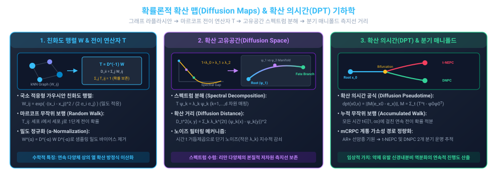

# 01. 매니폴드 기하학과 확산 유사시간 (Manifold Geometry & Diffusion Pseudotime)

---

## 학습 목표 (Cognitive Goals)

1. **단일세포 고차원 공간의 비선형 매니폴드 구조와 친화도 커널(Affinity Kernel) 정식화**: 유클리드 공간의 한계를 극복하고, 국소 적응형 대역폭(Adaptive Bandwidth)을 갖는 지수 커널을 통해 세포 간 국소적 연결성을 보존하는 인접 행렬 $W$를 구성할 수 있다.
2. **그래프 라플라시안(Graph Laplacian)과 마르코프 확산 연산자($T$)의 스펙트럼 분해**: 차수 행렬 $D$를 이용한 전이 확률 행렬 $T = D^{-1} W$의 수학적 성질을 유도하고, 고유값 스펙트럼 $1 = \lambda_0 > \lambda_1 \ge \lambda_2 \ge \dots$과 고유벡터 $\psi_j$가 형성하는 조화 좌표계(Harmonic Coordinates)를 이해한다.
3. **확산 유사시간(Diffusion Pseudotime, DPT) 수식의 엄밀한 수학적 유도**: 유한 시간 확산 거리 $D_t(x, y)$를 전 시간 스케일($t \in [1, \infty)$)로 적분하여 다음의 닫힌 형태(Closed-form) 공식을 도출할 수 있다:
   $$D^2(x, y) = \left\| \sum_{t=1}^\infty \left( T^t(x, \cdot) - T^t(y, \cdot) \right) \right\|^2_{1/\phi_0} = \sum_{j \ge 1} \left( \frac{\lambda_j}{1 - \lambda_j} \right)^2 (\psi_j(x) - \psi_j(y))^2$$
4. **다중 스케일 무작위 보행에 기반한 노이즈 필터링 및 분기점(Branch Point) 검출**: 단일 최단 경로 알고리즘의 노이즈 취약성을 극복하고, 매니폴드 위 다중 경로 간섭(Constructive Interference)을 통해 세포 운명 결정 분기점을 수학적으로 식별할 수 있다.

---

## 1. 단일세포 전사체 공간의 비선형 매니폴드 가설

단일세포 RNA 시퀀싱 데이터에서 각 세포는 수천~수만 개의 유전자 발현량으로 정의되는 초고차원 벡터 $x_i \in \mathbb{R}^G$로 표현된다. 그러나 생물학적으로 유전자 발현은 무작위로 독립적이지 않으며, 상호 작용하는 유전자 조절 네트워크(Gene Regulatory Network, GRN)의 구속(Constraint)을 받는다.

```
[The Non-linear Manifold Hypothesis in Single-Cell Biology]

  High-Dimensional Space (R^G, G ~ 20,000)
       ┌────────────────────────────────────────────────────────┐
       │                                                        │
       │     x_1               (Ambient Space: Empty)           │
       │      \                                                 │
       │       \   Curved Low-Dimensional                       │
       │        \  Manifold M (Intrinsic Dim d << G)            │
       │   x_3 ──○────────○──────○──────○                       │
       │        /        x_2    x_4    x_5 \                    │
       │       /                            \                   │
       │      /                              ○ x_6              │
       │                                                        │
       │  Euclidean Distance ||x_1 - x_6|| cuts through        │
       │  biologically impossible non-manifold space!           │
       └────────────────────────────────────────────────────────┘
```

- **매니폴드 가설(Manifold Hypothesis)**: 관측된 세포들은 고차원 공간 전체에 균일하게 분포하는 것이 아니라, 훨씬 낮은 고유 차원(Intrinsic Dimension $d \ll G$)을 갖는 매끄러운 부분다양체(Submanifold $\mathcal{M}$) 위에 밀집되어 있다.
- **유클리드 거리의 붕괴**: 두 세포 사이의 단순 유클리드 직선 거리 $\|x_i - x_j\|_2$는 매니폴드의 곡률을 무시하고 생물학적으로 존재할 수 없는 '빈 공간(Unphysical Void)'을 가로지른다.
- **측지선 거리(Geodesic Distance)**: 올바른 세포 상태 전이 궤적을 측정하기 위해서는 매니폴드의 표면 곡면을 따라 이동하는 측지선 경로 적분 $\int_{\gamma} ds$을 계산해야 한다.

---

## 2. 친화도 커널(Affinity Kernel)과 국소 기하 구조 복원

매니폴드 $\mathcal{M}$의 국소 기하 구조를 복원하기 위해, 근접한 세포 간에는 높은 가중치를 부여하고 멀리 떨어진 세포 간에는 0에 가까운 가중치를 부여하는 친화도 커널(Affinity Kernel)을 정의한다.

### 2.1 가우시안 커널과 국소 적응형 대역폭(Adaptive Bandwidth)

전통적인 가우시안 커널은 모든 세포에 동일한 대역폭 $\sigma$를 적용한다:

$$W_{ij} = \exp\left( -\frac{\|x_i - x_j\|^2}{2\sigma^2} \right)$$

그러나 단일세포 데이터는 세포 상태별로 샘플링 밀도가 극심하게 다르다(e.g., 분화 말기의 성숙 세포는 고밀도, 과도기적 전구세포는 저밀도). 전역 $\sigma$를 사용하면 고밀도 영역은 과도하게 연결되어 차원이 붕괴되고, 저밀도 영역은 그래프가 단절된다.

이를 해결하기 위해 각 세포 $i$의 $k$번째 최근접 이웃(k-NN)까지의 거리 $\sigma_i$를 사용하는 **국소 적응형 커널(Locally Adaptive Kernel)**을 구성한다:

$$W_{ij} = \frac{1}{2} \left[ \exp\left( -\frac{\|x_i - x_j\|^2}{2\sigma_i^2} \right) + \exp\left( -\frac{\|x_i - x_j\|^2}{2\sigma_j^2} \right) \right]$$

### 2.2 밀도 정규화(Density Normalization, Coifman & Lafon)

샘플링 밀도 $q(x)$의 불균일성이 확산 기하학에 미치는 인위적 왜곡을 제거하기 위해, 2단계 밀도 정규화를 적용한다:

1. 각 노드의 국소 밀도 추정:
   $$Z_i = \sum_{j=1}^N W_{ij}$$
2. 커널 재정규화:
   $$\widetilde{W}_{ij} = \frac{W_{ij}}{Z_i^\alpha Z_j^\alpha}$$
   - $\alpha = 0$: 고전적 그래프 라플라시안 (밀도 편향 보정 없음).
   - $\alpha = 1$: 라플라스-벨트라미 연산자(Laplace-Beltrami Operator $\Delta_{\mathcal{M}}$) 수렴. 세포의 샘플링 밀도 변동에 완전히 불변(Invariant)하며 순수한 기하학적 매니폴드 구조만을 추출한다. 단일세포 궤적 분석에서는 $\alpha = 1$이 표준적으로 적용된다.

---

## 3. 그래프 라플라시안과 마르코프 확산 연산자

밀도 보정된 인접 행렬 $\widetilde{W}$로부터 대각 차수 행렬(Degree Matrix) $D$를 정의한다:

$$D_{ii} = \sum_{j=1}^N \widetilde{W}_{ij}, \quad D_{ij} = 0 \; (i \ne j)$$

```
[Graph Operators & Markov Random Walk Setup]

   Affinity Matrix W (Local Affinities)
          │
          ▼ (Density Normalization α=1)
   Normalized Matrix W~ ───> Degree Matrix D_ii = Σ_j W~_ij
          │
          ├───────────────────────────────────┐
          ▼                                   ▼
   Normalized Graph Laplacian          Markov Transition Matrix
   L_sym = I - D^(-1/2) W~ D^(-1/2)     T = D^(-1) W~
   (Symmetric, Energy Minimization)    (Stochastic, Random Walk Probabilities)
```

### 3.1 비정규화 및 정규화 라플라시안

- **비정규화 라플라시안(Unnormalized Graph Laplacian)**:
  $$L = D - \widetilde{W}$$
- **대칭 정규화 라플라시안(Symmetric Normalized Graph Laplacian)**:
  $$L_{\text{sym}} = D^{-1/2} L D^{-1/2} = I - D^{-1/2} \widetilde{W} D^{-1/2}$$

### 3.2 무작위 보행 전이 행렬 (Markov Transition Matrix $T$)

그래프 위에서 임의의 세포 $i$에서 이웃 세포 $j$로 1단계 확률적으로 도약할 확률을 나타내는 행렬 $T$를 정의한다:

$$T = D^{-1} \widetilde{W}$$

$$T_{ij} = \frac{\widetilde{W}_{ij}}{\sum_{k=1}^N \widetilde{W}_{ik}} = P(X_{t+1} = j \mid X_t = i)$$

행렬 $T$는 모든 행의 합이 1인 확률 행렬(Row-stochastic Matrix)이다:
$$\sum_{j=1}^N T_{ij} = 1, \quad \forall i$$

---

## 4. 확산 연산자의 스펙트럼 분해와 확산 맵 (Diffusion Maps)

확률 행렬 $T$는 일반적으로 대칭 행렬이 아니지만, 대칭 유사 행렬(Similar Symmetric Matrix) $A$와 켤레(Conjugate) 관계를 갖는다:

$$A = D^{1/2} T D^{-1/2} = D^{-1/2} \widetilde{W} D^{-1/2}$$

스펙트럼 정리(Spectral Theorem)에 따라 $A$는 직교 고유벡터 기저를 가지므로, $T$ 역시 실수 고유값과 완전한 좌/우 고유벡터 세트를 갖는다:

$$T \psi_j = \lambda_j \psi_j \quad \text{(우측 고유벡터)}$$

$$\phi_j^T T = \lambda_j \phi_j^T \quad \text{(좌측 고유벡터)}$$

고유값들은 내림차순으로 정렬된다:
$$1 = \lambda_0 > \lambda_1 \ge \lambda_2 \ge \dots \ge \lambda_{N-1} \ge -1$$

1. $\lambda_0 = 1$에 대응하는 우측 고유벡터는 $\psi_0 = \mathbf{1} = (1, 1, \dots, 1)^T$이다.
2. $\lambda_0 = 1$에 대응하는 좌측 고유벡터 $\phi_0$는 마르코프 연쇄의 **정상 상태 분포(Stationary Distribution)**를 정의한다:
   $$\phi_0(i) = \frac{D_{ii}}{\sum_k D_{kk}}$$
3. 우측 고유벡터와 좌측 고유벡터는 다음의 쌍직교성(Biorthogonality)을 만족한다:
   $$\langle \phi_i, \psi_j \rangle = \delta_{ij}$$
   $$\phi_j(x) = \psi_j(x) \phi_0(x)$$

### 4.1 $t$단계 전이 확률의 스펙트럼 표현

무작위 보행이 시간 $t$단계 진행되었을 때, 세포 $x$에서 세포 $y$로 도약할 전이 확률 $T^t(x, y)$는 고유값과 고유벡터의 선형 결합으로 정확하게 전개된다:

$$T^t(x, y) = \sum_{j=0}^{N-1} \lambda_j^t \psi_j(x) \phi_j(y) = \phi_0(y) \left[ 1 + \sum_{j=1}^{N-1} \lambda_j^t \psi_j(x) \psi_j(y) \right]$$

```
[Spectral Filtering Effect over Diffusion Time t]

Small t (t = 1, 2):
  High-frequency noise modes (|λ_j| close to 0) still active.
  Reflects very local, noisy transcriptomic fluctuations.

Moderate t (t ~ 10 - 50):
  λ_j^t for small λ_j vanishes exponentially!
  Only dominant geometric modes (λ_1, λ_2, λ_3) survive.
  Reveals global developmental backbone and branching topology.

Large t (t -> inf):
  All λ_j^t -> 0 for j >= 1.
  T^t(x, y) -> φ_0(y) (Convergence to stationary equilibrium).
```

---

## 5. 확산 유사시간(Diffusion Pseudotime, DPT)의 완전한 수학적 유도

### 5.1 고정된 시간 $t$에서의 확산 거리(Diffusion Distance)

시간 $t$에서 두 세포 $x$와 $y$로부터 출발한 확률 분포 벡터 $T^t(x, \cdot)$와 $T^t(y, \cdot)$ 사이의 가중 $L_2$ 거리를 정의한다:

$$D_t^2(x, y) = \left\| T^t(x, \cdot) - T^t(y, \cdot) \right\|^2_{1/\phi_0} = \sum_{z=1}^N \frac{\left( T^t(x, z) - T^t(y, z) \right)^2}{\phi_0(z)}$$

스펙트럼 전개식 $T^t(x, z) = \phi_0(z) \sum_{j=0}^{N-1} \lambda_j^t \psi_j(x) \psi_j(z)$를 대입하면:

$$T^t(x, z) - T^t(y, z) = \phi_0(z) \sum_{j=1}^{N-1} \lambda_j^t \left( \psi_j(x) - \psi_j(y) \right) \psi_j(z)$$

이를 거리 공식에 대입하고 우측 고유벡터의 가중 직교성 $\sum_z \psi_j(z) \psi_k(z) \phi_0(z) = \delta_{jk}$를 적용하면:

$$D_t^2(x, y) = \sum_{z=1}^N \frac{1}{\phi_0(z)} \left[ \phi_0(z) \sum_{j=1}^{N-1} \lambda_j^t (\psi_j(x) - \psi_j(y)) \psi_j(z) \right]^2$$

$$= \sum_{j=1}^{N-1} \lambda_j^{2t} \left( \psi_j(x) - \psi_j(y) \right)^2$$

### 5.2 전 시간 스케일 누적 합과 DPT 공식 도출

고정된 $t$를 사용하는 것은 분석가가 임의로 시간 스케일을 선택해야 하는 문제를 야기한다. $t$가 너무 작으면 국소적 노이즈에 왜곡되고, 너무 크면 전역적 위상 정보가 평탄화된다.

Haghverdi et al. (2016)은 $t=1$부터 무한대까지의 모든 확산 시간 스케일에 대해 **전이 확률 차이를 누적**(시간에 대해 합/적분)한 뒤 그 노름을 취하는 **확산 유사시간(Diffusion Pseudotime, DPT)** 척도를 제안하였다. 즉 시간별 거리 $D_t^2$의 합이 아니라, 누적된 확률 차이 벡터의 노름이다. 5.1의 고유 전개를 시간에 대해 합하면:

$$\sum_{t=1}^\infty \left( T^t(x, z) - T^t(y, z) \right) = \phi_0(z) \sum_{j=1}^{N-1} \left( \sum_{t=1}^\infty \lambda_j^t \right) \left( \psi_j(x) - \psi_j(y) \right) \psi_j(z)$$

여기서 $|\lambda_j| < 1 \; (j \ge 1)$이므로, 무한 등비급수 공식 $\sum_{t=1}^\infty r^t = \frac{r}{1 - r}$을 적용할 수 있다:

$$\sum_{t=1}^\infty \lambda_j^t = \frac{\lambda_j}{1 - \lambda_j}$$

가중 직교성을 적용해 노름을 취하면 최종 DPT 거리 공식이 얻어진다(scanpy 구현의 가중치도 $(\lambda_j/(1-\lambda_j))^2$):

$$\boxed{D^2(x, y) = \sum_{j=1}^{N-1} \left( \frac{\lambda_j}{1 - \lambda_j} \right)^2 \left( \psi_j(x) - \psi_j(y) \right)^2}$$

- **가중 계수 $\left(\frac{\lambda_j}{1 - \lambda_j}\right)^2$의 물리적 의미**:
  - 주 성분 고유값($\lambda_j \approx 1$)에 해당하는 전역적 거시 경로에는 매우 큰 가중치($\frac{1}{(1 - \lambda_j)^2} \to \infty$)가 부여된다.
  - 고주파 노이즈 성분($\lambda_j \ll 1$)은 계수가 급격히 작아져 자동으로 소멸된다.
  - 즉, 별도의 임의적 매개변수 튜닝 없이도 매니폴드의 다중 스케일 측지선 거리가 수학적으로 최적 보존된다.

---

## 6. 매니폴드 기하학 및 DPT 다이어그램

확산 맵 좌표계와 무작위 보행의 다중 경로 누적, 그리고 DPT 측지선 거리의 기하학적 메커니즘을 아래 다이어그램에서 확인할 수 있다.



---

## 7. 자동 분기점(Branch Point) 및 팁(Tip) 검출 알고리즘

DPT는 시작점(Root cell $x_0$)이 지정되었을 때 매니폴드의 끝점(Tips)과 운명 결정 분기점(Branching Points)을 수학적으로 판정한다.

```
[DPT Branch Point Detection Topology]

                 Branch 1 (Tip 1, e.g., Luminal)
                  /
                 /  dpt(x, Tip 1) + dpt(x, Tip 2) = constant
   Root (x_0) ──●── Branch Point (x_b)
                 \
                  \
                 Branch 2 (Tip 2, e.g., Basal/NE)
```

1. **팁 세포(Extremity Tips) 식별**:
   - 루트 세포 $x_0$로부터 DPT 거리 $dpt(x_0, x)$가 최대가 되는 세포를 첫 번째 팁 $Tip_1$으로 설정한다:
     $$Tip_1 = \arg\max_x D(x_0, x)$$
   - $Tip_1$으로부터 DPT 거리가 최대가 되는 세포를 두 번째 팁 $Tip_2$로 지정한다.
2. **분기점 판정 조건**:
   - 임의의 중간 세포 $x$가 두 분기 경로 $Tip_1$과 $Tip_2$로 갈라지기 직전의 공통 조상 줄기(Trunk)에 위치한다면, 두 팁으로부터 측정한 거리의 합이 경로 분기 직전까지 일정한 상관관계를 유지한다.
   - 분기점 $x_b$를 통과하여 특정 계통으로 커밋(Commit)되는 순간, 다른 계통의 팁과의 확산 거리는 급격히 증가한다.
   - DPT는 상관관계 계수 $r(dpt_1, dpt_2)$가 임계값 이하로 역전되는 지점을 자동 분기점으로 선별한다.

---

## 8. Scanpy 기반 확산 맵 및 DPT 파이썬 구현

```python
import scanpy as sc
import numpy as np
import matplotlib.pyplot as plt

def run_diffusion_pseudotime_analysis(
    adata: sc.AnnData,
    root_cell_idx: int = None,
    n_dcs: int = 15,
    n_neighbors: int = 30
) -> sc.AnnData:
    """
    Scanpy를 사용한 고성능 확산 맵 및 DPT 궤적 추정 파이프라인.
    """
    print("[1/5] k-NN 친화도 그래프 구축 (UMAP fuzzy-simplicial 연결성)")
    # 주의: method='umap'(기본)은 본문 2.1의 σ_iσ_j 가우시안 커널이 아니라 UMAP 방식의 연결성 가중을 사용한다.
    #       본문의 가우시안 커널에 가깝게 하려면 method='gauss'를 쓴다.
    sc.pp.neighbors(adata, n_neighbors=n_neighbors, use_rep='X_pca', method='umap')

    print("[2/5] 밀도 정규화 확산 맵 (Diffusion Maps) 계산")
    # n_dcs: 보존할 고유벡터 개수
    sc.tl.diffmap(adata, n_comps=n_dcs)

    print("[3/5] Root 세포 자동 판별 또는 사용자 지정")
    if root_cell_idx is None:
        # DC1의 최소값을 갖는 세포를 잠재적 미분화 Root로 자동 탐색
        root_cell_idx = int(np.argmin(adata.obsm['X_diffmap'][:, 1]))
    
    adata.uns['iroot'] = root_cell_idx
    print(f"  -> Selected Root Cell Index: {root_cell_idx} ({adata.obs_names[root_cell_idx]})")

    print("[4/5] Diffusion Pseudotime (DPT) 계산")
    # n_branchings 기본값은 0(분기 검출 없음). 1로 두면 분기를 1회만 검출하며 실험적 기능이므로
    # 다중 분기 구조는 PAGA 등으로 확인하는 것을 권장한다.
    sc.tl.dpt(adata, n_dcs=n_dcs, n_branchings=1)

    print("[5/5] 결과 검증 및 메트릭 출력")
    dpt_values = adata.obs['dpt_pseudotime'].values
    print(f"  -> DPT Range: [{np.nanmin(dpt_values):.4f}, {np.nanmax(dpt_values):.4f}]")
    print(f"  -> Detected Groups/Branches: {adata.obs['dpt_groups'].unique().tolist()}")

    return adata

# 예제 실행 스니펫 (가상 데이터 적용)
if __name__ == "__main__":
    # 1000 cells x 2000 genes AnnData 로드
    adata_test = sc.datasets.paul15()
    sc.pp.recipe_zheng17(adata_test)
    sc.tl.pca(adata_test, svd_solver='arpack')
    
    adata_result = run_diffusion_pseudotime_analysis(adata_test)
```

---

## 단원 핵심 점검 (Cognitive Checkpoint & Case Study)

### 문제 1: 다중 스케일 확산 기하학 vs 단일 최단 경로(Shortest Path) 알고리즘 비교
Monocle 2와 같은 고전 알고리즘은 $k$-최근접 이웃 그래프 상에서 다익스트라(Dijkstra) 알고리즘으로 최단 거리를 계산한다. 반면 DPT는 마르코프 무작위 보행의 전 시간 누적 합을 사용한다.
1. 단일세포 전사체 데이터에서 전사 파열(Transcriptional Bursting)이나 기술적 드롭아웃에 의해 우발적으로 형성된 '가짜 지름길 간선(Spurious Shortcut Edge)'이 존재할 때, 최단 경로 알고리즘과 DPT가 각각 어떻게 반응하는지 수학적으로 비교 분석하시오.
2. DPT의 무한 등비급수 가중치 $\left(\frac{\lambda_j}{1 - \lambda_j}\right)^2$가 어떻게 국소 노이즈를 억제하고 전역 위상을 보존하는지 설명하시오.

<details>
<summary>💡 모범 답안 및 해설 확인</summary>

**1. 가짜 지름길 간선(Spurious Shortcut)에 대한 반응 차이**:
- **최단 경로 알고리즘 (Dijkstra / Monocle 2)**:
  최단 경로는 $\min \sum_{(u, v) \in \text{path}} w_{uv}$ 형태의 극값(Extremum) 연산이다. 만약 노이즈나 드롭아웃으로 인해 매니폴드의 서로 다른 두 분기 사이에 단 하나의 잘못된 간선(Spurious Edge)이 연결되면, 최단 경로 알고리즘은 즉시 그 지름길을 채택한다. 이로 인해 실제로는 수십 단계의 발생 과정을 거쳐야 하는 두 세포 집단 간의 거리가 0에 가깝게 단축되는 **단락 왜곡(Short-circuiting Catastrophe)**이 발생하며, 전체 궤적 트리가 붕괴된다.
- **확산 유사시간 (DPT)**:
  DPT는 단일 경로가 아닌 두 세포 사이를 연결하는 **모든 가능한 무작위 보행 경로의 확률 질량의 보강 간섭(Constructive Interference)**을 측정한다:
  $$T^t(x, y) = \sum_{p \in \text{all paths of length } t} P(p)$$
  단 하나의 고립된 지름길 간선이 존재하더라도, 그 간선을 통과하는 무작위 보행 경로의 확률 질량은 극히 미미하다($T_{ij} \approx \epsilon$). 반면 실제 생물학적 매니폴드를 따라 형성된 고밀도 경로 띠(Thick corridor of paths)는 수많은 대체 경로를 통해 거대한 전이 확률 질량을 형성한다. 따라서 DPT는 우발적 간선 노이즈를 완벽하게 통계적으로 여과한다.

**2. 가중치 $\left(\frac{\lambda_j}{1 - \lambda_j}\right)^2$의 스펙트럼 필터링 기전**:
- 고유값 $\lambda_j$는 그래프 라플라시안의 진동 주파수와 반비례한다. 전역적 분화 줄기를 나타내는 완만한 거시 구조는 $\lambda_j \approx 1$에 해당하며, 국소적 노이즈나 개별 세포의 요동은 $\lambda_j \approx 0$인 고주파 모드에 해당한다.
- 가중 함수 $f(\lambda) = \left(\frac{\lambda}{1 - \lambda}\right)^2$는 $\lambda \to 1$일 때 무한대로 발산하며, $\lambda \to 0$일 때 0으로 급격히 수렴한다.
- 따라서 수식 전개 과정에서 노이즈에 해당하는 수백~수천 개의 미세 고유벡터들은 가중치가 0에 수렴하여 제거되고, 오직 상위 몇 개의 거시적 분화 축($\lambda_1, \lambda_2, \dots$)만이 압도적인 기여를 하여 노이즈 없는 매끄러운 측지선 거리를 형성한다.

</details>

---

### 문제 2: Coifman & Lafon의 밀도 정규화 파라미터 $\alpha=1$의 수학적 필연성
1. 세포 증식(Proliferation) 속도가 빠른 클론 영역에서는 세포 밀도가 매우 높게 관측되고, 빠르게 소멸하거나 분열을 멈춘 중간 분화 영역에서는 세포 밀도가 극도로 낮게 관측된다. $\alpha=0$(표준 그래프 라플라시안)을 사용할 경우 확산 연산자 $T$가 매니폴드 기하학 대신 세포 밀도 구배(Density Gradient)에 지배당하는 수리적 이유를 설명하시오.
2. $\alpha=1$을 적용했을 때 정규화된 행렬 $\widetilde{W}_{ij} = \frac{W_{ij}}{Z_i Z_j}$가 연속 극한($N \to \infty$)에서 순수 라플라스-벨트라미 연산자($\Delta_{\mathcal{M}}$)로 수렴함을 설명하시오.

<details>
<summary>💡 모범 답안 및 해설 확인</summary>

**1. $\alpha=0$에서 밀도 구배에 의한 지배 기전**:
- 친화도 행렬 $W_{ij}$를 단순 행 정규화 $T = D^{-1}W$로 변환하면, 표본 밀도 $q(x)$가 높은 영역에서는 이웃 노드의 수(Degree $D_{ii}$)가 거대해지므로, 무작위 보행자가 고밀도 영역 내부로 쉽게 빨려 들어가 갇히는 **밀도 우물(Density Well)** 현상이 발생한다.
- 연속 극한($N \to \infty, \sigma \to 0$)에서 $\alpha=0$인 확산 연산자의 생성자(Infinitesimal Generator)는 다음과 같다:
  $$\mathcal{L}_0 f = \Delta_{\mathcal{M}} f + 2 \frac{\nabla q}{q} \cdot \nabla f$$
- 여기서 $\Delta_{\mathcal{M}} f$는 순수한 다양체 표면 라플라시안이지만, 우측의 드리프트 항 $2 \frac{\nabla q}{q} \cdot \nabla f$는 표본 밀도 $q(x)$의 기울기 방향으로 세포를 강제로 끌어당긴다. 즉, 실제 발생학적 분화 경로가 아니라 단순한 시퀀싱 포획량이나 세포 증식률 차이에 의해 형성된 밀도 언덕으로 궤적이 인위적으로 휘어지게 된다.

**2. $\alpha=1$에서의 순수 라플라스-벨트라미 수렴**:
- $Z_i = \sum_j W_{ij} \approx q(x_i)$는 해당 세포 주변의 표본 확률 밀도에 비례한다.
- 커널을 $\widetilde{W}_{ij} = \frac{W_{ij}}{q(x_i) q(x_j)}$로 나누어주면, 고밀도 영역 간의 연결 강도는 분모의 $q(x_i)q(x_j)$에 의해 약화되고, 희소 영역 간의 연결 강도는 상대적으로 보강된다.
- Coifman & Lafon (2006)의 정리에 따르면, $\alpha=1$로 1차 정규화된 행렬에 대해 차수 행렬 $\widetilde{D}_{ii} = \sum_j \widetilde{W}_{ij}$를 재계산하여 전이 행렬 $\widetilde{T} = \widetilde{D}^{-1} \widetilde{W}$를 구성하면, 드리프트 항의 계수가 완전히 소거된다:
  $$\lim_{N \to \infty, \sigma \to 0} \frac{I - \widetilde{T}}{\sigma^2} f = \Delta_{\mathcal{M}} f$$
- 따라서 샘플링 밀도의 인위적 불균일성이 수학적으로 완벽하게 상쇄되며, 오직 세포 상태가 존재하는 기하학적 매니폴드 $\mathcal{M}$ 고유의 곡률과 측지선 거리만이 보존된다.

</details>

---

### 문제 3: 암 계통 전이 매니폴드에서 고유값 간격(Eigengap) 붕괴와 매니폴드 단절(Disconnection)
전립선암 환자의 종양 샘플을 시퀀싱한 결과, 주요 선암종(Adenocarcinoma) 세포군과 거세 저항성 소세포 신경내분비암(Small Cell Neuroendocrine Carcinoma, SCNPC) 세포군이 관측되었다.
1. 두 세포군 사이에 전이 중간 상태(Intermediate Transition States)가 시퀀싱에서 포획되지 않아 그래프가 사실상 단절되었을 때, 전이 행렬 $T$의 고유값 스펙트럼에서 $\lambda_1$의 값이 어떻게 변화하는지 기술하시오.
2. 이러한 상황에서 DPT 거리 공식의 가중치 $\left(\frac{\lambda_1}{1 - \lambda_1}\right)^2$에서 발생하는 수치적 특이성(Singularity)과 그에 따른 궤적 추정 실패를 진단하고 대안을 제시하시오.

<details>
<summary>💡 모범 답안 및 해설 확인</summary>

**1. 그래프 단절 시 $\lambda_1$의 거동**:
- 그래프 이론의 페론-프로베니우스 정리(Perron-Frobenius Theorem) 및 스펙트럴 그래프 이론에 따르면, 연결 성분(Connected Component)이 1개인 이상적인 그래프에서 최대 고유값은 유일하게 $\lambda_0 = 1$이고, 두 번째 고유값은 반드시 $\lambda_1 < 1$을 만족한다.
- 그러나 전이 중간 세포의 부재로 인해 그래프가 선암종과 신경내분비암이라는 2개의 완전히 분리된 연결 성분으로 쪼개질 경우, 각 부분 그래프마다 독립적인 정상 상태 분포를 가지므로 고유값 1이 중근(Multiplicity = 2)을 형성한다:
  $$\lambda_0 = 1, \quad \lambda_1 \to 1$$
- 즉, 고유값 간격(Eigengap $\gamma = \lambda_0 - \lambda_1$)이 0으로 붕괴한다.

**2. 수치적 특이성과 대안**:
- **수치적 특이성 붕괴**:
  DPT 거리 공식의 첫 번째 항은 다음과 같다:
  $$\left(\frac{\lambda_1}{1 - \lambda_1}\right)^2 (\psi_1(x) - \psi_1(y))^2$$
  $\lambda_1 \to 1$로 근접함에 따라 분모 $(1 - \lambda_1)^2 \to 0$이 되어 가중치가 무한대($\infty$)로 폭발한다. 이로 인해 컴퓨터 부동소수점 연산에서 `Overflow` 또는 비정상적인 극단값이 발생하며, 선암종 내부의 세밀한 미세 분화 거리는 0으로 뭉개지고 오직 두 군집 간의 단절 신호만이 전체 거리를 왜곡한다.
- **해결 대안**:
  1. **고유값 클리핑(Spectral Truncation/Regularization)**: $\lambda_j$의 최대값을 $1 - \epsilon$ (e.g., $0.999$)으로 제한하거나 수렴 역치를 보정한다.
  2. **연결 성분 분리 분석**: 전체 데이터를 강제로 하나의 단일 궤적으로 피팅하지 않고, $k$-NN 그래프의 연결 성분을 분리하여 각각의 부분 매니폴드 내에서 DPT를 개별 계산한다.
  3. **시간적 섭동 데이터 통합**: 정적 스냅샷 대신 종단적 시계열 데이터(Longitudinal Timecourse)를 확보하여 최적 수송(Optimal Transport)으로 두 군집 간의 소실된 질량 전이 경로를 보완한다.

</details>

---

<!-- REFERENCES:BEGIN (generated by scripts/apply_references.py; do not edit by hand) -->
## 참고문헌 (References)
### 본문 인용 문헌
1. Haghverdi L, Büttner M, Wolf FA, et al. Diffusion pseudotime robustly reconstructs lineage branching. *Nat Methods*. 2016;13(10):845-8. PMID: 27571553. doi: 10.1038/nmeth.3971
2. Coifman RR, Lafon S. Diffusion maps. *Applied and Computational Harmonic Analysis*. 2006;21(1):5-30. doi: 10.1016/j.acha.2006.04.006
### 소프트웨어 (표기 버전은 검수 시 API를 확인한 버전이며, 파이프라인 실행 환경은 requirements-pipelines.txt 참조)
- Matplotlib 3.11.2 (github.com/matplotlib/matplotlib). 원 논문: Hunter JD. Matplotlib: A 2D Graphics Environment. *Comput. Sci. Eng*. 2007;9(3):90-95. doi: 10.1109/mcse.2007.55
- NumPy 2.5.4 (numpy.org). 원 논문: Harris CR, Millman KJ, van der Walt SJ, et al. Array programming with NumPy. *Nature*. 2020;585(7825):357-362. PMID: 32939066. doi: 10.1038/s41586-020-2649-2
- Scanpy 1.12.4 (github.com/scverse/scanpy). 원 논문: Wolf FA, Angerer P, Theis FJ. SCANPY: large-scale single-cell gene expression data analysis. *Genome Biol*. 2018;19(1):15. PMID: 29409532. doi: 10.1186/s13059-017-1382-0
<!-- REFERENCES:END -->
