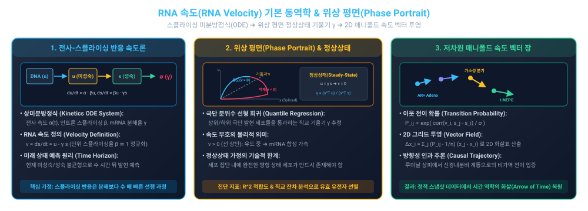

# 02. RNA 벨로시티와 스플라이싱 반응속도론 (RNA Velocity & Splicing Kinetics)

---

## 학습 목표 (Cognitive Goals)

1. **단일세포 리드로부터 미성숙 pre-mRNA(Unspliced)와 성숙 mRNA(Spliced)의 생물물리학적 생성 기전 이해**: 3' 말단 농축 scRNA-seq 및 snRNA-seq 프로토콜에서 인트론(Intronic) 리드가 포획되는 분자적 원리를 규명하고 카운트 행렬 $U, S \in \mathbb{R}^{N \times G}$의 통계적 성질을 정립할 수 있다.
2. **전사-스플라이싱-분해 연립 상미분방정식(Kinetic ODEs)의 해석적 유도**: 전사율 $\alpha$, 스플라이싱율 $\beta$, 분해율 $\gamma$로 구성된 선형 미분방정식계를 정식화하고, 전사 유도기(Induction)와 억제기(Repression)에서의 $(u(t), s(t))$ 해석적 위상 궤적을 도출할 수 있다.
3. **정상상태(Steady-state) 가설과 위상 평면(Phase Portrait) 선형 회귀의 한계 규명**: 평형 조건($du/dt = ds/dt = 0$)에 기반한 극단 세포 회귀 분석(Extreme Quantiles Regression)을 통해 기저 기울기 $\tilde{\gamma} = \gamma/\beta$를 추정하고 잔차 벨로시티 $v = u - \tilde{\gamma}s$를 계산할 수 있다.
4. **고차원 속도 벡터의 저차원 매니폴드 투영 및 마르코프 전이 확률 행렬 구축**: 개별 유전자 잔차 벨로시티 벡터를 코사인 유사도 기반 전이 커널로 변환하여 2D 임베딩(UMAP) 상의 유선형 벡터장(Stream Plot)으로 시각화할 수 있다.

---

## 1. 단일세포 스플라이싱 리드의 분자생물학적 기원

표준 액적 기반 단일세포 전사체 시퀀싱(10x Chromium 3' v2/v3)은 성숙 mRNA의 poly-A 꼬리를 올리고-dT(Oligo-dT) 프라이머로 포획하도록 설계되었다. 그러나 실제 원천 시퀀싱 BAM 파일을 전사체 어노테이션(GTF)과 대조하면 약 15%~25%(단일핵 snRNA-seq의 경우 최대 40%~60%)의 리드가 **엑손-인트론 접합부(Exon-Intron Junctions) 또는 순수 인트론 영역**에 매핑된다.

```
[Biophysical Origin of Unspliced vs. Spliced Reads]

Nascent Pre-mRNA (In Nucleus):
   5' ──[Exon 1]───/──[Intron 1]───/──[Exon 2]───[Exon 3]──AAAAA... 3'
                     ▲
                     │ (Internal Poly-A priming or Co-transcriptional capture)
   Unspliced Read (u) captures intron-exon junction or intronic sequence.

Mature mRNA (In Cytoplasm):
   5' ──[Exon 1]───────[Exon 2]───────[Exon 3]──AAAAA... 3' (Poly-A Tail)
             ▲               ▲
             │ (Exon-Exon junction only)
   Spliced Read (s) aligns strictly to mature exons.
```

- **미스플라이스 전사체(Unspliced pre-mRNA, $u$)**: 인트론 서열을 포함하며, 세포 핵 내에서 방금 합성되었거나 스플라이싱 과정 중에 있는 **현재 진행형 전사(Nascent Transcription)** 상태를 직접 대변한다.
- **스플라이스 전사체(Spliced mRNA, $s$)**: 인트론이 완전히 제거된 성숙 전사체로, 세포질로 수송되어 번역 대기 중이거나 분해 중인 **과거 누적된 전사체 풀(Accumulated Pool)**을 반영한다.
- **핵심 통찰 (La Manno et al., Nature 2018)**:
  미성숙 $u$와 성숙 $s$ 사이의 비율 불균형은 특정 유전자의 전사가 가속화되고 있는지(Induction: $u$가 상대적으로 과잉), 아니면 억제되어 소멸하고 있는지(Repression: $u$가 급감하고 $s$만 잔존)를 가리키는 **세포 내부의 고유한 미분 시계(Derivative Clock)** 역할을 수행한다.

---

## 2. 전사-스플라이싱-분해 연립 상미분방정식 (ODE System)

단일 유전자 $g$에 대해, 전사 활성화율 $\alpha(t)$, 스플라이싱 반응속도 상수 $\beta$, mRNA 분해 반응속도 상수 $\gamma$에 의해 지배되는 1차 선형 동역학계는 다음과 같다:

$$\frac{du(t)}{dt} = \alpha(t) - \beta u(t)$$

$$\frac{ds(t)}{dt} = \beta u(t) - \gamma s(t)$$

```
[Biophysical ODE Reaction Cascade]

      α(t)                 β                  γ
 DNA ──────> Unspliced (u) ────> Spliced (s) ────> Degraded (Ø)
(Transcription)         (Splicing)          (Degradation)
```

- $\alpha(t)$: 프로모터 상태에 따른 시간 의존적 전사 속도 ($\text{molecules} \cdot \text{time}^{-1}$).
- $\beta$: 인트론 제거 및 스플라이싱 효소 반응 속도 상수 ($\text{time}^{-1}$).
- $\gamma$: 리보뉴클레이스(RNase)에 의한 성숙 전사체 분해 속도 상수 ($\text{time}^{-1}$).

단일세포 시퀀싱은 절대적 물리 시간(초, 분) 단위를 제공하지 않으므로, 일반성을 잃지 않고 **스플라이싱 속도 상수를 기준 척도 $\beta \equiv 1$로 정규화**한다. 따라서 관측 가능한 핵심 상대 파라미터는 분해율과 스플라이싱율의 비인 $\tilde{\gamma} = \frac{\gamma}{\beta}$이다.

### 2.1 해석적 궤적 (Analytical Trajectories)

프로모터가 On 상태($\alpha = \alpha_{\text{on}}$)로 전환되는 **유도기(Induction)**와 Off 상태($\alpha = 0$)로 꺼지는 **억제기(Repression)**에 대해 위 미분방정식계는 다음과 같은 닫힌 형태의 해석적 해를 갖는다 ($t=0$에서 초기 조건 $u(0)=u_0, s(0)=s_0$):

1. **미스플라이스 전사체 $u(t)$의 해**:
   $$u(t) = u_0 e^{-\beta t} + \frac{\alpha}{\beta} \left( 1 - e^{-\beta t} \right)$$
2. **성숙 전사체 $s(t)$의 해 ($\beta \ne \gamma$ 가정)**:
   $$s(t) = s_0 e^{-\gamma t} + \frac{\alpha}{\gamma} \left( 1 - e^{-\gamma t} \right) + \frac{\beta u_0 - \alpha}{\gamma - \beta} \left( e^{-\beta t} - e^{-\gamma t} \right)$$
   (검산: $\alpha = 0$, $u_0 = 1$, $s_0 = 0$, $\beta = 1$, $\gamma = 2$이면 $s(t) = e^{-t} - e^{-2t} \ge 0$로 물리적으로 타당한 비음(Non-negative) 궤적을 얻는다.)

---

## 3. 정상상태(Steady-state) 가설과 위상 평면(Phase Portrait)

La Manno et al.의 고전적 결정론적 RNA 벨로시티 모델은 세포 집단 내에 전사적으로 안정화된 평형 상태(Steady-state Equilibrium)에 도달한 세포들이 충분히 존재한다고 가정한다.

$$\frac{du}{dt} = 0 \implies u^* = \frac{\alpha}{\beta}$$

$$\frac{ds}{dt} = 0 \implies \beta u^* - \gamma s^* = 0 \implies u^* = \left( \frac{\gamma}{\beta} \right) s^*$$

```
[Phase Portrait (s vs. u) Geometry & Kinetic Regimes]

   Unspliced (u)
        ▲
        │                 ● Steady-state ON (u_max, s_max)
        │                /
        │    Induction  /
        │   (u > γ·s)  /   Repression
        │     ┌───────/    (u < γ·s)
        │    /       / \
        │   /       /   \
        │  /       /     \
        │ /       /       ▼
        │/───────/─────────●
        ● Steady-state OFF (0, 0)
        └───────────────────────────────► Spliced (s)
                 Slope = γ/β
```

### 3.1 위상 평면 상의 4가지 동역학 구간

$(s, u)$ 직교 평면에서 세포들은 시계 반대 방향의 닫힌 루프 형태를 그리며 순환한다:
1. **유도기 (Induction Phase, $v > 0$)**:
   전사가 시작되면 $u$가 즉각 폭발적으로 증가하지만, $s$는 스플라이싱 지연으로 인해 서서히 증가한다. 데이터 포인트들은 정상상태 기준선($u = \gamma s$)의 **상단(Upper Arc)**에 위치한다.
2. **정상상태 활성 (Steady-state ON)**:
   전사, 스플라이싱, 분해의 평형이 달성되어 궤적이 우측 상단 정점($\alpha_{\text{on}}/\gamma$)에 머무른다.
3. **억제기 (Repression Phase, $v < 0$)**:
   전사가 중단되면 $u$가 급격히 0으로 추락하지만, 기존에 축적된 성숙 전사체 $s$는 상대적으로 천천히 분해된다. 데이터 포인트들은 기준선의 **하단(Lower Arc)**에 위치한다.
4. **정상상태 비활성 (Steady-state OFF)**:
   유전자가 발현되지 않는 기저 상태($(u, s) \approx (0, 0)$)에 수렴한다.

### 3.2 극단 사분위수 선형 회귀(Extreme Quantiles Regression)에 의한 $\tilde{\gamma}$ 추정

정상상태 모델은 세포들이 루프의 양 끝점(ON 상태와 OFF 상태)에서 평형을 이루고 있다고 가정한다. 따라서 양 끝단의 극단 세포(Upper/Lower Extreme Quantiles)들을 선별하여 절편이 0인 선형 회귀를 수행한다:

$$\tilde{\gamma}_g = \arg\min_{\gamma} \sum_{i \in \text{Extremes}} \left( u_{ig} - \gamma s_{ig} \right)^2 = \frac{\sum_{i} s_{ig} u_{ig}}{\sum_i s_{ig}^2}$$

### 3.3 잔차 벨로시티(Residual Velocity) 산출

추정된 기울기 $\tilde{\gamma}_g$에 대해, 각 세포 $i$의 성숙 전사체 발현 변화율인 RNA 벨로시티 $v_{ig} \equiv \frac{ds_{ig}}{dt}$는 회귀선의 수직 잔차(Vertical Residual)로 계산된다:

$$\boxed{v_{ig} = u_{ig} - \tilde{\gamma}_g s_{ig}}$$

- $v_{ig} > 0$: 해당 유전자의 전사가 상향 조절(Upregulating / Induction) 중임.
- $v_{ig} < 0$: 해당 유전자의 전사가 하향 조절(Downregulating / Repression) 중임.
- $v_{ig} \approx 0$: 유전자가 정적인 평형(Steady-state) 상태에 있음.

---

## 4. RNA 벨로시티 스플라이싱 반응속도론 다이어그램

미성숙 전사체와 성숙 전사체의 위상 평면 궤적과 잔차 벨로시티의 기하학적 정의를 아래 다이어그램에서 확인할 수 있다.



---

## 5. 고차원 벨로시티의 매니폴드 투영 (Velocity Graph)

각 세포 $i$는 수천 개 유전자의 벨로시티 값을 모은 고차원 속도 벡터 $v_i \in \mathbb{R}^G$를 갖는다. 그러나 단일세포 전사체 데이터는 희소성(Sparsity)과 잡음이 심하므로, 이를 직접 2차원 공간으로 미분 투영할 수 없다.

대신 주변 세포 $j$들의 발현 변화 방향 벡터 $(s_j - s_i)$와 속도 벡터 $v_i$ 사이의 코사인 유사도를 기반으로 **마르코프 전이 확률 행렬(Velocity Graph)**을 구축한다.

```
[Velocity Graph Projection Principle]

                   s_k (Negative Correlation: cos θ < 0)
                  ▲
                 /
                /  Displacement: s_k - s_i
               /
     Cell i  ●═════════════════════════════► Velocity Vector v_i
               \
                \  Displacement: s_j - s_i
                 \
                  ▼
                   s_j (Positive Correlation: cos θ > 0) -> HIGH Transition Prob!
```

### 5.1 코사인 상관계수 기반 전이 확률 정식화

세포 $i$에서 이웃 세포 $j$로의 발현 차이 벡터 $d_{ij} = s_j - s_i$와 벨로시티 벡터 $v_i$ 사이의 피어슨/코사인 상관계수를 계산한다:

$$r_{ij} = \frac{\sum_{g \in G_{\text{velo}}} (v_{ig} - \bar{v}_i)(s_{jg} - s_{ig} - \bar{d}_{ij})}{\sqrt{\sum_g (v_{ig} - \bar{v}_i)^2} \sqrt{\sum_g (s_{jg} - s_{ig} - \bar{d}_{ij})^2}}$$

이 상관계수 $r_{ij}$에 지수(Softmax-like) 커널을 적용하여 행 정규화된 마르코프 전이 행렬 $\Pi$를 도출한다:

$$\Pi_{ij} = \frac{\exp(r_{ij} / \sigma)}{\sum_{k \in \mathcal{N}(i)} \exp(r_{ik} / \sigma)}$$

여기서 $\mathcal{N}(i)$는 $k$-NN 이웃 집합이며, $\sigma$는 전이 불확실성을 조절하는 온도(Temperature) 파라미터이다.

### 5.2 저차원 임베딩 공간(UMAP) 상의 유선형 벡터장 투영

2차원 임베딩 좌표 $y_i \in \mathbb{R}^2$ 상에서 세포 $i$의 기대 이동 방향 $\Delta y_i$는 주변 이웃 세포들과의 상대 위치 차이를 전이 확률로 가중 평균하여 계산된다:

$$\Delta y_i = \sum_{j \in \mathcal{N}(i)} \left( \Pi_{ij} - \frac{1}{|\mathcal{N}(i)|} \right) (y_j - y_i)$$

균일 무작위 전이 확률 $\frac{1}{|\mathcal{N}(i)|}$를 차감함으로써, 국소 세포 밀도 차이에 의한 인위적 편향을 제거하고 순수한 생물학적 속도 구배만을 보존한다.

---

## 6. scVelo 파이프라인 파이썬 구현 실습

```python
import scvelo as scv
import scanpy as sc
import numpy as np

def run_steady_state_velocity_pipeline(
    adata: sc.AnnData,
    min_shared_counts: int = 20,
    n_top_genes: int = 2000
) -> sc.AnnData:
    """
    scVelo를 이용한 결정론적(Deterministic) 정상상태 RNA 벨로시티 파이프라인.
    """
    print("[1/6] Unspliced / Spliced 카운트 품질 관리 및 유전자 필터링")
    # (scvelo 0.3.4: filter_and_normalize는 n_top_genes를 받지 않아 TypeError → HVG는 scanpy로 별도 선택)
    scv.pp.filter_and_normalize(adata, min_shared_counts=min_shared_counts)
    sc.pp.highly_variable_genes(adata, n_top_genes=n_top_genes, subset=True)

    print("[2/6] PCA 및 k-NN 그래프 구축")
    sc.tl.pca(adata, svd_solver='arpack')
    sc.pp.neighbors(adata, n_neighbors=30, n_pcs=30)

    print("[3/6] k-NN 이웃 평균 모멘트 (First-order Moments) 계산")
    # 드롭아웃 노이즈 완화를 위해 이웃 세포들의 u와 s 평균을 도출: Ms, Mu
    scv.pp.moments(adata, n_pcs=30, n_neighbors=30)

    print("[4/6] 정상상태(Deterministic) 벨로시티 및 감마 추정")
    scv.tl.velocity(adata, mode='deterministic')

    print("[5/6] Velocity Graph (마르코프 전이 확률) 생성")
    scv.tl.velocity_graph(adata, n_jobs=4)

    print("[6/6] UMAP 상의 유선형 벡터장(Stream Plot) 투영")
    sc.tl.umap(adata)
    
    return adata

# 예제 실행 스니펫
if __name__ == "__main__":
    # scVelo 내장 췌장 내분비 분화 데이터셋 로드
    adata_pancreas = scv.datasets.pancreas()
    adata_pancreas = run_steady_state_velocity_pipeline(adata_pancreas)
    
    print("\n추정된 전역 파라미터:")
    print(f"Number of velocity genes: {np.sum(adata_pancreas.var['velocity_genes'])}")
```

---

## 단원 핵심 점검 (Cognitive Checkpoint & Case Study)

### 문제 1: 정상상태 가설(Steady-state Assumption)의 성립 조건과 위상 평면 왜곡
1. La Manno et al.의 결정론적 벨로시티 모델에서 회귀 기울기 $\tilde{\gamma} = \gamma/\beta$를 신뢰할 수 있게 추정하기 위해 데이터셋이 반드시 만족해야 하는 전사 동역학적 전제 조건을 위상 평면의 세포 분포 관점에서 기술하시오.
2. 만약 특정 세포 유형이 매우 빠르게 분열하거나, 특정 운명으로 전이되는 과도기적(Transient) 상태만 존재하여 ON/OFF 평형 상태에 도달한 세포가 전무할 경우, 추정된 $\tilde{\gamma}$와 잔차 벨로시티 $v$에 어떠한 왜곡이 발생하는지 설명하시오.

<details>
<summary>💡 모범 답안 및 해설 확인</summary>

**1. 정상상태 벨로시티의 필수 전제 조건**:
- 유전자의 전사 사이클 전체 과정에서, 세포 집단이 **충분한 시간 동안 유도(Induction), 정상상태 활성(Steady-state ON), 억제(Repression), 기저 상태(Steady-state OFF)의 전체 위상 루프를 완벽하게 통과**해야 한다.
- 특히 회귀선 $u = \tilde{\gamma}s$의 기준축을 확정하기 위해서는, 유전자 발현이 극대화되어 더 이상 $u$와 $s$가 증가하지 않는 상위 극단 세포 군집($\frac{du}{dt} \approx 0, \frac{ds}{dt} \approx 0$)과 발현이 꺼진 하위 극단 세포 군집이 데이터셋 내에 실제로 충분한 빈도로 포획되어 있어야 한다.

**2. 과도기적 상태만 존재할 때 발생하는 치명적 왜곡**:
- **기울기 과소/과대 추정**:
  만약 종양의 급격한 전이 과정처럼 유도기(Induction)에 속한 세포들만 대다수 포획되고 아직 평형 ON 상태에 도달한 세포가 없다면, 데이터 포인트들은 $(s, u)$ 평면의 상단 곡선에만 집중된다.
- 이 상태에서 단순 선형 회귀를 강제하면, 회귀선은 평형 상태의 기울기 $\gamma/\beta$보다 훨씬 가파른 기울기($\tilde{\gamma}_{\text{est}} \gg \gamma/\beta$)로 상향 편향된다.
- **가짜 억제(Spurious Repression) 벡터 생성**:
  기울기 $\tilde{\gamma}$가 비정상적으로 과대 추정되면, 실제로는 여전히 전사가 상향 조절($v_{\text{true}} > 0$)되고 있는 세포들조차 과도하게 높아진 회귀선보다 아래에 놓이게 된다($u < \tilde{\gamma}_{\text{est}} s$).
- 결과적으로 알고리즘은 실제 전진 분화하고 있는 세포에 대해 정반대의 음수 속도($v < 0$)를 부여하여, **생물학적 시간의 화살이 180도 역전되는 가짜 탈분화 아티팩트**를 생성한다.

</details>

---

### 문제 2: 1차 모멘트 평활화(Moments Smoothing)의 수학적 필요성과 부작용
scVelo 파이프라인에서는 원천 카운트 $u, s$를 직접 사용하지 않고, $k$-NN 그래프 상에서 이웃 세포들의 가중 평균인 1차 모멘트 $Mu, Ms$를 계산하여 모델을 적합한다.
1. 포아송/음이항 드롭아웃 노이즈 관점에서 왜 개별 세포의 $u, s$ 원천 카운트로는 안정적인 위상 평면 곡선을 얻을 수 없는지 수식적으로 설명하시오.
2. 과도한 이웃 수($k \gg 50$)를 적용하거나 서로 다른 계통이 교차하는 복잡한 매니폴드에서 모멘트 평활화가 유발하는 '다양체 간 인위적 혼합(Cross-branch Blurring)' 위험성을 설명하시오.

<details>
<summary>💡 모범 답안 및 해설 확인</summary>

**1. 모멘트 평활화의 수학적 필연성**:
- 미성숙 pre-mRNA($u$)는 세포당 분자 수가 극도로 적다(세포당 0~2 카운트 수준). 따라서 관측 카운트는 거대한 기술적 샘플링 드롭아웃과 포아송 산탄 잡음(Shot Noise)에 지배된다:
  $$u_{\text{obs}} \sim \text{Poisson}(\eta u_{\text{true}})$$
- 이로 인해 원천 카운트 $(s_i, u_i)$ 평면을 시각화하면 불연속 정수 격자점($(0, 0), (1, 0), (0, 1), \dots$)에 점들이 산란되어, 이론적인 매끄러운 바나나 모양의 타원 루프가 완전히 가려진다.
- $k$-NN 그래프 상의 이웃 평활화는 다음과 같이 정의된다:
  $$Ms_i = \sum_{j \in \mathcal{N}(i)} W_{ij} s_j, \quad Mu_i = \sum_{j \in \mathcal{N}(i)} W_{ij} u_j$$
  이 연산은 동일한 매니폴드 국소 영역에 속한 세포들의 조건부 기댓값 $\mathbb{E}[u \mid x_i], \mathbb{E}[s \mid x_i]$을 비모수적으로 추정하여 분산을 $\frac{1}{k}$ 수준으로 극적으로 감소시킴으로써 기저의 연속적인 ODE 위상 궤적을 복원한다.

**2. 교차 분지 혼합(Cross-branch Blurring) 부작용**:
- $k$가 지나치게 크거나 두 개의 서로 다른 분화 계통(e.g., 관강 상피세포와 기저 세포)이 유전자 공간에서 근접해 있을 때, $k$-NN 그래프는 두 계통의 세포들을 동일한 이웃 클러스터로 묶어버린다.
- 이 경우 계통 A(전사 촉진 중)와 계통 B(전사 억제 중)의 $u, s$ 값이 산술적으로 평균화되면서, 실제로는 존재하지 않는 가상의 중간 상태(Averaged Chimeric State)가 생성된다.
- 이로 인해 위상 평면의 고유한 곡률이 붕괴되어 평평한 선형 타원으로 변질되고, 분기점(Branching Point) 주변에서 속도 벡터가 상호 간섭하여 0으로 상쇄(Vanishing Velocity)되는 현상이 발생한다.

</details>

---

### 문제 3: 단일핵 RNA 시퀀싱(snRNA-seq) vs 단일세포(scRNA-seq)에서의 $\gamma/\beta$ 스케일 편차
동일한 전립선암 환자 조직을 전세포(Whole-cell scRNA-seq)와 단일핵(Single-nucleus snRNA-seq) 두 가지 플랫폼으로 각각 프로파일링하여 RNA 벨로시티를 분석하였다.
1. 단일핵 시퀀싱(snRNA-seq) 환경에서 세포질(Cytoplasm)이 소실됨에 따라 성숙 전사체 $s$의 포획 비율이 급감하고 상대적으로 $u$의 분율이 40~60%까지 급증한다. 이 물리적 변화가 회귀 기울기 $\tilde{\gamma} = \gamma/\beta$에 미치는 수학적 영향을 기술하시오.
2. 두 데이터셋을 통합(Batch Integration)하여 하나의 단일 벨로시티 모델로 피팅할 때 발생하는 치명적 오류를 진단하고 해결책을 제시하시오.

<details>
<summary>💡 모범 답안 및 해설 확인</summary>

**1. snRNA-seq에서의 기울기 $\tilde{\gamma}$ 수학적 변화**:
- 전세포(scRNA-seq)는 성숙 전사체가 축적되는 거대한 세포질 풀을 포함하므로 통상 $s \gg u$이며, 위상 평면의 기울기는 $\tilde{\gamma}_{\text{sc}} = \frac{\gamma}{\beta} \approx 0.05 \sim 0.2$ 수준으로 완만한 형태를 띤다.
- 반면 단일핵(snRNA-seq)은 세포질이 물리적으로 제거되고 핵 내부의 전사체만 포획한다. 핵 내부에서는 성숙 전사체가 생성 즉시 핵공(Nuclear Pore)을 통해 세포질로 수출(Export)되므로, 핵 내부의 '유효 분해율' $\gamma_{\text{eff}}$는 실제 화학적 분해뿐만 아니라 핵외 수출 속도($k_{\text{export}}$)를 포함하게 된다:
  $$\gamma_{\text{eff}} = \gamma_{\text{degradation}} + k_{\text{export}}$$
- 이로 인해 핵 내부의 성숙 전사체 정상상태 농도 $s^*$는 급감하고, 상대적 비율 $u/s$는 전세포 대비 3배~5배 이상 치솟는다.
- 결과적으로 snRNA-seq의 위상 평면 기울기는 $\tilde{\gamma}_{\text{sn}} \gg \tilde{\gamma}_{\text{sc}}$로 수직에 가깝게 가파르게 형성된다.

**2. 단순 통합 피팅 시의 오류 및 해결책**:
- **통합 피팅 시의 치명적 오류**:
  두 플랫폼 데이터를 단순히 합쳐 전역 단일 $\tilde{\gamma}$로 회귀하면, 동일한 생물학적 상태의 세포라 할지라도 플랫폼 차이에 의해 scRNA-seq 세포는 회귀선 아래($v < 0$, 억제)로 몰리고, snRNA-seq 세포는 회귀선 위($v > 0$, 유도)로 강제 분리된다. 이로 인해 생물학적 분화 궤적이 아닌 단순한 실험적 배치(Batch) 사이의 인위적 순환 벡터가 도출된다.
- **해결 방안**:
  1. **플랫폼별 독립적 $\gamma$ 추정**: 동일 유전자라 하더라도 scRNA-seq과 snRNA-seq 데이터셋에 대해 별도의 감마 파라미터 $\tilde{\gamma}_{\text{sc}}$와 $\tilde{\gamma}_{\text{sn}}$을 독립적으로 추정한 후 속도 벡터를 계산해야 한다.
  2. **핵외 수출 동역학을 고려한 3-구획 ODE 모델(Three-compartment Model)** 도입: $u \xrightarrow{\beta} s_{\text{nuc}} \xrightarrow{k_{\text{export}}} s_{\text{cyto}} \xrightarrow{\gamma} \emptyset$ 형태의 확장된 동역학계를 적용하여 핵 전용 데이터를 적합한다.

</details>

---

<!-- REFERENCES:BEGIN (generated by scripts/apply_references.py; do not edit by hand) -->
## 참고문헌 (References)
### 본문 인용 문헌
1. La Manno G, Soldatov R, Zeisel A, et al. RNA velocity of single cells. *Nature*. 2018;560(7719):494-498. PMID: 30089906. doi: 10.1038/s41586-018-0414-6
### 소프트웨어 (표기 버전은 검수 시 API를 확인한 버전이며, 파이프라인 실행 환경은 requirements-pipelines.txt 참조)
- NumPy 2.5.4 (numpy.org). 원 논문: Harris CR, Millman KJ, van der Walt SJ, et al. Array programming with NumPy. *Nature*. 2020;585(7825):357-362. PMID: 32939066. doi: 10.1038/s41586-020-2649-2
- Scanpy 1.12.4 (github.com/scverse/scanpy). 원 논문: Wolf FA, Angerer P, Theis FJ. SCANPY: large-scale single-cell gene expression data analysis. *Genome Biol*. 2018;19(1):15. PMID: 29409532. doi: 10.1186/s13059-017-1382-0
- scVelo 0.3.4 (github.com/theislab/scvelo). 원 논문: Bergen V, Lange M, Peidli S, et al. Generalizing RNA velocity to transient cell states through dynamical modeling. *Nat Biotechnol*. 2020;38(12):1408-1414. PMID: 32747759. doi: 10.1038/s41587-020-0591-3
<!-- REFERENCES:END -->
