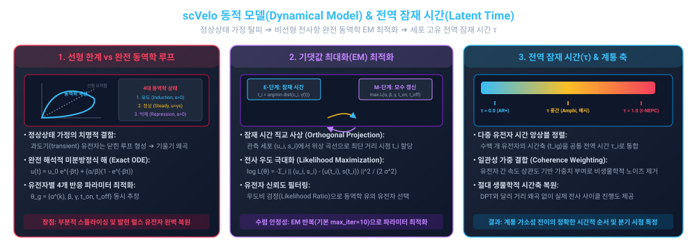

# 03. 동역학 모델과 보편 잠재 시간 (Dynamical Velocity & Latent Time)

---

## 학습 목표 (Cognitive Goals)

1. **정상상태 벨로시티 가설의 구조적 한계와 비평형 실패 모드 규명**: 급격한 종양 전이, 약물 유도 탈분화 및 계통 가소성 시스템에서 평형 상태(Steady-state)의 부재, 다중 반응속도(Multiple Kinetics), 절단된 위상 궤적이 초래하는 수학적 왜곡 기전을 진단할 수 있다.
2. **scVelo 완전 동역학 모델(Dynamical Model)의 확률론적 우도 정식화**: 전사 유도-억제 스위칭 시간($t_{\text{sw}}$)을 포함하는 비선형 ODE 시스템을 매개변수화하고, 가우시안 관측 오차 모델에 기반한 유전자별 완전 로그 우도 함수를 정식화할 수 있다.
3. **기댓값-최대화(Expectation-Maximization, EM) 알고리즘의 수렴 메커니즘 도출**: 위상 곡선으로의 직교 투영(Orthogonal Projection)을 통해 개별 세포의 잠재 시간 $t_i$를 추정하는 E-step과, 반응속도 파라미터 벡터 $\theta = (\alpha, \beta, \gamma, t_{\text{sw}})$를 갱신하는 M-step의 수리물리학적 반복 과정을 해석할 수 있다.
4. **보편 잠재 시간(Universal Latent Time, $\tau$)의 다중 유전자 결합 합성**: 개별 유전자 고유의 시간 축 $t^g$를 유전자 조절 네트워크의 방향성 일치도(Directional Coherence)와 우도 가중치로 결합하여, 외부 사전 지식 없이 전조직 차원의 전사체 진화 시계를 단일 공통 척도로 재구성할 수 있다.

---

## 1. 정상상태 벨로시티 모델의 치명적 결함과 동역학적 필요성

La Manno et al.의 고전적 결정론적 모델은 "세포들이 발현의 최고점(ON)과 최저점(OFF)에서 정상상태 평형에 도달한다"는 가설에 전적으로 의존한다. 그러나 종양 미세환경이나 계통 가소성(Lineage Plasticity) 모델에서는 이 가설이 심각하게 붕괴된다.

```
[Three Failure Modes of the Steady-State Model]

Mode 1: Truncated Phase Loop       Mode 2: Multiple Kinetics        Mode 3: Non-equilibrium Jumps
  Unspliced (u)                     Unspliced (u)                     Unspliced (u)
  ▲                                 ▲                                 ▲
  │     /── Induction               │      Branch A (Slow γ)          │     Rapid Perturbation
  │    /                            │      /                          │     (CRISPR / Drug)
  │   ● Truncated!                  │     /  ●                        │   ●────────►●
  │  (Never reaches ON)             │    /  /   Branch B (Fast γ)     │   │        /
  │                                 │   /  /   /                      │   │       /
  │                                 │  /  /   /  ●                    │   ▼      ▼
  └──────────────► Spliced (s)      └──────────────► Spliced (s)      └──────────────► Spliced (s)
   Slope fitted to transient arc     Two distinct slopes mixed         No continuous trajectory
   causes REVERSED velocity!         into a single bogus regression!   breaks differential assumption!
```

### 1.1 절단된 위상 루프 (Truncated Phase Trajectories)
- **현상**: 세포가 평형에 도달하기 전에 다른 세포 운명으로 조기 전환되거나 자멸사(Apoptosis)하는 경우, 위상 평면에는 오직 유도기(Induction)의 상향 곡선만 존재한다.
- **오류 기전**: 절단된 상향 호(Arc)에 강제로 선형 회귀를 적합하면, 기울기 $\tilde{\gamma}$가 실제 분해율보다 극단적으로 가파르게 추정된다. 그 결과 실제 전사가 활발히 유도되는 세포들의 $u$ 카운트가 회귀선 아래로 떨어져 **음수 벨로시티($v < 0$, 가짜 탈분화 또는 역류)**를 산출하게 된다.

### 1.2 다중 반응속도론 (Multiple Kinetics)
- **현상**: 동일한 유전자라 할지라도 기저 세포(Basal)와 관강 세포(Luminal), 또는 암 줄기세포와 분화 세포 간에 RNA 결합 단백질이나 마이크로RNA의 조절 차이로 인해 분해 속도 $\gamma$ 또는 스플라이싱 속도 $\beta$가 상이할 수 있다.
- **오류 기전**: 단일 직선 회귀는 두 개 이상의 상이한 반응속도 타원을 하나의 왜곡된 직선으로 뭉개버려, 두 계통 모두에서 방향성 예측을 완전히 실패하게 만든다.

---

## 2. scVelo 완전 동역학 모델(Dynamical Model)의 수리물리학적 정식화

Bergen et al. (Nature Biotechnology 2020)은 정상상태 가정을 완전히 폐기하고, 연속 시간 미분방정식계의 완전한 해석적 궤적을 데이터 포인트에 직접 피팅하는 **완전 동역학 모델(Dynamical Model)**을 수립하였다.

```
[Dynamical Phase Trajectory with Switch Time t_sw]

   Unspliced (u)
        ▲
        │                    Switch Time (t = t_sw)
        │                         ● (u_max, s_max)
        │                        / \
        │    Induction Phase    /   \   Repression Phase
        │    α = α_on          /     \  α = 0
        │    0 <= t <= t_sw   /       \ t_sw < t <= t_total
        │                    /         \
        │                   /           \
        │                  /             ▼
        ●─────────────────●───────────────●
        t = 0                               t = t_total
        (u_0, s_0)                          (u_0, s_0)
        └────────────────────────────────────────► Spliced (s)
```

### 2.1 매개변수화 및 2단계 전사 궤적

단일 유전자에 대한 파라미터 벡터를 다음과 같이 정의한다:

$$\theta = \left\{ \alpha, \beta, \gamma, t_{\text{sw}}, u_0, s_0, \sigma_u, \sigma_s \right\}$$

시스템은 스위칭 시간 $t_{\text{sw}}$를 기준으로 유도기와 억제기로 나뉜다:

$$\alpha(t) = \begin{cases} \alpha_{\text{on}}, & 0 \le t \le t_{\text{sw}} \quad \text{(Induction Phase)} \\ 0, & t_{\text{sw}} < t \le t_{\text{total}} \quad \text{(Repression Phase)} \end{cases}$$

1. **유도기 궤적 ($0 \le t \le t_{\text{sw}}$)**:
   $$\hat{u}_{\text{ind}}(t) = u_0 e^{-\beta t} + \frac{\alpha}{\beta} \left( 1 - e^{-\beta t} \right)$$
   $$\hat{s}_{\text{ind}}(t) = s_0 e^{-\gamma t} + \frac{\alpha}{\gamma} \left( 1 - e^{-\gamma t} \right) + \frac{\beta u_0 - \alpha}{\gamma - \beta} \left( e^{-\beta t} - e^{-\gamma t} \right)$$
2. **억제기 궤적 ($t > t_{\text{sw}}$)**:
   스위칭 시점에서의 상태를 $u_1 = \hat{u}_{\text{ind}}(t_{\text{sw}})$, $s_1 = \hat{s}_{\text{ind}}(t_{\text{sw}})$라 할 때, 경과 시간 $\tau = t - t_{\text{sw}}$에 대한 억제기 궤적은:
   $$\hat{u}_{\text{rep}}(\tau) = u_1 e^{-\beta \tau}$$
   $$\hat{s}_{\text{rep}}(\tau) = s_1 e^{-\gamma \tau} + \frac{\beta u_1}{\gamma - \beta} \left( e^{-\beta \tau} - e^{-\gamma \tau} \right)$$

이 두 곡선은 $(s, u)$ 평면에서 완전히 매끄럽게 연결되는 닫힌 폐곡선(Closed Continuous Trajectory $\hat{\gamma}(t) = (\hat{s}(t), \hat{u}(t))$)을 형성한다.

### 2.2 가우시안 관측 오차 모델 및 완전 우도(Likelihood)

각 세포 $i$의 관측값 $(u_i, s_i)$가 이론적 궤적 $\hat{\gamma}(t_i)$를 평균으로 하고 표준편차 $(\sigma_u, \sigma_s)$를 갖는 2차원 독립 정규분포를 따른다고 가정한다:

$$p(u_i, s_i \mid t_i, \theta) = \frac{1}{2\pi \sigma_u \sigma_s} \exp\left( -\frac{(u_i - \hat{u}(t_i))^2}{2\sigma_u^2} - \frac{(s_i - \hat{s}(t_i))^2}{2\sigma_s^2} \right)$$

모든 $N$개 세포에 대한 총 로그 우도(Log-Likelihood) 함수는 다음과 같다:

$$\log \mathcal{L}(\theta; U, S, \{t_i\}_{i=1}^N) = -\frac{N}{2} \log(2\pi \sigma_u^2 \sigma_s^2) - \sum_{i=1}^N \left[ \frac{(u_i - \hat{u}(t_i))^2}{2\sigma_u^2} + \frac{(s_i - \hat{s}(t_i))^2}{2\sigma_s^2} \right]$$

---

## 3. 기댓값-최대화(EM) 알고리즘을 통한 파라미터 최적화

우도 함수를 직접 최적화할 수 없는 이유는 개별 세포의 발생 시간 $t_i$가 관측되지 않은 **잠재 변수(Latent Variable)**이기 때문이다. 따라서 scVelo는 잠재 시간을 추정하는 E-step과 동역학 상수를 갱신하는 M-step을 번갈아 수행하는 EM 알고리즘을 적용한다.

```
[Expectation-Maximization Optimization Cycle]

        Initialize Parameters θ^(0) = {α, β, γ, t_sw}
                         │
                         ▼
        ┌───────────────────────────────────────────────┐
        │ E-step: Latent Time Assignment                │
        │ Project each (u_i, s_i) orthogonally onto     │
        │ trajectory curve to find optimal t_i^(k):     │
        │ t_i^(k) = argmin ||(u_i, s_i) - γ(t)||_Σ^2   │
        └──────────────────────┬────────────────────────┘
                               │
                               ▼
        ┌───────────────────────────────────────────────┐
        │ M-step: Parameter Maximization                │
        │ Update kinetic parameters θ^(k+1) via         │
        │ Nelder-Mead / Coordinate Descent:             │
        │ θ^(k+1) = argmax Log-Likelihood(θ | t^(k))    │
        └──────────────────────┬────────────────────────┘
                               │
                     [Converged? |ΔL| < ε]
                     ├── No ───► Return to E-step
                     └── Yes ──► Universal Latent Time Fusion
```

### 3.1 E-step: 잠재 시간 추정 (Orthogonal Projection)

현재 반복 단계 $k$에서 고정된 파라미터 $\theta^{(k)}$에 대해, 각 세포 $i$의 잠재 시간 $t_i^{(k)}$는 데이터 포인트 $(u_i, s_i)$와 궤적 $\hat{\gamma}(t)$ 사이의 마할라노비스 거리를 최소화하는 시간 매개변수로 결정된다:

$$t_i^{(k)} = \arg\min_{t \in [0, t_{\text{total}}]} d^2\left( (u_i, s_i), \hat{\gamma}(t; \theta^{(k)}) \right)$$

$$= \arg\min_{t} \left[ \frac{(u_i - \hat{u}(t))^2}{\sigma_u^2} + \frac{(s_i - \hat{s}(t))^2}{\sigma_s^2} \right]$$

수치적으로는 유도기 궤적과 억제기 궤적을 시간 격자(scVelo 소스 `assign_tau`: 격자 점 수는 세포 수/5를 200~500으로 clip)로 이산화한 뒤, 각 관측점에 대해 가장 가까운 격자 점을 고르는 **격자 탐색(argmin)**으로 투영 시점을 할당한다(Brent 등 1차원 볼록 탐색이 아니며, 세포마다 독립적으로 할당된다).

### 3.2 M-step: 반응속도 파라미터 최적화

고정된 잠재 시간 벡터 $\{t_i^{(k)}\}_{i=1}^N$ 하에서, 로그 우도를 최대화(잔차 제곱합 최소화)하도록 파라미터 벡터를 갱신한다:

$$\theta^{(k+1)} = \arg\min_{\alpha, \beta, \gamma, t_{\text{sw}}} \sum_{i=1}^N \left[ \frac{(u_i - \hat{u}(t_i^{(k)}; \theta))^2}{\sigma_u^2} + \frac{(s_i - \hat{s}(t_i^{(k)}; \theta))^2}{\sigma_s^2} \right]$$

이 최적화 문제는 유도기와 억제기의 결합 비선형 최소제곱 문제이므로, 좌표 하강법(Coordinate Descent) 및 넬더-미드(Nelder-Mead Simplex) 알고리즘을 결합하여 전역 수렴을 달성한다.

---

## 4. 보편 잠재 시간 (Universal Latent Time, $\tau$)의 수학적 합성

EM 알고리즘이 수렴하면 각 유전자 $g$마다 독립적인 세포별 시간 척도 $t_i^g \in [0, t_{\text{total}}^g]$가 획득된다. 그러나 유전자마다 전사가 켜지는 생체 발생 시점이 상이하므로(e.g., 조기 반응 전사인자는 초기에 켜지고 성숙 마커는 후기에 켜짐), 개별 유전자의 시간을 그대로 합산할 수 없다.

```
[Universal Latent Time (τ) Fusion Pipeline]

Gene 1 (Early TF):      [Induction 0 ───●─── t_sw] ─────────────────> t^1_i
Gene 2 (Intermediate):  ──────── [Induction 0 ───●─── t_sw] ────────> t^2_i
Gene 3 (Late Luminal):  ────────────────────── [Induction 0 ───●───]> t^3_i
                                      │
                                      ▼
                        Weighting & Alignment:
                        w_g = Likelihood(g) * Consistency(g)
                                      │
                                      ▼
Universal Latent Time:  [τ = 0 (Stem/Progenitor) ──────────────► τ = 1 (Differentiated)]
```

### 4.1 유전자별 시간의 정규화 및 정렬

1. 각 유전자의 시간을 $[0, 1]$ 구간으로 민맥스(Min-Max) 스케일링한다:
   $$\tilde{t}_i^g = \frac{t_i^g - \min_j t_j^g}{\max_j t_j^g - \min_j t_j^g}$$
2. 전사 궤적의 방향성이 거꾸로 뒤집힌(Inverted) 유전자를 식별하기 위해, 그래프 상의 벨로시티 전이 벡터와의 방향 일치도(Velocity Coherence)를 측정하여 일치하지 않는 유전자는 시간을 반전($1 - \tilde{t}_i^g$)하거나 제거한다.

### 4.2 우도 가중 결합 공식 (개념적 설명)

> **scVelo 실제 구현 (`latent_time`, `compute_shared_time` 소스 확인)**: 아래 $w_g=\log\mathcal{L}_g\times C_g$ 가중식은 개념 설명용이며 구현에 없습니다. 실제로는 (1) `fit_likelihood` $\ge$ `min_likelihood`(기본 0.1)인 유전자만 사용하고, (2) 뿌리 세포는 `root_key`로 지정하거나 지정하지 않으면 속도 그래프에서 추정한 시작 상태를 사용하며(속도 추정에 의존하므로 수동 지정이 안전), (3) `compute_shared_time`이 유전자 시간의 백분위수(15–35%) 후보 중 균등 분포에 가장 가까운(선형성 최적) 2개를 골라 합산해 공유 시간을 만들고, (4) 최대 4개 뿌리의 결과를 평균·정규화합니다.

최종적으로 모든 동역학 유전자 $g \in G_{\text{dyn}}$의 정보를 통합한 세포 $i$의 **보편 잠재 시간(Universal Latent Time, $\tau_i$)**은 유전자별 우도 점수 $L_g$와 방향 일치도 $C_g$를 가중치로 하는 볼록 결합(Convex Combination)으로 도출된다:

$$\boxed{\tau_i = \frac{\sum_{g \in G_{\text{dyn}}} w_g \tilde{t}_i^g}{\sum_{g \in G_{\text{dyn}}} w_g}}$$

$$w_g = \log \mathcal{L}_g \times C_g, \quad C_g = \frac{1}{N} \sum_{i=1}^N \cos\left( v_i^g, \mathbb{E}_{\mathcal{N}(i)}[\Delta s^g] \right)$$

- $\tau_i \in [0, 1]$는 유전자 전사 프로그램의 전개 순서를 대변하는 보편적 시계 역할을 합니다. 시작 세포(Root)를 지정하지 않으면 속도 그래프로 자동 추정하지만 이는 속도 추정의 질에 의존하므로 완전 자율적이라 할 수 없습니다.

---

## 5. 동역학 모델 최적화 및 보편 잠재 시간 다이어그램

EM 투영 최적화 과정과 다중 유전자 시간 융합 기하학을 아래 다이어그램에서 확인할 수 있다.



---

## 6. scVelo 동역학 모델 및 잠재 시간 파이썬 구현

```python
import scvelo as scv
import scanpy as sc
import matplotlib.pyplot as plt

def run_dynamical_velocity_and_latent_time(
    adata: sc.AnnData,
    n_top_genes: int = 1500,
    n_jobs: int = 8
) -> sc.AnnData:
    """
    scVelo 완전 동역학 모델(EM 알고리즘) 및 보편 잠재 시간(Latent Time) 추정 파이프라인.
    """
    print("[1/5] 데이터 정규화 및 모멘트 행렬 연산")
    # (scvelo 0.3.4: n_top_genes 인자는 TypeError → HVG는 scanpy로 별도 선택)
    scv.pp.filter_and_normalize(adata, min_shared_counts=30)
    sc.pp.highly_variable_genes(adata, n_top_genes=n_top_genes, subset=True)
    sc.tl.pca(adata, svd_solver='arpack')
    sc.pp.neighbors(adata, n_neighbors=30, n_pcs=30)
    scv.pp.moments(adata, n_pcs=30, n_neighbors=30)

    print("[2/5] EM 알고리즘 기반 완전 동역학 파라미터 복원 (recover_dynamics)")
    # 각 유전자별로 alpha, beta, gamma, t_sw 및 관측 우도 L_g 최적화
    scv.tl.recover_dynamics(adata, n_jobs=n_jobs)

    print("[3/5] 동역학 벨로시티 벡터 연산 (mode='dynamical')")
    scv.tl.velocity(adata, mode='dynamical')

    print("[4/5] 동역학 기반 Velocity Graph 생성")
    scv.tl.velocity_graph(adata, n_jobs=n_jobs)

    print("[5/5] 보편 잠재 시간 (Universal Latent Time) 합성")
    scv.tl.latent_time(adata)

    print("\n최적화 결과 요약:")
    print(f"  -> Processed Cells: {adata.n_obs}")
    print(f"  -> Highly Dynamic Genes: {adata.var['fit_likelihood'].dropna().count()}")
    print(f"  -> Latent Time Range: [{adata.obs['latent_time'].min():.3f}, {adata.obs['latent_time'].max():.3f}]")

    return adata

# 실행 예제
if __name__ == "__main__":
    adata_pancreas = scv.datasets.pancreas()
    adata_dyn = run_dynamical_velocity_and_latent_time(adata_pancreas, n_top_genes=500, n_jobs=4)
```

---

## 단원 핵심 점검 (Cognitive Checkpoint & Case Study)

### 문제 1: EM 알고리즘의 E-step 직교 투영(Orthogonal Projection) 시 다중 국소 최적점(Local Minima) 문제
1. $(s, u)$ 위상 평면에서 특정 세포의 발현 데이터 포인트 $(s_i, u_i)$가 유도기 곡선(Induction Arc)과 억제기 곡선(Repression Arc) 사이의 폐곡선 내부 중앙에 위치할 때, E-step의 최소 거리 목적 함수가 가질 수 있는 수학적 모순을 설명하시오.
2. scVelo의 실제 구현에서 이러한 모수 식별 모호성이 어떻게 처리되는지(세포별 시간 할당 방식)와 남는 한계, 그리고 분석가가 취할 수 있는 대책을 설명하시오.

<details>
<summary>💡 모범 답안 및 해설 확인</summary>

**1. 위상 곡선 내부 점의 다중 국소 최적점 모순**:
- 유도기 곡선 $\hat{\gamma}_{\text{ind}}(t)$와 억제기 곡선 $\hat{\gamma}_{\text{rep}}(t)$는 평면 상에서 타원형 닫힌 루프를 이룬다.
- 만약 어떤 세포의 관측치 $(s_i, u_i)$가 루프의 한가운데(Interior Void)에 위치한다면, 목적 함수 $d^2(t) = \frac{(u_i - \hat{u}(t))^2}{\sigma_u^2} + \frac{(s_i - \hat{s}(t))^2}{\sigma_s^2}$는 위쪽 유도기 곡선으로의 국소 최소점 $t_{\text{ind}}^*$와 아래쪽 억제기 곡선으로의 국소 최소점 $t_{\text{rep}}^*$라는 **최소 2개의 상이한 극소값(Bimodal Local Minima)**을 동시에 갖게 된다.
- 순수 기하학적 최소 거리 기준만 적용할 경우, 미세한 측정 노이즈 하나로 인해 시간 $t_i$가 초기 유도 단계($t \approx 0.1$)와 말기 억제 단계($t \approx 0.9$) 사이를 극단적으로 요동치게 되는 **위상 시간 도약(Phase-time Jump Catastrophe)**이 발생한다.

**2. scVelo의 시간 할당 방식과 한계 (그래프 사전분포는 없음)**:
- scVelo의 E-step 격자는 유전자별로 유도/억제 궤적 위의 이산 시간 점을 만들고, 각 세포는 가장 가까운 격자 점에 **독립적으로** 할당됩니다(`assign_tau`의 argmin). 이웃 세포의 시간을 사전분포로 쓰는 그래프 정규화 항은 구현되어 있지 않습니다.
- 따라서 폐곡선 내부 점은 가까운 쪽 곡선으로 할당되며 잡음에 따라 유도/억제 단계가 뒤바뀔 수 있습니다. 완화책은 유전자 수준에서 `fit_likelihood`가 낮은 유전자를 제외하고, 유전자 간 시간을 `latent_time`에서 결합할 때 평균·공유 시간 선택으로 개별 잡음을 줄이며, 스위칭 시점 초기화/여러 초기값으로 국소 최적점을 점검하는 것입니다.
- 근본적 모호성은 데이터 한계이므로 root·terminal 지식으로 검증해야 합니다.
</details>

---

### 문제 2: 안드로겐 수용체($AR$) 억제 시 발생하는 다중 반응속도(Multiple Kinetics)의 생물학적 해석
전립선암 오가노이드 실험에서 엔잘루타마이드(Enzalutamide)를 처리한 결과, 일부 세포는 성숙 관강 세포의 표지 유전자 발현을 서서히 낮추는 일반적 억제 반응을 보인 반면, 상피-간엽 전이(EMT) 경로를 획득한 침습적 저항성 세포 클론은 동일 유전자의 mRNA 분해율($\gamma$)이 5배 이상 급증하는 다중 반응속도 현상을 나타내었다.
1. 정상상태 선형 회귀 모델이 이 두 클론이 혼재된 데이터에서 하나의 전역 $\gamma$를 추정할 때, 저항성 EMT 클론의 벨로시티 벡터가 왜곡되는 방향성을 설명하시오.
2. scVelo 동역학 모델에서 유전자별 적합 우도 점수(Fit Likelihood $L_g$)가 극단적으로 낮게 산출될 때, 분석가가 이를 진단하고 대처할 수 있는 전략을 제시하시오.

<details>
<summary>💡 모범 답안 및 해설 확인</summary>

**1. 전역 $\gamma$ 추정 시 EMT 클론의 벨로시티 왜곡**:
- 일반 억제 반응 클론의 정상상태 기울기를 $\gamma_{\text{slow}}$, 저항성 EMT 클론의 분해 기울기를 $\gamma_{\text{fast}}$ ($\gamma_{\text{fast}} \gg \gamma_{\text{slow}}$)라 하자.
- 두 세포 집단이 섞인 상태에서 전역 단순 회귀를 수행하면, 추정된 기울기는 두 값의 어중간한 가중 평균인 $\bar{\gamma}$ ($\gamma_{\text{slow}} < \bar{\gamma} < \gamma_{\text{fast}}$)로 결정된다.
- EMT 저항성 세포(분해가 빠른 $\gamma_{\text{fast}}$)의 정상상태는 $u = \gamma_{\text{fast}} s$이므로, 평균 회귀선 $\bar{\gamma}$ ($<\gamma_{\text{fast}}$)보다 위에 놓인다($u_i > \bar{\gamma} s_i$).
- 정상상태 모델의 벨로시티는 $v = u - \bar{\gamma} s = (\gamma_{\text{fast}} - \bar{\gamma}) s > 0$이므로, 빠른 분해 클론은 실제로 정상상태에 있는데도 **거짓 양의 벨로시티**(발현 증가로 오인)를 받고, 반대로 $\gamma_{\text{slow}}$ 클론은 $v<0$(거짓 억제)을 받아 궤적 방향이 왜곡되고 저항성 획득 메커니즘이 오해석될 수 있다.

**2. 낮은 우도 점수 $L_g$의 진단 및 대처 전략**:
- **진단**: $L_g \approx 0$ 또는 음의 우도 점수는 해당 유전자의 전사 양상이 단일 $u \to s \to \emptyset$ 선형 ODE 시스템으로 설명될 수 없음을 의미한다(다중 동역학, 대체 스플라이싱, 또는 전사 파열의 극단적 비가우시안성).
- **대처 전략**:
  1. **CellRank 계통별 분리 모델링**: 단일 전역 동역학 모델 대신, CellRank의 다중 커널(Multi-kernel) 프레임워크를 적용하여 매니폴드의 부분 클러스터별로 상이한 반응속도 상수를 국소 피팅한다.
  2. **동역학 유전자 필터링(Gene Filtering)**: $\text{fit\_likelihood} < \text{threshold}$ (e.g., 상위 1,000개 유전자 외 제거) 기준을 적용하여, ODE 적합도가 불량한 유전자를 보편 잠재 시간 $\tau$ 합성 및 벨로시티 그래프 계산에서 제외함으로써 전체 시스템의 신호 대 잡음비(SNR)를 극대화한다.

</details>

---

### 문제 3: 보편 잠재 시간($\tau$)과 유사시간($t_{\text{pseudo}}$)의 결정적 차이: 왜 $\tau$는 시간의 화살을 내재화하는가?
1. DPT의 유사시간 $t_{\text{pseudo}}$는 사용자가 시작 세포(Root)를 지정하지 않으면 방향성을 결정할 수 없다. 반면 scVelo의 보편 잠재 시간 $\tau$가 사용자의 인위적 루트 세포 지정 없이도 분화의 절대적 시작점과 끝점을 스스로 찾아낼 수 있는 수리물리학적 메커니즘을 설명하시오.
2. 만약 특정 종양 시스템에서 대규모 게놈 결실로 인해 전반적인 스플라이싱 메커니즘이 비활성화되었을 때, $\tau$ 시계가 붕괴되는 원인을 설명하시오.

<details>
<summary>💡 모범 답안 및 해설 확인</summary>

**1. 보편 잠재 시간 $\tau$의 내재적 방향성 결정 메커니즘**:
- **DPT의 기하학적 대칭성**:
  DPT는 세포 간 발현 프로파일의 정적 거리($D^2(x, y)$)를 적분한 것이므로, 수학적으로 $D(x, y) = D(y, x)$ 대칭성을 띤다. 따라서 어느 쪽이 과거이고 어느 쪽이 미래인지 판단하는 시간의 화살(Arrow of Time)이 알고리즘 내부에 존재하지 않는다.
- **$\tau$의 비대칭 물리 법칙 내재화**:
  반면 scVelo의 잠재 시간은 **스플라이싱의 비가역적 시간 지연(Splicing Delay)**이라는 인과율(Causality)에 기반한다. 전사가 활성화될 때 미성숙 pre-mRNA($u$)가 먼저 급증하고, 뒤이어 물리적 시간차를 두고 성숙 mRNA($s$)가 증가한다는 생물물리학적 법칙은 시간의 방향이 역전될 수 없다:
  $$\frac{du}{dt} > 0 \implies \text{Future will have higher } s$$
- 수백 개 유전자의 위상 곡선에서 유도기($0 \le t \le t_{\text{sw}}$)와 억제기($t > t_{\text{sw}}$)의 시간 진행 방향이 일치하는 벡터장을 종합(Vector Field Consensus)함으로써, 시스템은 외부의 Root 세포 지정 없이도 세포들이 모여드는 근원점(Source)을 시작점으로, 소멸점(Sink)을 종착점으로 자율 인식한다.

**2. 스플라이싱 결함 시 $\tau$ 시계의 붕괴 원인**:
- 스플라이소좀(Spliceosome) 유전자(e.g., $SF3B1, U2AF1$)의 기능 상실성 변이가 발생하거나 게놈 결손으로 인해 인트론 제거 효소 반응 속도 $\beta \to 0$으로 추락하면, 미스플라이스 전사체가 정상적으로 성숙 전사체로 전환되지 못하고 핵 내에 비정상적으로 누적(Intron Retention)된다.
- 이 경우 $u$와 $s$ 사이의 상호 연계 ODE 동역학이 완전히 단절되어 위상 곡선이 타원형 폐곡선을 그리지 못하고 임의의 노이즈 구름으로 산란된다.
- 인과율의 기초가 되는 전사-스플라이싱 시간 지연 신호가 파괴되므로, EM 알고리즘은 수렴하지 못하고 보편 잠재 시간 $\tau$는 생물학적 의미를 상실한 무작위 값으로 붕괴한다.

</details>

---

<!-- REFERENCES:BEGIN (generated by scripts/apply_references.py; do not edit by hand) -->
## 참고문헌 (References)
### 본문 인용 문헌
1. La Manno G, Soldatov R, Zeisel A, et al. RNA velocity of single cells. *Nature*. 2018;560(7719):494-498. PMID: 30089906. doi: 10.1038/s41586-018-0414-6
2. Bergen V, Lange M, Peidli S, et al. Generalizing RNA velocity to transient cell states through dynamical modeling. *Nat Biotechnol*. 2020;38(12):1408-1414. PMID: 32747759. doi: 10.1038/s41587-020-0591-3
### 소프트웨어 (표기 버전은 검수 시 API를 확인한 버전이며, 파이프라인 실행 환경은 requirements-pipelines.txt 참조)
- Matplotlib 3.11.2 (github.com/matplotlib/matplotlib). 원 논문: Hunter JD. Matplotlib: A 2D Graphics Environment. *Comput. Sci. Eng*. 2007;9(3):90-95. doi: 10.1109/mcse.2007.55
- Scanpy 1.12.4 (github.com/scverse/scanpy). 원 논문: Wolf FA, Angerer P, Theis FJ. SCANPY: large-scale single-cell gene expression data analysis. *Genome Biol*. 2018;19(1):15. PMID: 29409532. doi: 10.1186/s13059-017-1382-0
- scVelo 0.3.4 (github.com/theislab/scvelo). 원 논문: Bergen V, Lange M, Peidli S, et al. Generalizing RNA velocity to transient cell states through dynamical modeling. *Nat Biotechnol*. 2020;38(12):1408-1414. PMID: 32747759. doi: 10.1038/s41587-020-0591-3
<!-- REFERENCES:END -->
