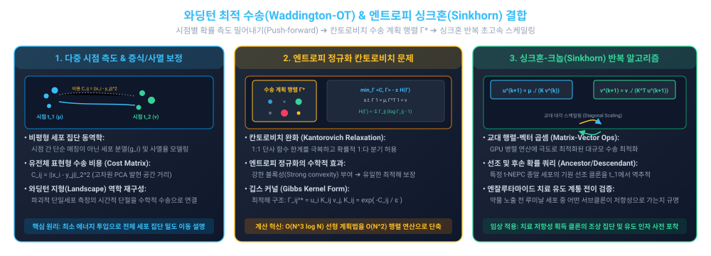

# 04. 최적 수송 이론과 Waddington-OT (Optimal Transport & Waddington-OT)

---

## 학습 목표 (Cognitive Goals)

1. **단일세포 시계열 데이터의 몽주-칸토로비치(Monge-Kantorovich) 최적 수송 정식화**: 파괴적 측정으로 인해 개별 세포의 연속 추적이 불가능한 불연속 시계열 집단($t_1 \to t_2 \to \dots$) 사이에서, 유전자 발현 공간의 최소 이동 비용을 갖는 결합 확률 측도 $\Gamma$를 수학적으로 정의할 수 있다.
2. **엔트로피 정규화(Entropic Regularization)와 싱크혼-크놉(Sinkhorn-Knopp) 알고리즘의 유도**: $O(N^3 \log N)$의 고전적 선형 계획법 병목을 극복하고, 깁스 커널(Gibbs Kernel $K$)과 대각 스케일링 벡터 $(u, v)$를 이용한 $O(N^2)$ 복잡도의 초고속 행렬 균형화(Matrix Balancing) 반복 수렴식을 유도할 수 있다.
3. **세포 증식/사멸 성장률($g(x)$)과 불균형 최적 수송(Unbalanced Optimal Transport)**: 세포 주기 및 자멸사 마커 시그니처로부터 세포별 증식 계수 $g(x_i)$를 추정하고, 쿨백-라이블러(KL) 발산 페널티를 통해 질량 비보존계를 모델링하는 완화된 최적 수송계를 정립할 수 있다.
4. **조상 추적(Ancestry Pull-back) 및 후손 예측(Descendant Push-forward) 파이프라인 구현**: 다중 시점 간의 전이 행렬들을 연쇄 결합($\Gamma_{t_1 \to t_K} = \prod_k \Gamma_{t_k \to t_{k+1}}$)하여 특정 암 세포 표현형의 과거 기원과 미래 운명 궤적을 `wot` 파이이썬 패키지로 복원할 수 있다.

---

## 1. 종단적 단일세포 시계열과 최적 수송의 수학적 구조

단일세포 RNA 시퀀싱 실험이 여러 시점 $t_1 < t_2 < \dots < t_K$에 걸쳐 수행되었을 때, 각 시점 $t_k$에서 측정된 세포 집단은 발현 공간 $\mathbb{R}^G$ 상의 경험적 확률 측도(Empirical Probability Measure)로 표현된다:

$$\mu = \sum_{i=1}^{N_1} p_i \delta_{x_i}, \quad \nu = \sum_{j=1}^{N_2} q_j \delta_{y_j}$$

여기서 $x_i \in \mathbb{R}^G$는 $t_1$의 세포 발현 프로파일, $y_j \in \mathbb{R}^G$는 $t_2$의 세포 발현 프로파일이며, $p_i = \frac{1}{N_1}, q_j = \frac{1}{N_2}$는 균일 가중치이다.

```
[The Destructive Longitudinal Sampling Challenge]

Time t_1: Cell Distribution μ            Time t_2: Cell Distribution ν
       ┌────────────────────────┐               ┌────────────────────────┐
       │   x_1        x_3       │               │       y_2              │
       │        x_2             │ ──[Destroy]─> │   y_1                  │
       │              x_4       │ ───[Lysis]──> │             y_3        │
       │   x_5                  │               │        y_4             │
       └────────────────────────┘               └────────────────────────┘
          (All cells destroyed!)                   (Brand new set of cells!)

Question: Which cell x_i at t_1 gave rise to which cell y_j at t_2?
```

### 1.1 칸토로비치 완화 (Kantorovich Relaxation)

1781년 가스파르 몽주(Gaspard Monge)의 결정론적 사상 $T: X \to Y$은 세포의 분열(하나의 세포가 여러 세포로 분화)이나 확률적 운명 결정을 수용하지 못한다. 1942년 레오니트 칸토로비치(Leonid Kantorovich)는 이를 결합 확률 분포 $\Gamma \in \mathbb{R}_{+}^{N_1 \times N_2}$로 완화하였다:

$$\Gamma_{ij} = P\left( \text{Cell } x_i \text{ transitions to Cell } y_j \right)$$

비용 행렬 $C \in \mathbb{R}_{+}^{N_1 \times N_2}$를 두 세포 사이의 전사체 유클리드 제곱 거리(통상 주성분 공간 PCA 상의 거리)로 정의한다:

$$C_{ij} = \|x_i - y_j\|_2^2$$

고전적 최적 수송 문제는 다음의 수송 비용 기댓값을 최소화하는 행렬 $\Gamma$를 찾는 선형 계획법(Linear Programming) 문제이다:

$$\min_{\Gamma \in \Pi(\mu, \nu)} \langle C, \Gamma \rangle = \min_{\Gamma \in \Pi(\mu, \nu)} \sum_{i=1}^{N_1} \sum_{j=1}^{N_2} C_{ij} \Gamma_{ij}$$

$$\Pi(\mu, \nu) = \left\{ \Gamma \in \mathbb{R}_{+}^{N_1 \times N_2} \;\middle|\; \sum_{j=1}^{N_2} \Gamma_{ij} = p_i, \; \sum_{i=1}^{N_1} \Gamma_{ij} = q_j \right\}$$

그러나 이 선형 계획법은 세포 수 $N \sim 10^4$ 수준에서 계산 복잡도가 $O(N^3 \log N)$에 달하여 단일세포 빅데이터에 적용하는 것이 불가능하다.

---

## 2. 엔트로피 정규화와 싱크혼-크놉(Sinkhorn-Knopp) 알고리즘

### 2.1 엔트로피 정규화 (Entropic Regularization, Cuturi 2013)

Marco Cuturi는 결합 행렬의 음의 엔트로피(Negative Shannon Entropy)를 목적 함수에 페널티 항으로 추가하는 획기적인 정규화를 도입하였다:

$$\min_{\Gamma \in \Pi(\mu, \nu)} \left[ \langle C, \Gamma \rangle - \epsilon \mathcal{H}(\Gamma) \right]$$

$$\mathcal{H}(\Gamma) = -\sum_{i=1}^{N_1} \sum_{j=1}^{N_2} \Gamma_{ij} \left( \log \Gamma_{ij} - 1 \right)$$

여기서 $\epsilon > 0$은 엔트로피 정규화 매개변수이다:
- $\epsilon \to 0$: 고전적 결정론적 희소 최적 수송으로 수렴.
- $\epsilon \to \infty$: 비용을 무시하고 주변부 확률의 독립 곱($\Gamma_{ij} \to p_i q_j$)으로 수렴.
- 적정 $\epsilon$: 물리적 브라운 운동(Brownian Diffusion)과 표동(Drift)이 결합된 통계역학적 전이를 완벽하게 근사.

```
[Entropic Optimal Transport & Matrix Balancing Geometry]

       Cost Matrix C_ij = ||x_i - y_j||^2
                       │
                       ▼ (Gibbs Kernel Transform)
       K_ij = exp( - C_ij / ε )  (Element-wise Gaussian-like Affinities)
                       │
                       ▼ (Matrix Balancing via Diagonal Scaling)
       Γ = diag(u) · K · diag(v)
                       │
       Sinkhorn Iterations (Alternating Projections):
       u^(k+1) = p / (K · v^(k))
       v^(k+1) = q / (K^T · u^(k+1))
                       │
                       ▼ (Convergence in O(N^2) GPU-Accelerated BLAS!)
       Optimal Regularized Coupling Matrix Γ*
```

### 2.2 라그랑주 쌍대성(Lagrange Duality)과 깁스 커널(Gibbs Kernel) 도출

주변부 제약 조건 $\Gamma \mathbf{1}_{N_2} = p$와 $\Gamma^T \mathbf{1}_{N_1} = q$에 대해 라그랑주 승수 벡터 $\alpha \in \mathbb{R}^{N_1}, \beta \in \mathbb{R}^{N_2}$를 도입하여 라그랑지안을 구성한다:

$$\mathcal{L}(\Gamma, \alpha, \beta) = \sum_{i, j} C_{ij} \Gamma_{ij} + \epsilon \sum_{i, j} \Gamma_{ij} (\log \Gamma_{ij} - 1) - \sum_i \alpha_i \left( \sum_j \Gamma_{ij} - p_i \right) - \sum_j \beta_j \left( \sum_i \Gamma_{ij} - q_j \right)$$

$\Gamma_{ij}$에 대해 편미분하여 0으로 놓는다:

$$\frac{\partial \mathcal{L}}{\partial \Gamma_{ij}} = C_{ij} + \epsilon \log \Gamma_{ij} - \alpha_i - \beta_j = 0$$

$$\log \Gamma_{ij} = \frac{\alpha_i + \beta_j - C_{ij}}{\epsilon}$$

$$\Gamma_{ij}^* = \exp\left( \frac{\alpha_i}{\epsilon} \right) \exp\left( -\frac{C_{ij}}{\epsilon} \right) \exp\left( \frac{\beta_j}{\epsilon} \right)$$

여기서 **깁스 커널(Gibbs Kernel $K$)**과 스케일링 벡터 $u, v$를 다음과 같이 치환한다:

$$K_{ij} = \exp\left( -\frac{C_{ij}}{\epsilon} \right), \quad u_i = \exp\left( \frac{\alpha_i}{\epsilon} \right), \quad v_j = \exp\left( \frac{\beta_j}{\epsilon} \right)$$

$$\boxed{\Gamma^* = \text{diag}(u) \, K \, \text{diag}(v)}$$

### 2.3 싱크혼-크놉(Sinkhorn-Knopp) 행렬 균형화 반복식

주변부 제약 조건에 대입하면:

1. 행 합 제약: $\Gamma \mathbf{1} = \text{diag}(u) K v = u \odot (K v) = p \implies u = \frac{p}{K v}$
2. 열 합 제약: $\Gamma^T \mathbf{1} = \text{diag}(v) K^T u = v \odot (K^T u) = q \implies v = \frac{q}{K^T u}$

여기서 $\odot$과 분수 기호는 원소별(Element-wise) 연산이다. 이 연립 비선형 방정식은 다음의 단순한 교대 곱셈 반복을 통해 기하급수적(Linear Convergence in Log-scale)으로 수렴한다:

$$u^{(k+1)} = \frac{p}{K v^{(k)}}, \quad v^{(k+1)} = \frac{q}{K^T u^{(k+1)}}$$

- 반복당 연산은 단순 행렬-벡터 곱($K v, K^T u$)에 불과하므로, 복잡도는 $O(N_1 N_2)$로 급감하며 GPU 텐서 코어를 통해 수초 만에 수만 개 세포의 최적 커플링이 계산된다.

---

## 3. 세포 성장률 $g(x)$와 불균형 최적 수송 (Unbalanced OT)

실제 생체 시스템에서 세포들은 균일하게 1:1로 전이하지 않는다. 일부 세포는 활발히 유사분열(Mitosis)을 거쳐 팽창하고, 다른 세포는 노화하거나 세포 자멸사(Apoptosis)로 소멸한다.

```
[Cell Growth Multiplier and Mass Non-conservation]

Cell x_1: High Proliferation Score (g(x_1) = 3.2) ──► Generates 3.2x Descendant Mass!
Cell x_2: High Apoptosis Score     (g(x_2) = 0.1) ──► 90% of Mass Lost by Apoptosis!
```

### 3.1 유전자 시그니처 기반 세포 성장률 $g(x_i)$ 모델링

Schiebinger et al. (Cell 2019)은 세포 주기 마커($S, G_2/M$)와 세포 자멸사 마커 유전자 세트의 발현량을 기반으로 개별 세포 $i$의 증식·자멸 시그니처 점수를 로지스틱 함수로 출생률·사멸률에 대응시켜 성장률 $g(x_i)$를 구성하였다. 아래 식은 이를 선형 점수의 지수식으로 단순화한 교육용 예시이며 원 논문의 식이 아니다:

$$g(x_i) = \exp\left( \frac{\Delta t}{\tau_{\text{cycle}}} \cdot \frac{s_{\text{prolif}}(x_i) - s_{\text{apopt}}(x_i)}{\sigma_{\text{norm}}} \right)$$

- $\Delta t = t_2 - t_1$: 실제 두 샘플링 사이의 물리적 경과 시간 (Days).
- $\tau_{\text{cycle}}$: 세포 분열 1주기에 소요되는 물리적 기준 시간 (e.g., 약 24시간).

### 3.2 불균형 최적 수송의 수식화

세포 증식률 $g(x_i)$가 반영되면, $t_1$의 세포가 $t_2$로 전달하는 총 질량은 $p_i$가 아니라 $g(x_i) p_i$가 되어야 한다. 그러나 잡음과 측정 편향으로 인해 엄격한 등식 제약을 걸면 해가 존재하지 않을 수 있다.

따라서 주변부 제약 조건을 쿨백-라이블러(KL) 발산 페널티로 완화한 **불균형 엔트로피 최적 수송(Unbalanced Optimal Transport)**을 정식화한다:

$$\min_{\Gamma \ge 0} \left[ \langle C, \Gamma \rangle - \epsilon \mathcal{H}(\Gamma) + \lambda_1 D_{\text{KL}}(\Gamma \mathbf{1} \| g \odot p) + \lambda_2 D_{\text{KL}}(\Gamma^T \mathbf{1} \| q) \right]$$

$$D_{\text{KL}}(a \| b) = \sum_i \left( a_i \log \frac{a_i}{b_i} - a_i + b_i \right)$$

완화 파라미터 $\lambda_1, \lambda_2$는 싱크혼 알고리즘의 스케일링 업데이트 단계에서 지수 보정항($u \leftarrow (p / Kv)^{\frac{\lambda_1}{\lambda_1 + \epsilon}}$)으로 자연스럽게 흡수되어 안정적인 수렴을 보장한다.

---

## 4. Waddington-OT 싱크혼 수송 커플링 다이어그램

비용 행렬 계산, 깁스 커널 변환, 싱크혼 반복 및 조상-후손 수송 메커니즘을 아래 다이어그램에서 확인할 수 있다.



---

## 5. 조상 추적(Ancestry Pull-back) 및 후손 예측(Descendant Push-forward)

최적화된 결합 행렬 $\Gamma \in \mathbb{R}_{+}^{N_1 \times N_2}$는 시간 $t_1$과 $t_2$를 잇는 통계적 전이 사상(Transition Map)이다.

```
[Push-forward vs. Pull-back Transport Geometry]

Push-forward (Forward in Time):
  Mass at t_1: δ_S (Source Population S)
  Descendants at t_2 = δ_S · Γ  (Which cell fates does S become?)

Pull-back (Backward in Time):
  Mass at t_2: δ_F (Terminal Fate F, e.g., t-NEPC)
  Ancestors at t_1 = Γ · δ_F    (Where did fate F originate from?)
```

### 5.1 후손 예측 연산자 (Push-forward)

시점 $t_1$의 특정 세포 하위군 $S \subset X_{t_1}$이 시간 경과 후 $t_2$ 시점에서 어떤 표현형 상태로 진화할 것인가를 예측하는 확률 질량 분포 $D_S \in \mathbb{R}^{N_2}$는 결합 행렬의 좌측 곱으로 계산된다:

$$D_S(j) = \frac{\sum_{i \in S} \Gamma_{ij}}{\sum_{i \in S} \sum_{k=1}^{N_2} \Gamma_{ik}}$$

### 5.2 조상 추적 연산자 (Pull-back)

시점 $t_2$에서 관측된 특정 말기 표현형(e.g., 거세 저항성 신경내분비암 세포군 $F \subset X_{t_2}$)의 기원이 된 $t_1$ 시점의 조상 확률 질량 분포 $A_F \in \mathbb{R}^{N_1}$는 결합 행렬의 우측 곱으로 계산된다:

$$A_F(i) = \frac{\sum_{j \in F} \Gamma_{ij}}{\sum_{k=1}^{N_1} \sum_{j \in F} \Gamma_{kj}}$$

### 5.3 다중 시계열 연쇄 수송 행렬 (Chained Transport Matrix)

시계열 샘플링이 $K$개 시점($t_1, t_2, \dots, t_K$)에 걸쳐 존재할 때, 초기 시점 $t_1$에서 최종 시점 $t_K$까지의 거시적 전이 확률 행렬은 인접 시점 간의 최적 수송 행렬들의 연쇄 행렬 곱(Markovian Chain Multiplication)으로 완벽하게 보간된다:

$$\Gamma_{t_1 \to t_K} = \Gamma_{t_1 \to t_2} \times \Gamma_{t_2 \to t_3} \times \dots \times \Gamma_{t_{K-1} \to t_K}$$

이를 통해 수 주~수 개월에 걸친 암 세포의 단계적 계통 역전 및 약물 저항성 획득 궤적이 끊김 없이 연속적으로 재구성된다.

---

## 6. WOT (`wot`) 라이브러리 파이썬 구현 실습

```python
import wot
import pandas as pd
import numpy as np
import scanpy as sc

def run_waddington_optimal_transport_pipeline(
    adata: sc.AnnData,
    time_col: str = 'timepoint',
    epsilon: float = 0.05,
    lambda1: float = 1.0,
    lambda2: float = 50.0
) -> wot.ot.OTModel:
    """
    Waddington-OT 패키지를 이용한 시계열 단일세포 전이 행렬 최적화 파이프라인.
    """
    print("[1/5] AnnData로부터 WOT 입력 AnnData(PCA 특징 공간 + day 메타데이터) 생성")
    # PCA 좌표계(30 components)를 수송 비용 행렬의 특징 공간으로 사용
    # (wot 1.0.x: wot.Dataset은 없으며, OTModel이 AnnData(.X = 특징, .obs['day'] = 시점)를 직접 받는다)
    wot_adata = sc.AnnData(X=adata.obsm['X_pca'][:, :30].copy(), obs=adata.obs.copy())
    wot_adata.obs['day'] = wot_adata.obs[time_col].astype(float)

    print("[2/5] 세포 주기 및 사멸 유전자 기반 세포 증식률 g(x) 계산")
    # (실무에서는 검증된 S/G2M 및 Apoptosis 유전자 세트를 적용)
    # 여기서는 obs['cell_growth_rate']에 사전 계산된 증식률을 사용 (없으면 교육용 모의 값 할당, 평균 ~1.0)
    if 'cell_growth_rate' not in wot_adata.obs:
        wot_adata.obs['cell_growth_rate'] = np.exp(np.random.normal(0, 0.1, size=wot_adata.n_obs))

    print("[3/5] Waddington-OT 최적 수송 모델 (OTModel) 초기화")
    ot_model = wot.ot.OTModel(
        wot_adata,
        day_field='day',
        growth_rate_field='cell_growth_rate',
        epsilon=epsilon,
        lambda1=lambda1,
        lambda2=lambda2
    )

    print("[4/5] 인접 시점 간 엔트로피 정규화 싱크혼 커플링 행렬 계산")
    # timepoints 정렬: e.g., [0, 3, 7, 14, 28]
    unique_days = sorted(wot_adata.obs['day'].unique())
    print(f"  -> Discovered Longitudinal Timepoints: {unique_days}")
    
    for i in range(len(unique_days) - 1):
        t1, t2 = unique_days[i], unique_days[i+1]
        print(f"  -> Computing transport map: Day {t1} -> Day {t2}...")
        tmap = ot_model.compute_transport_map(t1, t2)   # AnnData (t1 세포 x t2 세포)
        print(f"     Transport matrix shape: {tmap.shape}, Sparsity: {(tmap.X == 0).mean():.2%}")

    print("[5/5] WOT 최적화 완료")
    return ot_model

# 예제 파이프라인 호출 스크립트
if __name__ == "__main__":
    # 5개 시점(Day 0, 1, 3, 7, 14)을 갖는 모의 AnnData 생성
    adata_dummy = sc.datasets.blobs(n_variables=100, n_centers=3, n_observations=1500)
    adata_dummy.obs['timepoint'] = np.random.choice([0, 1, 3, 7, 14], size=1500)
    sc.tl.pca(adata_dummy)
    
    model = run_waddington_optimal_transport_pipeline(adata_dummy, time_col='timepoint')
```

---

## 단원 핵심 점검 (Cognitive Checkpoint & Case Study)

### 문제 1: 엔트로피 파라미터 $\epsilon$의 극단적 거동과 수송 행렬의 물리적 의미
엔트로피 정규화 최적 수송에서 파라미터 $\epsilon$은 최적화 수렴 속도와 생물학적 사실성 간의 균형을 결정한다.
1. $\epsilon \to 0$인 극한과 $\epsilon \to \infty$인 극한에서 싱크혼 알고리즘이 도출하는 최적 결합 행렬 $\Gamma^*$의 형태와 생물학적 한계를 각각 수학적으로 논증하시오.
2. 실제 단일세포 전사체 시계열 데이터셋에서 최적의 $\epsilon$을 선정하기 위해 사용하는 교차 검증(Cross-validation) 기법(e.g., 보류 시점 전사체 분포 예측 정확도)을 설명하시오.

<details>
<summary>💡 모범 답안 및 해설 확인</summary>

**1. $\epsilon$ 극단값에서의 수동적/통계적 거동**:
- **$\epsilon \to 0$ (영 엔트로피 극한)**:
  정규화 항 $-\epsilon \mathcal{H}(\Gamma)$이 소멸하여 고전적 선형 계획법(Kantorovich LP)으로 복귀한다.
  - 수학적 결과: 최적 결합 $\Gamma^*$는 극도로 희소(Extremely Sparse)해지며, 버코프-폰 노이만 정리에 의해 대부분의 질량이 몇 개의 극단 꼭짓점(Deterministic Extreme Points)에만 일대일로 집중된다.
  - 생물학적 한계: 실제 세포 분화 및 전사체 변화는 무작위 열역학적 요동과 전사 파열을 수반하는 확률론적 확산(Stochastic Diffusion) 과정이다. 결정론적 극단 해는 세포 상태의 자연스러운 분산과 다중 운명 선택 가능성을 완전히 배제하는 과적합(Overfitting)을 초래한다.
- **$\epsilon \to \infty$ (무한 엔트로피 극한)**:
  수송 비용 $C_{ij}$의 영향력이 0으로 수렴하고 순수 엔트로피 최대화 문제만 남는다.
  - 수학적 결과: 깁스 커널 $K_{ij} = \exp(-C_{ij}/\epsilon) \to 1$이 되므로, 최적 결합은 거리와 무관하게 두 주변부 분포의 단순 독립 곱 $\Gamma_{ij}^* \to p_i q_j$으로 균일화된다.
  - 생물학적 한계: 발현 공간 상의 기하학적 유사도가 완전히 무시되어, $t_1$의 세포가 $t_2$의 아무 세포로나 동일한 확률로 도약할 수 있다는 물리적으로 불가능한 무작위 셔플링 상태가 된다.

**2. 보류 시점(Hold-out Timepoint) 교차 검증을 통한 $\epsilon$ 최적화**:
- 3개 이상의 연속 시점(e.g., $t_1, t_2, t_3$)이 주어졌을 때, 중간 시점 $t_2$ 데이터를 의도적으로 분석에서 제외(Hold-out)한다.
- 시점 $t_1$에서 $t_3$로 직접 수송하는 모델 $\Gamma_{t_1 \to t_3}^{(\epsilon)}$을 다양한 $\epsilon$ 후보군에 대해 적합한 후, 물리적 중간 시간 비율 $\alpha = \frac{t_2 - t_1}{t_3 - t_1}$에 따라 측지선 보간 분포(Geodesic Interpolation Measure $\hat{\mu}_{t_2}^{(\epsilon)}$)를 생성한다.
- 보간된 예측 분포 $\hat{\mu}_{t_2}^{(\epsilon)}$와 실제로 측정되었던 보류 샘플 $\mu_{t_2}$ 사이의 1-와서스타인 거리(Wasserstein Distance) 또는 에너지 거리(Energy Distance)를 측정한다:
  $$\epsilon^* = \arg\min_\epsilon \mathcal{W}_1\left( \hat{\mu}_{t_2}^{(\epsilon)}, \mu_{t_2} \right)$$
- 이 오차를 최소화하는 $\epsilon^*$이 실제 세포 전사체 확산 계수를 가장 완벽하게 반영하는 최적의 정규화 상수가 된다.

</details>

---

### 문제 2: 안드로겐 차단 치료(ADT) 시계열에서 신경내분비암(t-NEPC) 조상 세포의 기원 추적
(가상 시나리오: 특정 문헌·임상 데이터에서 관찰된 결과가 아니며, 본 장 모의 데이터의 시점(Day 0~14)과 달리 설명을 위해 Day 28을 가정합니다.) 호르몬 결핍 치료 전(Day 0)에는 전형적인 $AR^+$ 관강 상피세포(Luminal)만 관측되었으나, 치료 28일차(Day 28)에 치명적인 신경내분비암($SYP^+, CHGA^+, AR^-$) 세포 집단이 출현하였다.
1. Day 28의 신경내분비암 세포군을 타깃 집단 $F \subset X_{\text{Day 28}}$로 지정했을 때, WOT의 Pull-back 조상 연산자를 통해 Day 0의 개별 세포 $i$가 신경내분비암의 기원 세포일 사후 확률 $P(\text{Ancestor of } F \mid x_i)$을 수식으로 유도하시오.
2. 세포 증식률 $g(x)$를 보정하지 않고 단순 최적 수송($g(x) \equiv 1$)을 적용할 경우, Day 28에 도달한 소수의 고증식성 저항 클론의 조상이 어떻게 왜곡 판정되는지 설명하시오.

<details>
<summary>💡 모범 답안 및 해설 확인</summary>

**1. 조상 확률 $P(\text{Ancestor of } F \mid x_i)$의 수식 유도**:
- Day 0부터 Day 28까지의 시점들을 $t_0, t_1, \dots, t_K$라 할 때, 전체 연쇄 최적 수송 결합 행렬을 도출한다:
  $$\Gamma_{\text{total}} = \Gamma_{t_0 \to t_1} \times \Gamma_{t_1 \to t_2} \times \dots \times \Gamma_{t_{K-1} \to t_K} \in \mathbb{R}_{+}^{N_0 \times N_K}$$
- Day 28의 신경내분비암 세포 집합 $F \subset \{1, \dots, N_K\}$를 지시하는 지시 벡터 $\mathbf{1}_F \in \{0, 1\}^{N_K}$를 정의한다.
- 조상 분포(Pull-back measure) 벡터 $A_F \in \mathbb{R}^{N_0}$는 다음과 같다:
  $$A_F(i) = \sum_{j \in F} (\Gamma_{\text{total}})_{ij}$$
- 전체 조상 확률 질량의 총합이 1이 되도록 정규화하면, Day 0의 특정 세포 $i$가 t-NEPC의 조상일 확률은 다음과 같이 엄밀하게 유도된다:
  $$\boxed{P(\text{Ancestor of } F \mid x_i) = \frac{\sum_{j \in F} (\Gamma_{\text{total}})_{ij}}{\sum_{k=1}^{N_0} \sum_{j \in F} (\Gamma_{\text{total}})_{kj}}}$$

**2. $g(x)$ 미보정 시의 치명적 왜곡 기전**:
- **상황**: Day 28의 t-NEPC 세포 군집 중 대다수는 Day 0의 극소수 저항성 세포($x_{\text{res}}$)가 폭발적으로 분열($g(x_{\text{res}}) \gg 1$)하여 형성된 클론이고, 나머지 대다수 정상 관강 세포는 사멸($g(x_{\text{norm}}) \ll 1$)하였다.
- **$g(x) \equiv 1$ (질량 보존 강제) 적용 시의 왜곡**:
  단순 OT는 모든 세포가 동일한 비율로 후손을 남긴다고 강제 가정한다. 따라서 Day 28의 방대한 t-NEPC 세포 질량을 설명하기 위해, 실제로는 사멸하여 후손을 남기지 못한 수많은 무고한 Day 0 관강 세포들로부터 질량을 억지로 끌어오게 된다.
- 그 결과, 실제 기원인 희귀 전구세포뿐만 아니라 전혀 엉뚱한 일반 관강 세포들까지 t-NEPC의 조상 세포로 지목되는 **가짜 조상 다형성(Spurious Ancestor Plurality)** 왜곡이 발생하여, 신약 표적이 되어야 할 진성 조상 클론의 분자 시그니처가 완전히 희석된다.

</details>

---

### 문제 3: 최적 수송과 RNA 벨로시티의 시너지: 왜 두 방법론을 상호 보완해야 하는가?
1. RNA 벨로시티(scVelo)는 단일 시점 스냅샷에서 세포의 순간 미분 벡터($ds/dt$)를 제공하지만 거시적 시간대($\Delta t \sim \text{weeks}$)의 누적 궤적 추정에서는 오차가 누적된다. 반면 Waddington-OT는 거시적 시계열을 정확히 연결하지만 시점 사이의 초미세 과도기적 동역학을 직접 관측할 수 없다. 두 방법론의 한계가 어떻게 상호 보완되는지 논하시오.
2. CellRank와 같은 최신 프레임워크가 WOT의 수송 행렬 $\Gamma$와 scVelo의 전이 확률 행렬 $\Pi_{\text{velo}}$를 결합하는 마르코프 커널 융합 수식을 제시하시오.

<details>
<summary>💡 모범 답안 및 해설 확인</summary>

**1. 두 패러다임의 상호보완적 수리물리학적 본질**:
- **RNA Velocity의 강점과 약점**:
  - 강점: 단 하나의 정적 시점 스냅샷만으로도 세포 내부의 스플라이싱 지연 인과율을 통해 현재 시점의 순간 가속도 방향($v = ds/dt$)을 즉각 도출한다.
  - 약점: 미분 신호의 유효 시간 윈도우는 전사체 반감기 수준인 수 시간(Hours) 이내이다. 수 주(Weeks)에 걸친 장기 치료 반응을 추정할 때 벨로시티 벡터를 단순 외삽(Euler Integration)하면 수치적 오차가 기하급수적으로 누적되어 발산한다.
- **Waddington-OT의 강점과 약점**:
  - 강점: 실제 실험적으로 경과된 거시적 물리 시간($\Delta t \sim 7, 14, 28\text{ days}$) 동안 집단이 겪은 대규모 세포 상태 전이와 증식/사멸을 대역폭 보존 법칙 하에서 전역적으로 최적화한다.
  - 약점: 시점 $t_1$과 $t_2$ 사이의 시간 간격 동안 일어난 미세한 중간 동역학(예: 일시적 탈분화 후 재분화)은 비용 행렬의 직선 경로로 단순화되어 포착되지 못한다.
- **상호보완성**: WOT가 장기적 거시 경로의 앵커(Global Backbone Anchor)를 제공하고, RNA 벨로시티가 각 국소 시간대 내에서 세포가 이동하는 미시적 순간 방향타(Local Steering Vector)를 제공함으로써 다중 시간 스케일의 완전한 시공간 동역학이 완성된다.

**2. CellRank의 커널 융합 정식화**:
CellRank는 최적 수송 커널 $T_{\text{OT}}$와 벨로시티 커널 $T_{\text{velo}}$를 선형 결합하여 단일 통합 전이 마르코프 행렬 $T_{\text{combined}}$를 구성한다:
$$T_{\text{combined}} = \lambda \, T_{\text{OT}} + (1 - \lambda) \, T_{\text{velo}}, \quad \lambda \in [0, 1]$$
여기서:
- $T_{\text{OT}}(i, j) = \frac{\Gamma_{ij}}{\sum_k \Gamma_{ik}}$: WOT로 계산된 거시적 종단 전이 확률.
- $T_{\text{velo}}(i, j) \propto \exp\left( \frac{\cos(v_i, s_j - s_i)}{\sigma} \right)$: 미시적 스플라이싱 반응속도론 기반 전이 확률.
- 이 결합 행렬에 슈어 분해(Schur Decomposition)와 대규모 마르코프 연쇄 분석(GPCCA)을 적용하면, 장기적 거시 계통 운명과 미시적 전이 전사 조절인자가 완벽하게 통합된 계통 운명 결정 확률(Fate Probabilities)이 도출된다.

</details>

---

<!-- REFERENCES:BEGIN (generated by scripts/apply_references.py; do not edit by hand) -->
## 참고문헌 (References)
### 본문 인용 문헌
1. Schiebinger G, Shu J, Tabaka M, et al. Optimal-Transport Analysis of Single-Cell Gene Expression Identifies Developmental Trajectories in Reprogramming. *Cell*. 2019;176(4):928-943.e22. PMID: 30712874. doi: 10.1016/j.cell.2019.01.006
2. Cuturi M. Sinkhorn Distances: Lightspeed Computation of Optimal Transportation Distances. *arXiv* preprint. 2013. arXiv: 1306.0895.
### 소프트웨어 (표기 버전은 검수 시 API를 확인한 버전이며, 파이프라인 실행 환경은 requirements-pipelines.txt 참조)
- NumPy 2.5.4 (numpy.org). 원 논문: Harris CR, Millman KJ, van der Walt SJ, et al. Array programming with NumPy. *Nature*. 2020;585(7825):357-362. PMID: 32939066. doi: 10.1038/s41586-020-2649-2
- pandas 2.3.3 (github.com/pandas-dev/pandas). 원 논문: McKinney W. Data Structures for Statistical Computing in Python. *Proceedings of the Python in Science Conference*. 2010:56-61. doi: 10.25080/majora-92bf1922-00a
- Scanpy 1.12.4 (github.com/scverse/scanpy). 원 논문: Wolf FA, Angerer P, Theis FJ. SCANPY: large-scale single-cell gene expression data analysis. *Genome Biol*. 2018;19(1):15. PMID: 29409532. doi: 10.1186/s13059-017-1382-0
- Waddington-OT (wot) 1.0.8.post2 (github.com/broadinstitute/wot). 원 논문: Schiebinger G, Shu J, Tabaka M, et al. Optimal-Transport Analysis of Single-Cell Gene Expression Identifies Developmental Trajectories in Reprogramming. *Cell*. 2019;176(4):928-943.e22. PMID: 30712874. doi: 10.1016/j.cell.2019.01.006
<!-- REFERENCES:END -->
