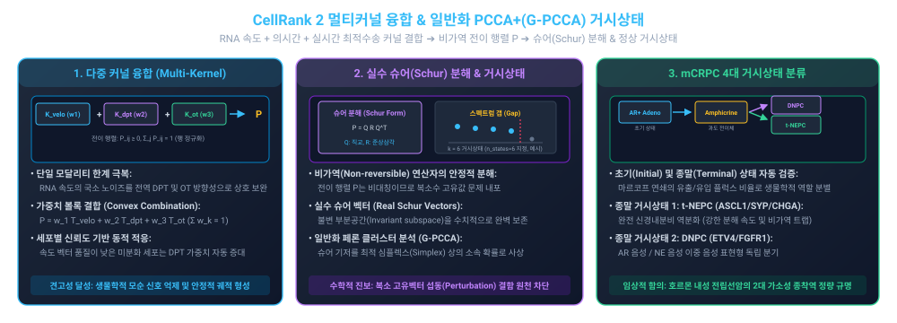

# Chapter 05. CellRank 2 다중 커널 융합 프레임워크 (CellRank 2 Multi-Kernel Integration Framework)

> **Cognitive Goal**:
> - 단일 양식(RNA velocity)의 노이즈, 전사 버스팅(Transcriptional bursting), 유전자별 상이한 스플라이싱 동역학(Multiple kinetics)으로 인한 궤적 추론 오류를 극복하기 위해 다중 오믹스 및 방향성 정보를 통합하는 `CellRank 2` 다중 커널(Multi-kernel) 프레임워크의 수학적 원리를 정립한다.
> - 속도 커널(Velocity Kernel), 의사시간/CytoTRACE 커널(Pseudotime & CytoTRACE Kernel), 실시간 최적 수송 커널(Real-time / Waddington-OT Kernel), 공간 커널(Spatial Kernel)의 커널 유사도 함수 $T(i, j)$ 수식을 엄밀히 유도하고 행-확률적(Row-stochastic) 정규화 기전을 체득한다.
> - 커널의 볼록 결합(Convex combination) $\mathbf{P} = \sum_m w_m \mathbf{P}_m$을 통해 마르코프 전이 확률 행렬을 구성하고, 행-확률성(Row-stochasticity) 보존 조건을 수학적으로 증명한다.
> - 전이성 거세 저항성 전립선암(mCRPC)에서 차세대 안드로겐 수용체 저해제(Enzalutamide) 치료 선택압 하의 계통 가소성(Lineage Plasticity: AR+ 선암종 $\to$ 양방향 가소성 중간체 $\to$ t-NEPC / DNPC) 궤적을 복원할 때, RNA velocity와 CytoTRACE 커널의 상호 보완적 융합이 필수적인 분자생물학적 당위성을 분석한다.

---

## 1. 단일 양식 전이 추론의 한계와 다중 커널 통합의 필연성

단일 세포 전사체(scRNA-seq/snRNA-seq) 데이터에서 세포의 분화 및 가소성 궤적(Trajectory)을 추론하는 고전적 방법론은 단일 양식의 정보에만 의존해 왔습니다. 그러나 생물학적 시스템의 시공간적 복잡성은 단일 양식 분석 시 심각한 해석 왜곡을 초래합니다.

```
┌────────────────────────────────────────────────────────────────────────────────────────┐
│                   단일 양식 전이 추론의 한계와 CellRank 2 다중 커널 융합               │
│                                                                                        │
│   [단일 양식 1: RNA Velocity 단독]                                                      │
│   ● 유전자별 상이한 스플라이싱 반응속도 (Multiple Kinetics)                             │
│   ● 치료제(Enzalutamide) 투여 시 전사 급감 ──► 속도 벡터 왜곡 및 인위적 역류          │
│                                                                                        │
│   [단일 양식 2: Pseudotime / CytoTRACE 단독]                                           │
│   ● 국소적 세포 이동 방향(Local directionality) 결여, 전역적(Global) 순서만 제시       │
│                                                                                        │
│   [단일 양식 3: Real-time (WOT) 단독]                                                  │
│   ● 시계열 샘플 간 불연속성(Time-gap), 세포 주기 및 사멸 편향 발생                     │
│                                                                                        │
│                            ▼ [CellRank 2 다중 커널 융합]                               │
│   ┌────────────────────────────────────────────────────────────────────────────────┐   │
│   │   P_comb = w_vel * P_vel + w_cyto * P_cyto + w_ot * P_ot + w_sp * P_sp         │   │
│   │   (단일 행-확률적 마르코프 전이 행렬 구성: ∑ w_m = 1, w_m ≥ 0)                 │   │
│   └────────────────────────────────────────────────────────────────────────────────┘   │
│                            ▼                                                           │
│   [G-PCCA 거시상태 분해 및 흡수 마르코프 체인을 통한 정확한 계통 운명 확률 도출]        │
└────────────────────────────────────────────────────────────────────────────────────────┘
```

### 1.1 RNA Velocity의 생물학적 및 기술적 한계
1. **전사 버스팅 및 비정상 상태(Non-steady-state)**:
   - 고전적 RNA velocity(La Manno et al., 2018)는 스플라이싱 이전의 미성숙 RNA($u$)와 성숙 RNA($s$)의 비율이 단일 반응속도 파라미터($\alpha, \beta, \gamma$) 하에서 정상 상태에 도달한다고 가정합니다.
   - 그러나 치료제 투여 등 급격한 외부 자극이 가해질 때, 전사 유도 속도 $\alpha(t)$가 시변(Time-varying)하며 세포 집단은 상평형(Phase plane) 상에서 비틀린 궤적을 그리게 됩니다.
2. **다중 동역학 체계(Multiple Kinetic Regimes)**:
   - 서로 다른 분화 계통(예: AR+ 선암종 vs t-NEPC 신경내분비암종)에서 동일 유전자의 전사 개시율 또는 분해율이 다를 수 있습니다. 단일 타원 곡선을 강제 적합(Single phase portrait fit)할 경우 속도 벡터가 실제 생물학적 진행 방향과 180도 반대로 뒤집히는 '역류 현상(Reverse flow artifact)'이 발생합니다.
3. **단백질 축적 지연(Velocity-Protein Discordance)**:
   - mRNA의 양적 변화가 실제 표현형 전환을 주도하는 단백질 및 전사인자 결합으로 이어지기까지 상당한 시간 지연(Post-transcriptional & translational delay)이 존재합니다.

### 1.2 CellRank 2 다중 커널 아키텍처의 혁신
CellRank 2(Weiler et al., Nature Methods 2024, PMID 38871986)는 방향성 정보를 제공하는 다양한 생물학적 프록시(RNA velocity, 발달 잠재력, 실험 시점, 전이 엔트로피, 공간적 이웃)를 독립적인 수학적 **커널(Kernel)**로 추상화한 뒤, 이를 단일 행-확률적(Row-stochastic) 전이 행렬로 결합하는 일반화된 마르코프 연쇄 프레임워크를 제공합니다.

---

## 2. 개별 커널(Kernel)의 수리적 정의 및 정규화

단일 세포 집합을 $\mathcal{C} = \{1, 2, \dots, N\}$이라 하고, 유전자 발현 공간의 좌표를 $\mathbf{x}_i \in \mathbb{R}^G$, 국소 속도 벡터를 $\mathbf{v}_i \in \mathbb{R}^G$라 합니다. 세포 간의 유사도 그래프는 $k$-최근접 이웃(kNN) 그래프 $\mathcal{G} = (\mathcal{V}, \mathcal{E})$로 표현되며, 세포 $i$의 이웃 집합은 $\mathcal{N}(i) = \{j \mid (i, j) \in \mathcal{E}\}$입니다.

### 2.1 속도 커널 (Velocity Kernel: $\mathbf{P}_{\text{vel}}$)
속도 커널은 세포 $i$의 RNA velocity 벡터 $\mathbf{v}_i$와 세포 $i$에서 이웃 세포 $j$로 향하는 상태 변위 벡터 $\mathbf{x}_j - \mathbf{x}_i$ 간의 방향적 일치도를 측정합니다.

1. **상관관계 기반 전이 점수(Pearson Correlation Score)**:
   $$r_{ij} = \frac{\sum_{g=1}^G (v_{ig} - \bar{v}_i) ((x_{jg} - x_{ig}) - \overline{\Delta x_{ij}})}{\sqrt{\sum_{g=1}^G (v_{ig} - \bar{v}_i)^2} \sqrt{\sum_{g=1}^G ((x_{jg} - x_{ig}) - \overline{\Delta x_{ij}})^2}}$$
2. **지수 변환 및 스케일링**:
   $$T_{\text{vel}}(i, j) = \exp\left( \frac{r_{ij}}{\sigma_i} \right), \quad \forall j \in \mathcal{N}(i)$$
   여기서 $\sigma_i$는 국소 이웃 간 속도 분산을 제어하는 온도 파라미터(Temperature hyperparameter)입니다.
3. **행 정규화(Row Normalization)**:
   $$P_{\text{vel}}(i, j) = \begin{cases} \frac{T_{\text{vel}}(i, j)}{\sum_{k \in \mathcal{N}(i)} T_{\text{vel}}(i, k)}, & j \in \mathcal{N}(i) \\ 0, & j \notin \mathcal{N}(i) \end{cases}$$
   이로써 $\sum_{j=1}^N P_{\text{vel}}(i, j) = 1$ 및 $P_{\text{vel}}(i, j) \ge 0$이 성립합니다.

### 2.2 의사시간 및 발달 잠재력 커널 (Pseudotime & CytoTRACE Kernel: $\mathbf{P}_{\text{pt}}$)
세포 분화는 비가역적인 엔트로피 감소 또는 후성유전학적 전위의 하강 과정으로 볼 수 있습니다. CytoTRACE(Gulati et al., Science 2020)는 미분화 줄기세포일수록 발현되는 고유 유전자 수(Gene counts/diversity)가 많다는 전사체 원리를 기반으로 0(완전 분화)에서 1(원시 줄기세포) 사이의 발달 잠재력 점수 $C(i)$를 부여합니다.

1. **방향성 편향(Directional Bias Function)**:
   세포 $i$에서 $j$로의 의사시간 진행 차이를 $\Delta t_{ij} = t(j) - t(i)$라 할 때, 로지스틱 활성화 함수(Soft thresholding)를 통해 순방향 전이에 가중치를 부여합니다:
   $$f(\Delta t_{ij}) = \frac{1}{1 + \exp\left( -\frac{\Delta t_{ij}}{\tau} \right)}$$
   여기서 $\tau > 0$는 의사시간 차이에 대한 민감도를 결정하는 스케일 인자입니다.
2. **발현 공간 유사도와의 결합**:
   발현 공간 상의 유클리드 거리에 기반한 가우시안 친화도 $W_{\text{exp}}(i, j) = \exp\left(-\frac{\|\mathbf{x}_i - \mathbf{x}_j\|^2}{2\sigma_{\text{exp}}^2}\right)$와 결합하여 비대칭적 전이 커널을 정의합니다:
   $$T_{\text{pt}}(i, j) = W_{\text{exp}}(i, j) \cdot f(\Delta t_{ij}), \quad \forall j \in \mathcal{N}(i)$$
3. **행 정규화**:
   $$P_{\text{pt}}(i, j) = \frac{T_{\text{pt}}(i, j)}{\sum_{k \in \mathcal{N}(i)} T_{\text{pt}}(i, k)}$$

### 2.3 실시간 및 최적 수송 커널 (Real-time & Waddington-OT Kernel: $\mathbf{P}_{\text{ot}}$)
종단적(Longitudinal) 시계열 생검 데이터나 약물 처리 시점($t_1 < t_2 < \dots < t_T$)이 존재하는 경우, 엔트로피 정규화 최적 수송(Entropic Optimal Transport, Schiebinger et al., Cell 2019)을 적용합니다.

1. **비평형 최적 수송(Unbalanced Optimal Transport) 목적식**:
   시점 $t_a$의 세포 분포 $\mu$와 시점 $t_b$의 세포 분포 $\nu$ 사이의 커플링 행렬 $\mathbf{\Gamma} \in \mathbb{R}_{+}^{N_a \times N_b}$을 구합니다:
   $$\min_{\mathbf{\Gamma}} \sum_{i=1}^{N_a} \sum_{j=1}^{N_b} C_{ij} \Gamma_{ij} + \epsilon H(\mathbf{\Gamma}) + \lambda_1 \text{KL}(\mathbf{\Gamma} \mathbf{1} \mid \hat{\mu}) + \lambda_2 \text{KL}(\mathbf{\Gamma}^T \mathbf{1} \mid \hat{\nu})$$
   - $C_{ij} = \|\mathbf{x}_i - \mathbf{x}_j\|_2^2$: 세포 간 전사체 비용(Cost)
   - $H(\mathbf{\Gamma}) = \sum_{i, j} \Gamma_{ij} (\ln \Gamma_{ij} - 1)$: 엔트로피 정규화 항 (싱크혼 알고리즘을 통한 초고속 수렴 보장)
   - $\text{KL}(\cdot \mid \cdot)$: 세포 증식률 및 사멸률 $g(i)$에 따른 질량 보존 완화 항
2. **전이 확률 행렬 변환**:
   최적 커플링 $\mathbf{\Gamma}^*$로부터 시점 $t_a$ 세포 $i$의 시점 $t_b$ 세포 $j$로의 전이 확률을 도출합니다:
   $$P_{\text{ot}}(i, j) = \frac{\Gamma_{ij}^*}{\sum_{k=1}^{N_b} \Gamma_{ik}^*}$$

### 2.4 공간 전이 커널 (Spatial Kernel: $\mathbf{P}_{\text{sp}}$, Track 02 연계)
공간 전사체(Spatial Transcriptomics) 데이터에서 세포 간 전이는 물리적 거리 제약과 미세환경 내 국소 신호전달(리간드-수용체 상호작용)의 영향을 받습니다.
$$T_{\text{sp}}(i, j) = \exp\left( -\frac{\|\mathbf{s}_i - \mathbf{s}_j\|_2^2}{2\ell_{\text{phys}}^2} \right) \cdot \exp\left( \frac{\text{LR}(i, j)}{\sigma_{\text{LR}}} \right) \cdot \mathbb{I}(j \in \mathcal{N}_{\text{spatial}}(i))$$
여기서 $\mathbf{s}_i \in \mathbb{R}^2$는 조직 상의 2D 물리 좌표이며, $\text{LR}(i, j)$는 Track 02/03에서 정량화된 리간드-수용체 복합체 점수입니다.

---

## 3. 볼록 결합(Convex Combination)과 행-확률적(Row-Stochastic) 전이 행렬의 형성

서로 다른 생물학적 모달리티에서 파생된 $M$개의 전이 확률 행렬 $\{\mathbf{P}_1, \mathbf{P}_2, \dots, \mathbf{P}_M\}$이 주어졌을 때, CellRank 2는 이를 가중 볼록 결합(Convex Combination)으로 융합합니다.

### 3.1 수학적 정의
$$\mathbf{P}_{\text{comb}} = \sum_{m=1}^M w_m \mathbf{P}_m, \quad \text{where } \sum_{m=1}^M w_m = 1, \quad w_m \ge 0 \quad (\forall m \in \{1, \dots, M\})$$

### 3.2 행-확률성 보존 정리 및 증명 (Theorem & Proof)
> **정리 (Row-Stochasticity Preservation)**:
> 모든 $m \in \{1, \dots, M\}$에 대해 $\mathbf{P}_m \in \mathbb{R}^{N \times N}$이 행-확률적 행렬(Row-stochastic matrix)이라면, 가중치 벡터 $\mathbf{w} = (w_1, \dots, w_M)^T$가 단위 심플렉스 $\Delta^{M-1}$에 속할 때($\sum w_m = 1, w_m \ge 0$), 결합 행렬 $\mathbf{P}_{\text{comb}}$ 역시 엄밀한 행-확률적 행렬이다.

**증명 (Proof)**:
1. **비음수성(Non-negativity)**:
   모든 $m$에 대해 $\mathbf{P}_m$의 원소가 $P_m(i, j) \ge 0$이고, 가중치 $w_m \ge 0$이므로:
   $$P_{\text{comb}}(i, j) = \sum_{m=1}^M w_m P_m(i, j) \ge 0, \quad \forall i, j \in \{1, \dots, N\}$$
2. **행합 불변성(Row Sum Invariance)**:
   모든 원소가 1인 열벡터를 $\mathbf{1} = (1, 1, \dots, 1)^T \in \mathbb{R}^N$이라 하자. 각 $\mathbf{P}_m$이 행-확률적이므로 $\mathbf{P}_m \mathbf{1} = \mathbf{1}$이다.
   결합 행렬 $\mathbf{P}_{\text{comb}}$에 $\mathbf{1}$을 우측 곱하면:
   $$\mathbf{P}_{\text{comb}} \mathbf{1} = \left( \sum_{m=1}^M w_m \mathbf{P}_m \right) \mathbf{1} = \sum_{m=1}^M w_m (\mathbf{P}_m \mathbf{1})$$
   $$\mathbf{P}_{\text{comb}} \mathbf{1} = \sum_{m=1}^M w_m \mathbf{1} = \left( \sum_{m=1}^M w_m \right) \mathbf{1}$$
   가중치의 합이 $\sum_{m=1}^M w_m = 1$이므로:
   $$\mathbf{P}_{\text{comb}} \mathbf{1} = 1 \cdot \mathbf{1} = \mathbf{1}$$
   따라서 임의의 행 $i$에 대해 $\sum_{j=1}^N P_{\text{comb}}(i, j) = 1$이 만족된다. Q.E.D.

### 3.3 왜 아다마르 곱(Hadamard Product) 대신 볼록 결합인가?
만약 커널의 원소별 곱(Hadamard product, $T(i, j) = P_{\text{vel}}(i, j) \cdot P_{\text{pt}}(i, j)$)을 취한 후 행 정규화를 시도한다면 다음과 같은 심각한 수학적 왜곡이 발생합니다:
- 하나의 커널에서 극미량의 노이즈로 0에 가까운 값($\epsilon \approx 0$)이 나타날 경우, 다른 양식의 강력한 증거가 존재하더라도 전이 확률이 0으로 강제 소멸(Veto effect)됩니다.
- 이는 그래프의 연결성(Connectivity)을 파괴하여 마르코프 체인의 흡수 상태나 고립 컴포넌트를 비정상적으로 유발합니다.
- 반면 볼록 결합은 상호 보완적인 덧셈 구조($w_1 P_{\text{vel}} + w_2 P_{\text{pt}}$)를 취하므로, 특정 양식의 결측이나 일시적 역전이 발생하더라도 궤적의 연속성과 강건성(Robustness)을 유지합니다.

---

## 4. 전립선암 거세 저항성(mCRPC) 계통 가소성 데이터 적용



전립선암의 안드로겐 박탈 요법(ADT) 및 2차 ARSI(Enzalutamide) 치료 환경에서, 종양 세포는 치명적인 진화적 병목(Evolutionary Bottleneck)을 겪습니다. 이때 단일 RNA velocity 분석은 심각한 생물학적 오판을 초래합니다.

### 4.1 Enzalutamide 유도성 속도 벡터 왜곡 기전
1. **루미날 유전자 전사 정지(Transcriptional Deceleration)**:
   - Enzalutamide가 투여되면 AR 전사 복합체가 즉각 차단되어 *KLK3*(PSA), *NKX3-1*, *TMPRSS2* 등 루미날 계통 표지자의 신규 전사가 전면 중단됩니다.
   - 이로 인해 미성숙 RNA($u$)가 먼저 고갈되어 $u < \frac{\gamma}{\beta} s$가 되며, 해당 유전자의 속도 $v = \beta u - \gamma s < 0$이 됩니다. 이는 **루미날 유전자 발현이 감소하는 방향, 즉 루미날 상태에서 멀어지는 정방향 신호**이며 그 자체가 '루미날로의 역류'를 뜻하지 않습니다.
   - 그럼에도 단일 RNA velocity 분석(scVelo)에서 가소성 중간체가 루미날 쪽으로 되돌아가는 것처럼 보이는 거짓 역류가 나타날 수 있는 경우는, 속도 계산에 쓰인 유전자가 대부분 하향 조절 유전자여서 임베딩 투영 방향이 전도되거나, 신경내분비 유도 유전자의 $u/s$ 비·$\gamma$ 추정이 틀린 경우, 또는 유전자 선택·스케일링 문제입니다. 해결은 velocity 유전자 선택과 dynamical 모델 사용입니다.
2. **CytoTRACE를 통한 시간의 화살(Arrow of Time) 복원**:
   - 약제 선택압 하에서 세포는 계통 제약을 풀기 위해 줄기세포능(Stemness) 전사인자(*SOX2*, *NANOG*)를 활성화하며 전사 엔트로피 및 유전자 다양성을 확장합니다.
   - 따라서 CytoTRACE 점수는 루미날 선암종(예시 값 $C \approx 0.2$) $\to$ 가소성 중간체(예시 값 $C \approx 0.85$) 방향으로 증가하는 기울기를 보일 것으로 가정합니다(위 수치는 설명용 가상 값이며 실제 데이터로 검증되지 않았고, 가소성 중간체의 CytoTRACE가 높다는 것은 검증 전 가정입니다).
   - `CellRank 2`에서 $w_{\text{vel}} = 0.7$, $w_{\text{cyto}} = 0.3$로 커널을 융합하면, 국소적 전사 변동성(Velocity)에 발달 전위의 비가역적 방향성(CytoTRACE)이 결합되어 올바른 가소성 분기 궤적이 복원됩니다.

---

## 5. 실전 파이썬 분석 파이프라인 (`cellrank`, `scvelo`, `scanpy`)

다음은 전립선암 snRNA-seq 데이터셋에서 `CellRank 2`의 `VelocityKernel`과 `CytoTRACEKernel`을 구성하고 볼록 결합하여 단일 마르코프 전이 행렬을 구축하는 표준 파이프라인입니다.

```python
import scanpy as sc
import scvelo as scv
import cellrank as cr
import numpy as np

# 1. 데이터 로드 및 전처리 검증
adata = sc.read_h5ad("mcrpc_plasticity_snRNA.h5ad")
scv.pp.filter_and_normalize(adata, min_shared_counts=20)  # scvelo 0.3.4: n_top_genes 인자는 TypeError
sc.pp.highly_variable_genes(adata, n_top_genes=2000, subset=True)
sc.pp.pca(adata, n_comps=30)
sc.pp.neighbors(adata, n_neighbors=30, n_pcs=30)

# 2. scVelo 동역학 모델 적합 및 RNA velocity 추정
scv.pp.moments(adata, n_pcs=30, n_neighbors=30)
scv.tl.recover_dynamics(adata, n_jobs=8)
scv.tl.velocity(adata, mode="dynamical")
scv.tl.velocity_graph(adata, n_jobs=8)

# 3. CellRank 2 속도 커널(VelocityKernel) 인스턴스화
vk = cr.kernels.VelocityKernel(adata)
vk.compute_transition_matrix(
    model="deterministic", 
    similarity="correlation", 
    softmax_scale=None   # None이면 자동 추정; (temperature 인자는 없음)
)

# 4. CytoTRACE 커널(CytoTRACEKernel) 인스턴스화
# 세포의 발달 잠재력(Stemness/Plasticity) 계산 및 커널 전이 확률 계산
ck = cr.kernels.CytoTRACEKernel(adata)
ck.compute_cytotrace(layer="Ms")   # 기본 layer='imputed'가 없으면 KeyError → 'Ms' 지정
ck.compute_transition_matrix(
    threshold_scheme="soft", 
    nu=0.5
)

# 5. 커널의 볼록 결합 (Convex Combination)
# w_vel = 0.7, w_cyto = 0.3 할당
combined_kernel = 0.7 * vk + 0.3 * ck

print("Combined Kernel Transition Matrix Shape:", combined_kernel.transition_matrix.shape)
print("Is Row-stochastic:", np.allclose(combined_kernel.transition_matrix.sum(axis=1), 1.0))

# 6. 결합 전이 행렬 기반 투영 및 시각화
combined_kernel.plot_projection(basis="umap", color="cell_type", save="multikernel_stream.png")
```

---

## 단원 핵심 점검 (Cognitive Checkpoint & Case Study)

### Q1. [수학적 원리 증명 (Mathematical Rigor)]
두 개의 행-확률적 마르코프 전이 행렬 $\mathbf{P}_1, \mathbf{P}_2 \in \mathbb{R}^{N \times N}$이 주어졌다.
1) 임의의 가중치 $w \in [0, 1]$에 대해 볼록 결합 $\mathbf{P} = w \mathbf{P}_1 + (1-w) \mathbf{P}_2$의 고유값 $\lambda$는 복소평면 상에서 단위 원판(Unit Disk) $|\lambda| \le 1$ 내부에 존재함을 게르슈고린 원판 정리(Gershgorin Circle Theorem)를 이용하여 증명하시오.
2) 두 커널의 원소별 곱(Hadamard Product) $\mathbf{M} = \mathbf{P}_1 \odot \mathbf{P}_2$을 취한 뒤 행 정규화하여 얻은 행렬 $\tilde{\mathbf{P}}$와 볼록 결합 행렬 $\mathbf{P}$의 희소성(Sparsity) 및 지지 집합(Support set) 차이를 설명하시오.

<details>
<summary>💡 모범 답안 및 해설 확인</summary>

- **1. 게르슈고린 원판 정리를 통한 $|\lambda| \le 1$ 증명**:
  - 임의의 $N \times N$ 행렬 $\mathbf{A} = (a_{ij})$의 모든 고유값은 다음 게르슈고린 원판들의 합집합 $\bigcup_{i=1}^N D_i$ 내에 존재합니다:
    $$D_i = \left\{ z \in \mathbb{C} \;\middle|\; |z - a_{ii}| \le R_i \right\}, \quad R_i = \sum_{j \neq i} |a_{ij}|$$
  - 볼록 결합 행렬 $\mathbf{P} = w \mathbf{P}_1 + (1-w) \mathbf{P}_2$는 앞선 증명에 따라 모든 원소가 비음수($P_{ij} \ge 0$)이며 행합이 1($\sum_{j=1}^N P_{ij} = 1$)인 행-확률적 행렬입니다.
  - 따라서 임의의 행 $i$에 대해 대각 원소는 $P_{ii} \ge 0$이고, 비대각 원소들의 합(반지름 $R_i$)은 다음과 같습니다:
    $$R_i = \sum_{j \neq i} P_{ij} = 1 - P_{ii}$$
  - 이를 게르슈고린 원판 부등식에 대입하면:
    $$|z - P_{ii}| \le 1 - P_{ii}$$
  - 삼각부등식 $|z| - |P_{ii}| \le |z - P_{ii}|$를 적용하면:
    $$|z| \le |z - P_{ii}| + P_{ii} \le (1 - P_{ii}) + P_{ii} = 1$$
  - 따라서 모든 고유값 $\lambda$는 복소평면 상의 단위 원판 $\{z \in \mathbb{C} \mid |z| \le 1\}$ 내부에 엄밀히 존재합니다.
- **2. 아다마르 곱과 볼록 결합의 지지 집합(Support) 비교**:
  - 전이 가능 경로를 나타내는 지지 집합(Support set)을 $\text{supp}(\mathbf{A}) = \{(i, j) \mid A_{ij} > 0\}$이라 정의합니다.
  - **볼록 결합 ($\mathbf{P}$)**:
    $$\text{supp}(\mathbf{P}) = \text{supp}(\mathbf{P}_1) \cup \text{supp}(\mathbf{P}_2)$$
    두 커널 중 어느 하나라도 전이 확률이 양수이면 결합 행렬에서도 연결선(Edge)이 보존됩니다. 따라서 그래프의 연결성이 강화되고 고립 노드가 방지됩니다.
  - **아다마르 곱 ($\mathbf{P}_1 \odot \mathbf{P}_2$)**:
    $$\text{supp}(\mathbf{M}) = \text{supp}(\mathbf{P}_1) \cap \text{supp}(\mathbf{P}_2)$$
    두 커널이 동시에 인정하는 경로만 살아남으므로, 그래프의 연결선 수가 급감(Intersection)하여 행렬이 지나치게 희소해지며, 특정 행의 모든 이웃이 0이 되어 행 정규화가 불가능해지는 '고립 영행(Zero-row)' 오류가 발생할 위험이 극히 높습니다.

</details>

---

### Q2. [생물학적 기전 및 동역학 왜곡 진단 (Biological Mechanism & Velocity Failure)]
전립선암 환자 유래 오가노이드에 Enzalutamide를 72시간 처리한 후 scRNA-seq을 수행하였다. UMAP 상에서 미처리 루미날 선암종 세포(Cluster A)와 약제 내성 가소성 중간체(Cluster B)가 명확히 분리되었다.
그러나 scVelo 동역학 모델 분석 결과, Cluster B에서 Cluster A로 역류하는 속도 벡터가 지배적으로 관찰되었다.
1) 이러한 현상을 유발하는 분자생물학적 원인을 전사항등식($\frac{ds}{dt} = \beta u - \gamma s$) 및 호르몬 치료의 약리 기전 관점에서 설명하시오.
2) CellRank 2의 `CytoTRACEKernel`을 추가 도입하여 결합 가중치 $w_{\text{vel}} = 0.5, w_{\text{cyto}} = 0.5$로 설정했을 때, 전이 확률 행렬 상에서 이 역류 벡터가 어떻게 교정되는지 수리적으로 서술하시오.

<details>
<summary>💡 모범 답안 및 해설 확인</summary>

- **1. 호르몬 치료에 의한 RNA Velocity 역류의 분자적 원인**:
  - 정상적인 분화 과정에서는 전사 개시 속도 $\alpha$가 증가하면서 미성숙 RNA($u$)가 먼저 급증한 뒤 성숙 RNA($s$)가 증가하여 위상 다이어그램(Phase portrait)의 상단 호(Upper curve)를 형성합니다.
  - 그러나 Enzalutamide는 안드로겐 수용체(AR)의 핵 내 이동과 DNA 결합을 원천 차단하므로, AR 표적 유전자들의 전사 개시율이 즉각 $\alpha \to 0$으로 추락합니다.
  - 미성숙 RNA는 수 분~수십 분 내에 스플라이싱되어 사라지지만($u \to 0$), 성숙 RNA($s$)는 상대적으로 긴 반감기(수 시간~수십 시간)를 가지므로 세포 내에 잔존합니다.
  - 결과적으로 $u < \frac{\gamma}{\beta} s$ 상태가 지속되어 해당 유전자의 $v = \beta u - \gamma s < 0$입니다. 다만 이는 그 유전자의 발현이 *감소 중*이라는 뜻이어서 루미날 상태에서 이탈하는 정방향 정보이며, 거짓 역류는 하향 조절 유전자가 투영 방향을 지배하거나 $\gamma$·$u/s$ 추정이 틀린 경우(스케일링·유전자 선택 문제)에 발생하는 것으로 해석해야 합니다.
- **2. CytoTRACE 커널 도입에 따른 수리적 교정 메커니즘**:
  - Cluster B(내성 가소성 세포)는 탈분화 및 계통 가소성을 획득하여 발현 유전자 다양성이 증가하므로, CytoTRACE 점수가 Cluster A보다 유의미하게 높습니다 ($t_B > t_A$).
  - CytoTRACE 커널의 전이 점수는 $\Delta t_{BA} = t_A - t_B < 0$이므로, 로지스틱 함수 $f(\Delta t_{BA}) \approx 0$으로 수렴하여 $P_{\text{pt}}(B \to A) \approx 0$이 됩니다.
  - 반면 순방향 전이인 $B$ 내부 또는 차세대 종착지(t-NEPC/DNPC)로의 전이는 $\Delta t \ge 0$이므로 높은 전이 확률 $P_{\text{pt}}(B \to C) > 0$을 가집니다.
  - 결합 전이 확률은 $P_{\text{comb}}(B \to A) = 0.5 P_{\text{vel}}(B \to A) + 0.5 P_{\text{pt}}(B \to A)$가 되며, $P_{\text{pt}}$ 항이 역류 전이를 강력히 억제(Damping)하고 순방향 전이를 보강함으로써 전체 마르코프 체인의 흐름이 Cluster B에서 내성 말단 상태로 올바르게 재정렬됩니다.

</details>

---

### Q3. [임상 파이프라인 설계 (Clinical Case Study)]
mCRPC 환자 코호트에서 [1] 치료 전 원발암(T0), [2] Enzalutamide 치료 12주 후 생검(T1), [3] 방사선학적 질병 진행(Progression, T2) 시점의 종단적(Longitudinal) 단일핵 전사체(snRNA-seq) 데이터를 확보하였다.
1) 이 종단적 다주기 임상 데이터에서 시간 간격(Time-gap)을 고려하여 `RealTimeKernel`(WOT 기반)과 `VelocityKernel`을 융합하는 최적의 커널 구성 전략을 제시하시오.
2) 치료 중 세포 사멸(Apoptosis) 및 클론 증식(Proliferation) 편향을 보정하기 위해 WOT 목적식의 마진 완화(Unbalanced OT) 파라미터($\lambda_1, \lambda_2$)와 세포 적합도 추정치 $g(x)$를 어떻게 설계해야 하는지 기술하시오.

<details>
<summary>💡 모범 답안 및 해설 확인</summary>

- **1. 종단적 코호트에 대한 최적 다중 커널 융합 전략**:
  - **시점 간(Inter-timepoints) 전이**: $T_0 \to T_1$ 및 $T_1 \to T_2$ 간의 거시적 전이는 시간 차이가 수 주~수개월에 달하므로 RNA velocity의 유효 시간 스케일(수 시간 단위)을 벗어납니다. 따라서 이 구간의 세포 간 연결은 최적 수송 모델인 `RealTimeKernel`을 주축으로 설정합니다 ($w_{\text{ot}} = 0.8, w_{\text{vel}} = 0.2$).
  - **시점 내(Intra-timepoint) 국소 전이**: 동일 생검 시점 내에서 존재하는 서브클론 간의 미세한 동역학적 가소성 흐름은 `VelocityKernel`과 `CytoTRACEKernel`을 결합하여 평가합니다 ($w_{\text{vel}} = 0.7, w_{\text{cyto}} = 0.3$).
  - 최종적으로 CellRank 2의 시간대별 블록 희소 결합 행렬을 구성하여 전역적 마르코프 체인을 완성합니다.
- **2. 비평형 최적 수송(Unbalanced OT)과 적합도 $g(x)$ 설계**:
  - **세포 적합도 함수 $g(x)$의 정량화**:
    - 치료 반응기($T_0 \to T_1$)에는 대량의 세포 사멸이 발생하므로, 사멸 시그니처 점수 $S_{\text{apop}}(i)$와 증식 표지자(*MKI67*, *TOP2A*, E2F 표적 유전자) 점수 $S_{\text{prolif}}(i)$를 계산합니다.
    - 성장률 $g(i) = \exp\left( \frac{S_{\text{prolif}}(i) - S_{\text{apop}}(i)}{\beta_{\text{scale}}} \right)$로 정의하여 사전 질량 가중치로 부여합니다.
  - **마진 완화 파라미터($\lambda_1, \lambda_2$) 설정**:
    - 엄격한 균형 OT($\lambda \to \infty$)를 사용할 경우, 사멸하여 사라진 민감 클론의 질량이 내성 클론으로 억지 매핑되는 치명적 가소성 과추정 왜곡이 발생합니다.
    - 따라서 $\lambda_1, \lambda_2$를 유한한 값(예: $\lambda = 0.5 \sim 1.0$)으로 완화하는 비평형 KL 발산 페널티를 적용하여, 사멸한 세포의 질량 소멸과 내성 클론의 독립적 팽창을 수학적으로 허용해야 합니다.

</details>

---

<!-- REFERENCES:BEGIN (generated by scripts/apply_references.py; do not edit by hand) -->
## 참고문헌 (References)
### 본문 인용 문헌
1. La Manno G, Soldatov R, Zeisel A, et al. RNA velocity of single cells. *Nature*. 2018;560(7719):494-498. PMID: 30089906. doi: 10.1038/s41586-018-0414-6
2. Weiler P, Lange M, Klein M, et al. CellRank 2: unified fate mapping in multiview single-cell data. *Nat Methods*. 2024;21(7):1196-1205. PMID: 38871986. doi: 10.1038/s41592-024-02303-9
3. Gulati GS, Sikandar SS, Wesche DJ, et al. Single-cell transcriptional diversity is a hallmark of developmental potential. *Science*. 2020;367(6476):405-411. PMID: 31974247. doi: 10.1126/science.aax0249
4. Schiebinger G, Shu J, Tabaka M, et al. Optimal-Transport Analysis of Single-Cell Gene Expression Identifies Developmental Trajectories in Reprogramming. *Cell*. 2019;176(4):928-943.e22. PMID: 30712874. doi: 10.1016/j.cell.2019.01.006
### 소프트웨어 (표기 버전은 검수 시 API를 확인한 버전이며, 파이프라인 실행 환경은 requirements-pipelines.txt 참조)
- CellRank 2.3.3 (github.com/scverse/cellrank). 원 논문: Weiler P, Lange M, Klein M, et al. CellRank 2: unified fate mapping in multiview single-cell data. *Nat Methods*. 2024;21(7):1196-1205. PMID: 38871986. doi: 10.1038/s41592-024-02303-9
- NumPy 2.5.4 (numpy.org). 원 논문: Harris CR, Millman KJ, van der Walt SJ, et al. Array programming with NumPy. *Nature*. 2020;585(7825):357-362. PMID: 32939066. doi: 10.1038/s41586-020-2649-2
- Scanpy 1.12.4 (github.com/scverse/scanpy). 원 논문: Wolf FA, Angerer P, Theis FJ. SCANPY: large-scale single-cell gene expression data analysis. *Genome Biol*. 2018;19(1):15. PMID: 29409532. doi: 10.1186/s13059-017-1382-0
- scVelo 0.3.4 (github.com/theislab/scvelo). 원 논문: Bergen V, Lange M, Peidli S, et al. Generalizing RNA velocity to transient cell states through dynamical modeling. *Nat Biotechnol*. 2020;38(12):1408-1414. PMID: 32747759. doi: 10.1038/s41587-020-0591-3
<!-- REFERENCES:END -->
