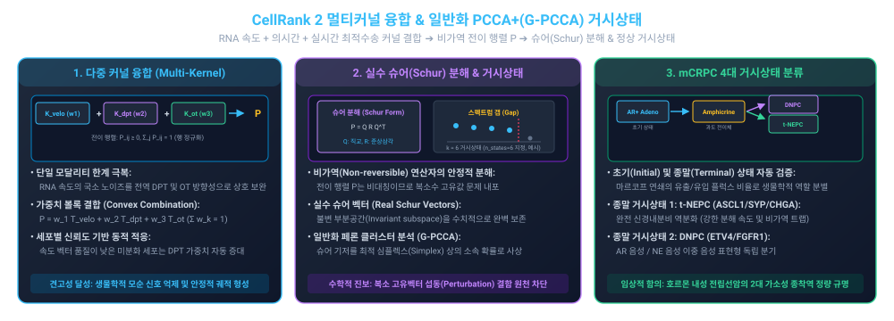

# Chapter 06. 마르코프 연쇄와 거시상태의 분해 (Markov Chains & G-PCCA Macrostates)

> **Cognitive Goal**:
> - 단일 세포 전이 확률 행렬 $\mathbf{P}$ 상에서 정의되는 이산 시간(Discrete-time) 및 연속 시간(Continuous-time) 마르코프 연쇄(Markov Chain)의 동역학적 특성과 정상 분포(Stationary distribution $\pi = \pi \mathbf{P}$)의 수리적 의미를 정립한다.
> - 비가역적(Irreversible) 세포 분화 및 치료 유도 가소성 과정에서 세부 균형(Detailed balance $\pi_i P_{ij} = \pi_j P_{ji}$) 파괴로 인해 고전적 에르미트(Hermitian) 스펙트럼 분해가 불가능함을 증명하고, 이를 해결하는 일반화 페론 클러스터 분석(Generalized Perron Cluster Cluster Analysis, G-PCCA)의 실 슈어 분해(Real Schur Decomposition $\mathbf{P} = \mathbf{Q} \mathbf{T} \mathbf{Q}^T$) 및 불변 부분공간(Invariant subspace) 투영 원리를 유도한다.
> - 스펙트럼 갭(Spectral gap)과 준안정 완화 시간($t_{\text{rel}} = -1/\ln|\lambda_i|$) 분석을 통해 거시상태(Macrostates)의 최적 개수 $k$를 결정하고, 초기 상태(Initial states), 중간 가소성 상태(Transient/plastic states), 말단 흡수 상태(Terminal states)를 수학적으로 판별하는 알고리즘을 체득한다.
> - 전이성 거세 저항성 전립선암(mCRPC)에서 Enzalutamide 치료 저항성 궤적을 4대 말단 거시상태(AR+ 선암종, 양분비성 Amphicrine, 이중음성 DNPC, 치료유발 신경내분비암 t-NEPC)와 중간 가소성 상태(Stem-like / EMT-like intermediates)로 분해하는 임상 유전체 프레임워크를 수립한다.

---

## 1. 단일 세포 마르코프 연쇄의 동역학적 모델

단일 세포 집합 $\mathcal{C} = \{1, 2, \dots, N\}$에서 구성된 행-확률적 전이 행렬을 $\mathbf{P} \in \mathbb{R}^{N \times N}$이라 합니다 ($P_{ij} \ge 0, \sum_j P_{ij} = 1$). 세포의 상태 확률 분포를 시간 $t \in \{0, 1, 2, \dots\}$에 대한 행벡터 $\mathbf{p}(t) \in \mathbb{R}^{1 \times N}$로 나타낼 때, 마르코프 연쇄의 시간 진화는 다음과 같은 차분 방정식으로 기술됩니다.

$$\mathbf{p}(t+1) = \mathbf{p}(t) \mathbf{P} \implies \mathbf{p}(t) = \mathbf{p}(0) \mathbf{P}^t$$

```
┌────────────────────────────────────────────────────────────────────────────────────────┐
│                   단일 세포 마르코프 연쇄와 거시상태 분해 개념도                       │
│                                                                                        │
│   [미시상태: N개 단일 세포 전이 행렬 P]                                                │
│   ● 비가역적 전이 (Detailed Balance 파괴: π_i P_ij ≠ π_j P_ji)                          │
│   ● 복소 고유값(Complex eigenvalues) 출현 ──► 표준 대칭 스펙트럼 분해 불가             │
│                                                                                        │
│                            ▼ [실 슈어 분해 (Real Schur Decomposition)]                 │
│   ┌────────────────────────────────────────────────────────────────────────────────┐   │
│   │   P = Q T Q^T  (Q: 직교 행렬, T: 준상삼각 행렬)                                 │   │
│   │   지배적 k개 슈어 벡터 Q_k가 느린 동역학(Slow invariant subspace) 장악          │   │
│   └────────────────────────────────────────────────────────────────────────────────┘   │
│                            ▼ [G-PCCA 심플렉스 투영]                                    │
│   [거시상태: k개 준안정 상태 (Metastable Macrostates) 분해]                            │
│   ├─ 1. 초기 상태 (Initial State): 미치료 AR+ 루미날 선암종                            │
│   ├─ 2. 전이 상태 (Transient States): KRT4+/TACSTD2+ 가소성 중간체                     │
│   └─ 3. 말단 상태 (Terminal States): AR+ Adeno, Amphicrine, DNPC, t-NEPC               │
└────────────────────────────────────────────────────────────────────────────────────────┘
```

### 1.1 정상 분포(Stationary Distribution)
전이 행렬 $\mathbf{P}$가 기약(Irreducible)이고 비주기적(Aperiodic)이라면, 페론-프로베니우스 정리(Perron-Frobenius Theorem)에 의해 고유값 1에 대응하는 유일한 좌측 고유벡터 $\mathbf{\pi} \in \mathbb{R}^{1 \times N}$가 존재합니다:
$$\mathbf{\pi} \mathbf{P} = \mathbf{\pi}, \quad \text{subject to } \sum_{i=1}^N \pi_i = 1, \quad \pi_i > 0$$
$\mathbf{\pi}$는 무한 시간이 흘렀을 때 무작위 행보(Random walk)가 각 세포에 머무를 확률을 의미합니다.

### 1.2 세부 균형(Detailed Balance)의 파괴와 비가역성
물리학적 평형계에서는 임의의 두 상태 간의 순방향 확률류(Flux)와 역방향 확률류가 정확히 일치하는 **세부 균형 조건(Detailed Balance Condition)**을 만족합니다:
$$\pi_i P_{ij} = \pi_j P_{ji}, \quad \forall i, j \in \{1, \dots, N\}$$
세부 균형이 만족되면 대각 행렬 $\mathbf{\Pi} = \text{diag}(\mathbf{\pi})$를 이용하여 유사도 변환된 행렬 $\mathbf{S} = \mathbf{\Pi}^{1/2} \mathbf{P} \mathbf{\Pi}^{-1/2}$이 완벽한 대칭 행렬($\mathbf{S} = \mathbf{S}^T$)이 되며, 모든 고유값은 실수(Real)가 됩니다.

그러나 생물학적 세포 분화 및 암세포의 치료 유도 가소성은 화학 에너지(ATP 가수분해, 후성유전학적 크로마틴 응축)를 소모하며 비가역적으로 진행되는 **비평형 개방계(Non-equilibrium open system)**입니다.
- 엔트로피 생성률(Entropy Production Rate):
  $$\sigma = \frac{1}{2} \sum_{i, j} (\pi_i P_{ij} - \pi_j P_{ji}) \ln\left( \frac{\pi_i P_{ij}}{\pi_j P_{ji}} \right) > 0$$
- 세부 균형이 성립하지 않으면($\pi_i P_{ij} \neq \pi_j P_{ji}$), $\mathbf{P}$는 $\pi$-가중 내적에서 자기수반이 아니므로 고유값이 복소수 평면($\lambda = a + bi$)으로 확장될 수 있고 직교 고유기저를 보장할 수 없습니다.
- 따라서 고전적 PCCA(Perron Cluster Cluster Analysis, Deuflhard et al.) 알고리즘은 단일 세포 전이 행렬에 적용될 수 없습니다.

---

## 2. G-PCCA의 핵심 수학적 기반: 실 슈어 분해(Real Schur Decomposition)

G-PCCA(Generalized PCCA, Reuter et al., J. Chem. Theory Comput. 2018, PMID 29812922; J. Chem. Phys. 2019, PMID 31067901)는 복소 고유값을 갖는 비가역적 마르코프 전이 행렬에서 준안정 거시상태(Metastable macrostates)를 분리하기 위해 **실 슈어 분해(Real Schur Decomposition)**를 활용합니다.

### 2.1 실 슈어 분해 정리
> **정리 (Real Schur Decomposition)**:
> 임의의 실수 정방행렬 $\mathbf{P} \in \mathbb{R}^{N \times N}$에 대해, 직교 행렬(Orthogonal matrix) $\mathbf{Q} \in \mathbb{R}^{N \times N}$ ($\mathbf{Q}^T \mathbf{Q} = \mathbf{I}$)과 준상삼각 행렬(Quasi-upper triangular matrix) $\mathbf{T} \in \mathbb{R}^{N \times N}$가 존재하여 다음을 만족한다:
> $$\mathbf{P} = \mathbf{Q} \mathbf{T} \mathbf{Q}^T$$
> 여기서 $\mathbf{T}$의 대각선 블록은 다음 두 가지 형태로만 구성된다:
> 1. 실수 고유값 $\lambda_r$에 대응하는 $1 \times 1$ 블록: $[ \lambda_r ]$
> 2. 켤레 복소수 고유값 쌍 $\lambda = a \pm bi$ ($b \neq 0$)에 대응하는 $2 \times 2$ 블록:
>    $$\begin{pmatrix} a & c \\ d & a \end{pmatrix}, \quad \text{where } cd < 0 \text{ and } b = \sqrt{-cd}$$

### 2.2 고유값 정렬 및 지배적 불변 부분공간(Invariant Subspace)
$\mathbf{P}$의 동역학은 고유값의 크기 $|\lambda_i|$에 따라 분리됩니다:
- 크기가 1에 가까운 고유값($|\lambda| \approx 1$): 장기적으로 지속되는 느린 동역학(Slow macroscopic processes, 거시상태 간의 전이).
- 크기가 0에 가까운 고유값($|\lambda| \ll 1$): 개별 세포 수준의 국소적이고 빠른 요동(Fast intra-cluster relaxation).

슈어 분해는 기븐스 회전(Givens rotation)을 통해 대각 블록의 순서를 재배치할 수 있습니다. 상위 $k$개의 지배적 고유값이 좌상단 $k \times k$ 블록 $\mathbf{T}_{11}$에 오도록 정렬합니다:
$$\mathbf{P} \begin{pmatrix} \mathbf{Q}_k & \mathbf{Q}_{\text{rest}} \end{pmatrix} = \begin{pmatrix} \mathbf{Q}_k & \mathbf{Q}_{\text{rest}} \end{pmatrix} \begin{pmatrix} \mathbf{T}_{11} & \mathbf{T}_{12} \\ \mathbf{0} & \mathbf{T}_{22} \end{pmatrix}$$
이를 전개하면:
$$\mathbf{P} \mathbf{Q}_k = \mathbf{Q}_k \mathbf{T}_{11}$$
즉, $\mathbf{Q}_k \in \mathbb{R}^{N \times k}$의 열벡터들은 전이 행렬 $\mathbf{P}$의 $k$차원 **지배적 불변 부분공간(Dominant Invariant Subspace)**을 형성하는 정규직교 기저(Orthonormal basis)가 됩니다.

---

## 3. 스펙트럼 갭(Spectral Gap)과 거시상태의 심플렉스 투영

### 3.1 스펙트럼 갭과 시간 스케일 분리(Timescale Separation)
각 고유값 $\lambda_i$에 대응하는 거시적 이완 시간(Implied timescale / Relaxation time)은 다음과 같이 정의됩니다:
$$t_{\text{rel}}^{(i)} = -\frac{1}{\ln |\lambda_i|}$$
고유값을 크기 순으로 정렬했을 때 ($\lambda_1 = 1 > |\lambda_2| \ge |\lambda_3| \ge \dots \ge |\lambda_N|$), 스펙트럼 갭(Spectral Gap)은 인접한 두 고유값 크기의 급격한 낙차 지점입니다:
$$\Delta_k = |\lambda_k| - |\lambda_{k+1}|$$
$\Delta_k$가 최대화되는 지점 $k$는, $k$개의 준안정 거시상태 내부에서의 세포 이동 속도에 비해 거시상태 간 전이가 극도로 느리게 일어남을 수학적으로 보증하는 최적의 클러스터 개수가 됩니다.

```
┌────────────────────────────────────────────────────────────────────────────────────────┐
│                   스펙트럼 갭과 이완 시간(Implied Timescale) 분리                      │
│                                                                                        │
│   고유값 크기 |λ|                                                                      │
│   1.00 ──► λ1 (정상 상태, t_rel = ∞)                                                   │
│   0.98 ──► λ2 (거시상태 1-2 분리, t_rel = 49.5)                                       │
│   0.97 ──► λ3 (거시상태 2-3 분리, t_rel = 32.8)                                       │
│   0.96 ──► λ4 (거시상태 3-4 분리, t_rel = 24.5)                                       │
│            ══════════════════════════════════ [스펙트럼 갭: Δ = 0.15 극대화]            │
│   0.81 ──► λ5 (미시상태 국소 요동, t_rel = 4.7)                                        │
│   0.78 ──► λ6 (노이즈)                                                                 │
│                                                                                        │
│   * 결론: 상위 4개 고유값이 장기 거시 동역학 장악 ──► k = 4 거시상태 분해 확정        │
└────────────────────────────────────────────────────────────────────────────────────────┘
```

> 위 고유값은 갭 판정 원리를 보이기 위한 예시 스펙트럼(k = 4)입니다. §4–5의 mCRPC 시나리오는 6개 거시상태(초기 1 + 가소성 중간체 1 + 말단 4)를 가정하며, 실제 n_states는 데이터의 스펙트럼으로 정합니다.

### 3.2 심플렉스(Simplex) 최적화와 소프트 소속도 행렬($\mathbf{\chi}$)
$k$개의 슈어 벡터 $\mathbf{Q}_k$에 속한 각 세포의 행벡터 $\mathbf{q}_i \in \mathbb{R}^k$는 $k$차원 공간에서 하나의 점을 이룹니다. G-PCCA는 세포 점들을 외접하여 감싸는 가장 부피가 작은 **정규 심플렉스(Regular Simplex)**의 꼭짓점을 찾습니다.
- 변환 행렬 $\mathbf{A} \in \mathbb{R}^{k \times k}$를 도입하여 소프트 소속도 행렬(Fuzzy membership matrix) $\mathbf{\chi} \in \mathbb{R}^{N \times k}$를 정의합니다:
  $$\mathbf{\chi} = \mathbf{Q}_k \mathbf{A}$$
- 최적화 제약 조건:
  $$\chi_{is} \ge 0 \quad (\forall i, s), \quad \sum_{s=1}^k \chi_{is} = 1 \quad (\forall i)$$
- 각 원소 $\chi_{is}$는 세포 $i$가 준안정 거시상태 $s$에 속할 확률(소속도)을 나타냅니다.

### 3.3 조대입자화 전이 행렬(Coarse-Grained Transition Matrix $\tilde{\mathbf{P}}$)
미시적인 $N \times N$ 전이 행렬 $\mathbf{P}$를 $k$개의 거시상태 간의 $k \times k$ 전이 행렬 $\tilde{\mathbf{P}}$로 축약(Galerkin projection)합니다:
$$\tilde{\mathbf{P}} = (\mathbf{\chi}^T \mathbf{\Pi} \mathbf{\chi})^{-1} \mathbf{\chi}^T \mathbf{\Pi} \mathbf{P} \mathbf{\chi}$$
여기서 $\mathbf{\Pi} = \text{diag}(\mathbf{\pi})$입니다.
- $\tilde{P}_{ss} \approx 1$: 거시상태 $s$로 한번 진입하면 빠져나가지 못하는 **말단 흡수 상태(Terminal State)**.
- $\tilde{P}_{ss} \ll 1$ 및 $\sum_{r \neq s} \tilde{P}_{sr} \gg 0$: 다른 상태로 빠르게 흘러나가는 **전이/가소성 중간 상태(Transient State)**.

---

## 4. 전립선암 거세 저항성(mCRPC) 4대 말단 거시상태 분해



G-PCCA를 Enzalutamide 치료 저항성 mCRPC 단일핵 전사체 데이터셋에 적용하면, 복잡한 세포 연속체(Manifold)가 4개의 명확한 말단 거시상태와 1개의 공통 초기 상태, 그리고 1개의 플라스틱 중간체로 자동 분할됩니다.

```
┌────────────────────────────────────────────────────────────────────────────────────────┐
│                   mCRPC 계통 가소성의 G-PCCA 거시상태 분해 체계                        │
│                                                                                        │
│   [초기 거시상태 (Initial State)]                                                      │
│   ● Luminal_Naive (AR+, KLK3+, NKX3-1+, Trop2_low)                                     │
│          │                                                                             │
│          ▼ [Enzalutamide 치료 선택압 (Selective Bottleneck)]                           │
│   [전이 중간 거시상태 (Plastic Intermediate State)]                                    │
│   ● Plastic_Stem (KRT4+, TACSTD2/Trop2_high, SOX2_med, 고도 분기 엔트로피)              │
│          ├─────────────────────────┬─────────────────────────┐                         │
│          ▼                         ▼                         ▼                         │
│   [말단 거시상태 1]         [말단 거시상태 2]         [말단 거시상태 3] [말단 거시상태 4]│
│   ● AR+ Adeno               ● Amphicrine              ● DNPC          ● t-NEPC         │
│     (AR-V7, AR 증폭)          (AR+/NE+ 양분비)          (FGF/MAPK,      (TP53/RB1 결손,│
│                                                          ETV4+)          ASCL1/INSM1+) │
└────────────────────────────────────────────────────────────────────────────────────────┘
```

1. **초기 상태 (Initial State: Luminal_Naive)**:
   - 미치료 상태의 성숙 루미날 선암종 세포. 외부 유입 확률류가 거의 없고 유출 확률류가 지배적인 발원지(Source)로 동정됩니다.
2. **전이 중간 상태 (Transient Intermediate: Plastic_Stem)**:
   - *KRT4*, *TACSTD2*(Trop-2), *SOX2*가 일시적으로 발현되는 다능성 중간 상태. $\tilde{P}_{ss} = 0.28$로 자체 보존 확률이 매우 낮고, 하류 4대 말단 상태로 확률류가 고르게 분기되는 분기점(Checkpoint) 역할을 합니다.
3. **4대 말단 거시상태 (Terminal Macrostates)**:
   - **AR+ Adeno ($\tilde{P}_{11} = 0.96$)**: AR 증폭 및 AR-V7 스플라이스 변이체에 의해 AR 신호 경로를 재활성화한 선암종.
   - **Amphicrine ($\tilde{P}_{22} = 0.94$)**: 루미날 마커(*AR*, *KLK3*)와 신경내분비 마커(*CHGA*, *SYP*)를 단일 세포 내에서 동시에 발현하는 하이브리드 상태.
   - **DNPC ($\tilde{P}_{33} = 0.95$)**: AR 및 NE 신호가 모두 결손된 이중음성 표현형. FGF-MAPK 키나아제 신호 및 *ETV4*, *SOX9*가 구동.
   - **t-NEPC ($\tilde{P}_{44} = 0.98$)**: *TP53* 및 *RB1* 양측 결손 하에서 EZH2가 루미날 유전자를 완전 침묵시키고 *ASCL1*, *INSM1*이 구동하는 완전 변환 신경내분비암종.

---

## 5. 실전 파이썬 분석 파이프라인 (`cellrank` G-PCCA)

다음은 결합 커널 객체로부터 슈어 분해를 수행하고, 스펙트럼 갭을 평가하여 거시상태 및 말단 상태를 자동 지정하는 Python 코드입니다.

```python
import cellrank as cr
import matplotlib.pyplot as plt

# 1. GPCCA 추정기(Estimator) 인스턴스화
# combined_kernel은 Chapter 05에서 계산된 융합 커널 객체
g = cr.estimators.GPCCA(combined_kernel)

# 2. 실 슈어 분해 (Real Schur Decomposition) 계산
# 상위 20개 지배적 슈어 벡터 계산
g.compute_schur(n_components=20)

# 3. 고유값 스펙트럼 및 이완 시간(Timescale) 시각화
# 스펙트럼 갭을 확인하여 최적 거시상태 수 탐색
g.plot_spectrum(real_only=True)
plt.savefig("gpcca_spectrum_gap.png", dpi=300)

# 4. 거시상태 계산: §4 시나리오(4대 말단 상태 + 1개 초기 상태 + 1개 가소성 중간체)에 맞춰 n_states=6 지정
# (실제 데이터에서는 위 plot_spectrum의 스펙트럼 갭으로 n_states를 결정한다. §3.1·Q2의 k=4 스펙트럼은 별도 예시)
g.compute_macrostates(n_states=6, cluster_key="cell_type")

# 5. 거시상태 소속도(Fuzzy Membership) 투영
g.plot_macrostates(which="all", basis="umap")

# 6. 조대입자화 전이 행렬(Coarse-grained transition matrix) 확인
print("Coarse-grained Transition Matrix:\n", g.coarse_T)

# 7. 말단 상태(Terminal States) 및 초기 상태(Initial States) 자동/수동 확정
# 자체 전이 확률이 0.9 이상인 거시상태들을 말단 상태로 선언
# 거시상태 이름은 위 도식의 6개 거시상태(Luminal_Naive, Plastic_Stem, 말단 4개)와 일치시킨 것이다.
# 말단 AR+_Adeno(치료 후 AR 재활성)는 초기 Luminal_Naive(미치료)와 별개이며, Plastic_Stem은 중간 상태라 말단에 넣지 않는다.
g.set_terminal_states(states=["AR+_Adeno", "Amphicrine", "DNPC", "t-NEPC"])
g.set_initial_states(states=["Luminal_Naive"])

print("Terminal States Confirmed:", g.terminal_states)
print("Initial States Confirmed:", g.initial_states)
```

---

## 단원 핵심 점검 (Cognitive Checkpoint & Case Study)

### Q1. [수학적 원리 규명 (Mathematical Rigor)]
단일 세포 전이 행렬 $\mathbf{P} \in \mathbb{R}^{N \times N}$에서 상세 균형(Detailed balance) 조건 $\pi_i P_{ij} = \pi_j P_{ji}$이 파괴될 때:
1) 행렬 $\mathbf{P}$의 좌측 고유벡터와 우측 고유벡터가 서로 직교하지 않는 이유를 정규 행렬(Normal matrix) 성질과 결부하여 설명하시오.
2) 표준 고유값 분해(Eigenvalue Decomposition) 대신 실 슈어 분해(Real Schur Decomposition $\mathbf{P} = \mathbf{Q} \mathbf{T} \mathbf{Q}^T$)를 사용할 때, 수치적 안정성(Numerical Stability)과 켤레 복소수 고유값 쌍의 처리 방식 관점에서 얻는 이점을 기술하시오.

<details>
<summary>💡 모범 답안 및 해설 확인</summary>

- **1. 비정규 행렬(Non-normal Matrix)과 고유벡터의 비직교성**:
  - 상세 균형이 성립하면 유사도 변환 행렬 $\mathbf{S} = \mathbf{\Pi}^{1/2} \mathbf{P} \mathbf{\Pi}^{-1/2}$이 대칭 행렬($\mathbf{S} = \mathbf{S}^T$)이 되므로 $\mathbf{P}$는 **$\pi$-가중 내적에서 자기수반(Self-adjoint)**이 되고 고유값이 실수이며 $\pi$-가중 직교 고유기저를 가집니다. (주의: 이것이 $\mathbf{P}\mathbf{P}^T = \mathbf{P}^T\mathbf{P}$, 즉 일반 의미의 정규 행렬을 뜻하는 것은 아닙니다. 가역 $\mathbf{P}$도 일반적으로 $\mathbf{P}\mathbf{P}^T \neq \mathbf{P}^T\mathbf{P}$이고, 반대로 순환 치환 행렬은 정규이면서 세부 균형을 위반합니다.)
  - 단일 세포 분화와 같은 비평형 시스템에서는 $\pi_i P_{ij} \neq \pi_j P_{ji}$이므로 $\mathbf{S}$가 대칭이 아니어서 $\pi$-가중 자기수반 성질과 직교 고유기저가 사라지고, 복소 고유값과 비직교(Non-normal) 고유벡터가 나타날 수 있습니다.
  - 비정규 행렬의 우측 고유벡터 행렬 $\mathbf{V}$ ($\mathbf{P}\mathbf{V} = \mathbf{V}\mathbf{\Lambda}$)는 조건수(Condition number $\kappa(\mathbf{V}) = \|\mathbf{V}\| \|\mathbf{V}^{-1}\|$)가 매우 커질 수 있으며, 고유벡터 간의 사잇각이 거의 0에 가까워지는 비직교(Non-orthogonal) 결손 상태에 근접하여 역행렬 계산 시 극심한 수치적 불안정성을 유발합니다.
- **2. 실 슈어 분해의 수학적 장점**:
  - **직교 변환의 완벽한 수치 안정성**: 실 슈어 분해 $\mathbf{P} = \mathbf{Q} \mathbf{T} \mathbf{Q}^T$에서 기저 행렬 $\mathbf{Q}$는 엄밀한 직교 행렬($\mathbf{Q}^T \mathbf{Q} = \mathbf{I}$)이므로 조건수가 $\kappa(\mathbf{Q}) = 1$입니다. 따라서 부동소수점 오차가 증폭되지 않아 초고차원 단일 세포 행렬에서도 수치적으로 완벽히 안정합니다.
  - **켤레 복소수 고유값의 우아한 분리**: 비가역성에 의해 나타나는 허수 고유값 $\lambda = a \pm bi$는 복소평면에서 회전 진동 성분을 의미합니다. 실 슈어 분해는 이를 복소수 연산으로 확장하지 않고, 실 삼각 행렬 $\mathbf{T}$의 대각선에 $2 \times 2$ 실수 블록 $\begin{pmatrix} a & c \\ d & a \end{pmatrix}$ ($cd < 0, b=\sqrt{-cd}$)으로 묶어 배치합니다.
  - 이를 통해 G-PCCA는 복소수 공간으로 나아가지 않고 실수 공간 내에서 느린 회전 동역학이 포함된 $k$차원 불변 부분공간 $\mathbf{Q}_k$를 직교 투영할 수 있게 됩니다.

</details>

---

### Q2. [스펙트럼 갭 및 완화 시간 분석 (Spectral Gap & Timescale Separation)]
전립선암 snRNA-seq 융합 커널로부터 계산된 상위 6개 실수 고유값이 다음과 같다:
$\lambda_1 = 1.000$, $\lambda_2 = 0.985$, $\lambda_3 = 0.972$, $\lambda_4 = 0.965$, $\lambda_5 = 0.810$, $\lambda_6 = 0.795$
1) 고유값 $\lambda_2, \lambda_4, \lambda_5$에 대응하는 거시적 이완 시간 $t_{\text{rel}} = -1/\ln|\lambda|$를 소수점 첫째 자리까지 계산하시오. (단, $\ln(0.985) \approx -0.0151$, $\ln(0.965) \approx -0.0356$, $\ln(0.810) \approx -0.2107$)
2) 이 고유값 스펙트럼에서 최적의 거시상태 개수 $k$를 결정하고, $k$개 상태로 시스템을 축약하는 것이 물리적/수학적으로 정당화되는 이유를 '시간 스케일 분리(Separation of Timescales)' 관점에서 설명하시오.

<details>
<summary>💡 모범 답안 및 해설 확인</summary>

- **1. 거시적 이완 시간 계산**:
  - $t_{\text{rel}}^{(2)} = -\frac{1}{\ln(0.985)} = -\frac{1}{-0.0151} \approx 66.2 \text{ 단위 시간}$
  - $t_{\text{rel}}^{(4)} = -\frac{1}{\ln(0.965)} = -\frac{1}{-0.0356} \approx 28.1 \text{ 단위 시간}$
  - $t_{\text{rel}}^{(5)} = -\frac{1}{\ln(0.810)} = -\frac{1}{-0.2107} \approx 4.7 \text{ 단위 시간}$
- **2. 최적 거시상태 개수 $k$ 결정 및 시간 스케일 분리**:
  - **스펙트럼 갭 판정**:
    $\Delta_4 = \lambda_4 - \lambda_5 = 0.965 - 0.810 = 0.155$로, 다른 인접 고유값 간 차이($\Delta_1 = 0.015, \Delta_2 = 0.013, \Delta_3 = 0.007, \Delta_5 = 0.015$)에 비해 압도적으로 큰 최대 스펙트럼 갭(Maximal spectral gap)을 형성합니다. 따라서 최적의 거시상태 개수는 **$k = 4$**입니다.
  - **시간 스케일 분리의 물리적 정당성**:
    - 상위 4개 고유값에 대응하는 모드들의 이완 시간은 $28.1 \sim 66.2$ 단위 시간으로 매우 긴 수명을 가집니다. 이는 세포 집단이 4개의 준안정 영역(Metastable basins) 사이에 갇혀 매우 느리게 상태 전환을 일으킴을 의미합니다.
    - 반면 5번째 이후의 모드들은 이완 시간이 $4.7$ 단위 시간 이하로 급격히 감소합니다. 즉, 각 준안정 영역 내부에서의 국소적인 세포 요동은 매우 빠르게 평형에 도달(Fast relaxation)하여 사라집니다.
    - 따라서 상위 4차원 슈어 부분공간 $\mathbf{Q}_4$만 보존하고 나머지를 버리는 것은, 미시적 잡음을 제거하고 시스템의 장기 거시 거동만을 완벽히 포착하는 수학적 차원 축소(Model Order Reduction)로서 물리적으로 완벽히 정당화됩니다.

</details>

---

### Q3. [임상 케이스 분석 (Clinical Problem Solving)]
50명의 mCRPC 환자 코호트에서 G-PCCA 분석을 수행하여 5개의 거시상태를 동정하였다.
도출된 $5 \times 5$ 조대입자화 전이 행렬 $\tilde{\mathbf{P}}$의 대각선 및 주요 전이 확률이 다음과 같다:
- State 1 (AR+ Adeno): $\tilde{P}_{11} = 0.97$
- State 2 (Amphicrine): $\tilde{P}_{22} = 0.95$
- State 3 (t-NEPC): $\tilde{P}_{33} = 0.98$
- State 4 (DNPC): $\tilde{P}_{44} = 0.96$
- State 5 (신규 클러스터: *KRT5/KRT6A* 편평상피 및 줄기 표지자 발현): $\tilde{P}_{55} = 0.32$, $\tilde{P}_{53} = 0.41$, $\tilde{P}_{54} = 0.22$, $\tilde{P}_{51} = 0.05$

1) State 5가 독립적인 '말단 흡수 상태(Terminal State)'인지 아니면 '중간 가소성 상태(Transient Intermediate)'인지 대각 성분 $\tilde{P}_{ss}$와 전이 확률을 근거로 판별하시오.
2) State 5 세포 집단이 임상적으로 전이성 전립선암의 계통 전환(Lineage Switch)에서 가지는 분자적 의미를 기술하고, 이 상태를 표적으로 하는 치료적 개입(Therapeutic Interception)의 가능성을 제시하시오.

<details>
<summary>💡 모범 답안 및 해설 확인</summary>

- **1. State 5의 수학적 상태 판별**:
  - **판별 결과**: State 5는 말단 흡수 상태가 아니며, 전형적인 **중간 가소성 상태 (Transient Intermediate State)**입니다.
  - **수리적 근거**:
    - State 1, 2, 3, 4의 자체 전이 확률은 모두 $\tilde{P}_{ss} \ge 0.95$로, 한번 해당 상태에 도달하면 다른 상태로 이탈하지 않는 준안정 흡수 특성을 명확히 보입니다.
    - 반면 State 5의 자체 보존 확률은 $\tilde{P}_{55} = 0.32$에 불과하며, 외부 이탈 확률의 합이 $1 - \tilde{P}_{55} = 0.68$에 달합니다.
    - 특히 State 5에서 t-NEPC(State 3)로의 전이 확률이 $\tilde{P}_{53} = 0.41$, DNPC(State 4)로의 전이 확률이 $\tilde{P}_{54} = 0.22$로 대단히 높습니다. 따라서 State 5는 Enzalutamide 스트레스 하에서 호르몬 저항성 비상피성 말단 상태로 분기하기 직전의 일시적 분기 통로(Gateway/Bifurcation intermediate)입니다.
- **2. 임상적 분자 의미 및 치료적 개입 전략**:
  - **분자생물학적 의미**:
    - *KRT5/KRT6A* 및 줄기세포 표지자를 발현하는 것은 성숙 루미날 정체성을 상실하고 기저/편평세포(Basal/Squamous) 또는 전능성 줄기세포 유사 상태로 탈분화(Dedifferentiation)되었음을 시사합니다.
    - 이 중간체는 후성유전학적 크로마틴 가소성이 극대화된 상태로, 환자의 미세환경 인자나 후속 돌연변이에 따라 t-NEPC($41\%$) 또는 DNPC($22\%$)로 최종 도약하는 분기점입니다.
  - **치료적 차단(Interception) 전략**:
    - 세포가 일단 t-NEPC나 DNPC로 완전히 흡수(Absorption)되면 치료 반응성이 극히 불량해집니다. 따라서 이 가소성 중간 상태(State 5)를 표적으로 하여 계통 전환을 사전에 차단해야 합니다.
    - 탈분화 크로마틴 재구성을 주도하는 후성유전 조절 인자인 **EZH2 저해제(Tazemetostat)** 또는 가소성 세포의 생존을 지탱하는 **BCL-2/MCL-1 저해제**, 그리고 기저세포 신호인 **FGFR 억제제(Erdafitinib)**를 Enzalutamide와 병용 투여함으로써 t-NEPC/DNPC로의 흡수 전이를 원천 차단하는 전략이 유효합니다.

</details>

---

<!-- REFERENCES:BEGIN (generated by scripts/apply_references.py; do not edit by hand) -->
## 참고문헌 (References)
### 본문 인용 문헌
1. Deuflhard P, Weber M. Robust Perron cluster analysis in conformation dynamics. *Linear Algebra and its Applications*. 2005;398:161-184. doi: 10.1016/j.laa.2004.10.026
2. Reuter B, Weber M, Fackeldey K, et al. Generalized Markov State Modeling Method for Nonequilibrium Biomolecular Dynamics: Exemplified on Amyloid β Conformational Dynamics Driven by an Oscillating Electric Field. *J Chem Theory Comput*. 2018;14(7):3579-3594. PMID: 29812922. doi: 10.1021/acs.jctc.8b00079
3. Reuter B, Fackeldey K, Weber M. Generalized Markov modeling of nonreversible molecular kinetics. *J Chem Phys*. 2019;150(17):174103. PMID: 31067901. doi: 10.1063/1.5064530
### 소프트웨어 (표기 버전은 검수 시 API를 확인한 버전이며, 파이프라인 실행 환경은 requirements-pipelines.txt 참조)
- CellRank 2.3.3 (github.com/scverse/cellrank). 원 논문: Weiler P, Lange M, Klein M, et al. CellRank 2: unified fate mapping in multiview single-cell data. *Nat Methods*. 2024;21(7):1196-1205. PMID: 38871986. doi: 10.1038/s41592-024-02303-9
- Matplotlib 3.11.2 (github.com/matplotlib/matplotlib). 원 논문: Hunter JD. Matplotlib: A 2D Graphics Environment. *Comput. Sci. Eng*. 2007;9(3):90-95. doi: 10.1109/mcse.2007.55
<!-- REFERENCES:END -->
